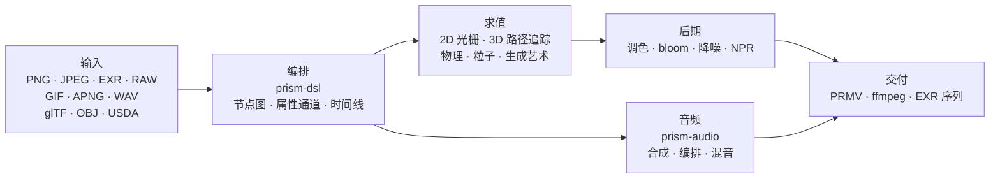

<h1 align="center">Prism Engine</h1>

<h3 align="center">程序化媒体引擎</h3>

<p align="center">
  
  
  
  
  
  <a href="https://github.com/Qianjinqie/prism-engine/releases"></a>
</p>

<p align="center">
  
</p>

<p align="center">
  <sub>不是效果图，是引擎输出：1200×675 · 256 spp · 路径追踪 + 物理 BSDF + ACES 色调映射 · 4 线程 158 秒<br>场景源码 <a href="docs/gallery/gallery.rs"><code>docs/gallery/gallery.rs</code></a></sub>
</p>

<p align="center">
  <sub><b>642</b> 个文件 &nbsp;·&nbsp; <b>28</b> 个 crate &nbsp;·&nbsp; <b>26.1 万</b> 行 Rust &nbsp;·&nbsp; <b>3929</b> 条测试 &nbsp;·&nbsp; <b>0</b> 个第三方依赖 &nbsp;·&nbsp; <b>18.9 MB</b> 单文件</sub>
</p>

## 能力全景

Rust 写的程序化媒体引擎。输入 `.prism` 场景文本或 Rust 调用，输出单帧、帧序列或成片。按一条媒体流水线的环节分九层；同一份场景描述，定住某一刻是单帧，连续推进并录下来就是视频——下面所有层对静态图和动态图是同一套。

| 层 | 能做什么 |
| --- | --- |
| **读** | PNG（8/16 bit，滤波逆运算）、基线 JPEG（定点 IDCT，跨平台逐位一致）、EXR（读写 / 压缩族 / DWA）、相机 RAW、GIF / APNG 逐帧、WAV；glTF / OBJ / USDA 导入，MaterialX 参数；TTF/OTF 装载与「内置 → 用户 → 多语种子集 → 数学符号」四级回退链 |
| **排** | OpenType 解析、GSUB/GPOS 整形、UAX #9 双向、阿拉伯四态、竖排；公式排版（上下标 / 分式 / 根号 / 矩阵 / 大型算子）；DSL v1/v2 编译成三元组图；五个高层组合子（片头 / 人名条 / 分屏 / 肯·伯恩斯 / 场景变形）；四种转场 + morph，任意时刻可采样 |
| **画** | 路径追踪 + 物理 BSDF（漫反射 / 镜面 / 玻璃 / 金属 / 次表面），玻璃与金属走随机逆（Neumann 级数蒙特卡洛）；Woodcock 异质体积；圆柱 / 圆锥 / 圆环 / 旋转曲面解析求交（四次方程 Ferrari 闭式解）；三角网格 + SAH-BVH（稳定排序，构建确定性）；mesh 烘焙成 SDF 后获得布尔 / 域变形 / 精确碰撞；CpuRef 一等后端 + Vulkan compute 与光追双管线 |
| **动** | XPBD 统一求解器——刚体 / 软体 / 布料 / 关节 / 流体 / 破碎是同一个约束投影循环的六组参数；FLIP 烟雾；粒子系统 + AudioReactive；毛发约束与着色；流场 / L 系统 / 元胞自动机 / 反应扩散 / 分形 / Voronoi；Spring 解析解与关键帧 |
| **调** | 二级调色（HSL 选区 + RGB 曲线）；cinematic / film / anime 预设，草稿 / 标准 / 电影三档显式标价；blur / bloom / vignette / 色差 / sharpen / glitch / dissolve；halation 渗光 + 双尺度胶片颗粒（按像素域派生）；三合一降噪；NPR 四风格（toon / watercolor / halftone / oil）；PQ / HLG 传输函数、线性 sRGB ↔ ACEScg、ACES 输出变换 |
| **声** | PolyBLEP 防混叠振荡器 + ADSR 闭式包络 + 4 情绪预设；音阶库 + 12-TET + 和弦进行功能语法状态机 + 声部引导；琶音器 / step 鼓机 / 小节节拍网格；手写 SMF 解析、SFZ 采样器、颗粒合成；物理建模 / 空间声像 / 效果器链；多轨混音 + 峰值防削波；节拍 / onset / FFT、AudioReactive 烘焙、响度归一；WAV 16/24/32 bit 逐字节往返 |
| **出** | 私有 PRMV 容器（v2/v3，v3 可读 v1/v2）+ I/P 帧时序编码；water-filling 率控 + qpel 子像素运动估计（实测 PSNR +2.577 dB、体积 −21.6%）；ffmpeg 运行时探测——有则 stdin 管道转 H.264/HEVC，无则自动降级 MJPEG，永远能出片；MP4 + MJPEG 容器、EXR 序列；多进程帧农场（断点续算，并行 MD5 == 串行 MD5）；NLE 时间映射 / 关键帧 / 转场 |
| **接** | MCP stdio 三工具（`scene_check` / `render_submit` / `diagnose`）；节点 SDK 语义化版本协商 + 示例节点包；CLI（`render` / `preview` / `demo`）；交互式编辑器双档预览（Draft 几何图案 / Real 低 spp）+ 子图签名增量；batch manifest 笛卡尔积；三平台硬编探测骨架（VideoToolbox / NVENC / VAAPI，未接后端） |
| **旁路** | 生成艺术：流场 / L 系统 / 元胞自动机 / 反应扩散 / Mandelbrot / Voronoi，矢量 draw-on 与图表。AI 辅助：确定性 mock 推理层（分镜 / 字幕 / 色彩提示），模型权重当数据读、乘加代码自己写，不引 ML 框架 |

这张表只列能力。每项「做不到什么」写在下面的[诚实的边界](#诚实的边界)，不藏在表里。

## 三分钟跑起来

```bash
# 1. 取单文件源码包，顺便校验 SHA-256
curl -L -O https://github.com/Qianjinqie/prism-engine/releases/download/v2.1/prism-engine-v2.1-source.txt
curl -L -O https://github.com/Qianjinqie/prism-engine/releases/download/v2.1/SHA256SUMS.txt
sha256sum -c SHA256SUMS.txt

# 2. 抽出包内的解包脚本（只需 Node 18+，不需要 npm install）
awk '/^UNPACK SCRIPT BEGIN$/{f=1;next} /^UNPACK SCRIPT END$/{f=0} f' \
  prism-engine-v2.1-source.txt > unpack.cjs
node unpack.cjs                    # 还原 642 个文件

# 3. 编译并跑全量测试
cargo test --workspace --release     # 3929 passed / 0 failed

# 4. 什么都不写，先看它出片
cargo run -p prism-app --release     # 内置演示场景
```

解包得到的是标准 Cargo workspace（`src/` 下 28 个 crate），后续与普通 Rust 项目无异。首次编译需要几分钟。

> 只想要「能跑起来」的最短路径：跳过第 1、2 步，直接在发布方的完整仓库里 `cargo run -p prism-app --release`。

## 一个镜头，一段文本

`.prism` 是引擎的场景描述语言。下面是一个完整可渲染的 3 秒镜头——球体、材质、环绕相机、方向光、时长、调色、输出规格，全在这里：

```prism
scene "spin_red_ball" {
    sphere ball {
        radius 1.0
        material {
            albedo #c0392b
            roughness 0.3
            metalness 0.05
        }
    }

    camera main {
        orbit {
            center 0,0,0
            radius 8.0
        }
        fov 45
    }

    light sun {
        direction (1.0, -1.0, -0.5)
        color #fff4e6
        intensity 3.0
    }
}

timeline {
    duration 3s
    fps 12
}

aesthetic {
    teal-orange
    contrast 1.12
    filmic
}

output {
    resolution 480x270
    format frames
}
```

```bash
cargo run -p prism-app --release -- examples/spin_red_ball.prism          # 帧序列
cargo run -p prism-app --release -- render examples/w2d_showcase.prism \
    --out out/demo.mp4                                                     # 一次出成片
```

`render` 走 v2 直达路径：编译节点图 → 逐帧求值 → 编码封装，中间不落临时帧；不支持的节点会得到明确的 `R5xxx` 错误，而不是静默跳过。

<p align="center">
  
  <br>
  <sub><code>examples/w2d_showcase.prism</code> 的第 10 帧：同一个场景里，3D 球体、文字层、调色与淡入淡出轨道共用一条时间线</sub>
</p>

## 也可以只用 Rust API

不想写 DSL，就直接调库。下面是门面图的骨架（完整场景 190 行，见 [`docs/gallery/gallery.rs`](docs/gallery/gallery.rs)）：

```rust
use prism_core::node::EvalCtx;
use prism_math::Vec3;
use prism_rt::camera::Camera;
use prism_rt::integrator::{render_pixel, MaterialKind, RenderParams, Scene, Sphere};

let scene = Scene {
    spheres: vec![(
        Sphere { center: Vec3::new(0.0, 0.6, 0.0), radius: 0.6 },
        MaterialKind::Lambert { albedo: Vec3::new(0.8, 0.2, 0.15) },
    )],
    ..Default::default()
};
let cam = Camera::new(
    Vec3::new(0.0, 1.2, 4.8),   // 视点
    Vec3::new(0.0, 0.72, 0.0),  // 看向
    Vec3::new(0.0, 1.0, 0.0),   // 上方向
    30.0, 0.05, 4.85, 0.0, 1.0 / 48.0,
);
let ctx = EvalCtx::new(20261028, 0, 0);
let params = RenderParams::new(256, 10);  // 每像素 256 样本，最多 10 次弹射

// 单像素：场景、相机、采样上下文、像素坐标、分辨率、参数
let color = render_pixel(&scene, &cam, &ctx, (640, 360), (1280, 720), &params);
```

`render_pixel` 是纯函数：输入场景、相机、采样上下文和像素坐标，输出线性 RGB。同样的参数，任意线程、任意顺序调用，结果逐位相同——所以并行渲染不需要任何同步。

## 引擎内特能力

这几样不是格式支持，而是引擎内部的基础设施。

### 音频：一套内置 DAW 内核

能力清单在「声」那一行。这里说的是它的运行方式，也就是它为什么能挂在同一条渲染时间线上：

- **每个函数是参数的纯函数**：同一段乐谱在任意 seek 位置重算，采样值逐位一致，不依赖播放历史
- **AudioReactive 烘焙成帧级纯函数**：第 N 帧读固定窗，跳帧、倒放、并行分块都不改变结果
- **混音是可离线并行的线性代数**：多轨求和 + 淡入淡出 + 峰值防削波，没有隐藏状态机

> 边界：AAC / mp3 编码不自研（专利历史包袱 + 工程量），走外部 ffmpeg 协作。

### 可定义核库

引擎里每个节点类型，都是一个「核 + 格 + 对偶」三元组的**特解**。第三方（或你自己）可以用 `registry!` 静态注册新特解，**不改引擎核心**：

- 静态汇入：宏在定义 crate 内展开，禁 `inventory` / proc-macro，保持零依赖
- 注册时**三问校验**（核形式 / 格 / 对偶），答不齐直接拒绝并给三段式报错
- 官方特解与自定义特解走同一张注册表，运行时无差别
- 数学上对应算子方程 `f = g + Kf` 的六种求逆策略（精确 / 随机 / 局部 / 正则化 / 迭代 / 谱）——接新特性是声明三元组，而不是往渲染循环里打补丁

### GPU：三条路径，三种状态

| 后端 | 状态 | 证据 |
| --- | --- | --- |
| **Vulkan** | 真实运行 | compute + 光追双管线；Mesa lavapipe 软件 ICD 上无 GPU 可验证；`render_scene` 出帧与 CPU 参考**逐字节 0 差异**；`is_available()` 是 compute ∧ render 双自检 |
| **Metal** | 编译门控，不点亮 | 同构移植完成，未实机验证，`is_available()` 恒 false |
| **WebGPU** | 只出结论 | 可行性评估完成（迁移量 4–6 人日），渲染路径未实现 |

## 工程事实

三条约束及其代价：

| 约束 | 具体做法 | 代价 |
| --- | --- | --- |
| 零第三方代码依赖 | 110 条运行期 + 20 条测试依赖全是仓内 `path` 依赖；无 `build.rs`、无原生链接、构建不联网 | 每种格式、每个算法、字体、编解码器全部自己写 |
| 逐字节确定性 | 定点 IDCT、固定采样序列、四维配置哈希；同输入跨平台逐位一致 | 放弃浮点快路径，不能依赖无序容器的遍历顺序 |
| 单文件分发 | 642 个文件、28 个 crate 合并成一个 18.9 MB 的 UTF-8 文本，`node unpack.cjs` 还原 | 放弃「在 GitHub 上直接点开看源码」的便利 |

### 确定性如何被验证

四层，从参数一路管到字节：

1. **签名闭包**：节点图、缓存键、快照键、帧签名统一为四维配置哈希。改一个参数 ⇒ 键必变 ⇒ 不会误复用；迭代节点的键含 `(ε, n)`，流节点的键含帧号，`None` 时逐字节退化到旧行为。
2. **字节不动点**：USD 导出→导入→导出逐字节一致；WAV 16/24/32 bit 往返一致；EXR 与官方 OpenEXR 做跨实现比特流对拍。
3. **打包确定性**：同一份源码两次打包，SHA-256 完全一致；解包回环逐文件逐字节比对。
4. **测试即判据**：3929 条测试里大量黄金值锁定（容差从 1e-2 收到 1e-6，实测残差 4.53e-7）；形状保真度用 Hausdorff 界，而不是「看着差不多」。

## 架构



28 个 crate，按职责分组：

| 类别 | crate |
| --- | --- |
| 内核 | `prism-core` · `prism-math` · `prism-bytes` · `prism-geometry` · `prism-noise` |
| 媒体 I/O | `prism-io` · `prism-media` · `prism-mux` · `prism-audio` · `prism-texture` |
| 渲染 | `prism-render` · `prism-raster` · `prism-gpu` · `prism-postfx` · `prism-vector` · `prism-particles` |
| 动画 / 生成 | `prism-anim` · `prism-genart` · `prism-aesthetic` · `prism-physics` |
| 文本 / UI | `prism-text` · `prism-rt` · `prism-app` |
| 高级 | `prism-ai` · `prism-dsl` · `prism-infra` · `prism-author` |
| 旁路（feature gate） | `prism-ffi-hwenc` |

解包后的目录结构：

| 路径 | 说明 |
| --- | --- |
| `src/` | 28 个 crate 的源码（仓库内原名 `crates/`，分发时重组） |
| `Compliance/` | 零依赖核验、第三方声明、资产登记 |
| `开发者指南.md` | 开发者文档：上手 / 架构 / 数学内核 / 门禁 / 扩展 |
| `tools/` | 门禁与打包脚本 |
| `examples/` | `.prism` 示例与节点包（`include_str!` 读取，缺了编译不过） |
| `.github/workflows/` | CI 配置 |

> 设计权威文档（`docs/设计/`）只在发布方的完整仓库中，不随分发；演示 crate `prism-anim-demo` 同样不进包。

## 构建、测试与门禁

```bash
cargo test --workspace --release      # 3929 passed / 0 failed / 0 ignored
cargo xtest                           # 等价别名
cargo test -p prism-core --release    # 单 crate 冒烟

node tools/ghost_guard.mjs --check    # 幽灵写入防御：G1 重复定义 / G2 严格超集 / G3 顶格文档 / G4 编译
node tools/hygiene_scan.mjs           # 开源卫生：逐条列出残留内部用语，命中即 exit 1
node tools/compliance_check.mjs       # 合规自检：应 9/9 通过
node tools/compliance_check.mjs --self-test  # 反向自证：应判红，证明判据有判别力
node tools/pack_source_txt.mjs --verify      # 打包并解包回环校验（逐文件逐字节）
```

- 全量：**3929 passed / 0 failed / 0 ignored**，179 个测试段，全核并行 171.5 秒（release）。
- CI 六个 job：幽灵写入防御、编译 + 全量测试、wasm32 构建、WGSL 静态检查、与官方 OpenEXR 跨实现对拍、Node 宿主交叉判对。
- 卫生扫描仍有存量命中：随包分发的文档层已清零，余下在源码注释与不随包分发的仓库文件中。脚本的存在是为了让残留**可见、可逐条清**，而不是假装干净。

### 反假绿门禁

四个零依赖门禁脚本（只用 `node`）：幽灵写入防御（含反向自证）、开源卫生扫描、合规自检（9/9 通过 + 8/8 反证判红）、打包回环校验。门禁只接受两种结果：通过，或判红。

## 诚实的边界

| 边界 | 现状 | 出路 |
| --- | --- | --- |
| DNG `Compression=7`（lossless JPEG） | 未实现，真实相机 DNG 读不了 | 先转 16 bit TIFF / PNG |
| mp3 / AAC / FLAC | 解码走外部 ffmpeg 探测；编码不自研 | 装 ffmpeg，或只用 WAV |
| 曲线图元 GPU | 仅 CPU 路径 | 三角化后走 SAH-BVH |
| Metal | 编译门控就绪，未实机验证，不点亮 | 有 Apple 设备后接 |
| WebGPU | 可行性结论已出，渲染未实现 | 4–6 人日 |
| 硬件编码 | 三平台探测骨架，未接实现 | 按目标平台填 |
| GPU 加速比 | 只在 lavapipe 上验证了正确性，未在真实 GPU 实测 | 需目标硬件实测 |
| 卫生扫描 | 源码注释有存量命中 | 逐条清理，脚本可追踪 |

这些不是「以后再说」，是当前状态下明确不支持的。写在这里，比藏在 issue 里好。

## 合规与许可

第三方代码依赖为零，经自检核验：

- **C1 零第三方代码依赖**：130 条依赖（110 运行期 + 20 测试）全部为仓内 `path` 依赖；无 `build.rs`、无原生链接指令；`Cargo.lock` 锁定 29 个本仓包。
- **C2 资产登记完备**：5 项资产主表字段齐全；字体以 SIL OFL 1.1 分发，许可证全文随字体置于 `src/prism-text/font_data/LICENSE`。
- **C3 第三方归属声明**：`Compliance/THIRD-PARTY-NOTICES.md` 明确区分「数据资产 ≠ 代码依赖」。

Apache License 2.0，见 [`LICENSE`](LICENSE)。再分发时请保留 `Compliance/` 下的归属声明与资产登记。

<p align="center">
  <sub>门面图与 DSL 截图均由引擎自身渲染，参数写在各图图注与 <a href="docs/gallery/gallery.rs"><code>docs/gallery/gallery.rs</code></a> 中</sub>
</p>
