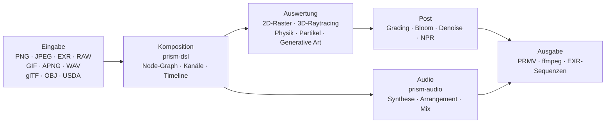

<p align="center">
  
</p>

<h1 align="center">Prism Engine</h1>

<h3 align="center">Die gesamte Medien-Pipeline in einem Quellbaum</h3>

<p align="center">
  <sub>Dekodieren · Setzen · Path-Tracing · Simulieren · Synthese · Kodieren &nbsp;|&nbsp; Keine Abhängigkeiten · Bit-genau deterministisch</sub>
</p>

<p align="center">
  <a href="../README.md">中文</a>
  · <a href="README.en.md">English</a>
  · <b><a href="README.de.md">Deutsch</a></b>
  · <a href="README.es.md">Español</a>
  · <a href="README.fr.md">Français</a>
  · <a href="README.ja.md">日本語</a>
  · <a href="README.ko.md">한국어</a>
  · <a href="README.pt-BR.md">Português</a>
  · <a href="README.ru.md">Русский</a>
</p>

<p align="center">
  
  
  
  
  
  <a href="https://github.com/Qianjinqie/prism-engine/releases"></a>
</p>

<p align="center">
  <a href="https://github.com/Qianjinqie/prism-engine/releases/latest"></a>
  <a href="#in-drei-minuten-lauffähig"></a>
  <a href="#architecture"></a>
</p>

<p align="center">
  
</p>

<p align="center">
  <sub>Kein Mock-up, sondern Engine-Ausgabe: 1200×675 · 256 spp · Raytracing + physikalisches BSDF + ACES-Tonemapping · 4 Threads, 158 s. Szenenquelle: <a href="gallery/gallery.rs"><code>docs/gallery/gallery.rs</code></a>.</sub>
</p>

<p align="center">
  <sub><b>642</b> Dateien · <b>28</b> Crates · <b>261.000</b> Zeilen Rust · <b>3929</b> Tests · <b>0</b> Fremdabhängigkeiten · <b>18,9 MB</b> Einzeldatei</sub>
</p>

## Warum es diese Engine gibt

Eine übliche Medien-Pipeline ist zusammengesetzt: ffmpeg dekodiert, Blender rendert, ImageMagick schreibt Standbilder, eine DAW macht den Ton, und Skripte kleben alles mit temporären Dateien zusammen. Jedes Werkzeug ist für sich hervorragend, doch an den Nahtstellen gehen zwei Dinge verloren — **Determinismus** und **Nachprüfbarkeit**. Ein anderer Rechner, ein anderer Gleitkommapfad; eine andere Version, andere Defaults; und im Fehlerfall stehen fünf Blackboxen und ein Haufen Zwischendateien da.

| | Konventionelle Pipeline | Prism Engine |
| --- | --- | --- |
| Kette | fünf oder sechs Werkzeuge + Klebeskripte + temporäre Dateien | ein Quellbaum, ein Build |
| Anderer Rechner | Gleitkommapfade ändern sich, Pixel ändern sich | gleiche Eingabe, gleiche Bytes |
| Etwas bricht | fünf Blackboxes und ein Haufen Zwischendateien | jedes Pixel lässt sich auf eine Quellzeile zurückführen |
| Abhängigkeiten | Dutzende native Bibliotheken, jede mit eigener Versionsmatrix | 0 |

Prism Engine zieht die ganze Kette in einen Quellbaum. Gleiche Szene, gleiche Parameter, egal welcher Rechner, egal welcher Lauf — identische Pixel und identische Bytes. Das ist kein Versprechen; 3929 Tests nageln es fest.

Die Engine soll ffmpeg oder Blender nicht ersetzen. Sie ersetzt den Klebstoff dazwischen und den Determinismus, den dieser Klebstoff stillschweigend wegwirft.

Die Zielgruppe ist bewusst eng: Pipelines, die „gleiche Eingabe, beliebiger Rechner, gleiche Ausgabe“ brauchen — Batch-Rendering, reproduzierbare Grafikforschung, Rendering in der CI.

### Drei harte Randbedingungen

| Randbedingung | Umsetzung | Preis |
| --- | --- | --- |
| **Kein Fremdcode** | Alle 110 Laufzeit- und 20 Test-Abhängigkeiten sind `path`-Abhängigkeiten im Repo; kein `build.rs`, keine nativen Linker-Direktiven, kein Netzwerk beim Bauen | Jedes Format, jeder Algorithmus, jede Schrift und jeder Codec muss hier entstehen |
| **Bitgenaue Determinismus** | Festkomma-IDCT, feste Sampling-Folgen, ein vierdimensionaler Konfigurations-Hash; plattformübergreifend identisch bei gleicher Eingabe | Keine schnellen Gleitkomma-Abkürzungen, kein Verlass auf die Iterationsreihenfolge von Hash-Maps |
| **Einzeldatei-Verteilung** | 642 Dateien aus 28 Crates in einem 18,9 MB großen UTF-8-Text, wiederhergestellt mit `node unpack.cjs` | Man verzichtet darauf, den Quellcode direkt auf GitHub durchzublättern |

## In drei Minuten lauffähig

```bash
# 1. Einzeldatei-Paket holen und per SHA-256 prüfen
curl -L -O https://github.com/Qianjinqie/prism-engine/releases/download/v2.1/prism-engine-v2.1-source.txt
curl -L -O https://github.com/Qianjinqie/prism-engine/releases/download/v2.1/SHA256SUMS.txt
sha256sum -c SHA256SUMS.txt

# 2. Das eingebettete Entpack-Skript herausziehen (nur Node 18+, kein npm install)
awk '/^UNPACK SCRIPT BEGIN$/{f=1;next} /^UNPACK SCRIPT END$/{f=0} f' \
  prism-engine-v2.1-source.txt > unpack.cjs
node unpack.cjs                    # stellt 642 Dateien wieder her

# 3. Bauen und die vollständige Testsuite ausführen
cargo test --workspace --release     # 3929 passed / 0 failed

# 4. Nichts schreiben, einfach rendern lassen
cargo run -p prism-app --release     # eingebaute Demo-Szene
```

Das Ergebnis ist ein gewöhnlicher Cargo-Workspace (28 Crates unter `src/`); alle weiteren `cargo`-Befehle funktionieren wie in jedem Rust-Projekt. Der erste Build dauert einige Minuten.

## Eine Einstellung, ein Text

`.prism` ist die Szenenbeschreibungssprache der Engine. Das Folgende ist eine vollständige, renderbare Drei-Sekunden-Einstellung — Kugel, Material, Orbit-Kamera, gerichtetes Licht, Dauer, Grading, Ausgabespezifikation:

```prism
scene "spin_red_ball" {
    sphere ball {
        radius 1.0
        material {
            albedo #c0392b
            roughness 0.3
            metalness 0.05
        }
    }

    camera main {
        orbit {
            center 0,0,0
            radius 8.0
        }
        fov 45
    }

    light sun {
        direction (1.0, -1.0, -0.5)
        color #fff4e6
        intensity 3.0
    }
}

timeline {
    duration 3s
    fps 12
}

aesthetic {
    teal-orange
    contrast 1.12
    filmic
}

output {
    resolution 480x270
    format frames
}
```

```bash
cargo run -p prism-app --release -- examples/spin_red_ball.prism          # Bildfolge
cargo run -p prism-app --release -- render examples/w2d_showcase.prism \
    --out out/demo.mp4                                                     # fertiger Film in einem Aufruf
```

`render` nimmt den direkten v2-Pfad: Node-Graph kompilieren → Bild für Bild auswerten → in einen Container kodieren, ohne Zwischenbilder auf der Platte. Nicht unterstützte Nodes erzeugen einen expliziten `R5xxx`-Fehler statt stillschweigend übersprungen zu werden.

<p align="center">
  
  <br>
  <sub>Bild 10 aus `examples/w2d_showcase.prism`: 3D-Kugel, Textebene, Grading und eine Fade-Spur teilen sich eine Timeline.</sub>
</p>

## Oder einfach die Rust-API

Wer keine DSL schreiben will, ruft die Bibliothek direkt auf. Das ist das Skelett des Titelbilds (die vollständige Szene umfasst 190 Zeilen, siehe [`docs/gallery/gallery.rs`](gallery/gallery.rs)):

```rust
use prism_core::node::EvalCtx;
use prism_math::Vec3;
use prism_rt::camera::Camera;
use prism_rt::integrator::{render_pixel, MaterialKind, RenderParams, Scene, Sphere};

let scene = Scene {
    spheres: vec![(
        Sphere { center: Vec3::new(0.0, 0.6, 0.0), radius: 0.6 },
        MaterialKind::Lambert { albedo: Vec3::new(0.8, 0.2, 0.15) },
    )],
    ..Default::default()
};
let cam = Camera::new(
    Vec3::new(0.0, 1.2, 4.8),   // Auge
    Vec3::new(0.0, 0.72, 0.0),  // Ziel
    Vec3::new(0.0, 1.0, 0.0),   // Oben
    30.0, 0.05, 4.85, 0.0, 1.0 / 48.0,
);
let ctx = EvalCtx::new(20261028, 0, 0);
let params = RenderParams::new(256, 10);  // 256 Samples pro Pixel, bis zu 10 Bounces

// Ein Pixel: Szene, Kamera, Sampling-Kontext, Pixelkoordinate, Auflösung, Parameter
let color = render_pixel(&scene, &cam, &ctx, (640, 360), (1280, 720), &params);
```

`render_pixel` ist eine reine Funktion: Szene, Kamera, Sampling-Kontext und Pixelkoordinate hinein, lineares RGB heraus. Bei gleichen Parametern sind die Bits identisch, unabhängig von Thread oder Aufrufreihenfolge — deshalb braucht paralleles Rendering keinerlei Synchronisation.

## Funktionsübersicht

| Schicht | Was sie leistet |
| --- | --- |
| **Lesen** | PNG (8/16 Bit), Baseline-JPEG (Festkomma-IDCT), GIF/APNG Bild für Bild, EXR (inkl. DWA), Baseline-RAW, WAV; glTF-/OBJ-/USDA-Assets, MaterialX-Parameter, externe TTF/OTF-Schriften |
| **Komponieren** | DSL v1/v2-Kompilierung, fünf High-Level-Kombinatoren (Titelkarte / Bauchbinde / Splitscreen / Ken Burns / Morph zwischen Szenen), vier Übergänge + Morph, Formelsatz (Hoch-/Tiefstellung, Brüche, Wurzeln, Matrizen, große Operatoren), Abtastung der Timeline zu jedem Zeitpunkt |
| **Rendern** | Raytracing + physikalisches BSDF (diffus / spiegelnd / Glas / Metall / Subsurface), heterogene Woodcock-Volumen, analytische Schnitte für Zylinder / Kegel / Tori / Rotationsflächen (Quartik via Ferrari), SAH-BVH-Dreiecksnetze, CPU-Referenz-Backend, Vulkan-Compute- und Raytracing-Pipelines |
| **Simulieren** | Unified-XPBD-Solver (Starrkörper / Soft Bodies / Tuch / Gelenke / Fluide / Bruch), FLIP-Rauch, Partikelsysteme (optional audio-getrieben), Strömungsfelder / L-Systeme / zelluläre Automaten / Reaktions-Diffusion / Fraktale / Voronoi |
| **Graden** | Sekundäres Grading (HSL-Selektionen + RGB-Kurven), cinematic-/film-/anime-Presets, Blur / Bloom / Halation / Filmkorn, vier NPR-Stile (Toon / Aquarell / Halbton / Öl), dreifache Denoiser, Vektorpfad-Rasterung und Draw-on |
| **Klingen** | PolyBLEP-Synthesizer, ADSR, Skalen- und Akkordfolge-Zustandsmaschinen, Arpeggiator, Step-Drummachine, SMF-Parser, SFZ-Sampler, Granularsynthese, Multitrack-Mixing, Loudness-Normalisierung, Beat-/Onset-/FFT-Analyse |
| **Ausliefern** | Eigenes `PRMV`-Containerformat (v2/v3) mit I/P-Frame-JPEG-Domänencodierung, Water-Filling-Ratensteuerung, Qpel-Bewegungsschätzung; ffmpeg-Pipeline (H.264/HEVC falls vorhanden, sonst automatisch MJPEG); EXR-Sequenzen; Multi-Prozess-Frame-Farm (fortsetzbar, parallele MD5 == serielle MD5) |
| **Integrieren** | Drei MCP-stdio-Werkzeuge (`scene_check` / `render_submit` / `diagnose`), Node-SDK mit semantischer Versionsaushandlung, HTTP/1.1-Renderdienst, Batch-Manifest mit kartesischem Rendering, Probe-Skelett für Hardware-Encoder auf drei Plattformen |

> Die Tabelle ist nur ein Inhaltsverzeichnis. Exakte Parameter und das „was sie nicht kann“ jeder Fähigkeit stehen in `开发者指南.md` im Paket.

## Fähigkeiten, die nicht in die Liste passen

Manches gehört nicht in die Tabelle oben — es ist nicht „ein Format mehr“, sondern Infrastruktur, die die Engine für sich selbst gewachsen hat.

### Audio: ein eingebauter DAW-Kern

`prism-audio` ist kein Randmodul, das zufällig WAV liest. Von der Komposition bis zum Mix ist es eine geschlossene Kette, und jede Funktion ist eine reine Funktion ihrer Parameter (plattformübergreifend bitgleich bei gleicher Eingabe):

- **Synthese**: PolyBLEP-Oszillatorfamilie mit Antialiasing, ADSR-Hüllkurven in geschlossener Form, vier Stimmungs-Presets;
- **Theorie**: Skalenbibliothek (Dur/Moll, Pentatonik, Modi), 12-TET-Tonklasse ↔ Frequenz, Zustandsmaschine mit funktionaler Grammatik für Akkordfolgen plus Stimmführung;
- **Arrangement**: Arpeggiator (Muster / Rate / Oktave), Step-Drummachine, Takt- und Beat-Raster;
- **Material**: handgeschriebener SMF-Parser (MIDI-Import), SFZ-Sampler, Granularsynthese;
- **Sounddesign**: physikalische Modellierung, räumliches Pannen, Effektketten;
- **Mixing**: lineares Multitrack-Mischen, Fades, peaksicheres Limiting;
- **Analyse und Kopplung**: Beat-/Onset-Erkennung, FFT-Spektren, Hüllkurvenextraktion, Loudness-Normalisierung; AudioReactive-Baking liest bei Frame N ein festes Fenster und ist damit eine reine Funktion des Frames, seek-äquivalent.

> Grenze: AAC-/mp3-Encoding wird nicht selbst implementiert (Patenthistorie plus Aufwand); es läuft über externes ffmpeg.

### Eine definierbare Kernel-Registry

Jeder Node-Typ der Engine ist eine **Partikulärlösung** eines Tripels aus „Kernel + Gitter + Dual“. Dritte (oder Sie selbst) können mit `registry!` neue Lösungen statisch registrieren, **ohne den Engine-Kern anzufassen**:

- Statische Einbindung: Das Makro expandiert in der definierenden Crate; `inventory` und Prozedur-Makros sind verboten, damit die Abhängigkeitszahl null bleibt;
- Bei der Registrierung prüft ein **Drei-Fragen-Test** (Kernelform / Gitter / Dual); unvollständige Antworten werden mit einem dreiteiligen Fehler abgelehnt;
- Offizielle und eigene Lösungen teilen sich eine Registry und sind zur Laufzeit nicht unterscheidbar;
- Mathematisch entspricht das den sechs Inversionsstrategien der Operatorgleichung `f = g + Kf` (exakt / stochastisch / lokal / regularisiert / iterativ / spektral) — eine neue Fähigkeit ist eine deklarierte Tripel, kein Patch im Render-Loop.

### GPU: drei Pfade, drei Zustände

| Backend | Status | Beleg |
| --- | --- | --- |
| **Vulkan** | Läuft wirklich | Compute- und Raytracing-Pipeline; ohne GPU auf Mesas lavapipe-Software-ICD verifizierbar; `render_scene` ist **byteidentisch (0 Differenz)** zur CPU-Referenz; `is_available()` ist ein Compute-∧-Render-Selbsttest |
| **Metal** | Compile-Gate vorhanden, nicht aktiviert | Isomorphe Portierung fertig, nicht auf Hardware verifiziert, `is_available()` immer false |
| **WebGPU** | Nur Fazit | Machbarkeit bewertet (4–6 Personentage Portierung), Renderpfad nicht implementiert |

### Anti-False-Green-Gates

Vier Gate-Skripte ohne Abhängigkeiten (nur Node): Ghost-Write-Schutz (inklusive Gegenselbsttest), Open-Source-Hygiene-Scan, Compliance-Selbstprüfung (9/9 bestanden plus 8/8 Nachweise, dass die Kriterien anschlagen), Pack-Roundtrip. Ein Gate kennt genau zwei Ergebnisse — bestanden oder rot — und „sieht gut aus“ gehört nicht dazu. **Ein falsches Grün ist gefährlicher als ein Fehlschlag.**

## Determinismus ist kein Slogan

Vier Schichten, von den Parametern bis zu den Bytes:

1. **Signatur-Hülle**: Node-Graphen, Cache-Schlüssel, Snapshot-Schlüssel und Frame-Signaturen teilen einen vierdimensionalen Konfigurations-Hash. Ein Parameter ändert sich ⇒ der Schlüssel muss sich ändern ⇒ keine falsche Wiederverwendung. Iterations-Nodes tragen `(ε, n)` im Schlüssel, Stream-Nodes die Frame-Nummer; bei `None` degradiert alles bitgenau auf das alte Verhalten.
2. **Byte-Fixpunkte**: USD export→import→export ist byteidentisch; WAV 16/24/32 Bit läuft verlustfrei hin und zurück; EXR wird Bitstrom gegen Bitstrom mit dem offiziellen OpenEXR verglichen.
3. **Pack-Determinismus**: Zweimal packen ergibt dieselbe SHA-256; der Entpack-Roundtrip vergleicht jede Datei Byte für Byte.
4. **Tests als Kriterium**: Viele der 3929 Tests fixieren Goldwerte (Toleranz von 1e-2 auf 1e-6 verschärft, gemessene Restabweichung 4,53e-7); Formtreue wird über Hausdorff-Schranken begrenzt statt über „passt schon“.

## Architektur



28 Crates, nach Verantwortung gruppiert:

| Gruppe | Crates |
| --- | --- |
| Kern | `prism-core` · `prism-math` · `prism-bytes` · `prism-geometry` · `prism-noise` |
| Medien-I/O | `prism-io` · `prism-media` · `prism-mux` · `prism-audio` · `prism-texture` |
| Rendering | `prism-render` · `prism-raster` · `prism-gpu` · `prism-postfx` · `prism-vector` · `prism-particles` |
| Animation / generativ | `prism-anim` · `prism-genart` · `prism-aesthetic` · `prism-physics` |
| Text / UI | `prism-text` · `prism-rt` · `prism-app` |
| Fortgeschritten | `prism-ai` · `prism-dsl` · `prism-infra` · `prism-author` |
| Sidecar (Feature-Gate) | `prism-ffi-hwenc` |

Verzeichnisstruktur nach dem Entpacken:

| Pfad | Inhalt |
| --- | --- |
| `src/` | Quellcode der 28 Crates (im Repo `crates/`, für die Verteilung umbenannt) |
| `Compliance/` | Null-Abhängigkeits-Prüfung, Drittanbieter-Hinweise, Asset-Register |
| `开发者指南.md` | Eigenständiger Entwicklerleitfaden: Einstieg / Architektur / mathematischer Kern / Gates / Erweiterung |
| `tools/` | Gate- und Pack-Skripte |
| `examples/` | `.prism`-Beispiele und Node-Pakete (per `include_str!` gelesen, fehlt eine Datei, bricht der Build) |
| `.github/workflows/` | CI-Konfiguration |

> Designdokumente (`docs/设计/`) liegen nur im vollständigen Repository des Herausgebers und werden nicht verteilt; die Demo-Crate `prism-anim-demo` ist ebenfalls nicht im Paket.

## Bauen, testen, Gates

```bash
cargo test --workspace --release      # 3929 passed / 0 failed / 0 ignored
cargo xtest                           # gleichwertiger Alias
cargo test -p prism-core --release    # Smoke-Test einer einzelnen Crate

node tools/ghost_guard.mjs --check    # Ghost-Write-Schutz: G1 Neudefinition / G2 echte Obermenge / G3 Top-Level-Doku / G4 Build
node tools/hygiene_scan.mjs           # Hygiene: listet jeden verbliebenen internen Begriff (Datei:Zeile), Exit 1 bei Treffer
node tools/compliance_check.mjs       # Compliance-Selbstprüfung: muss 9/9 bestehen
node tools/compliance_check.mjs --self-test  # Gegenprobe: muss rot werden und zeigt damit die Trennschärfe
node tools/pack_source_txt.mjs --verify      # Pack- und Entpack-Roundtrip, Byte für Byte
```

- Vollsuite: **3929 passed / 0 failed / 0 ignored**, 179 Testabschnitte, 171,5 s mit allen Kernen (Release).
- CI mit sechs Jobs: Ghost-Write-Schutz, Build + Volltests, wasm32-Build, WGSL-Statikprüfung, Bitstrom-Interop gegen offizielles OpenEXR, Node-Host-Gegenprobe.
- Der Hygiene-Scan hat weiterhin Treffer: Die verteilte Dokumentationsebene ist sauber, der Rest steckt in Quellkommentaren und nicht verteilten Repo-Dateien. Das Skript existiert, damit Reste **sichtbar und einzeln abarbeitbar** bleiben — nicht um Sauberkeit vorzutäuschen.

## Ehrliche Grenzen

| Grenze | Stand | Ausweg |
| --- | --- | --- |
| DNG `Compression=7` (Lossless JPEG) | Nicht implementiert; DNGs echter Kameras sind nicht lesbar | Vorher nach 16-Bit-TIFF/PNG wandeln |
| mp3 / AAC / FLAC | Dekodierung über externes ffmpeg, Encoding nicht selbst implementiert | ffmpeg installieren oder bei WAV bleiben |
| Gekrümmte Primitive auf GPU | Nur CPU-Pfad | Triangulieren und über die SAH-BVH gehen |
| Metal | Gate kompiliert, nicht auf Hardware geprüft, nicht aktiviert | Anbinden, sobald Apple-Hardware verfügbar ist |
| WebGPU | Machbarkeit geklärt, Renderpfad nicht implementiert | 4–6 Personentage |
| Hardware-Encoding | Probe-Skelett für drei Plattformen, keine Implementierung | Pro Zielplattform ausfüllen |
| GPU-Beschleunigung | Korrektheit nur auf lavapipe geprüft, nie auf echter GPU gemessen | Auf Zielhardware messen |
| Hygiene-Scan | Bestehende Treffer in Quellkommentaren | Einzeln abarbeiten, das Skript verfolgt sie |

Das sind keine „später“-Punkte. Sie werden heute ausdrücklich nicht unterstützt. Hier besser als in einem Issue versteckt.

## Compliance

Die Engine verspricht null Fremdcode-Abhängigkeiten und prüft das selbst:

- **C1 Kein Fremdcode**: Alle 130 Abhängigkeiten (110 Laufzeit + 20 Test) sind `path`-Abhängigkeiten im Repo; kein `build.rs`, keine nativen Link-Direktiven; `Cargo.lock` fixiert 29 Repo-Pakete.
- **C2 Vollständiges Asset-Register**: Alle fünf Assets haben vollständige Haupttabellenfelder; Schriften stehen unter SIL OFL 1.1, der vollständige Lizenztext liegt bei der Schrift unter `src/prism-text/font_data/LICENSE`.
- **C3 Drittanbieter-Hinweise**: `Compliance/THIRD-PARTY-NOTICES.md` trennt ausdrücklich „Datenassets ≠ Codeabhängigkeiten“.

## Lizenz

Apache License 2.0, siehe [`LICENSE`](../LICENSE).

Bei der Weitergabe bitte die Hinweise und das Asset-Register unter `Compliance/` erhalten.

<sub>Titelbild und DSL-Screenshot wurden von der Engine selbst gerendert; die Parameter stehen in den Bildunterschriften und in [`docs/gallery/gallery.rs`](gallery/gallery.rs).</sub>
