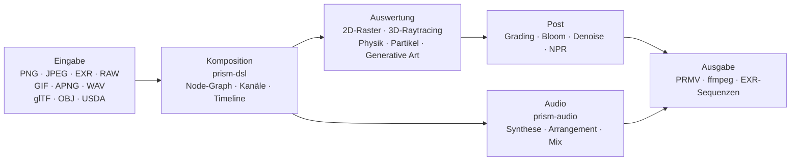

<p align="center">
  
</p>
<h1 align="center">Prism Engine</h1>

<h3 align="center">Prozedurale Medien-Engine</h3>

<p align="center">
  <sub>Dekodieren · Setzen · Path-Tracing · Simulieren · Synthese · Kodieren &nbsp;|&nbsp; Standbild · Sequenz · Fertiger Schnitt &nbsp;|&nbsp; CPU + Vulkan</sub>
</p>

<p align="center">
  <a href="../README.md">中文</a>
  · <a href="README.en.md">English</a>
  · <b><a href="README.de.md">Deutsch</a></b>
  · <a href="README.es.md">Español</a>
  · <a href="README.fr.md">Français</a>
  · <a href="README.ja.md">日本語</a>
  · <a href="README.ko.md">한국어</a>
  · <a href="README.pt-BR.md">Português</a>
  · <a href="README.ru.md">Русский</a>
</p>

<p align="center">
  
  
  
  
  
  <a href="https://github.com/Qianjinqie/prism-engine/releases"></a>
</p>

<p align="center">
  
</p>

<p align="center">
  <sub>Kein Mock-up, sondern Engine-Ausgabe: 1200×675 · 256 spp · Raytracing + physikalisches BSDF + ACES-Tonemapping · 4 Threads, 158 s. Szenenquelle: <a href="gallery/gallery.rs"><code>docs/gallery/gallery.rs</code></a>.</sub>
</p>

<p align="center">
  <sub><b>664</b> Dateien · <b>29</b> Crates · <b>273.000</b> Zeilen Rust · <b>4029</b> Tests · <b>0</b> Fremdabhängigkeiten · <b>19,5 MB</b> Einzeldatei</sub>
</p>

<!-- TOC-START -->
<details>
<summary>Inhaltsverzeichnis</summary>

- [Funktionsübersicht](#capabilities)
- [In drei Minuten lauffähig](#quickstart)
- [Eine Einstellung, ein Text](#one-scene)
- [Oder einfach die Rust-API](#rust-api)
- [Fähigkeiten, die nicht in die Liste passen](#internals)
- [Technische Fakten](#engineering)
- [Architektur](#architecture)
- [Bauen, testen, Gates](#build-test)
- [Ehrliche Grenzen](#boundaries)
- [Compliance](#compliance)
- [Lizenz](#license)

</details>
<!-- TOC-END -->

<a id="capabilities"></a>
## Funktionsübersicht

Eine prozedurale Medien-Engine in Rust. Eingabe ist eine `.prism`-Szene oder ein Aufruf der Rust-API; Ausgabe ist ein Standbild, eine Bildsequenz oder ein fertiger Schnitt. Die Schichten folgen einer Medien-Pipeline; ein eingefrorener Zeitpunkt ergibt ein Standbild, fortlaufend aufgezeichnet ein Video — jede Schicht behandelt beides gleich.

| Schicht | Was sie tut |
| --- | --- |
| **Lesen** | PNG (8/16 Bit, Filter-Inversion), Baseline-JPEG (Festkomma-IDCT, plattformübergreifend bitgleich), EXR (Lesen/Schreiben, Kompressionsfamilie, DWA), Kamera-RAW, GIF / APNG Bild für Bild, WAV; glTF / OBJ / USDA-Import, MaterialX-Parameter; TTF/OTF-Laden mit vierstufiger Fallback-Kette (eingebaut → Benutzer → Mehrschrift-Subsets → mathematische Symbole) |
| **Setzen** | OpenType-Parsing, GSUB/GPOS-Shaping, UAX #9 Bidirektionalität, vier arabische Formen, vertikaler Satz; Formelsatz (Hoch-/Tiefstellung, Brüche, Wurzeln, Matrizen, große Operatoren); DSL v1/v2 zu einem Tripel-Graph kompiliert; fünf High-Level-Kombinatoren (Titel / Bauchbinde / Splitscreen / Ken Burns / Szenen-Morph); vier Übergänge + Morph, zu jedem Zeitpunkt abtastbar |
| **Rendern** | Path-Tracing + physikalisches BSDF (diffus / spiegelnd / Glas / Metall / Subsurface), Glas und Metall über stochastische Inversion (Neumann-Reihe, Monte Carlo); heterogene Woodcock-Volumen; analytische Schnitte für Zylinder / Kegel / Tori / Rotationsflächen (Quartik über Ferrari); Dreiecksnetze + SAH-BVH (stabile Sortierung, deterministischer Aufbau); Meshes zu SDF gebacken für Booleans / Domain-Warping / exakte Kollision; CpuRef als vollwertiges Backend + Vulkan-Compute- und Raytracing-Pipelines |
| **Simulieren** | einheitlicher XPBD-Solver — Starrkörper / Soft Bodies / Tuch / Gelenke / Fluide / Bruch sind sechs Parametersätze einer Constraint-Projektionsschleife; FLIP-Rauch; Partikelsysteme + AudioReactive; Haar-Constraints und Shading; Strömungsfelder / L-Systeme / zelluläre Automaten / Reaktions-Diffusion / Fraktale / Voronoi; geschlossene Federlösung und Keyframes |
| **Grading** | sekundäres Grading (HSL-Auswahl + RGB-Kurven); cinematic / film / anime-Presets, drei Stufen (Entwurf / Standard / Film) explizit bepreist; blur / bloom / vignette / chromatische Aberration / sharpen / glitch / dissolve; Halation + Filmkorn in zwei Skalen (im Pixelraum abgeleitet); dreifache Denoiser-Kombination; vier NPR-Stile (toon / watercolor / halftone / oil); PQ-/HLG-Transferfunktionen, lineares sRGB ↔ ACEScg, ACES-Ausgangstransformation |
| **Ton** | PolyBLEP-antialiasing-Oszillator + geschlossene ADSR-Hüllkurve + 4 Stimmungs-Presets; Skalenbibliothek + 12-TET + funktionalgrammatische Akkordfolge-Zustandsmaschine + Stimmführung; Arpeggiator / Step-Drum-Machine / Takt-Raster; handgeschriebener SMF-Parser, SFZ-Sampler, Granularsynthese; physikalische Modellierung / räumliches Pannen / Effektketten; Mehrspur-Mixing + Peak-Limiting; Beat / Onset / FFT, AudioReactive-Baking, Loudness-Normalisierung; WAV 16/24/32 Bit bytegenauer Round-Trip |
| **Ausliefern** | eigener PRMV-Container (v2/v3, v3 liest v1/v2) + I/P-Frame-Zeitkodierung; Water-Filling-Ratensteuerung + qpel-Subpixel-Bewegungsschätzung (gemessen PSNR +2,577 dB, Größe −21,6 %); ffmpeg zur Laufzeit erkannt — stdin-Pipe nach H.264/HEVC wenn vorhanden, sonst automatischer MJPEG-Fallback, es kommt immer eine Datei heraus; MP4- + MJPEG-Container, EXR-Sequenzen; Mehrprozess-Frame-Farm (fortsetzbar, parallele MD5 == serielle MD5); NLE-Zeitabbildung / Keyframes / Übergänge |
| **Anbinden** | drei MCP-stdio-Werkzeuge (`scene_check` / `render_submit` / `diagnose`); Node-SDK mit semantischer Versionsaushandlung + Beispiel-Node-Paket; CLI (`render` / `preview` / `demo`); interaktiver Editor mit zwei Vorschau-Stufen (Draft geometrisch / Real niedrige spp) + Subgraph-Signatur-Inkremente; Batch-Manifest als kartesisches Produkt; Hardware-Encoder-Sonde für drei Plattformen (VideoToolbox / NVENC / VAAPI, kein Backend verdrahtet) |
| **Nebenweg** | generative Kunst: Strömungsfelder / L-Systeme / zelluläre Automaten / Reaktions-Diffusion / Mandelbrot / Voronoi, Vektor-Draw-on und Diagramme. KI-Unterstützung: deterministische Mock-Inferenzschicht (Storyboard / Untertitel / Farbhinweise), Modellgewichte als Daten gelesen, Multiplikation-Addition selbst geschrieben, kein ML-Framework |

Die Tabelle listet nur Fähigkeiten. Was jede davon nicht kann, steht unter [Ehrliche Grenzen](#ehrliche-grenzen), nicht in der Tabelle.

<a id="quickstart"></a>
## In drei Minuten lauffähig

```bash
# 1. Einzeldatei-Paket holen und per SHA-256 prüfen
curl -L -O https://github.com/Qianjinqie/prism-engine/releases/download/v2.2/prism-engine-v2.2-source.txt
curl -L -O https://github.com/Qianjinqie/prism-engine/releases/download/v2.2/SHA256SUMS.txt
sha256sum -c SHA256SUMS.txt

# 2. Das eingebettete Entpack-Skript herausziehen (nur Node 18+, kein npm install)
awk '/^UNPACK SCRIPT BEGIN$/{f=1;next} /^UNPACK SCRIPT END$/{f=0} f' \
  prism-engine-v2.2-source.txt > unpack.cjs
node unpack.cjs                    # stellt 664 Dateien wieder her

# 3. Bauen und die vollständige Testsuite ausführen
cargo test --workspace --release     # 4029 passed / 0 failed

# 4. Nichts schreiben, einfach rendern lassen
cargo run -p prism-app --release     # eingebaute Demo-Szene
```

Das Ergebnis ist ein gewöhnlicher Cargo-Workspace (29 Crates unter `src/`); alle weiteren `cargo`-Befehle funktionieren wie in jedem Rust-Projekt. Der erste Build dauert einige Minuten.

<a id="one-scene"></a>
## Eine Einstellung, ein Text

`.prism` ist die Szenenbeschreibungssprache der Engine. Das Folgende ist eine vollständige, renderbare Drei-Sekunden-Einstellung — Kugel, Material, Orbit-Kamera, gerichtetes Licht, Dauer, Grading, Ausgabespezifikation:

```prism
scene "spin_red_ball" {
    sphere ball {
        radius 1.0
        material {
            albedo #c0392b
            roughness 0.3
            metalness 0.05
        }
    }

    camera main {
        orbit {
            center 0,0,0
            radius 8.0
        }
        fov 45
    }

    light sun {
        direction (1.0, -1.0, -0.5)
        color #fff4e6
        intensity 3.0
    }
}

timeline {
    duration 3s
    fps 12
}

aesthetic {
    teal-orange
    contrast 1.12
    filmic
}

output {
    resolution 480x270
    format frames
}
```

```bash
cargo run -p prism-app --release -- examples/spin_red_ball.prism          # Bildfolge
cargo run -p prism-app --release -- render examples/w2d_showcase.prism \
    --out out/demo.mp4                                                     # fertiger Film in einem Aufruf
```

`render` nimmt den direkten v2-Pfad: Node-Graph kompilieren → Bild für Bild auswerten → in einen Container kodieren, ohne Zwischenbilder auf der Platte. Nicht unterstützte Nodes erzeugen einen expliziten `R5xxx`-Fehler statt stillschweigend übersprungen zu werden.

<p align="center">
  
  <br>
  <sub>Bild 10 aus `examples/w2d_showcase.prism`: 3D-Kugel, Textebene, Grading und eine Fade-Spur teilen sich eine Timeline.</sub>
</p>

<a id="rust-api"></a>
## Oder einfach die Rust-API

Wer keine DSL schreiben will, ruft die Bibliothek direkt auf. Das ist das Skelett des Titelbilds (die vollständige Szene umfasst 190 Zeilen, siehe [`docs/gallery/gallery.rs`](gallery/gallery.rs)):

```rust
use prism_core::node::EvalCtx;
use prism_math::Vec3;
use prism_rt::camera::Camera;
use prism_rt::integrator::{render_pixel, MaterialKind, RenderParams, Scene, Sphere};

let scene = Scene {
    spheres: vec![(
        Sphere { center: Vec3::new(0.0, 0.6, 0.0), radius: 0.6 },
        MaterialKind::Lambert { albedo: Vec3::new(0.8, 0.2, 0.15) },
    )],
    ..Default::default()
};
let cam = Camera::new(
    Vec3::new(0.0, 1.2, 4.8),   // Auge
    Vec3::new(0.0, 0.72, 0.0),  // Ziel
    Vec3::new(0.0, 1.0, 0.0),   // Oben
    30.0, 0.05, 4.85, 0.0, 1.0 / 48.0,
);
let ctx = EvalCtx::new(20261028, 0, 0);
let params = RenderParams::new(256, 10);  // 256 Samples pro Pixel, bis zu 10 Bounces

// Ein Pixel: Szene, Kamera, Sampling-Kontext, Pixelkoordinate, Auflösung, Parameter
let color = render_pixel(&scene, &cam, &ctx, (640, 360), (1280, 720), &params);
```

`render_pixel` ist eine reine Funktion: Szene, Kamera, Sampling-Kontext und Pixelkoordinate hinein, lineares RGB heraus. Bei gleichen Parametern sind die Bits identisch, unabhängig von Thread oder Aufrufreihenfolge — deshalb braucht paralleles Rendering keinerlei Synchronisation.

<a id="internals"></a>
## Fähigkeiten, die nicht in die Liste passen

Manches gehört nicht in die Tabelle oben — es ist nicht „ein Format mehr“, sondern Infrastruktur, die die Engine für sich selbst gewachsen hat.

### Audio: ein eingebauter DAW-Kern

Die Fähigkeitsliste steht in der Zeile **Ton**. Hier geht es um die Funktionsweise und darum, warum sie an derselben Render-Zeitleiste hängen kann:

- **Jede Funktion ist eine reine Funktion ihrer Parameter**: dieselbe Partitur an beliebiger Seek-Position neu berechnet liefert bitgleiche Samples, ohne Abhängigkeit von der Wiedergabehistorie
- **AudioReactive wird zu einer reinen Funktion pro Frame gebacken**: Frame N liest ein festes Fenster, daher ändern Springen, Rückwärtslaufen oder paralleles Aufteilen das Ergebnis nicht
- **Mixing ist offline-parallele lineare Algebra**: Mehrspur-Summation + Fades + Peak-Limiting, ohne versteckte Zustandsmaschine

> Grenze: AAC-/mp3-Kodierung wird nicht selbst implementiert (Patentgeschichte plus Aufwand); sie läuft über externes ffmpeg.

### Eine definierbare Kernel-Registry

Jeder Node-Typ der Engine ist eine **Partikulärlösung** eines Tripels aus „Kernel + Gitter + Dual“. Dritte (oder Sie selbst) können mit `registry!` neue Lösungen statisch registrieren, **ohne den Engine-Kern anzufassen**:

- Statische Einbindung: Das Makro expandiert in der definierenden Crate; `inventory` und Prozedur-Makros sind verboten, damit die Abhängigkeitszahl null bleibt;
- Bei der Registrierung prüft ein **Drei-Fragen-Test** (Kernelform / Gitter / Dual); unvollständige Antworten werden mit einem dreiteiligen Fehler abgelehnt;
- Offizielle und eigene Lösungen teilen sich eine Registry und sind zur Laufzeit nicht unterscheidbar;
- Mathematisch entspricht das den sechs Inversionsstrategien der Operatorgleichung `f = g + Kf` (exakt / stochastisch / lokal / regularisiert / iterativ / spektral) — eine neue Fähigkeit ist eine deklarierte Tripel, kein Patch im Render-Loop.

### GPU: drei Pfade, drei Zustände

| Backend | Status | Beleg |
| --- | --- | --- |
| **Vulkan** | Läuft wirklich | Compute- und Raytracing-Pipeline; ohne GPU auf Mesas lavapipe-Software-ICD verifizierbar; `render_scene` ist **byteidentisch (0 Differenz)** zur CPU-Referenz; `is_available()` ist ein Compute-∧-Render-Selbsttest |
| **Metal** | Code bereit (kein eigenständiges Metal-Backend, nicht aktiviert), nicht auf Hardware verifiziert | Isomorphe Portierung fertig (historisches Asset), `is_available()` immer false |
| **WebGPU** | Code bereit (T1/T2/T3 grün), unterstützte Oberfläche weiterhin nur Chrome/Edge; T3 ist 19/19 grün auf 2 Geräten (Galaxy S10 + HONOR X40, dieselben wasm-Bytes) (keines ist eine Chrome/Edge-Marke, daher bleibt der Markenpunkt offen) | Machbarkeit bewertet (4–6 Personentage Portierung), Renderpfad in T03; 19/19 auf echten Geräten (4 Browser-Umgebungen / 2 Geräte) |

<a id="engineering"></a>
## Technische Fakten

Drei Einschränkungen und was jede kostet:

| Einschränkung | Umsetzung | Kosten |
| --- | --- | --- |
| Keine Fremdcode-Abhängigkeiten | Alle 110 Laufzeit- + 20 Test-Abhängigkeiten sind `path`-Abhängigkeiten im Repo; kein `build.rs`, kein natives Linken, kein Netzwerk beim Build | Jedes Format, jeder Algorithmus, jede Schrift, jeder Codec muss hier geschrieben werden |
| Bitgenauer Determinismus | Festkomma-IDCT, feste Sampling-Sequenzen, ein vierdimensionaler Konfigurationshash; identisch über Plattformen bei identischer Eingabe | Keine schnellen Gleitkomma-Abkürzungen, keine Abhängigkeit von Hashmap-Iterationsreihenfolge |
| Einzeldatei-Verteilung | 664 Dateien aus 29 Crates zu einem 19,5 MB großen UTF-8-Text zusammengeführt, von `node unpack.cjs` wiederhergestellt | Man verliert das direkte Durchstöbern des Quellcodes auf GitHub |

> ⚠️ **v2.2-Verteilungskorrektur**: die v2.1-Einzdatei-Verteilung (`prism-engine-v2.1-source.txt`, gepackt am 2026-10-27) enthielt einen BSDF-Multistreu-Kompensationsfehler (Farbversatz bei übersättigten Metallen im Streifwinkel); **in v2.2 behoben**. Nutzer, die übersättigte Metalle mit der v2.1-Einzdatei-Verteilung rendern, sollten auf v2.2 upgraden.

### Wie Determinismus verifiziert wird

Vier Schichten, von den Parametern bis zu den Bytes:

1. **Signatur-Abschluss**: Node-Graphen, Cache-Schlüssel, Snapshot-Schlüssel und Frame-Signaturen teilen einen vierdimensionalen Konfigurationshash. Ein Parameter ändert sich ⇒ der Schlüssel muss sich ändern ⇒ keine veraltete Wiederverwendung. Iterationsknoten führen `(ε, n)` im Schlüssel, Stream-Knoten die Framenummer; `None` degradiert bitgenau zum alten Verhalten.
2. **Byte-Fixpunkte**: USD Export→Import→Export ist byteidentisch; WAV 16/24/32 Bit Round-Trips stimmen; EXR wird Bitstrom gegen Bitstrom mit dem offiziellen OpenEXR verglichen.
3. **Packaging-Determinismus**: zweimaliges Packen derselben Quelle ergibt identische SHA-256; der Unpack-Round-Trip vergleicht jede Datei Byte für Byte.
4. **Tests als Kriterium**: viele der 4029 Tests fixieren Goldwerte (Toleranz von 1e-2 auf 1e-6 verschärft, gemessene Residuen 4,53e-7); Formtreue wird über Hausdorff-Abstände begrenzt statt über „sieht nah genug aus“.

<a id="architecture"></a>
## Architektur



29 Crates, nach Verantwortung gruppiert:

| Gruppe | Crates |
| --- | --- |
| Kern | `prism-core` · `prism-math` · `prism-bytes` · `prism-geometry` · `prism-noise` |
| Medien-I/O | `prism-io` · `prism-media` · `prism-mux` · `prism-audio` · `prism-texture` |
| Rendering | `prism-render` · `prism-raster` · `prism-gpu` · `prism-postfx` · `prism-vector` · `prism-particles` |
| Animation / generativ | `prism-anim` · `prism-genart` · `prism-aesthetic` · `prism-physics` |
| Text / UI | `prism-text` · `prism-rt` · `prism-app` |
| Fortgeschritten | `prism-ai` · `prism-dsl` · `prism-infra` · `prism-author` |
| Sidecar (Feature-Gate) | `prism-ffi-hwenc` |

Verzeichnisstruktur nach dem Entpacken:

| Pfad | Inhalt |
| --- | --- |
| `src/` | Quellcode der 29 Crates (im Repo `crates/`, für die Verteilung umbenannt) |
| im Paket `Compliance/` | Null-Abhängigkeits-Prüfung, Drittanbieter-Hinweise, Asset-Register |
| `开发者指南.md` | Eigenständiger Entwicklerleitfaden: Einstieg / Architektur / mathematischer Kern / Gates / Erweiterung |
| `tools/` | Gate- und Pack-Skripte |
| `examples/` | `.prism`-Beispiele und Node-Pakete (per `include_str!` gelesen, fehlt eine Datei, bricht der Build) |
| `.github/workflows/` | CI-Konfiguration |

> Designdokumente (`docs/设计/`) liegen nur im vollständigen Repository des Herausgebers und werden nicht verteilt; die Demo-Crate `prism-anim-demo` ist ebenfalls nicht im Paket.

<a id="build-test"></a>
## Bauen, testen, Gates

```bash
cargo test --workspace --release      # 4029 passed / 0 failed / 0 ignored
cargo xtest                           # gleichwertiger Alias
cargo test -p prism-core --release    # Smoke-Test einer einzelnen Crate

node tools/ghost_guard.mjs --check    # Ghost-Write-Schutz: G1 Neudefinition / G2 echte Obermenge / G3 Top-Level-Doku / G4 Build
node tools/hygiene_scan.mjs           # Hygiene: listet jeden verbliebenen internen Begriff (Datei:Zeile), Exit 1 bei Treffer
node tools/compliance_check.mjs       # Compliance-Selbstprüfung: muss 9/9 bestehen
node tools/compliance_check.mjs --self-test  # Gegenprobe: muss rot werden und zeigt damit die Trennschärfe
node tools/pack_source_txt.mjs --verify      # Pack- und Entpack-Roundtrip, Byte für Byte
```

- Vollsuite: **4029 passed / 0 failed / 0 ignored**, 188 Testabschnitte, 110 s mit allen Kernen (Release).
- CI mit sechs Jobs: Ghost-Write-Schutz, Build + Volltests, wasm32-Build, WGSL-Statikprüfung, Bitstrom-Interop gegen offizielles OpenEXR, Node-Host-Gegenprobe.
- Der Hygiene-Scan hat weiterhin Treffer: Die verteilte Dokumentationsebene ist sauber, der Rest steckt in Quellkommentaren und nicht verteilten Repo-Dateien. Das Skript existiert, damit Reste **sichtbar und einzeln abarbeitbar** bleiben — nicht um Sauberkeit vorzutäuschen.

### Anti-False-Green-Gates

Vier Gate-Skripte ohne Abhängigkeiten (nur Node): Ghost-Write-Schutz (inklusive Gegenselbsttest), Open-Source-Hygiene-Scan, Compliance-Selbstprüfung (9/9 bestanden plus 8/8 Nachweise, dass die Kriterien anschlagen), Pack-Roundtrip. Ein Gate kennt genau zwei Ergebnisse — bestanden oder rot — und „sieht gut aus“ gehört nicht dazu. **Ein falsches Grün ist gefährlicher als ein Fehlschlag.**

<a id="boundaries"></a>
## Ehrliche Grenzen

| Grenze | Stand | Ausweg | Beleg / Ablehnungspunkt |
| --- | --- | --- | --- |
| DNG `Compression=1/7/8` (inkl. 32946 Deflate) | 1/7/8 unterstützt (inkl. 32946 Deflate); echte Kameramodelle nicht durch Muster verifiziert | Kein Konvertieren nötig; echte Kamera-Muster können golden ergänzen (nicht unterstützte Werte 6/34892/34712/52546 strukturell abgelehnt) | `raw.rs:3282,3287` (Lese-Pfad teilt 1/7/8/32946 zu) + `raw_dng_synth.rs:260` (Synth unterstützt 1/7/8/32946) + 设计 §7.3 / Q10 (Echtgeräte-Register) |
| mp3 / AAC / FLAC | Dekodierung über externes ffmpeg, Encoding nicht selbst implementiert | ffmpeg installieren oder bei WAV bleiben | `README.md:213` (AAC/mp3-Encoding nicht im Haus, via ffmpeg) |
| Gekrümmte Primitive auf GPU | Nur CPU-Pfad | Triangulieren und über die SAH-BVH gehen | Strukturierter Ablehnungspunkt: kein GPU-Kernel (`prism-vector/src/path.rs:8` CPU-Flachen; GPU-Kurven sind T06 TODO, 设计 §6 WP-A) |
| Metal | Code bereit (kein eigenständiges Metal-Backend, nicht aktiviert); `is_available()` immer false, nicht auf Hardware verifiziert | Anbinden, sobald Apple-Hardware und eine eigenständige Backend-Aufgabe verfügbar sind | `prism-gpu/src/metal/mod.rs:9,192` (is_available immer false) + `metal/render.rs:1` (nicht leuchtend) + 设计 §7.2 Metal-Zeile |
| WebGPU | Code bereit (T1/T2/T3 grün), unterstützte Oberfläche weiterhin nur Chrome/Edge; **19/19 in 4 Browser-Umgebungen / 2 Geräten / 2 Artefakt-Builds** (inkl. Edge for Android 153), Hardware-Adapter bestätigt (`isFallbackAdapter=false`); **Desktop ungetestet** | ein echter Desktop-Lauf mit Chrome/Edge schließt es ab (ca. 5 Minuten) | (bedingt machbar, Chrome/Edge zuerst) + 设计 §7.2 WebGPU-Zeile (19/19 auf Gerät) |
| Hardware-Encoding | Probe-Skelett für drei Plattformen, keine Implementierung (bindungsbereit wartet auf C-2) | Pro Zielplattform ausfüllen | `prism-ffi-hwenc/src/lib.rs:14` (linkt keine Plattform-Bibliothek) + 设计 §7.2 硬件编码-Zeile |
| GPU-Beschleunigung | Als wartend auf Verifikation registriert: Korrektheit nur auf lavapipe geprüft; echte GPU-Beschleunigung nicht gemessen, keine Zahl geschrieben (lavapipe ist Pseudowert) | Auf Zielhardware messen | `README.md:228` (lavapipe-Software-ICD, keine GPU zu verifizieren) + 设计 §7.2 GPU 加速比-Zeile (keine Zahl erlaubt) |
| Hygiene-Scan | Bestehende Treffer in Quellkommentaren (C-3 aus dieser Version genommen; Gate bleibt) | Einzeln abarbeiten, das Skript verfolgt sie | `README.md:299,307` (hygiene_scan-Gate, Dokumentationsebene geleert) + C-3 entfernt (设计 §6.2) |

Das sind keine „später“-Punkte. Sie werden heute ausdrücklich nicht unterstützt. Hier besser als in einem Issue versteckt.

<a id="compliance"></a>
## Compliance

Die Engine verspricht null Fremdcode-Abhängigkeiten und prüft das selbst:

- **C1 Kein Fremdcode**: Alle 130 Abhängigkeiten (110 Laufzeit + 20 Test) sind `path`-Abhängigkeiten im Repo; kein `build.rs`, keine nativen Link-Direktiven; `Cargo.lock` fixiert 29 Repo-Pakete.
- **C2 Vollständiges Asset-Register**: Alle fünf Assets haben vollständige Haupttabellenfelder; Schriften stehen unter SIL OFL 1.1, der vollständige Lizenztext liegt bei der Schrift unter `src/prism-text/font_data/LICENSE`.
- **C3 Drittanbieter-Hinweise**: `Compliance/THIRD-PARTY-NOTICES.md` trennt ausdrücklich „Datenassets ≠ Codeabhängigkeiten“.

<a id="license"></a>
## Lizenz

Apache License 2.0, siehe [`LICENSE`](../LICENSE).

Bei der Weitergabe bitte die Hinweise und das Asset-Register unter `Compliance/` erhalten.

<sub>Titelbild und DSL-Screenshot wurden von der Engine selbst gerendert; die Parameter stehen in den Bildunterschriften und in [`docs/gallery/gallery.rs`](gallery/gallery.rs).</sub>

