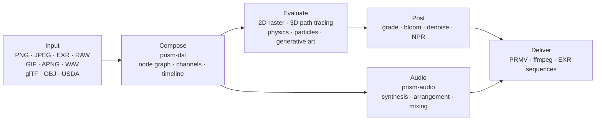

<p align="center">
  
</p>
<h1 align="center">Prism Engine</h1>

<h3 align="center">Procedural media engine</h3>

<p align="center">
  <sub>Decode · Typeset · Path-trace · Simulate · Synthesize · Encode &nbsp;|&nbsp; Still · Sequence · Finished cut &nbsp;|&nbsp; CPU + Vulkan backends</sub>
</p>

<p align="center">
  <a href="../README.md">中文</a>
  · <b><a href="README.en.md">English</a></b>
  · <a href="README.de.md">Deutsch</a>
  · <a href="README.es.md">Español</a>
  · <a href="README.fr.md">Français</a>
  · <a href="README.ja.md">日本語</a>
  · <a href="README.ko.md">한국어</a>
  · <a href="README.pt-BR.md">Português</a>
  · <a href="README.ru.md">Русский</a>
</p>

<p align="center">
  
  
  
  
  
  <a href="https://github.com/Qianjinqie/prism-engine/releases"></a>
</p>

<p align="center">
  
</p>

<p align="center">
  <sub>Not a mock-up — engine output: 1200×675, 256 spp, path tracing + physical BSDF + ACES tone mapping, 4 threads, 158 s. Scene source: <a href="gallery/gallery.rs"><code>docs/gallery/gallery.rs</code></a>.</sub>
</p>

<p align="center">
  <sub><b>642</b> files · <b>28</b> crates · <b>261k</b> lines of Rust · <b>3929</b> tests · <b>0</b> third-party dependencies · <b>18.9 MB</b> single-file package</sub>
</p>

<!-- TOC-START -->
<details>
<summary>Contents</summary>

- [Capability map](#capabilities)
- [Up and running in three minutes](#quickstart)
- [One shot, one text file](#one-scene)
- [Or just the Rust API](#rust-api)
- [Capabilities that do not fit the list](#internals)
- [Engineering facts](#engineering)
- [Architecture](#architecture)
- [Build, test, and gates](#build-test)
- [Honest boundaries](#boundaries)
- [Compliance](#compliance)
- [License](#license)

</details>
<!-- TOC-END -->

<a id="capabilities"></a>
## Capability map

A procedural media engine in Rust. Feed it a `.prism` scene file or call the Rust API; it outputs a still, a frame sequence, or a finished cut. The layers below follow one media pipeline; freeze an instant and you get a still, advance and record it and you get video — every layer treats both the same.

| Layer | What it does |
| --- | --- |
| **Read** | PNG (8/16-bit, filter inversion), baseline JPEG (fixed-point IDCT, bit-identical across platforms), EXR (read/write, compression family, DWA), camera RAW, GIF / APNG frame by frame, WAV; glTF / OBJ / USDA import, MaterialX parameters; TTF/OTF loading with a four-level fallback chain (built-in → user → multi-script subsets → math symbols) |
| **Compose** | OpenType parsing, GSUB/GPOS shaping, UAX #9 bidirectional text, four Arabic forms, vertical layout; formula typesetting (sub/superscripts, fractions, radicals, matrices, large operators); DSL v1/v2 compiled to a triple graph; five high-level combinators (title card / lower third / split screen / Ken Burns / morph between scenes); four transitions + morph, sampleable at any instant |
| **Render** | Path tracing + physical BSDF (diffuse / specular / glass / metal / subsurface), glass and metal via stochastic inversion (Neumann-series Monte Carlo); Woodcock heterogeneous volumes; analytic intersections for cylinders / cones / tori / surfaces of revolution (quartic via Ferrari's closed form); triangle meshes + SAH-BVH (stable sort, deterministic builds); meshes baked to SDF for booleans / domain warping / exact collision; CpuRef as a first-class backend + Vulkan compute and ray-tracing pipelines |
| **Simulate** | Unified XPBD solver — rigid bodies / soft bodies / cloth / joints / fluids / fracture are six parameter sets of one constraint-projection loop; FLIP smoke; particle systems + AudioReactive; hair constraints and shading; flow fields / L-systems / cellular automata / reaction-diffusion / fractals / Voronoi; closed-form spring solutions and keyframes |
| **Grade** | Secondary grading (HSL selections + RGB curves); cinematic / film / anime presets, with draft / standard / film tiers priced explicitly; blur / bloom / vignette / chromatic aberration / sharpen / glitch / dissolve; halation + dual-scale film grain (derived in pixel space); three-in-one denoising; four NPR styles (toon / watercolor / halftone / oil); PQ / HLG transfer functions, linear sRGB ↔ ACEScg, ACES output transform |
| **Sound** | PolyBLEP anti-aliased oscillator + closed-form ADSR envelope + 4 mood presets; scale library + 12-TET + functional-grammar chord-progression state machine + voice leading; arpeggiator / step drum machine / bar-and-beat grid; hand-written SMF parsing, SFZ sampler, granular synthesis; physical modeling / spatial panning / effect chains; multitrack mixing + peak-safe limiting; beat / onset / FFT, AudioReactive baking, loudness normalization; WAV 16/24/32-bit byte-exact round-trip |
| **Deliver** | Private PRMV container (v2/v3, v3 reads v1/v2) + I/P-frame temporal coding; water-filling rate control + qpel sub-pixel motion estimation (measured PSNR +2.577 dB, size −21.6%); ffmpeg probed at runtime — stdin pipe to H.264/HEVC when present, automatic MJPEG fallback when not, so it always ships a file; MP4 + MJPEG containers, EXR sequences; multi-process frame farm (resumable, parallel MD5 == serial MD5); NLE time mapping / keyframes / transitions |
| **Integrate** | Three MCP stdio tools (`scene_check` / `render_submit` / `diagnose`); node SDK with semantic-version negotiation + example node package; CLI (`render` / `preview` / `demo`); interactive editor with two preview tiers (Draft geometric / Real low-spp) + subgraph-signature increments; batch manifest Cartesian products; hardware-encoder probe skeleton for three platforms (VideoToolbox / NVENC / VAAPI, no backend wired) |
| **Side path** | Generative art: flow fields / L-systems / cellular automata / reaction-diffusion / Mandelbrot / Voronoi, vector draw-on and charts. AI assistance: deterministic mock inference layer (storyboard / subtitles / color cues), model weights read as data with hand-written multiply-add, no ML framework |

The table lists capabilities only. What each one cannot do is in [Honest boundaries](#honest-boundaries), not buried in the table.

<a id="quickstart"></a>
## Up and running in three minutes

```bash
# 1. Fetch the single-file source package and verify it
curl -L -O https://github.com/Qianjinqie/prism-engine/releases/download/v2.1/prism-engine-v2.1-source.txt
curl -L -O https://github.com/Qianjinqie/prism-engine/releases/download/v2.1/SHA256SUMS.txt
sha256sum -c SHA256SUMS.txt

# 2. Extract the unpack script embedded in the package (Node 18+ only, no npm install)
awk '/^UNPACK SCRIPT BEGIN$/{f=1;next} /^UNPACK SCRIPT END$/{f=0} f' \
  prism-engine-v2.1-source.txt > unpack.cjs
node unpack.cjs                    # restores 642 files

# 3. Build and run the full test suite
cargo test --workspace --release     # 3929 passed / 0 failed

# 4. Write nothing, just watch it render
cargo run -p prism-app --release     # built-in demo scene
```

What you get is an ordinary Cargo workspace (28 crates under `src/`); every `cargo` command behaves as usual. The first build takes a few minutes.

<a id="one-scene"></a>
## One shot, one text file

`.prism` is the engine's scene description language. Below is a complete, renderable three-second shot — sphere, material, orbit camera, directional light, duration, grade, output spec, all of it:

```prism
scene "spin_red_ball" {
    sphere ball {
        radius 1.0
        material {
            albedo #c0392b
            roughness 0.3
            metalness 0.05
        }
    }

    camera main {
        orbit {
            center 0,0,0
            radius 8.0
        }
        fov 45
    }

    light sun {
        direction (1.0, -1.0, -0.5)
        color #fff4e6
        intensity 3.0
    }
}

timeline {
    duration 3s
    fps 12
}

aesthetic {
    teal-orange
    contrast 1.12
    filmic
}

output {
    resolution 480x270
    format frames
}
```

```bash
cargo run -p prism-app --release -- examples/spin_red_ball.prism          # frame sequence
cargo run -p prism-app --release -- render examples/w2d_showcase.prism \
    --out out/demo.mp4                                                     # finished movie in one call
```

`render` takes the v2 direct path: compile the node graph → evaluate frame by frame → encode into a container, with no intermediate frames on disk. Unsupported nodes produce an explicit `R5xxx` error instead of being skipped silently.

<p align="center">
  
  <br>
  <sub>Frame 10 of `examples/w2d_showcase.prism`: a 3D sphere, a text layer, a grade, and a fade track all sharing one timeline.</sub>
</p>

<a id="rust-api"></a>
## Or just the Rust API

If you would rather skip the DSL, call the library directly. This is the skeleton of the hero image (the full scene is 190 lines, see [`docs/gallery/gallery.rs`](gallery/gallery.rs)):

```rust
use prism_core::node::EvalCtx;
use prism_math::Vec3;
use prism_rt::camera::Camera;
use prism_rt::integrator::{render_pixel, MaterialKind, RenderParams, Scene, Sphere};

let scene = Scene {
    spheres: vec![(
        Sphere { center: Vec3::new(0.0, 0.6, 0.0), radius: 0.6 },
        MaterialKind::Lambert { albedo: Vec3::new(0.8, 0.2, 0.15) },
    )],
    ..Default::default()
};
let cam = Camera::new(
    Vec3::new(0.0, 1.2, 4.8),   // eye
    Vec3::new(0.0, 0.72, 0.0),  // target
    Vec3::new(0.0, 1.0, 0.0),   // up
    30.0, 0.05, 4.85, 0.0, 1.0 / 48.0,
);
let ctx = EvalCtx::new(20261028, 0, 0);
let params = RenderParams::new(256, 10);  // 256 samples per pixel, up to 10 bounces

// One pixel: scene, camera, sampling context, pixel coordinate, resolution, params
let color = render_pixel(&scene, &cam, &ctx, (640, 360), (1280, 720), &params);
```

`render_pixel` is a pure function: scene, camera, sampling context, and pixel coordinate in; linear RGB out. With the same parameters it returns identical bits regardless of thread or call order — which is why parallel rendering needs no synchronization at all.

<a id="internals"></a>
## Capabilities that do not fit the list

These are not format support but infrastructure inside the engine.

### Audio: a built-in DAW kernel

The capability list is on the **Sound** row. What follows is how it runs, and why it can hang off the same render timeline:

- **Every function is a pure function of its parameters**: the same score recomputed at any seek position yields bit-identical samples, with no dependency on playback history
- **AudioReactive is baked into a per-frame pure function**: frame N reads a fixed window, so skipping frames, playing backwards, or parallel chunking never changes the result
- **Mixing is offline-parallel linear algebra**: multitrack summing + fades + peak-safe limiting, with no hidden state machine

> Boundary: AAC / mp3 encoding is not implemented in-house (patent history plus effort); it goes through external ffmpeg.

### A definable kernel registry

Every node type in the engine is a **particular solution** of a "kernel + lattice + dual" triple. Third parties (or you) can statically register new solutions with `registry!`, **without touching the engine core**:

- Static inclusion: the macro expands inside the defining crate; `inventory` and proc-macros are forbidden, keeping the dependency count at zero;
- Registration performs a **three-question check** (kernel form / lattice / dual); incomplete answers are rejected with a three-part error;
- Official and custom solutions share one registry and are indistinguishable at runtime;
- Mathematically this maps to the six inversion strategies for the operator equation `f = g + Kf` (exact / stochastic / local / regularized / iterative / spectral) — adding a feature means declaring a triple, not patching the render loop.

### GPU: three paths, three states

| Backend | Status | Evidence |
| --- | --- | --- |
| **Vulkan** | Really runs | Compute + ray-tracing pipelines; verifiable without a GPU on Mesa's lavapipe software ICD; `render_scene` output is **bit-identical (0 difference)** to the CPU reference; `is_available()` is a compute ∧ render self-check |
| **Metal** | Compiled behind a gate, not enabled | Isomorphic port complete, not verified on hardware, `is_available()` is always false |
| **WebGPU** | Conclusion only | Feasibility assessment done (4–6 person-days of porting), render path not implemented |

<a id="engineering"></a>
## Engineering facts

Three constraints, and what each costs:

| Constraint | How it is enforced | What it costs |
| --- | --- | --- |
| Zero third-party code | All 110 runtime + 20 test dependencies are in-repo `path` dependencies; no `build.rs`, no native linking, no network at build time | Every format, algorithm, font, and codec has to be written here |
| Bit-for-bit determinism | Fixed-point IDCT, fixed sampling sequences, a four-dimensional configuration hash; identical across platforms for identical input | No fast floating-point shortcuts, no reliance on hash-map iteration order |
| Single-file distribution | 642 files across 28 crates merged into one 18.9 MB UTF-8 text, restored by `node unpack.cjs` | You give up browsing the source directly on GitHub |

### How determinism is verified

Four layers, from parameters all the way down to bytes:

1. **Signature closure**: node graphs, cache keys, snapshot keys, and frame signatures share one four-dimensional configuration hash. Change one parameter ⇒ the key must change ⇒ no stale reuse. Iteration nodes include `(ε, n)` in their key; stream nodes include the frame number; `None` degrades bit-for-bit to the old behavior.
2. **Byte fixed points**: USD export→import→export is byte-identical; WAV 16/24/32-bit round-trips match; EXR is compared bitstream-to-bitstream against the official OpenEXR.
3. **Packaging determinism**: packing the same source twice yields an identical SHA-256; the unpack round-trip compares every file byte by byte.
4. **Tests as the criterion**: many of the 3929 tests lock golden values (tolerance tightened from 1e-2 to 1e-6, measured residual 4.53e-7); shape fidelity is bounded by Hausdorff distance rather than "looks close enough".

<a id="architecture"></a>
## Architecture



28 crates, grouped by responsibility:

| Group | Crates |
| --- | --- |
| Core | `prism-core` · `prism-math` · `prism-bytes` · `prism-geometry` · `prism-noise` |
| Media I/O | `prism-io` · `prism-media` · `prism-mux` · `prism-audio` · `prism-texture` |
| Rendering | `prism-render` · `prism-raster` · `prism-gpu` · `prism-postfx` · `prism-vector` · `prism-particles` |
| Animation / generative | `prism-anim` · `prism-genart` · `prism-aesthetic` · `prism-physics` |
| Text / UI | `prism-text` · `prism-rt` · `prism-app` |
| Advanced | `prism-ai` · `prism-dsl` · `prism-infra` · `prism-author` |
| Sidecar (feature gate) | `prism-ffi-hwenc` |

Layout after unpacking:

| Path | Contents |
| --- | --- |
| `src/` | Source of the 28 crates (named `crates/` in the repository, reorganized for distribution) |
| `Compliance/` | Zero-dependency verification, third-party notices, asset registry |
| `开发者指南.md` | Developer guide: getting started / architecture / math kernel / gates / extension |
| `tools/` | Gate and packaging scripts |
| `examples/` | `.prism` samples and node packages (read via `include_str!`, so a missing file breaks the build) |
| `.github/workflows/` | CI configuration |

> Design documents (`docs/设计/`) live only in the publisher's full repository and are not distributed; the demo crate `prism-anim-demo` is not packaged either.

<a id="build-test"></a>
## Build, test, and gates

```bash
cargo test --workspace --release      # 3929 passed / 0 failed / 0 ignored
cargo xtest                           # equivalent alias
cargo test -p prism-core --release    # single-crate smoke test

node tools/ghost_guard.mjs --check    # ghost-write defense: G1 redefinition / G2 strict superset / G3 top-level docs / G4 build
node tools/hygiene_scan.mjs           # hygiene: lists every leftover internal term (file:line), exits 1 on a hit
node tools/compliance_check.mjs       # compliance self-check: must pass 9/9
node tools/compliance_check.mjs --self-test  # reverse proof: must fail, proving the criteria discriminate
node tools/pack_source_txt.mjs --verify      # pack and unpack round-trip, byte by byte
```

- Full suite: **3929 passed / 0 failed / 0 ignored**, 179 test binaries, 171.5 s using all cores (release).
- CI has six jobs: ghost-write defense, build + full tests, wasm32 build, WGSL static check, bitstream interop against official OpenEXR, Node-host cross-check.
- The hygiene scan still has hits: the distributed documentation layer is clean, the rest sit in source comments and repository-only files. The script exists so leftovers stay **visible and fixable one by one** — not to pretend the tree is spotless.

### Anti-false-green gates

Four zero-dependency gate scripts (Node only): ghost-write defense (including a reverse self-test), open-source hygiene scan, compliance self-check (9/9 pass plus 8/8 must-fail proofs), and a pack round-trip check. A gate has exactly two outcomes — pass or fail — and "looks fine" is not one of them. **A false green is more dangerous than a failure.**

<a id="boundaries"></a>
## Honest boundaries

| Boundary | Status | Way out |
| --- | --- | --- |
| DNG `Compression=7` (lossless JPEG) | Not implemented; DNGs from real cameras cannot be read | Convert to 16-bit TIFF / PNG first |
| mp3 / AAC / FLAC | Decoding via external ffmpeg probe; encoding not implemented | Install ffmpeg, or stay on WAV |
| Curved primitives on GPU | CPU path only | Triangulate and go through the SAH-BVH |
| Metal | Gate compiled, not verified on hardware, not enabled | Wire it up once Apple hardware is available |
| WebGPU | Feasibility concluded, render path not implemented | 4–6 person-days |
| Hardware encoding | Probe skeleton for three platforms, no implementation | Fill in per target platform |
| GPU speedup | Correctness verified only on lavapipe, never measured on a real GPU | Measure on target hardware |
| Hygiene scan | Existing hits in source comments | Clean them one by one; the script tracks them |

These are not "later" items. They are explicitly unsupported today. Better here than buried in an issue.

<a id="compliance"></a>
## Compliance

The engine promises zero third-party code dependencies, verified by self-check:

- **C1 Zero third-party code**: all 130 dependencies (110 runtime + 20 test) are in-repo `path` dependencies; no `build.rs`, no native link directives; `Cargo.lock` pins 29 in-repo packages.
- **C2 Complete asset registry**: all five asset entries have their main-table fields; fonts are distributed under SIL OFL 1.1 with the full license text next to the font at `src/prism-text/font_data/LICENSE`.
- **C3 Third-party notices**: `Compliance/THIRD-PARTY-NOTICES.md` explicitly separates "data assets ≠ code dependencies".

<a id="license"></a>
## License

Apache License 2.0, see [`LICENSE`](../LICENSE).

When redistributing, keep the notices and asset registry under `Compliance/`.

<sub>The hero image and the DSL screenshot are both rendered by the engine itself; parameters are in the captions and in [`docs/gallery/gallery.rs`](gallery/gallery.rs).</sub>

