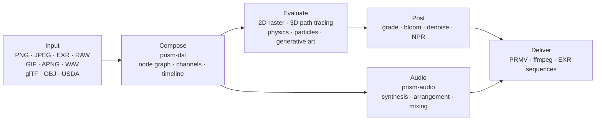

**English** | [简体中文](../README.md) | [Deutsch](README.de.md) | [Español](README.es.md) | [Français](README.fr.md) | [日本語](README.ja.md) | [한국어](README.ko.md) | [Português (BR)](README.pt-BR.md) | [Русский](README.ru.md)

# Prism Engine

**Zero third-party dependencies · Bit-for-bit deterministic · Single-file distribution**

A procedural media engine written from scratch in Rust: decoding, layout, path tracing, physical simulation, audio synthesis, and encoding — all inside one source tree. No third-party crates, no system libraries, no network at build time.


[](https://github.com/Qianjinqie/prism-engine/releases)


<sub>Not a mock-up — engine output: 1200×675, 256 spp, path tracing + physical BSDF + ACES tone mapping, 4 threads, 158 s. Scene source: [`docs/gallery/gallery.rs`](gallery/gallery.rs).</sub>

**642** files · **28** crates · **261k** lines of Rust · **3929** tests · **0** third-party dependencies · **18.9 MB** single-file package

---

## Why this engine exists

A conventional media pipeline is assembled: ffmpeg decodes, Blender renders, ImageMagick writes stills, a DAW handles sound, and scripts glue everything together with temp files. Each tool is excellent, but the seams lose two things — **determinism** and **auditability**. Change machines and the floating-point path changes; change versions and the defaults move; when something breaks, you face five black boxes and a pile of intermediate files.

Prism Engine pulls the whole chain into one source tree. Same scene description, same parameters, any machine, any run — identical pixels and identical bytes. That is not a promise; 3929 tests pin it down.

It is not meant to replace ffmpeg or Blender. It replaces the glue between them, and the determinism that glue quietly throws away.

The audience is narrow on purpose: pipelines that need "same input, any machine, same output" — batch rendering, reproducible graphics research, rendering inside CI.

### Three hard constraints

| Constraint | How it is enforced | What it costs |
| --- | --- | --- |
| **Zero third-party code** | All 110 runtime + 20 test dependencies are in-repo `path` dependencies; no `build.rs`, no native linking, no network at build time | Every format, algorithm, font, and codec has to be written here |
| **Bit-for-bit determinism** | Fixed-point IDCT, fixed sampling sequences, a four-dimensional configuration hash; identical across platforms for identical input | No fast floating-point shortcuts, no reliance on hash-map iteration order |
| **Single-file distribution** | 642 files across 28 crates merged into one 18.9 MB UTF-8 text, restored by `node unpack.cjs` | You give up browsing the source directly on GitHub |

---

## Up and running in three minutes

```bash
# 1. Fetch the single-file source package and verify it
curl -L -O https://github.com/Qianjinqie/prism-engine/releases/download/v2.1/prism-engine-v2.1-source.txt
curl -L -O https://github.com/Qianjinqie/prism-engine/releases/download/v2.1/SHA256SUMS.txt
sha256sum -c SHA256SUMS.txt

# 2. Extract the unpack script embedded in the package (Node 18+ only, no npm install)
awk '/^UNPACK SCRIPT BEGIN$/{f=1;next} /^UNPACK SCRIPT END$/{f=0} f' \
  prism-engine-v2.1-source.txt > unpack.cjs
node unpack.cjs                    # restores 642 files

# 3. Build and run the full test suite
cargo test --workspace --release     # 3929 passed / 0 failed

# 4. Write nothing, just watch it render
cargo run -p prism-app --release     # built-in demo scene
```

What you get is an ordinary Cargo workspace (28 crates under `src/`); every `cargo` command behaves as usual. The first build takes a few minutes.

---

## One shot, one text file

`.prism` is the engine's scene description language. Below is a complete, renderable three-second shot — sphere, material, orbit camera, directional light, duration, grade, output spec, all of it:

```prism
scene "spin_red_ball" {
    sphere ball {
        radius 1.0
        material {
            albedo #c0392b
            roughness 0.3
            metalness 0.05
        }
    }

    camera main {
        orbit {
            center 0,0,0
            radius 8.0
        }
        fov 45
    }

    light sun {
        direction (1.0, -1.0, -0.5)
        color #fff4e6
        intensity 3.0
    }
}

timeline {
    duration 3s
    fps 12
}

aesthetic {
    teal-orange
    contrast 1.12
    filmic
}

output {
    resolution 480x270
    format frames
}
```

```bash
cargo run -p prism-app --release -- examples/spin_red_ball.prism          # frame sequence
cargo run -p prism-app --release -- render examples/w2d_showcase.prism \
    --out out/demo.mp4                                                     # finished movie in one call
```

`render` takes the v2 direct path: compile the node graph → evaluate frame by frame → encode into a container, with no intermediate frames on disk. Unsupported nodes produce an explicit `R5xxx` error instead of being skipped silently.


<sub>Frame 10 of `examples/w2d_showcase.prism`: a 3D sphere, a text layer, a grade, and a fade track all sharing one timeline.</sub>

---

## Or just the Rust API

If you would rather skip the DSL, call the library directly. This is the skeleton of the hero image (the full scene is 190 lines, see [`docs/gallery/gallery.rs`](gallery/gallery.rs)):

```rust
use prism_core::node::EvalCtx;
use prism_math::Vec3;
use prism_rt::camera::Camera;
use prism_rt::integrator::{render_pixel, MaterialKind, RenderParams, Scene, Sphere};

let scene = Scene {
    spheres: vec![(
        Sphere { center: Vec3::new(0.0, 0.6, 0.0), radius: 0.6 },
        MaterialKind::Lambert { albedo: Vec3::new(0.8, 0.2, 0.15) },
    )],
    ..Default::default()
};
let cam = Camera::new(
    Vec3::new(0.0, 1.2, 4.8),   // eye
    Vec3::new(0.0, 0.72, 0.0),  // target
    Vec3::new(0.0, 1.0, 0.0),   // up
    30.0, 0.05, 4.85, 0.0, 1.0 / 48.0,
);
let ctx = EvalCtx::new(20261028, 0, 0);
let params = RenderParams::new(256, 10);  // 256 samples per pixel, up to 10 bounces

// One pixel: scene, camera, sampling context, pixel coordinate, resolution, params
let color = render_pixel(&scene, &cam, &ctx, (640, 360), (1280, 720), &params);
```

`render_pixel` is a pure function: scene, camera, sampling context, and pixel coordinate in; linear RGB out. With the same parameters it returns identical bits regardless of thread or call order — which is why parallel rendering needs no synchronization at all.

---

## Capability map

| Layer | What it does |
| --- | --- |
| **Read** | PNG (8/16-bit), baseline JPEG (fixed-point IDCT), GIF/APNG frame by frame, EXR (including DWA), baseline RAW, WAV; glTF / OBJ / USDA assets, MaterialX parameters, external TTF/OTF fonts |
| **Compose** | DSL v1/v2 compilation, five high-level combinators (title card / lower third / split screen / Ken Burns / morph between scenes), four transitions + morph, formula typesetting (sub/superscripts, fractions, radicals, matrices, large operators), sampling a timeline at any instant |
| **Render** | Path tracing + physical BSDF (diffuse / specular / glass / metal / subsurface), Woodcock heterogeneous volumes, analytic intersections for cylinders / cones / tori / surfaces of revolution (quartic via Ferrari's closed form), SAH-BVH triangle meshes, CPU reference backend, Vulkan compute + ray-tracing pipelines |
| **Simulate** | Unified XPBD solver (rigid / soft bodies / cloth / joints / fluids / fracture), FLIP smoke, particle systems (optionally driven by audio envelopes), flow fields / L-systems / cellular automata / reaction-diffusion / fractals / Voronoi |
| **Grade** | Secondary grading (HSL selections + RGB curves), cinematic / film / anime presets, blur / bloom / halation / film grain, four NPR styles (toon / watercolor / halftone / oil), three-in-one denoising, vector path rasterization and draw-on |
| **Sound** | PolyBLEP synthesizers, ADSR, scale and chord-progression state machines, arpeggiator, step drum machine, SMF parsing, SFZ sampler, granular synthesis, multitrack mixing, loudness normalization, beat / onset / FFT analysis |
| **Deliver** | In-house `PRMV` container (v2/v3) with I/P-frame JPEG-domain coding, water-filling rate control, qpel motion estimation; ffmpeg pipeline (H.264/HEVC when present, automatic MJPEG fallback when not); EXR sequences; multi-process frame farm (resumable, parallel MD5 == serial MD5) |
| **Integrate** | Three MCP stdio tools (`scene_check` / `render_submit` / `diagnose`), node SDK with semantic-version negotiation, HTTP/1.1 render service, batch-manifest Cartesian rendering, hardware-encoder probe skeleton for three platforms |

> The table is only a table of contents. For the exact parameters and the "what it cannot do" of each capability, see `开发者指南.md` inside the package.

---

## Capabilities that do not fit the list

Some things do not belong in the table above — they are not "one more format", but infrastructure the engine grew for itself.

### Audio: a built-in DAW kernel

`prism-audio` is not an edge module that happens to read WAV. From composition to mixing it is a complete chain, and every function is a pure function of its parameters (identical bits across platforms for identical input):

- **Synthesis**: an anti-aliased PolyBLEP oscillator family, closed-form ADSR envelopes, four mood presets;
- **Theory**: a scale library (major/minor, pentatonic, modes), 12-TET pitch-class ↔ frequency, a functional-grammar state machine for chord progressions plus voice leading;
- **Arrangement**: arpeggiator (pattern / rate / octave), step drum machine, bar and beat grids;
- **Material**: hand-written SMF parsing (MIDI import), SFZ sampler, granular synthesis;
- **Sound design**: physical modeling, spatial panning, effect chains;
- **Mixing**: multitrack linear mixing, fades, peak-safe limiting;
- **Analysis and linkage**: beat / onset detection, FFT spectra, envelope extraction, loudness normalization; AudioReactive baking reads a fixed window at frame N, making it a pure function of the frame and seek-equivalent.

> Boundary: AAC / mp3 encoding is not implemented in-house (patent history plus effort); it goes through external ffmpeg.

### A definable kernel registry

Every node type in the engine is a **particular solution** of a "kernel + lattice + dual" triple. Third parties (or you) can statically register new solutions with `registry!`, **without touching the engine core**:

- Static inclusion: the macro expands inside the defining crate; `inventory` and proc-macros are forbidden, keeping the dependency count at zero;
- Registration performs a **three-question check** (kernel form / lattice / dual); incomplete answers are rejected with a three-part error;
- Official and custom solutions share one registry and are indistinguishable at runtime;
- Mathematically this maps to the six inversion strategies for the operator equation `f = g + Kf` (exact / stochastic / local / regularized / iterative / spectral) — adding a feature means declaring a triple, not patching the render loop.

### GPU: three paths, three states

| Backend | Status | Evidence |
| --- | --- | --- |
| **Vulkan** | Really runs | Compute + ray-tracing pipelines; verifiable without a GPU on Mesa's lavapipe software ICD; `render_scene` output is **bit-identical (0 difference)** to the CPU reference; `is_available()` is a compute ∧ render self-check |
| **Metal** | Compiled behind a gate, not enabled | Isomorphic port complete, not verified on hardware, `is_available()` is always false |
| **WebGPU** | Conclusion only | Feasibility assessment done (4–6 person-days of porting), render path not implemented |

### Anti-false-green gates

Four zero-dependency gate scripts (Node only): ghost-write defense (including a reverse self-test), open-source hygiene scan, compliance self-check (9/9 pass plus 8/8 must-fail proofs), and a pack round-trip check. A gate has exactly two outcomes — pass or fail — and "looks fine" is not one of them. **A false green is more dangerous than a failure.**

---

## Determinism is not a slogan

Four layers of machinery, from parameters all the way down to bytes:

1. **Signature closure**: node graphs, cache keys, snapshot keys, and frame signatures share one four-dimensional configuration hash. Change one parameter ⇒ the key must change ⇒ no stale reuse. Iteration nodes include `(ε, n)` in their key; stream nodes include the frame number; `None` degrades bit-for-bit to the old behavior.
2. **Byte fixed points**: USD export→import→export is byte-identical; WAV 16/24/32-bit round-trips match; EXR is compared bitstream-to-bitstream against the official OpenEXR.
3. **Packaging determinism**: packing the same source twice yields an identical SHA-256; the unpack round-trip compares every file byte by byte.
4. **Tests as the criterion**: many of the 3929 tests lock golden values (tolerance tightened from 1e-2 to 1e-6, measured residual 4.53e-7); shape fidelity is bounded by Hausdorff distance rather than "looks close enough".

---

## Architecture



28 crates, grouped by responsibility:

| Group | Crates |
| --- | --- |
| Core | `prism-core` · `prism-math` · `prism-bytes` · `prism-geometry` · `prism-noise` |
| Media I/O | `prism-io` · `prism-media` · `prism-mux` · `prism-audio` · `prism-texture` |
| Rendering | `prism-render` · `prism-raster` · `prism-gpu` · `prism-postfx` · `prism-vector` · `prism-particles` |
| Animation / generative | `prism-anim` · `prism-genart` · `prism-aesthetic` · `prism-physics` |
| Text / UI | `prism-text` · `prism-rt` · `prism-app` |
| Advanced | `prism-ai` · `prism-dsl` · `prism-infra` · `prism-author` |
| Sidecar (feature gate) | `prism-ffi-hwenc` |

Layout after unpacking:

| Path | Contents |
| --- | --- |
| `src/` | Source of the 28 crates (named `crates/` in the repository, reorganized for distribution) |
| `Compliance/` | Zero-dependency verification, third-party notices, asset registry |
| `开发者指南.md` | Self-contained developer guide: getting started / architecture / math kernel / gates / extension |
| `tools/` | Gate and packaging scripts |
| `examples/` | `.prism` samples and node packages (read via `include_str!`, so a missing file breaks the build) |
| `.github/workflows/` | CI configuration |

> Design documents (`docs/设计/`) live only in the publisher's full repository and are not distributed; the demo crate `prism-anim-demo` is not packaged either.

---

## Build, test, and gates

```bash
cargo test --workspace --release      # 3929 passed / 0 failed / 0 ignored
cargo xtest                           # equivalent alias
cargo test -p prism-core --release    # single-crate smoke test

node tools/ghost_guard.mjs --check    # ghost-write defense: G1 redefinition / G2 strict superset / G3 top-level docs / G4 build
node tools/hygiene_scan.mjs           # hygiene: lists every leftover internal term (file:line), exits 1 on a hit
node tools/compliance_check.mjs       # compliance self-check: must pass 9/9
node tools/compliance_check.mjs --self-test  # reverse proof: must fail, proving the criteria discriminate
node tools/pack_source_txt.mjs --verify      # pack and unpack round-trip, byte by byte
```

- Full suite: **3929 passed / 0 failed / 0 ignored**, 179 test binaries, 171.5 s using all cores (release).
- CI has six jobs: ghost-write defense, build + full tests, wasm32 build, WGSL static check, bitstream interop against official OpenEXR, Node-host cross-check.
- The hygiene scan still has hits: the distributed documentation layer is clean, the rest sit in source comments and repository-only files. The script exists so leftovers stay **visible and fixable one by one** — not to pretend the tree is spotless.

---

## Honest boundaries

| Boundary | Status | Way out |
| --- | --- | --- |
| DNG `Compression=7` (lossless JPEG) | Not implemented; DNGs from real cameras cannot be read | Convert to 16-bit TIFF / PNG first |
| mp3 / AAC / FLAC | Decoding via external ffmpeg probe; encoding not implemented | Install ffmpeg, or stay on WAV |
| Curved primitives on GPU | CPU path only | Triangulate and go through the SAH-BVH |
| Metal | Gate compiled, not verified on hardware, not enabled | Wire it up once Apple hardware is available |
| WebGPU | Feasibility concluded, render path not implemented | 4–6 person-days |
| Hardware encoding | Probe skeleton for three platforms, no implementation | Fill in per target platform |
| GPU speedup | Correctness verified only on lavapipe, never measured on a real GPU | Measure on target hardware |
| Hygiene scan | Existing hits in source comments | Clean them one by one; the script tracks them |

These are not "later" items. They are explicitly unsupported today. Better here than buried in an issue.

---

## Compliance

The engine promises zero third-party code dependencies, verified by self-check:

- **C1 Zero third-party code**: all 130 dependencies (110 runtime + 20 test) are in-repo `path` dependencies; no `build.rs`, no native link directives; `Cargo.lock` pins 29 in-repo packages.
- **C2 Complete asset registry**: all five asset entries have their main-table fields; fonts are distributed under SIL OFL 1.1 with the full license text next to the font at `src/prism-text/font_data/LICENSE`.
- **C3 Third-party notices**: `Compliance/THIRD-PARTY-NOTICES.md` explicitly separates "data assets ≠ code dependencies".

---

## License

Apache License 2.0, see [`LICENSE`](../LICENSE).

When redistributing, keep the notices and asset registry under `Compliance/`.

---

<sub>The hero image and the DSL screenshot are both rendered by the engine itself; parameters are in the captions and in [`docs/gallery/gallery.rs`](gallery/gallery.rs).</sub>
