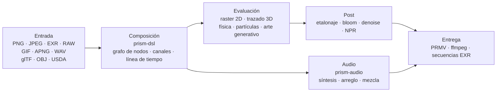

<h1 align="center">Prism Engine</h1>

<h3 align="center">Motor de medios procedural</h3>

<p align="center">
  <sub>Decodificar · Componer · Path tracing · Simular · Sintetizar · Codificar &nbsp;|&nbsp; Fotograma · Secuencia · Montaje final &nbsp;|&nbsp; CPU + Vulkan</sub>
</p>

<p align="center">
  <a href="../README.md">中文</a>
  · <a href="README.en.md">English</a>
  · <a href="README.de.md">Deutsch</a>
  · <b><a href="README.es.md">Español</a></b>
  · <a href="README.fr.md">Français</a>
  · <a href="README.ja.md">日本語</a>
  · <a href="README.ko.md">한국어</a>
  · <a href="README.pt-BR.md">Português</a>
  · <a href="README.ru.md">Русский</a>
</p>

<p align="center">
  
  
  
  
  
  <a href="https://github.com/Qianjinqie/prism-engine/releases"></a>
</p>

<p align="center">
  
</p>

<p align="center">
  <sub>No es un montaje, es salida del motor: 1200×675 · 256 spp · trazado de rayos + BSDF físico + mapeo tonal ACES · 4 hilos, 158 s. Código de la escena: <a href="gallery/gallery.rs"><code>docs/gallery/gallery.rs</code></a>.</sub>
</p>

<p align="center">
  <sub><b>642</b> archivos · <b>28</b> crates · <b>261 mil</b> líneas de Rust · <b>3929</b> pruebas · <b>0</b> dependencias de terceros · <b>18,9 MB</b> en un solo archivo</sub>
</p>

<!-- TOC-START -->
<details>
<summary>Contenido</summary>

- [Mapa de capacidades](#capabilities)
- [En marcha en tres minutos](#quickstart)
- [Un plano, un texto](#one-scene)
- [O simplemente la API de Rust](#rust-api)
- [Capacidades que no caben en la lista](#internals)
- [Hechos de ingeniería](#engineering)
- [Arquitectura](#architecture)
- [Compilar, probar y puertas](#build-test)
- [Límites honestos](#boundaries)
- [Cumplimiento](#compliance)
- [Licencia](#license)

</details>
<!-- TOC-END -->

<a id="capabilities"></a>
## Mapa de capacidades

Un motor de medios procedural en Rust. La entrada es una escena `.prism` o una llamada a la API de Rust; la salida es un fotograma, una secuencia de fotogramas o un montaje final. Las capas siguen una cadena de medios; congelar un instante da un fotograma, avanzar y grabarlo da vídeo — todas las capas tratan ambos igual.

| Capa | Qué hace |
| --- | --- |
| **Leer** | PNG (8/16 bits, inversión de filtros), JPEG baseline (IDCT de coma fija, idéntico bit a bit entre plataformas), EXR (lectura/escritura, familia de compresión, DWA), RAW de cámara, GIF / APNG fotograma a fotograma, WAV; importación glTF / OBJ / USDA, parámetros MaterialX; carga TTF/OTF con cadena de respaldo de cuatro niveles (incorporada → usuario → subconjuntos multi-escritura → símbolos matemáticos) |
| **Componer** | Análisis OpenType, shaping GSUB/GPOS, bidireccional UAX #9, cuatro formas árabes, composición vertical; composición de fórmulas (sub/superíndices, fracciones, radicales, matrices, operadores grandes); DSL v1/v2 compilado a un grafo de tripletas; cinco combinadores de alto nivel (cabecera / rótulo inferior / pantalla dividida / Ken Burns / morph entre escenas); cuatro transiciones + morph, muestreables en cualquier instante |
| **Renderizar** | Path tracing + BSDF físico (difuso / especular / vidrio / metal / subsuperficie), vidrio y metal por inversión estocástica (serie de Neumann, Monte Carlo); volúmenes heterogéneos Woodcock; intersecciones analíticas para cilindros / conos / toros / superficies de revolución (cuártica por Ferrari); mallas triangulares + SAH-BVH (ordenación estable, construcción determinista); mallas horneadas a SDF para booleanos / deformación de dominio / colisión exacta; CpuRef como backend de primera clase + pipelines Vulkan de cómputo y ray tracing |
| **Simular** | Solucionador XPBD unificado — rígidos / blandos / tela / articulaciones / fluidos / fractura son seis juegos de parámetros de un mismo bucle de proyección de restricciones; humo FLIP; partículas + AudioReactive; restricciones y sombreado de pelo; campos de flujo / sistemas L / autómatas celulares / reacción-difusión / fractales / Voronoi; solución analítica de resortes y keyframes |
| **Etalonar** | Etalonaje secundario (selecciones HSL + curvas RGB); presets cinematic / film / anime, con tres niveles (borrador / estándar / cine) tarifados explícitamente; blur / bloom / viñeta / aberración cromática / sharpen / glitch / dissolve; halation + grano de película a dos escalas (derivado en el dominio del píxel); denoising triple; cuatro estilos NPR (toon / watercolor / halftone / oil); funciones de transferencia PQ / HLG, sRGB lineal ↔ ACEScg, transformada de salida ACES |
| **Sonido** | Oscilador PolyBLEP anti-aliasing + envolvente ADSR cerrada + 4 presets de ánimo; biblioteca de escalas + 12-TET + máquina de estados de progresiones por gramática funcional + conducción de voces; arpegiador / caja de ritmos por pasos / rejilla de compases; parser SMF escrito a mano, sampler SFZ, síntesis granular; modelado físico / paneo espacial / cadenas de efectos; mezcla multipista + limitación de picos; beat / onset / FFT, horneado AudioReactive, normalización de sonoridad; WAV 16/24/32 bits round-trip byte a byte |
| **Entregar** | Contenedor PRMV propio (v2/v3, v3 lee v1/v2) + codificación temporal I/P; control de tasa water-filling + estimación de movimiento qpel subpíxel (PSNR medido +2,577 dB, tamaño −21,6 %); ffmpeg detectado en tiempo de ejecución — pipe stdin a H.264/HEVC si existe, fallback automático a MJPEG si no, siempre sale un archivo; contenedores MP4 + MJPEG, secuencias EXR; granja de frames multiproceso (reanudable, MD5 paralelo == MD5 serie); mapeo temporal NLE / keyframes / transiciones |
| **Integrar** | Tres herramientas MCP stdio (`scene_check` / `render_submit` / `diagnose`); SDK de nodos con negociación de versión semántica + paquete de nodo de ejemplo; CLI (`render` / `preview` / `demo`); editor interactivo con dos niveles de previsualización (Draft geométrico / Real bajo spp) + incrementos por firma de subgrafo; manifiesto batch como producto cartesiano; esqueleto de sonda de codificador hardware para tres plataformas (VideoToolbox / NVENC / VAAPI, sin backend conectado) |
| **Vía auxiliar** | Arte generativo: campos de flujo / sistemas L / autómatas celulares / reacción-difusión / Mandelbrot / Voronoi, draw-on vectorial y gráficos. Asistencia IA: capa de inferencia mock determinista (storyboard / subtítulos / sugerencias de color), pesos del modelo leídos como datos con multiplicación-suma propia, sin framework de ML |

La tabla solo enumera capacidades. Lo que cada una no puede hacer está en [Límites honestos](#límites-honestos), no escondido en la tabla.

<a id="quickstart"></a>
## En marcha en tres minutos

```bash
# 1. Descargar el paquete de código y verificar su SHA-256
curl -L -O https://github.com/Qianjinqie/prism-engine/releases/download/v2.1/prism-engine-v2.1-source.txt
curl -L -O https://github.com/Qianjinqie/prism-engine/releases/download/v2.1/SHA256SUMS.txt
sha256sum -c SHA256SUMS.txt

# 2. Extraer el script de desempaquetado incrustado (solo Node 18+, sin npm install)
awk '/^UNPACK SCRIPT BEGIN$/{f=1;next} /^UNPACK SCRIPT END$/{f=0} f' \
  prism-engine-v2.1-source.txt > unpack.cjs
node unpack.cjs                    # restaura 642 archivos

# 3. Compilar y ejecutar la suite completa
cargo test --workspace --release     # 3929 passed / 0 failed

# 4. Sin escribir nada, verlo renderizar
cargo run -p prism-app --release     # escena de demostración integrada
```

El resultado es un workspace de Cargo normal (28 crates bajo `src/`); el resto de comandos `cargo` funcionan como en cualquier proyecto Rust. La primera compilación tarda unos minutos.

<a id="one-scene"></a>
## Un plano, un texto

`.prism` es el lenguaje de descripción de escenas del motor. Lo siguiente es un plano completo y renderizable de tres segundos: esfera, material, cámara orbital, luz direccional, duración, etalonaje y especificación de salida:

```prism
scene "spin_red_ball" {
    sphere ball {
        radius 1.0
        material {
            albedo #c0392b
            roughness 0.3
            metalness 0.05
        }
    }

    camera main {
        orbit {
            center 0,0,0
            radius 8.0
        }
        fov 45
    }

    light sun {
        direction (1.0, -1.0, -0.5)
        color #fff4e6
        intensity 3.0
    }
}

timeline {
    duration 3s
    fps 12
}

aesthetic {
    teal-orange
    contrast 1.12
    filmic
}

output {
    resolution 480x270
    format frames
}
```

```bash
cargo run -p prism-app --release -- examples/spin_red_ball.prism          # secuencia de fotogramas
cargo run -p prism-app --release -- render examples/w2d_showcase.prism \
    --out out/demo.mp4                                                     # película terminada en una llamada
```

`render` toma la ruta directa v2: compilar el grafo de nodos → evaluar fotograma a fotograma → codificar en un contenedor, sin fotogramas intermedios en disco. Los nodos no soportados producen un error explícito `R5xxx` en lugar de omitirse en silencio.

<p align="center">
  
  <br>
  <sub>Fotograma 10 de `examples/w2d_showcase.prism`: una esfera 3D, una capa de texto, un etalonaje y una pista de fundido comparten una misma línea de tiempo.</sub>
</p>

<a id="rust-api"></a>
## O simplemente la API de Rust

Si prefieres no escribir DSL, llama a la biblioteca directamente. Este es el esqueleto de la imagen principal (la escena completa tiene 190 líneas, ver [`docs/gallery/gallery.rs`](gallery/gallery.rs)):

```rust
use prism_core::node::EvalCtx;
use prism_math::Vec3;
use prism_rt::camera::Camera;
use prism_rt::integrator::{render_pixel, MaterialKind, RenderParams, Scene, Sphere};

let scene = Scene {
    spheres: vec![(
        Sphere { center: Vec3::new(0.0, 0.6, 0.0), radius: 0.6 },
        MaterialKind::Lambert { albedo: Vec3::new(0.8, 0.2, 0.15) },
    )],
    ..Default::default()
};
let cam = Camera::new(
    Vec3::new(0.0, 1.2, 4.8),   // ojo
    Vec3::new(0.0, 0.72, 0.0),  // objetivo
    Vec3::new(0.0, 1.0, 0.0),   // arriba
    30.0, 0.05, 4.85, 0.0, 1.0 / 48.0,
);
let ctx = EvalCtx::new(20261028, 0, 0);
let params = RenderParams::new(256, 10);  // 256 muestras por píxel, hasta 10 rebotes

// Un píxel: escena, cámara, contexto de muestreo, coordenada, resolución, parámetros
let color = render_pixel(&scene, &cam, &ctx, (640, 360), (1280, 720), &params);
```

`render_pixel` es una función pura: entran escena, cámara, contexto de muestreo y coordenada de píxel; sale RGB lineal. Con los mismos parámetros devuelve bits idénticos sin importar el hilo ni el orden de llamada; por eso el renderizado en paralelo no necesita sincronización alguna.

<a id="internals"></a>
## Capacidades que no caben en la lista

Estas cosas no son soporte de formatos, sino infraestructura dentro del motor.

### Audio: un núcleo de DAW incorporado

La lista de capacidades está en la fila **Sonido**. Aquí va cómo funciona, y por qué puede colgar de la misma línea de tiempo de render:

- **Cada función es una función pura de sus parámetros**: la misma partitura recalculada en cualquier posición de seek da muestras idénticas bit a bit, sin depender del historial de reproducción
- **AudioReactive se hornea en una función pura por fotograma**: el fotograma N lee una ventana fija, así que saltar fotogramas, reproducir al revés o trocear en paralelo no cambia el resultado
- **La mezcla es álgebra lineal offline-paralela**: suma multipista + fundidos + limitación de picos, sin máquina de estados oculta

> Límite: la codificación AAC / mp3 no se implementa aquí (historia de patentes más esfuerzo); pasa por ffmpeg externo.

### Un registro de kernels definibles

Cada tipo de nodo del motor es una **solución particular** de una terna «kernel + retícula + dual». Terceros (o tú) pueden registrar soluciones nuevas estáticamente con `registry!`, **sin tocar el núcleo del motor**:

- Inclusión estática: la macro se expande dentro del crate que define; se prohíben `inventory` y los proc-macros para mantener cero dependencias;
- El registro hace una **verificación de tres preguntas** (forma del kernel / retícula / dual); respuestas incompletas se rechazan con un error en tres partes;
- Las soluciones oficiales y las propias comparten un mismo registro y son indistinguibles en tiempo de ejecución;
- Matemáticamente corresponde a las seis estrategias de inversión de la ecuación de operadores `f = g + Kf` (exacta / estocástica / local / regularizada / iterativa / espectral): añadir una capacidad es declarar una terna, no parchear el bucle de renderizado.

### GPU: tres rutas, tres estados

| Backend | Estado | Evidencia |
| --- | --- | --- |
| **Vulkan** | Funciona de verdad | Tuberías compute + ray tracing; verificable sin GPU sobre el ICD software lavapipe de Mesa; la salida de `render_scene` es **idéntica byte a byte (0 diferencia)** a la referencia de CPU; `is_available()` es una autocomprobación compute ∧ render |
| **Metal** | Compilado tras una puerta, sin activar | Port isomorfo terminado, no verificado en hardware, `is_available()` siempre false |
| **WebGPU** | Solo conclusión | Evaluación de viabilidad hecha (4–6 días-persona de port), ruta de renderizado no implementada |

<a id="engineering"></a>
## Hechos de ingeniería

Tres restricciones y lo que cuesta cada una:

| Restricción | Cómo se aplica | Qué cuesta |
| --- | --- | --- |
| Cero código de terceros | Las 110 dependencias de ejecución + 20 de test son dependencias `path` dentro del repositorio; sin `build.rs`, sin enlazado nativo, sin red al compilar | Cada formato, algoritmo, fuente y códec hay que escribirlo aquí |
| Determinismo bit a bit | IDCT de coma fija, secuencias de muestreo fijas, un hash de configuración de cuatro dimensiones; idéntico entre plataformas para la misma entrada | Se renuncia a atajos rápidos en coma flotante y a depender del orden de iteración de hashmaps |
| Distribución en un solo archivo | 642 archivos de 28 crates fusionados en un texto UTF-8 de 18,9 MB, restaurado con `node unpack.cjs` | Se renuncia a hojear el código directamente en GitHub |

### Cómo se verifica el determinismo

Cuatro capas, desde los parámetros hasta los bytes:

1. **Cierre de firmas**: grafos de nodos, claves de caché, claves de snapshot y firmas de fotograma comparten un hash de configuración de cuatro dimensiones. Cambiar un parámetro ⇒ la clave cambia ⇒ no hay reutilización obsoleta. Los nodos de iteración llevan `(ε, n)` en la clave; los de flujo, el número de fotograma; `None` degrada bit a bit al comportamiento anterior.
2. **Puntos fijos de bytes**: USD exportar→importar→exportar es idéntico byte a byte; los round-trips WAV de 16/24/32 bits coinciden; EXR se compara bitstream contra bitstream con el OpenEXR oficial.
3. **Determinismo de empaquetado**: empaquetar dos veces la misma fuente da el mismo SHA-256; el round-trip de desempaquetado compara cada archivo byte a byte.
4. **Los tests como criterio**: muchos de los 3929 tests fijan valores de oro (tolerancia ajustada de 1e-2 a 1e-6, residuo medido 4,53e-7); la fidelidad de forma se acota con distancia de Hausdorff en lugar de «se ve bastante parecido».

<a id="architecture"></a>
## Arquitectura



28 crates agrupados por responsabilidad:

| Grupo | Crates |
| --- | --- |
| Núcleo | `prism-core` · `prism-math` · `prism-bytes` · `prism-geometry` · `prism-noise` |
| E/S de medios | `prism-io` · `prism-media` · `prism-mux` · `prism-audio` · `prism-texture` |
| Renderizado | `prism-render` · `prism-raster` · `prism-gpu` · `prism-postfx` · `prism-vector` · `prism-particles` |
| Animación / generativo | `prism-anim` · `prism-genart` · `prism-aesthetic` · `prism-physics` |
| Texto / UI | `prism-text` · `prism-rt` · `prism-app` |
| Avanzado | `prism-ai` · `prism-dsl` · `prism-infra` · `prism-author` |
| Sidecar (feature gate) | `prism-ffi-hwenc` |

Estructura tras desempaquetar:

| Ruta | Contenido |
| --- | --- |
| `src/` | Código de los 28 crates (en el repositorio `crates/`, reorganizado para la distribución) |
| `Compliance/` | Verificación de cero dependencias, avisos de terceros, registro de activos |
| `开发者指南.md` | Guía del desarrollador autónoma: inicio / arquitectura / núcleo matemático / puertas / extensión |
| `tools/` | Scripts de puertas y empaquetado |
| `examples/` | Ejemplos `.prism` y paquetes de nodos (leídos con `include_str!`; si falta uno, no compila) |
| `.github/workflows/` | Configuración de CI |

> Los documentos de diseño (`docs/设计/`) solo existen en el repositorio completo del editor y no se distribuyen; el crate de demostración `prism-anim-demo` tampoco va en el paquete.

<a id="build-test"></a>
## Compilar, probar y puertas

```bash
cargo test --workspace --release      # 3929 passed / 0 failed / 0 ignored
cargo xtest                           # alias equivalente
cargo test -p prism-core --release    # prueba rápida de un crate

node tools/ghost_guard.mjs --check    # defensa de escritura fantasma: G1 redefinición / G2 superconjunto estricto / G3 documentación superior / G4 compilación
node tools/hygiene_scan.mjs           # higiene: lista cada término interno restante (archivo:línea), exit 1 si hay coincidencia
node tools/compliance_check.mjs       # autocomprobación de cumplimiento: debe pasar 9/9
node tools/compliance_check.mjs --self-test  # prueba inversa: debe fallar, demostrando que el criterio discrimina
node tools/pack_source_txt.mjs --verify      # ida y vuelta de empaquetado, byte a byte
```

- Suite completa: **3929 passed / 0 failed / 0 ignored**, 179 secciones de prueba, 171,5 s con todos los núcleos (release).
- La CI tiene seis jobs: defensa de escritura fantasma, compilación + pruebas completas, compilación wasm32, comprobación estática WGSL, interoperabilidad de bitstream con el OpenEXR oficial, verificación cruzada en host Node.
- El escaneo de higiene aún tiene coincidencias: la capa de documentación distribuida está limpia, el resto está en comentarios de código y archivos solo del repositorio. El script existe para que lo restante siga **visible y corregible pieza a pieza**, no para fingir que todo está limpio.

### Puertas anti-falso-verde

Cuatro scripts de puerta sin dependencias (solo Node): defensa contra escrituras fantasma (con autoprueba inversa), escaneo de higiene de código abierto, autocomprobación de cumplimiento (9/9 aprobadas más 8/8 pruebas de que los criterios fallan cuando deben) y verificación de ida y vuelta del empaquetado. Una puerta tiene exactamente dos resultados — pasa o falla — y «parece que está bien» no es uno de ellos. **Un verde falso es más peligroso que un fallo.**

<a id="boundaries"></a>
## Límites honestos

| Límite | Estado | Salida |
| --- | --- | --- |
| DNG `Compression=7` (lossless JPEG) | No implementado; los DNG de cámaras reales no se pueden leer | Convertir antes a TIFF/PNG de 16 bit |
| mp3 / AAC / FLAC | Decodificación vía sonda de ffmpeg externo; codificación no implementada | Instalar ffmpeg, o quedarse en WAV |
| Primitivas curvas en GPU | Solo ruta de CPU | Triangular y pasar por el SAH-BVH |
| Metal | Puerta compilada, no verificada en hardware, sin activar | Conectar cuando haya hardware Apple |
| WebGPU | Viabilidad concluida, ruta de renderizado no implementada | 4–6 días-persona |
| Codificación hardware | Esqueleto de sondeo para tres plataformas, sin implementación | Rellenar por plataforma objetivo |
| Aceleración GPU | Corrección verificada solo en lavapipe, nunca medida en GPU real | Medir en el hardware objetivo |
| Escaneo de higiene | Coincidencias existentes en comentarios | Limpiar una a una; el script las rastrea |

No son puntos de «ya veremos». Hoy no están soportados, explícitamente. Mejor aquí que escondidos en un issue.

<a id="compliance"></a>
## Cumplimiento

El motor promete cero dependencias de código de terceros y lo verifica por autocomprobación:

- **C1 Cero código de terceros**: las 130 dependencias (110 de ejecución + 20 de prueba) son `path` dentro del repositorio; sin `build.rs`, sin directivas de enlace nativo; `Cargo.lock` fija 29 paquetes del repositorio.
- **C2 Registro de activos completo**: las cinco entradas de activos tienen completos los campos de la tabla principal; las fuentes se distribuyen bajo SIL OFL 1.1 con el texto completo de la licencia junto a la fuente en `src/prism-text/font_data/LICENSE`.
- **C3 Avisos de terceros**: `Compliance/THIRD-PARTY-NOTICES.md` separa explícitamente «activos de datos ≠ dependencias de código».

<a id="license"></a>
## Licencia

Apache License 2.0, ver [`LICENSE`](../LICENSE).

Al redistribuir, conserva los avisos y el registro de activos bajo `Compliance/`.

<sub>La imagen principal y la captura de DSL fueron renderizadas por el propio motor; los parámetros están en los pies de foto y en [`docs/gallery/gallery.rs`](gallery/gallery.rs).</sub>

