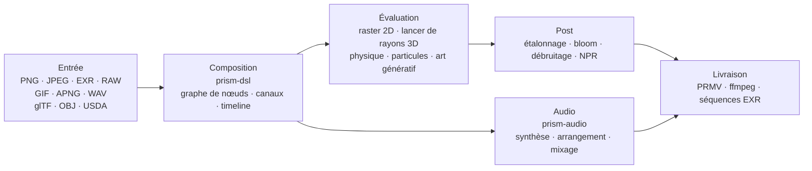

<p align="center">
  
</p>
<h1 align="center">Prism Engine</h1>

<h3 align="center">Moteur multimédia procédural</h3>

<p align="center">
  <sub>Décoder · Composer · Path tracing · Simuler · Synthétiser · Encoder &nbsp;|&nbsp; Image fixe · Séquence · Montage final &nbsp;|&nbsp; CPU + Vulkan</sub>
</p>

<p align="center">
  <a href="../README.md">中文</a>
  · <a href="README.en.md">English</a>
  · <a href="README.de.md">Deutsch</a>
  · <a href="README.es.md">Español</a>
  · <b><a href="README.fr.md">Français</a></b>
  · <a href="README.ja.md">日本語</a>
  · <a href="README.ko.md">한국어</a>
  · <a href="README.pt-BR.md">Português</a>
  · <a href="README.ru.md">Русский</a>
</p>

<p align="center">
  
  
  
  
  
  <a href="https://github.com/Qianjinqie/prism-engine/releases"></a>
</p>

<p align="center">
  
</p>

<p align="center">
  <sub>Pas une maquette, une sortie du moteur : 1200×675 · 256 spp · lancer de rayons + BSDF physique + tonemapping ACES · 4 threads, 158 s. Source de la scène : <a href="gallery/gallery.rs"><code>docs/gallery/gallery.rs</code></a>.</sub>
</p>

<p align="center">
  <sub><b>664</b> fichiers · <b>29</b> crates · <b>273 000</b> lignes de Rust · <b>4029</b> tests · <b>0</b> dépendance tierce · <b>19,5 Mo</b> en un seul fichier</sub>
</p>

<!-- TOC-START -->
<details>
<summary>Sommaire</summary>

- [Carte des capacités](#capabilities)
- [Opérationnel en trois minutes](#quickstart)
- [Un plan, un texte](#one-scene)
- [Ou simplement l'API Rust](#rust-api)
- [Des capacités qui ne tiennent pas dans la liste](#internals)
- [Faits d'ingénierie](#engineering)
- [Architecture](#architecture)
- [Compiler, tester, portes](#build-test)
- [Limites honnêtes](#boundaries)
- [Conformité](#compliance)
- [Licence](#license)

</details>
<!-- TOC-END -->

<a id="capabilities"></a>
## Carte des capacités

Un moteur multimédia procédural en Rust. L'entrée est une scène `.prism` ou un appel à l'API Rust ; la sortie est une image fixe, une séquence d'images ou un montage final. Les couches suivent une chaîne média ; figer un instant donne une image, avancer et enregistrer donne une vidéo — chaque couche traite les deux de la même façon.

| Couche | Ce qu'elle fait |
| --- | --- |
| **Lire** | PNG (8/16 bits, inversion des filtres), JPEG baseline (IDCT en virgule fixe, identique au bit près entre plateformes), EXR (lecture/écriture, famille de compression, DWA), RAW d'appareil, GIF / APNG image par image, WAV ; import glTF / OBJ / USDA, paramètres MaterialX ; chargement TTF/OTF avec chaîne de repli à quatre niveaux (intégrée → utilisateur → sous-ensembles multi-écritures → symboles mathématiques) |
| **Composer** | Analyse OpenType, shaping GSUB/GPOS, bidirectionnel UAX #9, quatre formes arabes, composition verticale ; composition de formules (indices/exposants, fractions, radicaux, matrices, grands opérateurs) ; DSL v1/v2 compilé en graphe de triplets ; cinq combinateurs de haut niveau (carton titre / bandeau bas / écran divisé / Ken Burns / morph entre scènes) ; quatre transitions + morph, échantillonnables à tout instant |
| **Rendre** | Path tracing + BSDF physique (diffus / spéculaire / verre / métal / subsurface), verre et métal par inversion stochastique (série de Neumann, Monte Carlo) ; volumes hétérogènes Woodcock ; intersections analytiques pour cylindres / cônes / tores / surfaces de révolution (quartique par Ferrari) ; maillages triangulaires + SAH-BVH (tri stable, construction déterministe) ; maillages cuits en SDF pour booléens / déformation de domaine / collision exacte ; CpuRef comme backend de première classe + pipelines Vulkan compute et ray tracing |
| **Simuler** | Solveur XPBD unifié — rigides / déformables / tissu / articulations / fluides / fracture sont six jeux de paramètres d'une même boucle de projection de contraintes ; fumée FLIP ; particules + AudioReactive ; contraintes et shading de cheveux ; champs de flux / systèmes L / automates cellulaires / réaction-diffusion / fractales / Voronoi ; solution analytique de ressorts et keyframes |
| **Étalonner** | Étalonnage secondaire (sélections HSL + courbes RVB) ; presets cinematic / film / anime, avec trois niveaux (brouillon / standard / cinéma) chiffrés explicitement ; blur / bloom / vignette / aberration chromatique / sharpen / glitch / dissolve ; halation + grain argentique à deux échelles (dérivé dans le domaine du pixel) ; débruiteur triple ; quatre styles NPR (toon / watercolor / halftone / oil) ; fonctions de transfert PQ / HLG, sRGB linéaire ↔ ACEScg, transformation de sortie ACES |
| **Son** | Oscillateur PolyBLEP anti-repliement + enveloppe ADSR fermée + 4 presets d'ambiance ; bibliothèque de gammes + 12-TET + machine à états de progressions par grammaire fonctionnelle + conduite des voix ; arpégiateur / boîte à rythmes par pas / grille de mesures ; parseur SMF écrit à la main, sampleur SFZ, synthèse granulaire ; modélisation physique / panoramique spatial / chaînes d'effets ; mixage multipiste + limiteur de crête ; beat / onset / FFT, cuisson AudioReactive, normalisation de sonie ; WAV 16/24/32 bits aller-retour octet pour octet |
| **Livrer** | Conteneur PRMV maison (v2/v3, v3 lit v1/v2) + codage temporel I/P ; contrôle de débit water-filling + estimation de mouvement qpel sous-pixel (PSNR mesuré +2,577 dB, taille −21,6 %) ; ffmpeg détecté à l'exécution — pipe stdin vers H.264/HEVC si présent, repli automatique en MJPEG sinon, il sort toujours un fichier ; conteneurs MP4 + MJPEG, séquences EXR ; ferme de frames multiprocessus (reprise possible, MD5 parallèle == MD5 série) ; mapping temporel NLE / keyframes / transitions |
| **Intégrer** | Trois outils MCP stdio (`scene_check` / `render_submit` / `diagnose`) ; SDK de nœuds avec négociation de version sémantique + paquet de nœud d'exemple ; CLI (`render` / `preview` / `demo`) ; éditeur interactif à deux niveaux d'aperçu (Draft géométrique / Real faible spp) + incréments par signature de sous-graphe ; manifeste batch en produit cartésien ; squelette de sonde d'encodeur matériel pour trois plateformes (VideoToolbox / NVENC / VAAPI, sans backend branché) |
| **Voie parallèle** | Art génératif : champs de flux / systèmes L / automates cellulaires / réaction-diffusion / Mandelbrot / Voronoi, draw-on vectoriel et graphiques. Assistance IA : couche d'inférence mock déterministe (storyboard / sous-titres / indications de couleur), poids de modèle lus comme données, multiplication-addition écrite ici, sans framework ML |

Le tableau ne liste que des capacités. Ce que chacune ne sait pas faire se trouve dans [Limites honnêtes](#limites-honnêtes), pas caché dans le tableau.

<a id="quickstart"></a>
## Opérationnel en trois minutes

```bash
# 1. Récupérer le paquet source et vérifier son SHA-256
curl -L -O https://github.com/Qianjinqie/prism-engine/releases/download/v2.2/prism-engine-v2.2-source.txt
curl -L -O https://github.com/Qianjinqie/prism-engine/releases/download/v2.1/SHA256SUMS.txt
sha256sum -c SHA256SUMS.txt

# 2. Extraire le script de dépaquetage embarqué (Node 18+ seulement, sans npm install)
awk '/^UNPACK SCRIPT BEGIN$/{f=1;next} /^UNPACK SCRIPT END$/{f=0} f' \
  prism-engine-v2.2-source.txt > unpack.cjs
node unpack.cjs                    # restaure 664 fichiers

# 3. Compiler et lancer toute la suite de tests
cargo test --workspace --release     # 4029 passed / 0 failed

# 4. Sans rien écrire, le regarder rendre
cargo run -p prism-app --release     # scène de démonstration intégrée
```

Le résultat est un workspace Cargo ordinaire (29 crates sous `src/`) ; les commandes `cargo` suivantes se comportent comme dans tout projet Rust. La première compilation prend quelques minutes.

<a id="one-scene"></a>
## Un plan, un texte

`.prism` est le langage de description de scènes du moteur. Voici un plan complet et rendable de trois secondes — sphère, matériau, caméra orbitale, lumière directionnelle, durée, étalonnage, spécification de sortie :

```prism
scene "spin_red_ball" {
    sphere ball {
        radius 1.0
        material {
            albedo #c0392b
            roughness 0.3
            metalness 0.05
        }
    }

    camera main {
        orbit {
            center 0,0,0
            radius 8.0
        }
        fov 45
    }

    light sun {
        direction (1.0, -1.0, -0.5)
        color #fff4e6
        intensity 3.0
    }
}

timeline {
    duration 3s
    fps 12
}

aesthetic {
    teal-orange
    contrast 1.12
    filmic
}

output {
    resolution 480x270
    format frames
}
```

```bash
cargo run -p prism-app --release -- examples/spin_red_ball.prism          # séquence d'images
cargo run -p prism-app --release -- render examples/w2d_showcase.prism \
    --out out/demo.mp4                                                     # film fini en un appel
```

`render` emprunte le chemin direct v2 : compiler le graphe de nœuds → évaluer image par image → encoder dans un conteneur, sans images intermédiaires sur disque. Les nœuds non pris en charge produisent une erreur explicite `R5xxx` au lieu d'être ignorés en silence.

<p align="center">
  
  <br>
  <sub>Image 10 de `examples/w2d_showcase.prism` : une sphère 3D, un calque de texte, un étalonnage et une piste de fondu partagent une même timeline.</sub>
</p>

<a id="rust-api"></a>
## Ou simplement l'API Rust

Si vous préférez éviter le DSL, appelez directement la bibliothèque. Voici le squelette de l'image d'en-tête (la scène complète fait 190 lignes, voir [`docs/gallery/gallery.rs`](gallery/gallery.rs)) :

```rust
use prism_core::node::EvalCtx;
use prism_math::Vec3;
use prism_rt::camera::Camera;
use prism_rt::integrator::{render_pixel, MaterialKind, RenderParams, Scene, Sphere};

let scene = Scene {
    spheres: vec![(
        Sphere { center: Vec3::new(0.0, 0.6, 0.0), radius: 0.6 },
        MaterialKind::Lambert { albedo: Vec3::new(0.8, 0.2, 0.15) },
    )],
    ..Default::default()
};
let cam = Camera::new(
    Vec3::new(0.0, 1.2, 4.8),   // œil
    Vec3::new(0.0, 0.72, 0.0),  // cible
    Vec3::new(0.0, 1.0, 0.0),   // haut
    30.0, 0.05, 4.85, 0.0, 1.0 / 48.0,
);
let ctx = EvalCtx::new(20261028, 0, 0);
let params = RenderParams::new(256, 10);  // 256 échantillons par pixel, jusqu'à 10 rebonds

// Un pixel : scène, caméra, contexte d'échantillonnage, coordonnée, résolution, paramètres
let color = render_pixel(&scene, &cam, &ctx, (640, 360), (1280, 720), &params);
```

`render_pixel` est une fonction pure : scène, caméra, contexte d'échantillonnage et coordonnée de pixel en entrée ; RGB linéaire en sortie. À paramètres égaux, les bits sont identiques quel que soit le thread ou l'ordre d'appel — c'est pourquoi le rendu parallèle n'a besoin d'aucune synchronisation.

<a id="internals"></a>
## Des capacités qui ne tiennent pas dans la liste

Ce ne sont pas des formats pris en charge, mais de l'infrastructure interne au moteur.

### Audio : un noyau de DAW intégré

La liste des capacités est sur la ligne **Son**. Ici, c'est son mode de fonctionnement, et pourquoi il peut pendre à la même timeline de rendu :

- **Chaque fonction est une fonction pure de ses paramètres** : la même partition recalculée à n'importe quelle position de seek donne des échantillons identiques au bit près, sans dépendre de l'historique de lecture
- **AudioReactive est cuit en fonction pure par image** : l'image N lit une fenêtre fixe, donc sauter des images, lire à l'envers ou découper en parallèle ne change pas le résultat
- **Le mixage est de l'algèbre linéaire parallèle hors ligne** : sommation multipiste + fondus + limiteur de crête, sans machine à états cachée

> Limite : l'encodage AAC / mp3 n'est pas implémenté ici (histoire des brevets plus charge de travail) ; il passe par ffmpeg externe.

### Un registre de noyaux définissables

Chaque type de nœud du moteur est une **solution particulière** d'un triplet « noyau + réseau + dual ». Des tiers (ou vous) peuvent enregistrer statiquement de nouvelles solutions avec `registry!`, **sans toucher au cœur du moteur** :

- Inclusion statique : la macro se développe dans le crate qui définit ; `inventory` et les proc-macros sont interdits pour garder zéro dépendance ;
- L'enregistrement effectue une **vérification en trois questions** (forme du noyau / réseau / dual) ; une réponse incomplète est refusée avec une erreur en trois parties ;
- Les solutions officielles et personnalisées partagent le même registre et sont indistinguables à l'exécution ;
- Mathématiquement, cela correspond aux six stratégies d'inversion de l'équation d'opérateur `f = g + Kf` (exacte / stochastique / locale / régularisée / itérative / spectrale) : ajouter une capacité, c'est déclarer un triplet, pas corriger la boucle de rendu.

### GPU : trois chemins, trois états

| Backend | État | Preuve |
| --- | --- | --- |
| **Vulkan** | Fonctionne réellement | Pipelines compute + ray tracing ; vérifiable sans GPU sur l'ICD logiciel lavapipe de Mesa ; la sortie de `render_scene` est **identique octet pour octet (0 différence)** à la référence CPU ; `is_available()` est un auto-contrôle compute ∧ render |
| **Metal** | Code prêt (pas de backend Metal autonome, non activé), non vérifié sur matériel | Portage isomorphe terminé (actif historique), `is_available()` toujours false |
| **WebGPU** | Code prêt (T1/T2/T3 verts), la surface prise en charge reste limitée à Chrome/Edge ; T3 passe 19/19 sur 2 appareils (Galaxy S10 + HONOR X40, mêmes octets wasm) (aucun n'est de marque Chrome/Edge, donc le point de marque reste en attente) | Étude de faisabilité faite (4–6 jours-homme de portage), chemin de rendu dans T03 ; preuve sur appareil dans `docs/QA/real-device-webgpu-2026-10-30.md` §9 |

<a id="engineering"></a>
## Faits d'ingénierie

Trois contraintes, et ce que chacune coûte :

| Contrainte | Mise en œuvre | Coût |
| --- | --- | --- |
| Zéro code tiers | Les 110 dépendances d'exécution + 20 de test sont des dépendances `path` internes au dépôt ; pas de `build.rs`, pas d'édition de liens native, pas de réseau à la compilation | Chaque format, algorithme, police et codec doit être écrit ici |
| Déterminisme au bit près | IDCT en virgule fixe, séquences d'échantillonnage fixes, un hash de configuration à quatre dimensions ; identique entre plateformes pour une même entrée | On renonce aux raccourcis rapides en virgule flottante et à l'ordre d'itération des hashmaps |
| Distribution en un seul fichier | 664 fichiers de 29 crates fusionnés en un texte UTF-8 de 19,5 Mo, restauré par `node unpack.cjs` | On renonce à parcourir le code directement sur GitHub |

> ⚠️ **Correction de distribution v2.2** : la distribution mono-fichier v2.1 (`dist/prism-engine-v2.1-source.txt`, empaquetée le 2026-10-27) contenait un défaut de compensation multi-diffusion BSDF (décalage de couleur des métaux sursaturés en angle rasant) ; **corrigé en v2.2**. Les utilisateurs rendant des métaux sursaturés avec la distribution mono-fichier v2.1 doivent passer à v2.2.

### Comment le déterminisme est vérifié

Quatre couches, des paramètres jusqu'aux octets :

1. **Clôture de signature** : graphes de nœuds, clés de cache, clés d'instantané et signatures d'image partagent un hash de configuration à quatre dimensions. Changer un paramètre ⇒ la clé change ⇒ pas de réutilisation périmée. Les nœuds d'itération portent `(ε, n)` dans leur clé, les nœuds de flux le numéro d'image ; `None` dégénère au bit près vers l'ancien comportement.
2. **Points fixes d'octets** : USD export→import→export est identique octet pour octet ; les allers-retours WAV 16/24/32 bits concordent ; EXR est comparé flux de bits contre flux de bits avec l'OpenEXR officiel.
3. **Déterminisme du paquetage** : empaqueter deux fois la même source donne un SHA-256 identique ; l'aller-retour de dépaquetage compare chaque fichier octet pour octet.
4. **Les tests comme critère** : beaucoup des 4029 tests verrouillent des valeurs d'or (tolérance resserrée de 1e-2 à 1e-6, résidu mesuré 4,53e-7) ; la fidélité de forme est bornée par distance de Hausdorff plutôt que par « ça a l'air assez proche ».

<a id="architecture"></a>
## Architecture



29 crates, groupés par responsabilité :

| Groupe | Crates |
| --- | --- |
| Noyau | `prism-core` · `prism-math` · `prism-bytes` · `prism-geometry` · `prism-noise` |
| E/S médias | `prism-io` · `prism-media` · `prism-mux` · `prism-audio` · `prism-texture` |
| Rendu | `prism-render` · `prism-raster` · `prism-gpu` · `prism-postfx` · `prism-vector` · `prism-particles` |
| Animation / génératif | `prism-anim` · `prism-genart` · `prism-aesthetic` · `prism-physics` |
| Texte / UI | `prism-text` · `prism-rt` · `prism-app` |
| Avancé | `prism-ai` · `prism-dsl` · `prism-infra` · `prism-author` |
| Sidecar (feature gate) | `prism-ffi-hwenc` |

Structure après dépaquetage :

| Chemin | Contenu |
| --- | --- |
| `src/` | Sources des 29 crates (nommées `crates/` dans le dépôt, réorganisées pour la distribution) |
| `Compliance/` | Vérification zéro dépendance, avis tiers, registre des actifs |
| `开发者指南.md` | Guide du développeur : démarrage / architecture / noyau mathématique / portes / extension |
| `tools/` | Scripts de portes et de paquetage |
| `examples/` | Exemples `.prism` et paquets de nœuds (lus par `include_str!` ; un fichier manquant casse la compilation) |
| `.github/workflows/` | Configuration CI |

> Les documents de conception (`docs/设计/`) ne vivent que dans le dépôt complet de l'éditeur et ne sont pas distribués ; le crate de démonstration `prism-anim-demo` n'est pas empaqueté non plus.

<a id="build-test"></a>
## Compiler, tester, portes

```bash
cargo test --workspace --release      # 4029 passed / 0 failed / 0 ignored
cargo xtest                           # alias équivalent
cargo test -p prism-core --release    # test de fumée d'un crate

node tools/ghost_guard.mjs --check    # défense écriture fantôme : G1 redéfinition / G2 sur-ensemble strict / G3 doc de premier niveau / G4 compilation
node tools/hygiene_scan.mjs           # hygiène : liste chaque terme interne restant (fichier:ligne), exit 1 si touché
node tools/compliance_check.mjs       # auto-contrôle de conformité : doit passer 9/9
node tools/compliance_check.mjs --self-test  # preuve inverse : doit échouer, montrant que le critère discrimine
node tools/pack_source_txt.mjs --verify      # aller-retour paquetage/dépaquetage, octet par octet
```

- Suite complète : **4029 passed / 0 failed / 0 ignored**, 188 sections de tests, 110 s sur tous les cœurs (release).
- La CI compte six jobs : défense écriture fantôme, compilation + tests complets, compilation wasm32, vérification statique WGSL, interopérabilité de flux de bits avec l'OpenEXR officiel, contre-vérification sur hôte Node.
- Le scan d'hygiène a encore des occurrences : la couche documentaire distribuée est propre, le reste se trouve dans les commentaires de source et les fichiers propres au dépôt. Le script existe pour que le reste demeure **visible et corrigeable un par un**, pas pour prétendre que tout est propre.

### Portes anti-faux-vert

Quatre scripts de porte sans dépendance (Node uniquement) : défense contre les écritures fantômes (avec auto-test inverse), scan d'hygiène open source, auto-contrôle de conformité (9/9 réussis plus 8/8 preuves que le critère échoue quand il doit), et vérification aller-retour du paquet. Une porte n'a que deux issues — réussite ou échec — et « ça a l'air bon » n'en fait pas partie. **Un faux vert est plus dangereux qu'un échec.**

<a id="boundaries"></a>
## Limites honnêtes

| Limite | État | Issue | Preuve / point de rejet |
| --- | --- | --- | --- |
| DNG `Compression=1/7/8` (dont 32946 Deflate) | 1/7/8 pris en charge (dont 32946 Deflate) ; modèles d'appareils réels non validés par échantillon | Aucune conversion requise ; les échantillons de caméras réelles peuvent ajouter un golden (valeurs non prises en charge 6/34892/34712/52546 rejetées structurellement) | `raw.rs:3282,3287` (le lecteur répartit 1/7/8/32946) + `raw_dng_synth.rs:260` (le synthé prend en charge 1/7/8/32946) + 设计 §7.3 / Q10 (registre des appareils réels) |
| mp3 / AAC / FLAC | Décodage via sonde ffmpeg externe ; encodage non implémenté en interne | Installer ffmpeg, ou rester en WAV | `README.md:213` (encodage AAC/mp3 non interne, via ffmpeg) |
| Primitives courbes sur GPU | Chemin CPU uniquement | Trianguler puis passer par le SAH-BVH | Point de rejet structuré : aucun kernel GPU (`prism-vector/src/path.rs:8` aplatissement CPU ; courbes GPU sont T06 TODO, 设计 §6 WP-A) |
| Metal | Code prêt (pas de backend Metal autonome, non activé) ; `is_available()` toujours false, non vérifié sur matériel | Brancher dès qu'un matériel Apple et une tâche de backend autonome sont disponibles | `prism-gpu/src/metal/mod.rs:9,192` (is_available toujours false) + `metal/render.rs:1` (non allumé) + 设计 §7.2 ligne Metal |
| WebGPU | Code prêt (T1/T2/T3 verts), la surface prise en charge reste limitée à Chrome/Edge ; **19/19 sur 4 environnements de navigateur / 2 appareils / 2 builds** (dont Edge for Android 153), adaptateur matériel confirmé (`isFallbackAdapter=false`) ; **bureau non testé** | une exécution réelle sur Chrome/Edge de bureau suffit à clore (environ 5 minutes) | `docs/v2.1-WebGPU可行性评估.md:13,152` (conditionnellement faisable, Chrome/Edge d'abord) + 设计 §7.2 ligne WebGPU + `docs/QA/real-device-webgpu-2026-10-30.md` §9 (19/19 sur appareil) |
| Encodage matériel | Squelette de sonde pour trois plateformes, sans implémentation (prêt à lier en attente de C-2) | Remplir par plateforme cible | `prism-ffi-hwenc/src/lib.rs:14` (ne lie aucune bibliothèque plateforme) + 设计 §7.2 ligne 硬件编码 |
| Accélération GPU | Enregistrée en attente de vérification : correction vérifiée seulement sur lavapipe ; accélération GPU réelle non mesurée, aucun nombre écrit (lavapipe est une pseudo-valeur) | Mesurer sur le matériel cible | `README.md:228` (ICD logiciel lavapipe, aucun GPU à vérifier) + 设计 §7.2 ligne GPU 加速比 (aucun nombre autorisé) |
| Scan d'hygiène | Occurrences existantes dans les commentaires (C-3 retiré de cette version ; gate conservé) | Nettoyer une par une ; le script les suit | `README.md:299,307` (gate hygiene_scan, couche doc vidée) + C-3 retiré (设计 §6.2) |

Ce ne sont pas des points « plus tard ». Ils ne sont explicitement pas pris en charge aujourd'hui. Mieux ici que cachés dans une issue.

<a id="compliance"></a>
## Conformité

Le moteur promet zéro dépendance de code tiers et le vérifie lui-même :

- **C1 Zéro code tiers** : les 130 dépendances (110 d'exécution + 20 de test) sont des dépendances `path` internes ; pas de `build.rs`, pas de directive de liaison native ; `Cargo.lock` fixe 29 paquets du dépôt.
- **C2 Registre d'actifs complet** : les cinq entrées d'actifs ont tous les champs de la table principale ; les polices sont distribuées sous SIL OFL 1.1 avec le texte intégral de la licence à côté de la police dans `src/prism-text/font_data/LICENSE`.
- **C3 Avis tiers** : `Compliance/THIRD-PARTY-NOTICES.md` sépare explicitement « actifs de données ≠ dépendances de code ».

<a id="license"></a>
## Licence

Apache License 2.0, voir [`LICENSE`](../LICENSE).

Lors d'une redistribution, conservez les avis et le registre d'actifs sous `Compliance/`.

<sub>L'image d'en-tête et la capture DSL ont été rendues par le moteur lui-même ; les paramètres figurent dans les légendes et dans [`docs/gallery/gallery.rs`](gallery/gallery.rs).</sub>

