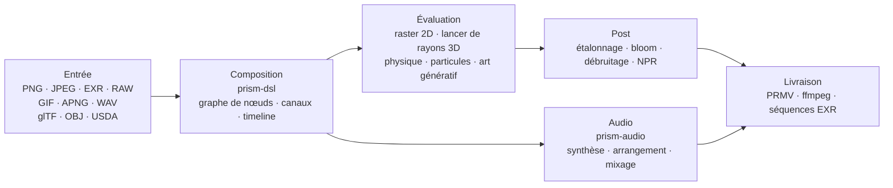

<p align="center">
  
</p>

<h1 align="center">Prism Engine</h1>

<h3 align="center">Toute la chaîne média, dans un seul arbre de sources</h3>

<p align="center">
  <sub>Décoder · Composer · Path tracing · Simuler · Synthétiser · Encoder &nbsp;|&nbsp; Zéro dépendance · Déterministe au bit près</sub>
</p>

<p align="center">
  <a href="../README.md">中文</a>
  · <a href="README.en.md">English</a>
  · <a href="README.de.md">Deutsch</a>
  · <a href="README.es.md">Español</a>
  · <b><a href="README.fr.md">Français</a></b>
  · <a href="README.ja.md">日本語</a>
  · <a href="README.ko.md">한국어</a>
  · <a href="README.pt-BR.md">Português</a>
  · <a href="README.ru.md">Русский</a>
</p>

<p align="center">
  
  
  
  
  
  <a href="https://github.com/Qianjinqie/prism-engine/releases"></a>
</p>

<p align="center">
  <a href="https://github.com/Qianjinqie/prism-engine/releases/latest"></a>
  <a href="#opérationnel-en-trois-minutes"></a>
  <a href="#architecture"></a>
</p>

<p align="center">
  
</p>

<p align="center">
  <sub>Pas une maquette, une sortie du moteur : 1200×675 · 256 spp · lancer de rayons + BSDF physique + tonemapping ACES · 4 threads, 158 s. Source de la scène : <a href="gallery/gallery.rs"><code>docs/gallery/gallery.rs</code></a>.</sub>
</p>

<p align="center">
  <sub><b>642</b> fichiers · <b>28</b> crates · <b>261 000</b> lignes de Rust · <b>3929</b> tests · <b>0</b> dépendance tierce · <b>18,9 Mo</b> en un seul fichier</sub>
</p>

## Pourquoi ce moteur existe

Une chaîne multimédia classique est un assemblage : ffmpeg décode, Blender rend, ImageMagick écrit les images fixes, un DAW s'occupe du son, et des scripts collent le tout avec des fichiers temporaires. Chaque outil est excellent, mais aux jointures deux choses se perdent — **le déterminisme** et **l'auditabilité**. Changez de machine et le chemin flottant change ; changez de version et les valeurs par défaut bougent ; en cas de problème, il reste cinq boîtes noires et une pile de fichiers intermédiaires.

| | Pipeline classique | Prism Engine |
| --- | --- | --- |
| Chaîne | cinq ou six outils + scripts de collage + fichiers temporaires | un seul arbre de sources, une compilation |
| Autre machine | les chemins flottants changent, les pixels changent | même entrée, mêmes octets |
| Une panne | cinq boîtes noires et une pile d'intermédiaires | chaque pixel remonte à une ligne de source |
| Dépendances | des dizaines de bibliothèques natives, chacune avec sa matrice de versions | 0 |

Prism Engine ramène toute la chaîne dans un seul arbre de sources. Même scène, mêmes paramètres, n'importe quelle machine, n'importe quelle exécution : pixels identiques et octets identiques. Ce n'est pas une promesse ; 3929 tests le verrouillent.

Il ne vise pas à remplacer ffmpeg ou Blender. Il remplace la colle entre eux, et le déterminisme que cette colle jette en silence.

Le public est volontairement étroit : les chaînes qui exigent « même entrée, n'importe quelle machine, même sortie » — rendu par lots, recherche graphique reproductible, rendu dans la CI.

### Trois contraintes dures

| Contrainte | Mise en œuvre | Ce qu'elle coûte |
| --- | --- | --- |
| **Zéro code tiers** | Les 110 dépendances d'exécution et 20 de test sont toutes des dépendances `path` internes ; pas de `build.rs`, pas d'édition de liens native, pas de réseau à la compilation | Chaque format, algorithme, police et codec doit être écrit ici |
| **Déterminisme au bit près** | IDCT en virgule fixe, séquences d'échantillonnage fixes, hachage de configuration en quatre dimensions ; identique entre plateformes à entrée égale | Renoncer aux raccourcis flottants rapides et à l'ordre d'itération des tables de hachage |
| **Distribution en un fichier** | 642 fichiers de 28 crates fusionnés en un texte UTF-8 de 18,9 Mo, restauré par `node unpack.cjs` | On renonce à parcourir le code directement sur GitHub |

## Opérationnel en trois minutes

```bash
# 1. Récupérer le paquet source et vérifier son SHA-256
curl -L -O https://github.com/Qianjinqie/prism-engine/releases/download/v2.1/prism-engine-v2.1-source.txt
curl -L -O https://github.com/Qianjinqie/prism-engine/releases/download/v2.1/SHA256SUMS.txt
sha256sum -c SHA256SUMS.txt

# 2. Extraire le script de dépaquetage embarqué (Node 18+ seulement, sans npm install)
awk '/^UNPACK SCRIPT BEGIN$/{f=1;next} /^UNPACK SCRIPT END$/{f=0} f' \
  prism-engine-v2.1-source.txt > unpack.cjs
node unpack.cjs                    # restaure 642 fichiers

# 3. Compiler et lancer toute la suite de tests
cargo test --workspace --release     # 3929 passed / 0 failed

# 4. Sans rien écrire, le regarder rendre
cargo run -p prism-app --release     # scène de démonstration intégrée
```

Le résultat est un workspace Cargo ordinaire (28 crates sous `src/`) ; les commandes `cargo` suivantes se comportent comme dans tout projet Rust. La première compilation prend quelques minutes.

## Un plan, un texte

`.prism` est le langage de description de scènes du moteur. Voici un plan complet et rendable de trois secondes — sphère, matériau, caméra orbitale, lumière directionnelle, durée, étalonnage, spécification de sortie :

```prism
scene "spin_red_ball" {
    sphere ball {
        radius 1.0
        material {
            albedo #c0392b
            roughness 0.3
            metalness 0.05
        }
    }

    camera main {
        orbit {
            center 0,0,0
            radius 8.0
        }
        fov 45
    }

    light sun {
        direction (1.0, -1.0, -0.5)
        color #fff4e6
        intensity 3.0
    }
}

timeline {
    duration 3s
    fps 12
}

aesthetic {
    teal-orange
    contrast 1.12
    filmic
}

output {
    resolution 480x270
    format frames
}
```

```bash
cargo run -p prism-app --release -- examples/spin_red_ball.prism          # séquence d'images
cargo run -p prism-app --release -- render examples/w2d_showcase.prism \
    --out out/demo.mp4                                                     # film fini en un appel
```

`render` emprunte le chemin direct v2 : compiler le graphe de nœuds → évaluer image par image → encoder dans un conteneur, sans images intermédiaires sur disque. Les nœuds non pris en charge produisent une erreur explicite `R5xxx` au lieu d'être ignorés en silence.

<p align="center">
  
  <br>
  <sub>Image 10 de `examples/w2d_showcase.prism` : une sphère 3D, un calque de texte, un étalonnage et une piste de fondu partagent une même timeline.</sub>
</p>

## Ou simplement l'API Rust

Si vous préférez éviter le DSL, appelez directement la bibliothèque. Voici le squelette de l'image d'en-tête (la scène complète fait 190 lignes, voir [`docs/gallery/gallery.rs`](gallery/gallery.rs)) :

```rust
use prism_core::node::EvalCtx;
use prism_math::Vec3;
use prism_rt::camera::Camera;
use prism_rt::integrator::{render_pixel, MaterialKind, RenderParams, Scene, Sphere};

let scene = Scene {
    spheres: vec![(
        Sphere { center: Vec3::new(0.0, 0.6, 0.0), radius: 0.6 },
        MaterialKind::Lambert { albedo: Vec3::new(0.8, 0.2, 0.15) },
    )],
    ..Default::default()
};
let cam = Camera::new(
    Vec3::new(0.0, 1.2, 4.8),   // œil
    Vec3::new(0.0, 0.72, 0.0),  // cible
    Vec3::new(0.0, 1.0, 0.0),   // haut
    30.0, 0.05, 4.85, 0.0, 1.0 / 48.0,
);
let ctx = EvalCtx::new(20261028, 0, 0);
let params = RenderParams::new(256, 10);  // 256 échantillons par pixel, jusqu'à 10 rebonds

// Un pixel : scène, caméra, contexte d'échantillonnage, coordonnée, résolution, paramètres
let color = render_pixel(&scene, &cam, &ctx, (640, 360), (1280, 720), &params);
```

`render_pixel` est une fonction pure : scène, caméra, contexte d'échantillonnage et coordonnée de pixel en entrée ; RGB linéaire en sortie. À paramètres égaux, les bits sont identiques quel que soit le thread ou l'ordre d'appel — c'est pourquoi le rendu parallèle n'a besoin d'aucune synchronisation.

## Carte des capacités

| Couche | Ce qu'elle fait |
| --- | --- |
| **Lire** | PNG (8/16 bits), JPEG baseline (IDCT virgule fixe), GIF/APNG image par image, EXR (DWA inclus), RAW baseline, WAV ; actifs glTF / OBJ / USDA, paramètres MaterialX, polices TTF/OTF externes |
| **Composer** | Compilation DSL v1/v2, cinq combinateurs de haut niveau (carton de titre / lower third / écran divisé / Ken Burns / morph entre scènes), quatre transitions + morph, composition de formules (indices, fractions, racines, matrices, grands opérateurs), échantillonnage de la timeline à tout instant |
| **Rendre** | Lancer de rayons + BSDF physique (diffus / spéculaire / verre / métal / subsurface), volumes hétérogènes Woodcock, intersections analytiques pour cylindres / cônes / tores / surfaces de révolution (quartique par forme fermée de Ferrari), maillages triangulaires SAH-BVH, backend de référence CPU, double pipeline Vulkan compute + ray tracing |
| **Simuler** | Solveur XPBD unifié (corps rigides / déformables / tissu / articulations / fluides / fracture), fumée FLIP, particules (pilotables par enveloppe audio), champs de flux / systèmes L / automates cellulaires / réaction-diffusion / fractales / Voronoi |
| **Étalonner** | Étalonnage secondaire (sélections HSL + courbes RVB), presets cinematic / film / anime, blur / bloom / halation / grain, quatre styles NPR (toon / aquarelle / demi-teinte / huile), débruiteur triple, rastérisation de tracés vectoriels et draw-on |
| **Sonner** | Synthétiseurs PolyBLEP, ADSR, machines à états de gammes et de progressions d'accords, arpégiateur, boîte à rythmes pas à pas, analyse SMF, sampler SFZ, synthèse granulaire, mixage multipiste, normalisation de sonie, analyse beat / onset / FFT |
| **Livrer** | Conteneur maison `PRMV` (v2/v3) avec codage en domaine JPEG des trames I/P, contrôle de débit water-filling, estimation de mouvement qpel ; pipeline ffmpeg (H.264/HEVC si présent, repli automatique MJPEG sinon) ; séquences EXR ; ferme d'images multiprocessus (reprise possible, MD5 parallèle == MD5 série) |
| **Intégrer** | Trois outils MCP stdio (`scene_check` / `render_submit` / `diagnose`), SDK de nœuds avec négociation de version sémantique, service de rendu HTTP/1.1, rendu par lots via manifeste cartésien, squelette de sonde d'encodeurs matériels sur trois plateformes |

> Le tableau n'est qu'une table des matières. Les paramètres exacts et le « ce qu'elle ne sait pas faire » de chaque capacité se trouvent dans `开发者指南.md`, dans le paquet.

## Des capacités qui ne tiennent pas dans la liste

Certaines choses n'entrent pas dans le tableau ci-dessus : ce ne sont pas « un format de plus », mais une infrastructure que le moteur a fait pousser pour lui-même.

### Audio : un noyau de DAW intégré

`prism-audio` n'est pas un module périphérique qui lit du WAV par accident. De la composition au mixage, c'est une chaîne complète, et chaque fonction est une fonction pure de ses paramètres (bits identiques entre plateformes à entrée égale) :

- **Synthèse** : famille d'oscillateurs PolyBLEP antirepliement, enveloppes ADSR en forme fermée, quatre presets d'ambiance ;
- **Théorie** : bibliothèque de gammes (majeur/mineur, pentatonique, modes), classe de hauteur 12-TET ↔ fréquence, machine à états à grammaire fonctionnelle pour les progressions d'accords et conduite des voix ;
- **Arrangement** : arpégiateur (motif / vitesse / octave), boîte à rythmes pas à pas, grilles de mesures et de temps ;
- **Matériau** : analyse SMF écrite à la main (import MIDI), sampler SFZ, synthèse granulaire ;
- **Design sonore** : modélisation physique, panoramique spatial, chaînes d'effets ;
- **Mixage** : mixage linéaire multipiste, fondus, protection contre les crêtes ;
- **Analyse et couplage** : détection de beat / onset, spectres FFT, extraction d'enveloppe, normalisation de sonie ; le baking AudioReactive lit une fenêtre fixe à l'image N, ce qui en fait une fonction pure de l'image, équivalente au seek.

> Limite : l'encodage AAC / mp3 n'est pas implémenté ici (poids historique des brevets et charge de travail) ; il passe par ffmpeg externe.

### Un registre de noyaux définissables

Chaque type de nœud du moteur est une **solution particulière** d'un triplet « noyau + réseau + dual ». Des tiers (ou vous) peuvent enregistrer statiquement de nouvelles solutions avec `registry!`, **sans toucher au cœur du moteur** :

- Inclusion statique : la macro se développe dans le crate qui définit ; `inventory` et les proc-macros sont interdits pour garder zéro dépendance ;
- L'enregistrement effectue une **vérification en trois questions** (forme du noyau / réseau / dual) ; une réponse incomplète est refusée avec une erreur en trois parties ;
- Les solutions officielles et personnalisées partagent le même registre et sont indistinguables à l'exécution ;
- Mathématiquement, cela correspond aux six stratégies d'inversion de l'équation d'opérateur `f = g + Kf` (exacte / stochastique / locale / régularisée / itérative / spectrale) : ajouter une capacité, c'est déclarer un triplet, pas corriger la boucle de rendu.

### GPU : trois chemins, trois états

| Backend | État | Preuve |
| --- | --- | --- |
| **Vulkan** | Fonctionne réellement | Pipelines compute + ray tracing ; vérifiable sans GPU sur l'ICD logiciel lavapipe de Mesa ; la sortie de `render_scene` est **identique octet pour octet (0 différence)** à la référence CPU ; `is_available()` est un auto-contrôle compute ∧ render |
| **Metal** | Compilé derrière une porte, non activé | Portage isomorphe terminé, non vérifié sur matériel, `is_available()` toujours false |
| **WebGPU** | Conclusion seulement | Étude de faisabilité faite (4–6 jours-homme de portage), chemin de rendu non implémenté |

### Portes anti-faux-vert

Quatre scripts de porte sans dépendance (Node uniquement) : défense contre les écritures fantômes (avec auto-test inverse), scan d'hygiène open source, auto-contrôle de conformité (9/9 réussis plus 8/8 preuves que le critère échoue quand il doit), et vérification aller-retour du paquet. Une porte n'a que deux issues — réussite ou échec — et « ça a l'air bon » n'en fait pas partie. **Un faux vert est plus dangereux qu'un échec.**

## Le déterminisme n'est pas un slogan

Quatre couches, des paramètres jusqu'aux octets :

1. **Clôture de signature** : graphes de nœuds, clés de cache, clés d'instantané et signatures d'image partagent un hachage de configuration en quatre dimensions. Un paramètre change ⇒ la clé doit changer ⇒ pas de réutilisation abusive. Les nœuds itératifs portent `(ε, n)` dans leur clé, les nœuds de flux le numéro d'image ; avec `None`, tout dégrade au bit près vers l'ancien comportement.
2. **Points fixes d'octets** : export→import→export USD identique octet pour octet ; WAV 16/24/32 bits aller-retour sans perte ; EXR comparé flux de bits contre flux de bits avec l'OpenEXR officiel.
3. **Déterminisme du paquetage** : empaqueter deux fois la même source donne le même SHA-256 ; l'aller-retour de dépaquetage compare chaque fichier octet par octet.
4. **Les tests comme critère** : beaucoup des 3929 tests verrouillent des valeurs d'or (tolérance resserrée de 1e-2 à 1e-6, résidu mesuré 4,53e-7) ; la fidélité de forme est bornée par distance de Hausdorff plutôt que par « ça se ressemble ».

## Architecture



28 crates, groupés par responsabilité :

| Groupe | Crates |
| --- | --- |
| Noyau | `prism-core` · `prism-math` · `prism-bytes` · `prism-geometry` · `prism-noise` |
| E/S médias | `prism-io` · `prism-media` · `prism-mux` · `prism-audio` · `prism-texture` |
| Rendu | `prism-render` · `prism-raster` · `prism-gpu` · `prism-postfx` · `prism-vector` · `prism-particles` |
| Animation / génératif | `prism-anim` · `prism-genart` · `prism-aesthetic` · `prism-physics` |
| Texte / UI | `prism-text` · `prism-rt` · `prism-app` |
| Avancé | `prism-ai` · `prism-dsl` · `prism-infra` · `prism-author` |
| Sidecar (feature gate) | `prism-ffi-hwenc` |

Structure après dépaquetage :

| Chemin | Contenu |
| --- | --- |
| `src/` | Sources des 28 crates (nommées `crates/` dans le dépôt, réorganisées pour la distribution) |
| `Compliance/` | Vérification zéro dépendance, avis tiers, registre des actifs |
| `开发者指南.md` | Guide développeur autonome : démarrage / architecture / noyau mathématique / portes / extension |
| `tools/` | Scripts de portes et de paquetage |
| `examples/` | Exemples `.prism` et paquets de nœuds (lus par `include_str!` ; un fichier manquant casse la compilation) |
| `.github/workflows/` | Configuration CI |

> Les documents de conception (`docs/设计/`) ne vivent que dans le dépôt complet de l'éditeur et ne sont pas distribués ; le crate de démonstration `prism-anim-demo` n'est pas empaqueté non plus.

## Compiler, tester, portes

```bash
cargo test --workspace --release      # 3929 passed / 0 failed / 0 ignored
cargo xtest                           # alias équivalent
cargo test -p prism-core --release    # test de fumée d'un crate

node tools/ghost_guard.mjs --check    # défense écriture fantôme : G1 redéfinition / G2 sur-ensemble strict / G3 doc de premier niveau / G4 compilation
node tools/hygiene_scan.mjs           # hygiène : liste chaque terme interne restant (fichier:ligne), exit 1 si touché
node tools/compliance_check.mjs       # auto-contrôle de conformité : doit passer 9/9
node tools/compliance_check.mjs --self-test  # preuve inverse : doit échouer, montrant que le critère discrimine
node tools/pack_source_txt.mjs --verify      # aller-retour paquetage/dépaquetage, octet par octet
```

- Suite complète : **3929 passed / 0 failed / 0 ignored**, 179 sections de tests, 171,5 s sur tous les cœurs (release).
- La CI compte six jobs : défense écriture fantôme, compilation + tests complets, compilation wasm32, vérification statique WGSL, interopérabilité de flux de bits avec l'OpenEXR officiel, contre-vérification sur hôte Node.
- Le scan d'hygiène a encore des occurrences : la couche documentaire distribuée est propre, le reste se trouve dans les commentaires de source et les fichiers propres au dépôt. Le script existe pour que le reste demeure **visible et corrigeable un par un**, pas pour prétendre que tout est propre.

## Limites honnêtes

| Limite | État | Issue |
| --- | --- | --- |
| DNG `Compression=7` (lossless JPEG) | Non implémenté ; les DNG d'appareils réels sont illisibles | Convertir d'abord en TIFF/PNG 16 bits |
| mp3 / AAC / FLAC | Décodage via sonde ffmpeg externe ; encodage non implémenté | Installer ffmpeg, ou rester en WAV |
| Primitives courbes sur GPU | Chemin CPU uniquement | Trianguler puis passer par le SAH-BVH |
| Metal | Porte compilée, non vérifiée sur matériel, non activée | Brancher dès qu'un matériel Apple est disponible |
| WebGPU | Faisabilité conclue, rendu non implémenté | 4–6 jours-homme |
| Encodage matériel | Squelette de sonde pour trois plateformes, sans implémentation | Remplir par plateforme cible |
| Accélération GPU | Correction vérifiée seulement sur lavapipe, jamais mesurée sur GPU réel | Mesurer sur le matériel cible |
| Scan d'hygiène | Occurrences existantes dans les commentaires | Nettoyer une par une ; le script les suit |

Ce ne sont pas des points « plus tard ». Ils ne sont explicitement pas pris en charge aujourd'hui. Mieux ici que cachés dans une issue.

## Conformité

Le moteur promet zéro dépendance de code tiers et le vérifie lui-même :

- **C1 Zéro code tiers** : les 130 dépendances (110 d'exécution + 20 de test) sont des dépendances `path` internes ; pas de `build.rs`, pas de directive de liaison native ; `Cargo.lock` fixe 29 paquets du dépôt.
- **C2 Registre d'actifs complet** : les cinq entrées d'actifs ont tous les champs de la table principale ; les polices sont distribuées sous SIL OFL 1.1 avec le texte intégral de la licence à côté de la police dans `src/prism-text/font_data/LICENSE`.
- **C3 Avis tiers** : `Compliance/THIRD-PARTY-NOTICES.md` sépare explicitement « actifs de données ≠ dépendances de code ».

## Licence

Apache License 2.0, voir [`LICENSE`](../LICENSE).

Lors d'une redistribution, conservez les avis et le registre d'actifs sous `Compliance/`.

<sub>L'image d'en-tête et la capture DSL ont été rendues par le moteur lui-même ; les paramètres figurent dans les légendes et dans [`docs/gallery/gallery.rs`](gallery/gallery.rs).</sub>
