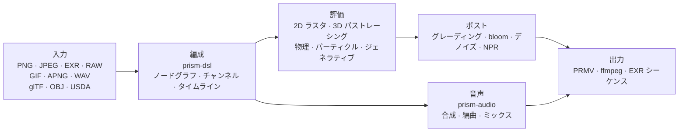

<h1 align="center">Prism Engine</h1>

<h3 align="center">プロシージャル・メディアエンジン</h3>

<p align="center">
  <sub>デコード · 組版 · パストレーシング · 物理シミュレーション · 音声合成 · エンコード ｜ 静止画 · 連番 · 完成カット ｜ CPU + Vulkan</sub>
</p>

<p align="center">
  <a href="../README.md">中文</a>
  · <a href="README.en.md">English</a>
  · <a href="README.de.md">Deutsch</a>
  · <a href="README.es.md">Español</a>
  · <a href="README.fr.md">Français</a>
  · <b><a href="README.ja.md">日本語</a></b>
  · <a href="README.ko.md">한국어</a>
  · <a href="README.pt-BR.md">Português</a>
  · <a href="README.ru.md">Русский</a>
</p>

<p align="center">
  
  
  
  
  
  <a href="https://github.com/Qianjinqie/prism-engine/releases"></a>
</p>

<p align="center">
  
</p>

<p align="center">
  <sub>イメージ図ではなく、エンジンの出力そのもの：1200×675 · 256 spp · パストレーシング + 物理ベース BSDF + ACES トーンマッピング · 4 スレッドで 158 秒。シーンのソースは <a href="gallery/gallery.rs"><code>docs/gallery/gallery.rs</code></a>。</sub>
</p>

<p align="center">
  <sub><b>642</b> ファイル · <b>28</b> crate · <b>26.1 万</b> 行の Rust · <b>3929</b> テスト · サードパーティ依存 <b>0</b> · <b>18.9 MB</b> の単一ファイル</sub>
</p>

## 能力の全体像

Rust で書かれたプロシージャル・メディアエンジン。入力は `.prism` のシーン記述か Rust 呼び出し、出力は静止画・連番・完成カット。以下の層はメディアパイプラインの工程順で、ある瞬間で止めれば静止画、連続して記録すれば動画になる——どの層も両方を同じように扱う。

| 層 | できること |
| --- | --- |
| **読む** | PNG（8/16 bit、フィルタ逆演算）、ベースライン JPEG（固定小数点 IDCT、プラットフォーム間でビット一致）、EXR（読み書き / 圧縮ファミリ / DWA）、カメラ RAW、GIF / APNG のフレーム単位、WAV；glTF / OBJ / USDA の取り込み、MaterialX パラメータ；TTF/OTF の読み込みと「内蔵 → ユーザー → 多言語サブセット → 数学記号」の四段フォールバック |
| **組む** | OpenType 解析、GSUB/GPOS シェーピング、UAX #9 双方向、アラビア語四形態、縦組み；数式組版（上下付き / 分数 / 根号 / 行列 / 大型演算子）；DSL v1/v2 を三つ組グラフへコンパイル；五つの高水準コンビネータ（タイトル / ローワーサード / 分割画面 / ケン・バーンズ / シーン間モーフ）；四種のトランジション + モーフ、任意時刻でサンプリング可能 |
| **描く** | パストレーシング + 物理 BSDF（拡散 / 鏡面 / ガラス / 金属 / 表面下散乱）、ガラスと金属は確率的逆変換（ノイマン級数モンテカルロ）；Woodcock 異種ボリューム；円柱 / 円錐 / トーラス / 回転体の解析的交差（四次方程式を Ferrari の閉形式で）；三角メッシュ + SAH-BVH（安定ソート、構築が決定的）；メッシュを SDF にベイクしてブール / 領域変形 / 正確な衝突；CpuRef を一級バックエンド + Vulkan の compute とレイトレーシングの二系統 |
| **動かす** | 統一 XPBD ソルバ——剛体 / 軟体 / 布 / 関節 / 流体 / 破壊は同一の制約射影ループの六組のパラメータ；FLIP 煙；パーティクル + AudioReactive；毛の制約とシェーディング；流れ場 / L システム / セルオートマトン / 反応拡散 / フラクタル / Voronoi；ばねの解析解とキーフレーム |
| **調える** | セカンダリグレーディング（HSL 選択 + RGB カーブ）；cinematic / film / anime プリセット、下書き / 標準 / 映画の三段階を明示的に価格付け；blur / bloom / ビネット / 色収差 / sharpen / glitch / dissolve；ハレーション + 二スケールのフィルムグレイン（ピクセル領域で導出）；三者一体のデノイズ；NPR 四風格（toon / watercolor / halftone / oil）；PQ / HLG 伝達関数、リニア sRGB ↔ ACEScg、ACES 出力変換 |
| **鳴らす** | PolyBLEP アンチエイリアス発振器 + ADSR 閉形式エンベロープ + 4 感情プリセット；音階ライブラリ + 12-TET + 和音進行の機能文法状態機械 + 声部進行；アルペジエイター / ステップドラム / 小節・拍グリッド；手書き SMF パーサ、SFZ サンプラー、グラニュラー合成；物理モデリング / 空間パンニング / エフェクトチェーン；マルチトラックミックス + ピーク制限；ビート / オンセット / FFT、AudioReactive ベイク、ラウドネス正規化；WAV 16/24/32 bit のバイト単位往復 |
| **出す** | 独自 PRMV コンテナ（v2/v3、v3 は v1/v2 を読める）+ I/P フレーム時間符号化；water-filling レート制御 + qpel サブピクセル動き推定（実測 PSNR +2.577 dB、サイズ −21.6%）；ffmpeg を実行時検出——あれば stdin パイプで H.264/HEVC、なければ自動で MJPEG に降格、必ずファイルが出る；MP4 + MJPEG コンテナ、EXR シーケンス；マルチプロセスのフレームファーム（中断再開可、並列 MD5 == 直列 MD5）；NLE の時間マッピング / キーフレーム / トランジション |
| **繋ぐ** | MCP stdio の三ツール（`scene_check` / `render_submit` / `diagnose`）；ノード SDK のセマンティックバージョン交渉 + サンプルノードパッケージ；CLI（`render` / `preview` / `demo`）；二段階プレビューの対話エディタ（Draft 幾何 / Real 低 spp）+ サブグラフ署名の差分；batch manifest の直積；三プラットフォームのハードウェアエンコーダ探索骨格（VideoToolbox / NVENC / VAAPI、バックエンド未接続） |
| **側路** | 生成アート：流れ場 / L システム / セルオートマトン / 反応拡散 / Mandelbrot / Voronoi、ベクター draw-on とチャート。AI 支援：決定論的モック推論層（絵コンテ / 字幕 / カラーヒント）、モデル重みはデータとして読み、積和演算は自前、ML フレームワークなし |

表は能力の一覧です。各能力の「できないこと」は[正直な境界](#正直な境界)にあり、表の中には隠していません。

## 3 分で動かす

```bash
# 1. 単一ファイルのソースパッケージを取得し、SHA-256 を検証
curl -L -O https://github.com/Qianjinqie/prism-engine/releases/download/v2.1/prism-engine-v2.1-source.txt
curl -L -O https://github.com/Qianjinqie/prism-engine/releases/download/v2.1/SHA256SUMS.txt
sha256sum -c SHA256SUMS.txt

# 2. パッケージに埋め込まれた展開スクリプトを取り出す（Node 18+ のみ、npm install 不要）
awk '/^UNPACK SCRIPT BEGIN$/{f=1;next} /^UNPACK SCRIPT END$/{f=0} f' \
  prism-engine-v2.1-source.txt > unpack.cjs
node unpack.cjs                    # 642 ファイルを復元

# 3. ビルドして全テストを実行
cargo test --workspace --release     # 3929 passed / 0 failed

# 4. 何も書かずに、まず映像を出す
cargo run -p prism-app --release     # 内蔵デモシーン
```

展開後は通常の Cargo workspace（`src/` 以下に 28 crate）で、以降の `cargo` コマンドは普通の Rust プロジェクトと同じです。初回ビルドには数分かかります。

## 一つのショットを、一つのテキストで

`.prism` はエンジンのシーン記述言語です。以下は完全にレンダリング可能な 3 秒のショット——球体、マテリアル、周回カメラ、方向光源、長さ、グレーディング、出力仕様のすべて：

```prism
scene "spin_red_ball" {
    sphere ball {
        radius 1.0
        material {
            albedo #c0392b
            roughness 0.3
            metalness 0.05
        }
    }

    camera main {
        orbit {
            center 0,0,0
            radius 8.0
        }
        fov 45
    }

    light sun {
        direction (1.0, -1.0, -0.5)
        color #fff4e6
        intensity 3.0
    }
}

timeline {
    duration 3s
    fps 12
}

aesthetic {
    teal-orange
    contrast 1.12
    filmic
}

output {
    resolution 480x270
    format frames
}
```

```bash
cargo run -p prism-app --release -- examples/spin_red_ball.prism          # フレーム列
cargo run -p prism-app --release -- render examples/w2d_showcase.prism \
    --out out/demo.mp4                                                     # 一発で完成映像
```

`render` は v2 の直行経路です。ノードグラフをコンパイル → フレームごとに評価 → コンテナへ符号化。中間フレームをディスクに残しません。未対応ノードは黙って飛ばさず、明示的な `R5xxx` エラーを返します。

<p align="center">
  
  <br>
  <sub>`examples/w2d_showcase.prism` の 10 フレーム目：3D 球体、テキストレイヤ、グレーディング、フェードトラックが同じタイムラインを共有しています。</sub>
</p>

## Rust API だけを使う

DSL を書かずにライブラリを直接呼ぶこともできます。以下はヒーローイメージの骨格です（完全なシーンは 190 行、[`docs/gallery/gallery.rs`](gallery/gallery.rs)）：

```rust
use prism_core::node::EvalCtx;
use prism_math::Vec3;
use prism_rt::camera::Camera;
use prism_rt::integrator::{render_pixel, MaterialKind, RenderParams, Scene, Sphere};

let scene = Scene {
    spheres: vec![(
        Sphere { center: Vec3::new(0.0, 0.6, 0.0), radius: 0.6 },
        MaterialKind::Lambert { albedo: Vec3::new(0.8, 0.2, 0.15) },
    )],
    ..Default::default()
};
let cam = Camera::new(
    Vec3::new(0.0, 1.2, 4.8),   // 視点
    Vec3::new(0.0, 0.72, 0.0),  // 注視点
    Vec3::new(0.0, 1.0, 0.0),   // 上方向
    30.0, 0.05, 4.85, 0.0, 1.0 / 48.0,
);
let ctx = EvalCtx::new(20261028, 0, 0);
let params = RenderParams::new(256, 10);  // 1 ピクセル 256 サンプル、最大 10 バウンス

// 1 ピクセル：シーン、カメラ、サンプリング文脈、ピクセル座標、解像度、パラメータ
let color = render_pixel(&scene, &cam, &ctx, (640, 360), (1280, 720), &params);
```

`render_pixel` は純関数です。シーン、カメラ、サンプリング文脈、ピクセル座標を入力に、線形 RGB を返します。同じパラメータなら、どのスレッドから、どの順序で呼んでも結果はビット一致——だから並列レンダリングに同期は一切要りません。

## 一覧に収まらない内部能力

これらはフォーマット対応ではなく、エンジン内部の基盤です。

### 音声：内蔵 DAW カーネル

能力の一覧は**鳴らす**の行にあります。ここに書くのはその動作原理、つまり同じレンダータイムラインに載せられる理由です：

- **各関数はパラメータの純関数**：同じ楽譜を任意のシーク位置で再計算してもサンプル値はビット一致し、再生履歴に依存しない
- **AudioReactive はフレーム単位の純関数にベイクされる**：フレーム N は固定窓を読むので、フレーム飛ばし・逆再生・並列分割で結果が変わらない
- **ミックスはオフライン並列の線形代数**：マルチトラック加算 + フェード + ピーク制限、隠れた状態機械はない

> 境界：AAC / mp3 の符号化は自前実装しない（特許の経緯と工数）。外部 ffmpeg と連携する。

### 定義可能なカーネルレジストリ

エンジンの各ノード型は、「カーネル + 格子 + 双対」という三つ組の**特殊解**です。第三者は `registry!` で新しい特殊解を静的に登録でき、**エンジンコアに手を入れません**：

- 静的取り込み：マクロは定義側 crate 内で展開され、`inventory` と proc-macro を禁止して依存ゼロを保つ；
- 登録時に**三つの問い**（カーネル形式 / 格子 / 双対）を検証し、欠ければ三段構成のエラーで拒否；
- 公式の特殊解も自作の特殊解も同じレジストリを通り、実行時に区別されない；
- 数学的には作用素方程式 `f = g + Kf` の六つの逆解法（厳密 / 確率 / 局所 / 正則化 / 反復 / スペクトル）に対応し、新機能の追加は三つ組の宣言であって、レンダリングループへのパッチではありません。

### GPU：三つの経路、三つの状態

| バックエンド | 状態 | 根拠 |
| --- | --- | --- |
| **Vulkan** | 実際に動作 | compute + レイトレーシングの二系統。Mesa lavapipe のソフトウェア ICD で GPU なしでも検証可能。`render_scene` の出力は CPU 参照と**バイト単位で 0 差**。`is_available()` は compute ∧ render の二重セルフチェック |
| **Metal** | コンパイルゲート済み、未点灯 | 同型移植は完了、実機検証なし、`is_available()` は常に false |
| **WebGPU** | 結論のみ | 実現可能性の評価は完了（移植量 4〜6 人日）、描画経路は未実装 |

## エンジニアリング上の事実

三つの制約と、それぞれのコスト：

| 制約 | 実現方法 | コスト |
| --- | --- | --- |
| サードパーティコードへの依存ゼロ | 実行時 110 + テスト 20 の依存はすべてリポジトリ内の `path` 依存；`build.rs` なし、ネイティブリンクなし、ビルド時にネットワークなし | あらゆるフォーマット、アルゴリズム、フォント、コーデックをここで書く必要がある |
| バイト単位の決定性 | 固定小数点 IDCT、固定サンプリング列、四次元設定ハッシュ；同一入力ならプラットフォーム間で同一 | 浮動小数点の高速経路を捨て、ハッシュマップの反復順序に依存できない |
| 単一ファイル配布 | 28 crate・642 ファイルを 18.9 MB の UTF-8 テキスト一つにまとめ、`node unpack.cjs` で復元 | GitHub 上でソースを直接眺める便利を捨てる |

### 決定性はどう検証されるか

四層、パラメータからバイトまで：

1. **署名閉包**：ノードグラフ、キャッシュキー、スナップショットキー、フレーム署名を四次元設定ハッシュに統一。パラメータが変わればキーも必ず変わり、誤再利用が起きない。反復ノードのキーは `(ε, n)`、ストリームノードはフレーム番号を含み、`None` では旧挙動へバイト単位で退化する。
2. **バイト不動点**：USD はエクスポート→インポート→エクスポートがバイト一致；WAV 16/24/32 bit の往復が一致；EXR は公式 OpenEXR とビットストリーム同士で突き合わせる。
3. **パッケージングの決定性**：同じソースを二度パッケージすると SHA-256 が一致；展開の往復で全ファイルをバイト単位で比較する。
4. **テストを判定基準にする**：3929 件のテストの多くが黄金値を固定（許容差は 1e-2 から 1e-6 へ、実測残差 4.53e-7）；形状の忠実さは「だいたい合っている」ではなく Hausdorff 距離で上限を決める。

## アーキテクチャ



28 crate を責務ごとに：

| 分類 | crate |
| --- | --- |
| コア | `prism-core` · `prism-math` · `prism-bytes` · `prism-geometry` · `prism-noise` |
| メディア I/O | `prism-io` · `prism-media` · `prism-mux` · `prism-audio` · `prism-texture` |
| レンダリング | `prism-render` · `prism-raster` · `prism-gpu` · `prism-postfx` · `prism-vector` · `prism-particles` |
| アニメーション / 生成 | `prism-anim` · `prism-genart` · `prism-aesthetic` · `prism-physics` |
| テキスト / UI | `prism-text` · `prism-rt` · `prism-app` |
| 応用 | `prism-ai` · `prism-dsl` · `prism-infra` · `prism-author` |
| サイドカー（feature gate） | `prism-ffi-hwenc` |

展開後のディレクトリ構成：

| パス | 内容 |
| --- | --- |
| `src/` | 28 crate のソース（リポジトリ内では `crates/`、配布時に再構成） |
| `Compliance/` | 依存ゼロ検証、第三者声明、アセット登録 |
| `开发者指南.md` | 自己完結の開発者ガイド：導入 / アーキテクチャ / 数学カーネル / ゲート / 拡張 |
| `tools/` | ゲートとパッケージのスクリプト |
| `examples/` | `.prism` の例とノードパッケージ（`include_str!` で読むため、欠けるとビルドが通らない） |
| `.github/workflows/` | CI 設定 |

> 設計の正典（`docs/設計/`）は配布元の完全なリポジトリにのみ存在し、配布には含まれません。デモ crate `prism-anim-demo` も同様です。

## ビルド・テスト・ゲート

```bash
cargo test --workspace --release      # 3929 passed / 0 failed / 0 ignored
cargo xtest                           # 同等のエイリアス
cargo test -p prism-core --release    # 単一 crate のスモークテスト

node tools/ghost_guard.mjs --check    # 幽霊書き込み防御：G1 重複定義 / G2 厳密な上位集合 / G3 最上位ドキュメント / G4 ビルド
node tools/hygiene_scan.mjs           # 衛生：残存する内部用語を file:line で列挙、ヒットで exit 1
node tools/compliance_check.mjs       # コンプライアンス自己点検：9/9 通過すること
node tools/compliance_check.mjs --self-test  # 反証：落ちることを確認し、判定基準の識別力を示す
node tools/pack_source_txt.mjs --verify      # パッケージと展開の往復をバイト単位で検証
```

- 全量：**3929 passed / 0 failed / 0 ignored**、179 のテスト区間、全コア並列で 171.5 秒（release）。
- CI は六つのジョブ：幽霊書き込み防御、ビルド + 全テスト、wasm32 ビルド、WGSL 静的検査、公式 OpenEXR とのビットストリーム相互検証、Node ホストのクロスチェック。
- 衛生スキャンには依然ヒットが残ります。配布物のドキュメント層はクリア済みで、残りはソースコメントと配布対象外のリポジトリ内ファイルです。スクリプトの存在は、残存を**見える形で一件ずつ片付ける**ためであり、きれいなふりをするためではありません。

### 偽グリーン防止ゲート

依存ゼロのゲートスクリプト四本（Node のみ）：幽霊書き込み防御（逆自己試験つき）、オープンソース衛生スキャン、コンプライアンス自己点検（9/9 通過 + 8/8 の反証で落ちることを確認）、パッケージ往復検証。ゲートの結果は「通過」か「失敗」の二つだけで、「たぶん大丈夫」は認めません——**偽のグリーンは失敗より危険です**。

## 正直な境界

| 境界 | 現状 | 道筋 |
| --- | --- | --- |
| DNG `Compression=7`（lossless JPEG） | 未実装。実機カメラの DNG は読めない | 16 bit TIFF / PNG に変換してから |
| mp3 / AAC / FLAC | デコードは外部 ffmpeg の探査経由、エンコードは自前実装せず | ffmpeg を入れる、または WAV のみ使う |
| 曲線プリミティブの GPU | CPU 経路のみ | 三角形化して SAH-BVH へ |
| Metal | ゲートは用意済み、実機未検証、未点灯 | Apple 機器が用意でき次第接続 |
| WebGPU | 実現可能性の結論のみ、描画は未実装 | 4〜6 人日 |
| ハードウェアエンコード | 三プラットフォームの探査スケルトンのみ | 対象プラットフォームごとに実装 |
| GPU 高速化率 | lavapipe で正しさのみ検証、実 GPU では未測定 | 対象ハードウェアで測定が必要 |
| 衛生スキャン | ソースコメントに既存のヒット | 一件ずつ整理、スクリプトで追跡 |

これらは「後回し」ではなく、現時点で明確に対応していない事項です。issue に隠すより、ここに書くほうがよいと判断しました。

## コンプライアンス

エンジンはサードパーティコード依存ゼロを掲げ、自己点検で検証しています：

- **C1 サードパーティコード依存ゼロ**：130 の依存（実行時 110 + テスト 20）はすべてリポジトリ内の `path` 依存。`build.rs` なし、ネイティブリンク指令なし。`Cargo.lock` はリポジトリ内 29 パッケージを固定。
- **C2 アセット登録の完備**：5 件のアセットの主表項目が揃っています。フォントは SIL OFL 1.1 で配布し、ライセンス全文を `src/prism-text/font_data/LICENSE` に同梱。
- **C3 第三者帰属表示**：`Compliance/THIRD-PARTY-NOTICES.md` が「データ資産 ≠ コード依存」を明確に区別。

## ライセンス

Apache License 2.0。[`LICENSE`](../LICENSE) を参照してください。

再配布時は `Compliance/` 以下の帰属表示とアセット登録を保持してください。

<sub>ヒーローイメージと DSL のスクリーンショットはどちらもエンジン自身がレンダリングしたものです。パラメータは図注と [`docs/gallery/gallery.rs`](gallery/gallery.rs) にあります。</sub>
