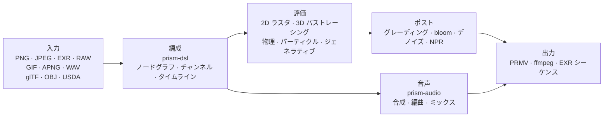

<p align="center">
  
</p>

<h1 align="center">Prism Engine</h1>

<h3 align="center">メディアパイプライン全体を、ひとつのソースツリーに</h3>

<p align="center">
  <sub>デコード · 組版 · パストレーシング · 物理シミュレーション · 音声合成 · エンコード ｜ 依存ゼロ · バイト単位で決定的</sub>
</p>

<p align="center">
  <a href="../README.md">中文</a>
  · <a href="README.en.md">English</a>
  · <a href="README.de.md">Deutsch</a>
  · <a href="README.es.md">Español</a>
  · <a href="README.fr.md">Français</a>
  · <b><a href="README.ja.md">日本語</a></b>
  · <a href="README.ko.md">한국어</a>
  · <a href="README.pt-BR.md">Português</a>
  · <a href="README.ru.md">Русский</a>
</p>

<p align="center">
  
  
  
  
  
  <a href="https://github.com/Qianjinqie/prism-engine/releases"></a>
</p>

<p align="center">
  <a href="https://github.com/Qianjinqie/prism-engine/releases/latest"></a>
  <a href="#3-分で動かす"></a>
  <a href="#アーキテクチャ"></a>
</p>

<p align="center">
  
</p>

<p align="center">
  <sub>イメージ図ではなく、エンジンの出力そのもの：1200×675 · 256 spp · パストレーシング + 物理ベース BSDF + ACES トーンマッピング · 4 スレッドで 158 秒。シーンのソースは <a href="gallery/gallery.rs"><code>docs/gallery/gallery.rs</code></a>。</sub>
</p>

<p align="center">
  <sub><b>642</b> ファイル · <b>28</b> crate · <b>26.1 万</b> 行の Rust · <b>3929</b> テスト · サードパーティ依存 <b>0</b> · <b>18.9 MB</b> の単一ファイル</sub>
</p>

## このエンジンが存在する理由

一般的なメディアパイプラインは寄せ集めです。ffmpeg がデコードし、Blender がレンダリングし、ImageMagick が静止画を書き、DAW が音を担当し、スクリプトが一時ファイルでそれらを接着します。どれも優れた道具ですが、継ぎ目では二つのものが失われます——**決定性**と**監査可能性**です。マシンを変えれば浮動小数点の経路が変わり、バージョンを変えれば既定値が動き、問題が起きれば五つのブラックボックスと中間ファイルの山が残ります。

| | 一般的なパイプライン | Prism Engine |
| --- | --- | --- |
| 経路 | 五六のツール + 接着スクリプト + 一時ファイル | ひとつのソースツリー、一度のビルド |
| 別のマシン | 浮動小数点の経路が変わり、ピクセルも変わる | 同じ入力なら同じバイト |
| 障害時 | 五つのブラックボックスと中間ファイルの山 | すべてのピクセルがソース行まで追える |
| 依存 | 数十のネイティブライブラリ、それぞれのバージョン行列 | 0 |

Prism Engine はその鎖全体を一つのソースツリーに引き込みます。同じシーン記述、同じパラメータなら、どのマシンでも、何回目の実行でも、ピクセルもバイトも完全に同じです。それは約束ではなく、3929 のテストが一本ずつ留めた事実です。

ffmpeg や Blender を置き換えるつもりはありません。置き換えるのは、それらを接着する層と、その接着層が静かに捨てていた決定性です。

対象読者は意図的に狭くしています。「同じ入力、どのマシンでも、同じ出力」を必要とする人——バッチ出稿のパイプライン、再現可能な実験を行うグラフィックス研究、レンダリングを CI に組み込みたいチーム。

### 三つの硬い制約

| 制約 | 実現方法 | 支払うコスト |
| --- | --- | --- |
| **サードパーティコード依存ゼロ** | 実行時 110 + テスト 20 の依存はすべてリポジトリ内の `path` 依存。`build.rs` なし、ネイティブリンクなし、ビルド時にネットワーク不要 | あらゆるフォーマット、アルゴリズム、フォント、コーデックを自前で書く |
| **バイト単位の決定性** | 固定小数点 IDCT、固定サンプリング列、四次元設定ハッシュ。同一入力ならプラットフォームを跨いでビット一致 | 浮動小数点の高速経路を捨て、順序を持たないコンテナの反復順に依存しない |
| **単一ファイル配布** | 642 ファイル・28 crate を 18.9 MB の UTF-8 テキスト一つに統合し、`node unpack.cjs` で復元 | GitHub 上でソースを直接開いて読む便利さを諦める |

## 3 分で動かす

```bash
# 1. 単一ファイルのソースパッケージを取得し、SHA-256 を検証
curl -L -O https://github.com/Qianjinqie/prism-engine/releases/download/v2.1/prism-engine-v2.1-source.txt
curl -L -O https://github.com/Qianjinqie/prism-engine/releases/download/v2.1/SHA256SUMS.txt
sha256sum -c SHA256SUMS.txt

# 2. パッケージに埋め込まれた展開スクリプトを取り出す（Node 18+ のみ、npm install 不要）
awk '/^UNPACK SCRIPT BEGIN$/{f=1;next} /^UNPACK SCRIPT END$/{f=0} f' \
  prism-engine-v2.1-source.txt > unpack.cjs
node unpack.cjs                    # 642 ファイルを復元

# 3. ビルドして全テストを実行
cargo test --workspace --release     # 3929 passed / 0 failed

# 4. 何も書かずに、まず映像を出す
cargo run -p prism-app --release     # 内蔵デモシーン
```

展開後は通常の Cargo workspace（`src/` 以下に 28 crate）で、以降の `cargo` コマンドは普通の Rust プロジェクトと同じです。初回ビルドには数分かかります。

## 一つのショットを、一つのテキストで

`.prism` はエンジンのシーン記述言語です。以下は完全にレンダリング可能な 3 秒のショット——球体、マテリアル、周回カメラ、方向光源、長さ、グレーディング、出力仕様のすべて：

```prism
scene "spin_red_ball" {
    sphere ball {
        radius 1.0
        material {
            albedo #c0392b
            roughness 0.3
            metalness 0.05
        }
    }

    camera main {
        orbit {
            center 0,0,0
            radius 8.0
        }
        fov 45
    }

    light sun {
        direction (1.0, -1.0, -0.5)
        color #fff4e6
        intensity 3.0
    }
}

timeline {
    duration 3s
    fps 12
}

aesthetic {
    teal-orange
    contrast 1.12
    filmic
}

output {
    resolution 480x270
    format frames
}
```

```bash
cargo run -p prism-app --release -- examples/spin_red_ball.prism          # フレーム列
cargo run -p prism-app --release -- render examples/w2d_showcase.prism \
    --out out/demo.mp4                                                     # 一発で完成映像
```

`render` は v2 の直行経路です。ノードグラフをコンパイル → フレームごとに評価 → コンテナへ符号化。中間フレームをディスクに残しません。未対応ノードは黙って飛ばさず、明示的な `R5xxx` エラーを返します。

<p align="center">
  
  <br>
  <sub>`examples/w2d_showcase.prism` の 10 フレーム目：3D 球体、テキストレイヤ、グレーディング、フェードトラックが同じタイムラインを共有しています。</sub>
</p>

## Rust API だけを使う

DSL を書かずにライブラリを直接呼ぶこともできます。以下はヒーローイメージの骨格です（完全なシーンは 190 行、[`docs/gallery/gallery.rs`](gallery/gallery.rs)）：

```rust
use prism_core::node::EvalCtx;
use prism_math::Vec3;
use prism_rt::camera::Camera;
use prism_rt::integrator::{render_pixel, MaterialKind, RenderParams, Scene, Sphere};

let scene = Scene {
    spheres: vec![(
        Sphere { center: Vec3::new(0.0, 0.6, 0.0), radius: 0.6 },
        MaterialKind::Lambert { albedo: Vec3::new(0.8, 0.2, 0.15) },
    )],
    ..Default::default()
};
let cam = Camera::new(
    Vec3::new(0.0, 1.2, 4.8),   // 視点
    Vec3::new(0.0, 0.72, 0.0),  // 注視点
    Vec3::new(0.0, 1.0, 0.0),   // 上方向
    30.0, 0.05, 4.85, 0.0, 1.0 / 48.0,
);
let ctx = EvalCtx::new(20261028, 0, 0);
let params = RenderParams::new(256, 10);  // 1 ピクセル 256 サンプル、最大 10 バウンス

// 1 ピクセル：シーン、カメラ、サンプリング文脈、ピクセル座標、解像度、パラメータ
let color = render_pixel(&scene, &cam, &ctx, (640, 360), (1280, 720), &params);
```

`render_pixel` は純関数です。シーン、カメラ、サンプリング文脈、ピクセル座標を入力に、線形 RGB を返します。同じパラメータなら、どのスレッドから、どの順序で呼んでも結果はビット一致——だから並列レンダリングに同期は一切要りません。

## 能力の全体像

| 層 | できること |
| --- | --- |
| **読む** | PNG（8/16 bit）、ベースライン JPEG（固定小数点 IDCT）、GIF/APNG のフレーム逐次、EXR（DWA 含む）、ベースライン RAW、WAV。glTF / OBJ / USDA の 3D アセット、MaterialX パラメータ、外部 TTF/OTF フォント |
| **組む** | DSL v1/v2 コンパイル、五つの高水準コンビネータ（タイトルカード / ローワーサード / 分割画面 / ケン・バーンズ / シーン間モーフ）、四種のトランジション + モーフ、数式組版（上下付き文字 / 分数 / 根号 / 行列 / 大型演算子）、タイムラインの任意時刻サンプリング |
| **描く** | パストレーシング + 物理ベース BSDF（拡散 / 鏡面 / ガラス / 金属 / 表面下散乱）、Woodcock 異種媒質、円柱 / 円錐 / トーラス / 回転面の解析的交差（四次方程式を Ferrari の閉形式で解く）、SAH-BVH 三角メッシュ、CPU 参照バックエンド、Vulkan の compute + レイトレーシング二系統 |
| **動かす** | 統一 XPBD ソルバ（剛体 / 軟体 / 布 / 関節 / 流体 / 破壊）、FLIP 煙、パーティクル（音声エンベロープと連動可能）、流れ場 / L システム / セルオートマトン / 反応拡散 / フラクタル / Voronoi |
| **整える** | セカンダリグレーディング（HSL 選択 + RGB カーブ）、cinematic / film / anime プリセット、blur / bloom / halation / フィルムグレイン、NPR 四風格（toon / watercolor / halftone / oil）、三者一体のデノイズ、ベクターパスのラスタライズと draw-on |
| **鳴らす** | PolyBLEP シンセ、ADSR、音階とコード進行の状態機械、アルペジエイタ、ステップドラム、SMF 解析、SFZ サンプラ、グラニュラー合成、マルチトラックミックス、ラウドネス正規化、ビート / onset / FFT 解析 |
| **出す** | 自前の `PRMV` コンテナ（v2/v3）+ I/P フレームの JPEG ドメイン符号化 + water-filling レート制御 + qpel 動き推定、ffmpeg パイプライン（あれば H.264/HEVC、なければ自動で MJPEG に降格）、EXR シーケンス、マルチプロセスのフレームファーム（再開可能、並列 MD5 == 直列 MD5） |
| **繋ぐ** | MCP stdio の三ツール（`scene_check` / `render_submit` / `diagnose`）、ノード SDK（セマンティックバージョン交渉）、HTTP/1.1 レンダリングサービス、batch manifest の直積バッチレンダリング、三プラットフォームのハードウェアエンコーダ探査スケルトン |
| **側路** | 生成アート：流れ場 / L システム / セルオートマトン / 反応拡散 / Mandelbrot / Voronoi、ベクター draw-on とチャート。AI 支援：決定論的モック推論層（絵コンテ / 字幕 / カラーヒント）、モデル重みはデータとして読み、積和演算は自前、ML フレームワークなし |

> 表は能力の一覧です。各能力の「できないこと」は[正直な境界](#正直な境界)にあり、表の中には隠していません。

## 一覧に収まらない内部能力

上の表に入りきらないものがあります。それらは「対応フォーマットが一つ増えた」という話ではなく、エンジンが自らのために育てた基盤です。

### 音声：内蔵 DAW カーネル

`prism-audio` は「WAV が読める」程度の周辺モジュールではありません。作曲からミックスまでが一本の鎖で、すべての関数がパラメータの純関数です（同一入力ならプラットフォームを跨いでビット一致）：

- **合成**：PolyBLEP のアンチエイリアス発振器群、閉形式 ADSR エンベロープ、4 種のムードプリセット；
- **楽理**：音階ライブラリ（長短調 / 五音音階 / 教会旋法）、12-TET の音級↔周波数、コード進行の機能文法状態機械 + 声部進行；
- **編曲**：アルペジエイタ（パターン / レート / オクターブ）、ステップドラム、小節と拍のグリッド；
- **素材**：手書き SMF 解析（MIDI インポート）、SFZ サンプラ、グラニュラー合成；
- **音響設計**：物理モデリング、空間パンニング、エフェクトチェーン；
- **ミックス**：マルチトラックの線形ミックス、フェード、ピーク時のクリップ防止；
- **解析と連動**：ビート / onset 検出、FFT スペクトル、エンベロープ抽出、ラウドネス正規化。AudioReactive のベイクはフレーム N で固定窓を読むため、フレームの純関数となり seek と等価。

> 境界：AAC / mp3 の符号化は自前実装しません（特許の歴史的負担と工数）。外部 ffmpeg と連携します。

### 定義可能なカーネルレジストリ

エンジンの各ノード型は、「カーネル + 格子 + 双対」という三つ組の**特殊解**です。第三者は `registry!` で新しい特殊解を静的に登録でき、**エンジンコアに手を入れません**：

- 静的取り込み：マクロは定義側 crate 内で展開され、`inventory` と proc-macro を禁止して依存ゼロを保つ；
- 登録時に**三つの問い**（カーネル形式 / 格子 / 双対）を検証し、欠ければ三段構成のエラーで拒否；
- 公式の特殊解も自作の特殊解も同じレジストリを通り、実行時に区別されない；
- 数学的には作用素方程式 `f = g + Kf` の六つの逆解法（厳密 / 確率 / 局所 / 正則化 / 反復 / スペクトル）に対応し、新機能の追加は三つ組の宣言であって、レンダリングループへのパッチではありません。

### GPU：三つの経路、三つの状態

| バックエンド | 状態 | 根拠 |
| --- | --- | --- |
| **Vulkan** | 実際に動作 | compute + レイトレーシングの二系統。Mesa lavapipe のソフトウェア ICD で GPU なしでも検証可能。`render_scene` の出力は CPU 参照と**バイト単位で 0 差**。`is_available()` は compute ∧ render の二重セルフチェック |
| **Metal** | コンパイルゲート済み、未点灯 | 同型移植は完了、実機検証なし、`is_available()` は常に false |
| **WebGPU** | 結論のみ | 実現可能性の評価は完了（移植量 4〜6 人日）、描画経路は未実装 |

### 偽グリーン防止ゲート

依存ゼロのゲートスクリプト四本（Node のみ）：幽霊書き込み防御（逆自己試験つき）、オープンソース衛生スキャン、コンプライアンス自己点検（9/9 通過 + 8/8 の反証で落ちることを確認）、パッケージ往復検証。ゲートの結果は「通過」か「失敗」の二つだけで、「たぶん大丈夫」は認めません——**偽のグリーンは失敗より危険です**。

## 決定性はスローガンではない

パラメータからバイトまで、四層の仕組み：

1. **署名閉包**：ノードグラフ、キャッシュキー、スナップショットキー、フレーム署名を四次元設定ハッシュに統一。パラメータを一つ変えればキーは必ず変わり、誤再利用が起きない。反復ノードのキーは `(ε, n)` を含み、ストリームノードのキーはフレーム番号を含み、`None` のときは旧挙動へバイト単位で退化する。
2. **バイト不動点**：USD のエクスポート→インポート→エクスポートがバイト一致。WAV 16/24/32 bit の往復が一致。EXR は公式 OpenEXR とビットストリーム単位で突き合わせる。
3. **パッケージの決定性**：同じソースを二回パッケージすると SHA-256 が完全一致。展開の往復で全ファイルをバイト単位で比較する。
4. **テストが判断基準**：3929 のテストの多くが黄金値を固定（許容差は 1e-2 から 1e-6 へ、実測残差 4.53e-7）。形状の忠実度は Hausdorff 距離で抑え、「だいたい合っている」では済ませない。

## アーキテクチャ



28 crate を責務ごとに：

| 分類 | crate |
| --- | --- |
| コア | `prism-core` · `prism-math` · `prism-bytes` · `prism-geometry` · `prism-noise` |
| メディア I/O | `prism-io` · `prism-media` · `prism-mux` · `prism-audio` · `prism-texture` |
| レンダリング | `prism-render` · `prism-raster` · `prism-gpu` · `prism-postfx` · `prism-vector` · `prism-particles` |
| アニメーション / 生成 | `prism-anim` · `prism-genart` · `prism-aesthetic` · `prism-physics` |
| テキスト / UI | `prism-text` · `prism-rt` · `prism-app` |
| 応用 | `prism-ai` · `prism-dsl` · `prism-infra` · `prism-author` |
| サイドカー（feature gate） | `prism-ffi-hwenc` |

展開後のディレクトリ構成：

| パス | 内容 |
| --- | --- |
| `src/` | 28 crate のソース（リポジトリ内では `crates/`、配布時に再構成） |
| `Compliance/` | 依存ゼロ検証、第三者声明、アセット登録 |
| `开发者指南.md` | 自己完結の開発者ガイド：導入 / アーキテクチャ / 数学カーネル / ゲート / 拡張 |
| `tools/` | ゲートとパッケージのスクリプト |
| `examples/` | `.prism` の例とノードパッケージ（`include_str!` で読むため、欠けるとビルドが通らない） |
| `.github/workflows/` | CI 設定 |

> 設計の正典（`docs/設計/`）は配布元の完全なリポジトリにのみ存在し、配布には含まれません。デモ crate `prism-anim-demo` も同様です。

## ビルド・テスト・ゲート

```bash
cargo test --workspace --release      # 3929 passed / 0 failed / 0 ignored
cargo xtest                           # 同等のエイリアス
cargo test -p prism-core --release    # 単一 crate のスモークテスト

node tools/ghost_guard.mjs --check    # 幽霊書き込み防御：G1 重複定義 / G2 厳密な上位集合 / G3 最上位ドキュメント / G4 ビルド
node tools/hygiene_scan.mjs           # 衛生：残存する内部用語を file:line で列挙、ヒットで exit 1
node tools/compliance_check.mjs       # コンプライアンス自己点検：9/9 通過すること
node tools/compliance_check.mjs --self-test  # 反証：落ちることを確認し、判定基準の識別力を示す
node tools/pack_source_txt.mjs --verify      # パッケージと展開の往復をバイト単位で検証
```

- 全量：**3929 passed / 0 failed / 0 ignored**、179 のテスト区間、全コア並列で 171.5 秒（release）。
- CI は六つのジョブ：幽霊書き込み防御、ビルド + 全テスト、wasm32 ビルド、WGSL 静的検査、公式 OpenEXR とのビットストリーム相互検証、Node ホストのクロスチェック。
- 衛生スキャンには依然ヒットが残ります。配布物のドキュメント層はクリア済みで、残りはソースコメントと配布対象外のリポジトリ内ファイルです。スクリプトの存在は、残存を**見える形で一件ずつ片付ける**ためであり、きれいなふりをするためではありません。

## 正直な境界

| 境界 | 現状 | 道筋 |
| --- | --- | --- |
| DNG `Compression=7`（lossless JPEG） | 未実装。実機カメラの DNG は読めない | 16 bit TIFF / PNG に変換してから |
| mp3 / AAC / FLAC | デコードは外部 ffmpeg の探査経由、エンコードは自前実装せず | ffmpeg を入れる、または WAV のみ使う |
| 曲線プリミティブの GPU | CPU 経路のみ | 三角形化して SAH-BVH へ |
| Metal | ゲートは用意済み、実機未検証、未点灯 | Apple 機器が用意でき次第接続 |
| WebGPU | 実現可能性の結論のみ、描画は未実装 | 4〜6 人日 |
| ハードウェアエンコード | 三プラットフォームの探査スケルトンのみ | 対象プラットフォームごとに実装 |
| GPU 高速化率 | lavapipe で正しさのみ検証、実 GPU では未測定 | 対象ハードウェアで測定が必要 |
| 衛生スキャン | ソースコメントに既存のヒット | 一件ずつ整理、スクリプトで追跡 |

これらは「後回し」ではなく、現時点で明確に対応していない事項です。issue に隠すより、ここに書くほうがよいと判断しました。

## コンプライアンス

エンジンはサードパーティコード依存ゼロを掲げ、自己点検で検証しています：

- **C1 サードパーティコード依存ゼロ**：130 の依存（実行時 110 + テスト 20）はすべてリポジトリ内の `path` 依存。`build.rs` なし、ネイティブリンク指令なし。`Cargo.lock` はリポジトリ内 29 パッケージを固定。
- **C2 アセット登録の完備**：5 件のアセットの主表項目が揃っています。フォントは SIL OFL 1.1 で配布し、ライセンス全文を `src/prism-text/font_data/LICENSE` に同梱。
- **C3 第三者帰属表示**：`Compliance/THIRD-PARTY-NOTICES.md` が「データ資産 ≠ コード依存」を明確に区別。

## ライセンス

Apache License 2.0。[`LICENSE`](../LICENSE) を参照してください。

再配布時は `Compliance/` 以下の帰属表示とアセット登録を保持してください。

<sub>ヒーローイメージと DSL のスクリーンショットはどちらもエンジン自身がレンダリングしたものです。パラメータは図注と [`docs/gallery/gallery.rs`](gallery/gallery.rs) にあります。</sub>
