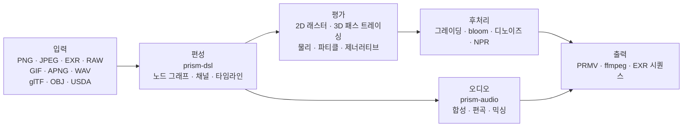

<h1 align="center">Prism Engine</h1>

<h3 align="center">프로시저럴 미디어 엔진</h3>

<p align="center">
  
  
  
  
  
  <a href="https://github.com/Qianjinqie/prism-engine/releases"></a>
</p>

<p align="center">
  
</p>

<p align="center">
  <sub>목업이 아니라 엔진 출력입니다: 1200×675 · 256 spp · 패스 트레이싱 + 물리 기반 BSDF + ACES 톤 매핑 · 4 스레드 158초. 장면 소스는 <a href="gallery/gallery.rs"><code>docs/gallery/gallery.rs</code></a>.</sub>
</p>

<p align="center">
  <sub><b>642</b> 파일 · <b>28</b> crate · <b>26.1만</b> 줄의 Rust · <b>3929</b> 테스트 · 서드파티 의존성 <b>0</b> · <b>18.9 MB</b> 단일 파일</sub>
</p>

## 기능 전경

Rust로 작성된 프로시저럴 미디어 엔진. 입력은 `.prism` 장면 기술이나 Rust 호출, 출력은 스틸·프레임 시퀀스·완성 컷. 아래 계층은 미디어 파이프라인의 공정 순서를 따르며, 어느 순간에서 멈추면 스틸, 연속으로 기록하면 영상이 된다——모든 계층이 둘을 같은 방식으로 다룬다.

| 계층 | 무엇을 하는가 |
| --- | --- |
| **읽기** | PNG(8/16 bit, 필터 역연산), 베이스라인 JPEG(고정소수점 IDCT, 플랫폼 간 비트 일치), EXR(읽기/쓰기, 압축 패밀리, DWA), 카메라 RAW, GIF / APNG 프레임 단위, WAV; glTF / OBJ / USDA 가져오기, MaterialX 파라미터; TTF/OTF 로딩과 "내장 → 사용자 → 다국어 서브셋 → 수학 기호" 4단계 폴백 |
| **조판** | OpenType 파싱, GSUB/GPOS 셰이핑, UAX #9 양방향, 아랍어 네 형태, 세로쓰기; 수식 조판(위/아래 첨자, 분수, 근호, 행렬, 대형 연산자); DSL v1/v2를 트리플 그래프로 컴파일; 다섯 가지 고수준 컴비네이터(타이틀 / 로어서드 / 분할 화면 / 켄 번스 / 장면 간 모프); 네 가지 전환 + 모프, 임의 시점 샘플링 가능 |
| **그리기** | 패스트레이싱 + 물리 BSDF(확산 / 거울 / 유리 / 금속 / 표면하 산란), 유리와 금속은 확률적 역변환(노이만 급수 몬테카를로); Woodcock 이질 볼륨; 원기둥 / 원뿔 / 토러스 / 회전체 해석적 교차(4차 방정식을 Ferrari 폐형식으로); 삼각 메시 + SAH-BVH(안정 정렬, 결정적 구축); 메시를 SDF로 베이크해 불리언 / 영역 변형 / 정확한 충돌; CpuRef 1급 백엔드 + Vulkan compute와 레이트레이싱 두 파이프라인 |
| **움직임** | 통합 XPBD 솔버——강체 / 연체 / 천 / 관절 / 유체 / 파괴는 하나의 제약 투영 루프에 대한 여섯 파라미터 세트; FLIP 연기; 파티클 + AudioReactive; 머리카락 제약과 셰이딩; 유동장 / L 시스템 / 세포 오토마타 / 반응-확산 / 프랙털 / Voronoi; 스프링 해석해와 키프레임 |
| **그레이딩** | 세컨더리 그레이딩(HSL 선택 + RGB 커브); cinematic / film / anime 프리셋, 초안 / 표준 / 영화 세 단계를 명시적으로 가격 표시; blur / bloom / 비네트 / 색수차 / sharpen / glitch / dissolve; 할레이션 + 두 스케일 필름 그레인(픽셀 영역에서 유도); 삼중 디노이즈; NPR 네 스타일(toon / watercolor / halftone / oil); PQ / HLG 전달 함수, 리니어 sRGB ↔ ACEScg, ACES 출력 변환 |
| **소리** | PolyBLEP 안티에일리어싱 오실레이터 + ADSR 폐형 엔벨로프 + 4가지 무드 프리셋; 음계 라이브러리 + 12-TET + 화성 진행 기능문법 상태기계 + 성부 진행; 아르페지에이터 / 스텝 드럼 머신 / 마디·박 그리드; 직접 작성한 SMF 파서, SFZ 샘플러, 그래뉼러 합성; 물리 모델링 / 공간 패닝 / 이펙트 체인; 멀티트랙 믹싱 + 피크 제한; 비트 / 온셋 / FFT, AudioReactive 베이크, 라우드니스 정규화; WAV 16/24/32 bit 바이트 단위 왕복 |
| **출력** | 자체 PRMV 컨테이너(v2/v3, v3는 v1/v2 읽기) + I/P 프레임 시간 부호화; water-filling 레이트 제어 + qpel 서브픽셀 움직임 추정(실측 PSNR +2.577 dB, 크기 −21.6%); ffmpeg 런타임 탐지——있으면 stdin 파이프로 H.264/HEVC, 없으면 자동 MJPEG 폴백, 항상 파일이 나온다; MP4 + MJPEG 컨테이너, EXR 시퀀스; 멀티프로세스 프레임 팜(중단 재개 가능, 병렬 MD5 == 직렬 MD5); NLE 시간 매핑 / 키프레임 / 전환 |
| **연결** | MCP stdio 세 도구(`scene_check` / `render_submit` / `diagnose`); 노드 SDK 시맨틱 버전 협상 + 예제 노드 패키지; CLI(`render` / `preview` / `demo`); 두 단계 미리보기 대화형 에디터(Draft 기하 / Real 저 spp) + 서브그래프 서명 증분; batch manifest 카티션 곱; 세 플랫폼 하드웨어 인코더 탐지 골격(VideoToolbox / NVENC / VAAPI, 백엔드 미연결) |
| **부수 경로** | 생성 예술: 유동장 / L 시스템 / 세포 오토마타 / 반응-확산 / Mandelbrot / Voronoi, 벡터 draw-on과 차트. AI 보조: 결정론적 mock 추론 계층(스토리보드 / 자막 / 색상 힌트), 모델 가중치는 데이터로 읽고 곱셈-덧셈은 직접 작성, ML 프레임워크 없음 |

표는 능력만 나열합니다. 각 능력이 못 하는 것은 [정직한 경계](#정직한-경계)에 있으며 표 안에 숨기지 않았습니다.

## 3분 만에 실행하기

```bash
# 1. 단일 파일 소스 패키지를 받고 SHA-256 검증
curl -L -O https://github.com/Qianjinqie/prism-engine/releases/download/v2.1/prism-engine-v2.1-source.txt
curl -L -O https://github.com/Qianjinqie/prism-engine/releases/download/v2.1/SHA256SUMS.txt
sha256sum -c SHA256SUMS.txt

# 2. 패키지에 들어 있는 언팩 스크립트 추출 (Node 18+ 만 필요, npm install 불필요)
awk '/^UNPACK SCRIPT BEGIN$/{f=1;next} /^UNPACK SCRIPT END$/{f=0} f' \
  prism-engine-v2.1-source.txt > unpack.cjs
node unpack.cjs                    # 642개 파일 복원

# 3. 빌드하고 전체 테스트 실행
cargo test --workspace --release     # 3929 passed / 0 failed

# 4. 아무것도 쓰지 말고, 먼저 영상을 봅니다
cargo run -p prism-app --release     # 내장 데모 장면
```

복원 결과는 평범한 Cargo workspace(`src/` 아래 28개 crate)이며, 이후 `cargo` 명령은 일반 Rust 프로젝트와 같습니다. 첫 빌드에는 몇 분이 걸립니다.

## 한 장면을, 한 편의 텍스트로

`.prism`은 엔진의 장면 서술 언어입니다. 아래는 완전히 렌더링 가능한 3초 장면입니다——구체, 재질, 궤도 카메라, 방향광, 길이, 그레이딩, 출력 사양까지 전부:

```prism
scene "spin_red_ball" {
    sphere ball {
        radius 1.0
        material {
            albedo #c0392b
            roughness 0.3
            metalness 0.05
        }
    }

    camera main {
        orbit {
            center 0,0,0
            radius 8.0
        }
        fov 45
    }

    light sun {
        direction (1.0, -1.0, -0.5)
        color #fff4e6
        intensity 3.0
    }
}

timeline {
    duration 3s
    fps 12
}

aesthetic {
    teal-orange
    contrast 1.12
    filmic
}

output {
    resolution 480x270
    format frames
}
```

```bash
cargo run -p prism-app --release -- examples/spin_red_ball.prism          # 프레임 시퀀스
cargo run -p prism-app --release -- render examples/w2d_showcase.prism \
    --out out/demo.mp4                                                     # 한 번에 완성 영상
```

`render`는 v2 직행 경로입니다. 노드 그래프 컴파일 → 프레임별 평가 → 컨테이너 인코딩까지, 중간 프레임을 디스크에 남기지 않습니다. 지원하지 않는 노드는 조용히 건너뛰지 않고 명시적인 `R5xxx` 오류를 냅니다.

<p align="center">
  
  <br>
  <sub>`examples/w2d_showcase.prism`의 10번째 프레임: 3D 구체, 텍스트 레이어, 그레이딩, 페이드 트랙이 하나의 타임라인을 공유합니다.</sub>
</p>

## Rust API만 쓰기

DSL을 쓰지 않고 라이브러리를 직접 호출할 수 있습니다. 아래는 히어로 이미지의 골격입니다(전체 장면은 190줄, [`docs/gallery/gallery.rs`](gallery/gallery.rs)):

```rust
use prism_core::node::EvalCtx;
use prism_math::Vec3;
use prism_rt::camera::Camera;
use prism_rt::integrator::{render_pixel, MaterialKind, RenderParams, Scene, Sphere};

let scene = Scene {
    spheres: vec![(
        Sphere { center: Vec3::new(0.0, 0.6, 0.0), radius: 0.6 },
        MaterialKind::Lambert { albedo: Vec3::new(0.8, 0.2, 0.15) },
    )],
    ..Default::default()
};
let cam = Camera::new(
    Vec3::new(0.0, 1.2, 4.8),   // 시점
    Vec3::new(0.0, 0.72, 0.0),  // 바라보는 점
    Vec3::new(0.0, 1.0, 0.0),   // 위쪽
    30.0, 0.05, 4.85, 0.0, 1.0 / 48.0,
);
let ctx = EvalCtx::new(20261028, 0, 0);
let params = RenderParams::new(256, 10);  // 픽셀당 256 샘플, 최대 10회 바운스

// 단일 픽셀: 장면, 카메라, 샘플링 컨텍스트, 픽셀 좌표, 해상도, 파라미터
let color = render_pixel(&scene, &cam, &ctx, (640, 360), (1280, 720), &params);
```

`render_pixel`은 순수 함수입니다. 장면, 카메라, 샘플링 컨텍스트, 픽셀 좌표를 받아 선형 RGB를 돌려줍니다. 같은 파라미터라면 어느 스레드에서, 어떤 순서로 호출해도 결과 비트가 같습니다——그래서 병렬 렌더링에 동기화가 전혀 필요 없습니다.

## 목록에 담기지 않는 내부 능력

이것들은 포맷 지원이 아니라 엔진 내부의 기반입니다.

### 오디오: 내장 DAW 커널

능력 목록은 **소리** 행에 있습니다. 여기서는 동작 방식, 즉 같은 렌더 타임라인에 올라갈 수 있는 이유를 적습니다:

- **각 함수는 파라미터의 순수 함수**: 같은 악보를 임의의 시크 위치에서 다시 계산해도 샘플 값은 비트 단위로 일치하며 재생 이력에 의존하지 않는다
- **AudioReactive는 프레임 단위 순수 함수로 베이크된다**: 프레임 N은 고정 창을 읽으므로 프레임 건너뛰기, 역재생, 병렬 분할이 결과를 바꾸지 않는다
- **믹싱은 오프라인 병렬 선형대수**: 멀티트랙 합산 + 페이드 + 피크 제한, 숨은 상태기계가 없다

> 경계: AAC / mp3 인코딩은 직접 구현하지 않는다(특허 이력 + 공수). 외부 ffmpeg와 연동한다.

### 정의 가능한 커널 레지스트리

엔진의 각 노드 타입은 "커널 + 격자 + 쌍대" 삼중항의 **특수해**입니다. 서드파티는 `registry!`로 새 특수해를 정적으로 등록할 수 있고, **엔진 코어를 건드리지 않습니다**:

- 정적 포함: 매크로가 정의 crate 안에서 전개되며, `inventory`와 proc-macro를 금지해 의존성 제로를 유지;
- 등록 시 **세 가지 질문**(커널 형식 / 격자 / 쌍대)을 검증하고, 답이 빠지면 세 단락 오류로 거부;
- 공식 특수해와 사용자 특수해가 같은 레지스트리를 지나며 런타임에 구분되지 않음;
- 수학적으로는 작용소 방정식 `f = g + Kf`의 여섯 가지 역해법(정확 / 확률 / 국소 / 정규화 / 반복 / 스펙트럼)에 대응하며, 새 기능 추가는 삼중항 선언이지 렌더 루프에 대한 패치가 아닙니다.

### GPU: 세 경로, 세 상태

| 백엔드 | 상태 | 근거 |
| --- | --- | --- |
| **Vulkan** | 실제 동작 | compute + 레이트레이싱 이중 파이프라인. Mesa lavapipe 소프트웨어 ICD에서 GPU 없이 검증 가능. `render_scene` 출력이 CPU 참조와 **바이트 단위 0 차이**. `is_available()`은 compute ∧ render 이중 자체 점검 |
| **Metal** | 컴파일 게이트 완료, 미점등 | 동형 이식 완료, 실기 검증 없음, `is_available()` 항상 false |
| **WebGPU** | 결론만 | 타당성 평가 완료(이식량 4–6 인일), 렌더 경로 미구현 |

## 엔지니어링 사실

세 가지 제약과 각각의 비용:

| 제약 | 구현 방식 | 비용 |
| --- | --- | --- |
| 서드파티 코드 의존 없음 | 런타임 110 + 테스트 20 의존성 전부 저장소 내 `path` 의존성; `build.rs` 없음, 네이티브 링크 없음, 빌드 시 네트워크 없음 | 모든 포맷, 알고리즘, 폰트, 코덱을 여기서 작성해야 한다 |
| 바이트 단위 결정성 | 고정소수점 IDCT, 고정 샘플링 열, 4차원 설정 해시; 같은 입력이면 플랫폼 간 동일 | 부동소수점 고속 경로를 포기하고, 해시맵 순회 순서에 의존할 수 없다 |
| 단일 파일 배포 | 28 crate·642 파일을 18.9 MB UTF-8 텍스트 하나로 합치고 `node unpack.cjs`로 복원 | GitHub에서 소스를 바로 훑어보는 편의를 포기한다 |

### 결정성은 어떻게 검증되는가

네 계층, 파라미터에서 바이트까지:

1. **서명 폐포**: 노드 그래프, 캐시 키, 스냅숏 키, 프레임 서명을 4차원 설정 해시로 통일. 파라미터가 바뀌면 키도 반드시 바뀌어 잘못된 재사용이 없다. 반복 노드 키에는 `(ε, n)`, 스트림 노드에는 프레임 번호가 들어가며, `None`이면 이전 동작으로 바이트 단위 퇴화한다.
2. **바이트 고정점**: USD는 내보내기→가져오기→내보내기가 바이트 일치; WAV 16/24/32 bit 왕복이 일치; EXR은 공식 OpenEXR과 비트스트림 대 비트스트림으로 대조한다.
3. **패키징 결정성**: 같은 소스를 두 번 패키징하면 SHA-256이 동일; 압축 해제 왕복에서 모든 파일을 바이트 단위로 비교한다.
4. **테스트를 판정 기준으로**: 3929개 테스트 중 다수가 황금값을 고정(허용 오차 1e-2에서 1e-6으로, 실측 잔차 4.53e-7); 형상 충실도는 "대충 비슷하다"가 아니라 Hausdorff 거리로 상한을 정한다.

## 아키텍처



28개 crate를 책임별로:

| 분류 | crate |
| --- | --- |
| 코어 | `prism-core` · `prism-math` · `prism-bytes` · `prism-geometry` · `prism-noise` |
| 미디어 I/O | `prism-io` · `prism-media` · `prism-mux` · `prism-audio` · `prism-texture` |
| 렌더링 | `prism-render` · `prism-raster` · `prism-gpu` · `prism-postfx` · `prism-vector` · `prism-particles` |
| 애니메이션 / 생성 | `prism-anim` · `prism-genart` · `prism-aesthetic` · `prism-physics` |
| 텍스트 / UI | `prism-text` · `prism-rt` · `prism-app` |
| 고급 | `prism-ai` · `prism-dsl` · `prism-infra` · `prism-author` |
| 사이드카(feature gate) | `prism-ffi-hwenc` |

언팩 후 디렉터리 구조:

| 경로 | 내용 |
| --- | --- |
| `src/` | 28개 crate 소스(저장소에서는 `crates/`, 배포 시 재구성) |
| `Compliance/` | 의존성 제로 검증, 서드파티 고지, 에셋 등록 |
| `开发者指南.md` | 자기 완결형 개발자 가이드: 시작 / 아키텍처 / 수학 커널 / 게이트 / 확장 |
| `tools/` | 게이트와 패키징 스크립트 |
| `examples/` | `.prism` 예제와 노드 패키지(`include_str!`로 읽으므로 없으면 빌드 실패) |
| `.github/workflows/` | CI 설정 |

> 설계 정본(`docs/设计/`)은 배포자의 전체 저장소에만 있으며 배포에는 포함되지 않습니다. 데모 crate `prism-anim-demo`도 마찬가지입니다.

## 빌드, 테스트, 게이트

```bash
cargo test --workspace --release      # 3929 passed / 0 failed / 0 ignored
cargo xtest                           # 동등한 별칭
cargo test -p prism-core --release    # 단일 crate 스모크 테스트

node tools/ghost_guard.mjs --check    # 유령 쓰기 방어: G1 중복 정의 / G2 엄격한 상위 집합 / G3 최상위 문서 / G4 빌드
node tools/hygiene_scan.mjs           # 위생: 남은 내부 용어를 file:line으로 나열, 적중 시 exit 1
node tools/compliance_check.mjs       # 컴플라이언스 자체 점검: 9/9 통과해야 함
node tools/compliance_check.mjs --self-test  # 반증: 실패해야 하며, 판정 기준의 판별력을 보여줌
node tools/pack_source_txt.mjs --verify      # 패키징과 언팩 왕복을 바이트 단위로 검증
```

- 전체: **3929 passed / 0 failed / 0 ignored**, 179개 테스트 구간, 전 코어 병렬 171.5초(release).
- CI는 여섯 job: 유령 쓰기 방어, 빌드 + 전체 테스트, wasm32 빌드, WGSL 정적 검사, 공식 OpenEXR과 비트스트림 상호 검증, Node 호스트 교차 판정.
- 위생 스캔에는 여전히 적중이 남아 있습니다. 배포 문서 층은 정리되었고, 나머지는 소스 주석과 배포 대상이 아닌 저장소 파일에 있습니다. 스크립트의 존재는 잔여물을 **보이게 두고 하나씩 정리**하기 위함이며, 깨끗한 척하기 위함이 아닙니다.

### 가짜 초록 방지 게이트

의존성 제로 게이트 스크립트 네 개(Node만 사용): 유령 쓰기 방어(역 자체 시험 포함), 오픈소스 위생 스캔, 컴플라이언스 자체 점검(9/9 통과 + 8/8 반증 판정), 패키지 왕복 검증. 게이트 결과는 "통과"와 "실패" 둘뿐이며, "아마 괜찮을 것"은 인정하지 않습니다——**가짜 초록은 실패보다 위험합니다**.

## 정직한 경계

| 경계 | 현황 | 출로 |
| --- | --- | --- |
| DNG `Compression=7`(lossless JPEG) | 미구현. 실제 카메라 DNG는 읽을 수 없음 | 16 bit TIFF / PNG로 변환 후 사용 |
| mp3 / AAC / FLAC | 디코딩은 외부 ffmpeg 탐색 경로, 인코딩은 직접 구현하지 않음 | ffmpeg 설치, 또는 WAV만 사용 |
| 곡선 프리미티브 GPU | CPU 경로만 | 삼각화 후 SAH-BVH로 |
| Metal | 게이트 준비 완료, 실기 미검증, 미점등 | Apple 기기가 생기면 연결 |
| WebGPU | 타당성 결론만, 렌더 미구현 | 4–6 인일 |
| 하드웨어 인코딩 | 세 플랫폼 탐색 골격만 | 대상 플랫폼별로 구현 |
| GPU 가속비 | lavapipe에서 정확성만 검증, 실제 GPU 미측정 | 대상 하드웨어에서 측정 필요 |
| 위생 스캔 | 소스 주석에 기존 적중 | 하나씩 정리, 스크립트로 추적 |

이것들은 "나중에"가 아니라 현재 명확히 지원하지 않는 항목입니다. 이슈에 숨기는 것보다 여기 적는 편이 낫다고 판단했습니다.

## 컴플라이언스

엔진은 서드파티 코드 의존성 제로를 표방하며 자체 점검으로 검증합니다:

- **C1 서드파티 코드 의존성 제로**: 130개 의존성(런타임 110 + 테스트 20)이 모두 저장소 내 `path` 의존성. `build.rs` 없음, 네이티브 링크 지시 없음. `Cargo.lock`이 저장소 내 29개 패키지를 고정.
- **C2 에셋 등록 완비**: 5개 에셋의 주표 항목이 모두 채워져 있습니다. 폰트는 SIL OFL 1.1로 배포하며 라이선스 전문을 `src/prism-text/font_data/LICENSE`에 동봉.
- **C3 서드파티 귀속 고지**: `Compliance/THIRD-PARTY-NOTICES.md`가 "데이터 자산 ≠ 코드 의존성"을 명확히 구분.

## 라이선스

Apache License 2.0, [`LICENSE`](../LICENSE)를 참고하세요.

재배포 시 `Compliance/` 아래의 귀속 고지와 에셋 등록을 유지해 주세요.

<sub>히어로 이미지와 DSL 스크린샷은 모두 엔진 자체가 렌더링한 것입니다. 파라미터는 그림 설명과 [`docs/gallery/gallery.rs`](gallery/gallery.rs)에 있습니다.</sub>
