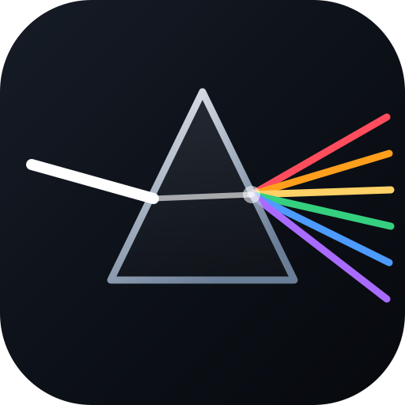
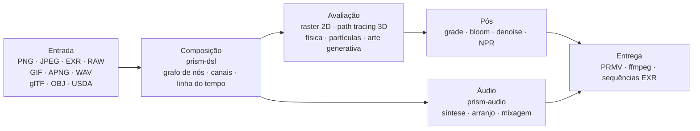

<p align="center">
  
</p>
<h1 align="center">Prism Engine</h1>

<h3 align="center">Motor de mídia procedural</h3>

<p align="center">
  <sub>Decodificar · Compor · Path tracing · Simular · Sintetizar · Codificar &nbsp;|&nbsp; Imagem · Sequência · Corte final &nbsp;|&nbsp; CPU + Vulkan</sub>
</p>

<p align="center">
  <a href="../README.md">中文</a>
  · <a href="README.en.md">English</a>
  · <a href="README.de.md">Deutsch</a>
  · <a href="README.es.md">Español</a>
  · <a href="README.fr.md">Français</a>
  · <a href="README.ja.md">日本語</a>
  · <a href="README.ko.md">한국어</a>
  · <b><a href="README.pt-BR.md">Português</a></b>
  · <a href="README.ru.md">Русский</a>
</p>

<p align="center">
  
  
  
  
  
  <a href="https://github.com/Qianjinqie/prism-engine/releases"></a>
</p>

<p align="center">
  
</p>

<p align="center">
  <sub>Não é mock-up, é saída do motor: 1200×675 · 256 spp · path tracing + BSDF físico + tonemapping ACES · 4 threads, 158 s. Código da cena: <a href="gallery/gallery.rs"><code>docs/gallery/gallery.rs</code></a>.</sub>
</p>

<p align="center">
  <sub><b>642</b> arquivos · <b>28</b> crates · <b>261 mil</b> linhas de Rust · <b>3929</b> testes · <b>0</b> dependências de terceiros · <b>18,9 MB</b> em arquivo único</sub>
</p>

<!-- TOC-START -->
<details>
<summary>Índice</summary>

- [Mapa de capacidades](#capabilities)
- [Rodando em três minutos](#quickstart)
- [Um plano, um texto](#one-scene)
- [Ou apenas a API Rust](#rust-api)
- [Capacidades que não cabem na lista](#internals)
- [Fatos de engenharia](#engineering)
- [Arquitetura](#architecture)
- [Compilar, testar e portões](#build-test)
- [Limites honestos](#boundaries)
- [Conformidade](#compliance)
- [Licença](#license)

</details>
<!-- TOC-END -->

<a id="capabilities"></a>
## Mapa de capacidades

Um motor de mídia procedural em Rust. A entrada é uma cena `.prism` ou uma chamada à API Rust; a saída é uma imagem, uma sequência de quadros ou um corte final. As camadas seguem uma cadeia de mídia; congelar um instante dá uma imagem, avançar e gravar dá vídeo — todas as camadas tratam os dois do mesmo jeito.

| Camada | O que faz |
| --- | --- |
| **Ler** | PNG (8/16 bits, inversão de filtros), JPEG baseline (IDCT de ponto fixo, idêntico bit a bit entre plataformas), EXR (leitura/escrita, família de compressão, DWA), RAW de câmera, GIF / APNG quadro a quadro, WAV; importação glTF / OBJ / USDA, parâmetros MaterialX; carga TTF/OTF com cadeia de fallback de quatro níveis (embutida → usuário → subconjuntos multi-escrita → símbolos matemáticos) |
| **Compor** | Análise OpenType, shaping GSUB/GPOS, bidirecional UAX #9, quatro formas árabes, composição vertical; composição de fórmulas (sub/sobrescritos, frações, radicais, matrizes, operadores grandes); DSL v1/v2 compilado em grafo de triplas; cinco combinadores de alto nível (cartela de título / faixa inferior / tela dividida / Ken Burns / morph entre cenas); quatro transições + morph, amostráveis em qualquer instante |
| **Renderizar** | Path tracing + BSDF físico (difuso / especular / vidro / metal / subsuperfície), vidro e metal por inversão estocástica (série de Neumann, Monte Carlo); volumes heterogêneos Woodcock; interseções analíticas para cilindros / cones / toros / superfícies de revolução (quártica por Ferrari); malhas triangulares + SAH-BVH (ordenação estável, construção determinística); malhas assadas em SDF para booleanos / deformação de domínio / colisão exata; CpuRef como backend de primeira classe + pipelines Vulkan de computação e ray tracing |
| **Simular** | Solver XPBD unificado — rígidos / macios / tecido / juntas / fluidos / fratura são seis conjuntos de parâmetros de um mesmo laço de projeção de restrições; fumaça FLIP; partículas + AudioReactive; restrições e sombreamento de pelos; campos de fluxo / sistemas L / autômatos celulares / reação-difusão / fractais / Voronoi; solução analítica de molas e keyframes |
| **Colorir** | Graduação secundária (seleções HSL + curvas RGB); presets cinematic / film / anime, com três níveis (rascunho / padrão / cinema) precificados explicitamente; blur / bloom / vinheta / aberração cromática / sharpen / glitch / dissolve; halation + grão de filme em duas escalas (derivado no domínio do pixel); denoising triplo; quatro estilos NPR (toon / watercolor / halftone / oil); funções de transferência PQ / HLG, sRGB linear ↔ ACEScg, transformação de saída ACES |
| **Som** | Oscilador PolyBLEP anti-aliasing + envelope ADSR fechado + 4 presets de humor; biblioteca de escalas + 12-TET + máquina de estados de progressões por gramática funcional + condução de vozes; arpejador / caixa de ritmos por passos / grade de compassos; parser SMF escrito à mão, sampler SFZ, síntese granular; modelagem física / panning espacial / cadeias de efeitos; mixagem multipista + limitação de picos; beat / onset / FFT, assamento AudioReactive, normalização de loudness; WAV 16/24/32 bits round-trip byte a byte |
| **Entregar** | Contêiner PRMV próprio (v2/v3, v3 lê v1/v2) + codificação temporal I/P; controle de taxa water-filling + estimação de movimento qpel subpixel (PSNR medido +2,577 dB, tamanho −21,6 %); ffmpeg detectado em tempo de execução — pipe stdin para H.264/HEVC se existir, fallback automático para MJPEG se não, sempre sai um arquivo; contêineres MP4 + MJPEG, sequências EXR; fazenda de quadros multiprocesso (retomável, MD5 paralelo == MD5 serial); mapeamento temporal NLE / keyframes / transições |
| **Integrar** | Três ferramentas MCP stdio (`scene_check` / `render_submit` / `diagnose`); SDK de nós com negociação de versão semântica + pacote de nó de exemplo; CLI (`render` / `preview` / `demo`); editor interativo com dois níveis de pré-visualização (Draft geométrico / Real baixo spp) + incrementos por assinatura de subgrafo; manifesto batch como produto cartesiano; esqueleto de sonda de codificador de hardware para três plataformas (VideoToolbox / NVENC / VAAPI, sem backend conectado) |
| **Via auxiliar** | Arte generativa: campos de fluxo / sistemas L / autômatos celulares / reação-difusão / Mandelbrot / Voronoi, draw-on vetorial e gráficos. Assistência de IA: camada de inferência mock determinística (storyboard / legendas / sugestões de cor), pesos do modelo lidos como dados com multiplicação-soma própria, sem framework de ML |

A tabela lista apenas capacidades. O que cada uma não faz está em [Limites honestos](#limites-honestos), não escondido na tabela.

<a id="quickstart"></a>
## Rodando em três minutos

```bash
# 1. Baixar o pacote de código e verificar o SHA-256
curl -L -O https://github.com/Qianjinqie/prism-engine/releases/download/v2.1/prism-engine-v2.1-source.txt
curl -L -O https://github.com/Qianjinqie/prism-engine/releases/download/v2.1/SHA256SUMS.txt
sha256sum -c SHA256SUMS.txt

# 2. Extrair o script de desempacotamento embutido (só Node 18+, sem npm install)
awk '/^UNPACK SCRIPT BEGIN$/{f=1;next} /^UNPACK SCRIPT END$/{f=0} f' \
  prism-engine-v2.1-source.txt > unpack.cjs
node unpack.cjs                    # restaura 642 arquivos

# 3. Compilar e rodar a suíte completa
cargo test --workspace --release     # 3929 passed / 0 failed

# 4. Sem escrever nada, ver renderizar
cargo run -p prism-app --release     # cena de demonstração embutida
```

O resultado é um workspace Cargo comum (28 crates em `src/`); os demais comandos `cargo` funcionam como em qualquer projeto Rust. A primeira compilação leva alguns minutos.

<a id="one-scene"></a>
## Um plano, um texto

`.prism` é a linguagem de descrição de cenas do motor. Abaixo está um plano completo e renderizável de três segundos — esfera, material, câmera orbital, luz direcional, duração, grade e especificação de saída:

```prism
scene "spin_red_ball" {
    sphere ball {
        radius 1.0
        material {
            albedo #c0392b
            roughness 0.3
            metalness 0.05
        }
    }

    camera main {
        orbit {
            center 0,0,0
            radius 8.0
        }
        fov 45
    }

    light sun {
        direction (1.0, -1.0, -0.5)
        color #fff4e6
        intensity 3.0
    }
}

timeline {
    duration 3s
    fps 12
}

aesthetic {
    teal-orange
    contrast 1.12
    filmic
}

output {
    resolution 480x270
    format frames
}
```

```bash
cargo run -p prism-app --release -- examples/spin_red_ball.prism          # sequência de quadros
cargo run -p prism-app --release -- render examples/w2d_showcase.prism \
    --out out/demo.mp4                                                     # filme pronto em uma chamada
```

`render` usa o caminho direto v2: compilar o grafo de nós → avaliar quadro a quadro → codificar em um contêiner, sem quadros intermediários em disco. Nós não suportados geram um erro explícito `R5xxx` em vez de serem ignorados em silêncio.

<p align="center">
  
  <br>
  <sub>Quadro 10 de `examples/w2d_showcase.prism`: uma esfera 3D, uma camada de texto, um grade e uma faixa de fade compartilham a mesma linha de tempo.</sub>
</p>

<a id="rust-api"></a>
## Ou apenas a API Rust

Se preferir não escrever DSL, chame a biblioteca direto. Este é o esqueleto da imagem principal (a cena completa tem 190 linhas, veja [`docs/gallery/gallery.rs`](gallery/gallery.rs)):

```rust
use prism_core::node::EvalCtx;
use prism_math::Vec3;
use prism_rt::camera::Camera;
use prism_rt::integrator::{render_pixel, MaterialKind, RenderParams, Scene, Sphere};

let scene = Scene {
    spheres: vec![(
        Sphere { center: Vec3::new(0.0, 0.6, 0.0), radius: 0.6 },
        MaterialKind::Lambert { albedo: Vec3::new(0.8, 0.2, 0.15) },
    )],
    ..Default::default()
};
let cam = Camera::new(
    Vec3::new(0.0, 1.2, 4.8),   // olho
    Vec3::new(0.0, 0.72, 0.0),  // alvo
    Vec3::new(0.0, 1.0, 0.0),   // cima
    30.0, 0.05, 4.85, 0.0, 1.0 / 48.0,
);
let ctx = EvalCtx::new(20261028, 0, 0);
let params = RenderParams::new(256, 10);  // 256 amostras por pixel, até 10 rebotes

// Um pixel: cena, câmera, contexto de amostragem, coordenada, resolução, parâmetros
let color = render_pixel(&scene, &cam, &ctx, (640, 360), (1280, 720), &params);
```

`render_pixel` é uma função pura: entram cena, câmera, contexto de amostragem e coordenada do pixel; sai RGB linear. Com os mesmos parâmetros devolve bits idênticos, não importa a thread nem a ordem de chamada — por isso a renderização paralela não precisa de sincronização alguma.

<a id="internals"></a>
## Capacidades que não cabem na lista

Estas coisas não são suporte a formatos, mas infraestrutura dentro do motor.

### Áudio: um núcleo de DAW embutido

A lista de capacidades está na linha **Som**. Aqui vai como ele funciona, e por que pode pendurar na mesma linha de tempo de render:

- **Cada função é uma função pura de seus parâmetros**: a mesma partitura recalculada em qualquer posição de seek dá amostras idênticas bit a bit, sem depender do histórico de reprodução
- **AudioReactive é assado em função pura por quadro**: o quadro N lê uma janela fixa, então pular quadros, tocar ao contrário ou fatiar em paralelo não muda o resultado
- **A mixagem é álgebra linear paralela offline**: soma multipista + fades + limitação de picos, sem máquina de estados escondida

> Limite: codificação AAC / mp3 não é implementada aqui (histórico de patentes mais esforço); passa por ffmpeg externo.

### Um registro de kernels definíveis

Cada tipo de nó do motor é uma **solução particular** de uma tripla “kernel + reticulado + dual”. Terceiros (ou você) podem registrar novas soluções estaticamente com `registry!`, **sem tocar no núcleo do motor**:

- Inclusão estática: a macro expande dentro do crate que define; `inventory` e proc-macros são proibidos para manter zero dependências;
- O registro faz uma **verificação de três perguntas** (forma do kernel / reticulado / dual); respostas incompletas são recusadas com um erro em três partes;
- Soluções oficiais e próprias compartilham o mesmo registro e são indistinguíveis em tempo de execução;
- Matematicamente corresponde às seis estratégias de inversão da equação de operadores `f = g + Kf` (exata / estocástica / local / regularizada / iterativa / espectral): adicionar uma capacidade é declarar uma tripla, não remendar o laço de renderização.

### GPU: três caminhos, três estados

| Backend | Estado | Evidência |
| --- | --- | --- |
| **Vulkan** | Funciona de verdade | Pipelines compute + ray tracing; verificável sem GPU no ICD de software lavapipe do Mesa; a saída de `render_scene` é **idêntica byte a byte (0 diferença)** à referência em CPU; `is_available()` é uma autoverificação compute ∧ render |
| **Metal** | Compilado atrás de gate, não ativado | Port isomórfico concluído, não verificado em hardware, `is_available()` sempre false |
| **WebGPU** | Apenas conclusão | Avaliação de viabilidade feita (4–6 pessoas-dia de port), caminho de renderização não implementado |

<a id="engineering"></a>
## Fatos de engenharia

Três restrições e o que cada uma custa:

| Restrição | Como é aplicada | O que custa |
| --- | --- | --- |
| Zero código de terceiros | As 110 dependências de execução + 20 de teste são dependências `path` dentro do repositório; sem `build.rs`, sem linkedição nativa, sem rede na compilação | Todo formato, algoritmo, fonte e codec precisa ser escrito aqui |
| Determinismo byte a byte | IDCT de ponto fixo, sequências de amostragem fixas, um hash de configuração de quatro dimensões; idêntico entre plataformas para a mesma entrada | Abre mão de atalhos rápidos em ponto flutuante e de depender da ordem de iteração de hashmaps |
| Distribuição em arquivo único | 642 arquivos de 28 crates fundidos em um texto UTF-8 de 18,9 MB, restaurado por `node unpack.cjs` | Abre mão de folhear o código direto no GitHub |

### Como o determinismo é verificado

Quatro camadas, dos parâmetros até os bytes:

1. **Fechamento de assinatura**: grafos de nós, chaves de cache, chaves de snapshot e assinaturas de quadro compartilham um hash de configuração de quatro dimensões. Mudar um parâmetro ⇒ a chave muda ⇒ sem reúso obsoleto. Nós de iteração carregam `(ε, n)` na chave; nós de fluxo, o número do quadro; `None` degenera byte a byte para o comportamento antigo.
2. **Pontos fixos de bytes**: USD exportar→importar→exportar é idêntico byte a byte; round-trips WAV de 16/24/32 bits batem; EXR é comparado bitstream contra bitstream com o OpenEXR oficial.
3. **Determinismo de empacotamento**: empacotar duas vezes a mesma fonte gera o mesmo SHA-256; o round-trip de desempacotamento compara cada arquivo byte a byte.
4. **Testes como critério**: muitos dos 3929 testes travam valores de ouro (tolerância apertada de 1e-2 para 1e-6, resíduo medido 4,53e-7); a fidelidade de forma é limitada por distância de Hausdorff em vez de “parece próximo o bastante”.

<a id="architecture"></a>
## Arquitetura



28 crates, agrupados por responsabilidade:

| Grupo | Crates |
| --- | --- |
| Núcleo | `prism-core` · `prism-math` · `prism-bytes` · `prism-geometry` · `prism-noise` |
| E/S de mídia | `prism-io` · `prism-media` · `prism-mux` · `prism-audio` · `prism-texture` |
| Renderização | `prism-render` · `prism-raster` · `prism-gpu` · `prism-postfx` · `prism-vector` · `prism-particles` |
| Animação / generativo | `prism-anim` · `prism-genart` · `prism-aesthetic` · `prism-physics` |
| Texto / UI | `prism-text` · `prism-rt` · `prism-app` |
| Avançado | `prism-ai` · `prism-dsl` · `prism-infra` · `prism-author` |
| Sidecar (feature gate) | `prism-ffi-hwenc` |

Estrutura após desempacotar:

| Caminho | Conteúdo |
| --- | --- |
| `src/` | Código dos 28 crates (no repositório `crates/`, reorganizado para a distribuição) |
| `Compliance/` | Verificação de zero dependências, avisos de terceiros, registro de ativos |
| `开发者指南.md` | Guia do desenvolvedor autônomo: início / arquitetura / núcleo matemático / portões / extensão |
| `tools/` | Scripts de portões e empacotamento |
| `examples/` | Exemplos `.prism` e pacotes de nós (lidos com `include_str!`; se faltar, não compila) |
| `.github/workflows/` | Configuração de CI |

> Os documentos de design (`docs/设计/`) ficam apenas no repositório completo do publicador e não são distribuídos; o crate de demonstração `prism-anim-demo` também não vai no pacote.

<a id="build-test"></a>
## Compilar, testar e portões

```bash
cargo test --workspace --release      # 3929 passed / 0 failed / 0 ignored
cargo xtest                           # alias equivalente
cargo test -p prism-core --release    # teste rápido de um crate

node tools/ghost_guard.mjs --check    # defesa de escrita fantasma: G1 redefinição / G2 superconjunto estrito / G3 documentação de topo / G4 compilação
node tools/hygiene_scan.mjs           # higiene: lista cada termo interno restante (arquivo:linha), exit 1 se houver
node tools/compliance_check.mjs       # autoverificação de conformidade: deve passar 9/9
node tools/compliance_check.mjs --self-test  # prova reversa: deve falhar, mostrando que o critério discrimina
node tools/pack_source_txt.mjs --verify      # ida e volta de empacotamento, byte a byte
```

- Suíte completa: **3929 passed / 0 failed / 0 ignored**, 179 seções de teste, 171,5 s com todos os núcleos (release).
- A CI tem seis jobs: defesa de escrita fantasma, compilação + testes completos, build wasm32, checagem estática WGSL, interoperabilidade de bitstream com o OpenEXR oficial, verificação cruzada em host Node.
- A varredura de higiene ainda tem ocorrências: a camada de documentação distribuída está limpa, o resto está em comentários de código e arquivos só do repositório. O script existe para que o restante fique **visível e corrigível peça por peça**, não para fingir que está tudo limpo.

### Portões anti-falso-verde

Quatro scripts de portão sem dependências (só Node): defesa contra escrita fantasma (com autoteste reverso), varredura de higiene open source, autoverificação de conformidade (9/9 aprovadas mais 8/8 provas de que o critério falha quando deve) e verificação de ida e volta do empacotamento. Um portão tem exatamente dois resultados — passa ou falha — e “parece bom” não é um deles. **Um verde falso é mais perigoso que uma falha.**

<a id="boundaries"></a>
## Limites honestos

| Limite | Estado | Saída |
| --- | --- | --- |
| DNG `Compression=7` (lossless JPEG) | Não implementado; DNGs de câmeras reais não são legíveis | Converter antes para TIFF/PNG 16 bit |
| mp3 / AAC / FLAC | Decodificação via sonda de ffmpeg externo; codificação não implementada | Instalar ffmpeg, ou ficar em WAV |
| Primitivas curvas na GPU | Apenas caminho CPU | Triangular e passar pelo SAH-BVH |
| Metal | Gate compilado, não verificado em hardware, não ativado | Ligar quando houver hardware Apple |
| WebGPU | Viabilidade concluída, renderização não implementada | 4–6 pessoas-dia |
| Codificação em hardware | Esqueleto de sondagem para três plataformas, sem implementação | Preencher por plataforma alvo |
| Aceleração GPU | Correção verificada só no lavapipe, nunca medida em GPU real | Medir no hardware alvo |
| Varredura de higiene | Ocorrências existentes em comentários | Limpar uma a uma; o script rastreia |

Não são itens de “depois”. Hoje não são suportados, explicitamente. Melhor aqui do que escondido em uma issue.

<a id="compliance"></a>
## Conformidade

O motor promete zero dependências de código de terceiros e verifica isso por autoverificação:

- **C1 Zero código de terceiros**: as 130 dependências (110 de execução + 20 de teste) são `path` dentro do repositório; sem `build.rs`, sem diretivas de link nativo; `Cargo.lock` fixa 29 pacotes do repositório.
- **C2 Registro de ativos completo**: as cinco entradas de ativos têm os campos da tabela principal; as fontes são distribuídas sob SIL OFL 1.1 com o texto completo da licença junto à fonte em `src/prism-text/font_data/LICENSE`.
- **C3 Avisos de terceiros**: `Compliance/THIRD-PARTY-NOTICES.md` separa explicitamente “ativos de dados ≠ dependências de código”.

<a id="license"></a>
## Licença

Apache License 2.0, veja [`LICENSE`](../LICENSE).

Ao redistribuir, mantenha os avisos e o registro de ativos em `Compliance/`.

<sub>A imagem principal e a captura do DSL foram renderizadas pelo próprio motor; os parâmetros estão nas legendas e em [`docs/gallery/gallery.rs`](gallery/gallery.rs).</sub>

