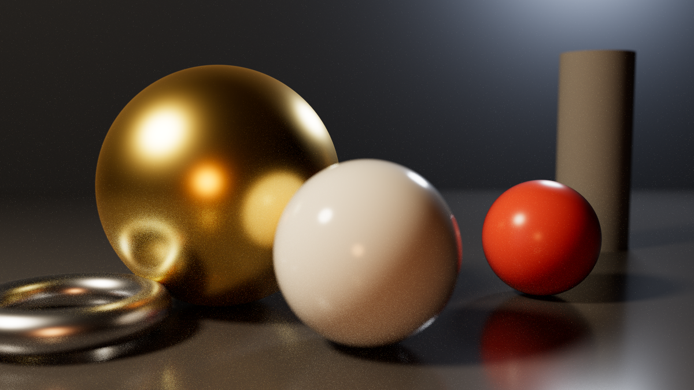
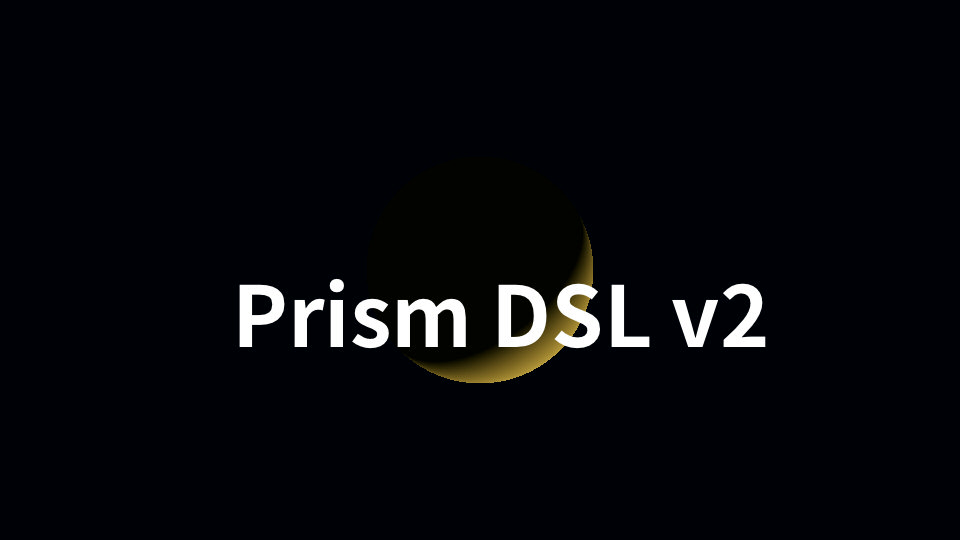
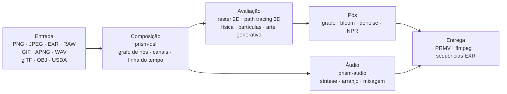

**Português (BR)** | [简体中文](../README.md) | [English](README.en.md) | [Deutsch](README.de.md) | [Español](README.es.md) | [Français](README.fr.md) | [日本語](README.ja.md) | [한국어](README.ko.md) | [Русский](README.ru.md)

# Prism Engine

**Zero dependências de terceiros · Determinístico bit a bit · Distribuição em arquivo único**

Um motor de mídia procedural escrito do zero em Rust: decodificação, composição tipográfica, path tracing, simulação física, síntese de áudio e codificação, tudo dentro de uma única árvore de código. Sem crates de terceiros, sem linkar bibliotecas do sistema, sem rede na compilação.


[](https://github.com/Qianjinqie/prism-engine/releases)



<sub>Não é mock-up, é saída do motor: 1200×675 · 256 spp · path tracing + BSDF físico + tonemapping ACES · 4 threads, 158 s. Código da cena: [`docs/gallery/gallery.rs`](gallery/gallery.rs).</sub>

**642** arquivos · **28** crates · **261 mil** linhas de Rust · **3929** testes · **0** dependências de terceiros · **18,9 MB** em arquivo único

---

## Por que este motor existe

Um pipeline de mídia convencional é montado: ffmpeg decodifica, Blender renderiza, ImageMagick grava imagens estáticas, um DAW cuida do som e scripts colam tudo com arquivos temporários. Cada ferramenta é excelente, mas nas junções duas coisas se perdem — **determinismo** e **auditabilidade**. Troque de máquina e o caminho de ponto flutuante muda; troque de versão e os padrões se movem; quando algo quebra, restam cinco caixas-pretas e uma pilha de arquivos intermediários.

O Prism Engine traz a cadeia inteira para uma única árvore de código. Mesma cena, mesmos parâmetros, qualquer máquina, qualquer execução: pixels idênticos e bytes idênticos. Não é promessa; 3929 testes prendem isso.

Não pretende substituir ffmpeg ou Blender. Substitui a cola entre eles, e o determinismo que essa cola joga fora em silêncio.

O público é estreito de propósito: pipelines que precisam de “mesma entrada, qualquer máquina, mesma saída” — renderização em lote, pesquisa gráfica reproduzível, renderização dentro da CI.

### Três restrições duras

| Restrição | Como é aplicada | O que custa |
| --- | --- | --- |
| **Zero código de terceiros** | Todas as 110 dependências de execução e 20 de teste são `path` dentro do repositório; sem `build.rs`, sem link nativo, sem rede na compilação | Cada formato, algoritmo, fonte e codec precisa ser escrito aqui |
| **Determinismo bit a bit** | IDCT de ponto fixo, sequências de amostragem fixas, hash de configuração quadridimensional; idêntico entre plataformas para a mesma entrada | Abrir mão de atalhos rápidos de ponto flutuante e de depender da ordem de iteração de tabelas hash |
| **Distribuição em arquivo único** | 642 arquivos de 28 crates fundidos em um texto UTF-8 de 18,9 MB, restaurado com `node unpack.cjs` | Perde-se a conveniência de folhear o código direto no GitHub |

---

## Rodando em três minutos

```bash
# 1. Baixar o pacote de código e verificar o SHA-256
curl -L -O https://github.com/Qianjinqie/prism-engine/releases/download/v2.1/prism-engine-v2.1-source.txt
curl -L -O https://github.com/Qianjinqie/prism-engine/releases/download/v2.1/SHA256SUMS.txt
sha256sum -c SHA256SUMS.txt

# 2. Extrair o script de desempacotamento embutido (só Node 18+, sem npm install)
awk '/^UNPACK SCRIPT BEGIN$/{f=1;next} /^UNPACK SCRIPT END$/{f=0} f' \
  prism-engine-v2.1-source.txt > unpack.cjs
node unpack.cjs                    # restaura 642 arquivos

# 3. Compilar e rodar a suíte completa
cargo test --workspace --release     # 3929 passed / 0 failed

# 4. Sem escrever nada, ver renderizar
cargo run -p prism-app --release     # cena de demonstração embutida
```

O resultado é um workspace Cargo comum (28 crates em `src/`); os demais comandos `cargo` funcionam como em qualquer projeto Rust. A primeira compilação leva alguns minutos.

---

## Um plano, um texto

`.prism` é a linguagem de descrição de cenas do motor. Abaixo está um plano completo e renderizável de três segundos — esfera, material, câmera orbital, luz direcional, duração, grade e especificação de saída:

```prism
scene "spin_red_ball" {
    sphere ball {
        radius 1.0
        material {
            albedo #c0392b
            roughness 0.3
            metalness 0.05
        }
    }

    camera main {
        orbit {
            center 0,0,0
            radius 8.0
        }
        fov 45
    }

    light sun {
        direction (1.0, -1.0, -0.5)
        color #fff4e6
        intensity 3.0
    }
}

timeline {
    duration 3s
    fps 12
}

aesthetic {
    teal-orange
    contrast 1.12
    filmic
}

output {
    resolution 480x270
    format frames
}
```

```bash
cargo run -p prism-app --release -- examples/spin_red_ball.prism          # sequência de quadros
cargo run -p prism-app --release -- render examples/w2d_showcase.prism \
    --out out/demo.mp4                                                     # filme pronto em uma chamada
```

`render` usa o caminho direto v2: compilar o grafo de nós → avaliar quadro a quadro → codificar em um contêiner, sem quadros intermediários em disco. Nós não suportados geram um erro explícito `R5xxx` em vez de serem ignorados em silêncio.



<sub>Quadro 10 de `examples/w2d_showcase.prism`: uma esfera 3D, uma camada de texto, um grade e uma faixa de fade compartilham a mesma linha de tempo.</sub>

---

## Ou apenas a API Rust

Se preferir não escrever DSL, chame a biblioteca direto. Este é o esqueleto da imagem principal (a cena completa tem 190 linhas, veja [`docs/gallery/gallery.rs`](gallery/gallery.rs)):

```rust
use prism_core::node::EvalCtx;
use prism_math::Vec3;
use prism_rt::camera::Camera;
use prism_rt::integrator::{render_pixel, MaterialKind, RenderParams, Scene, Sphere};

let scene = Scene {
    spheres: vec![(
        Sphere { center: Vec3::new(0.0, 0.6, 0.0), radius: 0.6 },
        MaterialKind::Lambert { albedo: Vec3::new(0.8, 0.2, 0.15) },
    )],
    ..Default::default()
};
let cam = Camera::new(
    Vec3::new(0.0, 1.2, 4.8),   // olho
    Vec3::new(0.0, 0.72, 0.0),  // alvo
    Vec3::new(0.0, 1.0, 0.0),   // cima
    30.0, 0.05, 4.85, 0.0, 1.0 / 48.0,
);
let ctx = EvalCtx::new(20261028, 0, 0);
let params = RenderParams::new(256, 10);  // 256 amostras por pixel, até 10 rebotes

// Um pixel: cena, câmera, contexto de amostragem, coordenada, resolução, parâmetros
let color = render_pixel(&scene, &cam, &ctx, (640, 360), (1280, 720), &params);
```

`render_pixel` é uma função pura: entram cena, câmera, contexto de amostragem e coordenada do pixel; sai RGB linear. Com os mesmos parâmetros devolve bits idênticos, não importa a thread nem a ordem de chamada — por isso a renderização paralela não precisa de sincronização alguma.

---

## Mapa de capacidades

| Camada | O que faz |
| --- | --- |
| **Ler** | PNG (8/16 bit), JPEG baseline (IDCT de ponto fixo), GIF/APNG quadro a quadro, EXR (incluindo DWA), RAW baseline, WAV; ativos glTF / OBJ / USDA, parâmetros MaterialX, fontes TTF/OTF externas |
| **Compor** | Compilação DSL v1/v2, cinco combinadores de alto nível (cartela de título / lower third / tela dividida / Ken Burns / morph entre cenas), quatro transições + morph, composição de fórmulas (sub/sobrescrito, frações, radicais, matrizes, operadores grandes), amostragem da linha do tempo em qualquer instante |
| **Renderizar** | Path tracing + BSDF físico (difuso / especular / vidro / metal / subsuperfície), volumes heterogêneos Woodcock, interseção analítica de cilindros / cones / toros / superfícies de revolução (quártica pela forma fechada de Ferrari), malhas triangulares com SAH-BVH, backend de referência em CPU, pipeline duplo Vulkan compute + ray tracing |
| **Simular** | Solver unificado XPBD (rígidos / macios / tecido / juntas / fluidos / fratura), fumaça FLIP, partículas (opcionalmente ligadas ao envelope de áudio), campos de fluxo / sistemas L / autômatos celulares / reação-difusão / fractais / Voronoi |
| **Graduar** | Grade secundário (seleções HSL + curvas RGB), presets cinematic / film / anime, blur / bloom / halation / grão, quatro estilos NPR (toon / aquarela / meio-tom / óleo), denoiser triplo, rasterização de caminhos vetoriais e draw-on |
| **Soar** | Sintetizadores PolyBLEP, ADSR, máquinas de estado de escalas e progressões de acordes, arpejador, caixa de ritmos por passos, análise SMF, sampler SFZ, síntese granular, mixagem multipista, normalização de loudness, análise de beat / onset / FFT |
| **Entregar** | Contêiner próprio `PRMV` (v2/v3) com codificação em domínio JPEG de quadros I/P, controle de taxa water-filling, estimação de movimento qpel; pipeline ffmpeg (H.264/HEVC se houver, degradação automática para MJPEG se não); sequências EXR; fazenda de quadros multiprocesso (retomável, MD5 paralelo == MD5 serial) |
| **Integrar** | Três ferramentas MCP stdio (`scene_check` / `render_submit` / `diagnose`), SDK de nós com negociação de versão semântica, serviço HTTP/1.1 de renderização, renderização em lote por manifesto cartesiano, esqueleto de sondagem de encoders de hardware em três plataformas |

> A tabela é só um índice. Os parâmetros exatos e o “o que não faz” de cada capacidade estão em `开发者指南.md`, dentro do pacote.

---

## Capacidades que não cabem na lista

Há coisas que não entram na tabela acima: não são “mais um formato”, mas infraestrutura que o motor cultivou para si.

### Áudio: um núcleo de DAW embutido

`prism-audio` não é um módulo periférico que por acaso lê WAV. Da composição à mixagem é uma cadeia completa, e cada função é uma função pura de seus parâmetros (bits idênticos entre plataformas para a mesma entrada):

- **Síntese**: família de osciladores PolyBLEP com anti-aliasing, envelopes ADSR em forma fechada, quatro presets de humor;
- **Teoria**: biblioteca de escalas (maior/menor, pentatônica, modos), classe de altura 12-TET ↔ frequência, máquina de estados com gramática funcional para progressões de acordes e condução de vozes;
- **Arranjo**: arpejador (padrão / taxa / oitava), caixa de ritmos por passos, grades de compasso e pulso;
- **Material**: análise SMF escrita à mão (importação MIDI), sampler SFZ, síntese granular;
- **Design de som**: modelagem física, panorâmica espacial, cadeias de efeitos;
- **Mixagem**: mixagem linear multipista, fades, proteção de picos;
- **Análise e vínculo**: detecção de beat / onset, espectros FFT, extração de envelope, normalização de loudness; o baking AudioReactive lê uma janela fixa no quadro N, tornando-o função pura do quadro e equivalente a seek.

> Limite: codificação AAC / mp3 não é implementada aqui (peso histórico de patentes mais esforço); passa por ffmpeg externo.

### Um registro de kernels definíveis

Cada tipo de nó do motor é uma **solução particular** de uma tripla “kernel + reticulado + dual”. Terceiros (ou você) podem registrar novas soluções estaticamente com `registry!`, **sem tocar no núcleo do motor**:

- Inclusão estática: a macro expande dentro do crate que define; `inventory` e proc-macros são proibidos para manter zero dependências;
- O registro faz uma **verificação de três perguntas** (forma do kernel / reticulado / dual); respostas incompletas são recusadas com um erro em três partes;
- Soluções oficiais e próprias compartilham o mesmo registro e são indistinguíveis em tempo de execução;
- Matematicamente corresponde às seis estratégias de inversão da equação de operadores `f = g + Kf` (exata / estocástica / local / regularizada / iterativa / espectral): adicionar uma capacidade é declarar uma tripla, não remendar o laço de renderização.

### GPU: três caminhos, três estados

| Backend | Estado | Evidência |
| --- | --- | --- |
| **Vulkan** | Funciona de verdade | Pipelines compute + ray tracing; verificável sem GPU no ICD de software lavapipe do Mesa; a saída de `render_scene` é **idêntica byte a byte (0 diferença)** à referência em CPU; `is_available()` é uma autoverificação compute ∧ render |
| **Metal** | Compilado atrás de gate, não ativado | Port isomórfico concluído, não verificado em hardware, `is_available()` sempre false |
| **WebGPU** | Apenas conclusão | Avaliação de viabilidade feita (4–6 pessoas-dia de port), caminho de renderização não implementado |

### Portões anti-falso-verde

Quatro scripts de portão sem dependências (só Node): defesa contra escrita fantasma (com autoteste reverso), varredura de higiene open source, autoverificação de conformidade (9/9 aprovadas mais 8/8 provas de que o critério falha quando deve) e verificação de ida e volta do empacotamento. Um portão tem exatamente dois resultados — passa ou falha — e “parece bom” não é um deles. **Um verde falso é mais perigoso que uma falha.**

---

## Determinismo não é slogan

Quatro camadas, dos parâmetros até os bytes:

1. **Fecho de assinaturas**: grafos de nós, chaves de cache, chaves de snapshot e assinaturas de quadro compartilham um hash de configuração quadridimensional. Mude um parâmetro ⇒ a chave muda ⇒ sem reutilização indevida. Nós iterativos carregam `(ε, n)` na chave; nós de fluxo, o número do quadro; com `None`, tudo degrada bit a bit ao comportamento antigo.
2. **Pontos fixos de bytes**: exportar→importar→exportar USD é idêntico byte a byte; WAV 16/24/32 bit vai e volta sem perda; EXR é comparado bitstream contra bitstream com o OpenEXR oficial.
3. **Determinismo do empacotamento**: empacotar duas vezes o mesmo código gera o mesmo SHA-256; a ida e volta de desempacotamento compara cada arquivo byte a byte.
4. **Testes como critério**: muitos dos 3929 testes fixam valores de ouro (tolerância apertada de 1e-2 para 1e-6, resíduo medido 4,53e-7); a fidelidade de forma é limitada por distância de Hausdorff em vez de “parece próximo”.

---

## Arquitetura



28 crates, agrupados por responsabilidade:

| Grupo | Crates |
| --- | --- |
| Núcleo | `prism-core` · `prism-math` · `prism-bytes` · `prism-geometry` · `prism-noise` |
| E/S de mídia | `prism-io` · `prism-media` · `prism-mux` · `prism-audio` · `prism-texture` |
| Renderização | `prism-render` · `prism-raster` · `prism-gpu` · `prism-postfx` · `prism-vector` · `prism-particles` |
| Animação / generativo | `prism-anim` · `prism-genart` · `prism-aesthetic` · `prism-physics` |
| Texto / UI | `prism-text` · `prism-rt` · `prism-app` |
| Avançado | `prism-ai` · `prism-dsl` · `prism-infra` · `prism-author` |
| Sidecar (feature gate) | `prism-ffi-hwenc` |

Estrutura após desempacotar:

| Caminho | Conteúdo |
| --- | --- |
| `src/` | Código dos 28 crates (no repositório `crates/`, reorganizado para a distribuição) |
| `Compliance/` | Verificação de zero dependências, avisos de terceiros, registro de ativos |
| `开发者指南.md` | Guia do desenvolvedor autônomo: início / arquitetura / núcleo matemático / portões / extensão |
| `tools/` | Scripts de portões e empacotamento |
| `examples/` | Exemplos `.prism` e pacotes de nós (lidos com `include_str!`; se faltar, não compila) |
| `.github/workflows/` | Configuração de CI |

> `docs/设计/` (documentos de design) permanece no repositório e não é distribuído; o crate de demonstração `prism-anim-demo` também não vai no pacote.

---

## Compilar, testar e portões

```bash
cargo test --workspace --release      # 3929 passed / 0 failed / 0 ignored
cargo xtest                           # alias equivalente
cargo test -p prism-core --release    # teste rápido de um crate

node tools/ghost_guard.mjs --check    # defesa de escrita fantasma: G1 redefinição / G2 superconjunto estrito / G3 documentação de topo / G4 compilação
node tools/hygiene_scan.mjs           # higiene: lista cada termo interno restante (arquivo:linha), exit 1 se houver
node tools/compliance_check.mjs       # autoverificação de conformidade: deve passar 9/9
node tools/compliance_check.mjs --self-test  # prova reversa: deve falhar, mostrando que o critério discrimina
node tools/pack_source_txt.mjs --verify      # ida e volta de empacotamento, byte a byte
```

- Suíte completa: **3929 passed / 0 failed / 0 ignored**, 179 seções de teste, 171,5 s com todos os núcleos (release).
- A CI tem seis jobs: defesa de escrita fantasma, compilação + testes completos, build wasm32, checagem estática WGSL, interoperabilidade de bitstream com o OpenEXR oficial, verificação cruzada em host Node.
- A varredura de higiene ainda tem ocorrências: a camada de documentação distribuída está limpa, o resto está em comentários de código e arquivos só do repositório. O script existe para que o restante fique **visível e corrigível peça por peça**, não para fingir que está tudo limpo.

---

## Limites honestos

| Limite | Estado | Saída |
| --- | --- | --- |
| DNG `Compression=7` (lossless JPEG) | Não implementado; DNGs de câmeras reais não são legíveis | Converter antes para TIFF/PNG 16 bit |
| mp3 / AAC / FLAC | Decodificação via sonda de ffmpeg externo; codificação não implementada | Instalar ffmpeg, ou ficar em WAV |
| Primitivas curvas na GPU | Apenas caminho CPU | Triangular e passar pelo SAH-BVH |
| Metal | Gate compilado, não verificado em hardware, não ativado | Ligar quando houver hardware Apple |
| WebGPU | Viabilidade concluída, renderização não implementada | 4–6 pessoas-dia |
| Codificação em hardware | Esqueleto de sondagem para três plataformas, sem implementação | Preencher por plataforma alvo |
| Aceleração GPU | Correção verificada só no lavapipe, nunca medida em GPU real | Medir no hardware alvo |
| Varredura de higiene | Ocorrências existentes em comentários | Limpar uma a uma; o script rastreia |

Não são itens de “depois”. Hoje não são suportados, explicitamente. Melhor aqui do que escondido em uma issue.

---

## Conformidade

O motor promete zero dependências de código de terceiros e verifica isso por autoverificação:

- **C1 Zero código de terceiros**: as 130 dependências (110 de execução + 20 de teste) são `path` dentro do repositório; sem `build.rs`, sem diretivas de link nativo; `Cargo.lock` fixa 29 pacotes do repositório.
- **C2 Registro de ativos completo**: as cinco entradas de ativos têm os campos da tabela principal; as fontes são distribuídas sob SIL OFL 1.1 com o texto completo da licença junto à fonte em `src/prism-text/font_data/LICENSE`.
- **C3 Avisos de terceiros**: `Compliance/THIRD-PARTY-NOTICES.md` separa explicitamente “ativos de dados ≠ dependências de código”.

---

## Licença

Apache License 2.0, veja [`LICENSE`](../LICENSE).

Ao redistribuir, mantenha os avisos e o registro de ativos em `Compliance/`.

---

<sub>A imagem principal e a captura do DSL foram renderizadas pelo próprio motor; os parâmetros estão nas legendas e em [`docs/gallery/gallery.rs`](gallery/gallery.rs).</sub>
