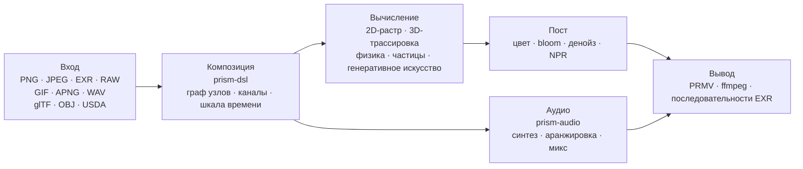

<h1 align="center">Prism Engine</h1>

<h3 align="center">Процедурный медиадвижок</h3>

<p align="center">
  <sub>Декодирование · Вёрстка · Трассировка путей · Симуляция · Синтез звука · Кодирование &nbsp;|&nbsp; Кадр · Последовательность · Готовый монтаж &nbsp;|&nbsp; CPU + Vulkan</sub>
</p>

<p align="center">
  <a href="../README.md">中文</a>
  · <a href="README.en.md">English</a>
  · <a href="README.de.md">Deutsch</a>
  · <a href="README.es.md">Español</a>
  · <a href="README.fr.md">Français</a>
  · <a href="README.ja.md">日本語</a>
  · <a href="README.ko.md">한국어</a>
  · <a href="README.pt-BR.md">Português</a>
  · <b><a href="README.ru.md">Русский</a></b>
</p>

<p align="center">
  
  
  
  
  
  <a href="https://github.com/Qianjinqie/prism-engine/releases"></a>
</p>

<p align="center">
  
</p>

<p align="center">
  <sub>Это не макет, а вывод движка: 1200×675 · 256 spp · трассировка лучей + физический BSDF + тональное отображение ACES · 4 потока, 158 с. Исходник сцены: <a href="gallery/gallery.rs"><code>docs/gallery/gallery.rs</code></a>.</sub>
</p>

<p align="center">
  <sub><b>642</b> файла · <b>28</b> crate · <b>261 тыс.</b> строк Rust · <b>3929</b> тестов · <b>0</b> сторонних зависимостей · <b>18,9 МБ</b> одним файлом</sub>
</p>

## Карта возможностей

Процедурный медиадвижок на Rust. На входе — сцена `.prism` или вызов Rust API; на выходе — кадр, последовательность кадров или готовый монтаж. Слои идут в порядке технологической цепочки; зафиксируйте мгновение — получите кадр, продвигайте и записывайте — получите видео; все слои обращаются с обоими одинаково.

| Слой | Что делает |
| --- | --- |
| **Чтение** | PNG (8/16 бит, обращение фильтров), baseline JPEG (IDCT с фиксированной точкой, побитово одинаково между платформами), EXR (чтение/запись, семейство сжатий, DWA), RAW камеры, GIF / APNG покадрово, WAV; импорт glTF / OBJ / USDA, параметры MaterialX; загрузка TTF/OTF с четырёхуровневой цепочкой отката (встроенные → пользовательские → многоязычные подмножества → математические символы) |
| **Вёрстка** | Разбор OpenType, шейпинг GSUB/GPOS, двунаправленность UAX #9, четыре арабские формы, вертикальный набор; набор формул (верхние/нижние индексы, дроби, радикалы, матрицы, крупные операторы); DSL v1/v2 компилируется в граф троек; пять высокоуровневых комбинаторов (титул / нижняя плашка / разделённый экран / Ken Burns / морф между сценами); четыре перехода + морф, сэмплирование в любой момент |
| **Рендер** | Трассировка путей + физический BSDF (диффузный / зеркальный / стекло / металл / подповерхностный), стекло и металл через стохастическую инверсию (ряд Неймана, Монте-Карло); гетерогенные объёмы Woodcock; аналитические пересечения для цилиндров / конусов / торов / поверхностей вращения (квартика по Феррари); треугольные сетки + SAH-BVH (стабильная сортировка, детерминированное построение); сетки запекаются в SDF для булевых операций / деформации домена / точных столкновений; CpuRef как полноценный бэкенд + Vulkan compute и трассировка лучей |
| **Симуляция** | Единый XPBD-решатель — твёрдые тела / мягкие тела / ткань / сочленения / жидкости / разрушение это шесть наборов параметров одного цикла проекции ограничений; дым FLIP; частицы + AudioReactive; ограничения и шейдинг волос; поля потока / L-системы / клеточные автоматы / реакция-диффузия / фракталы / Voronoi; аналитическое решение пружин и ключевые кадры |
| **Цветокоррекция** | Вторичная коррекция (HSL-выделения + кривые RGB); пресеты cinematic / film / anime, три уровня (черновик / стандарт / кино) с явно указанной ценой; blur / bloom / виньетка / хроматическая аберрация / sharpen / glitch / dissolve; halation + зерно плёнки в двух масштабах (выводится в пиксельном домене); тройной денойзинг; четыре стиля NPR (toon / watercolor / halftone / oil); передаточные функции PQ / HLG, линейный sRGB ↔ ACEScg, выходное преобразование ACES |
| **Звук** | PolyBLEP-осциллятор с антиалиасингом + замкнутая огибающая ADSR + 4 пресета настроения; библиотека ладов + 12-TET + конечный автомат аккордовых последовательностей на функциональной грамматике + голосоведение; арпеджиатор / шаговая драм-машина / сетка тактов; написанный вручную парсер SMF, сэмплер SFZ, гранулярный синтез; физическое моделирование / пространственное панорамирование / цепочки эффектов; многодорожечный микс + ограничение пиков; beat / onset / FFT, запекание AudioReactive, нормализация громкости; WAV 16/24/32 бит побайтовый round-trip |
| **Выдача** | Собственный контейнер PRMV (v2/v3, v3 читает v1/v2) + временное кодирование I/P-кадров; управление битрейтом water-filling + субпиксельная оценка движения qpel (измерено PSNR +2.577 дБ, размер −21.6%); ffmpeg определяется во время выполнения — есть, значит stdin-пайп в H.264/HEVC, нет — автоматический откат в MJPEG, файл выходит всегда; контейнеры MP4 + MJPEG, последовательности EXR; многопроцессная ферма кадров (с возобновлением, параллельный MD5 == последовательный MD5); отображение времени NLE / ключевые кадры / переходы |
| **Интеграция** | Три инструмента MCP stdio (`scene_check` / `render_submit` / `diagnose`); SDK узлов с согласованием семантических версий + пример пакета узла; CLI (`render` / `preview` / `demo`); интерактивный редактор с двумя уровнями предпросмотра (Draft геометрический / Real низкий spp) + инкременты по подписи подграфа; batch-манифест как декартово произведение; скелет зонда аппаратных кодировщиков для трёх платформ (VideoToolbox / NVENC / VAAPI, бэкенд не подключён) |
| **Боковой путь** | Генеративное искусство: поля потока / L-системы / клеточные автоматы / реакция-диффузия / Mandelbrot / Voronoi, векторный draw-on и диаграммы. ИИ-помощь: детерминированный mock-слой вывода (раскадровка / субтитры / цветовые подсказки), веса моделей читаются как данные, умножение-сложение написано здесь, без ML-фреймворков |

Таблица перечисляет только возможности. Чего каждая не умеет — в разделе [Честные границы](#честные-границы), а не в таблице.

## Запуск за три минуты

```bash
# 1. Скачать пакет исходников и проверить SHA-256
curl -L -O https://github.com/Qianjinqie/prism-engine/releases/download/v2.1/prism-engine-v2.1-source.txt
curl -L -O https://github.com/Qianjinqie/prism-engine/releases/download/v2.1/SHA256SUMS.txt
sha256sum -c SHA256SUMS.txt

# 2. Извлечь встроенный распаковщик (достаточно Node 18+, npm install не нужен)
awk '/^UNPACK SCRIPT BEGIN$/{f=1;next} /^UNPACK SCRIPT END$/{f=0} f' \
  prism-engine-v2.1-source.txt > unpack.cjs
node unpack.cjs                    # восстанавливает 642 файла

# 3. Собрать и прогнать весь набор тестов
cargo test --workspace --release     # 3929 passed / 0 failed

# 4. Ничего не писать — просто посмотреть, как он рендерит
cargo run -p prism-app --release     # встроенная демо-сцена
```

На выходе — обычный workspace Cargo (28 crate в `src/`); дальнейшие команды `cargo` работают как в любом Rust-проекте. Первая сборка занимает несколько минут.

## Один кадр — один текст

`.prism` — язык описания сцен. Ниже полностью рендерящийся трёхсекундный кадр: сфера, материал, орбитальная камера, направленный свет, длительность, цветокоррекция, параметры вывода:

```prism
scene "spin_red_ball" {
    sphere ball {
        radius 1.0
        material {
            albedo #c0392b
            roughness 0.3
            metalness 0.05
        }
    }

    camera main {
        orbit {
            center 0,0,0
            radius 8.0
        }
        fov 45
    }

    light sun {
        direction (1.0, -1.0, -0.5)
        color #fff4e6
        intensity 3.0
    }
}

timeline {
    duration 3s
    fps 12
}

aesthetic {
    teal-orange
    contrast 1.12
    filmic
}

output {
    resolution 480x270
    format frames
}
```

```bash
cargo run -p prism-app --release -- examples/spin_red_ball.prism          # последовательность кадров
cargo run -p prism-app --release -- render examples/w2d_showcase.prism \
    --out out/demo.mp4                                                     # готовый фильм одним вызовом
```

`render` идёт прямым путём v2: компиляция графа узлов → покадровое вычисление → кодирование в контейнер, без промежуточных кадров на диске. Неподдерживаемые узлы дают явную ошибку `R5xxx`, а не тихо пропускаются.

<p align="center">
  
  <br>
  <sub>Кадр 10 из `examples/w2d_showcase.prism`: 3D-сфера, текстовый слой, цветокоррекция и дорожка затухания живут на одной шкале времени.</sub>
</p>

## Или просто Rust API

Если не хочется писать DSL, вызывайте библиотеку напрямую. Это скелет титульного изображения (полная сцена — 190 строк, см. [`docs/gallery/gallery.rs`](gallery/gallery.rs)):

```rust
use prism_core::node::EvalCtx;
use prism_math::Vec3;
use prism_rt::camera::Camera;
use prism_rt::integrator::{render_pixel, MaterialKind, RenderParams, Scene, Sphere};

let scene = Scene {
    spheres: vec![(
        Sphere { center: Vec3::new(0.0, 0.6, 0.0), radius: 0.6 },
        MaterialKind::Lambert { albedo: Vec3::new(0.8, 0.2, 0.15) },
    )],
    ..Default::default()
};
let cam = Camera::new(
    Vec3::new(0.0, 1.2, 4.8),   // точка обзора
    Vec3::new(0.0, 0.72, 0.0),  // цель
    Vec3::new(0.0, 1.0, 0.0),   // верх
    30.0, 0.05, 4.85, 0.0, 1.0 / 48.0,
);
let ctx = EvalCtx::new(20261028, 0, 0);
let params = RenderParams::new(256, 10);  // 256 выборок на пиксель, до 10 отражений

// Один пиксель: сцена, камера, контекст выборки, координата, разрешение, параметры
let color = render_pixel(&scene, &cam, &ctx, (640, 360), (1280, 720), &params);
```

`render_pixel` — чистая функция: на входе сцена, камера, контекст выборки и координата пикселя, на выходе линейный RGB. При одинаковых параметрах биты совпадают независимо от потока и порядка вызова — поэтому параллельный рендеринг не требует синхронизации вообще.

## Возможности, не влезающие в список

Это не поддержка форматов, а инфраструктура внутри движка.

### Аудио: встроенное ядро DAW

Список возможностей — в строке **Звук**. Здесь о том, как оно работает и почему может висеть на той же таймлинии рендера:

- **Каждая функция — чистая функция своих параметров**: одна и та же партитура, пересчитанная в любой позиции seek, даёт побитово одинаковые сэмплы и не зависит от истории воспроизведения
- **AudioReactive запекается в чистую функцию на кадр**: кадр N читает фиксированное окно, поэтому пропуск кадров, обратное воспроизведение и параллельная нарезка не меняют результат
- **Микс — это офлайн-параллельная линейная алгебра**: многодорожечное суммирование + фейды + ограничение пиков, без скрытого конечного автомата

> Граница: кодирование AAC / mp3 здесь не реализуется (патентная история плюс трудозатраты); идёт через внешний ffmpeg.

### Реестр определяемых ядер

Каждый тип узла в движке — **частное решение** тройки «ядро + решётка + двойственность». Третьи стороны (или вы) могут статически регистрировать новые решения через `registry!`, **не трогая ядро движка**:

- Статическое включение: макрос раскрывается внутри определяющего crate; `inventory` и proc-macro запрещены, чтобы сохранить ноль зависимостей;
- При регистрации выполняется **проверка трёх вопросов** (форма ядра / решётка / двойственность); неполный ответ отклоняется с ошибкой из трёх частей;
- Официальные и пользовательские решения живут в одном реестре и неразличимы во время работы;
- Математически это соответствует шести стратегиям обращения операторного уравнения `f = g + Kf` (точная / стохастическая / локальная / регуляризованная / итеративная / спектральная): добавить возможность — значит объявить тройку, а не латать цикл рендеринга.

### GPU: три пути, три состояния

| Бэкенд | Состояние | Доказательство |
| --- | --- | --- |
| **Vulkan** | Реально работает | Конвейеры compute + трассировки лучей; проверяется без GPU на программном ICD lavapipe из Mesa; вывод `render_scene` **побайтово идентичен (0 различий)** эталону на CPU; `is_available()` — самопроверка compute ∧ render |
| **Metal** | Скомпилирован под гейтом, не включён | Изоморфный перенос готов, на железе не проверен, `is_available()` всегда false |
| **WebGPU** | Только вывод | Оценка осуществимости сделана (4–6 человеко-дней переноса), путь рендеринга не реализован |

## Инженерные факты

Три ограничения и чего каждое стоит:

| Ограничение | Как выполняется | Чего стоит |
| --- | --- | --- |
| Ноль сторонних зависимостей | Все 110 runtime + 20 тестовых зависимостей — `path`-зависимости внутри репозитория; нет `build.rs`, нет нативной линковки, нет сети при сборке | Каждый формат, алгоритм, шрифт и кодек приходится писать здесь |
| Побитовый детерминизм | IDCT с фиксированной точкой, фиксированные последовательности сэмплирования, четырёхмерный хеш конфигурации; одинаковый результат между платформами при одинаковом входе | Отказ от быстрых путей на плавающей точке и от зависимости от порядка обхода хеш-таблиц |
| Распространение одним файлом | 642 файла из 28 crate слиты в один UTF-8 текст на 18.9 МБ, восстанавливаемый через `node unpack.cjs` | Отказ от просмотра исходников прямо на GitHub |

### Как проверяется детерминизм

Четыре слоя, от параметров до байтов:

1. **Замыкание подписи**: графы узлов, ключи кеша, ключи снимков и подписи кадров используют один четырёхмерный хеш конфигурации. Изменился параметр ⇒ ключ обязан измениться ⇒ устаревшего переиспользования нет. Узлы итераций несут в ключе `(ε, n)`, потоковые — номер кадра; при `None` поведение побайтово вырождается в прежнее.
2. **Байтовые неподвижные точки**: USD экспорт→импорт→экспорт побайтово идентичен; round-trip WAV 16/24/32 бит совпадает; EXR сверяется битстрим с битстримом с официальным OpenEXR.
3. **Детерминизм упаковки**: упаковка одного и того же исходника дважды даёт одинаковый SHA-256; round-trip распаковки сравнивает каждый файл побайтово.
4. **Тесты как критерий**: многие из 3929 тестов фиксируют золотые значения (допуск ужесточён с 1e-2 до 1e-6, измеренный остаток 4.53e-7); точность формы ограничивается расстоянием Хаусдорфа, а не «выглядит похоже».

## Архитектура



28 crate по зонам ответственности:

| Группа | Crate |
| --- | --- |
| Ядро | `prism-core` · `prism-math` · `prism-bytes` · `prism-geometry` · `prism-noise` |
| Медиа I/O | `prism-io` · `prism-media` · `prism-mux` · `prism-audio` · `prism-texture` |
| Рендеринг | `prism-render` · `prism-raster` · `prism-gpu` · `prism-postfx` · `prism-vector` · `prism-particles` |
| Анимация / генератив | `prism-anim` · `prism-genart` · `prism-aesthetic` · `prism-physics` |
| Текст / UI | `prism-text` · `prism-rt` · `prism-app` |
| Продвинутые | `prism-ai` · `prism-dsl` · `prism-infra` · `prism-author` |
| Sidecar (feature gate) | `prism-ffi-hwenc` |

Структура после распаковки:

| Путь | Содержимое |
| --- | --- |
| `src/` | Исходники 28 crate (в репозитории — `crates/`, при распространении переименованы) |
| `Compliance/` | Проверка нулевых зависимостей, уведомления третьих сторон, реестр ассетов |
| `开发者指南.md` | Руководство разработчика: старт / архитектура / математическое ядро / гейты / расширение |
| `tools/` | Скрипты гейтов и упаковки |
| `examples/` | Примеры `.prism` и пакеты узлов (читаются через `include_str!`, без файла сборка не пройдёт) |
| `.github/workflows/` | Конфигурация CI |

> Проектные документы (`docs/设计/`) есть только в полном репозитории издателя и не распространяются; демонстрационный crate `prism-anim-demo` тоже не входит в пакет.

## Сборка, тесты, гейты

```bash
cargo test --workspace --release      # 3929 passed / 0 failed / 0 ignored
cargo xtest                           # эквивалентный псевдоним
cargo test -p prism-core --release    # дымовой тест одного crate

node tools/ghost_guard.mjs --check    # защита от призрачной записи: G1 переопределение / G2 строгое надмножество / G3 документация верхнего уровня / G4 сборка
node tools/hygiene_scan.mjs           # гигиена: перечисляет каждый оставшийся внутренний термин (файл:строка), exit 1 при совпадении
node tools/compliance_check.mjs       # самопроверка соответствия: должно быть 9/9
node tools/compliance_check.mjs --self-test  # обратная проверка: должно упасть, доказывая различающую силу критерия
node tools/pack_source_txt.mjs --verify      # упаковка и распаковка туда-обратно, побайтово
```

- Полный набор: **3929 passed / 0 failed / 0 ignored**, 179 тестовых секций, 171,5 с на всех ядрах (release).
- В CI шесть job: защита от призрачной записи, сборка + полные тесты, сборка wasm32, статическая проверка WGSL, битстрим-интероп с официальным OpenEXR, перекрёстная проверка на Node-хосте.
- В скане гигиены всё ещё есть совпадения: распространяемый слой документации чист, остальное — в комментариях исходников и файлах, которые не входят в пакет. Скрипт существует, чтобы остатки оставались **видимыми и разбираемыми по одному**, а не чтобы изображать чистоту.

### Гейты против ложной зелени

Четыре скрипта-гейта без зависимостей (только Node): защита от призрачной записи (с обратной самопроверкой), скан гигиены открытого кода, самопроверка соответствия (9/9 пройдено плюс 8/8 доказательств, что критерий срабатывает), проверка упаковки туда-обратно. У гейта ровно два исхода — пройдено или провал, и «выглядит нормально» в их число не входит. **Ложная зелень опаснее провала.**

## Честные границы

| Граница | Состояние | Выход |
| --- | --- | --- |
| DNG `Compression=7` (lossless JPEG) | Не реализовано; DNG реальных камер не читаются | Сначала конвертировать в 16-битный TIFF / PNG |
| mp3 / AAC / FLAC | Декодирование через внешний ffmpeg; кодирование не реализовано | Установить ffmpeg или остаться на WAV |
| Криволинейные примитивы на GPU | Только путь CPU | Триангулировать и пустить через SAH-BVH |
| Metal | Гейт собран, на железе не проверен, не включён | Подключить, когда появится техника Apple |
| WebGPU | Вывод по осуществимости есть, рендеринг не реализован | 4–6 человеко-дней |
| Аппаратное кодирование | Скелет зондирования для трёх платформ, реализации нет | Заполнять под целевую платформу |
| Ускорение GPU | Корректность проверена только на lavapipe, на реальном GPU не измерялась | Измерять на целевом железе |
| Скан гигиены | Есть существующие совпадения в комментариях | Чистить по одному, скрипт отслеживает |

Это не пункты «потом». Это то, что сегодня явно не поддерживается. Здесь лучше, чем спрятанным в issue.

## Соответствие

Движок обещает ноль сторонних кодовых зависимостей и проверяет это сам:

- **C1 Ноль стороннего кода**: все 130 зависимостей (110 рабочих + 20 тестовых) — `path`-зависимости внутри репозитория; нет `build.rs`, нет директив нативной линковки; `Cargo.lock` фиксирует 29 пакетов репозитория.
- **C2 Полный реестр ассетов**: у всех пяти ассетов заполнены поля основной таблицы; шрифты распространяются по SIL OFL 1.1, полный текст лицензии лежит рядом со шрифтом в `src/prism-text/font_data/LICENSE`.
- **C3 Уведомления третьих сторон**: `Compliance/THIRD-PARTY-NOTICES.md` явно разделяет «данные-ассеты ≠ кодовые зависимости».

## Лицензия

Apache License 2.0, см. [`LICENSE`](../LICENSE).

При повторном распространении сохраняйте уведомления и реестр ассетов в `Compliance/`.

<sub>Титульное изображение и скриншот DSL отрендерены самим движком; параметры указаны в подписях и в [`docs/gallery/gallery.rs`](gallery/gallery.rs).</sub>
