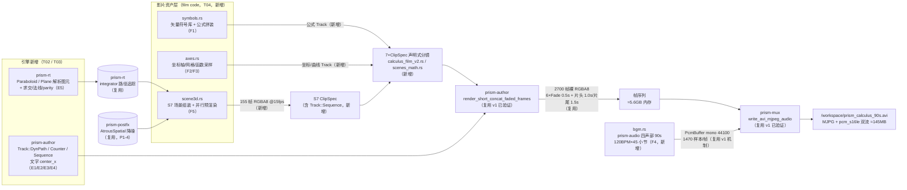
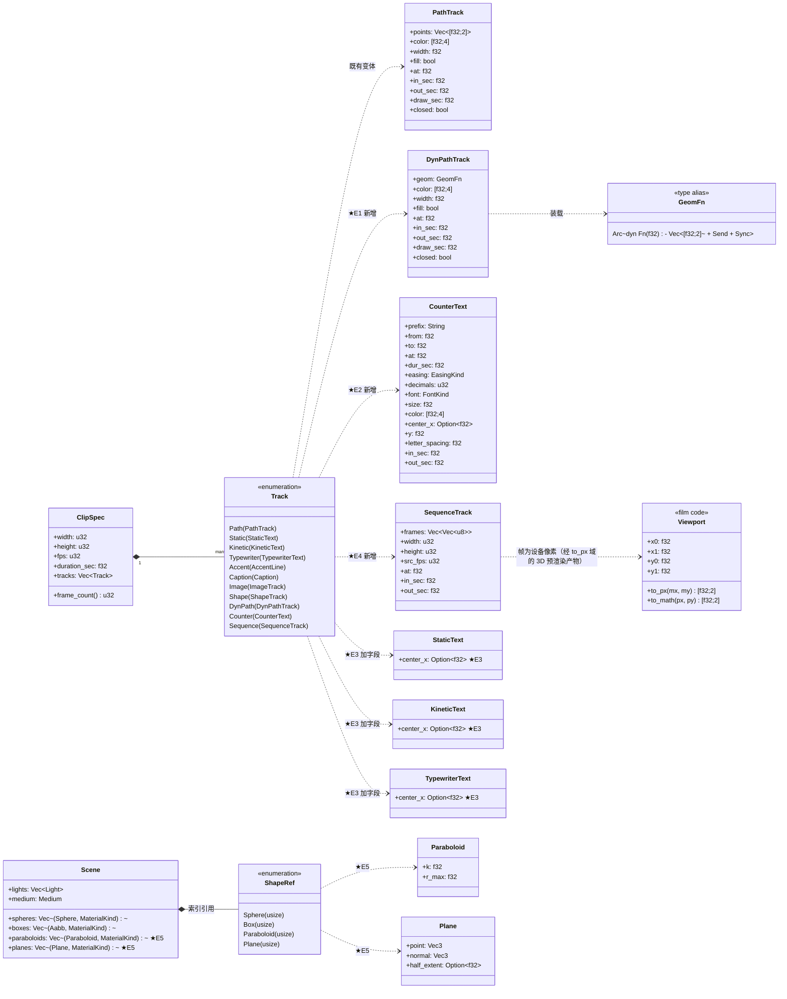
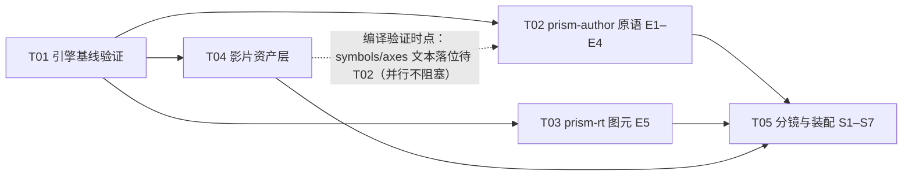

# 微积分短片 v2 · 架构设计（calculus-film-v2-architecture.md）

| 项 | 内容 |
|---|---|
| 文档 | calculus-film-v2-architecture.md（v2.0，待工程实现） |
| 作者 | 高见远（Gao）· 架构师 |
| 团队 | software-calculus-film-v2（主理人：齐活林） |
| 上游 | `docs/calculus-film-v2-prd.md`（许清楚，v2.0 分镜 PRD） |
| 实现基线 | v1 已交付 60s 短片（`crates/prism-author/examples/calculus_film.rs`，900 帧 @15fps） |
| 成品规格 | 960×540 @30fps，90.000s（2700 帧），MJPEG-in-AVI 双流（MJPG + pcm_s16le），BGM 由 prism-audio 实时合成 |
| 主理人裁定（直接采信） | ① 30fps；② S7 光追预算 ≤30 分钟（超支降 640×360/spp）；③ E5 走真原语（抛物面 + 可倾斜平面），不预设降级；④ 屏幕文案中文叙述 + ASCII HUD；⑤ E3（文字 center_x）P0 不可裁剪 |

---

## 1. 实现方案总览

### 1.1 管线图（每步标注「复用 v1 / 新增」）



**图例**：`（复用）` = v1 已交付且本设计零改动；`（新增）` = 本片新增文件或本设计新增引擎原语。全链路零第三方 crate：画面由 prism-author 声明式轨道 + prism-rt 路径追踪程序化生成，声音由 prism-audio 实时合成，封装由 prism-mux 手写 RIFF 完成——不调用 ffmpeg、不读取任何外部素材。

### 1.2 关键技术难点与选型

| # | 难点 | 方案 | 选型理由 |
|---|---|---|---|
| 1 | 切线滑动 / 割线连续收敛 / ε-δ 带连续收缩 / Riemann 矩形逐帧高度——静态 `PathTrack` 顶点无法逐帧变化 | **E1 `Track::DynPath`**：时间参数化闭包 `geom(t) -> Vec<[f32;2]>`，每帧求值后进入与 `PathTrack` **完全相同的光栅核心** | 最小增量：不改动任何既有渲染路径；`Fn + Send + Sync` 闭包保证纯度与可并行；`Arc` 装载保持 `Track` 的 `Debug/Clone` derive 不破 |
| 2 | 实时数值读数（Manim 式教学招牌动作） | **E2 `Track::Counter`**：`from/to/dur/easing/decimals` 逐帧格式化为 ASCII 文本，复用 `draw_static` 既有文本管线 | 数学符号全缺字体 → 读数只用拉丁/数字/`.`/`-`/空格（字体 ✅）；零新光栅代码 |
| 3 | 轴标签 / 公式标签 / HUD 无法水平定位（v1 已知限制） | **E3 文字轨 `center_x: Option<f32>`**，None = 画幅中心（与旧行为逐位一致） | 向后兼容的加法性变更；三文字轨渲染函数本就已收 `center_x` 参数（render.rs 现传 `w*0.5`），spec 侧仅加字段 |
| 4 | 155 帧 3D 光追序列注入 30fps 成片 | **E4 `Track::Sequence`**：帧序列 + 源 fps，按场景时间取帧；blit 走与 `ImageTrack` 共用的 `blit_rgba8`（零拷贝借入） | 替代「310 个 ImageTrack」hack；源帧常驻 spec ≈320MB，机器 129GB 无压力 |
| 5 | prism-rt `Scene` 仅 spheres + boxes；切平面倾斜无法用 Aabb 表达 | **E5 解析 `Paraboloid{k,r_max}` / `Plane{point,normal,half_extent}`**，integrator 与 wavefront 双路径同源对拍 | 二次面求交为闭式解（一次方程/二次方程）；wavefront 复用 `Scene::intersect/normal_at`（pub(crate) 同源）⇒ parity 结构性成立，测试钉住 |
| 6 | S7 155 帧 @960×540 spp8 光追超时风险 | 预渲染在 example 内按**行分带** `std::thread::scope` 并行（像素级纯函数，与串行逐位一致）；首帧并行 vs 串行双跑校验（toggle）；超 30 分钟预算降 640×360（0.44× 像素）或 spp 4 | `TileOrchestrator` 为顺序求值（orchestrator.rs 明言并行化未做），`farm::LocalScheduler` 类型为 `Fn(u64)->u64` 不产帧缓冲 ⇒ example 自行分带；std 线程零第三方依赖；D-28 像素域采样 ⇒ 并行不改变采样流 |
| 7 | rt 输出为场景线性 HDR（`to_framebuffer` 仅 clamp01×255 量化，无 tonemap） | scene3d.rs 内 Reinhard 色调映射 + 精确 sRGB OETF（`powf` 先例：easing.rs Elastic 族用 std 超越函数，同输入位模式一致） | 焦散/高光极易过曝；不映射则画面死白 |
| 8 | 符号库拼装对齐（矢量符号与字体文本按基线混排） | symbols.rs 提供 `assemble_formula()`：文本 run 经 `prism_text::layout_text` 测量宽度，符号以「基线 y + 累加 advance x」落位，产出 `Vec<Track>` | 排版规则单一事实源；单测钉住 advance 累加与坐标有限性 |

### 1.3 架构模式

- **声明式规格 + 纯后处理拼接**（沿用 v1）：`ClipSpec` 是作者唯一入口；场景拼接、Clip 淡变、转场混合全部是帧序列层纯后处理（render.rs 既有结构），v2 不重构渲染核心。
- **引擎 / 影片分层**：引擎只增原语（spec/render/rt），全部数学内容（分镜、符号、坐标、BGM、3D 场景）在 example 的 film code 层，引擎对「微积分」零知识。
- **确定性契约维持**：所有新原语是 `(输入, t)` 纯函数；新求交是 `(o, d)` 纯函数；同输入同输出逐位一致。唯一并行点（S7 预渲染）按行分带、无跨像素归约，逐位等于串行（首帧双跑校验）。

### 1.4 已核实事实对勘表（本次架构阶段重新读源码确认）

| PRD §3 断言 | 源码核实（文件:行） | 结论 |
|---|---|---|
| `Track` 8 变体 | spec.rs:277-294 | ✅ 采信 |
| 渲染在 `Fbuf16F`，每帧 `to_framebuffer().pixels` 出 RGBA8 | render.rs:1183/1309 | ✅ 采信 |
| `render_rgba_frames` 为 `pub(crate)` | render.rs:1164 | ✅ 采信（新轨道路由在此函数内部分发，无新公开入口） |
| 公开入口 `render_short_concat_faded_frames(&[ClipSpec], fade_in, fade_out)` | render.rs:1141-1155 | ✅ 采信，签名不变 |
| 转场硬编码 Fade 0.5s | render.rs:1125 `CONCAT_FADED_TRANS_SEC` | ✅ 采信（P2-1 开放 Transition 不在 v2 范围） |
| `EasingKind` 10 种 | easing.rs:14-34 | ✅ 采信 |
| 文字轨以画幅水平中心为锚（无 x 字段） | render.rs:1198/1215/1228 均传 `w*0.5` | ✅ 采信 ⇒ E3 设计前提成立 |
| 字体 = PrismSansSC（数学符号全缺 ⇒ 矢量绘制） | prism-text/lib.rs:40-65 + PRD §3.1 fontTools 实测 | ✅ 采信 |
| `prism-rt::Scene` 仅 spheres + boxes | integrator.rs:205-214 | ✅ 采信 ⇒ E5 前提成立 |
| 求交/法线/材质入口 | integrator.rs:310-340（intersect）/254-279（normal_at）/246-251（material）/366-383（light_pdf_sa） | ✅ ShapeRef 为 pub(crate)，**全仓仅 integrator.rs 匹配 ShapeRef**（wavefront 经同源方法调用，wavefront.rs:193/274/275/284）⇒ 加变体不引发跨文件编译破坏 |
| `prism-postfx::Warp` 未接 author；denoise/bloom 已有 | postfx/warp.rs:29、denoise.rs:34/120 | ✅ 采信；S2 缓推走 DynPath viewport（P0），Warp 留 P1-1 |
| `prism-mux::write_avi_mjpeg_audio` 双流（v1 验证 ffmpeg 可解） | mux/avi.rs:374；音频按帧切 `sr/fps` 须整除 | ✅ 采信；44100%30=1470 整除 ✓ |
| `prism-audio` render_note/Adsr/mix_tracks（v1 BGM 验证） | v1 example:602-716 | ✅ 采信，编排框架复用、参数改 120BPM×45 小节 |
| 机器 32 核 / 129GB | — | ✅ 2700 帧 ≈5.6GB + S7 序列 320MB + BGM 16MB，峰值 ~7GB 无压力 |
| **新发现 1**：`TileOrchestrator` 为**顺序**求值（注释明言并行化未做）；`farm::LocalScheduler` 类型为 `Fn(u64)->u64` 不产帧缓冲 | render/orchestrator.rs:64-113；farm/scheduler.rs:135 | S7 并行须在 example 内按行分带 `std::thread::scope`（std，零第三方；仓库已有先例 graph.rs:535/farm/merge.rs:319） |
| **新发现 2**：`Fbuf16F::to_framebuffer` 仅 clamp01×255 量化，**无 tonemap/OETF** | io/fbuf.rs:188/204-207 | S7 必须在 example 内显式 Reinhard + sRGB |
| **新发现 3**：`Track` 枚举穷尽匹配点**仅 render.rs 一处**（prism-media/nle 的 Track 为自带类型；prism-anim-demo 的 StaticText 为自带类型） | 全仓 grep | 加 3 变体不破坏其他 crate |
| **新发现 4**：`Scene` 字面量构造点共约 **19 处**需机械迁移（prism-rt src×5 文件 + rt tests×4 + prism-postfx tests×1）；三文字 struct 字面量约 **10 处**需补 `center_x: None` | 全仓 grep + 逐一确认依赖 prism-rt 的仅 prism-postfx | T02/T03 的迁移工作量据此估算，编译器可枚举 |
| **新发现 5**：MNEE k=1/k=2 链仅覆盖「显式镜面平板」/「球面折射体」（`refractors()` 仅收 spheres） | integrator.rs:399-410、763-766 | 抛物面/平面焦散靠 BSDF spec/transmission 瓣 + 降噪（§2.6 诚实边界） |

---

## 2. 新增原语详细设计

> 本节逐个给出 E1–E5 的数据结构（字段 + 类型 + 默认 + 不变量）、算法与性能估算。所有「既有」指 v1 已核实事实（PRD §3），本节「已核实」指本次架构阶段重新读源码确认（见 §1.4 对勘表）。

### 2.1 E1 `Track::DynPath` —— 时间参数化折线（S2–S6）

#### 数据结构

```rust
/// 动态几何闭包类型：场景绝对时间 t（秒）→ 设备像素折线。
/// - 必须是纯函数（禁止内部可变状态、时钟、随机源）；Fn + Send + Sync
///   保证可并行渲染时跨线程安全；
/// - 用 Arc 装载：Track 的 derive(Clone) 依赖 Arc<dyn Fn> 的 Clone
///   （Arc<T: ?Sized> 即 Clone）；Debug 由 DynPathTrack 手工实现
///   （打印除 geom 外全部字段，geom 打印为 "<dyn geom>"），
///   从而 Track / ClipSpec 的 #[derive(Debug, Clone)] 不破。
pub type GeomFn = Arc<dyn Fn(f32) -> Vec<[f32; 2]> + Send + Sync>;

pub struct DynPathTrack {
    pub geom: GeomFn,        // 几何发生器；参数为场景绝对时间 t（秒）
    pub color: [f32; 4],     // 直通 alpha 线性 RGBA（渲染层乘 env 信封）
    pub width: f32,          // 描边宽度 px（fill=false 且 width<=0 时跳过描边）
    pub fill: bool,          // true=闭合填充（半透明面积）；false=描边
    pub at: f32,             // 出现起始秒
    pub in_sec: f32,         // 淡入时长（<=0 立即全显）
    pub out_sec: f32,        // 淡出时长（<=0 不淡出；锚 duration 末，同 PathTrack）
    pub draw_sec: f32,       // 绘制进度动画时长（<=0 立即全显；仅描边模式）
    pub closed: bool,        // 描边时首尾相连画闭合段（填充自动闭合）
}
```

**不变量**（渲染层强制，违约跳过轨道不 panic，与 `PathTrack` 既有纪律一致）：
1. `geom(t)` 返回点数 < 2 → 跳过；
2. 任一点坐标非有限（NaN/Inf）→ 跳过；
3. `env <= 0`（at 之前 / 淡出完毕）→ 跳过；
4. `fill = true` 时忽略 `width` / `draw_sec` / `closed`（与 `draw_path_track` 填充分支语义逐位一致）。

#### 算法（render.rs）

```
draw_dynpath(fbuf, d: &DynPathTrack, t, env):
    pts = (d.geom)(t)                       // 场景绝对时间，非 t-at
    if !polyline_valid(&pts) { return }     // 点数>=2 且全有限（与 PathTrack 共用校验）
    col = d.color; col[3] *= env
    paint_polyline(fbuf, &pts, col, d.width, d.fill, d.draw_sec, d.closed, t, d.at)
```

`paint_polyline` 即从既有 `draw_path_track`（render.rs:780-853）提取的**共享光栅核心**：填充走 `prism_raster::fill_path`，描边走 `prism_raster::draw_line` + 累计长度进度截断（`draw_sec > 0` 时只画到总长 `p = clamp((t-at)/draw_sec, 0, 1)`，末段可截断）。`draw_path_track` 改为「校验 + 调核心」，**行为逐字节不变**（v1 黄金确定性测试盯住）。

#### E1 每帧求值性能估算（2700 帧 × 每帧 flatten 成本）

单点成本：采样 `f(x)`（数次 ±×÷）+ 视口映射（2 乘 2 加）≈ 20 flops ≈ 0.02µs（release）。每轨帧另计 1 次 `Vec` 分配 ≈ 50ns。

| 场景 | DynPath 轨数（估） | 每轨点数（估） | 轨帧合计 | 闭包求值合计 |
|---|---|---|---|---|
| S2 相机缓推（22 网格 + sin 49 点 + 轴/箭头） | ~28 | 2–49 | 28×308 ≈ 8.6k | ~0.13M 点 ≈ 3ms |
| S3 ε/δ 带 + 连续收敛割线 | ~3 | 4–8 | 3×496 ≈ 1.5k | ~10k 点 ≈ 0.2ms |
| S4 切线 + 动点 A/B + 引导虚线 | ~5 | 2–8 | 5×496 ≈ 2.5k | ~15k 点 ≈ 0.3ms |
| S5 Riemann 矩形组（n=2/4/8/32 共 46 轨）+ 面积 | ~47 | 4 / 25 | 47×496 ≈ 23.3k | ~0.4M 点 ≈ 8ms |
| S6 面积生长 + F 曲线截断 + B 点切线 | ~6 | 2–25 | 6×436 ≈ 2.6k | ~40k 点 ≈ 0.8ms |
| **合计** | ~89 | — | **~38.5k 轨帧** | **~1.0M 点 ≈ 12ms + 38.5k 次分配 ≈ 2ms** |

结论：E1 闭包求值全片累计 **≈15ms**，相对全片渲染（背景绘制 2700 帧 × ~3ms ≈ 8s + 轨道光栅数十秒）**< 0.2%，无性能风险**，无需缓存或采样降级。真正的成本是光栅化本身——与静态 `PathTrack` 同量级（v1 已验证）。若未来出现上千点的 DynPath（如 3D 投影网格），需改为「预计算 + 索引」方案，但 v2 分镜不涉及。

### 2.2 E2 `Track::Counter` —— 实时数值读数（S3/S4/S5/S6）

#### 数据结构

```rust
pub struct CounterText {
    pub prefix: String,        // 文本前缀，如 "m = " / "S = " / "n = "
    pub from: f32,             // 滚动起始值
    pub to: f32,               // 滚动终止值
    pub at: f32,               // 起始秒
    pub dur_sec: f32,          // 滚动时长（<=0：t>=at 时直接显示 to）
    pub easing: EasingKind,    // 缓动（与对应 DynPath 动画同参，保证「读数恒等」）
    pub decimals: u32,         // 小数位（0..=6；>6 钳 6）
    pub font: FontKind,
    pub size: f32,
    pub color: [f32; 4],
    pub center_x: Option<f32>, // E3 同语义；None = 画幅中心
    pub y: f32,                // 基线 y
    pub letter_spacing: f32,
    pub in_sec: f32,           // 淡入
    pub out_sec: f32,          // 淡出
}
```

#### 算法与文本渲染路径

```
draw_counter(fbuf, c, t, env, cache):
    u = clamp((t - c.at) / c.dur_sec, 0, 1)          // dur_sec<=0 → u = (t>=at) ? 1 : 0
    v = c.from + (c.to - c.from) * c.easing.apply(u)
    if v == 0.0 { v = 0.0 }                          // 归一 -0.0 → +0.0（防 "-0.0000"）
    text = format!("{}{:.*}", c.prefix, c.decimals, v)   // 定点格式，无科学计数
    draw_static(fbuf, font, &text, c.size, col, cx, c.y, c.letter_spacing, cache)
```

- **文本渲染路径**：`format!` 产出 ASCII 串（前缀字母/数字/`=`/空格 + 定点小数，全部在 PrismSansSC 字体内 ✅）→ 完全复用 `draw_static`（render.rs:501-531：`layout_text` 排版 + `GlyphCache` 位图缓存 + `draw_glyphs` 合成）。**零新光栅代码、零新字体风险**。
- 成本：每轨帧 ~5µs（format ~0.2µs + layout ~3µs + blit ~2µs）；全片 ~6 轨 × ~2400 可见帧 ≈ 14.4k 轨帧 ≈ **72ms**，可忽略。
- **恒等机制**（共享知识 §7.3）：Counter 的 `(from, to, dur_sec, easing)` 必须与对应 DynPath 的几何参数派生自**同一个纯函数**（如 `fn secant_h(t)->f32`），禁止两处各写常数——这是「HUD 读数与画面恒等」的工程保证。

### 2.3 E3 文字轨 `center_x` —— 水平锚点（S2–S7，P0 不可裁剪）

#### 变更

`StaticText` / `KineticText` / `TypewriterText`（既有 struct）各增一字段，**置于字段表末尾**，既有字段语义零改：

```rust
pub center_x: Option<f32>,   // None = 画幅水平中心 width*0.5（与 v1 逐位一致）
```

#### 锚点语义

- `center_x` 是**文本布局盒的水平中心**（与 `AccentLine::center_x` 同语义：盒中心，非左缘）；`y` 仍是基线 y（不变）。
- `None`（默认）= 画幅水平中心 `w * 0.5`——render.rs 三处调用点现传 `w as f32 * 0.5`（render.rs:1198/1215/1228），改为传 `s.center_x.unwrap_or(w as f32 * 0.5)`，**None 路径即旧代码路径，逐位兼容**。
- `draw_kinetic` / `draw_static` / `draw_typewriter` 三个私有函数的签名本已收 `center_x: f32` 参数 ⇒ render 侧改动仅 3 行 + dispatch 3 行。
- 向后兼容成本：struct 字面量构造点需补 `center_x: None`，仓库内共 **10 处**（`tests/{integration,content_boost,concat_transition}.rs` + `examples/{short,short_avi,short_v4,short_v5,calculus_film}.rs`），机械迁移，编译器枚举。（prism-anim-demo 的 `StaticText` 是其自带类型，不受影响；`prism-media::nle` 的 Track 亦为自带类型，不受影响。）

### 2.4 E4 `Track::Sequence` —— 帧序列轨道（S7）

#### 数据结构

```rust
pub struct SequenceTrack {
    pub frames: Vec<Vec<u8>>,  // RGBA8 行主序，每帧 width*height*4 字节
    pub width: u32,            // 源帧宽（必须等于画幅宽；不符则该轨跳过，不 panic）
    pub height: u32,           // 源帧高
    pub src_fps: u32,          // 源帧率（>0；<=0 跳过）
    pub at: f32,               // 场景内起始秒
    pub in_sec: f32,           // 淡入
    pub out_sec: f32,          // 淡出
}
```

#### 取帧与 fps 换算

```
draw_sequence(fbuf, q, t, env):
    idx = clamp(floor((t - q.at) * q.src_fps), 0, q.frames.len()-1)   // t<at 时 env=0 不可见
    blit_rgba8(fbuf, &q.frames[idx], q.width, q.height, 0.0, 0.0, w, h, env)
```

- src_fps=15、画布 fps=30 ⇒ 每源帧连续显示 2 个画布帧（`floor(t·15)` 在 `t∈[k/15,(k+1)/15)` 恒定，该区间恰跨 2 个 1/30 步长）——155 源帧铺满 310 画布帧（10.333s = S7 场景时长，帧对齐）。
- `blit_rgba8` 为从既有 `draw_image`（render.rs:637-694）Buffer 分支提取的**共用 blit 核心**（收 `&[u8]` 借入，零拷贝）；源尺寸 == 画幅时采样为精确 1:1（`round(vx*(bw-1))` 恒等于列号，draw_image 同款公式）。
- 淡入淡出复用既有 `fade_factor(t, at, in_sec, out_sec, duration)`（与 ImageTrack 同式）。
- 不变量：`frames` 空 / 帧字节数 ≠ width·height·4 / width|height ≠ 画幅 / src_fps ≤ 0 ⇒ 跳过（不 panic）；S7 尺寸失配是灾难性错误 ⇒ **example 组装期 assert 双保险**。

### 2.5 E5 prism-rt 解析二次面 / 平面原语（S7，最重工程项）

#### 数据结构（integrator.rs）

```rust
/// 抛物面 z = k(x²+y²)，径向有界 r² = x²+y² <= r_max²（闭边界）。
#[derive(Debug, Clone, Copy)]
pub struct Paraboloid {
    pub k: f32,       // 曲率（>0 开口向上；<=0 或非有限 ⇒ 该图元永不命中）
    pub r_max: f32,   // 径向截断（<=0 或非有限 ⇒ 永不命中）
}

/// 平面（可有限切片）：point 上一点，normal 法线（单位化后使用），
/// half_extent = None 无限平面；Some(h) 为以 point 为中心、边长 2h 的正方形切片。
#[derive(Debug, Clone, Copy)]
pub struct Plane {
    pub point: Vec3,
    pub normal: Vec3,             // 构造后须单位化（Plane::new）；非有限/零长 ⇒ 永不命中
    pub half_extent: Option<f32>, // h<=0 视为永不命中
}

// Scene 新增两字段（既有字段语义零改；字面量构造点机械迁移，见 §1.4/§6-T03）：
pub paraboloids: Vec<(Paraboloid, MaterialKind)>,
pub planes: Vec<(Plane, MaterialKind)>,

// ShapeRef（pub(crate)，内部类型）新增两变体：
pub(crate) enum ShapeRef { Sphere(usize), Box(usize), Paraboloid(usize), Plane(usize) }
```

#### 解析求交公式

**抛物面**（隐式 F(x,y,z) = z − k(x²+y²) = 0，射线 p(t) = o + t·d 代入得二次方程）：

```
a = -k * (d.x*d.x + d.y*d.y)
b =  d.z - 2k * (o.x*d.x + o.y*d.y)
c =  o.z - k * (o.x*o.x + o.y*o.y)

if a == 0.0:                      // 轴向射线（d.x==d.y==0，IEEE 平方和恰为零）
    if b == 0.0 { None }          // 平行且不在轴上：不相交（轴为测度零，判不相交）
    else { t = -c / b }           // 线性单根
else:
    disc = b*b - 4*a*c
    if disc < 0.0 { None }
    sq = sqrt(disc)
    t1 = (-b - sq) / (2a);  t2 = (-b + sq) / (2a)   // a<0 时勿假设顺序：两个候选都验证

候选 t 有效条件（与 sphere_t/box_t 完全同口径，integrator.rs:281-307）：
    t >= T_MIN(1e-4) 且 t < t_max
    且 r²(t) = (o.x+t*d.x)² + (o.y+t*d.y)² <= r_max²    // 闭边界：== 算命中
取最小有效 t。
```

**平面**：

```
denom = d · n                        // n 为单位法线
if denom == 0.0 { None }             // 平行（精确零判定；grazing 由 t<t_max 自然排除）
t = (point - o) · n / denom
if t < T_MIN 或 t >= t_max { None }
if half_extent = Some(h):
    p = o + t*d
    u = (p - point) · tu ;  v = (p - point) · tv
    tu = normalize(n × a);  tv = n × tu                 // 确定性正交基
    a = if |n.x| > 0.9 { (0,1,0) } else { (1,0,0) }     // 固定选择轴，无分支歧义
    if |u| > h 或 |v| > h { None }                      // 闭边界
```

#### 法线处理

- 抛物面：`n = normalize(-2k*x, -2k*y, 1)`——恒有 n.z > 0（朝上外法线，碗口向上）。入射方向自下方来时由积分器既有 `from_inside` 翻转逻辑处理（integrator.rs:698-700，与球体同机制），**不需特殊分支**。
- 平面：外法线即构造时的单位化 `normal`（切片两面同法线约定；玻璃透射材质下积分器按 `from_inside` 翻转）。
- `normal_at(ShapeRef, p)`（integrator.rs:254-279）新增两臂，纯函数、无分配。
- `light_pdf_sa`（integrator.rs:366-383）新增两臂恒返回 `None`（非球光源几何无立体角 pdf——与既有 `Box` 臂同语义）。`refractors()`（仅遍历 spheres）、`light_skip()`（仅 spheres）**零改动**。

#### 数值稳健性（新原语单测的边界/非法输入不 panic）

| 输入 | 行为 |
|---|---|
| o/d 任一分量 NaN/Inf | `None`（入口统一有限性检查） |
| k ≤ 0 / k 非有限 / r_max ≤ 0 / r_max 非有限 | 该图元永不命中（`intersect` 入口跳过） |
| normal 零长 / 非有限 | 该图元永不命中 |
| half_extent ≤ 0 | 永不命中 |
| disc == 0（相切） | 单根（t1 == t2），正常命中 |
| a == 0 且 b == 0（轴向平行不在轴上） | `None`，不 panic |
| denom == 0（射线平行平面） | `None`，不 panic |

#### integrator / wavefront parity 测试设计

- **结构性同源**：wavefront.rs 的全部求交/法线/材质都经 `scene.intersect` / `scene.normal_at` / `scene.material` / `scene.light_pdf_sa`（integrator 的 `pub(crate)` 方法，wavefront.rs:193/274/275/284）⇒ 新图元自动进入两条路径，无第二份实现需对齐。
- **parity 测试**（新增于 wavefront.rs tests 模块，与既有 `wavefront_equals_integrator_bitwise` 同构）：场景 = 抛物面（金属 Pbr）+ 有限切片平面（玻璃 Pbr）+ 无限地面平面 + `Light::Rect` + `Light::Ambient`；8×8 spp4，两路径 `render_pixel` 逐位相等（`to_bits()` 比较）。此测试守住「新增图元不得让两条路径发散」。
- **解析单测组**（integrator.rs tests，验收标准见 §6-T03）：轴向/离轴命中、r_max 界外 miss 界内 hit、平行退化、**切平面相切双重根**（PRD §6 配置：P=(0.8,0.8,1.28)、n=(−1.6,−1.6,1)，自 P+n·s 沿 −n 入射必命中 t=s±1e-4——把引擎公式与 PRD 已核实数学钉在一起）、平面轴向命中/平行 None/切片裁剪、非有限 None、`normal_at` 解析对照、闭边界 `r²==r_max²` 命中。

### 2.6 S7 场景组装与预渲染（F5，film code）

- **场景内容**（z 向上；全部数值可由工程师按画面微调，默认值如下）：
  - `paraboloids: [(Paraboloid{k:1.0, r_max:1.2}, Pbr{base:(0.95,0.93,0.88), metalness:0.9, roughness:0.15, ior:1.5, transmission:0.0, subsurface:0.0})]`
  - `planes: [(Plane{point:(0,0,0), normal:(0,0,1), half_extent:None}, Lambert{albedo:(0.18,0.20,0.24)})`（无限地面：焦散光池自然铺开，无盒缘穿帮）`, (Plane{point:(0.8,0.8,1.28), normal:normalize(-1.6,-1.6,1), half_extent:Some(0.85)}, Pbr{玻璃 transmission:0.9, roughness:0.02, ior:1.5})]`
  - `lights: [Light::Rect{center:(0.8,0.8,3.4), edge_u:(1.5,0,0), edge_v:(0.3,1.3,-0.6), radiance:(14,12,9)}, Light::Ambient{radiance:(0.05,0.06,0.09)}]`
  - 相机：`up=(0,0,1)`，fov 40°，目标 (0,0.35,0.5)；关键帧（azimuth°, radius, height）：(30,4.2,2.2)@0s → (42,4.2,2.2)@4s → (55,3.8,2.2)@6.5s → (55,4.6,3.0)@8s → 定格至 10.333s；段内 smoothstep 插值（纯函数 `camera_at(t)`）。
- **预渲染**：155 帧 @960×540 spp8；每帧 `EvalCtx::new(frame_idx, NODE_3D, SEED_3D)`（帧号入采样流 ⇒ 轨道运动有时间维噪声）；行分带 `std::thread::scope` 并行（`available_parallelism()` 上限 32）；像素级 `integrator::render_pixel` 纯函数 ⇒ 与串行逐位一致（首帧双跑校验，`const VERIFY_PARALLEL: bool = true`）。
- **后处理**：`Fbuf16F` → `AtrousSpatial{iterations:3, sigma_color:0.1}.eval_window()`（prism-postfx，P1-4）→ Reinhard `x/(1+x)`（`EXPOSURE` 常量）→ 精确 sRGB OETF → u8。**注意：`Fbuf16F::to_framebuffer` 仅 clamp01×255 量化、无色调映射**（fbuf.rs:204-207），直接用于 HDR 会死白 ⇒ tonemap+OETF 必须在 example 内显式完成。
- **成本与预算**：155×518400×8 ≈ 6.4 亿样本；32 线程预估 5–15 分钟（PRD §8-2 同量级）。**预算执行**：第 0 帧计时 × 155 外推；> 30 分钟 ⇒ 降 640×360（0.44× 像素）或 spp 4，重新外推确认 < 30 分钟后续跑。
- **诚实边界（焦散）**：MNEE k=1/k=2 链分别只覆盖「显式注册的镜面平板」与「球面折射体」（`refractors()` 仅收 spheres，integrator.rs:399-410）——抛物面/平面不在 MNEE 链上。焦散光池实际由**抛物面金属 spec 瓣 BSDF 抽样聚焦 + 玻璃平面 transmission 瓣**产生（有噪，spp8+降噪兜底）；PRD「MNEE」表述按此边界修正落实，环境光保底不变。

---

## 3. 文件清单

### 3.1 引擎改动（prism-author，T02）

| 路径 | 职责（一句话） |
|---|---|
| `crates/prism-author/src/spec.rs` | 新增 `DynPathTrack`/`CounterText`/`SequenceTrack` 三个 struct 与 `Track` 三变体；`StaticText`/`KineticText`/`TypewriterText` 尾部加 `center_x: Option<f32>`；`Track` 保持 `#[derive(Debug, Clone)]` 不破 |
| `crates/prism-author/src/render.rs` | Track 分发加三臂；提取 `paint_polyline`（Path/DynPath 共用光栅核心）与 `blit_rgba8`（Image/Sequence 共用 blit 核心）；新增 `draw_dynpath`/`draw_counter`/`draw_sequence`；三文字轨锚点改 `center_x.unwrap_or(w*0.5)` |
| `crates/prism-author/src/lib.rs` | re-export 六个新公开类型；新增原语单测（≥12 条，见 §6-T02） |
| `crates/prism-author/Cargo.toml` | dev-dependencies 增 `prism-rt`/`prism-render`/`prism-postfx`（路径依赖，与既有 `prism-audio` dev-dep 同款写法；不影响库公开 API 与下游构建） |
| `crates/prism-author/tests/{integration,content_boost,concat_transition}.rs` | E3 机械迁移：三文字 struct 字面量补 `center_x: None`（行为不变） |
| `crates/prism-author/examples/{short,short_avi,short_v4,short_v5,calculus_film}.rs` | E3 机械迁移（同上；v1 calculus_film 渲染结果不变） |

### 3.2 引擎改动（prism-rt，T03）

| 路径 | 职责 |
|---|---|
| `crates/prism-rt/src/integrator.rs` | 新增 `Paraboloid`/`Plane` struct；`Scene` 加 `paraboloids`/`planes` 两字段；`ShapeRef` 加两变体；`intersect`/`normal_at`/`material`/`light_pdf_sa` 加臂；解析求交单测组（≥12 条） |
| `crates/prism-rt/src/wavefront.rs` | 零逻辑改动（求交同源）；tests 模块新增「含新图元场景的 wavefront≡integrator 逐位对拍」 |
| `crates/prism-rt/src/lib.rs` | 模块文档更新（新原语接入说明） |
| `crates/prism-rt/src/depth.rs`、`src/gi/probes.rs`、`src/gi/sdf_gi.rs` | `Scene` 字面量机械迁移（补 `paraboloids: vec![], planes: vec![],`） |
| `crates/prism-rt/tests/{qa_edge_attack,qa_edge_attack_gpu,qa_edge_attack_rt_scene,qa_probe_wavefront_parity}.rs` | 同上（编译器枚举，共约 14 处字面量） |
| `crates/prism-postfx/tests/c1_depth_composite.rs` | 同上（1 处） |

### 3.3 影片资产（film code，T04/T05，全部新建）

| 路径 | 职责 |
|---|---|
| `crates/prism-author/examples/calculus_film_v2.rs` | 主入口：S1/S2 分镜 + 七场景装配 + main（预渲染驱动、拼接、BGM、mux、落盘、全部断言） |
| `crates/prism-author/examples/calculus_film_v2/common.rs` | 共享约定唯一事实源：画幅/帧率/场景帧表/`scene_duration`/视觉系统颜色（hex→linear）/`Viewport` 坐标映射/帧网格 |
| `crates/prism-author/examples/calculus_film_v2/symbols.rs` | F1：矢量符号库（lim dy/dx ∫ ∑ ε δ π ∀ ∃ ⇒ ∞ √ ′ − × 与上下标小数字）PathBuilder 手绘 + flatten；`assemble_formula()` 文本 run 与符号按基线 x 混排 |
| `crates/prism-author/examples/calculus_film_v2/axes.rs` | F2/F3：`axes_tracks()` 网格/轴/箭头/刻度生成器（含视口裁剪）；x²、x³/3、sin、切线族、黎曼矩形集采样辅助 |
| `crates/prism-author/examples/calculus_film_v2/scenes_math.rs` | S3 极限 / S4 导数 / S5 积分 / S6 基本定理四场景 ClipSpec（DynPath/Counter 密集用户） |
| `crates/prism-author/examples/calculus_film_v2/scene3d.rs` | F5：S7 3D 场景组装、`camera_at` 关键帧、行分带并行预渲染、降噪、tonemap+OETF、并行/串行一致性校验 |
| `crates/prism-author/examples/calculus_film_v2/bgm.rs` | F4：120BPM×45 小节四声部 BGM + 段落增益包络 + 母带淡入 1.5s/淡出 1.2s |

---

## 4. 数据结构与接口

### 4.1 关键 struct/enum 字段表

**新增（prism-author spec.rs）**

| 类型 | 字段（类型） | 默认/语义 |
|---|---|---|
| `DynPathTrack` | `geom: GeomFn` | 场景绝对时间 t → 设备像素折线；纯函数 |
| | `color: [f32;4]`、`width: f32`、`fill: bool`、`at: f32`、`in_sec: f32`、`out_sec: f32`、`draw_sec: f32`、`closed: bool` | 与 `PathTrack` 同语义同不变量 |
| `CounterText` | `prefix: String`、`from/to: f32`、`at: f32`、`dur_sec: f32`、`easing: EasingKind`、`decimals: u32`、`font/size/color`、`center_x: Option<f32>`、`y: f32`、`letter_spacing: f32`、`in_sec/out_sec: f32` | 见 §2.2；`decimals` >6 钳 6；`dur_sec<=0` 直接到 to |
| `SequenceTrack` | `frames: Vec<Vec<u8>>`、`width/height: u32`、`src_fps: u32`、`at/in_sec/out_sec: f32` | 见 §2.4 |
| `Track`（enum） | 既有 8 变体 **+** `DynPath(DynPathTrack)`、`Counter(CounterText)`、`Sequence(SequenceTrack)` | 11 变体；穷尽匹配点仅 render.rs 一处（已核实） |
| `StaticText/KineticText/TypewriterText` | 尾部 **+** `center_x: Option<f32>` | None = 画幅中心；向后兼容 |

**新增（prism-rt integrator.rs）**

| 类型 | 字段（类型） | 不变量 |
|---|---|---|
| `Paraboloid` | `k: f32`、`r_max: f32` | k>0、r_max>0、全有限，否则永不命中 |
| `Plane` | `point: Vec3`、`normal: Vec3`、`half_extent: Option<f32>` | normal 单位化且非零有限；half_extent>0 或 None（无限） |
| `Scene` | 既有字段 + `paraboloids: Vec<(Paraboloid, MaterialKind)>` + `planes: Vec<(Plane, MaterialKind)>` | 既有字段语义零改；新字段 Default 为空 vec |
| `ShapeRef`（pub(crate)） | `Sphere(usize)`、`Box(usize)` + `Paraboloid(usize)`、`Plane(usize)` | 内部索引类型，无外部影响 |

### 4.2 新公开函数签名

**prism-author：无新公开函数。** 全部新能力经既有入口消费：
- `render_short_concat_faded_frames(&[ClipSpec], fade_in_sec: f32, fade_out_sec: f32) -> Vec<Vec<u8>>`（render.rs:1141，签名不变）——内部 `render_rgba_frames`（pub(crate)）分发新增三臂。
- 新增公开**类型**（spec.rs 定义 + lib.rs re-export）：`DynPathTrack`、`CounterText`、`SequenceTrack`、`GeomFn`（type alias）；`Track` 新增三变体。

**prism-rt：无新公开函数签名变更。** 新增公开类型 `Paraboloid` / `Plane`（derive Debug+Clone+Copy，与 `Sphere`/`Aabb` 同款）；`Scene` 新增两 pub 字段；`intersect`/`normal_at`/`material`/`light_pdf_sa` 保持 `pub(crate)` 签名不变；`primary_hit_distance`（pub）自动覆盖新图元。

**film code（example）关键函数签名**（非引擎 API，供工程师对照实现）：

```rust
// common.rs
pub struct Viewport { /* 数学域 x0,x1,y0,y1；绘图区中心与 px/unit */ }
impl Viewport {
    pub fn to_px(&self, mx: f32, my: f32) -> [f32; 2];   // 数学 → 设备像素（唯一映射处）
    pub fn to_math(&self, px: f32, py: f32) -> [f32; 2]; // 设备 → 数学（单测/裁剪用）
}
pub fn scene_duration(frames: u32) -> f32;               // n/30 - 0.002（v1 同式）
pub fn hex_to_display(rgb: [u8; 3]) -> [f32; 3];         // PRD 视觉 hex → 2D 轨道显示值（÷255，唯一换算处；2D 管线显示参照直传，见 §7.2）
pub fn hex_to_linear(rgb: [u8; 3]) -> [f32; 3];          // 仅 S7 3D 线性空间原料换算用（见 §7.2）

// axes.rs
pub fn axes_tracks(vp: &Viewport) -> Vec<Track>;         // 网格/轴/箭头/刻度 → 静态 PathTrack
pub fn sample_curve(f: impl Fn(f32) -> f32, x0: f32, x1: f32, n: usize, vp: &Viewport) -> Vec<[f32; 2]>;
pub fn riemann_rects(n: u32, f: impl Fn(f32) -> f32, vp: &Viewport) -> Vec<Vec<[f32; 2]>>;

// symbols.rs
pub enum SymbolKind { Lim, DyDx, Integral, Sum, Epsilon, Delta, Pi, Forall, Exists, Implies, Inf, Sqrt, Prime, Minus, Times, Sup(usize), Sub(usize) }
pub fn symbol_path(kind: SymbolKind, size: f32) -> PathBuilder;      // 局部坐标：基线 y=0
pub enum FormulaPart { Text(String, FontKind, f32, [f32; 4]), Sym(SymbolKind, f32, [f32; 4]) }
pub fn assemble_formula(parts: &[FormulaPart], center_x: f32, baseline_y: f32) -> Vec<Track>;

// scene3d.rs
pub fn build_s7_scene() -> Scene;                        // 抛物面 + 双平面 + 灯光
pub fn camera_at(t_sec: f32) -> Camera;                  // 关键帧轨道（纯函数）
pub fn prerender_frames(count: u32) -> Vec<Vec<u8>>;     // 并行预渲染 + 降噪 + tonemap

// bgm.rs
pub fn synth_bgm(duration_sec: f32, sample_rate: u32) -> PcmBuffer;  // 120BPM×45 小节
```

### 4.3 DynPath 与 PathTrack 能否共用内部表示

**能，且已按共用设计。** 结论与做法：
1. **公开表示不合并**：`PathTrack` 持有静态 `points: Vec<[f32;2]>`，`DynPathTrack` 持有 `geom: GeomFn` 闭包——若把闭包塞进 `PathTrack`，其 `Box/Arc<dyn Fn>` 会破坏 `Track` 的 `#[derive(Debug, Clone)]`（`dyn Fn` 无 Debug/Clone），违反「既有公开 API 不破」。
2. **内部表示完全共用**：两者求值/校验后都汇入同一光栅核心 `paint_polyline(fbuf, pts: &[[f32;2]], color, width, fill, draw_sec, closed, t, at)`（从 `draw_path_track` 提取，逻辑逐行不变）+ 共用校验 `polyline_valid(pts)`。`DynPath` 的每帧产物与「同点静态 PathTrack」走**逐位相同**的光栅代码——单测 `dynpath_shares_path_core` 钉住此断言（同 spec 两轨渲染逐字节一致）。
3. **调试表示**：`DynPathTrack` 手工实现 `Debug`（打印除 `geom` 外全部字段，`geom` 显示 `<dyn geom>`），`Track`/`ClipSpec` 的 derive 不破。

### 4.4 类图（classDiagram）



**图例**：★E1/E2/E3/E4/E5 = 本设计新增/变更点；`Track` 11 变体；`Scene`/`ShapeRef` 为 prism-rt 内部结构（`ShapeRef` 是 `pub(crate)`）；`Viewport` 为 film code 层类型。

---

## 5. 程序调用流程

### 5.1 example main 的调用序列

```mermaid
sequenceDiagram
    autonumber
    participant M as main
    participant S3 as scene3d
    participant RT as prism_rt::integrator
    participant PF as prism_postfx
    participant SP as spec/分镜
    participant AU as prism_author
    participant AUd as prism_audio
    participant MX as prism_mux

    M->>S3: build_s7_scene()
    M->>S3: prerender_frames(155)
    loop 每帧 f = 0..154（std::thread::scope 行分带并行）
        S3->>RT: render_pixel(scene, camera_at(f/15), EvalCtx::new(f,..), (x,y), res, spp8)
        RT-->>S3: [f32;4] 场景线性 HDR
    end
    S3->>S3: 首帧并行 vs 串行双跑逐位校验（VERIFY_PARALLEL）
    S3->>PF: AtrousSpatial{3,0.1}.eval_window(&fbuf)
    PF-->>S3: 降噪后 Fbuf16F
    S3->>S3: Reinhard tonemap + sRGB OETF → RGBA8
    S3-->>M: Vec<Vec<u8>>（155 帧 @960×540）

    M->>SP: 组装 7×ClipSpec（S1/S2 + scenes_math S3–S6 + S7 含 Track::Sequence(155 帧)）
    Note over SP: 轨道来自 symbols.rs 公式拼装 /<br/>axes.rs 坐标采样 /<br/>DynPath 动态几何 / Counter HUD

    M->>AU: render_short_concat_faded_frames(&specs, 1.0, 1.5)
    loop 每场景 render_rgba_frames（帧内分发 11 变体 Track）
        AU->>AU: paint_bg + draw_dynpath/draw_counter/draw_sequence/...
    end
    AU->>AU: concat_with_transition ×6（Fade 0.5s）+ apply_clip_fade
    AU-->>M: 2700 帧裸 RGBA8（≈5.6GB）

    M->>AUd: synth_bgm(90.0, 44100)（120BPM×45 小节四声部）
    AUd-->>M: PcmBuffer（3,969,000 样本，mono）

    M->>M: 断言：总帧 2700 / 场景帧表 / BGM 长度·峰值·端点 / Sequence 155 帧 960×540
    M->>MX: write_avi_mjpeg_audio(&frames, 960, 540, 30, 82, &bgm)
    MX-->>M: AVI 字节（MJPG + pcm_s16le 双流，1470 样本/帧）
    M->>M: fs::write("/workspace/prism_calculus_90s.avi")
```

### 5.2 关键对象 CRUD / 初始化时序

| 对象 | 创建 | 消费 | 销毁 |
|---|---|---|---|
| `Scene`（S7） | `build_s7_scene()` 一次 | 155 帧 × 每像素求交（只读共享，`&Scene` 跨线程） | 预渲染结束 |
| `Camera`（每 3D 帧） | `camera_at(t)` 纯函数 | 该帧所有像素 `cast_ray` | 帧末 |
| 155 帧 RGBA8 | 预渲染产物 | `Track::Sequence` 常驻 S7 ClipSpec（≈320MB） | 全片渲染结束 |
| `GlyphCache` | `render_rgba_frames` 内部每场景一次（既有） | 该场景所有文字/Counter 帧 | 场景末 |
| 2700 帧序列 | concat 折叠累加 | mux | main 末 |
| `PcmBuffer` | `synth_bgm` | mux 音频分帧 | main 末 |

---

## 6. 任务列表

> 编号体系沿用 §3 文件清单预留的 T01–T05。逐条给出：负责文件 / 验收标准（可机械核对）/ 相对工作量 / 依赖。排期总原则：**T02 / T03 / T04 三方并行（共同前置仅 T01），T05 最后装配**；T04 内 bgm.rs 与引擎改动完全独立，可最先做。

### 6.0 总览

| 任务 | 名称 | 依赖 | 优先级 | 相对工作量（单工程师） |
|---|---|---|---|---|
| T01 | 引擎基线验证 | — | P0 | 0.5 人日 |
| T02 | prism-author 原语（E1 DynPath / E2 Counter / E3 center_x / E4 Sequence） | T01 | P0 | 3 人日 |
| T03 | prism-rt 解析图元（E5 Paraboloid / Plane） | T01 | P0 | 4 人日 |
| T04 | 影片资产层（common / symbols / axes / bgm） | T01 | P0 | 3 人日 |
| T05 | 分镜与装配（S1–S7 + 成片落盘） | T02 + T03 + T04 | P0 | 5–6 人日 |

合计 ≈ 15.5–16.5 人日；关键路径 T01 → T03 → T05 ≈ 10 人日（T02 / T04 在关键路径之外并行消化）。

### 6.1 T01 引擎基线验证

| 项 | 内容 |
|---|---|
| 负责文件 | 无（只读验证，不改码）；产出基线记录 `docs/v1-baseline.md` |
| 依赖 | 无（T02 / T03 / T04 / T05 的共同前置） |
| 优先级 / 工作量 | P0 / 0.5 人日 |

验收标准（全部可机械核对）：
1. `cargo test --workspace` 全绿：0 failed；
2. `cargo build --workspace --all-targets` 警告计数 = 0；
3. `cargo test -p prism-core --test qa_ignore_guard` 通过（无未登记 `#[ignore]`）；
4. 三条命令完整输出存档至 `docs/v1-baseline.md`，作为 T02 / T03 完成后同命令回归的对照基线。

说明：本任务只读。若基线本身有红或警告，先修复再进入 T02 / T03（修复计入 T01 工作量）。

### 6.2 T02 prism-author 原语（E1 / E2 / E3 / E4）

| 项 | 内容 |
|---|---|
| 负责文件 | `crates/prism-author/src/spec.rs`（三 struct + `Track` 三变体 + E3 三字段）；`src/render.rs`（分发三臂 + `paint_polyline` / `blit_rgba8` 核心提取 + `draw_dynpath` / `draw_counter` / `draw_sequence` + 三文字轨锚点）；`src/lib.rs`（re-export + 单测）；`Cargo.toml`（dev-deps）；`tests/{integration,content_boost,concat_transition}.rs` 与 `examples/{short,short_avi,short_v4,short_v5,calculus_film}.rs`（E3 字面量迁移，共 10 处）——§3.1 全列 |
| 依赖 | T01 |
| 优先级 / 工作量 | P0 / 3 人日 |

验收标准：
1. `cargo test -p prism-author` 全绿；新增原语单测 **≥12 条**（lib.rs `#[cfg(test)]`），必含断言组：
   - `dynpath_shares_path_core`：同几何 DynPath 与静态 PathTrack 渲染逐字节一致（§4.3）；
   - DynPath 违约跳过：点数 <2 / 坐标非有限 / `env<=0` 三种输入均跳过且不 panic；
   - Counter 读数恒等：`(from, to, dur_sec, easing)` 与几何派生自同一纯函数，采样点格式化值相等（§7.3）；
   - Counter `-0.0` 归一（不出现 `"-0.0000"`）、定点格式无科学计数、`decimals>6` 钳 6；
   - Sequence 取帧：src_fps=15 @ 画布 30fps，155 源帧每帧恰显 2 画布帧（`floor(t·15)` 在源帧区间恒定）；
   - Sequence 违约跳过：`frames` 空 / 帧字节数 ≠ w·h·4 / 尺寸 ≠ 画幅 / src_fps≤0，均不 panic；
   - E3 `center_x: None` 路径与 v1 黄金逐位一致；`Some(x)` 落位正确；
   - `Track` 11 变体 `#[derive(Debug, Clone)]` 不破（`DynPathTrack` 手工 `Debug` 打印 `<dyn geom>`）。
2. `cargo build -p prism-author --all-targets` **0 warning**；E3 字面量迁移 10 处全部补 `center_x: None`（编译器枚举清零，grep 三文字 struct 构造点无遗漏）；
3. v1 黄金不回退：既有 `integration` / `content_boost` / `concat_transition` 测试与 5 个 example 构建全绿，`calculus_film` 渲染结果逐位不变（既有确定性测试盯住）；
4. dev-deps（`prism-rt` / `prism-render` / `prism-postfx`，路径依赖）新增后 `cargo build --workspace` 全绿，公开 API 无收缩（§4.2：无新公开函数，仅新公开类型）。

实现顺序建议：spec.rs（数据结构 + E3 字段）→ render.rs（分发 + 核心提取 + 三个 draw）→ lib.rs（re-export + 单测）→ Cargo.toml dev-deps → 10 处字面量迁移 → 全量回归。

### 6.3 T03 prism-rt 解析图元（E5）

| 项 | 内容 |
|---|---|
| 负责文件 | `crates/prism-rt/src/integrator.rs`（`Paraboloid` / `Plane` struct + `Scene` 两字段 + `ShapeRef` 两变体 + `intersect` / `normal_at` / `material` / `light_pdf_sa` 加臂 + 解析单测组）；`src/wavefront.rs`（零逻辑改动；tests 内 `cornell_scene` 字面量迁移 + 新增 parity 对拍）；`src/lib.rs`（模块文档）；`src/depth.rs`、`src/gi/probes.rs`、`src/gi/sdf_gi.rs`（Scene 字面量迁移）；`tests/{qa_edge_attack,qa_edge_attack_gpu,qa_edge_attack_rt_scene,qa_probe_wavefront_parity}.rs`；`crates/prism-postfx/tests/c1_depth_composite.rs`——§3.2 全列；Scene 字面量共约 19 处（§1.4 新发现 4） |
| 依赖 | T01（parity 测试只依赖本任务自身的求交实现，无外部阻塞） |
| 优先级 / 工作量 | P0 / 4 人日（最重引擎项） |

验收标准：
1. `cargo test -p prism-rt` 全绿；解析单测组 **≥12 条**（integrator.rs tests），必含：
   - 抛物面轴向射线单根（`a==0, b!=0`）、离轴双根取最小有效 `t`；
   - `r_max` 界外 miss / 界内 hit / 闭边界 `r²==r_max²` 命中；
   - `a==0 && b==0`（轴向平行不在轴上）返回 None 不 panic；`disc==0` 相切单根正常命中；
   - **切平面相切双重根**（PRD §6 配置钉死）：P=(0.8,0.8,1.28)、n=(−1.6,−1.6,1)，自 P+n·s 沿 −n 入射必命中 `t=s±1e-4`（s 取 0.5 / 1.0 / 2.0 三档）；
   - 平面 `denom==0` 平行 None、切片裁剪（`|u|>h` 或 `|v|>h` miss，界内 hit）；
   - 非有限输入（o/d 含 NaN/Inf、`k<=0`、`r_max<=0`、normal 零长、`half_extent<=0`）一律 None 不 panic；
   - `normal_at` 解析对照（抛物面 `normalize(-2kx,-2ky,1)`、平面单位法线）；
   - `light_pdf_sa` 两臂恒 None（与 Box 臂同语义）。
2. parity 对拍：wavefront.rs tests 新增「含 Paraboloid（金属 Pbr）+ 有限切片 Plane（玻璃 Pbr）+ 无限地面 Plane + `Light::Rect` + `Light::Ambient` 场景，8×8 spp4，两路径 `render_pixel` 逐位相等（`to_bits()`）」通过（§2.5）；
3. Scene 字面量迁移约 19 处全部补 `paraboloids: vec![], planes: vec![],`：`cargo build --workspace --all-targets` 0 error **且 0 warning**（编译器枚举清零）；
4. `cargo test -p prism-postfx` 全绿（`c1_depth_composite` 迁移后行为不变）。

实现顺序建议：struct + Scene 字段 + ShapeRef 变体 → `intersect` 两臂 → `normal_at` / `material` / `light_pdf_sa` 臂 → 字面量迁移（编译器驱动）→ 解析单测组 → parity 测试 → 全量回归。**T05 的 S7 预渲染以本任务 parity 通过为开工门禁**（§8-R1）。

### 6.4 T04 影片资产层（film code 基础件）

| 项 | 内容 |
|---|---|
| 负责文件 | `crates/prism-author/examples/calculus_film_v2/common.rs`（Viewport / 颜色 / 帧表 / `scene_duration`）；`.../symbols.rs`（F1）；`.../axes.rs`（F2/F3）；`.../bgm.rs`（F4）；`.../calculus_film_v2.rs` **占位根**（仅 `mod` 声明 + 空 `main`，使模块可编译可测；T05 在其上扩建为完整主入口） |
| 依赖 | T01。bgm.rs 与引擎改动完全独立，**可最先做**；symbols.rs / axes.rs 的几何与采样部分不依赖 T02 / T03 可先行，但其文本轨落位使用 T02 交付的 E3 `center_x`——**编译验证需 T02 已合并**（与 T02 并行开发，不阻塞排期，见 §9） |
| 优先级 / 工作量 | P0 / 3 人日 |

验收标准：
1. `cargo test -p prism-author --example calculus_film_v2` 全绿；新增单测 **≥12 条**，必含：
   - common ≥4：`to_px` / `to_math` 往返误差 <1e-3（含 y 翻转，§7.1）；`scene_duration(248)=248/30−0.002` 且 `ceil(30·duration)=248`；`hex_to_display(#35D9F2)=(0.208,0.851,0.949)` 手算一致；帧表 [248,308,496,496,496,436,310] 断言 `Σ2790−6×15=2700`；
   - symbols ≥4：`assemble_formula` 两 run 的 advance 累加坐标与手算一致（§4.2）；各 `SymbolKind` 的 `symbol_path` 非空且全有限；`Sup` / `Sub` 上下标落位正确；Text run 宽度来自 `layout_text` 实测；
   - axes ≥4：`sample_curve(sin,0,2π,64)` 得 64 点、y 值域 [−1,1]、全在视口内；`riemann_rects(n)` 对 x² 的面积与同域解析闭式 `(x1³−x0³)/3` 误差 <0.5%（单测内自证域与闭式）；`axes_tracks` 全轨坐标有限且在画幅内；视口裁剪生效（界外采样被裁）；
   - bgm ≥3：`synth_bgm(90.0,44100)` 样本数 = 3,969,000；峰值 ≤1.0 无 clip；首 / 尾 0.05s 幅度 <0.01（母带淡入 1.5s / 淡出 1.2s）；
2. `grep -cE "DynPath|Counter|Sequence|Paraboloid|Plane|center_x" bgm.rs` = 0（机械证明「bgm.rs 与引擎改动完全独立、可最先做」）；
3. `cargo build -p prism-author --example calculus_film_v2` 0 warning（占位根阶段）；
4. 唯一事实源纪律（§7）：`examples/calculus_film_v2/` 内无第二处坐标映射 / 颜色换算 / 帧网格实现（grep 审查，全部经 common.rs）。

实现顺序建议：bgm.rs（零依赖最先）→ common.rs → axes.rs → symbols.rs（文本落位部分待 T02 合并后编译验证）。

### 6.5 T05 分镜与装配（S1–S7 + 成片）

| 项 | 内容 |
|---|---|
| 负责文件 | `crates/prism-author/examples/calculus_film_v2/calculus_film_v2.rs`（S1/S2 分镜 + 七场景装配 + main：预渲染驱动、拼接、BGM、mux、落盘、全部断言）；`.../scenes_math.rs`（S3 极限 / S4 导数 / S5 积分 / S6 基本定理）；`.../scene3d.rs`（S7 场景组装 + `camera_at` + 行分带并行预渲染 + 降噪 + tonemap/OETF + 并行/串行一致性校验） |
| 依赖 | T02 + T03 + T04（DynPath / Counter / Sequence 与 Paraboloid / Plane 全部落地后才可装配；scene3d.rs 编译依赖 T03） |
| 优先级 / 工作量 | P0 / 5–6 人日 |

验收标准：
1. `cargo run --release --example calculus_film_v2` 退出码 0，落盘 `/workspace/prism_calculus_90s.avi`；
2. main 装配断言全过（§5.1）：场景帧表 [248,308,496,496,496,436,310]（Σ2790 − 6×15 = 2700）；总帧 2700；BGM 3,969,000 样本 / 峰值 ≤1.0 / 端点近零；`Track::Sequence` 155 帧 @960×540；S7 场景时长 = `scene_duration(310)`；
3. AVI 读回自校验：MJPG + pcm_s16le 双流、30fps、960×540、1470 音频样本/帧、体积 ≈145MB（ffprobe 或 prism-mux 读回）；
4. S7 预渲染 ≤30 分钟（第 0 帧计时 ×155 外推，§2.6）；超支按 §8-R2 降级并在运行日志记录；
5. 确定性抽查：同参数重跑，抽 5 帧 MD5 一致（纯函数契约 §1.3）；
6. 数学准确性：PRD §6 清单逐条核对通过（切平面方程 z=1.6x+1.6y−1.28、切点 P=(0.8,0.8,1.28) 在抛物面 z=x²+y² 上、ε-δ 解、Riemann 闭式等），架构师抽检会签。

实现顺序建议：scene3d.rs（设计已定，T03 合并后即可编译联调）→ scenes_math.rs（S3→S4→S5→S6，Counter / DynPath 密集）→ calculus_film_v2.rs（S1/S2 + 装配 + main）→ 全片渲染 → 按 §6.5 验收。

### 6.6 任务依赖图



> T03 的 parity 测试依赖自身求交实现（§6.3-2），不构成跨任务阻塞；T04 内 bgm.rs 与全部引擎改动零依赖，可最先开工。

---

## 7. 共享知识（跨文件约定）

### 7.1 坐标映射唯一事实源

- `Viewport::to_px(&self, mx: f32, my: f32) -> [f32; 2]`（§4.2，定义于 common.rs）是**数学坐标 → 设备像素的唯一映射处**，含 y 轴翻转（数学 y↑ → 设备 y↓；v1 先例 `calculus_film.rs:119` 的 `420.0 - 90.0*y`）。
- 所有 DynPath `geom` 闭包、`sample_curve` / `riemann_rects` 采样、符号与公式落位、切线 / 割线端点，一律经 Viewport 方法取像素；**禁止在闭包或采样函数内联映射公式**（出现第二处即违约）。
- `to_math` 仅供单测与视口裁剪（§4.2）。
- S7 的 155 帧 3D 序列是设备像素域产物（§4.4），不经 `to_px`；`Track::Sequence` 直接 blit。

### 7.2 颜色规范（两个换算函数的职责边界）

- `hex_to_display(rgb)`：PRD 视觉 hex → 2D 轨道显示值（÷255，显示参照直传，§4.2）——**所有 2D Track 颜色**（曲线 / 切线 / 网格 / 文案 / 面积填充 / HUD）的唯一入口。
- `hex_to_linear(rgb)`：hex → 线性光（sRGB 逆变换）——**仅 S7 3D 场景原料**（albedo / radiance）使用；2D 管线禁用（整体发暗），3D 管线禁用 display 值（过曝）。
- 调色板单一事实源（PRD §4.0，common.rs 集中定义）：主曲线青 `#35D9F2`；切线与强调金 `#FFD24A`；导函数 / 累积链亮紫 `#B58CFF`；文案冷白 `#D6ECF7`；坐标网格白 alpha 0.10；面积填充半透明青 alpha 0.18–0.38；背景深蓝黑 / 深青黑 / 深紫黑渐变（各场景具体值以 PRD 为准）。
- alpha 语义：2D 轨道 `color[3]` 为直通 alpha，渲染层乘 env 信封（§2.1）——固定 alpha 与信封相乘，不得互相覆盖。

### 7.3 「读数恒等」工程约定（Counter ↔ DynPath）

- Counter 的 `(from, to, dur_sec, easing)` 必须与对应 DynPath 的几何参数派生自**同一个纯函数**（如 `fn secant_h(t) -> f32`、`fn riemann_sum(n) -> f32`）；**禁止两处各写常数**。
- 同一动画的缓动必须同参：`CounterText.easing` == 对应几何动画的 `EasingKind`。
- 单测钉住：采样点上 Counter 格式化值与几何派生值相等（§6.2-1 必含项）——这是「HUD 读数与画面恒等」的工程保证（§2.2）。

### 7.4 命名约定

- 新原语字段与既有轨道字段命名对齐：`at` / `in_sec` / `out_sec` / `draw_sec` / `closed`（§2.1 字段表）；film code 不得另造「出现 / 淡入 / 淡出」同义字段。
- film code 函数名遵循 §4.2 签名：`axes_tracks()` / `sample_curve()` / `riemann_rects()` / `assemble_formula()` / `symbol_path()` / `build_s7_scene()` / `camera_at()` / `prerender_frames()` / `synth_bgm()`。
- 常量 SCREAMING_SNAKE（对齐 `CONCAT_FADED_TRANS_SEC` 先例）；场景时长一律 `scene_duration(n)`，禁止手写 `n/30.0 - 0.002`。
- 测试命名描述行为：`dynpath_shares_path_core` / `plane_tangent_double_root` / `counter_readout_identical_to_geom`。

### 7.5 Err vs panic 边界

- **引擎原语**（prism-author / prism-rt）：数据驱动的非法输入一律「跳过轨道 / 永不命中」，不 panic、不返回 Err（§2.1 不变量 1–4、§2.5 数值稳健性表）；渲染期帧回调禁止 panic；单测钉住违约路径。
- **example 装配期**：灾难性错误用 `assert!` / `panic!` 快速失败——Sequence 尺寸失配、BGM 长度 / 峰值不符、帧表之和 ≠ 2790、总帧 ≠ 2700、S7 并行 / 串行双跑校验失败（§2.4 / §5.1 双保险）。
- 引擎新增代码不引入 Err 返回路径（与既有 render 路径一致：静默跳过 + 单测覆盖）。

### 7.6 帧网格纪律

- 场景帧数 n：**248 / 308 / 496 / 496 / 496 / 436 / 310**（S1–S7，PRD §4.0）；`ClipSpec.duration_sec = scene_duration(n) = n/30 − 0.002`（v1 同式；保证 `ceil(fps·duration)=n` 且浮点不跳帧）。
- 分镜时间码为标称值（8.0 / 10.0 / 16.0 / 16.0 / 16.0 / 14.0 / 10.0s），工程师按帧网格对齐（各拍漂移 ≤0.27s，PRD §4.0 已声明可接受）。
- Sequence：155 源帧 @15fps → **310 画布帧** @30fps（`floor(t·15)` 每源帧恰跨 2 画布帧，§2.4）；S7 场景 = 310 帧。
- 转场：6 × Fade 0.5s = 6×15 帧重叠相减（`concat_with_transition` 语义，render.rs:1125）；总帧 Σ2790 − 90 = **2700 = 90.000s**。
- BGM：90.000s = **3,969,000 样本** @44100 mono；音频按帧切 **1470 样本/帧**（44100 % 30 = 0，mux 整除要求已核实）。

---

## 8. 风险与备案

| 编号 | 风险 | 触发条件 | 备案动作 |
|---|---|---|---|
| R1 | E5 求交正确性：wavefront 与 integrator 两条路径发散或解析公式错 | T03 parity 对拍失败或解析单测失败 | ① 先查 `ShapeRef` 索引错位与 Scene 字面量迁移遗漏（编译器枚举项）；② 以 `disc==0` 相切双重根单测（PRD §6 配置）定位公式偏差；③ 若已合并 T05 才发现：S7 回退「镜面球 + 轴对齐薄盒」近似场景重出 155 帧（PRD §8-3 预留降级，切平面叙事依然成立），E5 修复后重渲替换——`Track::Sequence` 帧接口与装配零改动；**T05 的 S7 预渲染以 parity 通过为开工门禁** |
| R2 | S7 光追超 30 分钟预算 | 第 0 帧计时 ×155 外推 > 30min | 降 640×360（0.44× 像素）重新外推；仍超则降 spp 4（0.5× 样本）；组合下限 640×360 + spp4；降级决策写入运行日志（裁定②已预授，无需再拍板） |
| R3 | 2700 帧内存峰值 | 帧序列 ≈5.6GB + S7 序列 ≈320MB + BGM ≈16MB ≈ 6GB（§1.4 含杂项估 ~7GB）；本机 129GB 无压力——触发条件为在 ≤16GB 机器运行 | main 改分场景流式：每场景渲染后落盘临时裸帧、concat / mux 阶段分批读入编码（当前 `write_avi_mjpeg_audio` 为全帧入内存，§4.2；流式需手写 RIFF 分块，+0.5～1 人日）；默认不做 |
| R4 | DynPath 每帧求值性能 | §2.1 已估全片 ≈15ms < 0.2% 渲染总耗时——**无需备案**；监控点：release 下单场景渲染计时，若某场景 DynPath 光栅耗时 >30s 复查点数估算；仅未来上千点 DynPath（如 3D 投影网格）才需「预计算 + 索引」方案，v2 分镜不涉及 | 同左（监控即可，不设动作） |
| R5 | 符号库基线对齐误差（矢量符号与字体文本混排） | `assemble_formula` advance 累加单测失败，或目诊符号与文本基线错位 | 全部符号 / 文本落位只准走 `assemble_formula`（§4.2），禁止手工摆轨单点；符号 `PathBuilder` 局部坐标基线 y=0；文本宽度用 `layout_text` 实测、禁用估算；`SymbolKind` 新增必须补有限性单测 |
| R6 | 焦散诚实边界：MNEE 链不覆盖新图元 | `refractors()` 仅收 spheres（§1.4 新发现 5）⇒ 抛物面 / 平面不在 MNEE 链上；焦散光池过弱或近黑 | ① 调 `Light::Rect` radiance（14→20 量级）强化抛物面金属 spec 瓣聚焦；② 预算内提 spp 8→16；③ `AtrousSpatial` 降噪兜底；PRD「MNEE」表述按 BSDF + 降噪边界落实（§2.6），环境光保底不变，不谎称 MNEE |
| R7 | 帧率裁项变更（30fps → 15fps） | 主理人改裁 | 按 PRD §4.0 回退帧数表执行：124 / 154 / 248 / 248 / 248 / 218 / 158（Σ1398 − 6×8 = 1350 = 90.0s）；Sequence 改 158 源帧 @15fps 1:1 注入（src_fps=15）；分镜时间码不变；渲染耗时约减半 |

---

## 9. 待明确事项

- **无阻塞性待明确项。** PRD §8 五项待确认问题已由主理人裁定全部闭环（见文头裁定表：① 30fps；② S7 预算 ≤30 分钟且降级权预授；③ E5 走真原语；④ 中文叙述 + ASCII HUD；⑤ E3 P0 不可裁剪）。
- **一项排期事项需主理人（齐活林）知晓**（非技术阻塞）：T04 的 symbols.rs / axes.rs 文本轨落位依赖 T02 交付的 E3 `center_x`，其编译验证时点在 T02 合并之后（§6.4）。当前设计按 **T02 与 T04 并行**处理，T05 装配前全部落地；若排期要求 T04 先于 T02 完成编译验证，请主理人拍板并行方案。
- S7 若触发 R2 降级（640×360 / spp4），按裁定②执行并在运行日志记录，无需额外拍板。