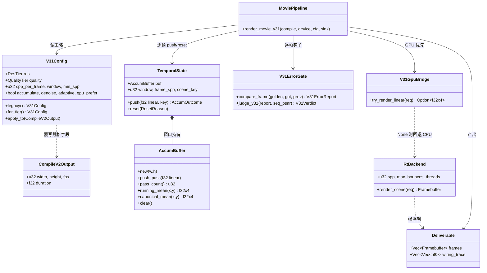
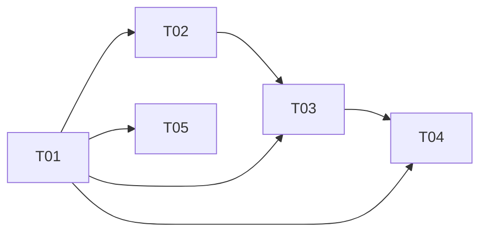

# V3.1「全方位性能优化」系统架构设计与任务分解

架构师：高见远｜输入：许清楚 V3.1 PRD｜状态：用户离线，全权裁定，无待确认项

## 0. 代码勘察结论（承接增量基线，不推翻）

- `accum.rs::AccumBuffer` 真实接口：`new(w,h)` / `push_pass(&[[f32;4]])` / `pass_count()` / `running_mean(x,y)` / `canonical_mean(x,y)`；`mean_samples` / `mean_samples_fill(n, emit)` 已是零堆分配的固定形状树。**它保存全部 pass**，直接接 3600 帧必 OOM。
- `wavefront.rs` 已有 `render_frame(...) -> Vec<[f32;4]>`、`render_frame_array_order`、`parity_report` / `ParityGate` / `judge`（含无 libm 的 `log10_det`、PSNR 判定、负向用例）——**误差判据基座直接复用，不另写一套**。
- `movie.rs::render_movie(compile: &CompileV2Output, device: &mut dyn GpuDevice) -> MovieResult<Deliverable>`；帧循环在 291–296 行；`render_frame_at` → `render_scene_frame`（1799–1804 分派 `render_frame` 或 `render_curve_frame`）→ `render_curve_frame` 已有 f32 线性帧 `wavefront::render_frame` 后 tone-map 成 u8。
- `rt_backend.rs`: `RT_DEFAULT_SPP=16` / `RT_DEFAULT_BOUNCES=6`；`RtBackend::render_scene` 调 `rt_tiles::render_frame(..., threads)`（32×32 tile、`auto_threads`）；`GpuDevice` trait 只有 `render_scene` / `is_available` / `backend_name`。
- `cmd_render.rs` **当前无** `--res/--quality/--frames/--fps`；`--fast` 与 `--adaptive` 互斥在 535 行；`CompileV2Output.width/height/fps/duration` 均为 pub；`prism.rs` 只是同源分发。
- **44 个未提交改动已含 V3.1 试验**：`integrator.rs` 的 `cylinder_t`/`cone_t`/`revolution_t` 已接 `curve_box_may_hit`（基于 `Aabb::segment_interval`，带 pad）；`torus_t` 因 Ferrari 伪根是基线输出一部分而**刻意不做剔除**；`visibility` 已改 `any_hit`（首命中即停）；`accum.rs` 已零堆分配。设计在这些之上增量。
- GPU 范式 `mask.rs:236–285`：能力开关常亮 → `prism_gpu::rasterize_path_gpu(...) -> Option<_>`，Some 接管 readback（零拷贝），None 回退 CPU 权威路径，`out/scratch` 由调用方复用。
- `denoise.rs` 有 `AtrousSpatial`（`TileEffect`，3 趟 / σ=0.1）、`TemporalAccumulator`、`DenoiseBackend` trait；`measure.rs` 有 `Counters` 与 `rss_report`（仅 peak）；`zero_copy.rs` 白名单为编译期常量。

## 1. 实现方案与框架选型

选型：**纯 `std` + 仓内 crate，零第三方依赖**。分层：`prism-app`（CLI/规格覆写）→ `prism-render`（编排/累积/判据/池）→ `prism-rt`（内核）+ `prism-postfx`（自适应/降噪）+ `prism-gpu`（可选加速）+ `prism-mux`（IO）。模式：编排器 + 策略对象（`V31Config`）+ 可选后端桥；保持"求值纯函数、跨帧状态显式持有"的既有纪律。

**1.1 时域累积接入 movie 的接口边界（核心）**
- 不改 `render_movie` / `render_movie_frame` 签名（被 movie 内测、`incremental.rs`、`farm` 大量调用，改则破 4629 测试）。新增 `render_movie_v31(compile, device, cfg: &V31Config, sink: &mut dyn V31FrameSink)`；旧 `render_movie` 委托 `V31Config::legacy()`（累积/降噪/自适应/覆写全关）→ 逐字节不变。
- 累积必须在 **f32 线性域**：u8 量化误差会吃掉 8/32 的判据预算。新增 `linear.rs::render_frame_linear(...)`：曲线场景直接复用 `render_curve_frame` 已产出的 `Vec<[f32;4]>`；普通场景由 `rt_tiles` 新增 `render_frame_linear` 旁路（同一 `trace_sample` / 同一 `mean_samples_fill`，仅把 tone-map 延后）。`--fast` 的 `CpuRefBackend` **不进线性旁路**，保持零回归。
- `TemporalState` 持 `AccumBuffer` + 窗口 W（final=4 / preview=2）：每帧 `push_pass(cur)` → `pass_count()==W` 用 `running_mean` 出帧 → `clear()` → 场景切换 / 尺寸变 / 帧差分异常 / GPU 回落即 `reset()` 清空重采。逐帧新增 spp 由 `RtBackend::new(4|2, 6)` 控制，等效 W×spp=16。`canonical_mean` 仅用于 CI 的"8×单样本 ≡ 一次 spp=8"逐位锚，不进热路径。

**1.2 档位参数链路**：`cmd_render::parse_args` 新增 `--res / --quality / --frames / --fps` → 构造 `V31Config` → **CLI 层覆写 `CompileV2Output` 的 pub 字段**（`duration = frames/fps`）→ `render_movie_v31` → `render_scene_frame` 读 cfg 决定 spp / 累积 / 降噪 / 线性旁路。**不进 DSL IR**（`wiring.rs` 不改），保住"DSL 场景 IR 逐字节一致"与 4629 测试。默认 720p/final；`--fast`×`--adaptive` 互斥原样保留；`--quality fast` 映射到既有 `--fast` 语义（不累积、不降噪）。

**1.3 GPU 回落**：`V31GpuBridge::try_render_linear(req) -> Option<Vec<[f32;4]>>`，条件 = `GpuDevice::is_available()`（VulkanBackend 的 compute+scene 双自检）∧ 探针派发成功；`Some` 接管 readback（零拷贝），`None` 或误差判据失败 → `RtBackend` CPU。完全复刻 `PathMask::rasterize_core` 的"能力常亮 / 真机优先 / 透明兜底 / 复用缓冲"四要素。`VULKAN_CURVE_PATH` 保持常亮仅作接线位；lavapipe 下只验编译、接线、误差，**不进 600 s 达标链**，不承诺 4K。

**1.4 误差判据**：以 `wavefront::parity_report/judge` 为统计基座，扩展五条：① max channel delta(8-bit) ≥99% 像素 ≤8、全局 ≤32；② PSNR 逐帧 ≥38 dB、序列均值 ≥42 dB；③ 亮度 64-bin 直方图各 bin 相对偏差 ≤5%；④ 3×3 梯度强边缘幅值保留 ≥90%；⑤ 相邻帧差分异常像素 ≤5%（超限触发累积清空重采）。golden = 16 spp / 6 bounces / 确定性 CPU / 无累积降噪自适应，逐帧生成锁 sha256；各档各自 golden，禁自比；负向用例（人为扰动必判红）为 CI 硬失败项。

## 2. 文件列表

| 路径 | 性质 | 职责 |
|---|---|---|
| `crates/prism-render/src/v31_config.rs` | 新增 | 档位/质量/spp/判据常量单一真源 + `apply_to` |
| `crates/prism-render/src/v31_accum.rs` | 新增 | `TemporalState` 窗口累积状态机与清空重采 |
| `crates/prism-render/src/v31_gate.rs` | 新增 | 五条误差判据、golden 哈希锚、`V31Verdict` |
| `crates/prism-render/src/v31_golden.rs` | 新增 | 各档 golden 逐帧生成/加载/摘要 |
| `crates/prism-render/src/v31_gpu.rs` | 新增 | GPU 优先 / CPU 兜底桥与能力探测 |
| `crates/prism-render/src/linear.rs` | 新增 | f32 线性帧旁路（延后 tone-map） |
| `crates/prism-render/tests/qa_v31_gate.rs` | 新增 | CI 硬门禁：逐帧判据 + 哈希锚 + 负向用例 |
| `crates/prism-render/tests/qa_v31_perf.rs` | 新增 | 3600 帧计时 / RSS / 分配计数门禁 |
| `scripts/v31_perf_gate.sh` | 新增 | 档位矩阵 3 次取中位 + 全量门禁脚本 |
| `docs/v3.1-golden/` | 新增 | 各档 golden PNG + `manifest.sha256` |
| `crates/prism-rt/src/accum.rs` | 修改 | 增 `clear()` / 窗口推入；`mean_samples` 逐位语义不动 |
| `crates/prism-rt/src/integrator.rs` | 修改 | 承接已有 `curve_box_may_hit`/`any_hit`，增 Torus 阴影臂存在性快判 |
| `crates/prism-rt/src/sampler.rs`、`crates/prism-math/src/det_trig.rs` | 修改 | 构建期 const 查表（等价、哈希不变） |
| `crates/prism-rt/src/bsdf.rs`、`light.rs` | 修改 | BSDF/NEE 热点等价变换 |
| `crates/prism-rt/examples/gallery.rs` | 修改 | 内核哈希锚 A/B 临时副本（`docs/gallery/gallery.rs` 不动） |
| `crates/prism-render/src/movie.rs` | 修改 | 新增 v31 入口 + 帧循环累积/降噪/判据钩子；旧入口委托 |
| `crates/prism-render/src/rt_tiles.rs` | 修改 | 暴露 `render_frame_linear`（同 `trace_sample`） |
| `crates/prism-render/src/rt_backend.rs` | 修改 | spp/threads 可配、线性帧出口 |
| `crates/prism-render/src/frame_pool.rs` | 修改 | 池扩至线性平面、3600 帧复用 |
| `crates/prism-render/src/zero_copy.rs` | 修改 | 登记新零拷贝路径键 |
| `crates/prism-render/src/measure.rs` | 修改 | `rss_current_kib()` + 分段计时 + V31 计数键 |
| `crates/prism-render/tests/qa_perf_counters.rs` | 修改 | 扩至 3600 帧 RSS 首尾差报表 |
| `crates/prism-render/src/lib.rs` | 修改 | re-export V31 公共类型 |
| `crates/prism-app/src/cmd_render.rs` | 修改 | 四选项 + 覆写 + 分段计时 + 零拷贝写帧 |
| `crates/prism-app/src/prism.rs` | 修改 | 仅用法串同步，分发逻辑不动 |
| `crates/prism-postfx/src/denoise.rs` | 修改 | `AtrousSpatial` 保守档接线 + CPU `DenoiseBackend` |
| `crates/prism-postfx/src/adaptive_backend.rs` | 修改 | 预算下限 `MIN_SPP=2` 接入默认档 |
| `crates/prism-gpu/src/lib.rs` | 修改 | VulkanBackend 出片线性帧入口（不改 `is_available` 语义） |
| `crates/prism-mux/src/*` | 修改 | MJPEG/PNG 零拷贝视图、去重复色彩转换 |
| `crates/prism-raster/src/*` | 修改 | 5 项光栅基准计数器与门禁 |
| `crates/prism-dsl/src/wiring.rs` | 修改 | 场景翻译计时计数器（IR 字节不变） |
| `crates/prism-text/audio/texture/particles/*` | 修改 | P2-1 计时计数器 + 零回归门禁 |
| `dist/`、九语 README、Release、`scanline.rs`、`docs/gallery/gallery.rs` | **不动** | 硬约束 |

## 3. 数据结构与接口

```rust
// v31_config.rs —— 单一真源
#[derive(Clone, Copy, PartialEq, Eq)] pub enum QualityTier { Preview, Final, Fast }
#[derive(Clone, Copy, PartialEq, Eq)] pub enum ResTier {
    R320x180, R640x360, R720p, R1080p, R4K, Custom(u32, u32) }
pub struct V31Config {
    pub res: ResTier, pub quality: QualityTier,
    pub width: u32, pub height: u32, pub fps: u32, pub frames: u32,
    pub spp_per_frame: u32, pub window: u32, pub bounces: u32, pub min_spp: u32,
    pub accumulate: bool, pub denoise: bool, pub adaptive: bool, pub gpu_prefer: bool,
}
impl V31Config {
    pub fn legacy() -> Self;                       // 全关：旧入口逐字节不变
    pub fn for_tier(r: ResTier, q: QualityTier) -> Self;
    pub fn apply_to(&self, c: &mut prism_dsl::CompileV2Output); // 覆写 width/height/fps/duration
    pub fn effective_spp(&self) -> u32;           // window * spp_per_frame == 16
}
pub const MIN_SPP: u32 = 2; pub const FINAL_SPP: u32 = 4; pub const PREVIEW_SPP: u32 = 2;
pub const GOLDEN_SPP: u32 = 16; pub const GOLDEN_BOUNCES: u32 = 6;
pub const DELTA_HARD: u8 = 32; pub const DELTA_P99: u8 = 8;
pub const PSNR_FRAME_DB: f64 = 38.0; pub const PSNR_SEQ_DB: f64 = 42.0;
pub const HIST_BIN_REL: f64 = 0.05; pub const EDGE_KEEP: f64 = 0.90;
pub const TEMPORAL_OUTLIER: f64 = 0.05;
pub const GALLERY_SHA256: &str = "78366f3e78323ea260a0dfb606d4f497b06913c1b96500a5ddc1018aa9c32da8";
pub const GALLERY_BYTES: u64 = 3_240_988;

// v31_accum.rs —— 复用 prism_rt::accum::AccumBuffer，不重写累积器
pub struct TemporalState {
    buf: prism_rt::accum::AccumBuffer, width: u32, height: u32, window: u32,
    scene_key: u64, last: Option<Vec<[f32; 4]>>, spp_per_frame: u32, frame_spp: u32,
}
pub enum ResetReason { SceneCut, TemporalOutlier, GpuFallback, SizeChange }
pub enum AccumOutcome { Warmup { passes: u32 }, Hit(Vec<[f32; 4]>), Reset(ResetReason) }
impl TemporalState {
    pub fn new(w: u32, h: u32, window: u32, spp_per_frame: u32) -> Self;
    pub fn push(&mut self, cur: &[[f32; 4]], scene_key: u64) -> AccumOutcome;
    pub fn reset(&mut self, why: ResetReason);
    pub fn frame_spp(&self) -> u32;      // 逐帧新增 spp（写入计数器）
    pub fn effective_spp(&self) -> u32; // 累积等效 spp
}

// v31_gate.rs
pub struct V31ErrorReport { pub max_delta: u8, pub p99_delta: u8, pub psnr_db: f64,
    pub hist_bin_max_rel: f64, pub edge_retention: f64, pub temporal_outlier_ratio: f64 }
pub struct V31Verdict { pub pass: bool, pub reasons: Vec<String>, pub report: V31ErrorReport }
pub fn compare_frame(golden: &[[u8; 4]], got: &[[u8; 4]], prev: Option<&[[u8; 4]]>) -> V31ErrorReport;
pub fn judge_v31(r: &V31ErrorReport, seq_mean_psnr: f64) -> V31Verdict;

// movie.rs 新增（旧签名保留）
pub trait V31FrameSink { fn on_frame(&mut self, f: u32, fb: &prism_gpu::Framebuffer, linear: &[[f32; 4]]); }
pub fn render_movie_v31(compile: &prism_dsl::CompileV2Output, device: &mut dyn prism_gpu::GpuDevice,
    cfg: &V31Config, sink: &mut dyn V31FrameSink) -> MovieResult<Deliverable>;

// linear.rs / v31_gpu.rs
pub fn render_frame_linear(device: &mut dyn GpuDevice, scene: &prism_core::Scene,
    t: f32, duration: f32, w: u32, h: u32, cfg: &V31Config) -> Vec<[f32; 4]>;
pub fn try_render_linear(req: &LinearFrameRequest) -> Option<Vec<[f32; 4]>>;
```



## 4. 程序调用流程（一帧：CLI → 落盘）

```mermaid
sequenceDiagram
    participant CLI as cmd_render::run
    participant CFG as V31Config
    participant DSL as CompileV2Output
    participant MV as movie::render_movie_v31
    participant SC as render_scene_frame
    participant GPU as V31GpuBridge
    participant RT as RtBackend / rt_tiles
    participant LIN as linear.rs (f32)
    participant AC as TemporalState
    participant GT as V31ErrorGate
    participant DN as AtrousSpatial
    participant POOL as FramePool / measure
    participant MUX as prism_mux

    CLI->>CFG: parse_args(--res --quality --frames --fps)
    CFG->>DSL: apply_to() 覆写 width/height/fps/duration
    CLI->>MV: render_movie_v31(compile, device, cfg, sink)
    loop frame i in 0..frames
        MV->>SC: render_frame_at(i, scene_key, cfg)
        SC->>GPU: try_render_linear(req)
        alt 真 GPU 且 is_available 且误差预检通过
            GPU-->>SC: Some(linear f32 readback, 零拷贝)
        else 无 /dev/dri、lavapipe 或失败
            GPU-->>SC: None
            SC->>RT: RtBackend::new(spp_per_frame, 6)
            RT->>LIN: render_frame_linear(同 trace_sample)
            LIN-->>SC: Vec<[f32;4]>
        end
        SC->>AC: push(linear, scene_key)
        alt 累积命中 pass_count == W
            AC-->>SC: Hit(mean) → clear()
        else 暖机 / 场景切换 / 帧差分异常 / GPU 回落
            AC-->>SC: Warmup 或 Reset(reason) → 清空重采
        end
        SC->>DN: 保守 à-trous（quality final|preview；fast 跳过）
        DN-->>SC: 线性帧
        SC->>POOL: acquire → tone-map 到 RGBA8 → measure 分段计时
        SC->>GT: on_frame(i, fb, golden_i) 五判据 + 序列 PSNR
        GT-->>MV: V31Verdict（任一失败 = CI 硬失败）
        MV->>MUX: 零拷贝视图写 MJPEG/MP4
        POOL->>POOL: release(fb) 复用；记录 rss_start/end、alloc/copy 计数
    end
    MV-->>CLI: Deliverable + 3600 帧 RSS 报表
```

## 5. 任务列表（有序，工程师直接执行）

| ID | 任务 / PRD ID | 涉及文件 | 依赖 | 验收判据 |
|---|---|---|---|---|
| **T01** | **验收框架与配置基础设施**（P0-6，横切须先合入） | `v31_config.rs`、`v31_golden.rs`、`v31_gate.rs`、`qa_v31_gate.rs`、`scripts/v31_perf_gate.sh`、`lib.rs`、`docs/v3.1-golden/` | — | golden 各档逐帧生成并锁 sha256；五判据 + 负向用例（人为扰动必判红）；纯 CPU 单帧锚 `78366f3e…`/3,240,988 B 不变；4629 测试全绿、wasm < 786432 B |
| **T02** | **内核等价优化**（P0-1、P1-1、P1-2） | `accum.rs`、`integrator.rs`、`sampler.rs`、`det_trig.rs`、`bsdf.rs`、`light.rs`、`examples/gallery.rs`（临时副本） | T01 | 先过哈希锚再改；内核求交 32spp@1200×675 ≤ 8 s；`torus_t`+`quartic` 栈占比 <10%；BSDF ≤15%、确定性数学 ≤8% 且纯 CPU 单帧逐字节不变；每条先 A/B，误差判据为 CI 硬失败项 |
| **T03** | **出片主链路**（P0-2/3/4/5） | `movie.rs`、`v31_accum.rs`、`linear.rs`、`rt_tiles.rs`、`rt_backend.rs`、`cmd_render.rs`、`prism.rs`、`adaptive_backend.rs`、`denoise.rs` | T01、T02 | 档位矩阵 3 次中位：320×180≤40 s、640×360≤150 s、**720p final ≤600 s**、1080p≤1300 s、720p fast≤180 s 零回归；3600 帧逐帧对 golden 五判据全过；默认 720p/final；`--fast`×`--adaptive` 互斥不变 |
| **T04** | **内存 / 编码 / GPU 回落**（P0-7/8、P1-3） | `frame_pool.rs`、`zero_copy.rs`、`measure.rs`、`qa_perf_counters.rs`、`qa_v31_perf.rs`、`cmd_render.rs`、`v31_gpu.rs`、`prism-gpu/lib.rs`、`prism-mux/*` | T01、T03 | 每帧分配次数降 ≥50%、RSS 首尾差 ≤5%、3600 帧 RSS 报表；编码固定开销 ≤0.08 s、零拷贝身份测试通过；lavapipe 验编译/接线/误差，GPU 不进 600 s 达标链 |
| **T05** | **全域基线与门禁**（P1-4、P2-1、P2-2） | `prism-raster/*`、`wiring.rs`、`text/audio/texture/particles/*`、`scripts/v31_perf_gate.sh`、`docs/v3.1-基线报表.md` | T01（与 T02–T04 并行） | 光栅 5 项零回归纳入门禁；DSL/场景翻译/文本/音频/纹理/粒子计数器基线；全量测试 wall clock 与构建时长 ≤首次基线 ×1.05 |



## 6. 依赖包列表

**无新增第三方依赖**，`Cargo.lock` 不新增条目。仓内 crate：`prism-core`（EvalCtx/Signature）、`prism-math`（Vec3/det_trig）、`prism-gpu`（Framebuffer/GpuDevice/VulkanBackend）、`prism-rt`（accum/wavefront/integrator）、`prism-render`（编排主战场）、`prism-postfx`（AdaptiveRtBackend/denoise）、`prism-dsl`（CompileV2Output）、`prism-mux`（MJPEG/MP4）、`prism-text`、`prism-raster`、`prism-io`、`prism-geometry`、`prism-app`。依赖方向不变（无环，postfx→render 单向）。

## 7. 共享知识

- 命名：新增公共类型统一 `V31*` 前缀；计数器键 `v31.<domain>.<metric>`（域：`kernel/raster/dsl/text/audio/texture/particle/encode/alloc/rss`）。
- 常量单一真源 `v31_config.rs`；**禁止**在别处硬编码 8/32/38/42/5%/90%/5%/16 spp。
- 档位枚举值固定：`preview|final|fast` × `320x180|640x360|720p|1080p|4k|<WxH>`；4K 可选但不承诺达标。
- golden 资产：`docs/v3.1-golden/<res>_<quality>/frame_%04d.png` + `manifest.sha256`；各档自比，禁互比、禁自比。
- 确定性写法：禁 libm、禁全局 RNG；样本流经 `EvalCtx::new(RT_SEED=0, 0, frame)`；归约只用 `mean_samples_fill` 固定形状树；tile 用全局像素坐标、合并按 tile 索引升序；跨帧状态只由 `TemporalState` 显式持有。
- 零拷贝路径必须在 `ZERO_COPY_WHITELIST` 登记，且 `verify_zero_copy` 指针相等；真正拷贝必须走 `measure::copy_bytes` 才被计数。
- 逐字节不变清单：纯 CPU 单帧 gallery 32spp、`--fast` 输出、2D 光栅 5 项、DSL 场景 IR、计数器确定性/帧池中性/零拷贝身份、wasm、`dist/`。改用误差上限：时域累积、自适应/降噪后、GPU 输出。
- 所有旧入口（`render_movie`、`render_movie_frame`、`--fast`）默认走 `V31Config::legacy()`，逐字节不变。

## 8. 待明确事项

**无。**

## 9. 架构裁定记录

| # | 原问题 | 选择 | 理由 |
|---|---|---|---|
| 1 | `render_movie` 签名要不要加参数 | 新增 `render_movie_v31`，旧入口委托 legacy | 被 movie 内测/incremental/farm 大量调用，改则破 4629 测试 |
| 2 | `AccumBuffer` 全量保存 pass | 窗口 W + 新增 `clear()`，不重写累积器 | 3600 帧全存必 OOM；PRD 要求复用现成累积器 |
| 3 | 累积在 u8 还是 f32 | f32 线性旁路（`linear.rs`），tone-map 延后 | u8 量化误差吃掉 8/32 判据预算；曲线路径已有 f32 帧 |
| 4 | Torus 已因伪根刻意不做 AABB 剔除，却要栈占比 <10% | 主射线**不动**（伪根是哈希锚一部分）；阴影臂用 `torus_any_hit` 只判"区间内实根存在性"、不取 t、不改主射线数值，与 `torus_t().is_some()` 逐像素 A/B 对拍；配合既有 Cylinder/Cone/Revolution 预剔除 + `any_hit` 首命中即停 + 图元按成本升序访问 | 保住纯 CPU 单帧逐字节不变，同时给 1.3× 剔除收益与 <10% 目标一条可验证路径；不等价即回退 |
| 5 | 档位参数是否进 DSL | CLI 覆写 `CompileV2Output` pub 字段，不进 IR | 保 "DSL 场景 IR 逐字节一致"；`wiring.rs` 零改动 |
| 6 | `--frames 3600 --fps 60` 与 3 s 示例冲突 | `duration = frames/fps = 60s` 覆写 | C2 命令口径，示例文件 36 帧基线仅作 A/B |
| 7 | 默认出片路径接 `--adaptive` | `quality final` 隐式启用 A5，`MIN_SPP=2` 写配置；显式 `--adaptive` 与 `--fast` 互斥不变 | 满足 P0-4 且不改既有 CLI 语义 |
| 8 | GPU 是否算进 600 s | 不进；lavapipe 只验编译/接线/误差 | 沙箱无 `/dev/dri`，PRD 明确非目标 |
| 9 | 误差判据是否新写 | 复用 `wavefront::parity_report/judge` 扩展五条 | 已有无 libm `log10_det`、PSNR、负向用例，避免第二套口径 |
| 10 | 44 个未提交改动 | 全部承接、其上增量；不提交/回退/checkout | 硬约束；已有 `curve_box_may_hit`/`any_hit`/`mean_samples_fill` 是本轮基线 |
| 11 | 既有 `docs/*-diagram.mermaid` | 新建 `docs/v3.1-*.mermaid`，不覆盖旧图 | 避免污染 v2 资产与工作区 |
| 12 | 4K | 档位可选，不承诺进 10 分钟 | PRD 非目标 |

## 10. 风险与回退

所有开关收敛在 `V31Config` 单点 + 环境变量 `PRISM_V31_<FLAG>=0`，**不改源码即可关**；旧入口恒走 legacy，故每条 P0 可独立回退、不连锁。

| P0 | 风险 | 独立回退开关 | 回退后 |
|---|---|---|---|
| P0-1 | Torus 存在性快判不等价 / 求交变慢 | `curve_box_may_hit` 关 + `torus_any_hit` 关 | 逐字节回旧求交，仅失 1.3× |
| P0-2 | 运动拖影超差 / 累积抖动 | `accumulate=false` | 每帧 16 spp 旧路径，仅失 4× |
| P0-3 | 规格覆写影响 DSL 对拍 | 覆写关 | 沿用 DSL 原规格 |
| P0-4 | 自适应预算下限破坏分配 | `adaptive=false` | 固定 spp |
| P0-5 | 降噪糊边缘 | `denoise=false` | 原始线性帧 tone-map |
| P0-6 | golden 资产缺失 | 结构化报错（不可静默关） | CI 硬失败，防假绿 |
| P0-7 | 帧池污染 / RSS 抬升 | 帧池关 | 逐帧新分配，输出不变 |
| P0-8 | lavapipe 假绿 / GPU 误差超限 | `gpu_prefer=false` | 全 CPU 达标链 |

护栏：P0-1~5 每条先做 A/B；误差判据为 CI 硬失败项；逐帧新增 spp 下限写配置；任何内核改动先过纯 CPU 单帧哈希锚；每帧对 golden 不得自比。

## 11. 工程硬约束

零第三方依赖；4629 测试全通过（239 段）；wasm < 786432 B；`dist/` v3.0.1 哈希锁定不动；九语 README 与 Release 不动；在 44 个未提交源码改动上增量，**禁止 git 提交/回退/checkout**；纯 CPU 单帧哈希锚 `78366f3e…` 不得变化；`docs/gallery/gallery.rs` 不动（只用 `crates/prism-rt/examples/gallery.rs` 临时副本验证）；不重写 `scanline.rs`；不启用曲线 BVH（A/B 已证 17.77 s 更慢）；不引入改变纯 CPU 单帧数值结果的数学近似；不改 `--fast` 平光语义及其与 `--adaptive` 互斥。
