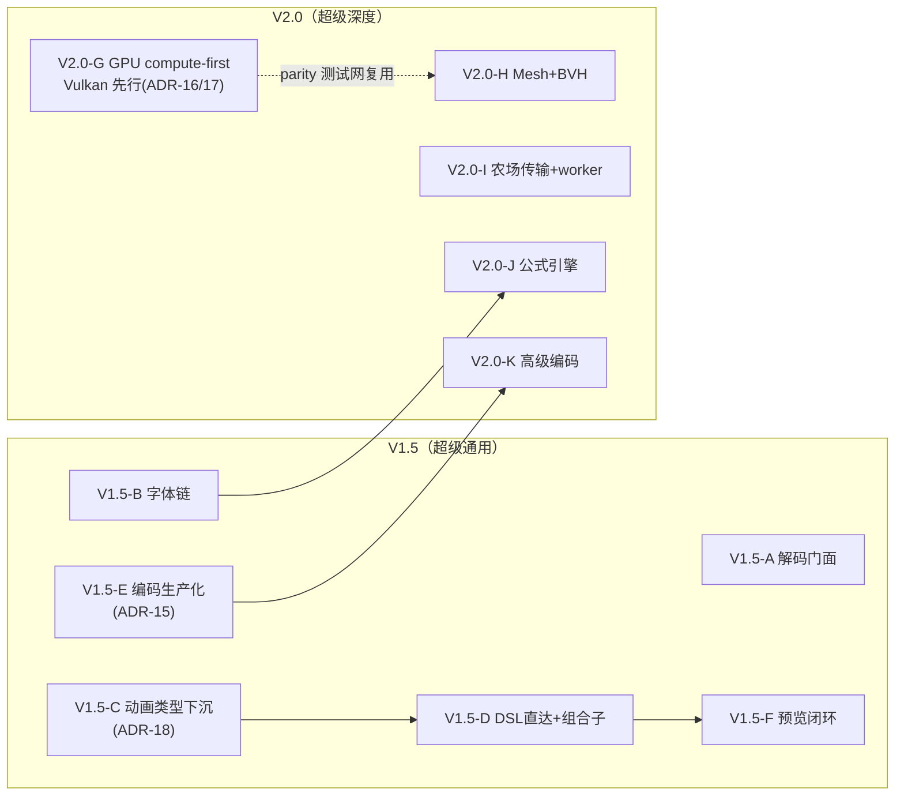
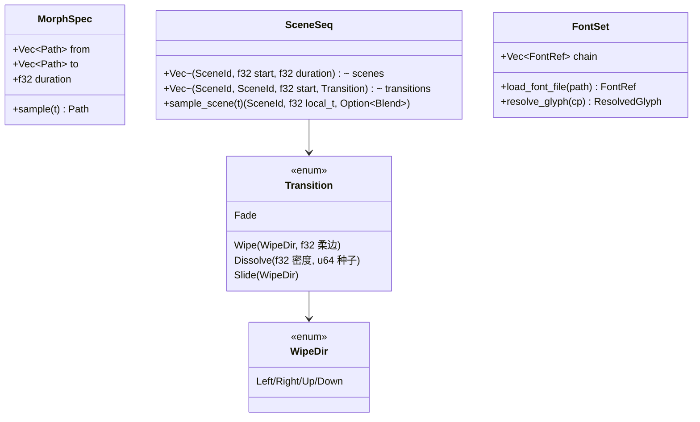

# V1.5 / V2.0 技术架构路线图

> 作者：Bob（架构师） · 视角：技术架构（"怎么做 / 技术取舍 / 多大工作量"）
> 与 PM 产品路线图互补：PM 定义"做什么/为什么"，本文定义"怎么做/取舍/工作量"。
> 版本主题（作者定，不可更改）：**V1.5「超级通用」** · **V2.0「超级深度、专业、强大」**
> 修订记录：2026-10-16 作者拍板——mesh+BVH 确认归 V2.0-M2；GPU 路线改 Vulkan 先行（ADR-16 修订版）。
> 事实基线：2026 年对 `main` 的只读抽查（仅读仓库，未执行任何构建/测试/git 写操作）。
> 宪章引用：D-10（不自研 H.264/HEVC 红线）、D-15/D-29（运行期零第三方 crate / 禁 libm）、
> D-17（ffmpeg 运行时协作）、C13（schema 版本入缓存键）、C18/C19（三段式错误）。

---

## 1. 缺口核验报告（8 项）

> 核验方法：对 8 个缺口逐一读取对应 crate 源码，给出「现状结论 + 文件:行号证据 + 严重度」。
> **重大发现：事实底稿整体落后于仓库现状**——引擎在底稿写就后又前进了数轮
> （已有 I/P 帧视频编码器、希腊符号回退表、GSUB/竖排/SDF 文本、分布式农场调度器、
> 编辑器增量预览逻辑）。下列结论以代码为准，底稿中已过时的描述逐条修正。

### G1 输出侧视频编码 —— 底稿过时，缺口性质改变

| 项 | 结论 |
|---|---|
| 现状结论 | **帧间预测编码器已实装**，不是"只有 MJPEG"。`prism-mux` 已有：基线 JPEG 编解码（灰度+彩色，`crates/prism-mux/src/jpeg.rs:230` `encode_jpeg_gray`、`:574` `encode_jpeg_color`）；**I 帧（全彩 JPEG）+ P 帧（16×16 整像素运动补偿、3-step 对数搜索、Y/CbCr 三平面残差独立灰度 JPEG）+ 零漂移（自写 JPEG 解码器回解重建参考）** 的时序编码器（`crates/prism-mux/src/video.rs:1-27` 模块头、`:100-110` 实测注释）；AVI(rawvideo/MJPEG)（`crates/prism-mux/src/avi.rs`）、MP4(MJPEG+PCM)（`crates/prism-mux/src/mp4.rs`）、EBU R128 响度归一（`crates/prism-mux/src/loudnorm.rs`）。 |
| 证据 | `video.rs:56-58`（容器魔数 `PRMV`，**私有格式，非标准 MP4**）；`video.rs:100-106`（实测 PSNR≈40.13 dB、体积较 MJPEG 小约 8.6%）；`lib.rs:8-9`（H.264/HEVC 维持 D-10 红线不自研，外部 ffmpeg 协作）；`extprobe.rs`（ffmpeg 探测器）、`hwenc.rs`（硬件编码适配骨架） |
| 真正缺口 | ① PRMV 私有容器**标准播放器不可播**，对外交付链路未闭合；② 无率控/无 B 帧/无子像素运动搜索；③ 分辨率 u16 上限；④ `hwenc` 仅骨架；⑤ 私有容器在生态中的定位未文档化 |
| 严重度 | **P1**（能力已存在，缺生产化与交付闭环；不再是"干不了活"） |

### G2 输入侧薄弱 —— 部分过时："有零件、没装配"

| 项 | 结论 |
|---|---|
| 现状结论 | ① **PNG 仅有编码、无公开解码**（`crates/prism-io/src/lib.rs:206` `encode_png`，存储型 deflate 无压缩）；但 `prism-media/apng.rs:4-18` 内部已完整具备「zlib inflate + PNG 滤波逆运算（Sub/Up/Average/Paeth）」能力，只服务 APNG。② **JPEG 解码器已存在但私有**：`mux/video.rs:15-16` 的零漂移回解用的就是自写 JPEG 解码器，无公开 API；`source.rs:127-133` 仍把 jpeg/webp 分类为"需外部 ffmpeg"。③ GIF/APNG/WAV 原生解码已有（`gif.rs`/`apng.rs`/`audio.rs`）；mp4/mov/webm/mp3/aac 走 ffmpeg 探测协作（`source.rs:74-77` `ReadKind`）。 |
| 证据 | `crates/prism-media/src/source.rs:127-133`（扩展名→ReadKind 分类表）；`crates/prism-media/src/apng.rs:71` `decode_apng`；`crates/prism-io/src/lib.rs:4-5`（PNG 编解码自实现声明仅覆盖写侧） |
| 真正缺口 | **缺统一解码门面**：把散落各 crate 的解码零件提为公开 API（`decode_png` / `decode_jpeg` / `decode_image(bytes, ext)`），并修正 source 分类判定；不支持的能力（交错 PNG、WebP、mp4 等）如实标注、不静默失败（D-17 已有此纪律，缺执行） |
| 严重度 | **P1**（低成本高收益；"能不能读"是通用性第一印象） |

### G3 文本排版引擎化 —— 严重过时：从"缺字形"升级为"缺装载与引擎化"

| 项 | 结论 |
|---|---|
| 现状结论 | `prism-text` 已远超底稿描述：**希腊/数学符号程序化回退表已存在**（`math_symbols.rs` 862 行，模块头明记"v3-A 修复 ε/δ 渲染成豆腐块缺陷"，`lib.rs:10-12`）；真 GSUB（`gsub.rs` 2215 行）、OpenType/CFF 解析（`opentype.rs` 1969 行）、复杂脚本整形（阿拉伯连接/天城文/双向，`shaping.rs` 1762 行）、竖排 CJK（`vertical.rs`）、SDF 文本（`sdf.rs`）、路径文本（`path_text.rs`）、确定性字形缓存（`cache.rs`）、自研多语种字体资产生成器（`multiscript_font.rs`）。 |
| 证据 | `crates/prism-text/src/lib.rs:43-54`（仅三个内嵌字体常量：FONT_REGULAR / FONT_BOLD / FONT_MULTISCRIPT，**无外部字体装载入口**）；`crates/prism-author/examples/calculus_film_v2/symbols.rs`（公式符号渲染仍在 example 层） |
| 真正缺口 | ① **外部 TTF/OTF 文件加载**（解析器已有，缺装载 API 与 DSL `font` 指令）；② **跨字体回退链**（现在是单字体+符号表两级，缺 chain 机制）；③ **公式排版引擎化**：AST + 布局（基线/上下标/分式/根号/大型算子）从 example 提为 crate 能力，并进 DSL |
| 严重度 | **P2**（回退表已灭火"乱码"；剩余是专业化深度，归 V2.0 为主、装载归 V1.5） |

### G4 动画语法场景层缺口 —— 确认存在，但作者层能力已相当完整

| 项 | 结论 |
|---|---|
| 现状结论 | `prism-author` 已有：Morph 折线变形轨道（`spec.rs:325-345` `MorphSpec` + `render.rs:1054` `draw_morph`）；转场枚举 **Fade / Wipe(四向) / Dissolve(像素级阈值显影) / Slide**（`spec.rs:638-696`，含 `WipeDir`）+ `concat_with_transition`（`render.rs:1465`）。**但 `prism-core` 对 morph/transition 零消费**（对 `crates/prism-core/src/*.rs` grep 无命中）；DSL v2 的 `transition` 块只登记元数据且 kind 仅 `crossfade`（`prism-dsl/src/lib.rs:805,838` 测试钉住）。 |
| 证据 | `crates/prism-author/src/spec.rs:662-696`；`crates/prism-dsl/src/lib.rs:804-806`（`transition "cut1" { ... kind crossfade }`） |
| 真正缺口 | ① 动画/转场**语义类型下沉**到 core（依赖方向 core∈L2 不得向上依赖 author∈L4，见 `io/distribution.rs:20-24` 红线自述）；② 场景序列模型 `SceneSeq`（场景+转场的时间采样）；③ DSL 转场参数化（wipe 方向/dissolve 密度/easing）+ `morph` 图层指令 |
| 严重度 | **P1**（V1.5「超级通用」的核心语法项：语法层已能写、执行层不消费=半条路） |

### G5 3D 图元窄 —— 确认，但比底稿好：已有 4 类解析图元 + 对拍机制

| 项 | 结论 |
|---|---|
| 现状结论 | `prism-rt` Scene 图元：**Sphere + Aabb + Paraboloid + Plane**（`integrator.rs:244-252`，`ShapeRef` 枚举 `:266-269`），抛物面/平面已带 `wavefront` 双路径 parity 对拍（`integrator.rs:22-26`、`wavefront.rs`）。**无 triangle mesh、无 BVH、无 CSG**。 |
| 证据 | `crates/prism-rt/src/integrator.rs:58,67,134,148,244-269` |
| 真正缺口 | ① Mesh 图元（索引三角批）+ **BVH**（构建须确定性：稳定排序+固定切分规则）；② USD mesh → rt Mesh 的加载路径（`io/usd.rs` 已有 4156 行 USD 解析，资产侧就绪）；③ CSG 需决策（建议不做显式 CSG，见 §3 ADR-20） |
| 严重度 | **P2**（V2.0「专业深度」主力项；通用性上解析图元已覆盖科教场景大部） |

### G6 作者 API 高层化 —— 确认，且缺口已定位到精确位置

| 项 | 结论 |
|---|---|
| 现状结论 | DSL v2 全块语法已能把 movie→节点图+属性通道+时间线一次编译（`prism-dsl/src/lib.rs:779-889` 黄金测试），但模块头自认「**深语义（渲染/模拟步进/音频）留 Phase 2/3**」（`lib.rs:9-10`）——**v2 产物图到帧的执行链未闭合**。作者 API 仍是代码级（`crates/prism-author/examples/` 下手写场景：calculus_film_v2/short_v5 等）。 |
| 证据 | `crates/prism-dsl/src/lib.rs:6-10`；`crates/prism-author/examples/`（short.rs / short_v4.rs / short_v5.rs / calculus_film_v2.rs） |
| 真正缺口 | ① **DSL v2 → 成片直达执行路径**：`CompileV2Output`（Graph+channels+timeline）→ 逐帧求值 → `prism-render` orchestrator → `prism-mux` 交付，一站式 API；② **高层组合子（combinator）库**：title_card / lower_third / split_screen / ken_burns / morph_between 等展开为节点图，把"90s 成片=手写代码"降为"组合子+DSL" |
| 严重度 | **P0**（V1.5 主题的直接承载项：通用性 = 用户不写引擎代码也能成片） |

### G7 实时预览闭环 —— 部分过时：逻辑层已具备，缺宿主壳与真实渲染绑定

| 项 | 结论 |
|---|---|
| 现状结论 | `prism-app/editor/` 已有：`EditorState`（命令模式 undo/redo + **子图签名精确增量失效**，`editor/mod.rs:9-22`）；`PreviewRenderer`（**Draft=1/4 分辨率+1spp / Final=全分辨率+16spp** + 签名 memoization，`editor/preview.rs:5-16`）；编辑器 ABI 版本（`editor/abi.rs`）。`prism-app` 本体是 CLI（`main.rs`：cmd_batch/cmd_critique/cmd_http/cmd_mcp/cmd_pack），**无交互宿主**。 |
| 证据 | `crates/prism-app/src/editor/preview.rs:21-24`（预览图案是"整数散列+多项式插值"的**几何测试图案，非真实渲染产物**——为守确定性禁 libm）；`crates/prism-app/src/lib.rs:1-12` |
| 真正缺口 | ① **宿主循环**：CLI/HTTP 预览服务（编辑→签名增量→重渲 dirty 区→推帧），可复用 `cmd_http.rs` 服务模式；② **预览→真实渲染管线绑定**：新增 Real 档（低 spp 真实 rt/render 输出）供成片前确认；③ 窗口宿主（如未来要 GUI）另行立项 |
| 严重度 | **P2**（V1.5 收尾项：逻辑已备，粘合成本低） |

### G8 性能工程 —— 严重过时：CPU 侧缓存/增量/农场骨架已相当完整

| 项 | 结论 |
|---|---|
| 现状结论 | 已有：**内容哈希缓存**（`io/cache_manifest.rs`：缓存键五元组=子图签名×分辨率×spp 档×tile×engine/schema 版本，磁盘 manifest 逐字节确定）；**增量渲染**（`render/incremental.rs`：子图签名×帧区间×tile 三维复用，命中=取回字节，未命中=全量重算，逐位一致）；**分布式渲染农场调度器**（`render/farm/`：split_frames 纯函数切分、merge_shards 按帧号归位、digest/evidence 校验、worker 只产逐帧部分结果不预归约——"并行 md5 == 串行 md5 是定理"）；tile 渲染 + halo（`render/tile.rs`/`orchestrator.rs`）；RGBA16F tile 存储（`io/fbuf.rs`）。 |
| 证据 | `crates/prism-render/src/farm/mod.rs:1-30`；`crates/prism-render/src/incremental.rs:1-25`；`crates/prism-io/src/cache_manifest.rs:1-22` |
| 真正缺口 | ① **GPU 生产管线从 0 到 1**：三后端（Vulkan/Metal/WebGPU）均只有"设备探测链"，`is_available()` 恒 false、`render_scene` 返回空帧（`gpu/lib.rs:11-14,60-71`）；D0 设备无关算法层（scan/sort/sync）已就绪。② 农场**传输层与 worker 可执行文件**（farm 是调度内核，无传输协议、无 worker 进程）。③ 90s/4 核/35min 的瓶颈归因（rt 求交+着色是主项，GPU 是最大杠杆） |
| 严重度 | **P0**（V2.0 主题直接承载项：GPU 是"不是玩具"的判据） |

### 核验总评

底稿 8 项中 **3 项严重过时（G1/G3/G8）、2 项部分过时（G2/G7）、3 项确认（G4/G5/G6）**。
引擎实际完成度显著高于底稿——这对路线图是好事：V1.5/V2.0 的重点应从"补缺失"调整为
**「装配已零件化能力 + 打通执行链 + GPU 生产化」**三件事。

---

## 2. 技术方案选型（每缺口：候选 + 取舍 + 推荐）

### G1 视频编码生产化

| 候选 | 方案 | 取舍 |
|---|---|---|
| A | FFI 绑定 rav1e/x264（引 Rust 编码 crate 或 C 库） | ✗ 违反 D-15 运行期零第三方 crate 宪章（rav1e 即便 Rust 也是巨型 dep 树）；x264 需 C 工具链；破坏确定性跨平台逐位复现；许可证（x264 GPL）污染。**否决** |
| B | 自研 H.264/AV1 完整编码器 | ✗ D-10 明文红线；人年级工作量；率控/熵编码/CABAC 深坑。**否决** |
| C（推荐） | **双轨制**：自研 I/P 帧 JPEG 域编解码器（已实装）定位为**引擎确定性中间格式 PRMV**（v2 容器加 schema 版本入缓存键）；对外交付 = 运行时探测 ffmpeg 做「PRMV/帧序列 → stdin rawvideo → H.264/HEVC」零磁盘转封装（无 ffmpeg 自动降级 MJPEG-AVI/MP4，已有 extprobe 降级链）；hwenc 补最小实装（**VAAPI 优先**：Linux 可编译 + dlopen libva 探测链可验证；VideoToolbox 留 macOS 段，与 Metal 第二阶段同环境再启，详见 V1.5-E） | ✓ 守住零依赖+确定性卖点（PRMV 逐位可复现、可 seek、可农场传输校验）；✓ 交付质量靠生态协作者；代价：压缩率低于同码率 H.264（P 帧 JPEG 域残差效率有限），且 PRMV 非标准播放器可播——**必须文档化交付链定位** |

补充生产化（随 C 落地）：固定档位率控预设（low/balanced/high，两趟 qp 分配）；B 帧（双向预测，确定性优势下实现简单）；YCbCr 4:2:0 残差选项；分辨率上限从 u16 提 u32（容器字段扩容，schema 版本递增）。

### G2 输入侧统一解码门面

| 候选 | 方案 | 取舍 |
|---|---|---|
| A | 每个格式各开公开 API（decode_png/decode_jpeg/decode_gif…） | △ 简单但调用方仍需自分发；source.rs 已有分类表可复用 |
| B（推荐） | **门面 + 分发**：`io`（或 media）新增 `decode_image(bytes, ext) -> Result<PixelImage, MediaError>` 统一入口，内部按格式分发；把 `apng.rs` 的 inflate+滤波逆运算提为 `png` 解码路径（单帧 PNG=APNG 的静态子集，天然覆盖）；把 `mux/jpeg.rs` 零漂移解码器提公开（`decode_jpeg_gray/color`）；`source.rs` 分类表修正（jpeg→Native）；不支持的（交错 PNG/WebP/mp4…）返回三段式错误+建议（"经 ffmpeg 协作"），**永不静默失败**（D-17 纪律执行化） | ✓ 零件零重写、纯装配；✓ 对外一个函数；✓ 与 ffmpeg 协作边界清晰。代价：基线 JPEG/非交错 PNG/8bit 是支持矩阵上限，须如实文档化 |

### G3 文本：外部字体装载 + 回退链 + 公式引擎化

| 候选 | 方案 | 取舍 |
|---|---|---|
| A | 只做外部 TTF 加载，回退靠用户自觉多字体 | △ 不解决 ε/δ 类问题系统性复发 |
| B（推荐） | **三件套**：① `FontSet` 装载 API（`load_font_file` 复用 `ttf.rs`/`opentype.rs` 解析器读外部 TTF/OTF；字体文件字节哈希进签名/缓存键保确定性）；② **回退链** `resolve_glyph(chain, cp)`：PrismSansSC → 用户字体 → FONT_MULTISCRIPT → math_symbols 程序化表 → 明确 .notdef 诊断（含缺失码位报告，不再静默豆腐块）；③ **公式 AST 引擎化**（V2.0）：从 `examples/calculus_film_v2/symbols.rs` 提取 `math_ast`+`math_layout`（上下标/分式/根号/大型算子/矩阵），DSL 增 `formula` 块 | ✓ 回退链把"乱码"从缺陷变为可诊断能力；✓ 公式引擎化直接服务科教深度。代价：CFF 轮廓解析覆盖度需核验补缺；外部文件引入环境依赖（哈希入键缓解） |

### G4 场景层动画/转场消费

| 候选 | 方案 | 取舍 |
|---|---|---|
| A | core 反向依赖 author 复用类型 | ✗ 违反依赖方向（io/distribution.rs:20-24 自述红线：io∈L4 不得依赖 core∈L2，author 同理不得被 core 依赖） |
| B | author 层自建场景序列，core 不管 | △ 快但 DSL/core 场景仍消费不到，半条路问题依旧 |
| C（推荐） | **语义类型下沉 core**（ADR-18）：Morph/Transition/WipeDir/Dissolve 参数类型移入 `prism-core`（compose 模块），author 改为引用（保留旧路径 adaptor，v1 测试零回归）；core 增 `SceneSeq{scenes, transitions}` 与 `sample_scene(t)->(scene, local_t, blend)`；DSL v2 transition kind 白名单扩 fade/wipe/dissolve/slide + 参数化（dir/edge 柔边/density/easing），layer 增 `morph { from to }` | ✓ 依赖方向正确、场景层与 DSL 层同时闭合；代价：类型下沉的兼容性迁移（adaptor+测试网可控） |

### G5 Mesh + BVH（+CSG 决策）

| 候选 | 方案 | 取舍 |
|---|---|---|
| A | 只加 mesh 线性遍历 | △  mesh 上万面后每帧爆炸，不专业 |
| B（推荐） | **Mesh + BVH（SAH 或 bins 切分，构建确定性：稳定排序+固定规则）**进 `rt::Scene` 与 `wavefront` 双路径（沿用既有 parity 对拍测试网，`integrator.rs:22-26`）；USD mesh 经 `io/usd.rs` 进入；**CSG 明确不做显式树**（ADR-20）：交/并/差由 USD/mesh 工具侧预处理，或未来以 SDF-ray-march 图元单独立项——CSG 求交数值稳健性成本与需求频度不匹配 | ✓ BVH 是"专业引擎"及格线；✓ parity 机制免费判对；代价：BVH 构建确定性需专门测试（切分规则+排序钉死） |

### G6 DSL → 成片直达路径 + 组合子库

| 候选 | 方案 | 取舍 |
|---|---|---|
| A | 在 CLI 里写死"编译→逐帧 eval→render→mux"脚本 | △ 能跑但不可复用、不可测试 |
| B（推荐） | **执行闭合为一等 API**：`render/render_short` 同级新增 `render_movie(compile_v2_output, device) -> Deliverable`（图求值→通道采样→orchestrator tile→rt/gpu 设备→mux 交付），放 `prism-render`（或 dsl 的 execute 模块）；**组合子库** `author/combinators.rs`：高层组合子展开为 v2 节点图（用户可 DSL 引用亦可代码引用）；未覆盖节点**如实报错不静默近似**（C18） | ✓ 90s 成片从"手写场景代码"降为"组合子拼装 + .prism 声明"；✓ 求值器与渲染域边界清晰可测。代价：v2 节点特解覆盖度是最大不确定性（需节点清单化盘点） |

### G7 预览闭环

| 候选 | 方案 | 取舍 |
|---|---|---|
| A | 直接上 GUI 窗口宿主 | ✗ 引第三方 GUI crate 破零依赖；沙箱 headless 不可验 |
| B（推荐） | **CLI/HTTP 预览服务闭环**：`cmd_preview` 子命令（或 cmd_http 扩展路由）：载入 .prism/编辑 JSON → EditorState → DirtySet → PreviewRenderer（Draft 几何图案保交互帧率；**新增 Real 档=低 spp 真实渲染**供成片前确认）→ PNG/帧推送；编辑器 ABI（abi.rs）冻结为集成面 | ✓ 零新依赖、headless 可验、为未来 GUI 留 ABI；代价：Real 档帧率受真实渲染限制（Draft 档兜底） |

### G8 GPU 生产管线（V2.0 之主战役）

| 候选 | 方案 | 取舍 |
|---|---|---|
| A | 引 wgpu/ash/vulkano | ✗ 巨型第三方 dep，直接撕毁零依赖卖点。**否决** |
| B | Vulkan-first 全线自写 | △ 桌面覆盖最广（Linux/Windows），作者主力环境（Linux）可真实验证、parity 对拍有真机——**现为主推**（承入候选 D）；代价：SPIR-V 构建期步骤进 CI（ADR-17 已许可），Apple 平台由 Metal 第二阶段补 |
| C | Metal-first（仅 Apple） | △ 真机验证体验好（MSL 运行期编译、无需构建期编译步骤），但桌面 Linux/Windows 缺席、通用性不足，且与作者主力环境（Linux）错位——**降为第二阶段**（Apple 平台验证段），不再先行 |
| D（推荐） | **Compute-first + Vulkan 先行 + Metal 第二阶段 + WebGPU 随 wasm**：① 新建 `gpu/compute/` 设备无关 compute 语义层（kernel 描述/dispatch 形状/buffer 布局——复刻 D0 scan/sort/sync 模式，CPU 可测）；② **Vulkan 先行**（`gpu/vulkan/` 已有 dlopen 探测链，补 queue+compute pipeline；kernel 以 SPIR-V **构建期生成入二进制**、运行期零依赖——构建期工具链先例：fontTools 生成字体/multiscript_font 自研生成器，ADR-17 已许可）；③ **Metal 第二阶段**（`gpu/metal/` 已有 dlopen 探测链 + MSL 源，Apple 平台验证段补 queue+compute pipeline，工作量单列）；④ **kernel 语义锚定 CPU wavefront**（`rt/wavefront.rs` 已实装 CPU 波前，GPU kernel 与其逐位 parity 对拍——引擎已有 integrator↔wavefront 双路径对拍机制，直接复用）；⑤ WebGPU 随 `gpu/web/` wasm 路径 | ✓ 每步可验证、可止损；✓ Vulkan 先行落在作者主力环境（Linux）真机验证，止损点前移（ADR-16/R1）；✓ parity 测试网把"GPU 正确性"化为确定性命题；✓ 零第三方运行期依赖不破。代价：三后端各一遍 dispatch 派生的重复工作；构建期 SPIR-V 步骤（可接受，ADR-17） |

---

## 3. 关键架构决策记录（ADR）

### ADR-15 视频编码双轨制（G1）

- **决策**：自研 I/P 帧 JPEG 域编解码器定位为**引擎确定性中间格式 PRMV**（容器版本入 schema，v2 起 `quality 档位/B 帧/4:2:0` 选项）；对外标准交付一律经**运行时协作者**：ffmpeg 管道（PRMV→stdin rawvideo→H.264/HEVC，零磁盘往返）优先，硬件编码 API（hwenc）次之，均不可用降级 MJPEG-AVI/MP4。**永不 FFI 绑定 rav1e/x264，永不自研 H.264/AV1**（D-10/D-15 双红线）。
- **理由**：零第三方 crate 是产品卖点而非洁癖（确定性、可审计、wasm 可分发性）；自研编码器逐位可复现、可 seek、可进农场做 sha256 传输校验——这些是 ffmpeg 给不了的；压缩效率差距用"交付=转封装链"弥补。
- **后果**：PRMV 非标准播放器可播（**必须在 README/文档明确定位为中间格式**，否则用户误用即差评）；交付质量依赖交付机 ffmpeg 版本（extprobe 降级链+转码证据 example 缓解）；PRMV 生态锁定风险由 schema 版本纪律管控（C13）。

### ADR-16 GPU compute-first，Vulkan 先行（G8）

- **决策**：GPU 路线 = 设备无关 compute 语义层（`gpu/compute/`）+ **Vulkan 先行**（`gpu/vulkan/` 补 queue + compute pipeline，kernel 以 SPIR-V **构建期生成入二进制**、运行期零依赖——ADR-17 已许可此模式）+ **Metal 第二阶段**（`gpu/metal/` 在 Apple 平台验证段补 queue + compute pipeline，MSL 源码内嵌、Metal 运行时编译）+ WebGPU 随 `gpu/web/` wasm；渲染 kernel 语义仍锚定 CPU wavefront（`rt/wavefront.rs`）做逐位 parity 对拍。**原「Metal 先行 + Vulkan 跟随」方案作废**（作者 2026-10-16 拍板：主力开发/验证平台为 Linux，非 macOS）。
- **理由**：① wavefront 双路径 parity 是现成判对基准（不变——GPU kernel 与 CPU 波前逐位对拍，正确性化为确定性命题）；② **作者主力环境为 Linux**：Vulkan 先行可在真实环境验证，Metal 先行会让 V2.0 最大项在不可验证环境裸奔（原方案最大结构缺陷）；③ Vulkan 桌面覆盖最广（Linux/Windows），Metal 第二阶段补 Apple——通用性不损，只重排时序；④ 沙箱/CI headless 可验证性：软件 Vulkan 实现（Mesa lavapipe）可在无 GPU 环境跑 compute pipeline，使 CI 可对拍——**当前已核验：本沙箱 `vulkaninfo`/`vkcube` 不可得、`/usr/share/vulkan/icd.d/` 不存在（无任何 ICD）、仅 `libvulkan.so.1` loader；lavapipe 可用性标记「待 CI 环境核验」**，核验通过前，SPIR-V 构建期正确性由构建期 compile-time 校验 + 确定性字节入二进制保证，parity 对拍依赖真机/CI 环境补齐。
- **后果**：① Vulkan 路径的 SPIR-V 构建期步骤进 CI（ADR-17 已覆盖：构建期工具链隔离记录、生成物入版本库并标注"勿手改"）；② **止损点前移——M1 = Vulkan compute 出图且与 CPU wavefront parity 通过；55 人日未达即重评**（原 Metal 方案 80 人日的依据是"单环境验证、Vulkan 跟随在后、风险晚暴露"；Vulkan 先行 + Linux 可验证使驱动/同步/内存类问题在 M1 之前暴露，且 M1 判据范围仅为 compute 先行段，故前移；止损点落在 50–60 区间中偏上，为 parity 测试网搭建与构建期 SPIR-V 步骤留缓冲）；③ Metal 第二阶段（Apple 平台验证段）工作量在 V2.0-G 内单列子项跟踪；④ 三后端 dispatch 派生的重复工作量不变。

### ADR-17 零依赖边界再定义（全局）

- **决策**：宪章 D-15 精确化为——**运行期零第三方 crate / 零链接依赖不变**；**构建期工具链允许但须隔离记录**（先例：fontTools 生成 PrismSansSC、multiscript_font 自研生成器；新增：SPIR-V 离线编译）；**运行时协作者**（ffmpeg、GPU 驱动、OS API）经探测/dlopen 协作，不算链接依赖（先例：gpu vulkan/metal loader、mux extprobe）。
- **理由**：原教旨"连构建期都不碰"会堵死 GPU 路线（SPIR-V 手写不现实）与字体扩充（fontTools 已在用）；区分"运行时可分发性/确定性"与"构建时便利性"后，卖点实际不受损。
- **后果**：可复现构建需固定构建期工具版本（CI 分层：stage1 工具链镜像、stage2 纯 cargo）；文档须明示哪些产物是构建期生成（防新人手改生成物）。

### ADR-18 动画/转场语义类型下沉 core（G4）

- **决策**：Morph/Transition/WipeDir/Dissolve/SceneSeq 等语义类型从 `prism-author` 下沉至 `prism-core`（compose 模块）；author 旧路径以 adaptor 保留，v1 测试零回归。
- **理由**：core∈L2 不得依赖 author∈L4（依赖方向红线，见 io/distribution.rs:20-24 自述）；场景层（core Scene）与 DSL 层（prism-dsl）都要消费，放 author 则两侧都够不着。
- **后果**：一次性兼容性迁移成本（adaptor+既有测试网可控）；core 语义面扩大，后续"场景组合学"以 core 为家。

### ADR-19 输入解码门面化（G2）

- **决策**：所有静态图像解码收敛到一个门面 `decode_image(bytes, ext)`；格式支持矩阵（基线 JPEG、非交错 PNG 8/16bit、GIF、APNG、WAV）文档化为硬边界，矩阵外一律三段式错误+"经 ffmpeg 协作"建议，**永不静默失败**（D-17 执行化）。
- **理由**：解码零件已散落三处（apng inflate、mux 内部 jpeg decode、io PNG 写侧），不收敛则"通用性"停留在README；诚实边界（C18）本就是引擎差异化纪律。
- **后果**：mux 内部 JPEG 解码器提公开需补确定性测试（浮点 IDCT 的 IEEE 逐位性）；支持矩阵是承诺，扩矩阵=新轮次。

### ADR-20 CSG 不做显式树，SDF 域另行立项（G5）

- **决策**：V2.0 不做显式 CSG（交/并差树 + 求交数值稳健化）；复杂几何由 USD/mesh 工具侧预处理或 BVH 表达；未来若需求确证，以 **SDF 图元（ray marching）**单独立项——DSL `stage3d { sdf ... }` 已有 SDF 概念种子（dsl 测试 `sdf ball { kind sphere }`）。
- **理由**：CSG 解析求交的数值稳健性（容差、裂缝、退化面）成本人年级，与科教/通用视频场景需求频度不匹配；SDF 路线与该域天然同构且已有 DSL 种子。
- **后果**：布尔建模用户需工具侧预处理（文档明示）；SDF 图源留 V2.0 后扩展位。

---

## 4. 实现路线图

### 4.1 V1.5 技术项（「超级通用」）

| ID | 技术项 | 主要文件（新建* / 修改） | 依赖 | 工作量(人日) | 优先级 |
|---|---|---|---|---|---|
| V1.5-A | 统一图像解码门面 | `prism-io/src/image_decode.rs`*（或 media/src/decode.rs*）；改 `prism-mux/src/jpeg.rs`（解码器提公开 `decode_jpeg_gray/color`）；改 `prism-media/src/apng.rs`（inflate+滤波提公共）；改 `prism-media/src/source.rs`（jpeg→Native 分类修正）；改 `prism-io/src/lib.rs`（导出） | 无 | 8–10 | P0 |
| V1.5-B | 外部字体装载 + 回退链 | 改 `prism-text/src/lib.rs`（`FontSet`/`load_font_file`/`resolve_glyph` 链）；改 `prism-text/src/math_symbols.rs`（接入链末端+缺失码位诊断）；改 `prism-dsl/src/{ast,parser,codegen}.rs`（`font` 指令） | 无 | 10–12 | P0 |
| V1.5-C | 动画/转场类型下沉 + 场景序列 | 改 `prism-core/src/compose.rs`*（或新建 core/src/sceneseq.rs*：Morph/Transition/WipeDir/Dissolve/SceneSeq/sample_scene）；改 `prism-author/src/{spec,render}.rs`（adaptor 引用 core 类型，旧路径保留）；改 `prism-dsl/src/{ast,parser,codegen}.rs`（transition kind 白名单+参数化、layer `morph`） | ADR-18 | 10–14 | P0 |
| V1.5-D | DSL v2 → 成片直达 + 组合子库 | `prism-render/src/movie.rs`*（或 dsl/src/execute.rs*：`render_movie(CompileV2Output, device)->Deliverable`）；`prism-author/src/combinators.rs`*（title_card/lower_third/split_screen/ken_burns/morph_between）；改 `prism-app/src/main.rs`（`prism render movie.prism`）；改 `prism-dsl/src/codegen.rs`（组合子注册面） | V1.5-C | 15–20 | P0 |
| V1.5-E | 视频编码生产化 + ffmpeg 协作管道 | 改 `prism-mux/src/video.rs`（档位率控/B 帧/4:2:0/u32 分辨率、容器 v2 schema）；改 `prism-mux/src/extprobe.rs`（stdin rawvideo 管道协作）；改 `prism-mux/src/hwenc.rs`（**VAAPI 最小实装**：Linux 可编译 + dlopen libva 探测链可验，hwenc.rs:26,45 已有 Vaapi 后端枚举与平台判定；VideoToolbox 最小实装随之移至 macOS 段（Metal 第二阶段同环境）再启）；`prism-mux/examples/transcode_check.rs`*（协作链证据：有 ffmpeg→h264、无→降级） | 无 | 12–16 | P1 |
| V1.5-F | 预览闭环（宿主壳） | 改 `prism-app/src/editor/preview.rs`（Real 档=低 spp 真实渲染）；`prism-app/src/cmd_preview.rs`*（CLI/HTTP 预览循环，复用 cmd_http 服务模式）；改 `prism-app/src/main.rs`（子命令注册） | V1.5-D | 6–8 | P1 |

**V1.5 小计：61–80 人日**（≈1 名工程师 3–4 个月）。

**V1.5 里程碑**：
- **M1「什么都能读、什么字都能排」**（V1.5-A + B）：输入门面 + 字体链——通用性第一印象。
- **M2「.prism 直达成片」**（V1.5-C + D）：语法层与执行层闭合，90s 成片不再手写场景代码——V1.5 主题达成标志。
- **M3「交付与预览闭环」**（V1.5-E + F）：协作交付链 + 编辑预览环——版本收尾。

### 4.2 V2.0 技术项（「超级深度、专业、强大」）

| ID | 技术项 | 主要文件（新建* / 修改） | 依赖 | 工作量(人日) | 优先级 |
|---|---|---|---|---|---|
| V2.0-G | GPU compute-first 生产管线 | `prism-gpu/src/compute/`*（设备无关 compute 语义层）；改 `prism-gpu/src/vulkan/`（queue+compute pipeline+SPIR-V kernel，**先行**；SPIR-V 构建期生成入二进制）；改 `prism-gpu/src/metal/`（queue+compute pipeline+MSL kernel，**第二阶段**：Apple 平台验证段，工作量单列）；改 `prism-rt/src/wavefront.rs`（GPU kernel 插槽+parity 对拍测试网*）；改 `prism-gpu/src/shaders.rs`（SPIR-V/MSL/WGSL 源宿主） | ADR-16/17 | 40–60 | P0 |
| V2.0-H | Mesh + BVH 进 rt/wavefront | 改 `prism-rt/src/integrator.rs`（Triangle/Mesh/Bvh、Scene 扩展、ShapeRef 扩展）；改 `prism-rt/src/wavefront.rs`（双路径同步）；改 `prism-io/src/usd.rs`（USD mesh→rt Mesh 加载路径）；parity 测试扩充 | 无 | 15–20 | P0 |
| V2.0-I | 渲染农场传输 + worker | `prism-render/src/farm/transport.rs`*（长度前缀帧+sha256 校验，本地子进程优先、TCP 变体可选）；`prism-render/src/bin/farm-worker.rs`*（或 app 子命令）；改 `prism-render/src/farm/{queue,scheduler}.rs`（任务分发/断点续算接 cache_manifest） | 无（cache_manifest 已有） | 10–14 | P1 |
| V2.0-J | 公式排版引擎化 | `prism-text/src/math_ast.rs`*+`math_layout.rs`*（从 examples/calculus_film_v2/symbols.rs 提取：上下标/分式/根号/大型算子/矩阵）；改 `prism-dsl`（`formula` 块）；改 `prism-text/src/layout.rs`（基线互操作） | V1.5-B | 15–20 | P1 |
| V2.0-K | 高级编码 + 交付矩阵 | 改 `prism-mux/src/video.rs`（子像素运动估计/qpel、多档率控细化）；EXR 序列交付路径（io/exr_write 已有）；交付矩阵文档化（PRMV/ffmpeg-h264/HEVC/MJPEG/EXR-seq 的能力-确定性-体积对照表） | V1.5-E | 10–15 | P2 |

**V2.0 小计：90–129 人日**（≈1 名工程师 4.5–6.5 个月，其中 GPU 占一半）。

**V2.0 里程碑**：
- **M1「GPU 出图且 parity 通过」**（V2.0-G 的 Vulkan 先行段）——"不是玩具"的第一判据；设 55 人日止损点（R1）；Metal 第二阶段（Apple 平台验证段）作为 V2.0-G 内单列子项跟进。
- **M2「几何深度 + 分布式可用」**（V2.0-H + I）：mesh/BVH + 农场 worker 真机跑通。
- **M3「科教深度 + 编码深度」**（V2.0-J + K）：公式引擎 + 交付矩阵完备。

### 4.3 任务依赖图（Mermaid）

并行说明：A/B/E 三者互不依赖可并行；G/H/I 是 V2.0 独立并行轨（G 与 H 仅共享 parity 测试方法，不共享代码路径）；J 等 B；K 等 E。

### 4.4 新增共享类型一览（ADR-18 落地形态，供开工对齐）

（Blend = 转场期双场景权重；ResolvedGlyph = 字形+来源字体+回退深度，缺失时带诊断而非 .notdef 静默。）

---

## 5. 风险登记册

| # | 风险 | 关联项 | 概率 | 影响 | 缓解 |
|---|---|---|---|---|---|
| R1 | GPU 管线工作量黑洞（驱动兼容/同步/内存/调试循环不可验） | V2.0-G | 高 | 高 | compute-first+Vulkan 先行保证可验证：作者主力环境 Linux 真机 + lavapipe 软件 Vulkan 实现可验（**当前沙箱核验：vulkaninfo/vkcube 不可得、无 icd.d、仅 libvulkan loader——lavapipe 可用性待 CI 环境核验**，见 ADR-16 理由④）+ parity 测试网把正确性化为确定性命题；**M1 止损点：Vulkan 55 人日未 parity 通过即重评路线**（降级目标：Vulkan 段冻结，收缩为 CPU wavefront 深度优化 + WebGPU 随 wasm；Metal 第二阶段顺延重评） |
| R2 | 类型下沉破坏 v1 零回归宪章 | V1.5-C | 中 | 中 | adaptor 过渡层；既有测试网先行跑绿再删旧路径；下沉分两步（先 mirror 后切换） |
| R3 | 外部字体引入非确定性（文件漂移→缓存误命中） | V1.5-B/J | 中 | 中 | 字体文件字节 SHA-256 进签名/缓存键（cache_manifest 五元组扩展）；文档要求固定字体资产版本 |
| R4 | ffmpeg 版本行为差异导致交付不一致 | V1.5-E/K | 中 | 低 | extprobe 能力探测+降级链已有；transcode_check example 做证据；交付矩阵文档标注"协作者依赖" |
| R5 | 解码支持矩阵被当承诺滥用（用户喂交错 PNG/WebP） | V1.5-A | 中 | 中 | C18 三段式错误明示矩阵边界+"经 ffmpeg 协作"建议；矩阵文档化（ADR-19） |
| R6 | BVH 构建非确定（切分规则/排序未钉死）击穿确定性铁律 | V2.0-H | 低 | 高 | 稳定排序+固定切分规则+专门 BVH 确定性测试（同树两遍逐位一致）；parity 对拍覆盖 |
| R7 | PRMV 私有格式被误当交付格式→生态差评 | V1.5-E | 中 | 中 | README/文档明确定位"中间格式"；`prism deliver` 命令默认走协作链；schema 版本纪律（C13） |
| R8 | v2 节点特解覆盖度不足，"直达路径"名不副实 | V1.5-D | 中 | 高 | 开工先做节点特解清单盘点；未覆盖节点**如实报错不静默近似**；直达路径按"已覆盖子集"分阶段声明 |
| R9 | 预览 Real 档帧率不足拖累编辑体验 | V1.5-F | 中 | 低 | Draft 档几何图案保交互；Real 档低 spp 异步刷新；编辑器 ABI 冻结防UI耦合 |
| R10 | 构建期工具链（SPIR-V/fontTools）不可复现 | ADR-17 | 中 | 中 | CI 两阶段镜像（工具链镜像+纯 cargo 阶段）；生成物入版本库并标注"勿手改" |
| R11 | 90s/35min 基线未归因（分辨率/spp/图元未知），GPU 优先级论证缺数据 | V2.0-G | 中 | 中 | V1.5 期间补一次基线剖析（cache_manifest/digest 已有 instrumentation 面）；以数据定 GPU 后端投入比（Vulkan 先行段 / Metal 第二阶段段） |

---

## 附：待作者拍板事项（Anything UNCLEAR）

1. ~~**开发/验证平台**：ADR-16 假设作者主环境为 macOS（Metal 先行依据）。若实际主力为 Linux/Windows，GPU 路线应改为 Vulkan 先行+止损点前移——**需作者确认**。~~ **已定案：Vulkan 先行（2026-10-16）**——作者主力开发/验证平台为 Linux（非 macOS）；ADR-16 已据此修订（Metal 降为第二阶段、WebGPU 随 wasm 不变），止损点前移至 55 人日（见 ADR-16/R1）。
2. **90s/35min 的测试条件**（分辨率、spp、图元规模、4 核机型）：直接影响 GPU 投入论证与 R11 消解。
3. **交付环境是否可假定 ffmpeg 存在**：降级链已设计，但"默认交付格式"（协作 h264 vs 自降级 MJPEG）需产品立场。
4. **CSG 真实需求频度**（ADR-20 假设低频；若核心受众是布尔建模向科教，需重评 SDF 立项提前）。
5. **H.264/HEVC 硬件编码的专利/许可立场**：hwenc 探测已建，产品是否主动走硬件编码需作者拍板。
6. **公式排版的需求深度**：V2.0-J 按"科教公式子集"估 15–20 人日；若需全 TeX 子集（对齐/宏/环境），工作量翻倍以上——需 PM 侧需求澄清后修估。
