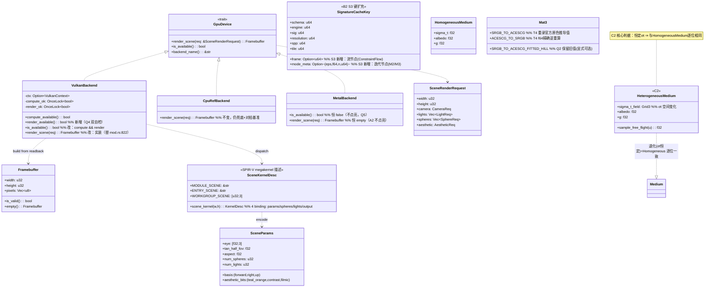

# V2.1 增量架构设计 — prism-engine（Rust 零依赖确定性程序化媒体引擎）

> 架构师：高见远（Bob）｜输入：`docs/v2.1-增量PRD.md`（产品经理许清楚 Alice，HEAD `a957475`，基线 3879/0）
> 基线纪律：`cargo xtest`（= `cargo test --workspace --release`）≥ 3879 passed / 0 failed / 0 ignored（PRD:5）；零第三方依赖；确定性（同输入同字节）；禁 TODO/占位符/`#[ignore]`（PRD G1–G6）。
> 主理人已裁定 5 问全部落定（见 PRD §5 + 文末 Q1–Q5 执行口径），本设计不再假设。
> 语言：简体中文。每条结论标注依据（文件:行号 或 测试名）。

---

## 0. 设计总览与判定依据（TL;DR）

| 流 | 缺口 | 设计结论 | 关键依据 |
|---|---|---|---|
| **A（重）** | #11 GPU | A1 把「光追 render」做成**单 kernel 计算管线**（SPIR-V megakernel + 复用 compute 九步闭环），与 `CpuRefBackend` 同构算法对拍；A2 同构 MSL + 编译门控不点亮；A3 仅出可行性结论 | `render_scene` 恒空帧 `vulkan/mod.rs:822`；背景 kernel `vulkan/background.rs`；发射器 `vulkan/spirv_bg.rs` |
| **B（轻）** | #9 + #8 | B1 把 R1（表示签名）/R3（Hausdorff 界）落成测试；B2 按 S3 表把 `frame`/(ε,n) 补进缓存键闭包 | S3 表 `能力对齐的数学分层.md:294-312`；`incremental.rs:521` `ReuseVerdict` |
| **C（轻）** | #10 + T4 | C1 长尾盘点（K1 三元组）；C2 仅异质体积；C3 T4 四件套（重录+登记+重渲+重录 golden） | T4 债务锁 `colorspace.rs:243-322`；`media.rs:1` 异质待扩展 |

**三流文件互斥**（A=crism-gpu，B=prism-core/prism-render/prism-io/prism-geometry，C=prism-math/prism-rt），仅 `CHANGELOG.md` 为三流共享（追加式、分节）→ **直接并行，无需 worktree**；CHANGELOG 串行收口（见 §6）。

---

## 1. 三流实现方案

### 1.1 流 A（重）：#11 GPU 渲染管线

#### A1（P0）Vulkan `render_scene` 光线追踪管线真实化

**核心判定**：`render_scene` 返回一个**逐像素独立**的算子（每个像素的射线只依赖该像素的 NDC 与全局场景数据，像素间无归约依赖）。因此它**可以且应当**走 compute 路径（与背景帧 `vulkan/background.rs:1-19` 同理由：无顶点/光栅语义、无显示器、零第三方 crate、与 CPU 逐字节可对拍），**不必引图形管线（render pass/swapchain）**。这把 §6 命题 P1「逐点算子支撑半径 r=0」从背景帧推广到光追帧。

**算法同构（与 `CpuRefBackend::render_scene` `lib.rs:418-508` 逐式对应，严禁代数重排）**：

```
每像素 (gx,gy) invocation:
  if gx >= w || gy >= h: return              // 尾组守卫（同 background.rs OpSelectionMerge）
  ndc_x = (2*((gx+0.5)/w) - 1) * tan_half * aspect
  ndc_y = (1 - 2*((gy+0.5)/h)) * tan_half
  dir   = normalize(forward + right*ndc_x + up*ndc_y)   // normalize = div by length; length 用 GLSL.std.450 Sqrt（IEEE 正确舍入）
  // 最近命中（与 lib.rs:448-463 同式：t = -b - sqrt(disc)，t>0 且 < closest_t）
  loop i in 0..num_spheres:
     oc = origin - sphere[i].center; b = dot(oc,dir); c = dot(oc,oc)-r*r
     disc = b*b - c; if disc>=0: t = -b - sqrt(disc); if t>0 and t<closest_t {closest_t=t; hit=i}
  color = (0.04,0.05,0.08)                   // 背景（lib.rs:466）
  if hit:                                    // 着色（lib.rs:467-480）
     p=origin+dir*closest_t; n=normalize(p-center)
     acc = Σ_light ambient + light.color*(max(dot(n,normalize(light.dir)),0)*light.intensity) * albedo
     color = acc
  // aesthetic（lib.rs:483-500，Reinhard filmic，**不经 ACES**）
  if teal_orange: ... ; if contrast!=1: ...; if filmic: color = color/(color+1)
  color = clamp01(color)
  out[gx + gy*w] = pack_rgba8(color)         // r|g<<8|b<<16|255<<24（同 background.rs 字节序）
```

**为何与 T4 零耦合（坐实 R2）**：`SceneRenderRequest` 的 aesthetic 口径 = Reinhard（`lib.rs:497-500`），着色与后处理**全程不消费 `SRGB_TO_ACESCG`/`ACESCG_TO_SRGB`**；`CpuRefBackend` 即基准。故 A1 的对拍基准不随 T4（`colorspace.rs:61-87`）移动。对拍测试显式声明「不经 ACES 链路」（PRD R2）。

**从既有资产派生（最小变更）**：
- **复用** `compute::dispatch_bytes` 九步闭环（`compute.rs:1-52`：shaderModule→descriptorLayout→pipelineLayout→computePipeline→buffer→descriptorPool→commandBuffer→fence→readback）。该闭环与 kernel 内容无关，只喂 `groups` 与 buffer。
- **复用** 自研 SPIR-V 发射器 `vulkan/spirv.rs` 的 `inst`/`id` 分配/段序/常数去重/NoContraction 装饰（`spirv_bg.rs:19-24`）。新增 `vulkan/spirv_rt.rs` 发射**光追 megakernel**——与 `spirv_bg.rs` 同级，区别仅在含动态循环（`OpLoopMerge`+`OpBranchConditional` 跨 `num_spheres` 读 storage buffer，非展开）。
- **复用** `verify_compute_path`（`vulkan/mod.rs:794-808`）模式：新增 `verify_render_path(ctx)` 跑一张极小真帧（如 4×4 单球）确认读回长度自洽，供 Q4 双自检。

**绑定布局（KernelDesc，4 binding，std430）**：
| b | 内容 | ElementType | 长度 | 访问 |
|---|---|---|---|---|
| 0 | Params：eye(3f32)+forward(3f32)+right(3f32)+up(3f32)+tan_half_fov(bits)+aspect(bits)+teal_orange(u32)+contrast(bits)+filmic(u32)+num_spheres(u32)+num_lights(u32) | U32/F32 混合打包 | 固定 16×u32 | ReadOnly |
| 1 | spheres：每球 {center.xyz, radius, albedo.xyz, pad} = 8×f32 | F32 | num_spheres×8 | ReadOnly |
| 2 | lights：每灯 {dir.xyz, color.xyz, intensity} = 7×f32 +pad = 8×f32 | F32 | num_lights×8 | ReadOnly |
| 3 | 输出 RGBA8 打包 u32 | U32 | w×h | WriteOnly |

> 相机基（`forward/right/up`/`tan_half_fov`）由 CPU 侧用 `prism_math::det_trig::tan` 一次算好（`lib.rs:436`，D-29 禁 GPU 内三角）后以 **f32 位型**传入（同 background 的 `t` 位型口径 `background.rs:112-123`），保证 GPU/CPU 同一浮点值、无第二套舍入口径。

**`VulkanBackend::render_scene` 新实现（替代 `vulkan/mod.rs:822` 恒空帧）**：
```
fn render_scene(&mut self, req) -> Framebuffer {
    let Some(ctx) = self.context() else { return Framebuffer::empty(); };  // 无设备 ⇒ 调用方回退 CPU（诚实，不假帧）
    if !fb_size_ok(req.width, req.height) { return Framebuffer::empty(); } // 复用 Framebuffer 尺寸契约（lib.rs:171-233）
    let kernel = scene_kernel(req.width, req.height);                       // 构造 KernelDesc（4 binding）
    let (params, spheres, lights) = encode_scene(req);                     // 打包三块输入缓冲（f32→LE bytes）
    let run = compute::dispatch_scene(ctx, &kernel, [req.width, req.height, 1], &params, &spheres, &lights);
    if run.status != Ok || run.output.len() != w*h*4 { return Framebuffer::empty(); }
    let mut fb = Framebuffer::new(w, h); fb.pixels = run.output; fb          // 已是 RGBA8 字节
}
```
> 需要在 `compute.rs` 新增 `dispatch_scene`（聚焦变体，仅扩 2-binding 为「多只读输入 + 1 写输出」），**不改动**既有 `dispatch_bytes`/background 路径（零回归）。

**可用性语义升级（Q4 裁定：双自检）**：
- 新增 `render_available(&self) -> bool`：`verify_render_path(ctx)` 真跑一张极小帧，`Some(ctx)` 且无设备则 `false`（不 panic）。
- `is_available()` 改为 `compute_available() && render_available()`（替代 `vulkan/mod.rs:843-845` 的 `compute_available()` 单自检）。
- 既有测试 `backend_availability_follows_verified_compute_path`（`vulkan/mod.rs:927`）**同步更新**为断言双自检：`is_available == compute_available && render_available`，且无设备时 `false`、有设备且双自检通过时 `true`。
- **勘误的勘误（QA-F6 订正）**：设计初稿曾称 PRD §5 Q4 引的 `availability_requires_verified_dispatch_not_just_a_device` 在本仓不存在——**该判断错误**。实测两个测试都存在：前者在 `crates/prism-gpu/tests/vulkan_compute_dispatch.rs:221`（V2.0 起即有），后者在 `src/vulkan/mod.rs`。PRD 引用无误；实施时**两个都同步升级为双自检断言**，不删除、不改名。

**对拍测试（两层判据，见 PRD A1 验收 1）**：
1. **GPU 自跑双次逐位一致（G3 硬判据）**：同 `req` 派发两次，`run.output` 字节逐位 `==`（lavapipe 确定性保证）。无设备则运行期自门控 skip（同 `real_device_compute_dispatch_smoke` 先例 `compute.rs:1269-1314`，**禁 `#[ignore]`**）。
2. **GPU vs CPU 统计对拍（Q1 裁定）**：`CpuRefBackend::render_scene(req)` 为基准；`max_channel_delta ≤ 16/255` 且 `differing_pixels ≤ 5%`（provisional 检测线，实测后收窄并 C15 登记，`render_scene` 用例显式声明「不经 ACES 链路」）。

**边界形态（A1 验收 4）**：沿用 background 三尺寸先例（`background.rs:253-264`：整除快路径 / 尾组守卫 / 极端或负参数）+ `u32::MAX×u32::MAX` 秒回 `Framebuffer::empty()` 不 panic（复用 `lib.rs:171-233` 尺寸契约 + `checked_pixel_len` 上界 `MAX_FRAMEBUFFER_BYTES` = 1 GiB `lib.rs:135`）。

#### A2（P1）Metal render 代码同构实现 + 编译门控（不点亮）

- 按 A1 的 kernel 结构**同构手写 MSL**：新增 `crates/prism-gpu/src/metal/msl/rt_scene.msl`（命名遵循 `metal/mod.rs:25-41` 双份源约定 `<wgsl去扩展>.scene_main.msl`，入口 `kernel void scene_main`；绑定映射 `@group(g)@binding(b)` → `[[buffer(g*31+b)]]`，`@builtin(global_invocation_id)` → `[[thread_position_in_grid]]`）。
- `metal/mod.rs` 的 `render_scene`（`metal/mod.rs:144-146`）**保持返回 `Framebuffer::empty()`**；`is_available`（`metal/mod.rs:151-153`）**恒 `false`**（不点亮）。模块文档加「未实机验证」字样（G4 三处分述之一）。
- 编译门控：Metal 模块全平台参与编译的现状保持（`metal/mod.rs:49-56`，`loader` 仅 macOS `#[cfg]`）；Linux `cargo xtest` 编译通过、`metal_stub_render_scene_returns_invalid_frame_without_panic`（`metal/mod.rs:266`）保持绿。
- 绝不产假帧、绝不在任何源码/文档/交付说明声称 Metal 可用（G4）。

#### A3（P2）WebGPU 渲染路径可行性评估结论（只出结论不实现）

- 产出 `docs/v2.1-WebGPU可行性评估.md`，结论明确（可行 / 条件可行 / 不可行）+ 量级 + 依赖 + §10.3 岔路建议（自研补完 vs wgpu）。
- 如实区分「已有绑定/测试链」（`web/device.rs` wasm/mobile 在用、scan/sort compute 内核）与「未建渲染路径」（`web/device.rs:169-172` 非 wasm 走 CPU 兜底；无 render kernel）——不得把绑定厚度表述为渲染能力（G4 同款纪律）。
- 共享边界分析：A1 的 SPIR-V megakernel 能否移植到 WGSL（与 MSL 同款「双份源手写」，不走发射器）；本评估为后续实装提供决策依据，V2.1 不做实现。

### 1.2 流 B（轻）：#9 资产判据 + #8 缓存签名闭包

#### B1（P0）#9 R1 同构保持判据 + R3 保真度界

- **R1（表示签名）**：在 `prism-io/src/usd.rs` 新增 `representation_signature(scene) -> [u8;32]`，复用 `prism-core/src/signature.rs` 内置 SHA-256 + **域分离标签** `b"PRISM/REPR/v1"`（与 #8 缓存签名同原语、不同标签，`能力对齐的数学分层.md:480` 合流点）。测试：`≥2` 组格式内等价源（同名引用 / 实例化 prim / 组合层级两种写法导入）→ 签名相等；`≥1` 组不等价源 → 签名不等。
- **R3（Hausdorff 界）**：在 `prism-geometry/src/mesh_sdf.rs` 形式化 `d_H(SDF⁻¹(0), mesh) ≤ h/2·(1+‖∇d‖)`（h=格距），并对可解析样例（球/平面）钉住：实测采样 Hausdorff ≤ 解析界；断言「分辨率提高界收紧」（h↓ ⇒ 界↓）。
- **R3 勘误（施工期实测，2026-02）**：① 实现侧 `BakedSdf::dist` 曾把 brick **局部**坐标 clamp 到 `BRICK−2`、权重 clamp 到 `[0,1]`，等价于把查询点吸附到最近格点（brick 无 apron，末格 `[7,8)` 退化）——h=0.05 的球面实测 `|dist| = 0.06929246 > √3/2·h = 0.0433013`，击穿 `h/2·(1+‖∇d‖) = h` 界；已改为**按全局格点坐标跨 brick 取 8 角点**（新增钉子 `brick_edge_cells_resolve_global_lattice_not_clamped_local`）。② 上述界是通用上界，本实现可推得更紧的 `√3/2·h`（8 角点凸组合 + 单元半对角，推导见 `hausdorff_upper_bound` 文档注释）。③ 修复后实测（球面 / 立方体表面采样，`max|dist|`）：h=0.1 → 3.1008e-3 / 2.39e-7，h=0.05 → 1.5489e-3 / 2.46e-7；h↓ ⇒ 实测↓，与 R3 结论一致。④ 实测仅覆盖 mesh→零集方向（表面采样点 |SDF| 上界）；零集→mesh 方向未做等值面提取，不作超配声明。
- **R2 不回归**：既有字节不动点钉子（`export_import_export_is_byte_fixed_point` 等 W4/W5 全量）保持全绿（PRD B1 验收 3）。

#### B2（P0）#8 缓存签名闭包收尾（S3 分类表）

- **依据**：S3 表 `能力对齐的数学分层.md:294-312` 已证四类闭包条件，但 `signature.rs`/`incremental.rs` 的**键扩充未逐行验**（`数学分层.md:263` 自述「条件可逐条钉死」）。
- **落全 S3 表**（≤150 行净增，PRD B2 验收 4）：
  - **无状态节点**：S1 已闭包（无需改，仅补测试）。
  - **流节点（ConstraintFlow）**：缓存键补 `frame`（S3 表行 2：`D-28 快照键 (sig,frame)`）；`signature.rs` 键计算注入 `frame`，`incremental.rs` `ReuseVerdict` 判定随之。
  - **迭代节点（M2/M3）**：缓存键补模式参数 `(ε,n)`（S3 表行 3；既有 `mode_metadata_changes_frame_signature_and_cache_key` 同款扩充）。
  - **音频反应（CH4）**：区间内复用、区间外拒绝（既有，补测试）。
  - **S4 逐出中性**：命中 vs 未命中两条路径输出逐位一致（`incremental.rs:521` `ReuseVerdict` 关卡）。
- 消费面零语义回归：`prism-app` `editor/preview.rs` 与 `prism-aesthetic` critic loop 既有测试全绿（PRD B2 验收 3 / R7）。

### 1.3 流 C（轻）：#10 渲染特性长尾 + T4 结清

#### C1（P0）#10 长尾盘点与收敛判据

- 产出 `docs/v2.1-渲染特性长尾盘点.md`：按 **K1 三元组**（核形式 K / 求逆策略 σ∈六策略 / 采样维度 d）逐项声明（`数学分层.md:348` 核层口径），对照 sss/media 两参考实例判完整性；含名录四项（光谱渲染 / SVGF-OIDN 去噪 / 自适应采样 / 异质体积）+ `grep`+源码勘定补漏项。
- 收敛判据成文且可机械判定：一项长尾算「还清」⟺ 三元组完整 + 实现对照参考实例结构同级 + 通过确定性/对拍框架验收（PRD C1 验收 3）。

#### C2（P1）#10 实施子集（仅异质体积，Q3 裁定）

- 在 `prism-rt/src/media.rs` 新增 `HeterogeneousMedium`（σt 空间变化，K=异质传输算子，σ=随机 Delta tracking 扩展，d={位置,方向}），经 `Medium::Heterogeneous` 接入既有 Delta tracking 框架（`media.rs:1` 自述「异质网格待后续扩展」）。
- **核心判据 = 退化一致性**（PRD C2 验收 1）：σt 恒定场下，异质实现与 `HomogeneousMedium`（`media.rs:74`）**逐位一致**（同输入同字节）。
- 无偏性断言：确定性格点采样 + 自由程分布/throughput 与 pdf 相消性质（沿用均匀档 `media.rs:9-25` 推导口径）。

#### C3（P0）T4 色彩债务结清四件套（Q2 裁定）

1. **按官方原色重录**（替换 `colorspace.rs:61-87`）：
   - `SRGB_TO_ACESCG` 按官方 AP1/sRGB 原色 + Bradford(D65→D60) 适配推导值重录（参照系 `colorspace.rs:250-254` 官方矩阵，差 <1e-6）。
   - `ACESCG_TO_SRGB` 由新矩阵经 **f64 精确求逆**重算（`colorspace_registry::invert3` 伴随矩阵法，先例 `ACES2065_TO_ACESCG` `colorspace.rs:113-117` + 测试 `aces2065_to_acescg_is_recomputed_inverse` `colorspace.rs:386-417`），**禁止照抄旧值**。
   - **Q2 裁定**：`SRGB_TO_ACESCG_FITTED_HILL`（`colorspace.rs:80`）**保留旧值为显式可选口径**；既有「别名与主常量逐位相同」断言（`colorspace.rs:69-80` 文档约定）更新为「`_FITTED_HILL` 旧值 + 主常量新值，二者不再逐位相同」，并在 C15 登记留名。
2. **C15 登记**：`CHANGELOG.md`《渲染行为变化清单》新增 `R-2026-xx-03`，四要素齐（受影响特性 / 变化原因 / 视觉影响 / 是否有开关）+ 受影响黄金值清单（PRD C3 验收 4；格式见 §7）。
3. **存量基线重渲**：凡经 ACES 路径的既有基线/示例产物（author golden 渲染、`qa_edge_attack_math*` 参考实现）重渲更新（PRD C3 验收 3）。
4. **黄金值重录**：全部受影响 golden 重录，每项在登记记录留名（测试名 + 旧值 + 新值 + 原因）。已知受影响：
   - `crates/prism-math/tests/c2_color_golden.rs:61` `ACES_FINGERPRINT` 27 词（`c2_color_golden.rs:13,49` 经 `srgb_to_acescg`/`acescg_to_srgb` 固化）；
   - `crates/prism-math/tests/qa_edge_attack_math_sample.rs` `aces_fitted_matches_reference_within_tolerance`（以 `colorspace.rs` 旧常量为参考，`aces.rs:62-69` 消费）；
   - `crates/prism-math/tests/qa_edge_attack_math.rs` 相关断言。
5. **债务锁翻转**（PRD C3 验收 3）：`legacy_srgb_acescg_matrices_debt_t4_is_named`（`colorspace.rs:243-322`）替换为**结清锁**——断言新口径偏差在声明的邻域/容差内（f32/f64 双口径 ≤ 1e-2，与 `registry_acescg_matches_official_aces_matrix` ~4.5e-7 分口径表述）；**不得静默删除旧测试**，commit 说明留痕。
6. **逆阵 recomputed-inverse 测试**存在且每次运行重算复核（先例 `aces2065_to_acescg_is_recomputed_inverse`）。
7. **G6 审计**：T4 commit 的 golden diff 逐条可对应登记记录；QA 审计不过即打回（PRD G6 / R1）。

---

## 2. 文件清单及相对路径

> 标注：**新** = 新增文件；**改** = 修改；**测** = 测试文件（含单元/集成）。

### 流 A（#11 GPU）
| 文件 | 操作 | 说明 |
|---|---|---|
| `crates/prism-gpu/src/vulkan/spirv_rt.rs` | **新** | 光追 megakernel SPIR-V 发射器（MODULE_SCENE/ENTRY_SCENE/WORKGROUP_SCENE + 4 binding 声明）；同级 `spirv_bg.rs` |
| `crates/prism-gpu/src/vulkan/mod.rs` | **改** | `render_scene` 实装（替 `:822` 恒空帧）；新增 `render_available`/`verify_render_path`；`is_available` 改双自检（替 `:843`）；更新 `backend_availability_follows_verified_compute_path`（`:927`） |
| `crates/prism-gpu/src/vulkan/compute.rs` | **改** | 新增 `dispatch_scene`（多只读输入 + 1 写输出变体）；不动既有 `dispatch_bytes` |
| `crates/prism-gpu/src/lib.rs` | **改** | `GpuDevice::render_scene` 文档注释更新（移除「光追未实装」口径，标注 Vulkan 已真跑）；`CpuRefBackend` 不变（仍兜底） |
| `crates/prism-gpu/src/metal/msl/rt_scene.msl` | **新** | Metal render 同构 MSL（双份源，不点亮） |
| `crates/prism-gpu/src/metal/mod.rs` | **改** | 模块文档加「未实机验证」；`render_scene`/`is_available` 保持空/false（`:144,:151`） |
| `crates/prism-gpu/tests/qa_render_scene.rs` | **测** | Vulkan render 实机出图 + 双跑逐位 + vs CPU 统计对拍（运行期自门控，禁 `#[ignore]`） |
| `docs/v2.1-WebGPU可行性评估.md` | **新** | A3 可行性评估结论 |

### 流 B（#9 + #8）
| 文件 | 操作 | 说明 |
|---|---|---|
| `crates/prism-io/src/usd.rs` | **改** | 新增 `representation_signature`（R1，复用 SHA-256 + 域分离标签） |
| `crates/prism-geometry/src/mesh_sdf.rs` | **改** | 新增 `hausdorff_upper_bound` + R3 解析样例测试；**修** `BakedSdf::dist` brick 边缘插值（局部 clamp 吸附 → 全局格点跨 brick 取角点，见 §B1 R3 勘误）+ 缺陷钉子测试 |
| `crates/prism-core/src/signature.rs` | **改** | S3 键扩充：`frame`（ConstraintFlow）/(ε,n)（迭代节点）注入缓存键；≤150 行 |
| `crates/prism-core/tests/qa_r1_representation_signature.rs` | **测** | R1 等价/不等价样本对签名测试 |
| `crates/prism-core/tests/qa_signature_s3_closure.rs` | **测** | S3 四类闭包 + S4 逐出中性测试 |
| `crates/prism-render/src/incremental.rs` | **改** | `ReuseVerdict` 判定随 S3 键变化；音频 CH4 区间测试扩充 |
| `crates/prism-render/tests/qa_incremental_s3.rs` | **测** | 流/迭代/音频/LRU 复用判定测试 |

### 流 C（#10 + T4）
| 文件 | 操作 | 说明 |
|---|---|---|
| `crates/prism-rt/src/media.rs` | **改** | 新增 `HeterogeneousMedium` + `Medium::Heterogeneous`（C2） |
| `crates/prism-rt/tests/qa_heterogeneous_volume.rs` | **测** | 退化一致性（恒定 σt 逐位 == 均匀）+ 无偏性（C2） |
| `docs/v2.1-渲染特性长尾盘点.md` | **新** | C1 K1 三元组盘点 + 收敛判据 |
| `crates/prism-math/src/colorspace.rs` | **改** | T4 重录 `SRGB_TO_ACESCG`/`ACESCG_TO_SRGB`；`_FITTED_HILL` 保留旧值；翻转债务锁为结清锁；新增 recomputed-inverse 测试（`:61-87,:243-322`） |
| `crates/prism-math/tests/c2_color_golden.rs` | **改** | `ACES_FINGERPRINT`（`:61`）重录新值（G6 登记） |
| `crates/prism-math/tests/qa_edge_attack_math.rs` | **改** | ACES 消费路径 golden 重录（G6 登记） |
| `crates/prism-math/tests/qa_edge_attack_math_sample.rs` | **改** | `aces_fitted` 参考实现重录（G6 登记） |
| `CHANGELOG.md` | **改** | 三流共享：C3 写 C15 `R-2026-xx-03`；A1 写能力扩容条目；分节追加（§6 串行收口） |

**总计**：新文件 5（A:2、B:0、C:3，含 2 文档）、改文件 13（A:4、B:4、C:5）、测文件 6（A:1、B:3、C:2）。

---

## 3. 数据结构与接口（关键变更）



**接口变更要点**：
- `VulkanBackend`：新增 `render_available`/`verify_render_path`；`is_available` 语义由「compute 自检」升为「compute+render 双自检」（Q4）。
- `SceneKernelDesc`（新类型/模块 `spirv_rt.rs`）：`scene_kernel(w,h)` 产出 4-binding `KernelDesc`，复用 `compute::dispatch_scene`。
- `SignatureCacheKey`（B2）：在既有五元组上增 `frame`/`mode_meta` 两个 `Option` 分量，闭合 S3 动态层。
- `HeterogeneousMedium`（C2）：实现 `Medium` trait，退化 σt 恒定时输出与 `HomogeneousMedium` 逐位一致（测试钉死）。
- `Mat3` 常量（C3）：主常量换值、`_FITTED_HILL` 保留旧值（Q2）。

---

## 4. 程序调用流程（render_scene 从请求到出帧）

```mermaid
sequenceDiagram
    participant Caller
    participant VB as VulkanBackend
    participant Ctx as VulkanContext
    participant Disp as compute::dispatch_scene
    participant Pipe as Vulkan 9-step (compute.rs:1-52)
    participant CPU as CpuRefBackend (对拍基准)

    Caller->>VB: render_scene(req)
    alt 无设备(ctx=None)
        VB-->>Caller: Framebuffer::empty()  %% 调用方回退 CPU（诚实，不假帧）
    else 有设备
        VB->>VB: 尺寸契约检查(lib.rs:171-233)
        VB->>VB: encode_scene(req) → (params,spheres,lights)
        VB->>Disp: dispatch_scene(ctx, scene_kernel, [w,h,1], inputs)
        Disp->>Pipe: shaderModule→descriptor→pipeline→cmd→fence→readback
        Pipe-->>Disp: ByteRunReport{output: w*h*4 bytes RGBA8}
        Disp-->>VB: output
        VB->>VB: Framebuffer::new(w,h); pixels=output
        VB-->>Caller: Framebuffer{is_valid()=true}
    end

    Note over VB,CPU: 对拍测试（qa_render_scene.rs，运行期自门控）
    VB->>VB: render 两次 → output_A, output_B
    VB->>VB: assert output_A == output_B (逐字节, G3 硬判据)
    Caller->>CPU: render_scene(req)  %% 同算法基准
    CPU-->>VB: cpu_fb
    VB->>VB: max_channel_delta ≤ 16/255 && differing_pixels ≤ 5% (Q1 统计线)

    Note over VB: is_available 双自检（Q4）
    Caller->>VB: is_available()
    VB->>VB: compute_available() && render_available()
    VB-->>Caller: bool
```

**CPU 参考后处理不消费 ACES**（坐实 R2）：`CpuRefBackend::render_scene`（`lib.rs:497-500`）filmic = Reinhard `color/(color+1)`，全程无 `SRGB_TO_ACESCG`/`ACESCG_TO_SRGB` 调用；故 A1 对拍基准不受 T4（`colorspace.rs:61-87`）位移影响。

---

## 5. 任务列表（有序、含依赖、按实现顺序）

> 估算文件数 = 第 2 节清单计数。验收标准引用 PRD G1–G6 / Q1–Q5 / R1–R7。
> 波次组织沿用《阶段一施工规划.md》§5（3–5 路并行、各管一摊、文件互不打架）。

| Task | 流 | 优先级 | 依赖 | 预估文件 | 验收标准（核心） |
|---|---|---|---|---|---|
| **T-A1** | A | P0 | A0 既有资产（compute 闭环/发射器/background，已就绪） | 4 改 + 1 测（spirv_rt 新 / mod 改 / compute 改 / lib 改 / qa_render_scene） | lavapipe 实机出 `is_valid()` 帧；GPU 双跑逐位一致（G3）；vs CPU `max_channel_delta≤16/255` & `differing_pixels≤5%`（Q1）；无设备自门控 skip、禁 `#[ignore]`；`u32::MAX` 秒回不 panic（A1 验收 1–4） |
| **T-A2** | A | P1 | T-A1（kernel 设计结论） | 2 改（metal/mod + rt_scene.msl 新） | Linux `cargo xtest` 编译通过；`is_available` 恒 false；`render_scene` 返 invalid；模块文档「未实机验证」；全仓无 Metal 可用声称（A2 验收 1–4 / G4 / Q5） |
| **T-A3** | A | P2 | T-A1（kernel 结构可移植性结论） | 1 新（webgpu-feasibility.md） | 评估文档落盘、结论明确、含量级/依赖/§10.3 建议；区分绑定厚度与渲染能力（A3 验收 1–2 / G4） |
| **T-B2** | B | P0 | 无（可先行） | 2 改 + 2 测（signature 改 / incremental 改 / qa_signature_s3 / qa_incremental_s3） | S3 表逐行测试：无状态/流(键含 frame)/迭代(键含 ε,n)/音频(区间)/S4 逐出中性；净增 ≤150 行；消费面(prism-app/preview, prism-aesthetic)零回归（B2 验收 1–5 / R7 / S3 表 `数学分层.md:294-312`） |
| **T-B1** | B | P0 | T-B2（共享 SHA-256 原语，可并行） | 2 改 + 2 测（usd 改 / mesh_sdf 改 / qa_r1 / 内嵌 R3 测试） | R1：≥2 等价源签名等 + ≥1 不等价签名不等；R3：球/平面 Hausdorff ≤ 解析界且分辨率↑界↓；R2 字节不动点钉子不回归（B1 验收 1–5 / `数学分层.md:480`） |
| **T-C1** | C | P0 | 无 | 1 新（longtail-inventory.md） | K1 三元组逐条声明 + 参考实例对照 + 收敛判据可机械判定（C1 验收 1–4） |
| **T-C2** | C | P1 | T-C1（盘点分级） | 1 改 + 1 测（media 改 / qa_heterogeneous） | 恒定 σt 与 `HomogeneousMedium` 逐位一致；无偏性(throughput/pdf 相消)断言；均匀档测试全绿（C2 验收 1–5 / Q3） |
| **T-C3** | C | P0 | Q2 裁定（已落定） | 3 改 + 3 测 + CHANGELOG（colorspace 改 / c2_color_golden 改 / qa_edge_attack* 改 / 3 测内嵌） | 重录官方推导值 + f64 逆重算；`_FITTED_HILL` 留旧值；债务锁翻结清锁；逆阵 recomputed 测试；C15 `R-2026-xx-03` 四要素+golden 清单；G6 逐条对应审计；全量 ≥3879（C3 验收 1–7 / Q2 / R1） |

**实现顺序（波次）**：
- **波次 1（并行起步）**：T-A1、T-B2、T-B1、T-C1、T-C3 —— 五路文件互不打架，齐头并进。
- **波次 2（依赖收口）**：T-A2、T-A3（依 T-A1 kernel 结论）、T-C2（依 T-C1 分级）。
- **收口**：CHANGELOG 串行合并（见 §6）→ 全仓 `cargo xtest` ≥3879/0/0 → QA 总账（PRD 验收总账）。

---

## 6. 文件冲突分析（三流并行重叠矩阵）

| 文件 | 流 A | 流 B | 流 C | 重叠？ |
|---|---|---|---|---|
| `crates/prism-gpu/**` | ✅ | — | — | 仅 A |
| `crates/prism-core/src/signature.rs` | — | ✅ | — | 仅 B |
| `crates/prism-render/src/incremental.rs` | — | ✅ | — | 仅 B |
| `crates/prism-io/src/usd.rs` | — | ✅ | — | 仅 B |
| `crates/prism-geometry/src/mesh_sdf.rs` | — | ✅ | — | 仅 B |
| `crates/prism-math/src/colorspace.rs` | — | — | ✅ | 仅 C |
| `crates/prism-rt/src/media.rs` | — | — | ✅ | 仅 C |
| `crates/prism-math/tests/c2_color_golden.rs` 等 | — | — | ✅ | 仅 C |
| `CHANGELOG.md` | ✅(能力扩容) | △(可选注) | ✅(C15) | **三流共享** |

**关键结论**：
1. **源码文件三流完全互斥**（A=prism-gpu / B=prism-core+prism-render+prism-io+prism-geometry / C=prism-math+prism-rt）——无任何 `.rs` 被两流同时触碰。
2. **T4 与流 A 对拍零交叉**（PRD R2 已勘定）：流 A 对拍基准 `CpuRefBackend` 用 Reinhard（`lib.rs:497-500`），**不消费** `colorspace.rs:61-87`；流 C 改的 `colorspace.rs`/golden 文件与流 A 的 `vulkan/*`/`qa_render_scene.rs` 无任何包含/依赖关系。**故「T4 的 colorspace.rs / 黄金值文件与流 A 的对拍测试文件」在文件层面本就不重叠**——用户提示中的潜在冲突经实证不成立，无需为它隔离。
3. **唯一共享文件 = `CHANGELOG.md`**：三流均可能追加条目（C3 写 C15 `R-2026-xx-03`；A1 写能力扩容条目；B 可选补注）。各条目进**不同分节/不同块**，追加式写入，git 合并极少冲突。

**并行策略建议（按用户规则「写代码改文件互不影响就直接并行，否则 worktree」）**：
- ✅ **直接并行**：A / B / C 三流的源码与测试（文件互斥），可分三个分支或三 agent 并发实现，互不打架。
- ⚠️ **CHANGELOG.md 串行收口**：由集成者在三流代码合入后**单一提交**完成（C3 的 C15 + A1 能力扩容 + B 可选注），避免三路同文件并行编辑的合并噪声。若坚持隔离，可把 CHANGELOG 编辑单独放一个 worktree 最后 rebase——但鉴于追加式分节，直接串行提交成本更低、风险更小。
- ❌ **无需为代码开 worktree**：源码零重叠，worktree 只增加同步成本，不带来收益。
- **回归门禁**：每波次结束跑全仓 `cargo xtest`（≥3879/0/0，PRD G1）+ `prism-core/tests/qa_ignore_guard.rs` 零命中（PRD G5）+ `Cargo.lock` diff 无新增（PRD G2）。

---

## 7. 共享知识（跨文件约定）

### 7.1 签名闭包的 S3 分类表（B2 落全口径）
| 动态类型 | 输出依赖 | sig 闭包？ | 缓存键必须含 | 依据 |
|---|---|---|---|---|
| 无状态节点 | (θ, u) | ✅ | — | S1 `数学分层.md:269-278` |
| 流节点（ConstraintFlow） | 帧历史 x(f−1) | ❌ | **frame** | S3 `数学分层.md:299`；D-28 快照键 `(sig,frame)` |
| 迭代节点（M2/M3） | (ε, n) 模式参数 | ❌ | **ε, n** | S3 `数学分层.md:300`；模式元数据进签名 |
| 音频反应（CH4） | 烘焙表区间 | ✅(区间内) | 区间 | `incremental.rs` CH4 |
| LRU 逐出 | — | 中性（S4） | — | `数学分层.md:307-309` |

> 域分离标签纪律：资产表示签名标签 `b"PRISM/REPR/v1"`；缓存键哈希复用 `signature.rs` 内置 SHA-256；**两用途同原语、不同标签**，禁止混用（`数学分层.md:480`）。

### 7.2 C15 登记格式（CHANGELOG.md《渲染行为变化清单》）
```
### R-2026-xx-03：T4 结清 SRGB↔ACEScg 矩阵（按官方 AP1 原色推导重录 + f64 精确逆重算）
- 受影响特性：prism-math `colorspace::{SRGB_TO_ACESCG, ACESCG_TO_SRGB}` 及一切经
  `TransformChain`/`aces_fitted` 的 ACES 消费路径（postfx ColorManage 等）。
- 变化原因：旧轨为 Hill 拟合口径（债务锁 `legacy_srgb_acescg_matrices_debt_t4_is_named`），
  现按官方 AP1/sRGB 原色 + Bradford(D65→D60) 推导重录；逆阵由新矩阵 f64 求逆重算。
- 视觉影响描述：输出字节变化（凡经 ACES 色调映射/互转的结果改变）；`_FITTED_HILL` 保留
  旧值作显式可选口径，既有调用点不静默改变。
- 是否有开关：无（属单向门决策，旧版本可并存重渲，C10 逃生门）。
验收：colorspace.rs 结清锁 + recomputed-inverse 测试；受影响黄金值清单如下（G6 逐条对应）：
  | 测试名 | 旧值(指纹/样本) | 新值 | 原因 |
  |---|---|---|---|
  | c2_color_golden::ACES_FINGERPRINT | <27 词旧> | <27 词新> | SRGB_TO_ACESCG 重录 |
  | qa_edge_attack_math_sample::aces_fitted_matches_reference | <旧参考> | <新参考> | aces_fitted 输入阵换值 |
  | qa_edge_attack_math::* | <旧断言> | <新断言> | 同上 |
```

### 7.3 黄金值重录流程（T4 / C3）
1. 先重录 `colorspace.rs` 主常量 + `_FITTED_HILL` 保留旧值（Q2）。
2. 翻债务锁为结清锁 + 加 recomputed-inverse 测试，跑通（本仓 `cargo test -p prism-math`）。
3. **独立 commit**（R1 对策①）：T4 的 golden diff 单独成集。
4. 跑受影响 golden 测试，记录每个失败处的旧值 → 改新值 → 在 C15 表格逐条登记（测试名+旧+新+原因）。
5. 存量基线（author golden 渲染等）重渲（机械重跑渲染目标）。
6. QA 审计：golden diff 每处必须能在 C15 表格按「测试名+旧值+新值+原因」找到对应条目，否则打回（G6 / R1 对策③）。

---

## 8. 依赖包列表

**零新增第三方依赖（满足 PRD G2 / 零依赖纪律）。**

| 包 | 状态 | 论证 |
|---|---|---|
| 全部第三方 crate | **无新增** | A1 复用既有自研 SPIR-V 发射器（`spirv.rs`）+ 手写 FFI（`loader.rs`）；`Cargo.lock` 仅 4 行（PRD G2，已核查）。无 `ash`/`vulkano`/`metal`/`wgpu`/`objc` 等。 |
| 数学/哈希 | 复用既有 | SHA-256 用 `prism-core/src/signature.rs` 内置实现；`invert3` 用 `colorspace_registry`；`det_trig`/`det_ln` 用 `prism-math` 既有确定性件（D-29）。 |

> 例外论证：无。若 A1 实装中发现必须引某 crate，须先回主理人裁定并破「零依赖纪律」，本设计不预期此情形。

---

## 9. 待明确事项

**原记 1 处勘误，已由 QA-F6 撤回**（属误判，两个测试名都真实存在）：

1. ~~Q4 测试名勘误~~：`availability_requires_verified_dispatch_not_just_a_device`
   （`tests/vulkan_compute_dispatch.rs:221`）与
   `backend_availability_follows_verified_compute_path`（`src/vulkan/mod.rs`）
   **均存在**，本版两条都已升级为 compute ∧ render 双自检断言。PRD 引用无误。

> 其余 5 个待确认问题（Q1–Q5）主理人已裁定，全部按裁定执行（见文首 + PRD §5），无悬空决策。

---

## 附：主理人裁决执行口径（Q1–Q5 落点速查）

| 裁定 | 本设计落点 |
|---|---|
| **Q1** | 硬判据 = GPU 自跑双次逐位一致（G3）；跨后端统计线 `max_channel_delta ≤ 16/255`、`differing_pixels ≤ 5%`（provisional，实测后收窄 + C15 登记） |
| **Q2** | T4 主常量同名换值；`_FITTED_HILL` 保留旧值为显式可选；别名「逐位相同」断言更新并登记 |
| **Q3** | #10 仅实施异质体积；其余列 P2 留名（C1 盘点） |
| **Q4** | `is_available` 升为 compute+render 双自检（trait 语义本即「能否 service render_scene」）；既有测试同步更新（按真实名 `backend_availability_follows_verified_compute_path`） |
| **Q5** | Metal 交付显式留名「未点亮/未实机验证」；QA 文案审查专检「就绪≠可用」 |

---

## 10. 实施偏差登记（QA-F5 / F7 补录，交付后核定）

设计 §2 的「文件清单」是**预测**，实施中的真实改动以下表为准（与 QA V2.1 轮报告 §F5 一致，共 12 处偏离；R3 勘误与 R1 测试路径偏移已在前文单列）：

| 类型 | 文件 | 说明 |
|---|---|---|
| 未登记·新增 | `crates/prism-gpu/src/vulkan/scene.rs`、`crates/prism-gpu/src/metal/render.rs`、`crates/prism-gpu/src/metal/msl/mod.rs` | 光追 dispatch 编排（kernel 描述与执行分离）、Metal 设备无关层（全平台可编译，MSL 仍门控） |
| 未登记·改 | `crates/prism-gpu/src/vulkan/spirv.rs`、`crates/prism-gpu/src/shaders.rs`、`crates/prism-gpu/src/web/mod.rs` | 发射器白名单/结构校验扩展（含 2 处 OpCode 错值勘误：170/167 → 176/168）、MSL 宿主表登记、胶水计数注释订正 |
| 未登记·改（测试） | `crates/prism-gpu/tests/qa_verify_p1_framebuffer_guard.rs`、`crates/prism-gpu/tests/vulkan_compute_dispatch.rs` | Q4 双自检同步（PRD 要求，设计清单漏列） |
| 未登记·改（math/core/render） | `crates/prism-math/src/aces.rs`、`crates/prism-math/src/colorspace_registry.rs`、`crates/prism-core/src/lib.rs`、`crates/prism-render/src/lib.rs` | C15 登记表已列条目，但设计文件清单未列 |
| 登记未改 | `crates/prism-math/tests/qa_edge_attack_math_sample.rs` | 设计预测需改；实际以常量为参考自动跟随，无需改动（预测失准） |
| 有说明的偏离（合规） | `prism-core/tests/qa_r1_…` → `prism-io/tests/qa_r1_…` | 分层纪律禁止 core 依赖 io，测试文件头有「设计偏差说明」 |
| 交付后补录（QA-F2） | `crates/prism-rt/src/media.rs`、`crates/prism-rt/src/integrator.rs`、`crates/prism-rt/src/wavefront.rs` | 新增 `enum Medium`（Homogeneous / Heterogeneous）并接入场景介质盒；均匀路径采样流消耗逐字节不变 |

**T4「删除即翻转」留痕（QA-F7）**：被删除的测试为
`colorspace_registry::tests::srgb_to_acescg_fitted_hill_alias_is_bit_identical_to_the_legacy_name`
（别名同值语义随 T4 结清失效），由
`srgb_to_acescg_fitted_hill_preserved_and_diverged_from_recut_main` 接替；
原债务锁 `colorspace::tests::legacy_srgb_acescg_matrices_debt_t4_is_named`
更名为 `..._settled_t4_is_named`。完整「旧 → 新」黄金值对照见 CHANGELOG
R-2026-xx-03 表格，本条为 commit 说明的等价留痕（后续提交正文一并载明）。
