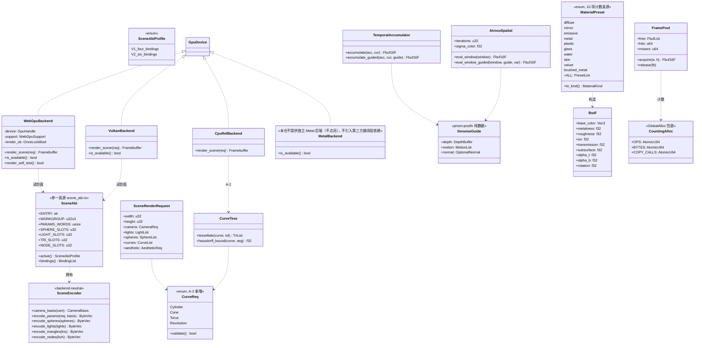
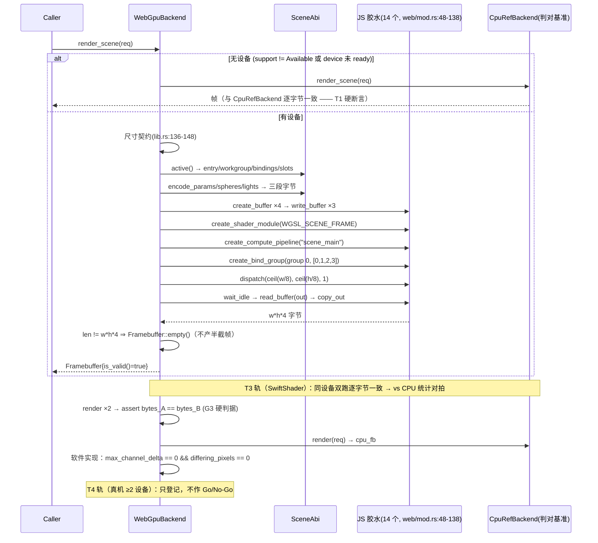
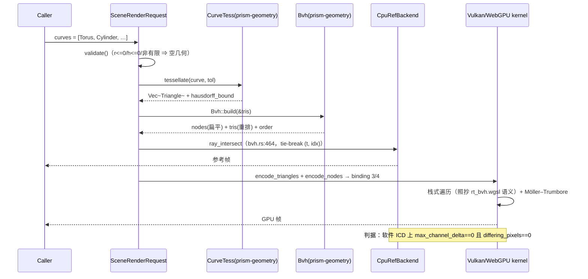
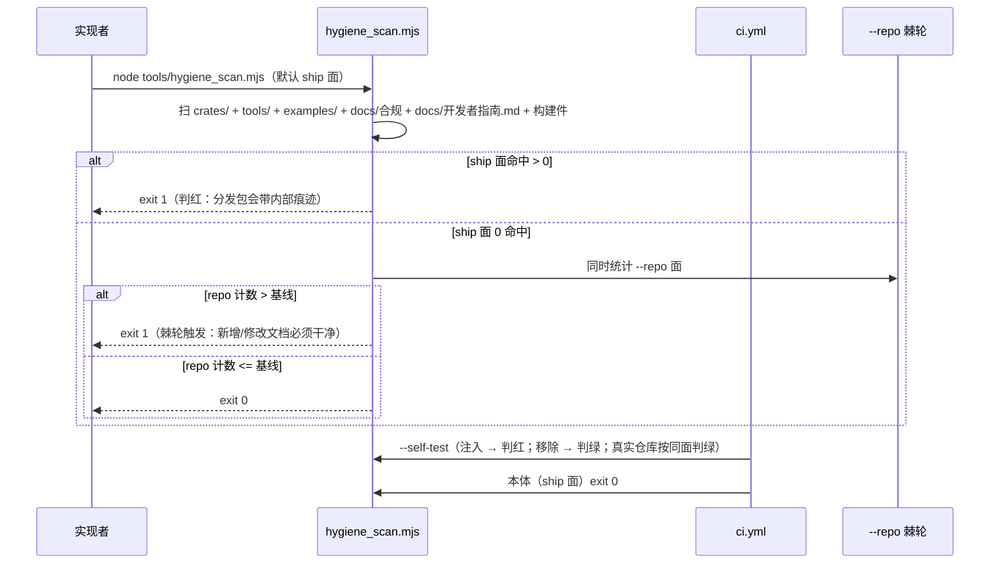

# V2.2 增量架构设计 — prism-engine（Rust 零依赖确定性程序化媒体引擎）

> 架构师：高见远（Bob）｜输入：`docs/v2.2-增量PRD.md`（产品经理许清楚 Alice）
> 上游技术底稿：`docs/v2.1-WebGPU可行性评估.md`（A-1 唯一立项依据）、`docs/v2.1-渲染特性长尾盘点.md` §5
> 结构模板：`docs/v2.1-增量设计.md`（同构：§0–§9 + 附）
> 基线：**`cargo xtest` 实测 3929 passed / 0 failed / 0 ignored / 179 测试段**（本设计开工时实跑，见 §0.2 F-1）
> 纪律：零第三方依赖（`Cargo.lock` 29 包全仓内 path，无 `build.rs`、无原生链接）；确定性（同输入同字节）；禁 TODO/占位符/`#[ignore]`
> 语言：简体中文。**每条结论均给 `文件:行号`；PRD 引用与实测有偏差处逐条标注（不静默沿用）**

---

## 0. 设计总览与判定依据（TL;DR）

### 0.1 四流结论一览

| 流 | 项 | 缺口本体（实测） | 设计结论 | 关键依据 |
|---|---|---|---|---|
| **A（重）** | V2.2-A-1 | `render_scene` **恒**走 CPU 兜底（唯一路径，非降级） | 建 **1 个场景 ABI 真源**（`scene_abi`）+ 手写第 4 份源 `scene_frame.wgsl` + 真实 dispatch 接线 + 1 个 ABI 测试项；验证拆 **四轨**（T1 cargo / T2 node 静态 / T3 SwiftShader 真 dispatch / T4 真机） | `web/device.rs:169-173`；`web/mod.rs:48-138`；`shaders.rs:26-54`（16 份无 `scene_frame`）；`abi.rs:845`+（16 项无渲染项） |
| A | V2.2-A-2 | GPU 侧**零曲线覆盖**，且 README 所称「既有 SAH-BVH GPU 路径」**不存在** | 取 **方案乙（三角化桥接）**；但须在 megakernel 上新增「三角形槽位 + 扁平 BVH 遍历」——**真实 1–2 波次，非 1–2**（PRD 估算基于不存在的资产） | `grep Cylinder\|Cone\|Torus\|Revolution` 于 `prism-gpu/` **0 命中**；`compute/mod.rs:288-318` 仅 3 kernel 全球体；`abi.rs:2446` census 记 `rt_bvh.wgsl` **零入口** |
| A | V2.2-A-3 | `is_available()` 恒 false；本仓不提供独立 Metal 后端（不点亮），不引入任何第三方翻译层依赖 | 锚定**参数化**（WGSL + SPIR-V 两目标，由 `scene_abi` 派生期望值，缺项必红）+ **零依赖声明** + 文案对齐；**不点亮** | `metal/mod.rs:189-191`；`shaders.rs:646`/`:1056`/`:1108` |
| **B（轻）** | V2.2-B-2 | 三件套在档，缺 **G-buffer 重投影**与**方差引导** | 新增 `DenoiseGuide`（纯数据）+ **闭式相机 motion**（不用光流）+ 方差进 à-trous 权重；两阶段链端到端 | `denoise.rs:34/120-130/171`；`accumulate(acc,cur)` 无 guide 参数（`:130`）；`depth.rs:38` 已有深度 AOV |
| B | V2.2-B-3 | `MaterialKind` 4 变体；DSL 仅 3 字段；`anisotrop` 零命中 | 新增 `MaterialPreset`（10 项，可渲染口径）+ GGX 各向异性 + 白炉能量守恒常驻 | `integrator.rs:446`；`ast.rs:44-51`；`codegen.rs:1750-1794`（`P1002` 未知字段白名单）；`bsdf.rs:308-323` |
| B | V2.2-B-1 | 全程 RGB，无 λ 轴 | 切片：λ 轴 + 自研 CMF 分段有理 + 退化一致性（单波长 ≡ RGB）+ 棱镜 golden；**排 B-3 之后** | PRD Q3；`prism-rt` 无 `spectral` 模块（grep 零命中） |
| **C（轻）** | V2.2-C-1 | 解码层**已实装**，README **低报**；真实样本从未进仓 | 只做「取证 + 边界矩阵成文 + 9 语言口径订正」，**不补实现**；新增「边界表 ↔ 代码锚点」对照表 | `raw.rs:3279-3300`（1/7/8/32946 分派）；`raw_lossless_jpeg.rs` 2001 行；`find *.dng` **0 命中** |
| C | V2.2-C-2 | 探测链真读平台，无 extern、无 link | VAAPI 侧 `dlopen/dlsym` + `extern "C"`，**不建会话**；**禁止 `#[link]`**（破 G2） | `prism-ffi-hwenc/src/lib.rs:1-30`；`metal/loader.rs:33` 的 `#[link(name="dl")]` 是**反例**（仅 macOS cfg 内） |
| C | V2.2-C-3 | 实测 445 处（自指增长，392→422→445） | **非目标（作者明示：卫生不重要，移出本期）**：分面/清零/棘轮均不排期；门禁保留但非本版依赖 | `hygiene_scan.mjs`；`ci.yml:149,152` |
| **D（轻）** | V2.2-D-2 | 帧池/分配计数/零拷贝**全无生产实现** | 计数器（`GlobalAlloc` 包装，仅测试二进制安装）+ 帧池（中性可判）+ **指针身份**判据 + RSS 报表（非门禁） | `grep FramePool\|GlobalAlloc\|alloc_count` 于 `crates/` **0 命中**；先例 `denoise.rs:130` 与 S4 中性测试 |
| D | V2.2-D-3 | 三条包体指标无脚本；首帧无度量 | 3 条包体脚本 + 阈值 + 首帧报表（趋势）；wasm 面**被 A-1 阻塞** | `dist/prism-engine-v2.1-source.txt` = 18,939,405 B；`prism_gpu.wasm` 实测 **344,674 B**（`ci_wasm_verify.mjs:25` 注释「~158KB」**已漂移**） |

### 0.2 六条"必须先说的实测发现"（改变 PRD 前提，逐条给证据）

| # | 发现 | 证据 | 对设计的影响 |
|---|---|---|---|
| **F-1** | **测试基线是 3929，不是 3928**。PRD G1 的「≥3928 下限」比实测**低 1 条**——按字面执行等于允许静默删测 1 条 | 本设计开工时 `cargo test --workspace --release` 汇总：`segments=179 passed=3929 failed=0 ignored=0`；`README.md:24` 徽章 3929 与实测吻合，`docs/QA/qa-round-v2.1-2026-10-26.md:43` 的 3927 与 `:356` 的 3928 是**历史时点值** | **G1 下限订正为 3929**（§9-Q2）。R-7 的三个数并存已实证解消：3927（QA 轮）→ 3928（F1 结清 +1）→ **3929（F2 结清 +1，README 已记但无文档留痕）** |
| **F-2** | **卫生扫描实测 445 处（不是 392）**，且数字是**自指增长**的：392（PRD 声称）→ **422**（写完 PRD 后，PRD 自身 30 处）→ **445**（写完本设计后，本设计自身 23 处）。三次测量精确闭合 | `node tools/hygiene_scan.mjs`；本设计的分类计数脚本：`.rs` **54** / `.md` **391**（445 = 422 + 本设计 23）；`docs/v2.2-增量PRD.md` 单文件 30 处 | **扫描面含 `docs/`，故"写文档"本身就在新增命中**——这是自指效应，**每一份新文档都会让它涨**；该任务已按作者决策**移出本期（§1.5 非目标），不再排期，门禁保留但非本版依赖** |
| **F-3** | **"既有 SAH-BVH GPU 路径"不存在**：GPU 侧无任何 BVH dispatch，`rt_bvh.wgsl` 是**零入口库件** | `compute/mod.rs:288-318` 注册表仅 `primary_ray_gen` / `wavefront_intersect` / `spirv_probe` 三者，全部只吃球；`abi.rs:2446` 的 dispatch census 明确记 `("rt_bvh.wgsl", &[])` | A-2 方案乙**不是"接线"，是"新建"**：PRD 的 1 波次不成立（§1.2、§9-Q3） |
| **F-4** | **方案甲在现行纪律下无合法实现**（不只是"数值风险"）：CPU 四次方程的预解三次在 `Δ ≤ 0` 分支走 **`acos`/`cos`**，而 GPU 侧发射器只允许 `Sqrt/FMax/FClamp/Floor` 四个 GLSL 指令（D-29 禁超越函数） | `quartic.rs:9-17`（"`Δ <= 0` 走三角法，`acos` 经 `det_atan2`、`cos` 经 `det_cos`"）、`quartic.rs:19`；`spirv_rt.rs:156/158/160/162`（`GLSL_SQRT=31`/`FMAX=40`/`FCLAMP=43`/`FLOOR=8`，**无 acos/cos/cbrt**） | **甲被纪律否决**（不是被风险否决）→ 直接支撑选乙（§1.2） |
| **F-5** | **`prism-rt → prism-gpu` 已存在**，故曲线/三角形的权威**不能**经 `prism-gpu → prism-rt` 复用（环） | `prism-rt/Cargo.toml:15`（`prism-gpu = { path = "../prism-gpu" }`）；`prism-geometry/Cargo.toml` 仅依赖 `prism-math`+`prism-noise`（**叶子**） | 权威落 **`prism-geometry`**；`prism-gpu` 新增 `prism-geometry` path 依赖（零外部 crate，lock 包数不变）（§9-Q5） |
| **F-6** | **卫生门禁当前是红的**（`real.length === 0` 断言未满足） | `ci.yml:149`（`--self-test`）、`:152`（本体）；`hygiene_scan.mjs:207-210` | **C-3 已移出本期**：门禁保留但**非本版 Go/No-Go 必要条件**，归日常维护，不阻塞 V2.2 交付 |
| **F-7** | **沙箱内可跑真 WebGPU dispatch（SwiftShader）**，且已有一套成熟链路 | `wgsl_lib_compile.mjs:762-766`（`--enable-unsafe-webgpu --use-vulkan=swiftshader`）；本设计实跑 `node wgsl_lib_compile.mjs` **全绿**（6 份库件 0 error + dispatch + 自证注入全抓到）；`realgpu_check.mjs:1-30` 明确支持 SwiftShader 适配器并驱动真 ABI | **A-1 的"浏览器验证不在 CI 内"可以被拆细**：T3 轨（SwiftShader）可在沙箱内出**真断言**，把 R-3「结构自检绿 ≠ 语义正确」的缺口从"无法判定"降到"软件实现上可判定"（§1.1.4） |

### 0.3 一句话设计立场

**V2.2 的设计难点不是"加四个能力"，而是"让每个新能力都落在一个可被判据逃逸不掉的锚点上"。** 因此本设计的核心资产是 **三个单一真源**（场景 ABI、材质预设计数、测试基线）——卫生扫描分面已随 C-3 移出本期不再是本版资产，其余都是围绕它们的填肉。

---

## 1. 四流实现方案

### 1.1 流 A · V2.2-A-1（P0）WebGPU 渲染路径

#### 1.1.1 决策：先建"场景 ABI 真源"，再写第 4 份源

现状是**多处手写源**并存的场景 ABI，而 PRD 只要求"两端一致"。把它们钉在一处，A-1/A-2 才不会互相踩（A-3 定为"本仓不提供独立 Metal 后端、不引入任何第三方翻译层依赖"，`metal/` 退为历史资产，详见 §1.3）：

| 现存 ABI | 参数块形式 | 位置 |
|---|---|---|
| Vulkan（发射器） | 22 × u32（浮点走位型，shader 内 `OpBitcast`） | `spirv_rt.rs:130-134`（`PARAMS_WORDS=22`/`SPHERE_SLOTS=8`/`LIGHT_SLOTS=8`） |
| WebGPU（WGSL） | 同 Vulkan 扁平 `array<f32>`（A-1 新建 `scene_frame.wgsl`） | `web/device.rs` 现有 scan/histogram 两 kernel 布局可复用 |
| Metal（本仓不提供独立后端） | **不登记宿主目标**：`metal/` 退为历史资产 | 历史锚定 `metal/render.rs:35-46`（`PARAMS_BYTES=112`，可择期清理） |

**新增 `crates/prism-gpu/src/scene_abi.rs`（单一真源，零 GPU 依赖纯数据）**：

```
SceneAbi {
    entry:        "scene_main"                // 两目标同名（WGSL + SPIR-V；Metal 不登记宿主目标）
    workgroup:    [8, 8, 1]                   // 两目标同值
    profile:      SceneAbiProfile::V1 | V2    // 绑定集版本
    bindings:     [Params, Spheres, Lights, (Triangles, Nodes)?, Output]
    params_words: 22, sphere_slots: 8, light_slots: 8, tri_slots: 12, node_slots: 12
    encode:       camera_basis / encode_params / encode_spheres / encode_lights  // 从 spirv_rt 迁来
}
```

**为什么要迁编码器**：`vulkan/scene.rs:31` 在 `#[cfg(not(target_arch="wasm32"))]` 下才 import `camera_basis/encode_*`。A-1 的 wasm 侧需要**同一份**编码字节（否则 CPU/GPU 出现第二套舍入口径——`feasibility §4` 明确「参数以位型传入，无十进制往返」是必须照搬的方法学）。迁到 `scene_abi` 后：
- `spirv_rt` 用 `pub use` 重导出，**既有路径与单测零改动**（零回归）；
- `web/device.rs` 直接调 `scene_abi::encode_*`（wasm 可用）；
- `metal/render.rs` 的 112 B 编码器**退化为历史锚定**——本仓不提供独立 Metal 后端（不点亮），`metal/` 不登记为宿主目标、可择期清理（§1.3）。A-3 的锚定**只承诺 WGSL 与 SPIR-V 两目标的入口/工作组/绑定号三项**（PRD A-3 验收 3 原文即此三项），**不承诺参数块同形**。

#### 1.1.2 `shaders/scene_frame.wgsl`（第 4 份手写源）

- 入口 `scene_main`，`@workgroup_size(8, 8, 1)`，绑定连续前缀 `{0,1,2,3}` = params/spheres/lights/out（满足 `web/mod.rs:100-114` 的「绑定必须从 0 起连续」硬约束）。
- 参数走 `bitcast<f32>(u32slot)`；**不写 `fma()`**；无 `sin/cos/exp/pow/log`（D-29）。
- 语义**逐句对应** `lib.rs:421-511`（`CpuRefBackend::render_scene`）：尾组守卫 → 相机基 → 球循环（`t = -b - sqrt(disc)`）→ 背景 `(0.04,0.05,0.08)` → 灯循环 → teal/contrast/filmic → `floor(x*255+0.5)` 量化 → `r|g<<8|b<<16|255<<24`。
- 不移植 SPIR-V 发射器（同 MSL 定案：WGSL 文本→文本无稳定规范，`feasibility §2.1`）。

#### 1.1.3 `web/device.rs`：真实路径 + 双自检（不改 14 个胶水函数）

```
fn render_scene(req):
    if !self.is_gpu_ready()      → cpu_fallback.render_scene(req)      // 保持"永有输出"
    if !fb_size_ok(w,h)          → Framebuffer::empty()                // 复用 lib.rs:136-148 上限
    let abi = scene_abi::active();
    let (params, spheres, lights) = abi.encode(req);
    用既有 9 个资源创建/执行胶水：create_buffer×4 → write×3 →
        create_shader_module(WGSL_SCENE_FRAME) → create_compute_pipeline("scene_main") →
        create_bind_group(group 0, [0,1,2,3]) → dispatch(ceil(w/8), ceil(h/8), 1) →
        wait_idle → read_buffer(out) → copy_out
    读回长度 != w*h*4  → Framebuffer::empty()（不产半截帧）
    否则                → Framebuffer{ pixels }
```

`is_available()` = **compute 自检 ∧ 渲染自检**（与 Vulkan 同语义，`lib.rs:384-392`）：渲染自检 = 用 `scene::self_test_request()`（`vulkan/scene.rs:166-195`，4×4 单球单灯）真跑一次并断言 `len == 64` 且非全零。**不新增第 15 个胶水函数**：adapter 名由 harness 页 JS 侧（`web/index.html`）从 `GPUAdapterInfo` 读并写进报告，ABI 契约保持 14 个不动（`ci_wasm_verify.mjs:29-35` 的 imports 断言因此无需改动）。

#### 1.1.4 ⭐ A-1 的**四轨验证结构**（本设计对 PRD 的核心增补）

| 轨 | 在哪跑 | 能钉死什么 | 进不进门禁 | 对应 PRD |
|---|---|---|---|---|
| **T1 `cargo test`**（native） | CI（`ci.yml:158` native job） | ① 源结构：`scene_frame.wgsl` 过 `shaders.rs` 结构自检（入口/括号/禁 libm/无未解析符号）② **槽位 ABI 钉偏移**（native 单测断言 `array<f32>` 索引约定 ≡ `SPHERE_SLOTS/LIGHT_SLOTS` 逐槽对齐）③ **绑定数与顺序一致性**（从 `scene_abi` 派生，非字面量）④ native 桩返回 `NotWasmTarget`、测试项 `Skip` ⑤ **无设备时 CPU 兜底与 `CpuRefBackend` 逐字节一致（硬断言）** | ✅ 进门禁 | 验收 1/2/3(后半)/5 |
| **T2 node 静态门禁** | CI（`ci.yml:275` wasm job + `:369` wasm-verify + `:546` lint job） | ① `ci_wgsl_smoke.mjs` 全 shader 基础解析 ② `wgsl_lint.mjs` 规则 A（uniform 16 B 对齐 + 宿主字节数）③ 规则 E（bind group 偏移）④ 规则 B（import 非 async）⑤ 规则 F18（无入口库件已登记真编译链）⑥ `ci_wasm_verify.mjs` 导出/导入符号 ⑦ `host_test.mjs` 的 ABI 往返（14 个桩返回 0 ⇒ GPU 项 Skip） | ✅ 进门禁 | 验收 1/5 |
| **T3 SwiftShader 真 dispatch** | **沙箱内**（`realgpu_check.mjs` 起 Xvfb + Chromium + SwiftShader，驱动真 `index.html` + `prism_gpu.wasm` + 14 个胶水） | ① `createShaderModule` **真编译** ② `createComputePipeline` **真建起来** ③ `dispatchWorkgroups` **真跑** ④ 读回 `len == w*h*4` ⑤ 同设备双跑**逐字节一致**（G3）⑥ vs CPU 统计对拍（软件实现上预期 0 差异） | ⚠️ **交付前必跑，不挂 CI workflow**（playwright 非仓内依赖，CI 无保证） | 验收 3（前半）+ 验收 4 的真证据 |
| **T4 真机 Chrome/Edge ≥2 设备** | 人工 | adapter 名、尺寸、`max_channel_delta`、双跑一致性 | ❌ **永不进门禁**，只登记 | §3.0.1「已交付待验」 |

> **诚实口径（G4）**：T3 通过**不等于** WebGPU 可用。SwiftShader 是**软件 WebGPU 实现**，不是用户设备；README 边界行措辞**不因 T3 通过而改写**。T3 的价值是把 R-3 的「结构自检绿 ≠ 语义正确」压缩成「语义在软件实现上已判对，剩余风险仅是驱动浮点差异」——这句话本身要写进 QA 报告，不许写成"WebGPU 已支持"。

#### 1.1.5 槽位 ABI「钉偏移」怎么做才不是空话

`metal/render.rs` 的先例是"编码器 + 单测钉 `OFF_*` 常量"，但那只钉住**同一份代码自洽**。A-1 需要的是**跨源断言**（Rust ↔ WGSL 文本）：

在 `qa_scene_frame_abi.rs` 里用**极小的 WGSL 词法扫描**（不引解析器）断言：

1. `scene_frame.wgsl` 里出现的 `params[i]` / `spheres[j]` 索引上界 ≡ `scene_abi::PARAMS_WORDS` / `SPHERE_SLOTS × n`；
2. WGSL 的 `@binding(k) var<storage,…>` 声明集合 ≡ `scene_abi::active().bindings` 的 `(binding, access)` 列表（**顺序与访问属性都比**）；
3. 入口名与 `@workgroup_size` 字面量 ≡ `scene_abi::ENTRY/WORKGROUP`。

**这三条是"缺项必红"的**：删掉 WGSL 的一个绑定、改工作组、改入口名，T1 立刻红（这正是 PRD A-3 验收 3「WGSL 侧缺项时测试必须红」的同一手法，A-1 先建好，A-3 复用）。

### 1.2 流 A · V2.2-A-2（P1）曲线图元 GPU 覆盖

#### 1.2.1 甲/乙裁决：**选乙**，理由是"甲无合法实现"而非"甲风险高"

| 判据 | 方案甲（解析求交 kernel） | 方案乙（三角化桥接） |
|---|---|---|
| 算法权威 | CPU 侧 `torus_t` 用 `solve_quartic`（Ferrari，**预解三次在 `Δ≤0` 走 `acos`/`cos`**，`quartic.rs:9-17`） | CPU 侧已 SAH-BVH + Möller–Trumbore（`bvh.rs:464`），GPU 侧 `rt_bvh.wgsl:1-25` 已是**同式文本**（可逐句移植） |
| **D-29 合规** | ❌ **不成立**：GPU 发射器只有 `Sqrt/FMax/FClamp/Floor`（`spirv_rt.rs:156-162`）；复现该分支需要 `acos`+`cos`+`cbrt`，三者皆超越函数。改用"纯代数 Cardano"仍需 `cbrt`；改用牛顿迭代被**明文禁止**（`quartic.rs:4-6`"禁止牛顿迭代"） | ✅ 只用 `+ − × ÷ sqrt floor` |
| 数值风险（f32 重根） | **高且不可判定**：`t²(t−1)²` 型近重根（射线切触圆环内缘）处，Ferrari 的两个二次因子的根会"分裂成两对近重根"，f32 下根的相对误差 ∝ `ε^(1/4)`（四次根的病态是所有多项式求根里最差的档）。更致命的是**两侧病态不同步**：CPU 走三角法、GPU 只能走另一条代数路，**同一场景两侧会在不同像素上"各自失败"**，`max_channel_delta == 0` 的硬断言（`tests/qa_render_scene.rs:388-390`）基本不可能达成 | **无病态**：三角形求交是线性/二次运算，误差 O(ε)；保真度误差被**三角化分辨率**控制，且**可声明上界** |
| 判据可判性 | 只能靠放宽阈值（但软件 ICD 档被 PRD 钉死为 0 差异） | 软件 ICD 档 0 差异**可达**（与球路径同性质） |
| 真实工作量 | 2 波次（且很可能推翻重来） | **1–2 波次**（见下） |

**裁决：方案乙。** 并**明确否证 PRD 的成本假设**：

> PRD Q5 称乙「1 波次可收」，其隐含前提是「既有 SAH-BVH GPU 路径」存在。**该前提不成立**（F-3）。乙的真实工作 = 三角化器（新）+ BVH 扁平化编码（新）+ **megakernel 内新增"节点数组遍历"段**（SPIR-V 发射器新段）+ WGSL/MSL 两份源同步 + CPU 参考同步。真实 **1–2 波次**。

#### 1.2.2 乙的落地结构

```
CPU 侧（权威，落 prism-geometry —— 叶子 crate，无环）
  curve_tess::tessellate(&CurveReq, tol) -> Vec<Triangle>
      圆柱：侧壁 2×seg 四边形 + 上下盖扇形     （seg = ceil(2π·r / tol)）
      圆锥：侧壁 seg 三角形 + 底盖扇形
      圆环：主环 seg_u × 管 seg_v 四边形
      旋转曲面：轮廓段数 × seg 四边形（水平段特化为环带 → 仍需三角化，保退化一致）
  Bvh::build(&tris) -> 既有 SAH-BVH（bvh.rs:286）
  Bvh 扁平化：nodes[i] = {bmin.xyz, pad, bmax.xyz, pad, start, count, right_child, pad}（12 f32）

CPU 参考（判对基准）
  CpuRefBackend::render_scene：curves 非空 ⇒ 三角化 → Bvh → ray_intersect（bvh.rs:464）

GPU（两处真实宿主同步，槽位与球同款扁平 array<f32>）
  Vulkan：spirv_rt 新增「栈式 BVH 遍历」段（照抄 rt_bvh.wgsl 语义 + bvh.rs:464 的 tie-break）
  WebGPU：scene_frame.wgsl 同步（A-1 的源，扩 2 绑定）
  Metal ：本仓不提供独立后端（不点亮），不写独立 MSL 源、不登记宿主目标
```

**绑定向后兼容**：`scene_abi` 的 `SceneAbiProfile` 由 `V1`（4 绑定）升 `V2`（6 绑定：`0 params / 1 spheres / 2 lights / 3 triangles / 4 nodes / 5 out`）。**输出恒为最后一个绑定**——这样"连续前缀"约束不被破坏，且 A-1 的 T1 断言（绑定集 ≡ 真源）自动跟随，只需 A-2 一个 commit 同时改真源 + 三份源 + 测试。

**保真度界（验收 4 要求，不得"看起来一样"）**：三角化误差上界声明为
`d_H(S(曲线), mesh) ≤ r_max · (1 − cos(π/seg))`（seg = 一周切分段数，r_max = 该图元最大半径），即**弦高**。测试对球面特例（圆环 minor=r 退化为球）实测 Hausdorff ≤ 该界，并断言 `seg↑ ⇒ 界↓`（与 V2.1 R3 的 `hausdorff_upper_bound` 同一方法学）。

**退化形态（验收 3）**：`r=0 / h=0 / profile 单点 / 空集合 / 非有限` 一律→ 空三角形集（不 panic）；沿用既有 `u32::MAX×u32::MAX` 五组 `catch_unwind` 守卫。

**失败退路（明确写死，不许无限调参）**：若 megakernel 遍历段的软件 ICD 0 差异 **3 个迭代内达不到**，降级为：**只交付三角化器 + CPU 参考 + 保真度界 + WGSL 侧（T3 轨可跑的 WebGPU 路径）**，Vulkan megakernel 曲线支持整项「留名」（G9 允许 P2 未启动即留名；A-2 是 P1，需 PM 记一次变更）。**不允许**为了让判据变绿而放宽 `differing_pixels`（那是改判据，不是修实现）。

### 1.3 流 A · V2.2-A-3（P2）Metal 不点亮：零依赖声明（不提供独立后端）

**定性（作者纠错后统一口径）**：**本仓不提供独立 Metal 后端（不点亮），不引入任何第三方翻译层依赖**。把第三方原生库写进本仓架构路径即构成依赖声明——即便代码里既无 `#[link]`、也无 `dlopen`，故按 G2（外部依赖 0）必须清除。`metal/` 模块（1,484 行 MSL）退为**历史资产**：不登记为宿主目标、可择期清理。原"三目标 MSL 锚定收口"任务因此消解。

V2.2 只做三件，**不新增任何对外能力声称、不写任何 MSL 同步代码、不引入任何第三方依赖**：

1. **两目标锚定**：`check_targets()`（`shaders.rs:646`）对 `scene_main` 的期望值从 `scene_abi` 派生，目标集为 `hosts_of("scene_main") == [Wgsl, Spirv]`，**缺项必红**（负自证：漏 `Wgsl` 须红、把 `Msl` 加回须红；A-1 落地前该断言须红，先红后绿留痕）。
2. **文案四分述**：`metal/render.rs:1-30` 四分述表与 `README.md:321` 逐字对齐，统一明确「**不提供独立 Metal 后端**」，而非「翻译层就绪」。
3. **`is_available()` 恒 false 钉子保持**（`metal/mod.rs:189-191` + 测试）。

**原"探测链登记"取消**：探测第三方 ICD 本身就是依赖声明。

### 1.4 流 B

#### B-2（P1）SVGF 第二阶段

**现状坐实**：`TemporalAccumulator::accumulate(&self, acc, cur)`（`denoise.rs:130`）**没有引导参数**——即递推均值只在"像素不动"的前提下正确；à-trous 权重只用色差（`denoise.rs:77` `atrous_pass(src, step, sigma2)`），**无方差项**。

**设计（三件，均在 `prism-postfx`，不碰 `prism-rt` 生产代码）**：

```
新增 denoise/guide.rs（纯数据，零依赖）
  DenoiseGuide {
      depth:   &[f32],          // 逐像素深度（来自 prism_rt::depth::render_depth，depth.rs:38）
      motion:  &[[f32;2]],      // 逐像素屏幕位移（闭式，见下）
      normal:  Option<&[[f32;3]]>, // None ⇒ 由 depth 有限差分重建（默认路径）
  }
  closed_form_motion(prev_cam, cur_cam, depth, w, h) -> Vec<[f32;2]>
      // p_world = unproject(cur); p_prev = project(prev, p_world) − pixel；
      // 全程 det_trig / 矩阵乘，零超越函数；不引光流、不引第三方
改 denoise.rs
  TemporalAccumulator::accumulate_guided(acc, cur, guide) -> Fbuf16F
      // 采样数随重投影有效性衰减：invalid ⇒ 退化为 curr（n=0 重启），不引入 NaN
  VarEstimate { mean, m2 }（Welford，定点表达式，逐像素）
  atrous_pass_variance_guided(src, step, guide, var)  // w = 1/(1 + d²/σ² + |var−var_c|/σv²)
```

**判据落点**：
1. 第一阶段零回归：`denoise.rs:269/294/346/390/436` 五个既有 checkpoint 测试全绿；
2. **静态重投影逐字节等价**：静态相机 + 静态场景 ⇒ `accumulate_guided` 与 `accumulate` **逐字节相同**（用 `==`，不用 PSNR）——这是"重投影没写错"的唯一机械证明；
3. 动态（**定义见 §9-Q6：= 相机运动**，引擎无逐物体变换，`integrator.rs:520-554` 全部世界空间）接缝无 NaN/Inf；vs 高 spp 参考 PSNR ≥ 40 dB；同等画质 sample 数降 ≥ 50%；
4. 零超越函数：模块内 `grep exp|log|powf|sin|cos` 零命中（D-29）。

#### B-3（P1）材质库

**计数口径落地**（Q4 待作者拍板，设计给可执行默认）：新增 `crates/prism-rt/src/material.rs` 的 `MaterialPreset`（**用户可见、可渲染、DSL 可声明**的那一层，共 10 项）：

`diffuse / mirror / emissive / metal / plastic / glass / water / skin(sss) / velvet(sheen) / brushed_metal(anisotropic)`

- 计数真源 = `MaterialPreset::ALL.len()`，测试断言 `>= 10` 且**每一项都能构造出可渲染的 `MaterialKind`**（防"枚举 10 个、能渲染 6 个"）；
- 内部口径（`MaterialKind` 变体数）**同时上报**，不混用。

**各向异性**：`Bsdf`（`bsdf.rs:308-323`）新增 `alpha_t/alpha_b/rotation`（默认 `alpha_t == alpha_b` ⇒ **走原各向同性分支**，位级不变）；GGX anisotropic + 能量补偿用**闭式近似**（禁迭代）。**退化判据**：`α_t == α_b` 时输出与既有 GGX **逐位相同**（不是"容差内"）——做法是**显式分支**而非"同一公式自然退化"（后者无法保证位级相同）。

**白炉（furnace）常驻**：对每个预设断言半球积分反射率 ∈ `[1−ε, 1+ε]`，**ε 默认 1e-2、实测后收窄到 1e-3**（与 Q4 建议一致），并含**反向自证**：故意破坏归一化因子 ⇒ 测试必红。

**DSL 兼容**：`material` 块新增 `anisotropy` / `anisotropy_rotation`（`codegen.rs:1750-1794` 的 `P1002` 白名单同步），行列号诊断沿用 `err_at`；老场景（3 字段）输出**逐位不变**（新增字段缺省时必须走原分支）。

#### B-1（P2）光谱切片

- 新增 `crates/prism-rt/src/spectral.rs`：`Wavelength(f32)` + `hero wavelength`（1 spp 1 λ，分层 + 确定性 seed）+ `RgbToSpectrum`（**自研 CMF 分段有理拟合**，零 crate、零超越函数）。
- **排在 B-3 之后**（PRD Q3 已定：先材质后波长，避免同时动求值面 → R-2 的 golden 交叉）。
- 判据：① 单波长 + 恒定谱反射率 ⇒ 与 RGB 路径**逐字节相等**（做不到则须给 ≤1 LSB 界 + 实测分布，不许口头等价）② 同 seed 双跑逐位一致 ③ 棱镜 golden 红/蓝通道**质心分离 > 声明阈值**（可机械判定）④ 超声明波次即整项降级为「设计定稿 + 留名」（G9 + R-6）。

### 1.5 流 C

#### C-1（P1）DNG 取证与口径订正

**定位**：缺口**不是"写解码器"**（已实装，`raw.rs:3279-3300` + `raw_lossless_jpeg.rs` 2001 行 + `raw_lossless_jpeg_encode.rs` 488 行），而是三件：

1. **边界矩阵成文**：新增 `docs/v2.2-边界锚点表.md`，把 `README.md:318-325` **8 行 × 9 语言**逐行映射到「代码证据（`文件:行号`）」或「结构化拒绝点」。DNG 行的证据链：
   `Compression 1` → `raw.rs:3280`；`7` → `raw.rs:3282`（+ strip/tile 支持 `raw.rs:3410-3413`）；`8|32946` → `raw.rs:3286`（Adler-32 校验）；**拒绝面** → `SamplesPerPixel != 1`（`raw.rs:3441-3448`）、`DRI != 0`、`Ns != 1`、`Compression = 6`（`raw.rs:2474` `compression_reject_hint`）。
2. **9 语言口径订正**：`README.md` + `docs/README.{de,en,es,fr,ja,ko,pt-BR,ru}.md` 的 DNG 行改为「已支持 Compression 1/7/8（含 strip×tile + RowInterleave）；真实机型兼容性未经样本验证」——**既不低报**（旧措辞"未实现"是错的）**也不高报**（样本未验）。
3. **合成矩阵正向钉子**（验收 4）：`prism-io` 新增 `tests/qa_dng_support_matrix.rs`，跑 `strip × tile × Compression{1,7,8}` 全交叉端到端（`raw_dng_synth` 既有入口 `diagnose_dng_bytes`，`raw_dng_synth.rs:1517`），禁 `#[ignore]`。
4. **真实样本 = 可选待验档**：沙箱 `find *.dng` **0 命中**。样本由作者提供则追加第 5 件（golden 摘要或结构化错误 + 成因 + 转存建议）；**不提供也完整交付**（合成 DNG 交叉矩阵已自证）。

#### C-2（P2）硬件编码绑定层

- 只做 VAAPI 一侧：`extern "C"` 声明 `vaInitialize/vaCreateConfig/…`（仅声明，不调用建会话）+ 手写 `dlopen("libva.so.2")`/`dlsym` 解析 + 失败结构化 `Unsupported`（带路径/errno 证据）。
- **⭐ 零原生链接的硬约束（G2）**：`metal/loader.rs:33` 的 `#[link(name="dl")]` 是**反例**——它只在 `cfg(target_os="macos")` 内，Linux 构建不触发。**C-2 在 Linux 上不得使用 `#[link]`**，改用**裸 `extern "C"`**（`dlopen/dlsym` 由 glibc 提供；Ubuntu 22.04+ 的 glibc ≥ 2.35 已把符号并入 libc）。若目标平台 glibc < 2.34 导致链接失败 ⇒ **结构化降级为 `Unsupported` 并登记**，不得加 `#[link]`（§9-Q7）。
- 四档分述（探测链 → 绑定就绪 → 会话建立 → 真机出码）在模块文档与 README **分开写**；当前只能声称到第二档。`cargo check -p prism-ffi-hwenc --features vaapi` 进验收；`Cargo.lock` 不变。

#### C-3（非目标）卫生扫描存量清零 —— 移出本期

> **作者决策（2026-10-29）：卫生不重要，C-3 移出 V2.2 本期。**
>
> 实测 445 处（`.rs` 54 / `.md` 391），且为自指增长（写文档本身即新增命中：392→422→445）。全仓清零在数学上不可达——须动 `docs/QA/*.md` 署名与轮次编号（审计证据），等于伪造审计记录。
>
> 故本期**不做**清零 / 分面 / 棘轮；`tools/hygiene_scan.mjs` 现有门禁**保留但非本版 Go/No-Go 依赖**。如需后续清理，作为日常维护单独排期，不与功能版耦合。
>
> 该决策不影响对外能力承诺与确定性契约（G1–G9 其余判据不变）。
### 1.6 流 D

#### D-2（P1）内存/带宽剖析与帧池

**设计（三件，全部可自动验）**：

```
新 prism-render/src/measure/alloc.rs
  pub struct CountingAlloc<A: GlobalAlloc>            // 零 crate
  pub static OPS/ BYTES / COPY_CALLS / COPY_BYTES: AtomicU64
  安装方式：**只在专用测试二进制**里 `#[global_allocator]`（prism-render/tests/qa_d2_mem.rs）
  → 生产二进制零开销、零行为变更；计数确定性靠"单进程单测试"保证
新 prism-render/src/frame_pool.rs
  FramePool { free: Vec<Fbuf16F>, hits: u64, misses: u64 }
  acquire(w,h) -> Fbuf16F（复用则 hits+=1，否则新分配 misses+=1）；release(fb)
  中性判据：复用路径 vs 全新分配路径输出**逐字节一致**（先例 S4）
零拷贝身份判据（不靠"看起来没拷"）
  ZeroCopyPath { name, check: fn() -> bool }，白名单只有**登记过的**路径；
  测试对每条断言 `as_ptr()` 相等；未登记路径 claim 零拷贝 ⇒ 测试红
```

- **"计数器强 / RSS 弱"如何落成判据**：强判据 = **同场景两次运行，`OPS/BYTES/COPY_CALLS/POOL_HITS` 完全相等**（`assert_eq!`，不打印）；弱判据 = 峰值 RSS 只出报表（读 `/proc/self/statm` 或 `VmHWM`，**仅 Linux，不进门禁**）。
- 帧池接入点：`prism-render/src/tile.rs` 的中间缓冲 + `prism-gpu` 的 `Framebuffer` 复用入口（**新增方法，不改结构体**——避免与 A-1/A-2 的 `lib.rs` 改动重叠）。

#### D-3（P2）包体与启动度量

- 三条指标脚本 `tools/measure_size.mjs`（零依赖 node，读文件大小）：① `dist/prism-engine-v2.2-source.txt` ② `crates/prism-gpu/web/prism_gpu.wasm` ③ native release 二进制（`target/release/<bin>`）。
- **基线必须写实测值**：`prism_gpu.wasm` 实测 **344,674 B**，而 `ci_wasm_verify.mjs:25` 注释写「~158KB」——**注释已漂移**，本项第一件事是订正它并把基线写成实测值（否则阈值建在假数字上）。
- 首帧时间：在 `realgpu_check.mjs`（T3 轨）里加计时段，**只做趋势报表，不作 Go/No-Go**（SwiftShader 时间不具代表性；真机时间无设备）。
- **被 A-1 阻塞**：wasm 面体积变化必须在 A-1 合入后重测并记录（这是 PRD 唯一明确的跨流阻塞边）。

---

## 2. 文件清单及相对路径

> 标注：**新** = 新增；**改** = 修改；**测** = 测试文件。行数为预估。

### 流 A
| 文件 | 操作 | 说明 |
|---|---|---|
| `crates/prism-gpu/src/scene_abi.rs` | **新** | 场景 ABI 单一真源：入口/工作组/绑定剖面/槽位/编码器（从 `spirv_rt` 迁入并 `pub use` 回） |
| `crates/prism-gpu/shaders/scene_frame.wgsl` | **新** | 第 4 份手写源，入口 `scene_main`，8×8，绑定 `{0,1,2,3}` |
| `crates/prism-gpu/src/web/device.rs` | **改** | `render_scene` 真路径 + `is_available` 双自检 + 渲染自检（替换 `:169-173`） |
| `crates/prism-gpu/src/web/abi.rs` | **改** | 新增第 17 个测试项 `gpu.scene_frame`（`TESTS` `:845`），native `Skip` |
| `crates/prism-gpu/src/vulkan/spirv_rt.rs` | **改** | 编码器迁出 + 重导出；A-2 再扩遍历段 |
| `crates/prism-gpu/src/shaders.rs` | **改** | `SHADERS`（`:26`）登记 `scene_frame.wgsl`；两目标锚定参数化（WGSL + SPIR-V） |
| `crates/prism-gpu/src/lib.rs` | **改** | `GpuDevice`/`WebGpuBackend` 语义注释；A-2 的 `SceneRenderRequest` 扩字段 |
| `crates/prism-gpu/src/metal/render.rs` | **改** | A-3：同构对拍面随 A-2 参数扩展；锚定断言改从 `scene_abi` 派生 |
| `crates/prism-gpu/src/metal/msl/rt_scene.scene_main.msl` | **改** | A-2/A-3：与 WGSL 同步（不点亮，仅为可锚定） |
| `crates/prism-gpu/src/metal/mod.rs` | **改** | A-3：文案四分述对齐（`is_available` 恒 false 不动） |
| `crates/prism-geometry/src/curve_tess.rs` | **新** | A-2：四类曲线三角化 + 弦高界 |
| `crates/prism-geometry/src/lib.rs` | **改** | A-2：导出 `curve_tess` |
| `crates/prism-gpu/Cargo.toml` | **改** | A-2：新增 `prism-geometry` path 依赖（零外部 crate） |
| `crates/prism-gpu/tests/qa_scene_frame_abi.rs` | **测** | 槽位钉偏移 / 绑定集 ≡ 真源 / native 兜底逐字节 |
| `crates/prism-gpu/tests/qa_curve_parity.rs` | **测** | A-2：出图 + 软件 ICD 0 差异 + 双跑 + 退化形态 |
| `crates/prism-geometry/tests/qa_curve_tessellation.rs` | **测** | A-2：Hausdorff ≤ 弦高界 + `seg↑ ⇒ 界↓` |

### 流 B
| 文件 | 操作 | 说明 |
|---|---|---|
| `crates/prism-postfx/src/denoise/guide.rs` | **新** | `DenoiseGuide` + 闭式相机 motion + 深度重建法线 |
| `crates/prism-postfx/src/denoise.rs` | **改** | `accumulate_guided` + Welford 方差 + 方差引导权重（既有三件套不动） |
| `crates/prism-postfx/src/lib.rs` | **改** | 导出 guide 模块 |
| `crates/prism-postfx/tests/qa_svgf_stage2.rs` | **测** | 静态重投影逐字节等价 + 动态 PSNR≥40dB + 零超越函数扫描 |
| `crates/prism-rt/src/material.rs` | **新** | `MaterialPreset` 10 项（计数真源） |
| `crates/prism-rt/src/bsdf.rs` | **改** | GGX anisotropic + 能量补偿（`α_t==α_b` 走原分支，位级不变） |
| `crates/prism-rt/src/integrator.rs` | **改** | `MaterialKind` 扩 + `surface_brdf/pdf` 分支 |
| `crates/prism-dsl/src/ast.rs` | **改** | `MaterialV2Ast` 增 `anisotropy*`（`MaterialAst` 老路径不动） |
| `crates/prism-dsl/src/codegen.rs` | **改** | `build_material` 白名单 + `P1002` 提示串同步（`:1750-1794`） |
| `crates/prism-rt/tests/qa_material_furnace.rs` | **测** | 白炉 + 反向自证 + 计数 ≥10 + 各向同性退化逐位 |
| `crates/prism-rt/src/spectral.rs` | **新** | B-1：λ 轴 + hero wavelength + CMF 分段有理 |
| `crates/prism-rt/src/{sampler,integrator,lib}.rs` | **改** | B-1：采样维度加 λ 轴（`d ⊇ {波长}`）+ 导出；与 T05 串行（同文件，先材质后波长） |
| `crates/prism-rt/tests/qa_spectral_degeneracy.rs` | **测** | 单波长 ≡ RGB 逐字节 + 双跑 + 棱镜质心分离 |

### 流 C
| 文件 | 操作 | 说明 |
|---|---|---|
| `tools/hygiene_scan.mjs` | **改** | 分面 `--ship`（默认）/`--repo`（棘轮）+ 自证期望面 + 覆盖度下界 |
| `crates/{prism-render,prism-gpu,prism-math,prism-core,prism-audio,prism-physics}/**/*.rs` | **改** | C-3：54 处注释改写（**仅注释**，按 3 切片） |
| `docs/v2.2-边界锚点表.md` | **新** | C-1/G8：8 行 × 9 语言 ↔ 代码锚点/结构化拒绝点 |
| `README.md` + `docs/README.{de,en,es,fr,ja,ko,pt-BR,ru}.md` | **改** | C-1 口径订正 + C-3 卫生段 + 徽章 3929（**单点串行，见 §6.3**） |
| `crates/prism-io/tests/qa_dng_support_matrix.rs` | **测** | strip×tile×Compression{1,7,8} 全交叉 |
| `crates/prism-ffi-hwenc/src/vaapi.rs` | **新** | C-2：`extern "C"` + `dlopen/dlsym`（**无 `#[link]`**） |
| `crates/prism-ffi-hwenc/src/lib.rs` | **改** | C-2：四档分述 + 绑定就绪状态机 |
| `crates/prism-ffi-hwenc/src/env_probe.rs` | **改** | C-2：`/dev/dri` 证据串接到绑定层 |
| `crates/prism-ffi-hwenc/tests/qa_vaapi_binding.rs` | **测** | 沙箱无 `/dev/dri` ⇒ `Unsupported` + 证据非空 + 不 panic |

### 流 D
| 文件 | 操作 | 说明 |
|---|---|---|
| `crates/prism-render/src/measure/alloc.rs` | **新** | `CountingAlloc` + 计数器（仅测试二进制安装） |
| `crates/prism-render/src/measure/copy.rs` | **新** | 计数拷贝 + `ZeroCopyPath` 白名单 |
| `crates/prism-render/src/frame_pool.rs` | **新** | `FramePool` + hits/misses |
| `crates/prism-render/src/lib.rs` / `tile.rs` | **改** | 导出 + 中间缓冲走池 |
| `crates/prism-render/tests/qa_d2_mem.rs` | **测** | 计数两次相等 + 池中性逐字节 + 身份断言 |
| `tools/measure_size.mjs` | **新** | 三条包体指标 + 阈值（零依赖） |
| `crates/prism-gpu/web/ci_wasm_verify.mjs` | **改** | 体积基线改实测值 + 注释漂移订正（`:25`） |
| `crates/prism-gpu/web/realgpu_check.mjs` | **改** | 首帧计时段（非门禁） |
| `.github/workflows/ci.yml` | **改** | 新增 `size` job（包体门禁）+ hygiene job 改双面 |

**总计**：新 12（含 2 文档 + 1 node 工具 + 1 检测工具）、改 29（其中 C-3 的 54 处注释跨 6 crate、README×9 计入 1 类）、测 9。

---

## 3. 数据结构与接口（关键变更）



**接口变更要点**
1. `SceneAbi` / `SceneEncoder`（新）：**唯一权威**。三/四个宿主（SPIR-V 发射器、WGSL、MSL、WebGPU 胶水）都从这里取入口名、工作组、绑定集、槽位数；测试断言"各源的文本声明 ≡ 真源"，缺项必红。
2. `WebGpuBackend::is_available`（新）：`compute 自检 ∧ 渲染自检`，与 `lib.rs:384-392` 的 trait 语义对齐；**`false` 双向蕴含"不出有效帧"**（验收 4 的蕴含断言）。
3. `SceneRenderRequest::curves`（A-2）：**缺省空 ⇒ 与 V2.1 输出逐位相同**（这是 A-2 不回归的机械保证，也是 A-3 可继续锚定的前提）。
4. `DenoiseGuide`（B-2）：纯数据、可选法线（默认由深度重建）——**不把 `prism-rt` 拉进 `prism-postfx` 的生产依赖**（现状 `prism-rt` 只是 dev-dependency）。
5. `MaterialPreset`（B-3）：计数真源；`Bsdf` 三个新字段**默认退化**。
6. `FramePool` + `CountingAlloc`（D-2）：**只在测试二进制安装** `#[global_allocator]`，生产零改动。

---

## 4. 程序调用流程

### 4.1 A-1：`render_scene` 到出帧（WebGPU，四轨判定点）



### 4.2 A-2：曲线图元（CPU 权威 → GPU 同旨）



### 4.3（C-3 已移出本期）原分面判据与棘轮 —— 本节作废，留作历史参考

> **作者决策：卫生不重要，C-3 移出 V2.2 本期。** 本节描述的 ship/`--repo` 分面与棘轮方案本期**不执行**；`hygiene_scan.mjs` 门禁保留但非本版依赖。



---

## 5. 任务列表（有序、含依赖、按实现顺序）

> **分组**：11 个任务（T01 已移出，T02–T12）按 **5 个工作包**（WP）组织——包内可并行、包间有依赖。每个任务 ≥3 个文件、可直接派工。
> **G1 口径**：全部任务共用 `cargo xtest ≥ 3929 passed / 0 failed / 0 ignored / 179 段`（F-1 订正，见 §9-Q2）。

### WP-0 清道（W0）

| Task | 项 | 优先级 | 依赖 | 文件数 | 验收标准 | 并行性 |
|---|---|---|---|---|---|---|
| **T01** | V2.2-C-3 卫生清零 | **非目标（移出本期）** | — | — | 作者明示卫生不重要，C-3 移出 V2.2；门禁保留但非本版依赖（见 §1.5 / §6.2） | — |
| **T02** | V2.2-C-1 口径订正 + 边界锚点表 + 基线订正 | P1 | 无 | 新 1 + 改 9 + 测 1 | ① 8 行 × 9 语言逐行有 `文件:行号` 或结构化拒绝点（G8 / C-1 验收 1）② 合成 DNG 交叉矩阵全绿（验收 4，自证主路径，无需真实样本）③ 徽章与文档统一为 **3929**（G1）④ 无"未实现"掩盖"未验证"（R-8） | **独占 `README`×9**（§6.3） |
| **T12** | V2.2-C-4 多散射补偿登记补齐 | **P0** | 无 | 改 2 + 测 1（`CHANGELOG.md`、`bsdf.rs` 测试段、`bsdf.rs` 钉子） | ① `R-2026-xx-05` 四要素齐 + 实测比值（**clamp 不得写成主因**）② 金/铜 α×cosθ 网格补偿随 F0 单调 ③ 白金属逐位等于白炉形 ④ **旧形式负向自证判红** ⑤ 两遍逐位一致（验收 1–5 / G3） | 与 T01/T02 文件互斥可并行；**与 T05 同改 `bsdf.rs`，必须串行** |

### WP-A 关键路径（W1–W2）

| Task | 项 | 优先级 | 依赖 | 文件数 | 验收标准 | 并行性 |
|---|---|---|---|---|---|---|
| **T03** | V2.2-A-1 WebGPU 路径 | **P0** | 无（W0 直接开工） | 新 2 + 改 5 + 测 1 | T1 轨：源结构自检 + 槽位钉偏移 + 绑定集≡真源 + native 兜底逐字节 + 桩 `Skip`；T2 轨：`wgsl_lint` A/E/B + `ci_wasm_verify` 符号齐；T3 轨：SwiftShader 出 `w*h*4` + 双跑逐字节 + vs CPU 0 差异；`is_available` 双自检蕴含断言（验收 1–6，**不含真机**） | 与 T04/T05 **文件互斥**，可三路并行 |
| **T06** | V2.2-A-2 曲线图元（乙案） | P1 | T03（绑定剖面真源） | 新 1 + 改 8 + 测 2 | 软件 ICD 上 `max_channel_delta==0 && differing_pixels==0` + 双跑逐位 + 退化形态不 panic + **Hausdorff ≤ 弦高界且 seg↑⇒界↓**（验收 1–5；G9：超 5 波次触发变更） | 依赖 T03 完成；与 T05 可并行（`prism-gpu` vs `prism-rt`） |
| **T07** | V2.2-A-3 Metal 零依赖声明 | P2 | T03（WGSL 侧存在才两目标齐全） | 改 2 | ① **零依赖声明**：全仓零命中第三方翻译层库名字样（含注释/文档/九语 README/字符串字面量）② `is_available` 在 Metal 语义下恒 false 钉子绿 ③ **两目标锚定缺 WGSL 项时必须红**（先红后绿留痕）④ 文案四分述，统一称「不提供独立 Metal 后端」（验收 1–4） | 声明型，串行最后 |

### WP-B 画质（W1–W3）

| Task | 项 | 优先级 | 依赖 | 文件数 | 验收标准 | 并行性 |
|---|---|---|---|---|---|---|
| **T04** | V2.2-B-2 SVGF 第二阶段 | P1 | 无 | 新 1 + 改 2 + 测 1 | ① 第一阶段 5 个 checkpoint 零回归 ② 静态重投影**逐字节等价**（`==`）③ 动态接缝无 NaN + PSNR≥40dB + 采样数降 ≥50% ④ 零超越函数扫描（验收 1–5） | 与 T03/T05 并行（`prism-postfx` 独占） |
| **T05** | V2.2-B-3 材质库 | P1 | 无（注释清理已非前置）；T06 之前的 golden 顺序 | 新 1 + 改 4 + 测 1 | ① `α_t==α_b` 与既有 GGX **逐位相同** ② 白炉 ∈[1−ε,1+ε] + 反向自证 ③ 计数 ≥10 由测试钉住 ④ DSL 新字段有行列号、老场景逐位不变（验收 1–6） | 与 T04 并行；**先于 T08**（R-2 顺序） |
| **T08** | V2.2-B-1 光谱切片 | P2 | T05（求值面顺序） | 新 1 + 改 3（sampler/integrator/lib）+ 测 1 | ① 单波长 ≡ RGB 逐字节（或声明 ≤1 LSB 界 + 实测分布）② 双跑逐位 ③ 棱镜质心分离可机械判定 ④ 超 1.5× 即整项留名（验收 1–5 / G9） | 与 T09/T10 并行 |

### WP-D 性能与分发（W2–W3）

| Task | 项 | 优先级 | 依赖 | 文件数 | 验收标准 | 并行性 |
|---|---|---|---|---|---|---|
| **T09** | V2.2-D-2 计数器 + 帧池 | P1 | 无 | 新 3 + 改 2 + 测 1 | ① 两次运行四项计数 `assert_eq!` 相等 ② 池中性逐字节 ③ 零拷贝身份 `as_ptr()` 断言 + 未登记不得声明 ④ RSS 报表（非门禁）（验收 1–5） | 与 T06 并行（不同 crate） |
| **T10** | V2.2-D-3 包体与首帧 | P2 | **T03**（wasm 面阻塞） | 新 1 + 改 3 + ci | ① 三指标脚本产出 + 阈值写明（实测基线）② 首帧报表同机可比、非门禁 ③ A-1 后 wasm 体积记录 ≤ 上限 ④ `ci_wasm_verify.mjs:25` 注释漂移订正（验收 1–4） | 被 T03 阻塞；与 T08 并行 |

### WP-C 交付边界（W3）

| Task | 项 | 优先级 | 依赖 | 文件数 | 验收标准 | 并行性 |
|---|---|---|---|---|---|---|
| **T11** | V2.2-C-2 硬编绑定层 | P2 | 无 | 新 1 + 改 2 + 测 1 | ① `cargo check --features vaapi` 通过 ② `dlopen` 失败 ⇒ 结构化 `Unsupported` 带证据、不 panic ③ 四档不混用 ④ **`Cargo.lock` 不变 + 无 `#[link]`**（验收 1–5 / G2） | 与 T08/T10 并行 |

> **T12（V2.2-C-4）虽属 C 流，但施工位在 W0**（见 WP-0），不重复列于本包。

**波次编排（与 PRD §2.3 对齐，含本设计的订正）**

| 波次 | 并行 Agent | 任务 | 出口 |
|---|---|---|---|
| **W0** | 2（T02）+ 1（T12） | T02、T12 | 9 语言锚点表齐；基线=3929（纯数字，非门禁）；`R-2026-xx-05` 登记落地 + 彩色金属钉子全绿（含旧形式判红） |
| **W1** | 3 | T03（A-1，关键路径）、T04（B-2）、T05（B-3） | A-1 T1+T2+T3 全绿；B-2 判据可机械执行 |
| **W2** | 3 | T06（A-2）、T09（D-2）、T05 收尾/T08 启动 | 各流判据全绿；golden 逐条登记（G6） |
| **W3** | 3 | T07（A-3）、T08（B-1）、T10（D-3）、T11（C-2） | P2 项"成立即收 / 不成立即留名"（G9） |
| **W4** | QA + PM | 全量回归、G1–G9 审计、四轨证据归档、README/CHANGELOG 收口 | IS_PASS + 「已交付待验（7 项）」 |

> **关键路径**：T03（WebGPU 路径，1 波次）→ T06（曲线图元乙案，1–2 波次）。卫生 C-3 已移出本期，A-1 可在 W0 直接开工，不再被注释清理阻塞。

---

## 6. 文件冲突分析（四流并行重叠矩阵）

### 6.1 逐文件矩阵

| 文件 | A（GPU） | B（画质） | C（边界） | D（性能） | 结论 |
|---|---|---|---|---|---|
| `prism-gpu/src/scene_abi.rs` | T03 建、T06 扩 | — | — | — | **A 内串行**（T06 依赖 T03） |
| `prism-gpu/shaders/scene_frame.wgsl` | T03 建、T06 扩 | — | — | — | A 内串行 |
| `prism-gpu/src/shaders.rs` | T03（登记）、T07（两目标剖面派生） | — | — | — | **A 内两任务**：T03 定结构，T07 只改断言体 |
| `prism-gpu/src/vulkan/spirv_rt.rs` | T03（编码器迁出）、T06（遍历段） | — | — | — | A 内串行 |
| `prism-gpu/src/lib.rs` | T03（文档）、T06（`CurveReq`） | — | — | T09（`Framebuffer` 复用方法） | **A + D**：T09 只**新增方法**，与 T03/T06 的 diff 不重叠（追加式） |
| `prism-gpu/src/web/{device,abi,mod}.rs` | T03 | — | — | — | 仅 A |
| `prism-gpu/src/metal/**` | T07（仅文案；零依赖声明，MSL 同步已取消，模块可择期清理） | — | — | — | 仅 A |
| `prism-gpu/Cargo.toml` | T06 | — | — | — | 仅 A |
| `prism-geometry/**` | T06 | — | — | — | 仅 A |
| `prism-postfx/**` | — | T04 | — | — | 仅 B |
| `prism-rt/src/{bsdf,material,codegen…}` | — | T05、T08、**T12** | — | — | **B 内串行**（先材质后波长）；**T12 与 T05 同改 `bsdf.rs`，必须串行（禁止并行）** |
| `prism-rt/src/spectral.rs` | — | T08 | — | — | 仅 B |
| `prism-io/tests/qa_dng_support_matrix.rs` | — | — | T02 | — | 仅 C |
| `prism-ffi-hwenc/**` | — | — | T11 | — | 仅 C |
| `tools/hygiene_scan.mjs` | — | — | —（C-3 移出） | — | 仅历史参考 |
| `crates/**/*.rs`（注释） | — | — | —（C-3 移出） | — | 无 C-3 清扫，原横切消除 |
| `prism-render/src/{measure,frame_pool,tile,lib}` | — | — | — | T09 | 仅 D |
| `README.md` + 8 镜像 | A/B/C/D 都要改文案 | ← | ← | ← | ⚠️ **单点串行（§6.3）** |
| `CHANGELOG.md` | 能力扩容 | golden 位移 | 口径 | 度量 | ⚠️ 单点串行（V2.1 经验沿用） |
| `.github/workflows/ci.yml` | — | — | —（C-3 移出，hygiene job 保留但非本版） | T10（size job） | **仅 D**：不同 job 块 |
| `dist/*` | — | — | — | T10 产出 | 仅 D |

### 6.2 C-3 已移出本期，原「最大冲突源」消除

> **作者决策：卫生不重要，C-3 移出 V2.2 本期。** 因此 V2.1「源码互斥、CHANGELOG 单点串行」的经验**重新成立**——C-3 的 54 处注释清扫不再与 A/D 流抢同一文件，**原 §6.2 的「前置单波+热区切片」隔离策略作废**。A-1 可在 W0 直接开工，不受注释清理前置阻塞。
>
> 跨流冲突重新收敛为：A/B/C/D 源码互斥 + `README`×9 与 `CHANGELOG` 单点串行（§6.3），与 V2.1 一致。

### 6.3 `README`×9 与 `CHANGELOG` 的单点串行

- **`README.md` + 8 语言镜像 = 唯一文案聚合点，由 T02 独占**。T01（卫生段）、T07（Metal 行）、T10（包体数字）**不得直接编辑 README**，只在交付说明里给"待落盘文案片段"，由 T02 在 W4 前统一落盘一次。
  理由：9 语言 × 最多 4 流的改动若并行编辑，冲突量是 36 处，且互相看不到对方的新数字（3929 / 344,674 B / 新边界措辞）。
- **`CHANGELOG.md` 沿用 V2.1 的追加式分节**：各流写自己的分节，集成者最后一次提交合并（V2.1 §6.3 已证有效）。

### 6.4 并行结论

- ✅ **可并行**：T03 / T04 / T05（三流文件完全互斥）；T06 / T09 / T11（不同 crate）。
- ⚠️ **需串行**：`shaders.rs`（T03→T07）、`spirv_rt.rs`（T03→T06）、`prism-rt` 求值面（T05→T08）、`README`×9（T02 独占）、`CHANGELOG`（W4）。
- ❌ **无需 worktree**：除 `README`/`CHANGELOG` 外无同文件并行，worktree 只增同步成本。

---

## 7. 共享知识（跨文件约定）

### 7.1 三个单一真源（本版最重要的跨文件约定）

| 真源 | 位置 | 谁必须向它对齐 |
|---|---|---|
| **场景 ABI** | `prism-gpu/src/scene_abi.rs` | SPIR-V 发射器 / `scene_frame.wgsl` / MSL / WebGPU 胶水 / 测试断言。**改绑定或槽位只改这里 + 同步源，禁止在任何源里写字面量** |
| **材质预设计数** | `prism-rt/src/material.rs::MaterialPreset` | 文档、测试、DSL 提示串；`MaterialKind` 变体数为**内部口径**，两者同时上报、不混用 |
| **卫生扫描（非目标）** | `tools/hygiene_scan.mjs` | C-3 移出本期；门禁保留但非本版依赖 |
| **测试基线（纯数字）** | **3929 / 0 / 0 / 179 段** | README 徽章 ×9、每波次净增上报（G1）。**仅为记录数字，非门禁决策点**；任何文档写 3927/3928 都是过时值 |

### 7.2 四态分述（G4 的可执行版本）

任何一处涉及下列四项，措辞必须落在四态之一，**不得跨态**：

`探测链` → `绑定就绪` → `代码就绪` → `实机验证`

| 项 | 当前可达态 | 不得声称 |
|---|---|---|
| Metal | 代码就绪（**不提供独立 Metal 后端**；零依赖声明 + 文案四分述） | "可用 / 已点亮 / 独立后端 / 经翻译层复用" |
| 硬件编码 | **绑定就绪**（C-2 落地后） | "会话建立 / 能出码" |
| WebGPU | 代码就绪（T1/T2/T3 绿） | "WebGPU 已支持"（T3 是 SwiftShader，非用户设备） |
| GPU 加速比 | — | 任何数字（lavapipe 伪值） |

### 7.3 真机项登记表格式（随版本归档，7 行）

```
| 项 | 差什么设备 | 验什么 | 验不了会怎样 |
|---|---|---|---|
| V2.2-A-1 T4 | 有 GPU 的浏览器 ≥2 设备 | w*h*4 有效帧 + 双跑逐字节 + vs CPU 统计 | README 边界行措辞保持原样 |
| V2.2-A-3 | Apple 设备（团队无） | MTLDevice→pipeline→dispatch→读回 | `is_available` 恒 false |
| V2.2-C-1 | 真实相机 DNG（可选） | 可读→golden / 不可读→结构化拒绝 | 文案停在"未样本验证"；合成矩阵已自证 |
| V2.2-C-2 | 硬件编码器（无） | VAAPI 真出码 | 措辞停在"绑定就绪" |
| V2.2-D-1 | 目标硬件（无） | 加速比 | 不测、不写数字 |
| V2.2-D-2 | 稳定同机基线 | 峰值 RSS 绝对值 | 只出报表 |
| V2.2-D-3 | 稳定同机基线 | 首帧绝对值 | 只出趋势 |
```

### 7.4 确定性三纪律（跨流，逐条有测试）

1. **同式发射**：GPU 侧求值树与 Rust 参考**逐句对应**，禁代数重排（`spirv_rt.rs:36-40`）；
2. **禁收缩**：SPIR-V 打 `NoContraction`；WGSL **不写 `fma()`**；MSL 不写 `fma`；
3. **无超越函数（D-29）**：GPU 侧只许 `Sqrt/FMax/FClamp/Floor`；CPU 侧三角走 `det_trig`、log 走 `det_ln`。

### 7.5 G6 golden 位移登记格式（沿用 V2.1 §7.2）

`| 测试名 | 旧值 | 新值 | 原因 |`——找不到条目即打回。本版预期位移源：B-3（材质求值面）、B-1（采样维度）、A-2（`curves` 缺省必须零位移）。

### 7.6 两条硬禁令

- **禁 `#[link(...)]`**（G2「无原生链接」）：C-2 的 `dlopen` 用裸 `extern "C"`；`metal/loader.rs:33` 的 `#[link(name="dl")]` 只因 `cfg(target_os="macos")` 才不破 Linux 构建，**不得照抄到 Linux 路径**。
- **禁为清零/为凑数删测试**（G1 + PRD §4.2）：同名替换须在 commit 正文点名（V2.1 已有先例：`colorspace_registry` 别名测试）。

---

## 8. 依赖包列表

**零新增第三方依赖（PRD G2 / 零依赖宪章）。`Cargo.lock` 包数保持 29。**

| 包 | 状态 | 论证 |
|---|---|---|
| 任何外部 crate | **无新增** | A-1 复用手写 `extern "C"` 胶水 + 既有自研管线；A-2 不用几何库（三角化自研，~250 行）；B-2 不用 OIDN/光流库（D-2 定案禁 OIDN，闭式 motion 自研）；B-1 的 CMF 用自研分段有理（禁 crate，PRD B-1） |
| `prism-geometry` | **新增 path 依赖 → `prism-gpu`** | ⚠️ **标红项**：这是**仓内 path 依赖**，不新增外部 crate、不改 package 总数（29 不变），满足 G2 字面；但**依赖图变化**（`prism-rt → prism-gpu` 已存在 `prism-rt/Cargo.toml:15`，故方向是 `prism-gpu → prism-geometry`，**不构成环**，prism-geometry 是叶子）。若作者认为"依赖图不得变化"，替代方案 = 在 `prism-gpu` 内**复制**一份三角形求交与 BVH 构建 → **违反单一权威、制造第二套实现**，本设计**不推荐**（§9-Q5 请裁定） |
| `playwright`（node 侧） | 复用既有 | 仅 T3 轨（`realgpu_check.mjs`）使用，**已在沙箱 `node_modules`**，不在 `Cargo.lock` 管辖内；**CI 不挂 T3**，故不引入 CI 的 npm 安装依赖 |
| 数学/哈希/检测 | 复用既有 | SHA-256 在 `prism-core/src/signature.rs`；`det_trig`/`det_ln` 在 `prism-math`；卫生/包体脚本用 node 内建 |

> **例外论证：无。** 若某任务实施中确需引外部 crate，须先回作者裁定并破零依赖宪章——本设计不预期此情形。

---

## 9. 待明确事项（请作者拍板，逐条给默认执行口径）

> **编号说明**：本节 `Q1–Q10` **独立于 PRD §5 的 Q1–Q8**。引用 PRD 的问题时一律写「PRD Qn」（如 PRD Q5 问甲/乙，本设计的回答在 §1.2 与本节 Q3）。

| # | 问题 | 本设计的默认执行口径（未获裁定即按此办） | 影响面 |
|---|---|---|---|
| **Q1** | **C-3 是否本期做？** | **不做（作者明示：卫生不重要，移出本期）**。分面/清零/棘轮均不排期；`hygiene_scan` 门禁保留但非本版依赖 | C-3 全部移出；T01 撤销 |
| **Q2** | **G1 下限取哪个数？** | **3929（实测值），但仅为数字**：基线不充当门禁决策点；关键是「每波次净增上报 + 禁删测」，而非死守某一具体数字 | G1、所有净增数、徽章×9 |
| **Q3** | **A-2 的成本与口径**：乙案真实 1–2 波次（PRD 估 1–2），是否接受超量级？是否允许把出口从 `render_scene` 改为 `rt_wavefront_intersect`？ | **接受 1–2 波次并按原出口判**（不改判据）。若作者愿改口径，则 1 波次可收（该 kernel 已有 `KernelDesc`+CPU 参考+ABI 项），但**那是验收口径变更，须作者显式拍板**，本设计不擅自改 | T06 排期、G9 变更记录 |
| **Q4** | **B-3「材质节点 ≥10」计数口径** | 按 **`MaterialPreset`（DSL 可声明且可渲染的预设）计 10 项**，`MaterialKind` 变体数作内部口径同时上报；ε 默认 1e-2、实测后收窄 1e-3 | B-3 判据 3 |
| **Q5** | **是否允许 `prism-gpu → prism-geometry` path 依赖**（G2 字面满足、依赖图变化） | **允许**（不这样做就要复制 BVH/三角形求交，破坏单一权威） | A-2 全部；`Cargo.lock` diff 形态 |
| **Q6** | **B-2「动态场景」的定义**：引擎 `Scene` 无逐物体变换（`integrator.rs:520-554` 全世界空间） | **动态 = 相机运动**；物体运动需先给 `Scene` 加 per-object transform（**超 V2.2 范围**，登记为留名） | B-2 判据 3 |
| **Q7** | **C-2 在 Linux 上如何 `dlopen` 而不破「无原生链接」** | **裸 `extern "C"`**（依赖 glibc ≥2.34 提供符号）；若目标 glibc 更老导致链接失败 ⇒ 结构化 `Unsupported` + 登记，**禁止 `#[link]`**。若作者要求覆盖老 glibc，需明确破 G2 或改用 `dlsym` 的替代方案 | T11 可行性 |
| **Q8** | **是否把 T3（SwiftShader）列为 A-1 交付前必跑证据？**（不改 README 措辞） | **列为必跑**：它在沙箱内可复现，把 R-3 的"结构自检 ≠ 语义正确"缺口从"无法判定"降到"软件实现上已判定"。**明确不构成"WebGPU 可用"**，不改变 README 边界措辞 | A-1 验收证据强度 |
| **Q9** | **D-3 的 wasm 体积上限**：实测 344,674 B，而 `ci_wasm_verify.mjs:25` 注释写「~158KB」（漂移） | 先**订正注释为实测值**，再定上限 **≤ 400 KB**（留 ~16% 余量给 A-1 的 `scene_frame.wgsl` 内嵌文本）。请作者确认上限 | T10 判据 1/3 |
| **Q10** | **DNG 真实样本是否提供** | **不提供也完整交付**：C-1 收「口径订正 + 边界矩阵 + 合成交叉矩阵自证 + 待验登记」；README 写「已支持 1/7/8；真实机型未经样本验证」。提供样本则追加 golden 档 | T02 范围 |

> **已消解的 PRD 疑问（无需再议）**：Q2（A-1 跨后端阈值）→ 本设计用 **T1 硬判据 + T3 软件实现 0 差异 + T4 只登记** 三层承接，阈值不必在 native 下"实测收窄"；Q8（实机项不作 Go/No-Go）→ 照原样执行，§7.3 给了登记表落点。

---

## 附：裁决执行口径（速查）

| 裁定 | 本设计落点 |
|---|---|
| **Q1（C-3 移出本期）** | 作者明示卫生不重要；§1.5 / T01 撤销；门禁保留但非本版依赖 |
| **Q2（基线 3929）** | §0.2 F-1 / §7.1 真源表 / T02 徽章统一 |
| **Q3（A-2 选乙 + 1–2 波次）** | §1.2；甲的否决依据是 **D-29 不可实现**（F-4），非"风险高" |
| **Q4（材质计数 10 项）** | §1.4 / `MaterialPreset` 单一真源 / 白炉 ε 1e-2→1e-3 |
| **Q5（geometry 依赖）** | §8 标红项 + T06 文件清单 |
| **Q6（动态=相机运动）** | §1.4 B-2 判据 3；物体运动登记留名 |
| **Q7（无 `#[link]`）** | §7.6 硬禁令 / T11 / `metal/loader.rs:33` 反例标注 |
| **Q8（T3 必跑）** | §1.1.4 四轨表 / A-1 验收证据链 |
| **PRD Q2（A-1 阈值）** | §1.1.4：T1 硬判据 + T3 软件 0 差异 + T4 只登记，不在 native 下收窄 |
| **PRD Q8（实机不进门禁）** | §1.1.4 T4 / §7.3 登记表 / 全文凡真机项均标「代码就绪（实机 = 永不）」 |
| **G1–G9** | 每任务验收列逐条引用；G6 见 §7.5；G4 见 §7.2；G2 见 §8 + §7.6 |
| **PRD 编号体系** | 全文只用 `G1–G9` / `V2.2-A/B/C/D-n` / `D-1~D-6` / `R-1~R-9`；PRD 的待确认问题一律标「PRD Qn」，本设计新提的裁定请求用 §9 的 `Q1–Q10`（两者不混用），**未新造任何验收编号** |

—— 高见远（Bob），架构师
