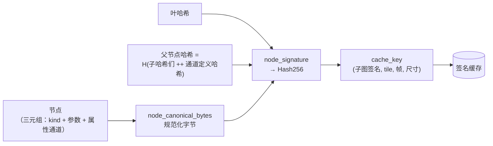
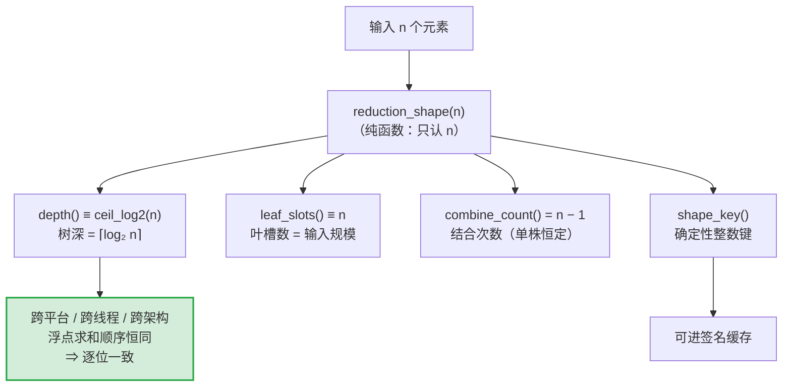
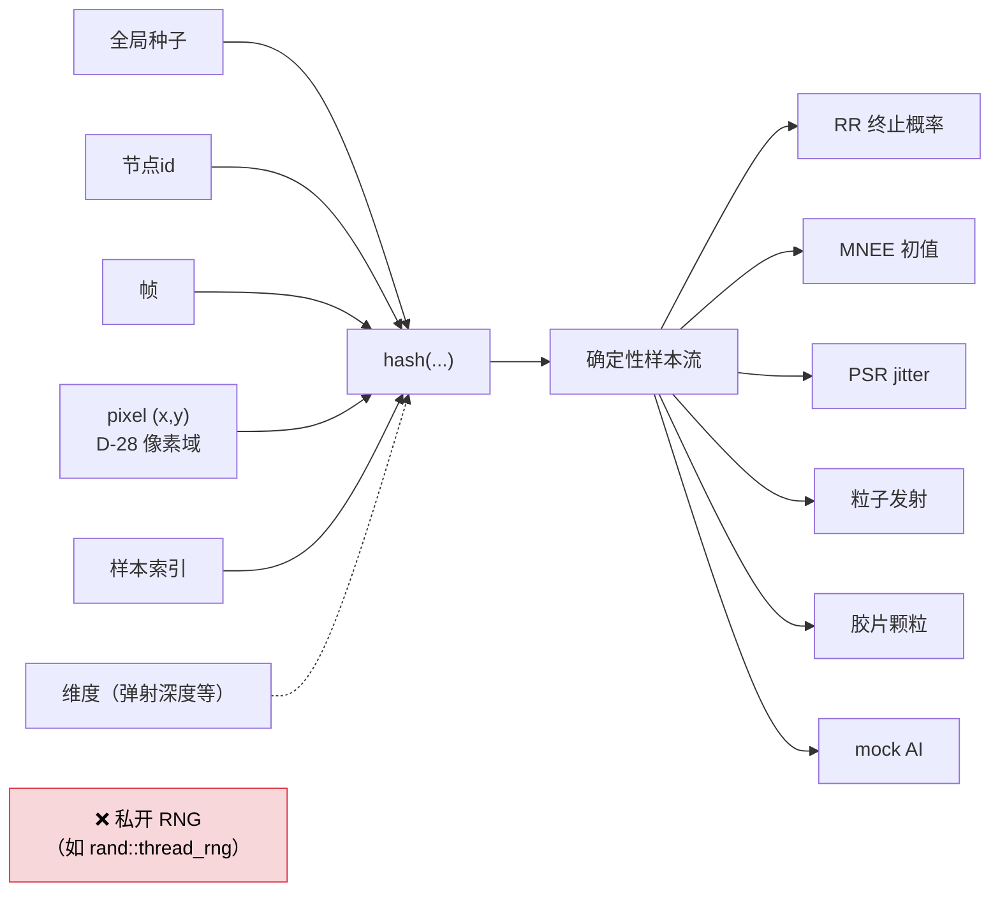
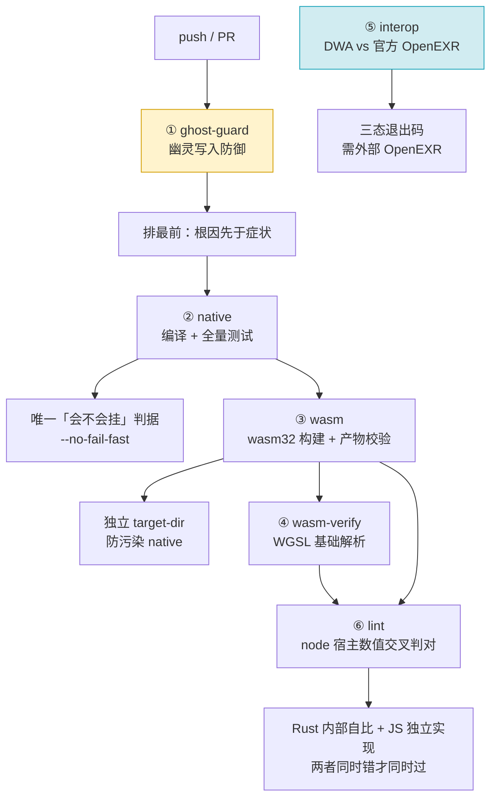
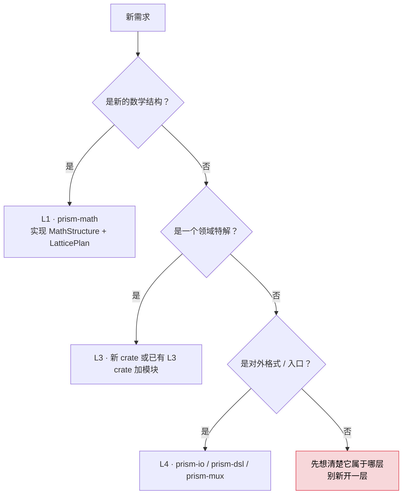

# Prism Engine 开发者指南

> **读者**：第一次接触本项目的开发者。
> **目标**：30 分钟内跑起来，并理解「为什么是这个架构」。
> **版本**：v1.0（2026-10-07 开源）
> **作者**：高见远（架构师）

---

## 0. 这份文档怎么用

文档八件套（`docs/文档八件套/`）是**设计史**——它记录为什么变成这样，适合考古。
本文是**上手路**——只讲第一次跑起来需要知道的，以及日后改代码时不能违反的纪律。

| 你想做的事 | 直接跳到 |
| --- | --- |
| 跑起来 / 跑第一个测试 | [§1 五分钟上手](#1-五分钟上手) |
| 搞懂 26 个 crate 怎么摆 | [§2 全景](#2-26-个-crate-全景) |
| 理解地基抽象 | [§3 核心抽象](#3-核心抽象两个地基) |
| **改代码前必读** | [§4 确定性纪律](#4-确定性纪律本项目的核心价值观) |
| 提交 PR 前必读 | [§5 反假绿门禁](#5-反假绿门禁体系) |
| 判断"能不能引这个库" | [§6 零第三方依赖铁律](#6-零第三方依赖铁律) |
| 给引擎加新格式 | [§7 加新格式的步骤](#7-加新格式--新特解的步骤) |
| 想知道引擎做不到什么 | [§8 诚实的边界](#8-诚实的边界本项目当前不做什么) |

---

## 1. 五分钟上手

### 1.1 前置条件（两条，都要真装）

本引擎**零第三方 crate**，但仍需要标准 Rust 工具链与 Node（跑门禁脚本用）。

```bash
# ① Rust 工具链 —— 装好后 rustc / cargo 都可用
curl --proto '=https' --tlsv1.2 -sSf https://sh.rustup.rs | sh
source "$HOME/.cargo/env"

# ② Node 18+ —— 只用于门禁脚本与打包/解包脚本，不参与编译
#    Ubuntu/Debian:
apt-get install -y nodejs npm
node --version   # 期望 v18 以上
```

**验证**（两条都应正常输出版本号）：

```bash
rustc --version
node --version
```

> 本指南写作环境实测版本：`rustc 1.93.0` / `cargo 1.93.0` / `node v22.13.1`。

### 1.2 拿到源码

项目**不用传统 git 仓库分发**，而是发布**单个 TXT 文件**（内嵌解包脚本）：

```bash
# 1) 保存 prism-engine-v1.0-source.txt（UTF-8 编码）
# 2) 把该 TXT 开头 UNPACK SCRIPT BEGIN/END 之间的代码存为同目录 unpack.cjs
# 3) 运行解包脚本
node unpack.cjs          # 需 Node 18+，零依赖
```

解包后得到完整目录树（含 `crates/`、`docs/`、`tools/`、`.github/workflows/`、`docs/合规/`）。

如果你拿到的是 git 仓库，直接 `git clone` 亦可——TXT 只是分发形态。

### 1.3 编译

```bash
cd prism-engine-v1.0-source/    # 目录名以解包结果为准
cargo build --workspace --locked
```

`--locked` 是**纪律性参数**，不是可选优化：它强制依赖解析结果与 `Cargo.lock` 逐位一致，
任何偷偷引入外部依赖的改动都会在这里失败（详见 [§6](#6-零第三方依赖铁律)）。

首次编译会有一波输出，属正常（26 个 crate 全量构建）。

### 1.4 跑第一个测试

```bash
cargo test -p prism-core
```

**期望结果**（实测）：

```
test result: ok. 111 passed; 0 failed; 0 ignored; 0 measured; 0 filtered out
```

全仓规模（`cargo test --workspace`，实测基线）：

| 指标 | 数值 |
| --- | --- |
| 用例总数 | **3271 passed / 0 failed / 0 ignored** |
| 测试二进制（块） | 149 |
| 耗时 | 约 1 分 52 秒 |

```bash
# 全仓测试
cargo test --workspace --no-fail-fast --locked

# 只看某个 crate
cargo test -p prism-io
```

> `--no-fail-fast` 是**必加**的：默认行为下第一个失败的 crate 立即终止全局测试，
> 后面 25 个 crate 根本不跑，你就只能知道"坏了"，不知道"坏了几个、哪些"。

### 1.5 跑内置演示（看画面）

```bash
cargo run -p prism-app
```

无参数即跑内置演示：用 CPU 参考后端（**不需GPU**）离线渲染 36 帧 480x270，
产物落在 `output/frames/` 与 `output/preview.png`。

渲染自己的 `.prism` 场景：

```bash
cargo run -p prism-app -- demo.prism --width 1280 --height 720
cargo run -p prism-app -- demo.prism --frame 1.5     # 单帧预览
```

### 1.6 跑门禁（提交前必做）

六道门禁全部零依赖，只用 `node`：

```bash
# ① 幽灵写入防御（秒级，含反向自证）
node tools/ghost_guard.mjs --self-test
node tools/ghost_guard.mjs --check --no-compile

# ② WGSL 着色器静态检查
node crates/prism-gpu/web/wgsl_lint.mjs
node crates/prism-gpu/web/ci_wgsl_smoke.mjs crates/prism-gpu/shaders

# ③ 跨实现对拍判据的反向自证
node crates/prism-io/tests/interop/interop_gate.mjs --self-test

# ④ 合规自检
node tools/compliance_check.mjs
```

---

## 2. 26 个 crate 全景

### 2.1 分层架构

引擎按**分层**组织。箭头 = 允许的依赖方向，禁止逆向。

```mermaid
flowchart TB
    subgraph L4["L4 · 声明面与出口（dsl / io / render / mux / infra）"]
        DSL["prism-dsl"]
        IO["prism-io"]
        RENDER["prism-render"]
        MUX["prism-mux"]
        INFRA["prism-infra"]
    end

    subgraph L3["L3 · 特解宿主 crate —— 一个 crate = 一个新特解"]
        RT["prism-rt"]TEXT["prism-text"]PHYS["prism-physics"]
        PART["prism-particles"]POST["prism-postfx"]TEX["prism-texture"]
        AUD["prism-audio"]RAST["prism-raster"]VEC["prism-vector"]
        GEO["prism-geometry"]GEN["prism-genart"]AI["prism-ai"]
        AES["prism-aesthetic"]ANIM["prism-anim"]
    end

    subgraph L2["L2 · 引擎核心 —— 签名树 + 归约代数 + 调度"]
        CORE["prism-core"]
    end

    subgraph L1["L1 · 数学结构层 —— 12 数学结构 + 格类型"]
        MATH["prism-math"]
    end

    subgraph L0["L0 · 叶子层 —— 确定性的家"]
        BYTES["prism-bytes"]
        NOISE["prism-noise"]
    end

    APP["prism-app<br/>（CLI 入口 / 交互式编辑器）"]

    APP --> L4
    L4 --> L3
    L3 --> CORE
    L2 --> L1
    L1 --> L0
    GPUX["prism-gpu<br/>（GPU 抽象，只依赖 L1）"] -.-> MATH

    classDef core fill:#fff3cd,stroke:#d39e00,stroke-width:2px
    classDef leaf fill:#d4edda,stroke:#28a745
    class CORE core
    class BYTES,NOISE leaf
```

### 2.2 🔴 架构红线：`io ∈ L4 → core ∈ L2` 的方向禁令

> **铁律**：`prism-io`（L4）**禁止**依赖 `prism-core`（L2）。低层不得依赖高层。

这条禁令不是风格偏好，而是**被真实事故逼出来的**。

**事故原委**：项目里曾有两份手写 DEFLATE inflate 实现——

1. `prism-io/src/exr.rs` 内一份；
2. `prism-media/src/inflate.rs` 内一份，注释写着"因循环依赖无法复用，自研第二份 inflate，形成技术债"。

第二份的注释暴露了问题：两份实现**都被卡在 L4 附近**，而 L4 不能依赖 L2 的 `prism-core`，
所以谁也够不着谁。**双份实现 = 双份 bug 面**，而它已经产生过事故：EXR 侧的
zlib 容器口径（裸 DEFLATE vs zlib 流）**错了 3 次**才由测试逮住。

**解法**：把 inflate 下沉到**所有消费者之下**的 L0 叶子 `prism-bytes`。
现在 `prism-io`(L4) 与 `prism-media`(L4) 都向下依赖它，反向依赖不存在，循环自然消失。

> **教训写进代码**：`prism-bytes/src/lib.rs` 的模块文档原文写着
> "**结构上收敛到一处（解码只有本 crate），验证上保持互相独立**"。
> 也就是说：读侧测试**刻意不复用**写侧实现来造负载——否则两侧共用同一份实现，
> 同错时互相掩盖，测试就再也逮不住 bug。

### 2.3 为什么`prism-bytes` 是零依赖叶子

`prism-bytes`（L0）**不依赖本仓任何其他 crate**，连 `prism-math` 也不用。原因有三：

1. **它在依赖图最底部**——任何一个 `use` 都会成为全仓所有 crate 的传递依赖，把 L0 拖进高层依赖网；
2. **DEFLATE 解码只需要 `std`**（位运算 + `Vec`）——引入任何数学库都是负债而非资产；
3. **它是"确定性的家"**——位流固定低位→高位，Huffman 固定按码长→符号升序，
   同输入逐字节一致、跨平台一致。越靠底层，越要这份干净。

它带 `#![forbid(unsafe_code)]` 与 `#![deny(missing_docs)]`——**零 unsafe、无文档即编译失败**。

### 2.4 26 个 crate 一览

依赖方向列 = 它依赖谁（同层或下层）。

| crate | 层 | 一句话职责 | 依赖方向 |
| --- | --- | --- | --- |
| `prism-bytes` | L0 | 全引擎唯一 DEFLATE/zlib **解码**真源 | 零依赖（叶子） |
| `prism-noise` | L0 | 确定性标量场件（PCG 整数 hash 等） | 零依赖（叶子） |
| `prism-math` | L1 | 12 数学结构 trait + 格类型 + 纯函数数学件 | bytes/noise |
| `prism-core` | L2 | 引擎核心：签名树 + 归约代数 + 调度 + 注册表 | math/anim |
| `prism-anim` | L3/L1 | 属性通道数学件（Spring 解析解/关键帧/缓动） | math/noise |
| `prism-gpu` | L1旁 | GPU/CPU 渲染抽象（Vulkan/Metal 手写 FFI） | math |
| `prism-geometry` | L3 | 几何域（glTF/OBJ 导入 + SDF 场 + 层次） | math/noise |
| `prism-rt` | L3 | 路径追踪 **CpuRef** + GI + 毛发 + BSDF | core/math/noise/geometry |
| `prism-physics` | L3 | XPBD 统一求解器 + 烟雾 FLIP + 毛发约束 | core/math |
| `prism-particles` | L3 | 粒子系统（发射器/力场/点精灵/AudioReactive） | core/math/noise/physics/io/render/audio |
| `prism-audio` | L3 | 音频全家（loudnorm/节拍/频谱/包络） | core/noise |
| `prism-text` | L3 | 文本排版（OpenType/GSUB/整形/竖排） | raster/io/anim/core/math |
| `prism-raster` | L3 | 扫描线矢量光栅化 | io/math/core |
| `prism-vector` | L3 | 矢量路径表达与光栅化对接 | core/math/noise/raster |
| `prism-texture` | L3 | 程序化纹理族（纸张/噪波/渐变/Voronoi） | math/io/noise/render |
| `prism-postfx` | L3 | 后处理链 | math/io/render/noise/raster |
| `prism-genart` | L3 | 生成艺术与矢量绘制节点 | core/math/noise/raster/vector/anim |
| `prism-ai` | L3 | AI mock 层（工作流 B10） | core/io/gpu/math |
| `prism-aesthetic` | L3 | 二级调色与曲线（HSL 选区/RGB 曲线） | math/io/render/core |
| `prism-media` | L3 | 多媒体嵌入 + **NLE 剪辑**（U14） | bytes/core/math/io/audio/anim/gpu |
| `prism-io` | L4 | 媒体 I/O（PNG/JPEG/EXR/RAW/分发层） | bytes/gpu |
| `prism-render` | L4 | 渲染调度层 | math/gpu/core/io |
| `prism-dsl` | L4 | DSL 前端（v2 全块语法 + codegen） | math/core/anim |
| `prism-mux` | L4 | 容器交付 | io/audio |
| `prism-infra` | L4 | 开发者面基础设施 | math/gpu/core/render/io/dsl |
| `prism-app` | 顶层 | **CLI 入口** + 交互式编辑器（U13） | 上述 9 个 |

**加新crate 时的位置判断**：新东西是"数学结构"→ L1；是"一个领域特解"→ L3；
是"对外格式/入口"→ L4。**先找同层已有 crate 挂上去，别新开一层。**

---

## 3. 核心抽象：两个地基

全引擎只有两个"必须知道存在"的地基抽象。它们都在 `prism-core`。

### 3.1 地基一：签名树（`prism_core::graph` / `signature`）

**作用**：把"一段子图的计算结果"压缩成一个**确定性哈希**。有了它，
引擎才能判断"这块没变，缓存直接复用"。



关键 API（`prism-core/src/signature.rs`）：

| 函数 | 作用 |
| --- | --- |
| `node_canonical_bytes(node)` | 节点的规范字节表示（与字段顺序无关） |
| `graph_canonical_bytes(graph)` | 整图的规范字节 |
| `graph_signatures(...)` | 一次算出全图各级签名 |
| `graph_signature(graph, defs)` | 整图签名 |
| `cache_key(subgraph, dims)` | 缓存键 = `hash(子图签名, tile, 帧, 尺寸)` |
| `snapshot_signature(subgraph, channel_chain)` | 快照键（D-28 状态模拟用） |
| `channel_definition_hash(def)` | **通道定义哈希**——通道变了签名必须变 |

**为什么它对**：U13 交互式编辑器靠它做**增量失效**——改一个叶子节点，
只有它自己和祖先链的签名变，兄弟节点逐位复用。集成测试把"改叶 1 → dirty 集恰为 {1,3,4}"
钉死了。这是"改一个参数只重算受影响部分"的全部机制。

> **给你自己的节点写测试时**：只要它进 `Graph`，签名树就**自动覆盖**它——
> 不需要你写任何一行签名相关代码。这是架构的红利，不是巧合。

### 3.2 地基二：固定形状归约代数（§26 `ReductionShape`）

**作用**：求和/归约（把n 个数加成一个数）必须**逐位可复现**。
问题在于：浮点加法**不满足结合律**，`(a+b)+c ≠ a+(b+c)`，所以归约顺序决定结果。
若顺序随线程数、随chunk 大小、随执行环境变化，输出就不可复现。

**解法**：归约树形状是**输入规模 n 的纯函数**，与执行环境无关。



关键 API（`prism-core/src/graph.rs`）：

| 函数 | 契约 |
| --- | --- |
| `ceil_log2(n)` | 精确整数上界（`ceil_log2(1024)=10`，`usize::MAX` 不溢出） |
| `reduction_shape(n)` / `ReductionShape` | 层结构 + 每层 carry 数 + 确定性整数键 |
| `ReductionShape::depth()` | **恒等于** `ceil_log2(n)` |
| `ReductionShape::leaf_slots()` | 恒等于 `n` |
| `ReductionShape::combine_count()` | 恒等于 `n − 1` |
| `reduce_sorted_by_key(items, ...)` | **工程四律之 3**：消序用排序。排序保证顺序唯一 |
| `reduce_unordered(...)` | 调用方须自行证明顺序无关（如max/min） |
| `reduce(items, combine, unit)` | 基础归约 |

**规矩**（架构 §4.3 格锚表原文口径）：

> 求和/归约 | 格序 | **一律走 `prism-core` 唯一 `reduction_shape(n)`**（白皮书 §26），
> 串行为其退化情形；碰撞/约束按 id 排序。

**你在什么时候需要关心它**：写任何"把一堆值合并成一个值"的逻辑时——
求和、求最大值、算平均、能量积分。**不要自己写 `for`循环累加浮点**，
那会让输出依赖执行环境。NLE 音频归约就是**完全复用** `prism_core::graph::reduce` 的（零自写浮点累加）。

---

## 4. 确定性纪律（本项目的核心价值观）

> 架构总设计原文：**铁律四条：零第三方依赖、全链路确定性、CpuRef 永远可跑、Mini Code**。
> 加上 v2.2 的第五条：**数学术语不泄漏**。

这一节讲第二条。**它不是性能优化，是正确性要求**。

### 4.1 全链路确定性

**含义**：同一输入，在任意机器、任意线程数、任意pass 顺序下，
输出**逐字节相同**（不只是"视觉相近"）。

**为什么这么严**：因为引擎支持增量渲染、分布式渲染、缓存复用。
如果同一场景两次渲染出不同字节，缓存就可能命中错误结果——
**假绿比崩溃更危险**。

**怎么做到的**（架构 §4.3 格锚表，摘要）：

| 量种类 | 允许的运算 | 禁止 |
| --- | --- | --- |
| Sobol 逆/插值/积分 | ℝ | 只允许格点间局部插值，端点皆格点 |
| 求和/归约 | 格序 | 一律走 `reduction_shape(n)`；碰撞/约束按 id 排序 |
| hash | Z→Z | PCG 整数函数；**禁浮点三角**（如sin 大数法） |
| 超越函数 sin/cos/exp/pow/atan2 | ℝ | **一律用 `prism-math` 确定性数学件（区间逼近多项式 + 固定系数，D-29），禁 libm**——libm 跨平台差 1–2 ulp，击穿"跨平台逐位一致" |
| fma | — | 全局统一启用或禁用 |

**最反直觉的一条：禁 libm。**你可能会想"标准库当然最准"。但恰恰相反——
不同平台的 `sin()` 实现可以差 1–2 ulp，而这个误差会击穿逐位一致。
所以引擎自己实现区间逼近多项式（`prism-math/src/` 下），**固定系数**，
输入相同则输出必然相同。整数幂一律连乘，不用 `pow`。

> 注意 `sqrt` **不在禁列**——它是 IEEE 精确舍入运算，标准保证结果唯一。

### 4.2 断言优先 `to_bits()`

**做法**：断言浮点相等时**不要**用 `assert_eq!(a, b)`，要用
`assert_eq!(a.to_bits(), b.to_bits())`。

**为什么**：编译器可以合法地把 `0.1 + 0.2` 优化成不等于 `0.3` 的值，
也可以在 debug/release 下用不同的中间精度。用 `==` 比浮点会得到**随构建配置变化**的结果。
`to_bits()` 比较的是**位模式**，是确定的。

**项目实例**（`prism-ai` 某验收记录）：CPU/GPU 真机对拍
12 组向量 × {R, TT, TRT}，**最大绝对误差 1.388e-17，最大相对误差 1.509e-7**（约 1 ulp），
36 格中 9 组三瓣**逐位为 0**——用 `to_bits()` 才能断言"逐位为 0"这件事。

### 4.3 CpuRef 永远可跑

> 宪章 **C22（CpuRef 硬保证）**原文：
> CpuRefBackend 是**一等运行后端**——无 GPU 平台引擎完整可运行、能产出正确图像/视频，
> 且永远作为 GPU 后端的**正确性黄金参照**。这是全平台兼容的地基：
> **任何有 CPU 的平台都能跑 Prism**。

**工程含义**：

- CPU 参考实现**不是"降级方案"**，是一等公民，必须始终可编译可运行；
- 写GPU 代码时，**同时写 CPU 参考**，两者用`to_bits()` 对拍；
- 本文档 §1.5 的 `cargo run -p prism-app` 在**无 GPU 的机器上也能跑**——
  这正是 C22 的体现（实测于 4 核/8G 沙箱）。

**反例警戒**：`host_test.mjs` 历史上曾在无 GPU 时**静默 SKIP**，
被判定为"关键防线无人看守"，现已改为**无 GPU 时判 FAIL**。

### 4.4 关于"C18 永不 panic"——一条需要澄清的编号

任务书里写的"C18 永不 panic"，**在本项目文档里对不上号**。诚实说明：

- **C18** 在《兼容性宪章》里的原文是「**危险参数编译期校验 + 错误三段式**」，
  讲的是 duration≤0 / fps≤0 / spp≤0 等 ≥12 条防呆规则，
  要求错误信息三段式（在哪 / 什么事 / 怎么改），与 panic 不是一回事；
- **C22** 才是"CpuRef 硬保证"（见上）；
- **"永不 panic"是真实存在的纪律**，但它写在**各 crate 的模块文档**里而非宪章编号里。
  例如 `prism-bytes/src/lib.rs` 铁律段原文：

  > **永不 panic**：所有下标/长度都经 `get()` 与 `min()` 兜底，
  > 畸形输入（截断、越界码长、保留块类型）返回三段式 `BytesError`。

  这与 C18 的"错误三段式"是**同一个思路在解码层的落地**：
  不崩溃，而是返回结构化错误（在哪/什么事/怎么改）。

**给你的实操准则**：畸形输入 ⇒返回 `Result` + 三段式错误信息，**不要 `unwrap()` / `panic!`**。
判红（测试失败）比崩溃（进程退出）好，因为崩溃会带走其他测试的结果。

### 4.5 随机性唯一入口（D-28）

> 架构总设计 §4.4 原文：
> **随机性 = hash(全局种子，节点id，帧，pixel，样本索引[, 维度])，全引擎唯一随机性入口**
> （D-28：pixel 为像素域，逐像素派生如胶片颗粒/采样流的安放处——**同节点不同像素必不同流，防网格伪影**）：
> **任何结构的 sample 不得私开 RNG**。



**关键机制**：

1. **无全局 RNG 状态**——任意像素、任意 pass 可**独立重算**；
2. **`pixel` 域是防网格伪影的关键**——胶片颗粒若只按 (节点, 帧) 派生，
   整个画面会是同一片噪声纹理；加入 `pixel` 后每个像素拿到不同流，才像真实颗粒；
3. **Sobol 维度序号**编码弹射深度等用途；哈希只负责**选点与打散**。

**有状态模拟 = `EvalCtx` 快照库接线（D-28）**：
`EvalCtx` 携带 `SnapshotStore` 引用，模拟类节点先自快照库装配（上一帧状态, 当前帧参数）
再投影一步。快照键 = (子图签名, 帧)。LRU 逐出**只影响重算、不影响结果**。

> **seek 等价成立条件**：跳第 N 帧 ≡ 顺序推进到第 N 帧，**逐字节**。
> 这条等式是分布式渲染与任意跳转的数学地基。

### 4.6 归约形状是输入规模的纯函数

见 [§3.2](#32-地基二固定形状归约代数26reductionshape)。单独强调其地位：

> 归约形状是**输入规模的纯函数**，**不是执行环境的函数**。

这意味着：不能用"当前线程有 8 个线程所以分成 8 块"来决定归约树形状。
线程数是执行环境，会变；n 是输入，不会变。**形状只认 n。**

---

## 5. 反假绿门禁体系

这是本项目最有特色的部分。核心命题：

> **"内部往返测试全绿" ≠ "符合规范"。**

### 5.1 六道 CI job 各查什么



| job | 查什么 | 关键设计 |
| --- | --- | --- |
| ① **ghost-guard** | 源码被无人运行的写入改动（行数只增零删等） | 排**最前**，秒级无 cargo。检测逻辑同时跑 `--self-test`，被改成恒过就红 |
| ② **native** | 编译 + 全量测试 | `--no-fail-fast` 硬性要求；`--locked` 防依赖偷渡 |
| ③ **wasm** | wasm32 构建 + 产物静态结构（导出/导入符号/体积） | **独立 target-dir**，显式断言 native `target/debug/` 无 wasm 产物 |
| ④ **wasm-verify** | `shaders/` 下全部 `.wgsl`（实测 12 份）基础解析 | 从 wasm job 拆出，失败原因更聚焦；脚本**枚举目录不写死个数** |
| ⑤ **interop** | DWA(DWAA/DWAB)与官方 OpenEXR 的**跨实现比特流对拍** | **三态退出码**（见 §5.4） |
| ⑥ **lint** | node 宿主`host_test.mjs`：CPU 参考 × JS 独立实现交叉判对 | 只认脚本退出码，不 grep 计数 |

**为什么 ghost-guard 排第一**（CI 注释原文事故记录）：
2026-10-06 当天 `raw.rs` 被无人运行的写入注入 254 行（E0592 编译错误）。
若只有 native 门禁，要等 13 分钟才在测试阶段报"有测试挂了"，
而**根因是源码被换了**。ghost-guard 只跑纯文本分析（秒级），
能在 native 开工前报出"文件相对基线只增行、零删除"这种**形状**。

实测自证输出（`node tools/ghost_guard.mjs --self-test`）：

```
✓ 真实事故复刻判红（raw.rs 基线 + 254 行注入）：G1=红 G2=红 G3=红
     与 17:58 事故一致：8225 → 8478 行，diff = +253 / -0（零删除 ⇒ 严格超集）
     G3 顶格文档块命中行：3357（事故位置 3357）
自证通过：破损必红、良好必绿、方向性正确
```

### 5.2 为什么"内部往返全绿"≠ 符合规范——DWA 真实例子

> 这是本项目最值得记住的一条工程教训。

**背景**：EXR 的 DWA/DWAB 压缩器实现完成后，作者写了**自写自读**的往返测试
（用本仓写入器写DWA，再用本仓读取器读回来）——**100% 通过**。

**然后**：跟**官方 OpenEXR** 一对拍（interop 门禁），**立刻暴露 5 个真 bug**：

| # | 缺陷 | 为什么自写自读照不到 |
| --- | --- | --- |
| 1 | `zip_pack` 预测器误用**变换后**字节当 `p`（官方 `ImfZip.cpp:88`） | 自己写自己读，两侧犯**同一个错**时结果仍自洽 |
| 2 | `csc709_forward` 用**反解**而非官方 709 矩阵（`ImfDwaCompressorSimd.h:223`） | 自己的正/反解互为逆运算，误差抵消 |
| 3 | **边缘 tile 用完整尺寸而非裁剪尺寸**（`:689`） | 自己写的读取器按同样错误尺寸裁剪，**照样自洽**（曾致 68/72 格失败） |
| 4 | 缺「压不小就原样存」块级回退（`ImfOutputFile.cpp:584`） | 只有官方解码器会触发这条路径 |
| 5 | **`lineOrder=DECREASING_Y` 却按 y 升序写块**（`ImfLineOrder.h:23`） | 连`Compression::None` 都读不了——**这是容器层 bug 冒充压缩 bug** |

**结论**：**自写自读只能证明"自己和自己一致"，不能证明"符合规范"。**
两侧同错时，互相掩盖，误差抵消，测试全绿。
**必须有独立第三方实现做对拍**，才能打破这个闭合回路。

这也是为什么 `interop` 必须**独立成 job**：它需要**系统 OpenEXR**
（本仓不依赖它，它只是验证工具），且退出码是**三态**——塞进 native 会让
"跳过"和"测试通过"混在同一份报告里。

### 5.3 变异测试：主动注入 bug，证明测试能抓住

上面 DWA 的 5 个 bug 之所以能活到对拍阶段，是因为**测试覆盖不足**。
变异测试主动**注入缺陷**，检验"测试是否真能发现"。

**项目实践（实测数据）**：`node crates/prism-io/tests/interop/interop_gate.mjs --self-test`
是**注入式反向自证**——把实测最差值放大后喂给判据，断言必须判红：

```
ok    P0-2: 退出码 FAIL(1) 与 SKIP(3) 必须不同（编译失败不得报 SKIP）  [FAIL=1 SKIP=3]
self-test: 37/37 通过
SELF-TEST OK: 每条判据都能判红，且实测值本身判绿
```

**另一个真实收获**（账本记录）：QA 变异测试在全绿测试中挖出
**2 个严重假绿缺口 + 2 个真 bug**（当时 477 项全绿掩盖了它们）：

- `SubIfdBlock` **缺 `x0`** —— tile 是二维分块，同行第 `tx` 个 tile 应落 `x0 = tx*tile_w`，
  代码硬编码 0 ⇒ **同行 tile 互相覆盖、右侧图像被涂掉**（高像素机型普遍用 tile，不是理论问题）；
- `bits_per_sample` 越界被**静默归一成 1** ⇒ 下游 `1..=16` 守卫成死代码，
  `BitsPerSample=0` 被当 1 位解出"长度对、内容全错"的垃圾。

**门禁自身也要能判红**——这是本项目的核心防御。
每个门禁脚本都提供 `--self-test`：故意注入破损，断言自己会红。
若判据恒真，self-test 立刻失败——**门禁自己先被证伪**。

### 5.4 什么不算门禁通过

三条硬规矩：

1. **SKIP 不得当 PASS。**interop 门禁是**三态**：
   - `0` = 真通过 → CI 绿
   - `1` = 判红 → CI 红
   - `3` = 环境不具备 → **显式 SKIP**（既不算失败，也**不算通过**）

   装不上 OpenEXR 时，用 `|| true` 兜底，随后**显式检查** `pkg-config`；
   查不到就把 SKIP 打到 job summary 里并以 `exit 0` + `::notice` 结束——
   **绝不** `exit 1`（平台包缺失不是本仓的责任），
   **也绝不**静默成功（那会让"门禁从未真正跑过"变成假绿）。

2. **已修复条目不得从登记簿删除。**缺陷登记簿里每条必须写明
   症状、根因、以及**"矩阵为何照不到它"**。当前 2 条已登记的编码器缺陷
   （`KI-ENC-ZIP-FLEVEL-HEADER`、`KI-ENC-RLE-BLOCK-LENGTH`）
   **诚实标为 `matrix_covers_it=false`**，不许谎称已覆盖。

3. **不 grep 计数判过。**例如 lint job **只**以 `host_test.mjs` 的退出码为准，
   YAML 里不写 `grep -c "ok" == 41` 这类断言——
   这样别人往脚本里加测试项时，无需同步改 YAML。

---

## 6. 零第三方依赖铁律

### 6.1 怎么做到

**核验方式与结果**（见 `docs/合规/README.md` 的完整版）：

| 核验项 | 方法 | 结果 |
| --- | --- | --- |
| 第三方 crate | 查所有 26 个 `Cargo.toml` 的 `[dependencies]` | **全部是 `{ path = "../prism-x" }` 本仓路径依赖**，零外部 |
| `Cargo.lock` | 逐行审| **26 个条目，全部 `prism-*`**，无一个外部包 |
| `build.rs` | `find crates -name build.rs` | **零个**（无构建期代码生成） |
| C++/FFI 链接 | 查 `extern "C"` / `link!` | 仅 wasm32 的 JS 胶水导入，**无原生 C/C++ 链接** |
| CI 依赖 | `.github/workflows/ci.yml` | 只用 GitHub 官方 actions，**不引第三方 action** |

**手写了什么**（部分清单，全部零依赖实现）：

| 领域 | 自研件 |
| --- | --- |
| 压缩 | SHA-256、Adler-32、DEFLATE inflate（RFC 1951）、zlib 容器（RFC 1950） |
| 字体 | OpenType 解析器、GSUB/GPOS 排版、UBA L2 双向、阿拉伯四态整形、SFNT 二进制写入器 |
| 图形 | EXR 全家桶（读写/压缩/DWA）、PNG（滤波）、JPEG 编解码、RAW 解码 |
| 序列化 | 自研包序列化（**无 serde**）、canonical 字节、SemVer 校验 |
| GPU | Vulkan / Metal **手写 FFI**（dlopen/dlsym，零 `libloading`） |
| 数学 | 超越函数区间逼近多项式（**禁 libm**，D-29）、FFT、样条、Spring 解析解 |
| 其他 | DSL 词法/语法/编译、命令行解析、Unicode 双向算法（零 Unicode 依赖） |

> **为什么值得付出这个代价**：
> ①供应链攻击面归零——CI 不用 `dtolnay/rust-toolchain` 等第三方 action；
> ②离线可构建——网络不可用时仍能编译（`--locked` 已足够）；
> ③**审计容易**——没有"这个依赖到底引了多少传递依赖"的树要查。

### 6.2 "权重是数据不是代码依赖"——为什么 ML 推理不违反铁律

这条经常被质疑：引擎有 `prism-ai` crate，做神经网络推理，
难道不需要 `candle` / `tract` / `onnxruntime`？**不违反。**

**判据是"是否引入他人的代码"，不是"是否用到数值"。**

| | 权重（模型参数） | 代码依赖（crate / 库） |
| --- | --- | --- |
| 本质 | **数据**——一大坨浮点数 | **代码**——别人写的指令序列 |
| 随包分发 | 是（`.bin` / `.f32` 数组） | 是（源码或预编译产物） |
| 会不会执行其中的指令 | **不会**，只被 `load` 进内存当数据读 | 会，CPU 执行其指令 |
| 出事时的风险面 | 数据错→ 结果错，但**不执行任意逻辑** | 代码错/被投毒 → **任意代码执行** |
| 许可 | 通常是**数据许可**（可自由用） | 源码许可（需遵守条款） |

**关键区别**：`权重文件里没有指令，只有数字。**引擎不会"运行"一个权重文件**——
它做的是 `f32` 乘法与加法，那些乘加代码是**我们自己写的**。

同理适用于：Joe–Kuo 方向数表（**BSD 许可的数据表**，不是 BSD 库）、
字体子集（**OFL 许可的字体数据**）、论文逼近系数（**数学常数**）。

> 三者都是**资产/数据**，不是**代码**。它们在 `docs/合规/assets/资产登记.md`
> 里单独登记，**不混进代码依赖清单**。
> 这个区分不是狡辩，是**风险模型的区分**：数据出错会得出错误答案，
> 代码被投毒会夺取控制权。两者该用不同的核查手段。

---

## 7. 加新格式 / 新特解的步骤

架构铁律："**新功能 = 新特解**"（D-22）。以下checklist 照做就能贡献。

### 7.1 判断落点



### 7.2 Checklist

**准备**

- [ ] 确认落点（见 §7.1），**先找同层已有 crate 挂上去**，别新开一层
- [ ] 读 `crates/<目标>/src/lib.rs` 的模块文档——那里写清了本 crate 的铁律

**实现**

- [ ] 零第三方 crate：只用 `std`；需要"库"时先问"能不能手写"（§6.1 清单）
- [ ] 归约走 `prism_core::graph::reduce` / `reduce_sorted_by_key`，**不自己写浮点循环累加**
- [ ] 随机性走 `hash(种子, 节点id, 帧, pixel, 样本索引, ...)`，**不私开 RNG**（D-28）
- [ ] 超越函数用 `prism-math` 确定性件，**不调 libm**（D-29）
- [ ] 同步写 **CpuRef 参考实现**（C22）
- [ ] 畸形输入返回 `Result` + **三段式**错误（在哪/ 什么事 / 怎么改），**不 panic**（§4.4）
- [ ] 若定义新数学结构：实现 `MathStructure` + `MathStructureMeta`，
      三问必答（`KernelKind` / `DualityPair` / `LatticePlan`），**不齐注册表拒绝**
- [ ] 若进注册表：用 `registry!` 声明宏（**D-27 静态汇入制**，不引第三方过程宏）

**测试**

- [ ] 每个浮点相等断言用 **`to_bits()`**，不用 `==`（§4.2）
- [ ] 覆盖畸形/截断/越界输入
- [ ] 若有 GPU 侧实现：与 CPU 参考**对拍**，并加**"阈值放宽即判红"的反向断言**
- [ ] **确认测试不是自写自读**——问自己"如果两侧犯同一个错，能发现吗？"
      不能 ⇒ 需要独立实现对拍（[§5.2](#52-为什么内部往返全绿--符合规范dwa-真实例子)）

**门禁**

- [ ] `node tools/ghost_guard.mjs --check --no-compile`（不引入幽灵写入形状）
- [ ] `node crates/prism-gpu/web/wgsl_lint.mjs`（若动WGSL）
- [ ] `node tools/compliance_check.mjs`（若动 `Cargo.toml` 或资产登记）
- [ ] `cargo test --workspace --no-fail-fast --locked`
- [ ] 若新增门禁脚本：**同时写 `--self-test` 注入破损，并让它进 CI**

**诚实**

- [ ] 在相关文档的"诚实边界"里写清**本改动做不到什么**
      —— 这不是自我贬低，是**给下一个人的路标**。项目账本里的每条
      "诚实边界"都是这么攒出来的。

---

## 8. 诚实的边界：本项目当前不做什么

> **这一节的存在意义**：让你不要从"能跑"推断"什么都能干"。
> 以下条目全部来自《差距账本》与各 crate 模块文档的"诚实边界"记录，
> **不是过时的旧账**——除特别注明外，都是当前状态。

### 8.1 格式与编解码

| 限制 | 现状 | 出处 |
| --- | --- | --- |
| **视频编码器** | **不自研**。D-10（2026-09-27 用户拍板）：H.264 编码器含运动估计搜索/码控/率失真优化，ROI 失衡。交付走运行时 ffmpeg 探测协作 + Phase 4 硬件编码器 API；引擎内置终态 MP4+MJPEG 永远可用 | R1 账行 |
| **音频编解码** | **不自研** AAC/mp3（D-10：专利历史包袱 + 工程量）。WAV/FLAC 覆盖，通用音频走外部 ffmpeg 路径 | R4 账行 |
| **NLE 无编码器输出** | NLE（U14）提供时间映射/关键帧/转场，但**不产出编码视频**（与 D-10 一致）。`Fade` 与 `Dissolve` **数学同式**（仅语义别名） | U14 边界 |
| **DWA 有损** | DWA/DWAB 是**有损压缩**。`KI-DWA-QUANT-1CH-NOISE` 是**真实编码器量化质量差距，未修**（修它才能让 CI `interop` job 转绿）。噪声格 204/589824 样本差 2~4 half-ULP，判为官方 SIMD IDCT 与本仓标量 f32 **加法次序差**，非格式缺陷 | 账本 v3.0 诚实边界 |
| **真DNG 仍读不了** | 真实 DNG 的 `Compression=7`（lossless JPEG）**未实现** ⇒ 真实相机 DNG 读不了 | 账本 v5.2 遗留 |
| **EXR tiled 方向** | 方向 B/C 各 36 格 tiled 为**显式 SKIP** 而非通过（本仓 `exr_write` 未实装 tiled 写出，属独立特性不影响互通结论） | 账本 v3.0 边界 |
| **inflate 无压缩器** | `prism-bytes` 只做**解压**，无 deflate 压缩器。写入侧 `exr_write::deflate_zlib` 目前只有 stored 块，**无压缩比** | `prism-bytes` 边界 |
| **压缩格式广度** | 只支持 zlib 容器；**不支持** gzip(RFC 1952)/zstd/brotli/LZMA，不支持 FDICT | `prism-bytes` 边界 |

### 8.2 渲染与物理

- **SwiftShader ≠ 真 GPU**：CPU/GPU 对拍的最大相对误差 1.509e-7（约 1 ulp）是在
  **SwiftShader软件光栅化**上测得的，WGSL 允许重结合，**真机逐位一致性仍未验证**。
- **手机端 UI 尚未开工**：全仓**零 `wasm_bindgen`/`web-sys`**，无手机 UI crate，
  `prism-app` 是 CLI。缺陷上报台账已建（`docs/文档八件套/手机测试缺陷台账.md`，P0–P3 分级）。
- **DWA 真值表覆盖 512 点**而非全 65536。
- **U2 烟雾/FLIP** 无标量场输运（温度/烟密度/浮力）、无稀疏体素、无涡量约束。
- **U3 毛发** 无丝束碰撞、无完整 Marschner 偏角、着色器接线未做。
- **U4 实时 GI** 无 GPU 路径（纯 CPU 参考实现）、只做一步间接光、无自适应探针放置。
- **单步间接光**；光追只做一步间接光，无全局多次弹射。

### 8.3 文本排版

- **SubIFD 单层**（W13 修复后）：已支持一层 SubIFD，多层链未实现。
- **印度系只有天城文**：U+0750–077F / 08A0–08FF 未整形（保守标 NonJoining，
  **错连比不连更糟**）；孟加拉/古木尔蒂/泰米尔只分类不整形。
- **双向非完整 UAX #9**：无显式嵌入控制符/隔离符/BD16 括号对。
- **字形替换未做**：内嵌中文子集不含阿拉伯/天城文字形，产出的是**整形计划**，
  与 GSUB `init/medi/fina/isol/liga` 解耦。
- **编辑器预览是风格化程序化映射，非引擎真实核算子**；Draft 为 1/4 分辨率最近邻放大；
  `EditCommand::from_json` 未实现（编辑序列 JSON **单向导出**）；无移动端手势/快捷键/节点增删 UI 入口。

### 8.4 🔴 资产未自研化（U15，最需要你注意的一条）

> **用户 2026-10-06 原话**："现在资产还没有进行自研化，再履行一次也无妨。"
> **诚实解读**：**照实登记为待还项**，不是假装已合规。

账本 U15 行原文口径：§6.1 清单所列外部资产**均为过渡态**——
① Joe–Kuo 方向数表（BSD）②Noto Sans SC 字体子集（OFL，D-12拍板"现在用"）
③ 分词词典（源待定）④ 论文逼近系数（Disney/GGX/Schlick）。
**合规无风险，此账为"自研纯度"补强非合规欠账。**

**U15 状态：未启动。** 用户 2026-10-02 原话：
"不是远期，整个引擎开发完之后有时间我就会下指令"；"不只是中文字体……就会下指令进行'资产数据自研化'"（D-31 总账）。
账本 v3.1 明确记载：**"U15 未启动（用户未发话，主理人已作废任务书）"**。

**你必须知道的三件事**：

1. **合规 ≠ 已自研。** 当前资产**许可合规**（OFL 履行了改名、附许可、同许可分发五条），
   但**纯度未达标**——用的是别人的数据，不是自己造的。
2. **分词词典在代码里根本不存在。** 账本记"源待定"，实测
   `prism-text/src/` 下**无任何分词词典文件**。所以它不是"待自研"，
   而是**尚未引入**——连过渡态都算不上。诚实登记为"未引入"。
3. **自研化路线已写好但未执行**：① 方向数表 component-by-component 自跑搜索 + t 值验证；
   ② 字体矢量字形自造（贝塞尔域）+ hinting + 排版度量，从实际用字集起步逐步扩面；
   ③ 词典自建语料词频统计 + 新词发现； ④ 系数 Remez/Chebyshev 自行拟合重推。

**逐项状态与依据见 `docs/合规/assets/资产登记.md`。**

### 8.5 一处实测发现的文档漂移（如实登记，未擅自修改）

`crates/prism-text/assets/README.md` 记录 `prism_multiscript.ttf` 为
**4,224 B / sha256 `110e2be3…c3b34`**，而**实测为 23,244 B / sha256 `0eece481…b76c7`**。

- **测试是对的**：`tests/multiscript_asset.rs` 的 `EXPECTED_SHA` 常量是实测值；
- **README 是过时的**：真实字节变化被测试捕捉到了，只是旧 README 没同步；
- 这正是"资产是确定性产物、字节漂移必须被看见"的机制在工作；
- **`crates/` 只读，故未擅自修改**——上报在此，由维护者决定是否同步 README。

另外两处**编号勘误**（避免你按错误编号去查宪章）：
- 任务书常说的**"C18 永不 panic"编号对不上**：C18 实为「危险参数编译期校验 + 错误三段式」，
  **C22** 才是「CpuRef 硬保证」。「永不 panic」真实存在，但写在各 crate 的模块文档里
  （如 `prism-bytes/src/lib.rs`），而非宪章编号。详见 §4.4；
- 字体 `font_data/LICENSE` 首行是 **Adobe**（Source Han Sans）版权声明，
  而 `font_data/README.md` 记上游为 `notofonts/noto-cjk`——**两者不矛盾**，
  Noto CJK 的字形源自 Source Han Sans，OFL 要求保留上游版权声明。两份文件共同构成完整来源链。

### 8.6 其他已知边界

- **U12 `PackageSignature` 不是密码学签名**：无公私钥/证书链，
  能查篡改与冒用但**不防抵赖**；无 SemVer 预发布；**无网络协议**（只扫本地目录）。
- **节点术语纪律**：`S1–S12`、核、对偶、格、求逆等数学术语**永不泄漏**到官方预置面
  （crate 公开 API / 错误信息 / 用户文档），只活在 crate 代码与贡献者文档里。
  自定义通道 = 显式 opt-in 贡献者通道，类比 Rust 的 `unsafe`。

---

## 附录 A：文档地图

| 文档 | 内容 | 什么时候读 |
| --- | --- | --- |
| **本文** | 上手路 + 纪律 | 第一次接触项目 |
| `docs/文档八件套/架构总设计.md` | 架构权威（分层/格锚表/签名树/归约/快照库） | 要改架构 |
| `docs/文档八件套/算法白皮书.md` | 每个计算问题"怎么算最好" + 超越点 | 改算法 |
| `docs/文档八件套/兼容性宪章.md` | C1–C25 兼容性条款 | 改对外接口/格式 |
| `docs/文档八件套/差距账本.md` | 欠账与还款实绩、**诚实边界** | 知道做到哪了 |
| `docs/文档八件套/门禁强度审计.md` | 门禁强度评估 | 改 CI |
| `docs/文档八件套/施工手册.md` | 施工流程 | 参与施工 |
| `docs/合规/README.md` | **合规专章入口**（零依赖核验/资产现状/U15） | 涉及资产/许可 |

## 附录 B：术语速查

| 术语 | 英文 | 一句话 |
| --- | --- | --- |
| 特解 | feature solution | 一个可独立注册的能力单元（宿主 crate/模块） |
| 签名树 | signature tree | 子图的确定性哈希，支持增量失效 |
| 归约代数 | reduction algebra | 固定形状的求和顺序，保证逐位一致 |
| CpuRef | CPU reference | CPU 参考实现，一等运行后端 + GPU 正确性基准 |
| 确定性种子派生 | deterministic seed derivation | 随机性 = 纯函数哈希，无全局 RNG 状态 |
| 格 | lattice | 数值类型的代数结构，定义合法运算与误差界 |
| 门禁 | gate | CI 中只允许通过/判红，不许含"假绿"的检查 |
| 反假绿 | anti-false-green | 主动注入破损，证明门禁能判红 |
| 过渡态 | transitional | 资产合规但未自研的中间状态（U15 全部资产） |

---

*Prism Engine v1.0 开发者指南 · 架构师 高见远 · 2026-10-06*
*本文所有命令均在 rustc 1.93.0 / node v22.13.1 环境实测通过；测试基线 3271 passed / 0 failed / 0 ignored。*
