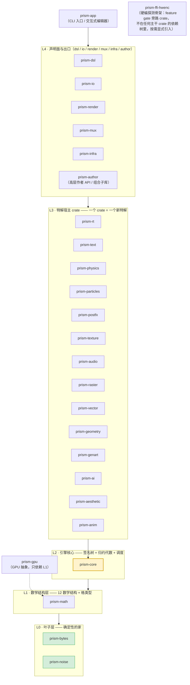
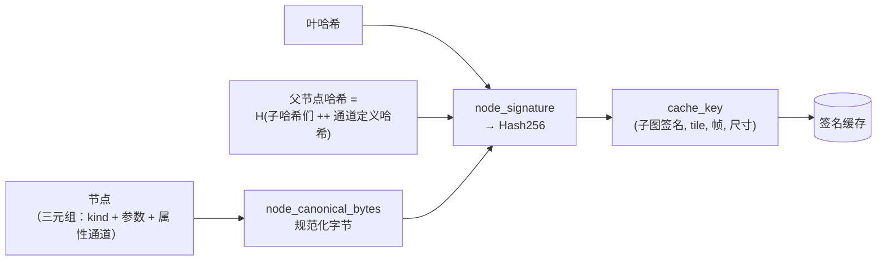
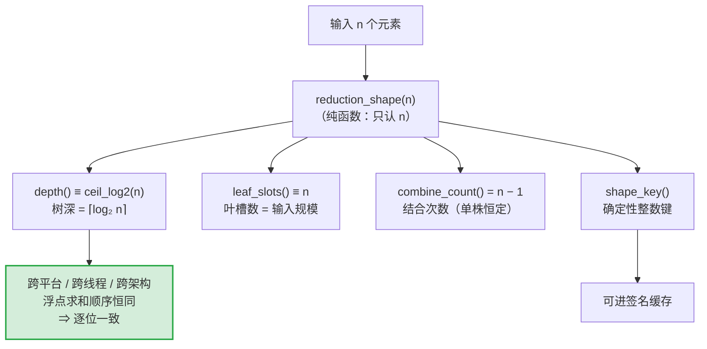
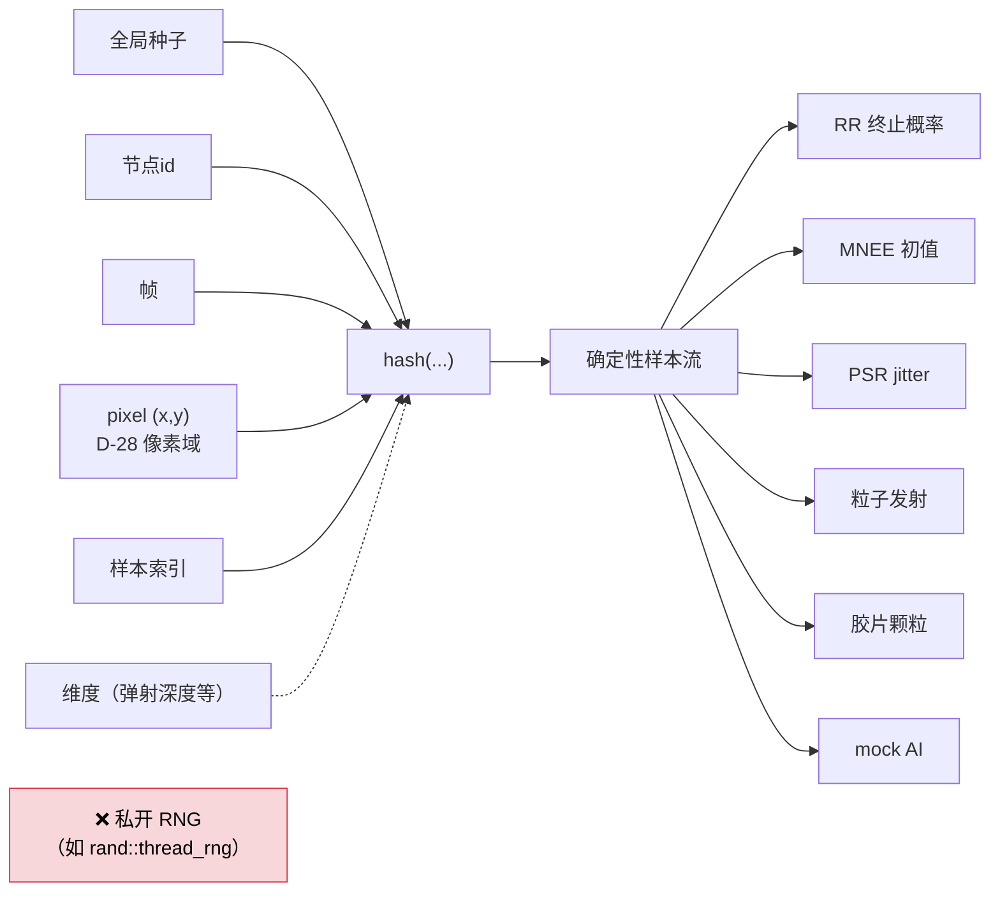
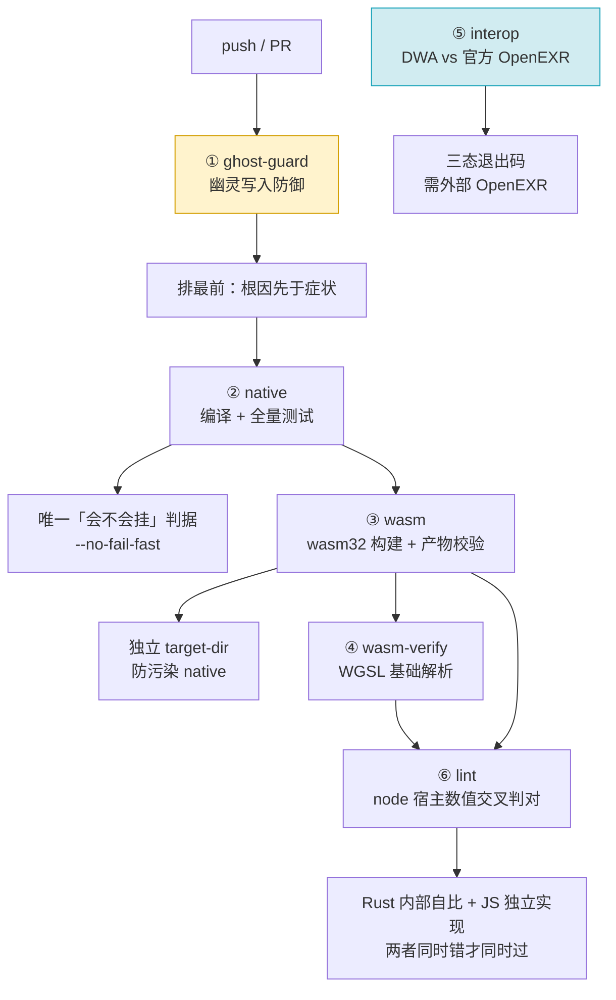
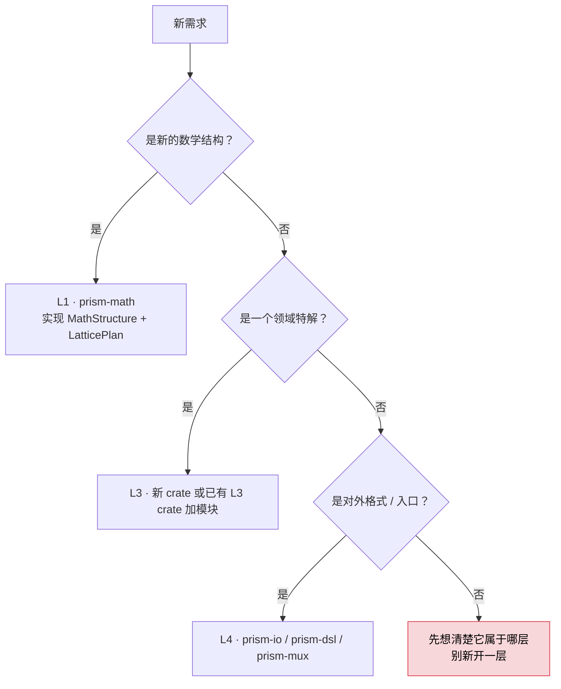

# Prism Engine 开发者指南

> **读者**：第一次接触本项目的开发者。
> **目标**：30 分钟内跑起来，并理解「为什么是这个架构」。
> **版本**：v2.1（继 v2.0 后的长尾收口版：GPU 光追实帧 / USD 资产判据 R1·R3 /
> 签名闭包 S3 / 异质体积接线 / T4 色彩债务结清。V2.1 全部变更见 `CHANGELOG.md`）

---

## 0. 这份文档怎么用

这份分发包里**没有别的技术文档**——本文即**完整技术文档**，自包含：
数学内核（§3.5）、能力全景（§2.5）、29 个 crate 分层（§2；分发包内 28 个）、两个地基抽象（§3）、
确定性纪律（§4）、反假绿门禁（§5）、零依赖铁律（§6）、贡献流程（§7）、
诚实的边界（§8），全在这里。合规与资产信息见同包的 `Compliance/README.md`。

> **三个会反复出现的词，先按白话理解（后文不再解释）**：
> - **门禁**＝提交前必须跑的自检脚本。它只有两种合法结果："通过"或"判红"（报错拦下），
>   不接受"看起来过了"。
> - **假绿**＝检查显示通过，实际什么也没验到（例如检查根本没跑、或比对的两侧犯了同一个错）。
>   它比直接失败更危险，因为人不会再去看。
> - **铁律**＝不因赶进度、图方便就破例的硬约束。本项目最主要的一条是"零第三方代码依赖"（§6）。

| 你想做的事 | 直接跳到 |
| --- | --- |
| 跑起来 / 跑第一个测试 | [§1 五分钟上手](#1-五分钟上手) |
| 搞懂 29 个 crate 怎么摆（包内 28 个） | [§2 全景](#2-29-个-crate-全景) |
| **看看这引擎到底能干什么** | [§2.5 能力全景](#25-引擎能干什么能力全景) |
| 理解地基抽象 | [§3 核心抽象](#3-核心抽象两个地基) |
| **理解引擎的数学内核（结构 = 本体）** | [§3.5 数学内核](#35-数学内核结构是本体功能是特解) |
| **改代码前必读** | [§4 确定性纪律](#4-确定性纪律本项目的核心价值观) |
| 提交 PR 前必读 | [§5 反假绿门禁](#5-反假绿门禁体系) |
| 判断"能不能引这个库" | [§6 零第三方依赖铁律](#6-零第三方依赖铁律) |
| 给引擎加新格式 | [§7 加新格式的步骤](#7-加新格式--新特解的步骤) |
| 想知道引擎做不到什么 | [§8 诚实的边界](#8-诚实的边界本项目当前不做什么) |

### 0.1 编号约定：编号是内部标签，均自带解释，无需外部文档

源码注释与本文里出现的字母数字代号，是**本项目内部的标签**，不是外部标准。
每个编号在**首次出现处都自带一句白话解释**——看到编号不懂，按同一句话里
的白话理解即可，**不需要查任何外部文档**（也没有那样的文档可查）。

| 代号族 | 含义（均自带解释，无需外部文档） | 本文出处 |
| --- | --- | --- |
| `S-n` | 十二数学结构的结构序号：S1 标量场（坐标→场值）、S2 卷积、S3 约束梯度流、S4 确定性抽样、S5 重参数化、S6 谱分解、S7 闭式线性响应、S8 辐射传输积分、S9 分段多项式、S10 层次+签名、S11 扩散、S12 实体表示（边界↔体对偶） | [§3.5.1 十二数学结构总表](#351-十二数学结构总表) |
| `C-n` | **代码条款**（贡献者纪律，"宪章"只是它在本项目里的叫法；源码注释里自带解释）：C18＝危险参数在编译期校验＋错误信息三段式（在哪 / 什么事 / 怎么改）；C19＝每条错误必须带"怎么改"的建议段；C20＝缺定义或能力不支持时**如实报错，绝不静默降级**；C22＝CpuRef（CPU 参考实现）必须永远可跑 | 正文相关处（C18/C19 → §4.4；C20 → §3.5.2 与 §3.5.4；C22 → §4.3） |
| `D-n` | 架构决策编号（一条决策 = 一个编号，首次出现处均带白话）：D-10＝不自研视频编码器；D-12＝字体资产先用现成开源资产、自研化排后；D-22＝新功能=新特解；D-27＝注册表静态汇入；D-28＝随机性唯一入口；D-29＝禁 libm（不用系统数学库） | 正文随附解释处 |
| `B-n` / `A-n` | 早期旧编号族，**已全部退役**：源码注释里已移除，本文亦不再使用（见下） | 仅存于本节说明 |

读法：看到 `D-28`，同一句话里就有「随机性唯一入口」的解释；编号从此只是
**标签**，不是「查无此处的坐标」。`!` 表示该条款为强制约束。

**编号不承载论据本身**：每个编号后面的正文才是权威依据，如果正文与编号
冲突，**以正文为准**。修改设计时请连同编号一起对齐，避免留下编号还在、
正文已改的悬空引用。

#### 为什么源码里看不到 `A-n` / `B-n` 了

早期源码注释里大量出现 `（B12）`、`（D2）` 这类坐标，指向仓库内一份设计文档。
实测发现两个问题，于是**全部删除**：

1. **悬空**——那份设计文档不随源码分发，读者拿到源码后无处可查；
2. **编号不可靠**——同一个编号在不同模块被复用了。例：`B14` 在
   `src/prism-postfx/src/effects/npr/` 指「NPR 风格化族」，却在
   `src/prism-texture/src/registry.rs` 被标成「纹理注册表」；`B12` 在
   `src/prism-audio/src/fx/` 指「效果器链」，在别处又指「采样回放插值」。

删除时**只摘坐标、保留中文语义**，所以模块注释现在直接说自己是做什么的
（`//! 效果器链：混响 / 延迟 / 压缩 / EQ / 失真 / 声像自动化。`），
读起来比原来更自足。**保留下来的编号只有 `C-n`**——代码宪章条款，
因为它在源码里**自带解释**，例如：

```rust
// 错误（宪章 C18 三段式：在哪 / 什么事 / 怎么改；C19 必含建议段）
```

这种引用不依赖任何外部文档，删掉反而丢信息。

---

## 1. 五分钟上手

### 1.1 前置条件（两条，都要真装）

本引擎**零第三方 crate**，但仍需要标准 Rust 工具链与 Node（跑门禁脚本用）。

```bash
# ① Rust 工具链 —— 装好后 rustc / cargo 都可用
curl --proto '=https' --tlsv1.2 -sSf https://sh.rustup.rs | sh
source "$HOME/.cargo/env"

# ② Node 18+ —— 只用于门禁脚本与打包/解包脚本，不参与编译
#    Ubuntu/Debian:
apt-get install -y nodejs npm
node --version   # 期望 v18 以上
```

**验证**（两条都应正常输出版本号）：

```bash
rustc --version
node --version
```

> 本指南命令的实测工具链版本：`rustc 1.93.0` / `cargo 1.93.0` / `node v22.13.1`。

### 1.1.1 在本机准备 Vulkan 环境（GPU 路径 · lavapipe 软件 ICD）

V2.1 起，`prism-gpu` 的 Vulkan 路径（loader 枚举 → SPIR-V → compute pipeline → dispatch → 读回，
**以及光追场景管线 `render_scene`：主射线逐像素发射 + 动态实体/灯光循环 → 离屏帧 → 读回**）
可在本机真跑，前提是装一个 Vulkan ICD。最低成本方案是 Mesa 的 **lavapipe（llvmpipe）软件光栅**——纯 CPU 实现，**不需要任何 GPU 硬件、不需要 X/Wayland**：

```bash
# Ubuntu/Debian（24.04 · mesa 25.2.8 · Vulkan 1.4.318）：
sudo apt-get update
sudo apt-get install -y mesa-vulkan-drivers
ls /usr/share/vulkan/icd.d/lvp_icd.json   # 枚举入口：loader 经它发现 lavapipe 设备
```

装完后跑 `cargo test -p prism-gpu --release`：`real_device_compute_dispatch_smoke` 等真机测试会**真执行**
compute dispatch 并读回校验；`tests/qa_render_scene.rs` 会**真出帧**并与 CPU 参考逐字节对拍
（64×48 / 113×47 实测 `max_channel_delta=0`、`differing_pixels=0`）。无设备环境仍运行期自门控：
明确打印 skip 原因后返回，**不用 `#[ignore]`**——全仓禁 `#[ignore]`。

可选（排障用，不影响测试通过）：Khronos 验证层与 SPIR-V 工具链，能拿到精确的 VUID 错误码与模块反汇编：

```bash
sudo apt-get install -y vulkan-validationlayers spirv-tools
VK_LOADER_LAYERS_ENABLE=VK_LAYER_KHRONOS_validation cargo test -p prism-gpu --lib vulkan::compute
```

**口径边界（诚实说明）**：llvmpipe 是 **CPU 软件光栅**——lavapipe 上真跑证明 GPU 代码路径**功能正确**（枚举/管线/派发/读回全通、验证层 0 error）；硬件 GPU 上的加速比请在目标环境实测。GPU 判对基准仍是 `CpuRefBackend`（一等运行后端，见 §4.3），CPU 路径 MD5 基准不受影响。

### 1.2 拿到源码

项目**不用传统 git 仓库分发**，而是发布**单个 TXT 文件**（内嵌解包脚本）。
整个引擎 **642 个文件**（28 个 crate + 工具 + 合规文档 + 本文）合并进这一个 UTF-8 文本：

```bash
# 1) 保存 prism-engine-v2.1-source.txt（UTF-8 编码）
# 2) 把该 TXT 里 UNPACK SCRIPT BEGIN/END 之间的代码存为同目录 unpack.cjs
# 3) 运行解包脚本（传不传文件名都可以：不传就用包内默认的 v2.0 文件名）
node unpack.cjs          # 需 Node 18+，零依赖；实测还原 642 个文件
```

解包后得到完整目录树：

| 路径 | 内容 |
| --- | --- |
| `src/` | **28 个 crate** 的源码（Rust 零第三方依赖）。仓库里有 29 个 crate，其中演示 crate `prism-anim-demo`（Aurora Drift 动画示例）**不进分发包**，所以包内是 28 个；差异见 §2.4 |
| `Compliance/` | 合规声明、第三方归属、资产登记 |
| `开发者指南.md` | 本文档 |
| `tools/` | 门禁脚本（幽灵写入防御 / 开源卫生扫描 / 合规自检） |
| `.github/workflows/` | CI 配置（6 个 job） |
| `.cargo/` | 构建配置 |
| `examples/` | `.prism` 示例（`prism-dsl` 的测试会读它，删掉测试编译不过） |
| `Cargo.toml` / `Cargo.lock` | workspace 定义与锁定依赖 |

如果你拿到的是 git 仓库，直接 `git clone` 亦可——TXT 只是分发形态。

### 1.3 编译

```bash
cd prism-engine-v2.1-source/    # 目录名以解包结果为准
cargo build --workspace --locked
```

`--locked` 是**纪律性参数**，不是可选优化：它强制依赖解析结果与 `Cargo.lock` 逐位一致，
任何偷偷引入外部依赖的改动都会在这里失败（详见 [§6](#6-零第三方依赖铁律)）。

首次编译会有一波输出，属正常（分发包内 28 个 crate 全量构建）。

### 1.4 跑第一个测试

```bash
cargo test -p prism-core
```

**期望结果**（实测）：`prism-core` 一共 6 个测试块——lib 单测 1 块 + 4 个集成测试文件 + doc-test 1 块：

```
test result: ok. 106 passed; 0 failed; 0 ignored; 0 measured; 0 filtered out   # lib 单测
test result: ok. 8 passed; 0 failed; 0 ignored; 0 measured; 0 filtered out     # tests/acceptance_edge_cases.rs
test result: ok. 7 passed; 0 failed; 0 ignored; 0 measured; 0 filtered out     # tests/qa_edge_attack.rs
test result: ok. 4 passed; 0 failed; 0 ignored; 0 measured; 0 filtered out     # tests/qa_ignore_guard.rs
test result: ok. 3 passed; 0 failed; 0 ignored; 0 measured; 0 filtered out     # tests/qa_indep_probe_depth.rs
test result: ok. 1 passed; 0 failed; 0 ignored; 0 measured; 0 filtered out     # doc-test
```

（合计 **129 passed / 0 failed / 0 ignored**。**别用单块数字判断整 crate 是否跑全**——
只看第一块 106 会漏掉后面 5 块。）

全仓规模（`cargo test --workspace`，实测基线）：

| 指标 | 数值 |
| --- | --- |
| 用例总数 | **3929 passed / 0 failed / 0 ignored** |
| 测试二进制（块） | 167（仓库口径）/ 166（分发包口径，差 1 块是演示 crate 的空测试块） |
| 耗时 | 约 1 分 35 秒（release，依赖已编译完成时的纯测试耗时，随硬件而变）；debug 未单独计时，但慢一个量级——**日常请用 release** |

```bash
# 全仓测试
cargo test --workspace --no-fail-fast --locked

# 只看某个 crate
cargo test -p prism-io
```

> `--no-fail-fast` 是**必加**的：默认行为下第一个失败的 crate 立即终止全局测试，
> 后面 28 个 crate 根本不跑，你就只能知道"坏了"，不知道"坏了几个、哪些"。

### 1.5 跑内置演示（看画面）

```bash
cargo run -p prism-app
```

无参数即跑内置演示：用 CPU 参考后端（**不需GPU**）离线渲染 36 帧 480x270，
产物落在 `output/frames/` 与 `output/preview.png`。

渲染自己的 `.prism` 场景：

```bash
cargo run -p prism-app -- demo.prism --width 1280 --height 720
cargo run -p prism-app -- demo.prism --frame 1.5     # 单帧预览
```

### 1.6 跑门禁（提交前必做）

本地可跑的门禁共五类，全部零依赖，只用 `node`：

```bash
# ① 幽灵写入防御（秒级，含反向自证）
node tools/ghost_guard.mjs --self-test
node tools/ghost_guard.mjs --check --no-compile

# ② WGSL 着色器静态检查
node src/prism-gpu/web/wgsl_lint.mjs
node src/prism-gpu/web/ci_wgsl_smoke.mjs src/prism-gpu/shaders

# ③ 跨实现对拍判据的反向自证
node src/prism-io/tests/interop/interop_gate.mjs --self-test

# ④ 开源卫生扫描（含反向自证；清空词表会让它判红）
node tools/hygiene_scan.mjs --self-test
node tools/hygiene_scan.mjs

# ⑤ 合规自检（含反向自证：判据必须"违规必红、良好必绿"）
node tools/compliance_check.mjs
node tools/compliance_check.mjs --self-test
```

> 路径按 §1.7 的双布局写：git 仓里把 `src/` 换成 `crates/` 即可。

> **④ 为什么值得单列一道门禁**：内部过程痕迹一旦进入 git 历史就不可撤回——
> 开源仓的历史是公开的。而手工 `grep` 极易漏掉文件类型（例如漏扫 `.toml`，
> `Cargo.toml` 注释里的内部编号就能一直藏着）。`hygiene_scan.mjs` 把
> **词表与扩展名集合固化成一个脚本**，判断"扫全了没"的责任归脚本，不归人。
>
> 它同样遵守本项目的门禁纪律：`--self-test` 会注入 6 类痕迹 + 2 个技术义
> 反例，逐条断言判红/判绿——**若有人把词表删空让 CI 变绿，这一步会先判红。**
>
> **当前状态要如实说**：**随包分发的文档层**已清零，但仓库内仍有两类存量——
> **分发包内源码注释**与**不随包分发的仓库文件**，脚本会逐条列出 `文件:行号`。
> 所以不带 `--self-test` 直接跑，它会以 exit 1 收尾——
> **这不是门禁坏了，是它如实报告还有债**。约定是"不新增"：你提交的代码别让它变多；
> 清存量是独立工作项，别混进功能 PR。

### 1.7 源码根目录：`crates/`（git）还是 `src/`（分发包）

同一批源码有两个路径，取决于你怎么拿到的：

| 来源 | 源码根 | workspace 定义 |
| --- | --- | --- |
| `git clone` 本仓库 | `crates/` | `members = ["crates/*"]` |
| TXT 分发包解包 | `src/` | `members = ["src/*"]` |

这是**打包时重映射**的结果（`tools/pack_source_txt.mjs` 的 `remap()`），
仓库本身维持 `crates/` 不变。两边的依赖关系完全等价——所有 crate 在两种布局下
都是平级兄弟（`../prism-xxx` 形式的 path 依赖两种布局都成立）。

> **⚠️ 如果你要在分发包里改代码或跑门禁，注意这三条**：
>
> 1. **包内所有脚本都做了双布局探测**：`tools/` 下的
>    `ghost_guard.mjs` / `hygiene_scan.mjs` / `compliance_check.mjs` 会自动
>    识别 `crates/` 或 `src/`；`.github/workflows/ci.yml` 用 `$SRC_ROOT`
>    环境变量（在 checkout 后探测），所以同一份 CI 配置在 git 仓和
>    解包目录里都能跑。
> 2. **源码里的路径注释在打包时会被自动改写**（`crates/xxx` → `src/xxx`），
>    所以你在包内看到的注释路径是包内路径，不会指向不存在的目录。
> 3. **`examples/` 必须留在包里**：`src/prism-dsl` 的一个测试用
>    `include_str!("../../../examples/spin_red_ball.prism")` 读它，
>    删掉会导致 `cargo test` 编译失败（不是测试失败，是编不过）。

---

## 2. 29 个 crate 全景

> 数字口径：**仓库里 29 个 crate**（本节按仓库口径讲，含演示 crate）；
> **分发包 `src/` 里 28 个**（演示 crate `prism-anim-demo` 不进包）。两个数字都对，
> 差别只在"是否含演示 crate"，§2.4 表末行标了这个例外的身份。

### 2.1 分层架构

引擎按**分层**组织。箭头 = 允许的依赖方向，禁止逆向。



### 2.2 🔴 架构约束：`io ∈ L4 → core ∈ L2` 的方向禁令

> **铁律**：`prism-io`（L4）**禁止**依赖 `prism-core`（L2）。低层不得依赖高层。

这条禁令不是风格偏好，而是**被真实事故逼出来的**。

**事故原委**：项目里曾有两份手写 DEFLATE inflate 实现——

1. `src/prism-io/src/exr.rs` 内一份；
2. `src/prism-media/src/inflate.rs` 内一份，注释写着"因循环依赖无法复用，自研第二份 inflate，形成技术债"。

第二份的注释暴露了问题：两份实现**都被卡在 L4 附近**，而 L4 不能依赖 L2 的 `prism-core`，
所以谁也够不着谁。**双份实现 = 双份 bug 面**，而它已经产生过事故：EXR 侧的
zlib 容器口径（裸 DEFLATE vs zlib 流）**错了 3 次**才由测试逮住。

**解法**：把 inflate 下沉到**所有消费者之下**的 L0 叶子 `prism-bytes`。
现在 `prism-io`(L4) 与 `prism-media`(L4) 都向下依赖它，反向依赖不存在，循环自然消失。

> **教训写进代码**：`src/prism-bytes/src/lib.rs` 的模块文档原文写着
> "**结构上收敛到一处（解码只有本 crate），验证上保持互相独立**"。
> 也就是说：读侧测试**刻意不复用**写侧实现来造负载——否则两侧共用同一份实现，
> 同错时互相掩盖，测试就再也逮不住 bug。

### 2.3 为什么`prism-bytes` 是零依赖叶子

`prism-bytes`（L0）**不依赖本仓任何其他 crate**，连 `prism-math` 也不用。原因有三：

1. **它在依赖图最底部**——任何一个 `use` 都会成为全仓所有 crate 的传递依赖，把 L0 拖进高层依赖网；
2. **DEFLATE 解码只需要 `std`**（位运算 + `Vec`）——引入任何数学库都是负债而非资产；
3. **它是"确定性的家"**——位流固定低位→高位，Huffman 固定按码长→符号升序，
   同输入逐字节一致、跨平台一致。越靠底层，越要这份干净。

它带 `#![forbid(unsafe_code)]` 与 `#![deny(missing_docs)]`——**零 unsafe、无文档即编译失败**。

### 2.4 29 个 crate 一览

依赖方向列 = 它依赖谁（同层或下层）。

| crate | 层 | 一句话职责 | 依赖方向 |
| --- | --- | --- | --- |
| `prism-bytes` | L0 | 全引擎唯一 DEFLATE/zlib **解码**真源 | 零依赖（叶子） |
| `prism-noise` | L0 | 确定性标量场件（PCG 整数 hash 等） | 零依赖（叶子） |
| `prism-math` | L1 | 12 数学结构 trait + 格类型 + 纯函数数学件 | bytes/noise |
| `prism-core` | L2 | 引擎核心：签名树 + 归约代数 + 调度 + 注册表 + 场景序列（转场/morph 下沉） | math/anim |
| `prism-anim` | L3/L1 | 属性通道数学件（Spring 解析解/关键帧/缓动） | math/noise |
| `prism-gpu` | L1旁 | GPU/CPU 渲染抽象（Vulkan 手写 FFI + compute 语义层） | math |
| `prism-geometry` | L3 | 几何域（glTF/OBJ 导入 + SDF 场 + 层次 + 曲线图元求交 + SAH-BVH） | math/noise |
| `prism-rt` | L3 | 路径追踪 **CpuRef** + GI + 毛发 + BSDF + 曲线图元 + mesh/BVH 双路径 | core/math/noise/geometry |
| `prism-physics` | L3 | XPBD 统一求解器 + 烟雾 FLIP + 毛发约束 | core/math |
| `prism-particles` | L3 | 粒子系统（发射器/力场/点精灵/AudioReactive） | core/math/noise/physics/io/render/audio |
| `prism-audio` | L3 | 音频全家（loudnorm/节拍/频谱/包络） | core/noise |
| `prism-text` | L3 | 文本排版（OpenType/GSUB/整形/竖排/外部字体装载/公式排版引擎） | raster/io/anim/core/math |
| `prism-raster` | L3 | 扫描线矢量光栅化 | io/math/core |
| `prism-vector` | L3 | 矢量路径表达与光栅化对接 | core/math/noise/raster |
| `prism-texture` | L3 | 程序化纹理族（纸张/噪波/渐变/Voronoi） | math/io/noise/render |
| `prism-postfx` | L3 | 后处理链 | math/io/render/noise/raster |
| `prism-genart` | L3 | 生成艺术与矢量绘制节点 | core/math/noise/raster/vector/anim |
| `prism-ai` | L3 | AI mock 层（确定性 mock：分镜草稿 / 字幕草稿 / 色彩提示，不接真模型） | core/io/gpu/math |
| `prism-aesthetic` | L3 | 二级调色与曲线（HSL 选区/RGB 曲线） | math/io/render/core |
| `prism-media` | L3 | 多媒体嵌入 + **NLE 剪辑** | bytes/core/math/io/audio/anim/gpu |
| `prism-author` | L4 | 高层作者 API：声明式 `ClipSpec` 一次调用出片 + 五组合子库 | io/mux/noise/raster/text/core/dsl |
| `prism-io` | L4 | 媒体 I/O（PNG/JPEG/EXR/RAW 解码门面/分发层） | bytes/gpu |
| `prism-render` | L4 | 渲染调度层 + `render_movie` 成片直达 + 分布式农场 | math/gpu/core/io |
| `prism-dsl` | L4 | DSL 前端（v2 全块语法 + codegen + formula 块） | math/core/anim |
| `prism-mux` | L4 | 容器交付（PRMV v2/v3 + water-filling 率控 + qpel + ffmpeg 协作链） | io/audio |
| `prism-infra` | L4 | 开发者面基础设施（编辑器 / MCP 工具面 / 节点 SDK） | math/gpu/core/render/io/dsl |
| `prism-app` | 顶层 | **CLI 入口**（render/preview/demo…）+ 交互式编辑器 | 上述 10 个 |
| `prism-ffi-hwenc` | 旁路 | 硬件编码探测骨架：VideoToolbox/NVENC/VAAPI 三 feature gate，**不在主干依赖树** | 零依赖（独立 crate） |
| `prism-anim-demo` | 演示 | 动画生成演示（Aurora Drift，仓库内可复现示例；**不进分发包**） | noise/gpu/raster/mux/io/text/anim |

**加新crate 时的位置判断**：新东西是"数学结构"→ L1；是"一个领域特解"→ L3；
是"对外格式/入口/作者面"→ L4。**先找同层已有 crate 挂上去，别新开一层。**
需要平台 FFI（如硬件编码）→ 仿 `prism-ffi-hwenc` 走 feature gate 旁路 crate，
不放进主干依赖树。

### 2.5 引擎能干什么（能力全景）

> 这一节回答"我该拿它做什么"。每个能力域给出**能做什么**与**去哪个 crate 找**。
> 想知道某项具体能不能做、做不到什么，必须查[§8 诚实的边界](#8-诚实的边界本项目当前不做什么)——
> 那里记着当前真实状态，本节只给全景，不吹。

一句话总览：**图片是画面在某一时刻的样子，视频是画面在一段时间里一连串的样子。
引擎只做"那一沓会动的画"，不分两个车间。** 同一份场景描述，定住某一刻是单帧，
连续推进并录下来就是视频——所以下面所有能力域，对静态图和动态图是**同一套**。

#### 渲染

- **离线照片级渲染**：路径追踪（`prism-rt`）+ 物理正确的 BSDF 材质（漫反射/镜面/玻璃/金属），
  玻璃与金属靠**随机逆**（Neumann 级数蒙特卡洛）求解，不做近似糊弄；支持体积介质与
  次表面散射（随机游走 SSS）。
- **CPU 参考后端一等公民**：`prism-render` 的 CpuRef 后端是完整可运行的一等后端，
  无 GPU 机器上照样出正确图像（详见 [§4.3](#43-cpuref-永远可跑)），它同时是 GPU 后端的判对基准。
- **GPU 双管线**（`prism-gpu`）：设备无关 compute 语义层 + Vulkan dispatch（queue →
  compute pipeline → 读回全通）+ **手写最小 SPIR-V** 装配；V2.1 起**光追场景管线真实出帧**
  （自研发射器生成光追 megakernel：主射线、球/灯动态循环、aesthetic 后处理槽），
  `render_scene` 不再返回空帧回退 CPU。用 Mesa lavapipe 软件 ICD 可在**无 GPU 平台**上
  完整运行（headless 可验；装法与口径边界见 §1.1.1）。
  **可用性语义**：`is_available() = compute 自检 ∧ render 自检`（双自检，可用却出空帧的
  组合被测试排除）。**Metal** 后端同构移植 + 编译门控就绪，但**未实机验证、不点亮**
  （`is_available()` 恒 false）；WebGPU 仅可行性结论（`docs/v2.1-webgpu-feasibility.md`）。
- **分布式渲染农场**（`prism-render` 的 `farm/`）：帧级任务分发 + N 进程 `farm-worker`
  子进程真跑 + 按帧号归位的确定性合并——**并行合并 MD5 == 单机串行 MD5**（worker 数/
  完成顺序不进结果）；支持断点续算（每 worker 独立缓存，重启跳过已完成帧）。
- **tile 编排与增量**：按 tile 切分渲染，签名命中即复用（[§3.1](#31-地基一签名树prism_coregraph--signature)），
  改一个参数只重算受影响的 tile。
- **加速光追**：BVH 与 brick 稀疏化（`prism-geometry`）负责求交加速。
  **边界**：光追只做一步间接光，无全局多次弹射（见 §8.2）。

#### 模拟

- **XPBD 统一求解器**（`prism-physics`）：一套求解器覆盖刚体、软体、布料、关节、
  流体、破碎——不是六个互不相干的物理引擎，而是同一个约束投影循环的六组约束参数。
- **烟雾 FLIP**（`prism-physics`）：流体仿真。**边界**：无标量场输运（温度/烟密度/浮力）、
  无稀疏体素、无涡量约束（见 §8.2）。
- **粒子系统**（`prism-particles`）：发射器 + 力场 + 点精灵渲染，支持 AudioReactive
  （粒子行为跟音频包络联动）。
- **毛发**（`prism-rt` + `prism-physics`）：毛发约束与着色。**边界**：无丝束碰撞、
  无完整 Marschner 偏角、着色器接线未做（见 §8.2）。

#### 动画与场景序列

- **转场与 morph 语义下沉**（`prism-core` 的 `compose` / `sceneseq`）：转场类型
  （Fade / Wipe 四向 / Dissolve 像素级显影 / Push 四向）与 Morph 折线变形从作者层
  **下沉进核心**——场景层与 DSL 层同时消费，时长与缓动全部参数化（不再有
  硬编码 0.5s）；`SceneSeq` 描述"场景 + 转场"的时间采样，任意时刻 t 可解出
  （当前场景, 局部时间, 混合权重）。
- **属性通道数学件**（`prism-anim`）：Spring 解析解、关键帧、缓动函数。

#### 音频（内置 DAW 内核）

`prism-audio` 不是"能读个 WAV"的边缘模块，而是一套**确定性 DAW 内核**——从作曲到混音
全链路自带，且每个函数都是参数的纯函数（同输入跨平台逐位一致）：

- **合成器族**（`synth`）：PolyBLEP 防混叠振荡器 + ADSR 闭式包络 + 4 情绪预设；
- **乐理引擎**（`theory` / `harmony`）：音阶库（大小调/五声/中古调式）+ 12-TET 音级↔频率 +
  和弦进行**功能语法状态机** + 声部引导规则；
- **编排与节奏**（`arp` / `drums` / `score`）：琶音器（模式/速率/八度）、step 鼓机、
  小节/节拍网格配乐编排；
- **MIDI 与采样**（`midi` / `sfz` / `sampler`）：手写 SMF 解析（MThd/MTrk/事件/VLQ）、
  SFZ 采样器、粒子化采样；
- **声音设计**（`granular` / `physical` / `spatial` / `fx`）：颗粒合成、物理建模、
  空间声像、效果器链；
- **混音**（`mixer`）：多轨线性混合 + 淡入淡出 + 峰值防削波；
- **分析与联动**（`beats` / `reactive` / `loudnorm`）：节拍/onset 检测、FFT 频谱、
  AudioReactive 烘焙（第 N 帧读固定窗，帧级纯函数、seek 等价）、响度归一；
- **交付**：WAV（16/24/32 bit，逐字节往返一致）/ FLAC 编解码。**边界**：AAC/mp3 **不自研**
  （专利历史包袱 + 工程量），通用音频走外部 ffmpeg 路径（见 §8.1）。

#### 文本

- **字体与排版全套**（`prism-text`）：OpenType 解析、GSUB/GPOS 排版整形、
  双向算法（UAX #9）、阿拉伯四态整形、竖排，字幕 SRT 读取。
- **外部字体装载 + 回退链**（`prism-text`）：`load_font_file` 直接装载第三方
  TTF/OTF；`resolve_glyph` 回退链按序解析字形——内置字体 → 用户字体 → 多语种
  子集 → 数学符号程序化表，**缺失码位给明确诊断而非静默豆腐块**；字体文件
  字节哈希进签名/缓存键，装载不破坏确定性。
- **公式排版引擎**（`prism-text` 的 `math_ast` + `math_layout`）：上下标、分式、
  根号、大型算子、矩阵五类结构的解析与布局；DSL 增 `formula` 块，公式与正文
  同基线排版。
- **字形进渲染管线**：字形被烘成 SDF 距离场（实体表示结构），再由卷积结构算覆盖率
  ——所以文字能和三维场景同深度参与合成，而不是贴一张透明 PNG。
- **编辑器预览**（`prism-infra`）：交互式编辑器可预览排版结果。
  **边界**：编辑器预览是风格化程序化映射，非引擎真实核算子；字形替换未做（见 §8.3）。

#### 几何

- **模型导入**（`prism-geometry`）：glTF / OBJ 导入；USD 资产经 `prism-io` 解析后
  可将 mesh 送进渲染场景。
- **曲线图元四族**（`prism-rt`）：圆柱 / 圆锥 / 圆环 / 旋转曲面，全部**解析求交**——
  二次曲面直接解二次方程，圆环与旋转曲面归结为**四次方程，走 Ferrari 闭式解**
  （`prism-geometry::quartic`，精确根、无迭代逼近）；DSL `stage3d` 可直接声明四种 kind。
- **三角 mesh + SAH-BVH**（`prism-rt` + `prism-geometry`）：任意三角形网格进 Scene，
  SAH（表面积启发式）切分的 BVH 做加速；构建**确定性**（稳定排序 + 并列取遍历序首、
  固定切分规则，`sah_build_is_deterministic` 测试钉住：同输入两遍逐位一致）；
  **integrator 与 wavefront 双路径 parity 对拍**（同一网格场景两条路径输出逐位一致）。
  大网格侧另有 100k 三角形的实测：BVH 构建 + 求交可用性（release 下构建在 1 秒内）。
- **SDF 场与布尔组合**：mesh 可烘焙（bake）成 SDF 距离场，之后**免费获得**无限细节位移、
  布尔并/交/减、域变形（repeat/twist/displace）、精确碰撞——这是 SDF 生态的红利总闸门
  （[§3.5 对偶切换](#354-对偶切换结构层面的双向能力)）。
- **网格层次结构**：BVH 加速 + brick 稀疏体素（`prism-geometry`）。
- **边界数据**（`prism-vector`）：矢量路径表达，交给 `prism-raster` 光栅化。

#### 后处理

- **卷积族效果**（`prism-postfx`）：blur、bloom、vignette、色差（CA）、sharpen、glitch、dissolve。
- **胶片感**（`prism-postfx`）：halation 渗光链 + 双尺度胶片颗粒（颗粒按像素域派生，
  不会退化成一张重复噪声纹理，见 [§4.5](#45-随机性唯一入口架构决策-d-28)）。
- **降噪**（`prism-postfx`）：三合一降噪（把三张噪声图合成一张干净图）。
- **NPR 风格化**（`prism-postfx`）：toon / watercolor / halftone / oil 四种风格算子。

#### 调色与美学

- **二级调色**（`prism-aesthetic`）：HSL 选区调色、RGB 曲线。
- **风格预设与画质档**（`prism-aesthetic`）：cinematic / film / anime 风格曲线，
  草稿/标准/电影三档**显式标价**（草稿档 spp 低、电影档 spp 高——质量是参数，不是玄学）。
- **色彩管理**（`prism-math` + `prism-io`）：PQ（ST 2084）、HLG（BT.2100）传输函数、
  线性 sRGB ↔ ACEScg 矩阵、ACES 输出变换拟合。

#### 生成艺术

- **流场**（`prism-genart`）：流场撒点。
- **L 系统**（`prism-genart`）：字符串改写式植物生长。
- **元胞自动机**（`prism-genart`）：分形生长。
- **反应扩散**（`prism-genart`）：Turing 斑图（本质是扩散结构）。
- **分形与 Voronoi**（`prism-genart`）：Mandelbrot 集渲染、Voronoi 马赛克。
- **矢量绘制与数据可视化**（`prism-genart` / `prism-vector`）：路径 draw-on、
  morph 变形、chart 图表。

#### AI 辅助

- **确定性 mock 推理层**（`prism-ai`）：分镜草稿、字幕草稿、色彩提示（cue）——
  全部是**确定性 mock**，走唯一的随机性入口（同一输入同一结果，见 [§4.5](#45-随机性唯一入口架构决策-d-28)），
  不引入任何 ML 框架。
- **模型权重当数据**（`prism-ai`）：`.bin` / `.f32` 权重文件被 `load` 进内存当数据读，
  乘加代码是引擎自己写的（[§6.2](#62-权重是数据不是代码依赖为什么-ml-推理不违反铁律) 有完整论证）。
- **不接真模型是刻意的**：接真模型意味着引入第三方代码依赖，与零依赖铁律冲突。
  这一层存在的意义是**把 AI 作为一等节点接进图**，而不是内置某个模型。

#### 媒体 I/O

- **统一解码门面**（`prism-io` 的 `image_decode`）：一个入口 `decode_image(bytes, ext)` 按格式分发——
  **L0 内置解码只有两类**：PNG（非交错 8/16bit，滤波逆运算）、基线 JPEG（定点 IDCT，
  跨平台逐位确定）；**魔数优先、扩展名兜底**；其余格式返回三段式错误（在哪/什么事/怎么改）
  + "经 ffmpeg 协作"建议，**永不静默失败**。
- **其他格式各有归属**（别在门面里找）：GIF / APNG 逐帧解码在 `prism-media`；
  WAV 在 `prism-audio`；MP4-MJPEG 回读是 `prism-mux` 的 `decode_mp4_video`。
- **图像格式**（`prism-io`）：PNG（滤波）、JPEG 编解码、EXR 全家桶（读写 / 压缩 / DWA）。
- **相机 RAW**（`prism-io`）：RAW 解码。**边界**：真实 DNG 的 `Compression=7`
  （lossless JPEG）未实现，真实相机 DNG 读不了（见 §8.1）。
- **底层压缩件**（`prism-bytes`）：SHA-256、Adler-32、DEFLATE inflate（RFC 1951）、
  zlib 容器（RFC 1950）——全引擎唯一解码真源。**边界**：只做解压，无压缩器；
  只支持 zlib 容器，不支持 gzip/zstd/brotli（见 §8.1）。
- **缓存与清单**（`prism-io`）：产物 manifest 与缓存索引。

#### 交付

- **容器与编码**（`prism-mux`）：MP4 + MJPEG 终态容器、JPEG 的 DCT 编码路径；
  自研 I/P 帧时序编码器走私有 `PRMV` 中间容器（**v2/v3 两代 schema**，版本号入
  缓存键，v3 可向后读 v1/v2——向后兼容有测试钉住）。
- **率控与运动估计**（`prism-mux`）：**water-filling 率控**（按斜率把码率定量位
  分配）+ **qpel 子像素运动估计**——实测较整像素 **PSNR +2.577 dB、体积 −21.6%**。
- **ffmpeg 协作链**（`prism-mux` 的 `extprobe`）：对外标准交付走**运行时探测**——
  有 ffmpeg：PRMV/帧序列经 stdin rawvideo 管道转 H.264/HEVC（零磁盘往返）；
  **无 ffmpeg：自动降级 MJPEG-AVI/MP4，引擎永远能出片**（兜底能力而非缺陷）；
  不捆绑任何 ffmpeg 二进制。
- **EXR 序列交付**（`prism-io`）：帧序列可直接写成 EXR 序列，进后期管线。
- **NLE 剪辑**（`prism-media`）：时间映射、关键帧、转场、多媒体嵌入
  （图像序列/音频嵌入图）。**边界**：不产出编码视频（H.264/HEVC 编码器不自研，
  架构决策 D-10：含运动估计搜索/码控/率失真优化，ROI 失衡），见 §8.1。
- **命令行与开发面**（`prism-app` / `prism-infra`）：CLI 入口（`render` / `preview` /
  `demo`）、交互式编辑器、渲染编排与 tile 调度。
- **创作入口**（`prism-dsl`）：用一套代码描述"要什么、怎么摆、怎么动、长什么样、导出成什么"，
  编译产物是三元组图。

#### 成片直达与预览

- **`render_movie` 直达路径**（`prism-render`）：DSL v2 编译产物（图 + 属性通道 +
  时间线）一次调用走完"逐帧求值 → tile 渲染 → 设备交付"，`.prism` 单命令出成片；
  未覆盖的节点**如实报错，不静默近似**。
- **五组合子**（`prism-author` 的 `combinators`）：`title_card` / `lower_third` /
  `split_screen` / `ken_burns` / `morph_between` 高层组合子展开为节点图——
  "90 秒成片"从手写场景代码降为组合子拼装；Rust 与 DSL 两侧同一张注册表。
- **`prism-app render` 子命令**（`prism-app`）：`prism-app render movie.prism` 一键成片。
- **预览闭环**（`prism-app` 的 `preview` + 编辑器）：`prism-app preview movie.prism`
  起预览服务；编辑器双档预览——**Draft 档**（1/4 分辨率几何图案，保交互帧率）/
  **Real 档**（低 spp 真实渲染，所见接近所得，异步刷新不卡交互）；编辑→子图签名
  增量失效→只重算脏区。

#### 集成与生态

- **MCP 工具面**（`prism-infra`）：stdio JSON-RPC 三个工具——`scene_check`
  （编译 + 首帧试渲 + 帧数预估）、`render_submit`（确定性 job id + 逐帧 MD5 摘要）、
  `diagnose`（编译失败给三段式定位：行号/消息/建议）。
- **节点 SDK 语义化版本**（`prism-infra` 的 `sdk`）：节点包 manifest 与引擎版本
  按语义化兼容带协商（含 0.x 特例），不合组拒绝加载并给出原因；随包附
  **示例节点包**（`examples/sdk-nodes/cinematic-basic/`：manifest + presets +
  subgraphs + assets，可编译/可加载/可版本协商三判据）。
- **硬编探测骨架**（`prism-ffi-hwenc`）：VideoToolbox / NVENC / VAAPI 三平台
  探测链 + feature gate 矩阵（`videotoolbox` / `nvenc` / `vaapi` 三 gate），
  平台不符明确报"不支持"；按目标平台接入对应后端，探测链会明确报告当前平台
  支持状态（见 §8.1）。

> **一句话**：这些能力域不是十几个互不相通的软件，而是**一个通用底座 + 可叠加的主题扩展包**——
> 底座管所有领域都用得上的通用能力，扩展包只是把高频组合提前打包调顺手，绝不另起炉灶。

---

## 3. 核心抽象：两个地基

全引擎只有两个"必须知道存在"的地基抽象。它们都在 `prism-core`。

### 3.1 地基一：签名树（`prism_core::graph` / `signature`）

**作用**：把"一段子图的计算结果"压缩成一个**确定性哈希**。有了它，
引擎才能判断"这块没变，缓存直接复用"。



关键 API（`src/prism-core/src/signature.rs`）：

| 函数 | 作用 |
| --- | --- |
| `node_canonical_bytes(node)` | 节点的规范字节表示（与字段顺序无关） |
| `graph_canonical_bytes(graph)` | 整图的规范字节 |
| `graph_signatures(...)` | 一次算出全图各级签名 |
| `graph_signature(graph, defs)` | 整图签名 |
| `cache_key(subgraph, dims)` | 缓存键 = `hash(子图签名, tile, 帧, 尺寸)` |
| `snapshot_signature(subgraph, channel_chain)` | 快照键（架构决策 D-28「随机性唯一入口」的状态模拟用，见 §4.5） |
| `channel_definition_hash(def)` | **通道定义哈希**——通道变了签名必须变 |

**为什么它对**：交互式编辑器靠它做**增量失效**——改一个叶子节点，
只有它自己和祖先链的签名变，兄弟节点逐位复用。集成测试把"改叶 1 → dirty 集恰为 {1,3,4}"
钉死了。这是"改一个参数只重算受影响部分"的全部机制。

> **给你自己的节点写测试时**：只要它进 `Graph`，签名树就**自动覆盖**它——
> 不需要你写任何一行签名相关代码。这是架构的红利，不是巧合。

### 3.2 地基二：固定形状归约代数（`ReductionShape`）

**作用**：求和/归约（把n 个数加成一个数）必须**逐位可复现**。
问题在于：浮点加法**不满足结合律**，`(a+b)+c ≠ a+(b+c)`，所以归约顺序决定结果。
若顺序随线程数、随chunk 大小、随执行环境变化，输出就不可复现。

**解法**：归约树形状是**输入规模 n 的纯函数**，与执行环境无关。



关键 API（`src/prism-core/src/graph.rs`）：

| 函数 | 契约 |
| --- | --- |
| `ceil_log2(n)` | 精确整数上界（`ceil_log2(1024)=10`，`usize::MAX` 不溢出） |
| `reduction_shape(n)` / `ReductionShape` | 层结构 + 每层 carry 数 + 确定性整数键 |
| `ReductionShape::depth()` | **恒等于** `ceil_log2(n)` |
| `ReductionShape::leaf_slots()` | 恒等于 `n` |
| `ReductionShape::combine_count()` | 恒等于 `n − 1` |
| `reduce_sorted_by_key(items, ...)` | **工程四律之 3**：消序用排序。排序保证顺序唯一 |
| `reduce_unordered(...)` | 调用方须自行证明顺序无关（如max/min） |
| `reduce(items, combine, unit)` | 基础归约 |

**规矩**（本文 §4.1 格锚定规则表，权威口径）：

> 求和/归约 | 格序 | **一律走 `prism-core` 唯一 `reduction_shape(n)`**，
> 串行为其退化情形；碰撞/约束按 id 排序。

**你在什么时候需要关心它**：写任何"把一堆值合并成一个值"的逻辑时——
求和、求最大值、算平均、能量积分。**不要自己写 `for`循环累加浮点**，
那会让输出依赖执行环境。NLE 音频归约就是**完全复用** `prism_core::graph::reduce` 的（零自写浮点累加）。

### 3.5 数学内核：结构是本体，功能是特解

> **这一节是全文的"为什么"。** 前两节讲两个地基怎么用，这一节讲引擎为什么长成这样。
> 外行也能读懂——所有术语都会先给一句白话，再给代码位置。

#### 3.5.0 一句话轴心命题

> **数学结构 = 引擎本体，功能节点 = 结构的特解。**

翻译成人话：

- 引擎里**真正存在的东西只有 12 个数学结构**。它们像"乐高底板的卡扣形状"——
  就那么几种，但是全引擎所有能力都是从这几种卡扣上长出来的。
- 你在界面上看到的每一个功能节点（`sphere`、`cloth`、`bloom`、`denoise`…），
  **都不是新的引擎能力**，而是"某个结构 + 一组具体参数 + 一种接法"。
  这就是**特解**（feature solution）：数学结构的一个具体化身。
- 所以**加新功能不用改内核**——写一个特解、注册进去就行。这就是铁律
  「**新功能 = 新特解**」（架构决策 D-22）。

**为什么轴心是"结构"而不是"功能"**：

早期设计试过按功能分类（Geometry / Material / Light / Simulation / PostFX…）。
原型验证了求值语义是对的，但数学探究给出一个硬结论：**表面上 24 项不同领域的算法，
可以被 5 种"核"和 6 种"求逆策略"完全重述**。

也就是说，功能分类是**表象**，数学结构才是**本体**。换成结构视角后，三件事同时变好：

| 好处 | 为什么结构视角能拿到 |
| --- | --- |
| 能力上限高 | 结构的**组合空间天然开放**——新特解接入零成本，因为不用动内核 |
| 每条红利有保证 | "不变性免费""压缩映射收敛"等结论来自数学定理，不是工程运气 |
| 术语不膨胀 | 功能节点类型表会随功能无限膨胀（功能面 ≥16 域），而结构**只有 12 个** |

**落到代码上就一句话**：节点不再是"类型"，而是**三元组**——
`(结构 StructureId, 特解参数 Params, 组合方式 Composition)`。

以"玻璃球焦散"为例：

| 元组位 | 取值 | 说明 |
| --- | --- | --- |
| 结构 | S8 辐射传输积分（内嵌 S5 镜面链重参数化） | **本体**：光在这条链上怎么传 |
| 特解参数 | `ior=1.5`、`roughness=0`、迭代步数 3、初值 k 个 | **特解身份**：同一个结构的不同特解由此区分 |
| 组合方式 | MIS（与 NEE 按权重合并多估计量） | **怎么连接**：单进单出、串行、归约、布尔、权重合并、表示切换 |

老的功能面**全部被吸收，无一废弃**（下面这行里的 `S-n` 就是结构编号，
紧跟着的「十二结构总表」逐条给了名字——S1 标量场、S2 卷积、S3 约束梯度流、
S4 确定性抽样、S5 重参数化、S8 辐射传输积分、S9 分段多项式、S11 扩散、
S12 实体表示；不必背，读到编号时看括号里/表里的名字即可）：

```text
Geometry → S12/S1     Material → S8 特解参数    Light  → S8 输入侧特解
Camera   → S5         Transform → S9            Output → 声明面
Simulation → S3       PostFX   → S2/S11          Compose → Merge
Aesthetic → S9 + 预设   AIInference → S4 + 声明面
```

开发者面上的名字（`sphere` / `material.glass` / `cloth`）全部作为**友好名**活着——
在 DSL 前端展开成上面的三元组，**运行时与你直接写结构完全一致，别名层零开销**。

#### 3.5.1 十二数学结构总表

`StructureId` 枚举（`src/prism-core/src/node.rs`）就是这张表的代码形态：
官方段 `S1`–`S12` 十二个值 + 用户段 `Custom { n, crate_name }`（自 `S13` 起，按 crate 名隔离冲突）。

> **别被"12"误导成"12 个 trait"**：结构层只有**一个** trait——`MathStructure`（三操作
> `apply` / `invert` / `sample`），12 个结构共用它。表里最后一列给的是
> **`StructureId` 的变体名**（以及该结构 `apply` 的语义），不是 trait 名。
> 这正是"结构只有 12 个、接口不膨胀"（Mini Code）的含义。

| # | 结构名 | 数学本质 | 对应能力（引擎里用它做什么） | `StructureId` 变体（`apply` 作用的语义） |
| --- | --- | --- | --- | --- |
| **S1** | 标量场 | 协方差核随机场 | 噪声族、SDF 场、SPH 密度场、程序化纹理场 | `ScalarField`（坐标 → 场值含导数） |
| **S2** | 卷积 | 调和分析核 | blur / bloom、加权、插值、快门核、字形覆盖率 | `Convolution`（`f ∗ k`，可谱逆） |
| **S3** | 约束梯度流 | 近端算子不动点 | XPBD 全家：刚体/软体/布料/关节/流体/破碎 | `ConstraintFlow`（约束投影一步） |
| **S4** | 确定性抽样 | 样本 ↔ 测度配对 | Sobol+Owen 低差异序列、撒点初值、颗粒、mock AI | `DeterministicSampling`（**本体即采样**） |
| **S5** | 重参数化 | 变量替换 + 方程求根 | MNEE 牛顿（映射焦散）、时间映射、UV warp | `Reparameterization`（可牛顿局部逆） |
| **S6** | 谱分解 | 傅里叶对角化 | FFT 节拍检测、JPEG DCT | `SpectralDecomposition`（时域 ↔ 频域） |
| **S7** | 闭式线性响应 | 格林函数（冲激响应） | Spring 解析解、ADSR 包络、阶跃/斜坡响应 | `ClosedFormResponse`（O(1) 求值，精确逆） |
| **S8** | 辐射传输积分 | 转移核 | 路径追踪、BSDF、SSS（随机游走）、体积介质 | `RadiativeTransfer`（随机逆 = Neumann 级数 MC） |
| **S9** | 分段多项式 | 再生核 / RKHS | 关键帧 track、缓动、ACES 拟合、Catmull-Rom、曲线 | `PiecewisePolynomial`（`t → 值`，可插值反解） |
| **S10** | 层次 + 签名 | 内容 ↔ 摘要（Merkle）+ 分割 | BVH 加速、brick 稀疏化、**签名树** | `HierarchySignature`（求交/判等/近邻；**无逆**） |
| **S11** | 扩散 | 热核（拉普拉斯的格林函数） | 三合一降噪、halation 渗光链 | `Diffusion`（可正则化逆） |
| **S12** | 实体表示 | 边界 ↔ 体对偶 | mesh / SDF / glTF、SDF 字形、bake 切换 | `EntityRepresentation`（距离/命中/内外；可表示切换） |

**怎么读这张表**：一行 = "一种数学形状 + 它在引擎里承担的一类活儿 + 谁来实现它"。
注意**结构不是按业务划分的**——`S2 卷积` 同时服务模糊、bloom、插值、快门、字形覆盖率，
它们业务上是五件事，数学上都是同一个卷积。这就是"结构是本体"的意思。

> **接上一节的连接**：[§3.1 签名树](#31-地基一签名树prism_coregraph--signature) 就是
> **S10 层次+签名**在这个引擎里的落地；[§3.2 归约代数](#32-地基二固定形状归约代数reductionshape)
> 是 S10 的"判等"能力在数值聚合上的应用。**两个地基不是凭空设计的，它们就是 S10 的两个用途。**

#### 3.5.2 特解与注册表：为什么"新功能 = 新特解"

**特解（feature solution）= 一个数学结构的具体化身。**

打个比方：**结构是乐高卡扣的形状，特解是具体的零件。**
卡扣就那么几种（12 种），但你拼出的零件成千上万。
再换一个比方：**结构是"和弦"，特解是"具体弹的那首歌"**——和弦类型有限，歌无限。

**特解由三样东西唯一确定**：

1. **它声明自己是哪个结构**（`StructureId`）——决定"它属于哪种数学形状"；
2. **它的一组参数**（`Params`，schema 化，全部可接属性通道）——决定"它是哪一档"；
   所以 `ior=1.5` 的玻璃和 `ior=1.0` 的玻璃是两个特解，结构相同、参数不同；
3. **三问元数据**（`StructureMeta`）——下一节展开。

**注册表 = 全部特解的单一目录**（`src/prism-core/src/registry.rs`，`NodeRegistry`）。

**两条通道汇入同一张表**：

| 通道 | 谁用 | 词汇面 | 声明位置 |
| --- | --- | --- | --- |
| `alias.rs` | 官方预置 | 创作词汇（友好名） | `prism-core` 单一出口 |
| `registry!` | 自定义贡献者 | opt-in 内核词汇 | 用户 crate 内声明 |

**运行时无差别**：调度器只认 `StructureId`，不认通道来源。
`registry!` 是 `macro_rules!`，在**定义所在 crate 内**展开为 `__prism_collect(reg)` 式注册函数，
可执行 crate 启动时静态汇入一次——**无动态加载、无脚本层、无插件管理器**。
这正是零第三方依赖铁律的延续：**禁 `inventory` / `proc-macro` 类方案**（它们要第三方过程宏）。

**注册表拒绝的四件事**（全部返回三段式结构化报错，**绝不静默**）：

1. **三问不齐**——见下一节；
2. **结构编号重复**（同 crate 内）——换编号，或跨 crate 同编号（按 crate 名天然隔离）；
3. **注册名被占用**——改名；
4. **组合方式要求该结构不具备的操作**——比如对 S10（无逆）要求 `invert` 的组合方式，直接拒绝。

第 4 条值得单独说：它的意义是**把"能力缺失"从静默缺陷变成类型级事实**。
你不能注册一个"对没有逆的 结构 调用求逆" 的组合——错误在注册时暴露，不是运行时崩溃。

**存档与读档**（一条容易忽略的纪律）：自定义组件在存档图（`.prism`）中**按名记录**，
读档时按**当前程序的注册表**解析——**定义跟着代码走**（代码在，组件就在）。
读档时缺定义 = 结构化报错（三段式），**绝不静默降级**（否则你会得到一个"看起来渲染成功、
实际少了一半东西"的场景，那比崩溃危险得多）。

**你怎么用上这条红利**：只要你写一个类型 `impl MathStructure`，
再加一行 `registry!`，**签名树、增量失效、缓存复用、确定性、跨平台逐位一致全部自动获得**——
因为你写的东西的签名会自动进图签名（[§3.1](#31-地基一签名树prism_coregraph--signature)）。
**这是架构的红利，不是巧合。**

#### 3.5.3 三问元数据：注册一个特解必须回答的三个问题

每个特解在 `meta()` 里必须填齐 `StructureMeta`。**问不齐，注册表拒绝**——没有"先注册再说"。

```rust
/// 三问注册元数据（src/prism-core/src/node.rs）
pub struct StructureMeta {
    pub id: StructureId,               // 我是哪个结构
    pub kernel: KernelKind,// 问一：核是什么？
    pub duality: DualityPair,          // 问二：配对哪一侧？
    pub lattice: LatticePlan,          // 问三：格锚了吗？
    pub capabilities: OpCapabilities,  // 能力面：支不支持 invert / sample
}
```

**问一：`KernelKind` —— 核是什么？**
"核"是这个结构的**数学心脏**：它靠什么把输入变成输出。

| 取值 | 数学含义 | 白话 |
| --- | --- | --- |
| `Unspecified` | 未回答 | **注册直接拒绝** |
| `Convolution` | 卷积核 | "拿一个核去卷输入"——模糊、bloom、插值 |
| `Green` | 格林函数 | "给一个冲激，看它扩散成什么"——物理冲激响应、Spring |
| `Transfer` | 转移核 | "物质/概率在状态之间怎么转移"——路径追踪、SSS |
| `Covariance` | 协方差核 | "描述两个位置有多像"——噪声、SDF 场 |
| `Reproducing` | 再生核 | "在候选函数空间里取插值"——关键帧、ACES 拟合 |
| `NoKernel` | 无核服务 | "不需要核，纯逻辑服务"——层次查询、归约 |

**问二：`DualityPair` —— 配对哪一侧？**
每个结构背后都有一对**互为镜像**的视角，你必须说清你站在哪一侧。

| 取值 | 对偶 | 白话 |
| --- | --- | --- |
| `Unspecified` | — | **注册直接拒绝** |
| `BoundaryVolume` | 边界 ↔ 体 | mesh 表面 vs SDF 内部（§3.5.4 详述） |
| `SampleMeasure` | 样本 ↔ 测度 | 采一堆点，去估一个积分（蒙特卡洛） |
| `TimeFrequency` | 时域 ↔ 频域 | 信号长什么样 vs 它由哪些频率组成（傅里叶） |
| `PrimalMultiplier` | 原问题 ↔ 乘子 | 直接解 vs 换个变量解（拉格朗日对偶，物理约束） |
| `ContentDigest` | 内容 ↔ 摘要 | 完整数据 vs 它的哈希（Merkle 签名树） |

**问三：`LatticePlan` —— 格锚了吗？**
这一问是**确定性的守门人**：你的结构里那些量，是**整数**还是**浮点**？
只有回答清楚，注册表才知道该不该给你发放确定性通行证。

| 取值 | 含义 |
| --- | --- |
| `Unspecified` | **注册直接拒绝** |
| `LatticeAnchored` | 全量锚定 Zᵏ：整数运算，**确定性是定理而非承诺** |
| `LatticeAnchoredInterp { kernel }` | 格锚 + 格点间局部浮点插值（**端点皆格点**），插值核显式命名（如 `"quintic"`） |

> `Zᵏ` 读作"整数格 k 维"——所有需要**逐位一致**的量（种子、节点 id、帧号、样本索引）
> 都必须活在整数格上。见 [§4.1 全链路确定性](#41-全链路确定性)。

**外加一问：`OpCapabilities` —— 你支持求逆吗？支持采样吗？**

```rust
pub struct OpCapabilities { pub invert: bool, pub sample: bool }
```

`apply`（作用）是**必答主操作，恒可用**；`invert` / `sample` 按能力显式声明。
**声明了才被调度**——没声明却有人调，注册表在汇入时就已经拦下了。

**为什么三问是硬门槛，不是填表走场**：

| 问题 | 不回答会导致什么 |
| --- | --- |
| 核是什么 | 你不知道自己的输出能不能被缓存、被求逆、被采样 |
| 配对哪一侧 | 求逆策略无从选择；组合方式无从校验 |
| 格锚了吗 | **确定性承诺无法保证**——这会污染整条输出链 |

> **要记住的一句话**：**三问由特解作者（内核贡献者）填写，使用者无感**——
> 开发者只见到友好名与参数 schema。要做"用户面零数学术语"，靠的就是这道门槛。

#### 3.5.4 对偶切换：结构层面的双向能力

**对偶（duality）= 同一件事的两种等价表示，互相之间能转换。**

五对偶（边界↔体、样本↔测度、时域↔频域、原问题↔乘子、内容↔摘要）里，
**只有"边界 ↔ 体"会发生"表示本身切换"**——它也是 SDF 生态红利的总闸门。

**两种表示**：

| | 边界侧 `BoundaryRepr` | 体侧 `VolumeRepr` |
| --- | --- | --- |
| **是什么** | mesh 表面——顶点、边、面 | SDF——空间中每点的带符号距离 |
| **擅长** | 编辑、导入、顶点操作、扫描线光栅 | 组合、查询、碰撞、变形 |
| **弱点** | 布尔运算重；内外判定有歧义 | 编辑麻烦（改一个点会影响一片） |

**切换后，算子全部被替换成场算子**（这是红利的来源）：

| 边界侧算子（mesh 上算） | 体侧算子（SDF 上算） |
| --- | --- |
| 法线 `n` | `∇d`（梯度归一） |
| 曲率 | `Δd / ∇²d` |
| 内外判定（射线奇偶，**有歧义**） | `sign(d)`（winding number，容忍非水密，失败走警告） |
| 最近点查询（要加速结构） | `d(p)` **直读** |
| 网格布尔（通用布尔，很重） | `min` / `max` / `smooth`（SDF 三函数，**极轻**） |

**看清红利有多重**：mesh 导入一个模型后，**免费获得**——

1. **无限细节**（displace 用 S1 噪声场推挤表面，想要多少细节给多少，网格不增加）；
2. **布尔组合**（min/max/smooth 三行搞定，边界侧则是重量级通用布尔）；
3. **域变形**（repeat / twist，边界侧极难，体侧换个坐标系的事）；
4. **精确碰撞**（`d(p) < 0` 判定，物理求解器直接可用）。

这就是为什么 `prism-geometry` 里 mesh 与 SDF 是同一件事的两端——
bake 是 **S12 的一个标准特解**，与 glTF 导入同挂注册表，**不设旁路服务**。

**三条纪律**：

1. **切换单向声明**——编辑在边界侧，组合/碰撞/变形在体侧。开发者面上只是一行
   `mesh { bake sdf }`，或碰撞/CSG 端口自动要求（**编译期显式插入，永不静默**）；
2. **反向未设计**——体→边界（如 marching cubes 提网格）当前**未实现**。
   这里不说"永不"（需求会变），只如实记为待办：触发条件是雕刻/导出需求；
3. **2D 同构**——SDF 字形烘焙是同一服务的二维特解，红利跨 2D/3D；
   判定失败按 exterior + 警告处理，**永不静默**。

> **烘焙产物是确定性资产**：构建序固定 ⇒ 同一个模型全场景只烘焙一次，
> 产物注册进签名缓存（[§3.1](#31-地基一签名树prism_coregraph--signature)）。

#### 3.5.5 组合方式：结构之间怎么连（6 种）

三元组的第三位。结构解决了"算什么"，组合方式解决**"怎么接"**。

| 组合方式 | 白话 | 引擎实例 |
| --- | --- | --- |
| `Feed` | 默认图边（单进单出） | 一切连线（SPH 密度喂色彩也是它） |
| `Chain` | 串行，前一个的输出接下一个的输入 | `post { chain [...] }`、色彩节点链 |
| `Merge(op)` | 多输入归约成一个：over / plus / screen / multiply / mask | Compose 树、混音 |
| `Csg(op, k)` | 布尔变体：并(Union) / 交(Intersect) / 减(Subtract) / 平滑并 / 平滑交 / 平滑减，`k` 是融合半径 | SDF 组合 |
| `Mis(w)` | 多估计量按 power heuristic 权重合并 | BSDF 采样 × NEE；MNEE × 主积分器 |
| `Dual` | 表示切换（**单向声明**） | mesh → SDF bake |

> **归约语义归核心**：任何 `Merge` / `Mis` 类合并都归约到
> [§3.2 的固定形状归约代数](#32-地基二固定形状归约代数reductionshape)——顺序即结果。
> 这是"同一输入必得同一字节"在多输入场景的落地。

#### 3.5.6 给你的实操清单

- [ ] 新功能**先问自己是哪个结构的特解**，不是"我要加一个什么类型"（§7.1 判断落点）。
- [ ] 特解只准用 `prism-math` / `prism-core` 原语，**禁拉外部 crate**。
- [ ] 三问必答，`Unspecified` 会被注册表拒绝——**先想清"核是什么、配对哪侧、格锚了吗"**。
- [ ] 能力面诚实声明：支持 `invert` 才声明 `invert: true`，别赌调度器不调。
- [ ] 宏用 `registry!`（`macro_rules!`，编译期展开），**不用 `inventory` / `proc-macro`**。
- [ ] 全局种子 / 节点 id / 帧号由 `EvalCtx` 注入；样本流只能来自 `SampleIndex` 派生，
      **不得私开 RNG**（[§4.5](#45-随机性唯一入口架构决策-d-28)）。
- [ ] 随图进 CpuRef 后端（同一 trait 实现，**无 GPU-only 旁路**，见 §4.3）。
- [ ] 结构级自定义（`StructureId::custom(13+, ...)`）须附**结构性质测试套件**：
      按 `StructureMeta` 声明验证 ① 确定性（同 `EvalCtx` 同输出）② 可逆性
      （声明有逆则 `invert ∘ apply ≡` 恒等）③ 格一致性（`LatticePlan` 声明的量确实格锚）。

---

## 4. 确定性纪律（本项目的核心价值观）

> **全引擎的架构铁律有五条，任何特解都不得违反**：
> **零第三方依赖**（只用 `std`）、**全链路确定性**（同输入必得同字节）、
> **CpuRef 永远可跑**（无 GPU 也能完整运行）、**Mini Code**（在 100% 质量前提下求简：
> 减少概念、减少分支、减少特例）、**数学术语不泄漏**（内核术语不进官方预置面）。
> 另有第六条贯穿始终：**永不静默**——一切降级、不支持、判定失败均结构化报错
> （三段式：在哪 / 什么事 / 怎么改），绝不静默降级或静默跳过。

这一节讲第二条。**它不是性能优化，是正确性要求**。

### 4.1 全链路确定性

**含义**：同一输入，在任意机器、任意线程数、任意pass 顺序下，
输出**逐字节相同**（不只是"视觉相近"）。

**为什么这么严**：因为引擎支持增量渲染、分布式渲染、缓存复用。
如果同一场景两次渲染出不同字节，缓存就可能命中错误结果——
**假绿比崩溃更危险**。

**怎么做到的**（本文 §4.1 格锚定规则表，摘要）：

| 量种类 | 允许的运算 | 禁止 |
| --- | --- | --- |
| Sobol 逆/插值/积分 | ℝ | 只允许格点间局部插值，端点皆格点 |
| 求和/归约 | 格序 | 一律走 `reduction_shape(n)`；碰撞/约束按 id 排序 |
| hash | Z→Z | PCG 整数函数；**禁浮点三角**（如sin 大数法） |
| 超越函数 sin/cos/exp/pow/atan2 | ℝ | **一律用 `prism-math` 确定性数学件（架构决策 D-29：禁 libm——区间逼近多项式 + 固定系数）**——libm 跨平台差 1–2 ulp，击穿"跨平台逐位一致" |
| fma | — | 全局统一启用或禁用 |

**最反直觉的一条：禁 libm。**你可能会想"标准库当然最准"。但恰恰相反——
不同平台的 `sin()` 实现可以差 1–2 ulp，而这个误差会击穿逐位一致。
所以引擎自己实现区间逼近多项式（`src/prism-math/src/` 下），**固定系数**，
输入相同则输出必然相同。整数幂一律连乘，不用 `pow`。

> 注意 `sqrt` **不在禁列**——它是 IEEE 精确舍入运算，标准保证结果唯一。

### 4.2 断言优先 `to_bits()`

**做法**：断言浮点相等时**不要**用 `assert_eq!(a, b)`，要用
`assert_eq!(a.to_bits(), b.to_bits())`。

**为什么**：编译器可以合法地把 `0.1 + 0.2` 优化成不等于 `0.3` 的值，
也可以在 debug/release 下用不同的中间精度。用 `==` 比浮点会得到**随构建配置变化**的结果。
`to_bits()` 比较的是**位模式**，是确定的。

**项目实例**（`prism-ai`）：CPU/GPU 对拍
12 组向量 × {R, TT, TRT}，**最大绝对误差 1.388e-17，最大相对误差 1.509e-7**（约 1 ulp），
36 格中 9 组三瓣**逐位为 0**——用 `to_bits()` 才能断言"逐位为 0"这件事。

### 4.3 CpuRef 永远可跑

> **C22（CpuRef 硬保证）**条款全文：
> CpuRefBackend 是**一等运行后端**——无 GPU 平台引擎完整可运行、能产出正确图像/视频，
> 且永远作为 GPU 后端的**正确性黄金参照**。这是全平台兼容的地基：
> **任何有 CPU 的平台都能跑 Prism**。

**工程含义**：

- CPU 参考实现**不是"降级方案"**，是一等公民，必须始终可编译可运行；
- 写GPU 代码时，**同时写 CPU 参考**，两者用`to_bits()` 对拍；
- 本文档 §1.5 的 `cargo run -p prism-app` 在**无 GPU 的机器上也能跑**——
  这正是 C22 的体现。

**反例警戒**：无 GPU 环境下测试必须显式判 FAIL，不得静默 SKIP——
静默跳过会让关键防线无人看守。

### 4.4 关于"C18 永不 panic"——一条需要澄清的编号

早期流传的"C18 永不 panic"说法，**在本项目的条款编号里对不上号**。诚实说明：

- **C18** 讲的是「**危险参数编译期校验 + 错误三段式**」，
  讲的是 duration≤0 / fps≤0 / spp≤0 等 ≥12 条防呆规则，
  要求错误信息三段式（在哪 / 什么事 / 怎么改），与 panic 不是一回事；
- **C22** 才是"CpuRef 硬保证"（见上）；
- **"永不 panic"是真实存在的纪律**，但它写在**各 crate 的模块文档**里而非条款编号里。
  例如 `src/prism-bytes/src/lib.rs` 铁律段原文：

  > **永不 panic**：所有下标/长度都经 `get()` 与 `min()` 兜底，
  > 畸形输入（截断、越界码长、保留块类型）返回三段式 `BytesError`。

  这与 C18 的"错误三段式"是**同一个思路在解码层的落地**：
  不崩溃，而是返回结构化错误（在哪/什么事/怎么改）。

**给你的实操准则**：畸形输入 ⇒返回 `Result` + 三段式错误信息，**不要 `unwrap()` / `panic!`**。
判红（测试失败）比崩溃（进程退出）好，因为崩溃会带走其他测试的结果。

### 4.5 随机性唯一入口（架构决策 D-28）

> **随机性唯一入口**：
> **随机性 = hash(全局种子，节点id，帧，pixel，样本索引[, 维度])，全引擎唯一随机性入口**
> （D-28：pixel 为像素域，逐像素派生如胶片颗粒/采样流的安放处——**同节点不同像素必不同流，防网格伪影**）：
> **任何结构的 sample 不得私开 RNG**。



**关键机制**：

1. **无全局 RNG 状态**——任意像素、任意 pass 可**独立重算**；
2. **`pixel` 域是防网格伪影的关键**——胶片颗粒若只按 (节点, 帧) 派生，
   整个画面会是同一片噪声纹理；加入 `pixel` 后每个像素拿到不同流，才像真实颗粒；
3. **Sobol 维度序号**编码弹射深度等用途；哈希只负责**选点与打散**。

**有状态模拟 = `EvalCtx` 快照库接线（D-28）**：
`EvalCtx` 携带 `SnapshotStore` 引用，模拟类节点先自快照库装配（上一帧状态, 当前帧参数）
再投影一步。快照键 = (子图签名, 帧)。LRU 逐出**只影响重算、不影响结果**。

> **seek 等价成立条件**：跳第 N 帧 ≡ 顺序推进到第 N 帧，**逐字节**。
> 这条等式是分布式渲染与任意跳转的数学地基。

### 4.6 归约形状是输入规模的纯函数

见 [§3.2](#32-地基二固定形状归约代数reductionshape)。单独强调其地位：

> 归约形状是**输入规模的纯函数**，**不是执行环境的函数**。

这意味着：不能用"当前线程有 8 个线程所以分成 8 块"来决定归约树形状。
线程数是执行环境，会变；n 是输入，不会变。**形状只认 n。**

---

## 5. 反假绿门禁体系

这是本项目最有特色的部分。核心命题：

> **"内部往返测试全绿" ≠ "符合规范"。**

### 5.1 六道 CI job 各查什么



| job | 查什么 | 关键设计 |
| --- | --- | --- |
| ① **ghost-guard** | 源码被无人运行的写入改动（行数只增零删等） | 排**最前**，秒级无 cargo。检测逻辑同时跑 `--self-test`，被改成恒过就红 |
| ② **native** | 编译 + 全量测试 | `--no-fail-fast` 硬性要求；`--locked` 防依赖偷渡 |
| ③ **wasm** | wasm32 构建 + 产物静态结构（导出/导入符号/体积） | **独立 target-dir**，显式断言 native `target/debug/` 无 wasm 产物 |
| ④ **wasm-verify** | `shaders/` 下全部 `.wgsl`（实测 16 份）基础解析 | 从 wasm job 拆出，失败原因更聚焦；脚本**枚举目录不写死个数** |
| ⑤ **interop** | DWA(DWAA/DWAB)与官方 OpenEXR 的**跨实现比特流对拍** | **三态退出码**（见 §5.4） |
| ⑥ **lint** | node 宿主`host_test.mjs`：CPU 参考 × JS 独立实现交叉判对 | 只认脚本退出码，不 grep 计数 |

**为什么 ghost-guard 排第一**：根因先于症状——ghost-guard 只跑纯文本分析（秒级），
能在 native 开工前报出"文件相对基线只增行、零删除"这种**形状**，拦下源码被无人运行
写入改动的情况；若只有 native 门禁，要等十几分钟（从零编译 + 全量测试）才在测试阶段
报"有测试挂了"，而根因是源码被换了。

自证输出（`node tools/ghost_guard.mjs --self-test`，节选）：

```
✓ 破损 fixture 判红：G1=红 G2=红 G3=红
✓ 良好 fixture 判绿（G1/G2/G3 均未误报）
✓ G2 方向性正确：删行（真子集）不判红
✓ 只增行、零删除的注入式破损判红（严格超集）
自证通过：破损必红、良好必绿、方向性正确
```

### 5.2 为什么"内部往返全绿"≠ 符合规范

> 这是本项目最值得记住的一条工程纪律。

**自写自读只能证明"自己和自己一致"，不能证明"符合规范"。**
用本仓写入器写、再用本仓读取器读回的往返测试，两侧犯同一个错时结果仍自洽，
误差互相掩盖、彼此抵消，测试全绿——**必须有独立第三方实现做对拍**，
才能打破这个闭合回路。跨实现对拍要盯的正是这类"两侧同错"的形状：
预测器用错字节、正反解互为逆运算、容器层缺陷冒充压缩层缺陷——
每一种在自写自读里都照不到。

这也是为什么 `interop` 必须**独立成 job**：它需要**系统 OpenEXR**
（本仓不依赖它，它只是验证工具），且退出码是**三态**——塞进 native 会让
"跳过"和"测试通过"混在同一份报告里。

### 5.3 变异测试：主动注入 bug，证明测试能抓住

缺陷能活过对拍阶段，往往是因为**测试覆盖不足**。
变异测试主动**注入缺陷**，检验"测试是否真能发现"。

**项目实践（实测数据）**：`node src/prism-io/tests/interop/interop_gate.mjs --self-test`
是**注入式反向自证**——把实测最差值放大后喂给判据，断言必须判红：

```
ok    退出码纪律: 退出码 FAIL(1) 与 SKIP(3) 必须不同（编译失败不得报 SKIP）  [FAIL=1 SKIP=3]
self-test: 37/37 通过
SELF-TEST OK: 每条判据都能判红，且实测值本身判绿
```

**另一个收获**：变异测试能在全绿的测试套件中挖出假绿缺口与真 bug——
测试全绿不等于测试有效。常见的假绿形状有：分块坐标硬编码 0 导致相邻分块
互相覆盖、越界值被静默归一让下游守卫成死代码——每一种都产出"长度对、内容全错"
的垃圾输出，而自洽的往返测试照不到它们。

**门禁自身也要能判红**——这是本项目的核心防御。
每个门禁脚本都提供 `--self-test`：故意注入破损，断言自己会红。
若判据恒真，self-test 立刻失败——**门禁自己先被证伪**。

### 5.4 什么不算门禁通过

三条硬规矩：

1. **SKIP 不得当 PASS。**interop 门禁是**三态**：
   - `0` = 真通过 → CI 绿
   - `1` = 判红 → CI 红
   - `3` = 环境不具备 → **显式 SKIP**（既不算失败，也**不算通过**）

   装不上 OpenEXR 时，用 `|| true` 兜底，随后**显式检查** `pkg-config`；
   查不到就把 SKIP 打到 job summary 里并以 `exit 0` + `::notice` 结束——
   **绝不** `exit 1`（平台包缺失不是本仓的责任），
   **也绝不**静默成功（那会让"门禁从未真正跑过"变成假绿）。

2. **已修复条目不得从登记簿删除。**缺陷登记簿里每条必须写明
   症状、根因、以及**"矩阵为何照不到它"**。当前 2 条已登记的编码器缺陷
   （`KI-ENC-ZIP-FLEVEL-HEADER`、`KI-ENC-RLE-BLOCK-LENGTH`）
   **诚实标为 `matrix_covers_it=false`**，不许谎称已覆盖。

3. **不 grep 计数判过。**例如 lint job **只**以 `host_test.mjs` 的退出码为准，
   YAML 里不写 `grep -c "ok" == 41` 这类断言——
   这样别人往脚本里加测试项时，无需同步改 YAML。

---

## 6. 零第三方依赖铁律

### 6.1 怎么做到

**核验方式与结果**（见 `Compliance/README.md` 的完整版）：

| 核验项 | 方法 | 结果 |
| --- | --- | --- |
| 第三方 crate | 查所有 29 个 `Cargo.toml` 的 `[dependencies]` | **全部是 `{ path = "../prism-x" }` 本仓路径依赖**，零外部 |
| `Cargo.lock` | 逐行审| **29 个条目，全部 `prism-*`**，无一个外部包 |
| `build.rs` | `find crates -name build.rs` | **零个**（无构建期代码生成） |
| C++/FFI 链接 | 查 `extern "C"` / `link!` | 仅 wasm32 的 JS 胶水导入，**无原生 C/C++ 链接** |
| CI 依赖 | `.github/workflows/ci.yml` | 只用 GitHub 官方 actions，**不引第三方 action** |

**手写了什么**（部分清单，全部零依赖实现）：

| 领域 | 自研件 |
| --- | --- |
| 压缩 | SHA-256、Adler-32、DEFLATE inflate（RFC 1951）、zlib 容器（RFC 1950） |
| 字体 | OpenType 解析器、GSUB/GPOS 排版、UBA L2 双向、阿拉伯四态整形、SFNT 二进制写入器 |
| 图形 | EXR 全家桶（读写/压缩/DWA）、PNG（滤波）、JPEG 编解码、RAW 解码 |
| 序列化 | 自研包序列化（**无 serde**）、canonical 字节、SemVer 校验 |
| GPU | Vulkan / Metal **手写 FFI**（dlopen/dlsym，零 `libloading`） |
| 数学 | 超越函数区间逼近多项式（**禁 libm**，D-29）、FFT、样条、Spring 解析解 |
| 其他 | DSL 词法/语法/编译、命令行解析、Unicode 双向算法（零 Unicode 依赖） |

> **为什么值得付出这个代价**：
> ①供应链攻击面归零——CI 不用 `dtolnay/rust-toolchain` 等第三方 action；
> ②离线可构建——网络不可用时仍能编译（`--locked` 已足够）；
> ③**审计容易**——没有"这个依赖到底引了多少传递依赖"的树要查。

### 6.2 "权重是数据不是代码依赖"——为什么 ML 推理不违反铁律

这条经常被质疑：引擎有 `prism-ai` crate，做神经网络推理，
难道不需要 `candle` / `tract` / `onnxruntime`？**不违反。**

**判据是"是否引入他人的代码"，不是"是否用到数值"。**

| | 权重（模型参数） | 代码依赖（crate / 库） |
| --- | --- | --- |
| 本质 | **数据**——一大坨浮点数 | **代码**——别人写的指令序列 |
| 随包分发 | 是（`.bin` / `.f32` 数组） | 是（源码或预编译产物） |
| 会不会执行其中的指令 | **不会**，只被 `load` 进内存当数据读 | 会，CPU 执行其指令 |
| 出事时的风险面 | 数据错→ 结果错，但**不执行任意逻辑** | 代码错/被投毒 → **任意代码执行** |
| 许可 | 通常是**数据许可**（可自由用） | 源码许可（需遵守条款） |

**关键区别**：`权重文件里没有指令，只有数字。**引擎不会"运行"一个权重文件**——
它做的是 `f32` 乘法与加法，那些乘加代码是**我们自己写的**。

同理适用于：Joe–Kuo 方向数表（**BSD 许可的数据表**，不是 BSD 库）、
字体子集（**OFL 许可的字体数据**）、论文逼近系数（**数学常数**）。

> 三者都是**资产/数据**，不是**代码**。它们在 `Compliance/assets/资产登记.md`
> 里单独登记，**不混进代码依赖清单**。
> 这个区分不是狡辩，是**风险模型的区分**：数据出错会得出错误答案，
> 代码被投毒会夺取控制权。两者该用不同的核查手段。

---

## 7. 加新格式 / 新特解的步骤

架构铁律："**新功能 = 新特解**"（架构决策 D-22）。以下checklist 照做就能贡献。

> **先读 [§3.5 数学内核](#35-数学内核结构是本体功能是特解)**——它解释了这条铁律的来由，
> 并给出 12 结构总表、三问元数据、对偶切换。下面的 checklist 是它的执行版。

### 7.1 判断落点



### 7.2 Checklist

**准备**

- [ ] 确认落点（见 §7.1），**先找同层已有 crate 挂上去**，别新开一层
- [ ] 读 `src/<目标>/src/lib.rs` 的模块文档——那里写清了本 crate 的铁律

**实现**

- [ ] 零第三方 crate：只用 `std`；需要"库"时先问"能不能手写"（§6.1 清单）
- [ ] 归约走 `prism_core::graph::reduce` / `reduce_sorted_by_key`，**不自己写浮点循环累加**
- [ ] 随机性走 `hash(种子, 节点id, 帧, pixel, 样本索引, ...)`，**不私开 RNG**（架构决策 D-28：随机性唯一入口，见 §4.5）
- [ ] 超越函数用 `prism-math` 确定性件，**不调 libm**（架构决策 D-29：禁 libm）
- [ ] 同步写 **CpuRef 参考实现**（C22）
- [ ] 畸形输入返回 `Result` + **三段式**错误（在哪/ 什么事 / 怎么改），**不 panic**（§4.4）
- [ ] 实现 `MathStructure`（`src/prism-core/src/node.rs`）+ 填 `StructureMeta` 三问
      （`KernelKind` / `DualityPair` / `LatticePlan`），**不齐注册表拒绝**（详见 [§3.5.3](#353-三问元数据注册一个特解必须回答的三个问题)）
- [ ] 能力面（`OpCapabilities`：支不支持 `invert` / `sample`）**诚实声明**，
      别赌调度器不调未声明的操作
- [ ] 若进注册表：用 `registry!` 声明宏（**架构决策 D-27：静态汇入制**——`macro_rules!` 编译期展开、无动态加载，
      **不引第三方过程宏 / inventory**，详见 [§3.5.2](#352-特解与注册表为什么新功能--新特解)）

**测试**

- [ ] 每个浮点相等断言用 **`to_bits()`**，不用 `==`（§4.2）
- [ ] 覆盖畸形/截断/越界输入
- [ ] 若有 GPU 侧实现：与 CPU 参考**对拍**，并加**"阈值放宽即判红"的反向断言**
- [ ] **确认测试不是自写自读**——问自己"如果两侧犯同一个错，能发现吗？"
      不能 ⇒ 需要独立实现对拍（[§5.2](#52-为什么内部往返全绿-符合规范)）

**门禁**

- [ ] `node tools/ghost_guard.mjs --check --no-compile`（不引入幽灵写入形状）
- [ ] `node src/prism-gpu/web/wgsl_lint.mjs`（若动WGSL）
- [ ] `node tools/hygiene_scan.mjs`（不引入内部过程痕迹——注释也算）
- [ ] `node tools/compliance_check.mjs`（若动 `Cargo.toml` 或资产登记）
- [ ] `cargo test --workspace --no-fail-fast --locked`
- [ ] 若新增门禁脚本：**同时写 `--self-test` 注入破损，并让它进 CI**

**诚实**

- [ ] 在相关文档的"诚实边界"里写清**本改动做不到什么**
      —— 这不是自我贬低，是**给下一个人的路标**。项目文档里的每条
      "诚实边界"都是这么攒出来的。

---

## 8. 诚实的边界：本项目当前不做什么

> **这一节的存在意义**：让你不要从"能跑"推断"什么都能干"。
> 以下条目全部来自各 crate 模块文档的"诚实边界"记录，
> **不是过时的旧账**——除特别注明外，都是当前状态。

### 8.1 格式与编解码

| 限制 | 现状 | 出处 |
| --- | --- | --- |
| **视频编码器** | **不自研**（架构决策 D-10：H.264 编码器含运动估计搜索/码控/率失真优化，ROI 失衡）。交付走运行时 ffmpeg 探测协作 + 硬件编码器探测骨架（`prism-ffi-hwenc`）；引擎内置终态 MP4+MJPEG 永远可用 | 架构决策 |
| **音频编解码** | **不自研** AAC/mp3（同一决策：专利历史包袱 + 工程量）。WAV/FLAC 覆盖，通用音频走外部 ffmpeg 路径 | 架构决策 |
| **NLE 无编码器输出** | NLE 提供时间映射/关键帧/转场，但**不产出编码视频**（与 D-10 一致）。当前转场族为 Fade / Wipe / Dissolve / Push（Fade＝全局线性权重，Dissolve＝整数 hash 阈值显影，两者是不同实现） | 剪辑层边界 |
| **硬编只交付探测骨架** | `prism-ffi-hwenc` 只交付**探测链 + feature gate 矩阵 + 显式降级报错**；VideoToolbox / NVENC / VAAPI 按目标平台接入对应后端，探测链会明确报告当前平台支持状态 | 探测骨架边界 |
| **DWA 有损** | DWA/DWAB 是**有损压缩**。`KI-DWA-QUANT-1CH-NOISE` 是**真实编码器量化质量差距，未修**（修它才能让 CI `interop` job 转绿）。噪声格 204/589824 样本差 2~4 half-ULP，判为官方 SIMD IDCT 与本仓标量 f32 **加法次序差**，非格式缺陷 | 跨实现对拍诚实边界 |
| **真DNG 仍读不了** | 真实 DNG 的 `Compression=7`（lossless JPEG）**未实现** ⇒ 真实相机 DNG 读不了 | `prism-io` 遗留 |
| **EXR tiled 方向** | 方向 B/C 各 36 格 tiled 为**显式 SKIP** 而非通过（本仓 `exr_write` 未实装 tiled 写出，属独立特性不影响互通结论） | 跨实现对拍边界 |
| **inflate 无压缩器** | `prism-bytes` 只做**解压**，无 deflate 压缩器。写入侧 `exr_write::deflate_zlib` 目前只有 stored 块，**无压缩比** | `prism-bytes` 边界 |
| **压缩格式广度** | 只支持 zlib 容器；**不支持** gzip(RFC 1952)/zstd/brotli/LZMA，不支持 FDICT | `prism-bytes` 边界 |

### 8.2 渲染与物理

- **SwiftShader 是软件光栅化，≠ 真 GPU**：CPU/GPU 对拍的最大相对误差 1.509e-7
  （约 1 ulp）是在 SwiftShader 上测得的；WGSL 允许重结合，硬件 GPU 上的逐位
  一致性请在目标环境实测。
- **llvmpipe 是 CPU 软栅**：V2.1 的 Vulkan **compute + 光追场景**双路径依赖 Mesa lavapipe
  （llvmpipe）软件 ICD——已在软件 Vulkan 实现上验证功能正确（枚举/管线/派发/读回全通、
  验证层 0 error；`render_scene` 与 CPU 参考逐字节 0 差异）；硬件加速比请在目标 GPU 上实测。
- **Metal 未点亮 / WebGPU 未实现**：Metal 后端只有同构移植 + 编译门控（本仓 CI 在 Linux，
  无 macOS 实机验证），`is_available()` **恒 false**，交付文案显式留名「未实机验证」；
  WebGPU 只有可行性结论与 scan/sort compute 内核，**无渲染路径**。不要把
  「探测链就绪」当作「后端可用」。
- **异质体积只支持单介质盒**：`Medium::Heterogeneous` 已接入 integrator / wavefront
  双渲染路径（V2.1），但场景仍只支持**一个**介质区域（单一凸盒），无多区域嵌套、
  无介质边界折射；σt 场为规则网格三线性采样。
- **曲线图元只走 CPU 路径**：圆柱/圆锥/圆环/旋转曲面的解析求交在
  integrator 与 wavefront 双路径都有，但 **GPU 设备请求契约暂无曲线槽位**——
  曲线四族的 GPU 求交 kernel 未接（mesh 已有 GPU 路径，曲线没有）。
- **分布式农场加速比取决于硬件与 worker 配置**：帧级分发 + N 进程 worker + 确定性合并；
  可用核数（主节点与 worker 共享 CPU）与固定开销（进程启动 + 协议往返）都会影响加速比，
  具体数值请在目标环境实测。**确定性不受影响**——并行合并 MD5 与单机串行 MD5 逐字节
  一致，不随 worker 数改变；测试**只打印不对数值做脆断言**（脆断言会在别的机器上假红）。
- **手机端 UI 尚未开工**：全仓**零 `wasm_bindgen`/`web-sys`**，无手机 UI crate，
  `prism-app` 是 CLI。手机端缺陷按 P0–P3 分级登记。
- **DWA 真值表覆盖 512 点**而非全 65536。
- **烟雾/FLIP** 无标量场输运（温度/烟密度/浮力）、无稀疏体素、无涡量约束。
- **毛发** 无丝束碰撞、无完整 Marschner 偏角、着色器接线未做。
- **实时 GI** 无 GPU 路径（纯 CPU 参考实现）、只做一步间接光、无自适应探针放置。
- **单步间接光**；光追只做一步间接光，无全局多次弹射。

### 8.3 文本排版

- **SubIFD 单层**（修复后）：已支持一层 SubIFD，多层链未实现。
- **印度系只有天城文**：U+0750–077F / 08A0–08FF 未整形（保守标 NonJoining，
  **错连比不连更糟**）；孟加拉/古木尔蒂/泰米尔只分类不整形。
- **双向非完整 UAX #9**：无显式嵌入控制符/隔离符/BD16 括号对。
- **字形替换未做**：内嵌中文子集不含阿拉伯/天城文字形，产出的是**整形计划**，
  与 GSUB `init/medi/fina/isol/liga` 解耦。
- **编辑器预览是风格化程序化映射，非引擎真实核算子**；Draft 为 1/4 分辨率最近邻放大；
  `EditCommand::from_json` 未实现（编辑序列 JSON **单向导出**）；无移动端手势/快捷键/节点增删 UI 入口。

### 8.4 🔴 资产未自研化（最需要你注意的一条）

> **诚实解读**：**照实登记为待办项**，不是假装已合规。

§6.1 清单所列外部资产**均为过渡态**——
① Joe–Kuo 方向数表（BSD）② Noto Sans SC 字体子集（OFL；架构决策 D-12＝字体资产先用现成
开源资产，自研化排到引擎主体完成之后）③ 分词词典（源待定）④ 论文逼近系数（Disney/GGX/Schlick）。
**合规无风险，此项为"自研纯度"补强，不构成合规风险。**

**数据资产自研化状态：未启动。** 既定口径：自研化排在引擎主体开发完成之后，
范围不限于中文字体（方向数表 / 字体矢量字形 / 分词词典 / 逼近系数四项都有
既定路线，见下）。明确记载：**"资产自研化未启动"**。

**你必须知道的三件事**：

1. **合规 ≠ 已自研。** 当前资产**许可合规**（OFL 履行了改名、附许可、同许可分发五条），
   但**纯度未达标**——用的是别人的数据，不是自己造的。
2. **分词词典在代码里根本不存在。** 登记为"源待定"，实测
   `src/prism-text/src/` 下**无任何分词词典文件**。所以它不是"待自研"，
   而是**尚未引入**——连过渡态都算不上。诚实登记为"未引入"。
3. **自研化路线已写好但未执行**：① 方向数表 component-by-component 自跑搜索 + t 值验证；
   ② 字体矢量字形自造（贝塞尔域）+ hinting + 排版度量，从实际用字集起步逐步扩面；
   ③ 词典自建语料词频统计 + 新词发现； ④ 系数 Remez/Chebyshev 自行拟合重推。

**逐项状态与依据见 `Compliance/assets/资产登记.md`。**

### 8.5 一处实测发现的资产指纹漂移（如实登记）

`src/prism-text/assets/README.md` 记录 `prism_multiscript.ttf` 为
**4,224 B / sha256 `110e2be3…c3b34`**，而**实测为 23,244 B / sha256 `0eece481…b76c7`**。

- **测试是对的**：`src/prism-text/tests/multiscript_asset.rs` 的 `EXPECTED_SHA` 常量是实测值；
- **README 是过时的**：真实字节变化被测试捕捉到了，只是旧 README 没同步；
- 这正是"资产是确定性产物、字节漂移必须被看见"的机制在工作——
  **测试常量与文档冲突时，以测试为准**（它是被执行的那个事实）；
- 同步 README 属于资产维护动作，**由维护者决定**；此处只如实登记，不代改。

另外两处**编号勘误**（避免你按错误编号去查条款）：
- 早期文档常说的**"C18 永不 panic"编号对不上**：C18 实为「危险参数编译期校验 + 错误三段式」，
  **C22** 才是「CpuRef 硬保证」。「永不 panic」真实存在，但写在各 crate 的模块文档里
  （如 `src/prism-bytes/src/lib.rs`），而非条款编号。详见 §4.4；
- 字体 `font_data/LICENSE` 首行是 **Adobe**（Source Han Sans）版权声明，
  而 `font_data/README.md` 记上游为 `notofonts/noto-cjk`——**两者不矛盾**，
  Noto CJK 的字形源自 Source Han Sans，OFL 要求保留上游版权声明。两份文件共同构成完整来源链。

### 8.6 其他已知边界

- **`PackageSignature` 不是密码学签名**：无公私钥/证书链，
  能查篡改与冒用但**不防抵赖**；无 SemVer 预发布；**无网络协议**（只扫本地目录）。
- **节点术语纪律**：`S1–S12`、核、对偶、格、求逆等数学术语**永不泄漏**到官方预置面
  （crate 公开 API / 错误信息 / 用户文档），只活在 crate 代码与贡献者文档里。
  自定义通道 = 显式 opt-in 贡献者通道，类比 Rust 的 `unsafe`。

---

## 附录 A：文档地图

**分发包里只有三样东西**：`src/`（源码，28 个 crate——仓库 29 个减去不进包的演示 crate）、`Compliance/`（合规文件）、
`开发者指南.md`（本文，唯一技术文档）。所以下表右两列全部指向**本文内部章节**——
不需要跳去别处找。

| 你要查的内容 | 在本文哪里 | 什么时候读 |
| --- | --- | --- |
| **本文 §0–§1** | 上手路 + 前置条件 + 跑通第一个测试 | 第一次接触项目 |
| **本文 §2 / §2.1** | 29 crate 分层总图 + 依赖方向禁令 | 搞懂 crate 怎么摆 |
| **本文 §2.5** | **能力全景**（渲染/模拟/动画与场景序列/音频/文本/几何/后处理/调色与美学/生成艺术/AI/媒体 I/O/交付/成片直达与预览/集成与生态） | 拿它做什么 |
| **本文 §3.1 / §3.2** | 地基一签名树、地基二归约代数 | 理解缓存与增量 |
| **本文 §3.5** | **数学内核**：12 结构总表 / 特解与注册表 / 三问元数据 / 对偶切换 / 6 种组合方式 | 要加新特解或新结构 |
| **本文 §4.1** | 格锚定规则表（含"禁 libm"等逐量纪律） | 改任何影响输出的代码 |
| **本文 §4.3** | CpuRef 硬保证（C22） | 写 GPU 代码时 |
| **本文 §5** | 六道门禁 + 反假绿纪律 | 提交 PR 前 |
| **本文 §6** | 零依赖铁律 + "权重是数据"论证 | 判断能不能引某个库 |
| **本文 §7** | 加新特解的 checklist | 贡献代码 |
| **本文 §8** | 诚实的边界（做不到什么） | 判断可行性 |
| **`Compliance/README.md`** | **合规专章入口**（零依赖核验 / 资产现状与许可） | 涉及资产 / 许可 / 合规 |
| **`Compliance/assets/资产登记.md`** | 逐项资产状态与依据（过渡态资产、自研化路线） | 涉及外部数据资产 |

> **为什么没有"设计文档"这一行**：分发包必须**自包含**。
> 架构为什么长成这样的推导过程（十二结构总表的原始论证、每个算法的"超越点"论证）
> 已在本指南里**内联为可执行的表述**——§3.5 是完整的数学内核章节、
> §4.1 是完整的格锚定规则表、§5.2 是完整的跨实现对拍纪律。
> 你不需要第二个文档就能改这个引擎。

## 附录 B：术语速查

| 术语 | 英文 | 一句话 |
| --- | --- | --- |
| 数学结构 | math structure | 引擎本体，共 12 个（S1–S12）；能力的数学形状 |
| 特解 | feature solution | 一个结构的具体化身 = 结构 + 参数 + 三问元数据；**新功能 = 新特解** |
| 三问 | three questions | 注册特解必答：核是什么（`KernelKind`）/ 配对哪侧（`DualityPair`）/ 格锚了吗（`LatticePlan`）；**不齐拒绝** |
| 对偶 | duality | 同一件事的两种等价表示（边界↔体、样本↔测度、时域↔频域、原问题↔乘子、内容↔摘要） |
| 节点三元组 | node triple | 节点 = (结构 StructureId, 特解参数 Params, 组合方式 Composition) |
| 组合方式 | composition | 结构之间怎么接：Feed / Chain / Merge / Csg / Mis / Dual |
| 格 | lattice | 数值类型的代数结构，定义合法运算与误差界；`Zᵏ` = 整数格 |
| 格锚 | lattice anchoring | 声明哪些量活在整数格上、哪些允许格间浮点插值——确定性的守门人 |
| 签名树 | signature tree | 子图的确定性哈希，支持增量失效（S10 的用途） |
| 归约代数 | reduction algebra | 固定形状的求和顺序，保证逐位一致 |
| CpuRef | CPU reference | CPU 参考实现，一等运行后端 + GPU 正确性基准 |
| 确定性种子派生 | deterministic seed derivation | 随机性 = 纯函数哈希，无全局 RNG 状态 |
| 门禁 | gate | CI 中只允许通过/判红，不许含"假绿"的检查 |
| 反假绿 | anti-false-green | 主动注入破损，证明门禁能判红 |
| 过渡态 | transitional | 资产合规但未自研的中间状态（全部数据资产） |

---

*Prism Engine v2.0 开发者指南（继 v1.0 开源首发后的能力扩展版本）*
*本文所有命令均在 rustc 1.93.0 / node v22.13.1 上实测通过；测试基线 3929 passed / 0 failed / 0 ignored。*
