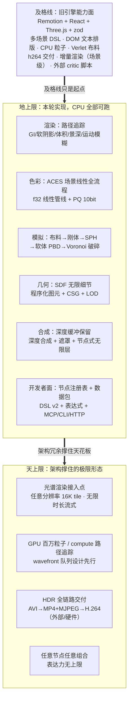
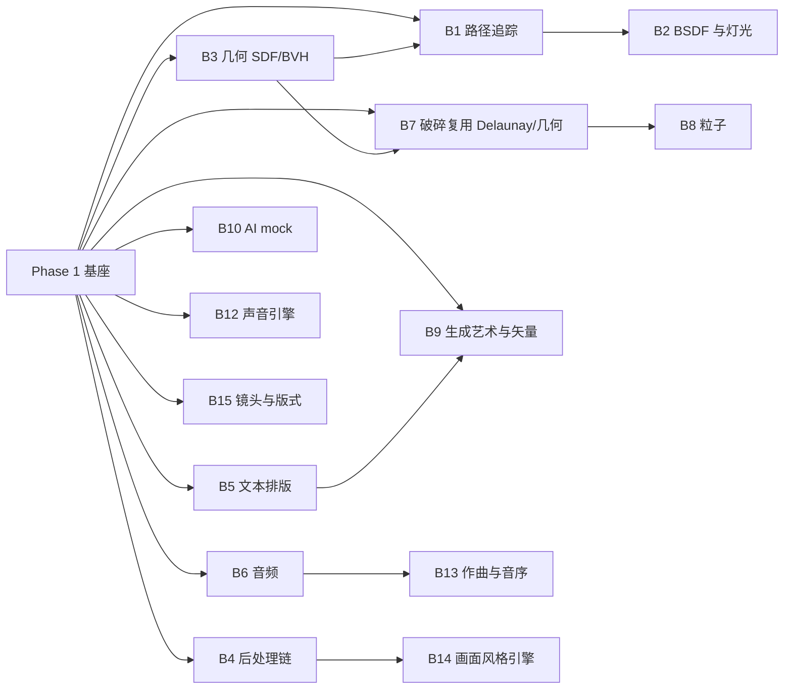

# Prism Engine 强大版路线图（v2.0）

> **兼容性宪章**：本路线图受《兼容性宪章》（`兼容性宪章.md`，条款 C1–C25、验收项 V1–V20）约束——兼容性是第三维度（强大 = 硬实力，上限高 = 表达力，兼容性 = 开发者信心）。宪章修订点 R1–R12 随各 Phase 实现落地，验收项已按 R7 挂接进各 Phase。

> 版本：v2.0（取代 v1.0《能力对齐与补齐路线图》） · 作者：架构师 高见远 · 协调：主理人 齐活林
> 现状基线：M0/M1 已完成——单球体软件光追（CpuRefBackend）、DSL 四块语法（scene/timeline/aesthetic/output，手写 Lexer/Parser）、手写 PNG、36/36 帧确定性验证（md5 逐字节一致）、30+ 测试全绿；workspace 共 7 个 crate（math/gpu/core/dsl/io/render/app）。
> 本文是设计文档，不改任何文件；落盘后即为 v1.0→v2.0 的路线替代。

---

## 0. 术语速查（白话解释，后文直接使用）

| 术语 | 白话解释 |
|------|----------|
| 场景图（Graph） | 把"画面里有什么"描述成一张由节点组成的图，每个节点负责一小块计算，引擎按时钟 t 逐帧求值整张图得到一帧画面 |
| 属性通道（PropertyChannel） | 让节点参数既可以写死一个数，也可以是"随时间变化的曲线/弹簧/表达式"的统一抽象 |
| 路径追踪（Path Tracing） | 从相机发射光线，命中表面后按材质的物理规则继续弹射多次、累积亮度的渲染法，能自然算出全局光照（间接光互相照亮） |
| GI（全局光照） | 光不只来自灯，还包括墙面/地面反弹的间接光；路径追踪免费获得 |
| NEE（下一事件估计） | 路径追踪降噪技巧：每次弹射时额外向光源发射一条"影子线"直接采光，收敛快几倍 |
| BSDF | 材质的"光线反弹规则说明书"：给一个入射方向，告诉你光会以什么概率弹向哪些方向 |
| GGX / 菲涅尔 | GGX 是现代高光模型（粗糙度可控的高光形状）；菲涅尔效应 = 掠射角度下反射变强（水面远处像镜子） |
| 薄透镜 | 景深的相机模型：光圈越大背景越糊，对焦距离决定哪里清晰 |
| 体积介质 / HG 相函数 | 烟、雾、体积光；HG 相函数描述光在介质里被散射的方向分布 |
| Russian roulette / firefly 钳制 | 路径追踪省算力的"随机提前终止"；firefly 钳制 = 限制个别超亮噪点，防白点闪烁 |
| Progressive 渲染 | 先快速出一张噪点多的图，然后一遍遍累积样本让图逐渐干净——随时可看，随时可停 |
| Wavefront 路径追踪 | GPU 上的高效组织法：把几百万条路径按"状态"分组批量处理（求交一批、着色一批），避免 GPU 分支发散 |
| BVH | 把三角形按层级装进包围盒树，求交时快速排除不可能命中的区域 |
| SDF（有符号距离场） | 一个函数，告诉你空间中任意点"到最近表面有多远"；配合 sphere tracing（沿光线步进）求交，可以表达无限细节的程序化形状 |
| CSG | 布尔几何：并/交/减（球减去圆柱=打孔），SDF 下就是几个 min/max 函数 |
| Verlet 积分 | 只用"当前+上一帧位置"就能模拟弹簧/布料的物理算法，稳定且简单 |
| 冲量法刚体 | 刚体物理的实用解法：碰撞瞬间用冲量公式改速度，迭代几次收敛 |
| SPH | 平滑粒子流体动力学：把流体拆成一堆粒子，用核函数估算密度和压力，粒子互相推挤形成流体 |
| PBD（位置动力学） | 软体/通用物理法：不积分力，直接反复"投影"点位到满足约束的位置，稳定好写 |
| Voronoi 破碎 | 在表面撒种子点，每个点划分出"离它最近"的多边形区域，把整块拆成碎片的几何方法 |
| 深度合成 | 3D 渲染时留下"每个像素离相机多远"的深度图，2D 元素按深度插进 3D 场景，雾/景深统一作用 |
| ACES / ACEScg | 电影行业的标准色彩体系：ACEScg 是渲染用的工作色域，ACES 输出变换是"电影感"的官方色调映射 |
| OETF / PQ / HLG | 信号编码曲线：PQ（ST 2084）是 HDR 视频 0~10000 尼特的标准编码；HLG 是广播兼容的 HDR 曲线 |
| RGBA16F | 每通道 16bit 浮点的帧缓冲，能存超过 1.0 的亮度（HDR 的前提） |
| Tile 渲染 | 把一帧切成小块（tile）分别渲染，内存只与 tile 相关，任意分辨率都不爆内存 |
| 推理插座 | AI 能力的接入方式：AI 是一种普通节点，通过统一的推理适配层接口接外部服务/未来小模型，引擎不自研大模型运行时 |
| 求值纯函数 | 同输入必同输出：`Node::eval(ctx, t)` 无隐藏状态，是逐字节复现与增量渲染的根基 |
| 子图签名 | 对图的一小撮节点算哈希，参数没变签名不变 ⇒ 增量渲染与模拟快照复用的判据 |
| 数据包 | 预设+子图+资产（字体/LUT/词典）的分发单元，纯数据不含可执行代码 |

---

## 1. 开篇定位：两个正交维度，不要搞混

### 1.1 用户原话（定位锚点）

> "如果只是做到和旧引擎差不多，对等，那么我投入这么多是为了什么，要强大"
> "要有上限啊，上限要极高"
> "首先要强大，这是第一点。然后要上限高，这是第二点。不要搞混了。上限高是什么意思？就是引擎本身能力足够，开发者可以用引擎做出复杂的事情。"

### 1.2 两个维度的定义

**维度一：强大（引擎硬实力）**——渲染、模拟、色彩、合成、交付自身的**质量天花板**。路径追踪与全局光照、ACES 场景线性全流程、布料→刚体→流体→软体→破碎、深度合成、16K tile 渲染、PQ/HDR。这是"引擎一个人干活干得多好多真"。

**维度二：上限高（开发者表达力，第一原则）**——开发者用引擎能**组合出多复杂的东西**。通用场景图 + 节点注册表 + 属性通道 + 受限表达式 + DSL + 数据包。这是"一千个开发者能用它做出一千种作品"。

两者正交但有一条铁律连接：

> **铁律：每一项硬实力都必须以"可组合节点"的形态暴露给开发者，严禁焊死的旁路管线。**
> 路径追踪是节点图的求值后端（不是隐藏的"高级模式"）、流体是节点族（不是内置特效）、ACES 是色彩节点链（不是开关）、破碎是几何节点+刚体节点的组合。强大经由通用才有意义：路径追踪算出的辐射度可以被表达式读取，SPH 粒子的密度场可以喂给色彩节点，深度图可以参与任意合成算子——**能力之间自由借用，就是"上限高"的字面意思**。

### 1.3 里程碑哲学：消灭"以后"

> "有计划为什么不实现呢，要以后呢？哈哈"

凡 CPU 能实现的能力，**全部排进实现序列**，按依赖拓扑排序（P0/P1 是依赖顺序，不是价值取舍——不存在"重要但靠后"）。真正可后置的只有硬依赖 GPU 硬件的部分：设计+骨架先行，标注"实装待 GPU 机器"。

**画质先行（已拍板）**：物理正确优先于速度——CPU 路径追踪每帧秒级可接受；同时提供草稿低清模式（0.5× 分辨率 + 1spp，成本约 1/64）保迭代体验。
**推理插座（已拍板）**：AI 节点与普通节点同构，推理适配层接口化，接外部服务/未来小模型，不自研大模型推理运行时。

### 1.4 北极星图



---

## 2. 架构上限保证机制（P0 就要埋对，骨架先行）

> 本节六项机制是"天上限"的承重墙。它们必须出现在 Phase 1，因为**后埋等于重写**。

### 2.1 任意分辨率 tile 渲染

**设计**：帧缓冲从整幅 `Framebuffer` 升级为 `TileGrid`：输出分辨率任意 → 切成 128×128（可配）tile → 每 tile 独立调度求值。内存峰值 = 活动 tile 数 × tile 尺寸 × 每像素字节数，与输出分辨率解耦。

- 求交/路径追踪天然逐像素独立，tile 直接并行；
- 需要邻域的后处理（blur/bloom/DOF）分两级：per-tile 效果原地做；全帧效果（大半径模糊）用"halo 扩展区"（tile 外扩 r 像素重算输入带）或流式扫描行窗口，保证跨 tile 结果与整帧渲染**逐字节一致**；
- 交付写盘以 tile 为单位流式追加，16K 帧（15360×8640，RGBA32F 全帧约 2.1GB）不必驻留内存。

**为什么 P0 埋**：路径追踪的采样器、增量渲染的脏区粒度、并行调度单元全部以 tile 为坐标。事后改造 = 三个子系统重写。
**效率**：tile 是天然并行单元（4 核沙箱按核数分片；未来核多自动受益）；增量渲染可以细到 tile 级复用。

### 2.2 线性高精度色彩管线（f32 起步，可升级）

**设计**：内部帧缓冲统一 RGBA16F（f16 存储、f32 计算，内存省一半、精度足够）；**一切光照/混合/后处理在场景线性域进行**，8bit 量化只发生在交付边界。

- 升级点一（ACES）：工作色域从 linear-sRGB primaries 切到 ACEScg（AP1）只换两个 3×3 矩阵 + 输出变换节点，P0 预留 `ColorSpace` 枚举与矩阵常量；
- 升级点二（PQ/HLG）：输出侧 OETF 可插拔（sRGB / PQ / HLG），P0 完成数学+单测（ST 2084 曲线约 100 行，规格公开）；
- 升级点三（光谱，最远端）：积分器采样结构预留"样本可携带波长"的接口位（`Sample::wavelength: Option<f32>`），光谱渲染 = 换一个光谱 BSDF + 每样本固定波长策略，是 Phase 4 后的选项，不做承诺但接口不焊死。

**为什么 P0 埋**：8bit sRGB 直通里写死的混合/后处理，切线性时全部要重新校准；f32 起步则 ACES 只是在管线上"加节点"。

### 2.3 纯函数求值 + 全链路种子化

**设计**：`Node::eval(ctx, t)` 是 t 的纯函数（同输入同输出、无隐藏可变状态）。有状态模拟（物理/粒子/SPH）通过"固定步长推进 + 会话内快照缓存"满足该契约；一切随机（噪声/粒子发射/路径追踪样本/胶片颗粒/溶解/mock AI）由 `(全局种子, 节点 id, 帧号, 像素坐标/样本索引)` 哈希派生，**无任何全局随机数状态**。

推论（这就是"架构上限"）：
- **任意 seek**：跳到第 N 帧直接求值，不需要从第 0 帧播起（模拟按需推进快照）；
- **逐字节复现**：同版本同输入 → 全部帧 + 音频 md5 一致，进 CI；
- **增量与分布式地基**：子图签名（§2.4）+ 帧级天然并行（任何一帧不依赖其他帧的渲染结果）⇒ 渲染农场 = 按帧号分片，未来加分布式调度协议即可，引擎核心零改动。

**为什么 P0 埋**：任何一处"顺手用个全局 RNG"都会在并行化时爆雷，事后清洗成本极高。

### 2.4 节点注册表 + 数据包扩展

**设计**：`NodeRegistry` 是引擎的节点索引：`类型名 → 构造器 + 参数 schema（类型/范围/默认值）`。内置节点编译进二进制；数据包节点**不是代码**，是"预制子图 + 参数预设 + 资产"的纯数据（DSL/TOML/字体/LUT/词典文件）。

```
mypack/
  manifest.toml          # name(kebab-case)/semver/许可证白名单/依赖的引擎能力版本
  presets/*.prism        # 参数预设（如 cinema 调色、布料旗帜风场）
  subgraphs/*.prism      # 预制子图（如 kinetic-type、LowerThird）
  assets/                # 字体子集 / .cube LUT / 分词词典 / cues
```

- 包的加载 = 子图实例化进用户图，节点注册表对包节点与内置节点一视同仁；
- 市场/分发 = 校验 manifest（semver、许可证、资产清单）后落库，**无动态代码加载**，安全面极小；
- 领域优化包（DataViz/Cinematic/…）就是这个机制的官方首批数据。

**为什么 P0 埋**：注册表决定 DSL→图的 codegen 形态；参数 schema 决定校验、编辑器（未来 UI 用引擎自绘）、MCP 工具描述的自动生成。

### 2.5 流式资源与无限时长

**设计**：时间轴是迭代器不是数组——渲染循环"求值一帧 → tile 渲染 → 编码 → 写盘 → 释放"，帧永不驻留；时长上限 = 磁盘。大资产（长音频、大纹理、高模网格）按需流式加载 + LRU 上限（默认 2GB，可配，8G 沙箱安全）。模拟快照缓存同样 LRU，超出即重推进（确定性不依赖缓存命中）。

### 2.6 并行与分布式预留

**设计**：并行的三个天然粒度全部保留确定性——
1. **帧级**：帧与帧渲染结果互不依赖（帧内随机全部由帧号派生）；
2. **tile 级**：§2.1；
3. **样本级**：路径追踪的 pass/spp 独立累积，累积顺序固定（pass 序号进哈希）。

工程约定：混音/求和类运算用固定分块归约顺序；碰撞求解对按节点 id 排序后迭代（消除浮点顺序抖动）。分布式（渲染农场）P2 只出设计：任务 = (帧号区间, 配置哈希)，产物 = 帧文件 + manifest，主节点校验 md5 合帧。

---

## 3. 能力域设计（16 域 A–P）

### 3.0 总表

判定口径：**及格线** = 旧引擎对齐点（压缩为一行）；**地上限** = 本轮实现、CPU 可跑；**天上限** = 架构撑得住的极限形态 + 演进路径；**节点暴露形态** = 开发者怎么用（"上限高"第一原则的落实）。

| 域 | 及格线（旧引擎） | 地上限（本轮，CPU 可跑） | 天上限（架构极限 + 演进） | 节点暴露形态 |
|----|----------------|------------------------|--------------------------|--------------|
| A DSL/分镜 | YAML+zod、多场景、过渡、captions、theme | DSL v2 全语法（§3.6）：多场景/过渡/anim/expr/audio/post/packs，编译期类型检查+行号+常量折叠 | 模块 import、命名子图库、宏；编辑器自动生成（schema 驱动） | DSL 是一切节点的声明入口；`import packs` 装数据包 |
| B 场景内容 2D | kinetic-type/dataviz/logo/cta/插件场景 | Composite2D + 文本/路径/图表/字幕节点族，旧场景全部=预设包 | 任意 2D 节点组合、遮罩树、无限层 | `layer text/path/chart/caption` + 数据包预设 |
| C 动画 | interpolate/spring/easing/关键帧/loop/wiggle/bind | PropertyChannel 全家桶：Track/Spring(解析解)/Expr/Wiggle/Remap/Loop/AudioReactive | 任意通道互引用、表达式节点网络（编译期环检测） | 一切节点参数都是通道；`anim`/`expr` 块定义复用通道 |
| D 噪声/随机 | hash random/value noise/simplex/fbm | prism-noise：PCG 种子 hash + value/simplex/fbm，全种子化 | 3D/4D simplex、流场导数、谱合成（接口已留） | `noise` 表达式函数 + 力场节点 + 位移节点参数 |
| E 着色器栈 | Shader 单 pass + ShaderStack 多 pass（GLSL） | PostFx 可组合链 15+ 效果（blur/bloom/vignette/grain/dissolve/glitch/grade/CA/Mandelbulb…） | GPU WGSL 同名同参双实现；自写着色 DSL 编译 SPIR-V（远期） | `post { chain [...] }` 任意排序任意组合；效果=节点 |
| F 3D/几何 | Three.js Stage3D/相机轨/GPUParticles/UnrealBloom | 路径追踪 CpuRef + 图元族 + SDF/CSG + LOD + 多光源 + 材质升级（§3.1/§3.2） | GPU compute 路径追踪（wavefront）、无限细节 SDF、光谱 | `stage3d { mesh/sdf/light/camera }` 全节点化 |
| G 物理 | Verlet 布料（3 pin 模式/风/阻尼） | 布料→刚体→SPH 流体→软体 PBD→Voronoi 破碎 + 耦合框架（§3.3；实现走 B7 XPBD 统一求解器，D-18） | GPU compute 百万级、全域耦合求解器 | `sim cloth/rigid/fluid/softbody/fracture` 节点族 + 力场节点 |
| H 粒子 | ParticleCanvas CPU + GPUParticles | 种子化 Emitter + 力场（noise/吸引子）+ 点/精灵渲染 + AudioReactive | GPU compute 百万粒子（设计先行） | `layer particles { emitter {...} force {...} }` |
| I 矢量 | DrawPath/morphPath/humanizePath/Rough | Path 模型 + 扫描线光栅 + draw-on/morph/humanize + Rough 预设 | 与 SDF/3D 曲线互转；Lottie 子集 P2 | `layer path` + `anim`（draw-on 通道） |
| J 排版 | Intl.Segmenter/混排/悬挂/分词/卡拉OK | prism-text Tier A→B：TTF 解析/光栅/布局/禁则/kerning/分词（§3.6 外的全部沿用 v1.0 设计） | SDF 文本 GPU、可变字体 | `layer text` / `captions` / kinetic 预设包 |
| K 音频 | 4 情绪配乐/节拍检测/频谱/loudnorm | 采样级合成+WAV+FFT 频谱+节拍+AudioReactive 烘焙+BGM 混音；EBU R128 自研 | 全频段反应网络（音频→任意参数的节点图） | `audio` 块 + `AudioReactive` 通道 = 任意节点可读音频 |
| L 美学 | OKLCH/调色板/LUT/cinema/critic 闭环 | prism-aesthetic 全套 + critic 内建引擎命令（§3.5 合并叙述） | ACES 级 look-dev 体系、镜头语言库 | 色彩=节点链；critic=引擎命令；预设=数据包 |
| M 生成艺术 | circlePacking/flowField/lsystem/Delaunay/turing 等 | 六算法全部生成器节点，输出可再加工（矢量/像素层） | 与 SDF/粒子互喂的生成生态 | `layer genart { kind ... seed ... }` 输出接任意节点 |
| N AI 流水线 | LLM 分镜/TTS 时间戳/cues/mock 降级 | 推理插座：Provider trait + Mock 默认 + OpenAI 兼容可选 + 全流程 pipeline（§3.6） | 任意推理服务即插即用；AI 节点输出进任意通道 | `ai` 节点与普通节点同构；适配层=trait 接口 |
| O 渲染/交付 | renderMedia h264/PQ/增量渲染（场景级） | 路径追踪+tile+RGBA16F+ACES+AVI/MP4+MJPEG+增量（子图签名级）+16K tile（§3.1/§3.4/§3.5） | H.264/HEVC（外部/硬件编码）→HDR 容器、分布式农场 | `output` 块 + `post`/`grade` 节点链 + 增量全自动 |
| P 基础设施 | MCP/HTTP/batch/插件市场/40+ 测试 | MCP stdio + batch matrix + 自写 HTTP + 数据包规范 + >150 测试 | SDK 化、编辑器（引擎自绘 UI）、市场生态 | CLI/MCP/HTTP 三个出口；插件=数据包 |

### 3.1 渲染域（重点扩写）：CpuRef 升级路径追踪

**现状**：CpuRefBackend 是单球体+单灯+Lambert 的软件光追（正确但内容少）。

**选型建议（本轮拍板依据）**：

| 方案 | 原理 | 优点 | 缺点 | 结论 |
|------|------|------|------|------|
| 增量式 light tracing（光子图） | 从光源发射光子，存入光子图再查表 | 焦散/复杂间接光自然 | 需要光子图存储与 kNN 搜索、收敛慢、调参难 | 不做（焦散走 §3.1 焦散专项：SMS+PSR 现代算法组合） |
| **backwards path tracing（从相机）+ NEE** | 从相机发射路径，命中后按 BSDF 弹射；每次弹射额外向光源发影子线 | 与现有光追同构升级；无偏一致；progressive 直观；实现量可控 | 焦散收敛慢（由 §3.1 焦散专项：SMS+PSR 解决） | ✅ **主路径** |

**能力清单（全部 CPU 可跑）**：
- **GI**：路径弹射天然获得间接光（颜色渗透、天光、反弹照明）；
- **软阴影**：面光源（球光/矩形光）+ NEE 面光采样，阴影边缘随光源尺寸变软；
- **体积介质**：均匀介质 ray marching + HG 相函数（烟/雾/体积光束），Beer-Lambert 吸收；
- **景深**：薄透镜模型（`aperture` 光圈 + `focus_distance` 对焦距离）；
- **运动模糊**：每条路径在快门窗口内随机采样 t，几何按该 t 求值（与 Graph(t) 模型严丝合缝）；
- **progressive 渲染**：f32 累积缓冲，一遍遍叠样本；草稿模式 = 0.5×分辨率 + 1spp（成本约 1/64），成片 = spp 16~64 可配；`--progressive` 每pass落盘；
- **firefly 钳制**：间接光高光 clamp（可关），防白点噪闪；
- **确定性**：样本索引 `(tile, 像素, spp序号, bounce)` 全部进哈希 ⇒ 同参数逐字节复现。

**焦散专项（已定 2026-09-27：不自研光子映射老路线，采用现代算法组合，CPU 可跑）**：

焦散难在"从相机出发的路径挤不进镜面链"——玻璃聚焦、水面波光需要路径精确穿过 specular 反弹才够得到光源，随机弹射几乎不可能命中。选型：

| 算法 | 原理（白话） | 结论 |
|------|-------------|------|
| **算法权威声明** | 焦散算法以《算法白皮书》§2（MNEE 分层 + PSR）为施工权威（D-18）；下表 SMS 为历史选型记录 | — |
| **Specular Manifold Sampling（SMS，镜面流形采样）** | 不靠海量随机光线碰运气，而是"解方程"：在镜面链构成的流形上用牛顿迭代直接求出"相机→镜面链→光源"的精确连线，作为一条额外采样路径经 MIS 融合进主积分器 | 历史选型记录：质量高；实现量中等；现由白皮书 §2 MNEE（多初值牛顿）承接其思路 |
| **Path Space Regularization（PSR，路径空间正则化）** | 把镜面反弹微模糊化（BSDF 采样加极小 jitter），让普通路径"挤得过"specular 链 | ✅ **兜底**：实现极小，保证任何场景的焦散"永远看得见"；副作用是轻微模糊，参数可调可关，与 SMS 互补 |
| 光子映射 / SPPM | 从光源发光子存图查表 | ❌ **不做**：收敛慢、调参难，且光子图与 tile 渲染架构有一致性冲突 |
| ReSTIR DI/GI | 时空重采样（业界最新一代） | ⏳ 远期池：GPU 实时/低 spp 预览时代的主力候选（Phase 4 设计占位） |

**Prism 特色加成**：SMS 的牛顿迭代初值、PSR 的 jitter 全部由 `(全局种子, 像素, 样本索引)` 种子派生——焦散渲染**逐字节可复现**，这是论文原始实现（依赖全局 RNG 状态）都做不到的；全链路确定性在焦散这个"最难治噪点"的场景上价值最大。落位：进 Phase 2 渲染工作流（B2 之后接入），验收 = 玻璃球焦散 / 水面波光焦散 golden-file + 焦散亮斑能量守恒断言。

**BSDF 材质模型升级**（Disney 风格参数化，材质=节点）：
- `base_color`（线性域）+ `metalness`（金属度：0=电介质漫反射+高光，1=金属反射着色）+ `roughness`（GGX 微表面粗糙度）+ `ior`（折射率）+ `transmission`（透射权重：玻璃/水）+ `emission`（自发光，喂体积/灯带）；
- 菲涅尔：Schlick 近似；透射：specular transmission lob（进出介质处理 ior 比）；
- 旧 Lambert 是 roughness=1、metalness=0 的特例——向后兼容。

**灯光族**：方向光（太阳，NEE 按方向锥采样）、球光/矩形光（面光源，NEE 面采样）、环境光（纯色起步 → HDRI 经纬贴图 P1，重要性采样 P2）。

**GPU compute 路径追踪设计（GPU-only=骨架先行，实装待 GPU 机器）**：
- wavefront 队列架构：活路径队列/阴影线队列/命中队列，按状态批量处理避免分支发散；
- BVH CPU 侧构建（SAH 启发式）P1 完成——CpuRef 也用它加速网格求交，一份代码两处受益；GPU 侧只做遍历 WGSL；
- 输出进同一 f32 累积缓冲；CpuRef/GPU 双实现互为判对（逐像素统计 diff，阈值视觉等价）。

**效率**：BVH 加速网格求交 O(log n)；NEE 让 spp 需求降一个数量级；tile+帧级+spp 三级并行；草稿模式保迭代。

**节点暴露**：`stage3d` 下的 `mesh/sdf/light/camera/material` 全是节点；材质参数全走属性通道（金属度可以随音乐动）；`quality { spp, bounces, draft }` 是渲染节点的参数而非隐藏开关。

### 3.2 几何域（重点扩写）：程序化几何、SDF 无限细节、LOD

**设计**：新 crate `prism-geometry`，输出统一的"可求交表示"（解析图元 / 网格+BVH / SDF 场），`prism-rt` 消费。

- **程序化图元族**：sphere/box/plane/cylinder/torus/capsule/roundcone + 参数曲面（旋转面/放样面 P2）；参数全走属性通道（半径随时间脉动）；
- **SDF 节点族（无限细节的关键）**：
  - 图元 SDF：同上（SDF 表达式形式）；
  - 组合算子：union/intersect/subtract + smooth 变体（smooth min 让融合圆角，k 参数控制）——CSG 就是三个函数；
  - 域算子：repeat（无限阵列：一颗球变成无限球场）、twist/bend（域变形）、displace（噪声位移 → 分形岩石/地形，fbm 来自 prism-noise）；
  - 求交：sphere tracing（沿光线按 SDF 值步进），步长 eps 随距离放大；
- **LOD**：SDF 天然支持（eps 步长 + 位移 octaves 随距离衰减）；网格几何走 `lod` 参数（细分级数）；相机节点输出距离信息供 LOD 决策；
- **网格**：obj-like 自写解析器（顶点/面）P1，细分（Catmull-Clark P2）；程序化网格（球/柱生成器）P0 已够用。

**天上限**：SDF + 域重复 + 位移噪声 = 无限细节、无限阵列，分辨率只受 tile 渲染限制；GPU 端 SDF marching 是 compute 甜点（骨架先行）。
**效率**：SDF 步进与解析求交混合调度（解析图元直连，SDF 才 marching）；displace octaves 按 LOD 衰减；SDF 场缓存按 tile 复用。
**节点暴露**：`sdf { sphere {...} }`、`csg { a=... b=... op smooth_subtract }`、`repeat { cell 2.0 count inf }`——几何即节点组合，开发者可以搭出完全自创的形状，这正是"上限高"。

### 3.3 模拟域（重点扩写）：布料→刚体→流体 SPH→软体→破碎

**统一模拟框架（先定，五个模拟器全部长在这上面）**：
- `SimSession` trait：`fn advance_to(frame: u64) -> &Snapshot`；固定步长 dt=1/fps，从初始态推进，会话内快照缓存（LRU），子图签名判断快照失效（对接增量渲染）——这就是"eval 是 t 的纯函数"在模拟上的实现；
- `ForceField` trait：噪声场/吸引子/风/重力，布料的风、粒子的力场、SPH 的外力共用同一族节点；
- 耦合器节点：`ClothRigidCoupler`（布料顶点挂刚体）、`ParticleForceCoupler`（粒子对刚体近似推力）——耦合是节点连线，不是写死在求解器里。

**五步序列（依赖顺序，全部 CPU 可跑）**：
**实现权威（D-18 覆盖注）**：实现方式以 B7 XPBD 统一求解器为准（D-18）——刚体/软体/布料/关节走同一约束求解；SPH 走白皮书 §8 XPBD 密度约束（PBF）；下述第 2/3 条冲量法与力基 SPH 为历史选型记录；五步**序列顺序**与 SimSession 会话机制不变。
1. **布料（Verlet）**：点集+距离约束（结构+剪切对角 0.3）+松弛迭代；pin 三模式；风=Expr 通道。沿用 v1.0 设计。
2. **刚体（冲量法，历史记录；实现按 B7 XPBD）**：球/盒刚体 + 平面/球碰撞；冲量 j=−(1+e)·v_rel·n/(1/m₁+1/m₂+…)；库仑摩擦；休眠机制；**确定性关键**：碰撞对按 id 排序求解，浮点顺序稳定。
3. **流体 SPH（历史记录：力基方案；实现按白皮书 §8 PBF）**：Poly6 密度核 + Spiky 压力梯度 + 粘性项；状态方程（Tait）；边界盒反弹；2D 先行（渲染为密度场阈值层=metaball 感，或点精灵），参数 h/rest_density/stiffness/viscosity 全节点化；3D SPH 跟随 GPU 实装。
4. **软体（PBD）**：质点四面体/2D 网格 + 距离约束 + 体积约束 + 子步进；与布料共享"约束投影循环"骨架（同一求解器两种约束集）。
5. **破碎（Voronoi）**：噪声+泊松盘撒种子 → Voronoi 单元（Delaunay 对偶+半平面裁剪，复用 prism-genart 的 Delaunay）→ 每单元实例化为刚体 → 冲击力阈值触发激活。**破碎=几何节点+刚体节点的组合**，铁律的又一示例。

**百万粒子 GPU compute 路线（GPU-only=骨架先行）**：空间哈希网格 + 每格排序 + 邻域搜索的 compute 设计文档 P1 完成；CPU SPH 代码组织成"力计算/积分/邻居搜索"三段，与 GPU kernel 一一对应，双实现互为判对。
**效率**：邻居搜索网格化 O(n)；快照按需推进（seek 跳帧一次到位）；睡眠刚体零成本；2D SPH 网格与迭代上限随分辨率自适应。
**节点暴露**：`sim cloth/rigid/fluid/softbody/fracture { ... force { noise_field ... } }`；模拟输出（粒子位置、密度场、刚体变换）是普通节点输出，可喂给材质、色彩、表达式——比如"SPH 密度场驱动 emissive"。

### 3.4 合成域（重点扩写）：深度合成、遮罩/ROTO、节点式无限层

**深度缓冲保留（本域的地基）**：Stage3D 输出从"RGBA8 底图"升级为"RGBA16F + 线性深度 f32 通道"——路径追踪顺手产出（命中距离），零额外成本。

- **深度合成 / 3D 合成**：`DepthComposite` 节点把 2D 层（带 z 通道）按深度插进 3D 场景：雾/大气/景深对 2D 元素统一作用（2D 文字放进 3D 雾里会被正确雾化、被 DOF 正确虚化）——旧引擎两套栈做不到的事；
- **遮罩族**：`PathMask`（矢量蒙版，复用 prism-raster）、`LumaKey`/`ChromaKey`（亮度/色度抠像）、Roto（手绘路径+羽化+参数随时间=Expr 驱动的动态遮罩）；
- **节点式无限层**：Composite2D 从"平铺层列表"升级为"Compose 树"：双输入合成算子（over/plus/screen/multiply/mask）任意嵌套；平铺列表 = 树的退化形式，完全兼容；层数无上限（求值是流式的，按需算子树）。

**天上限**：深度/遮罩/层都是节点输出，任意组合——深度图可以喂给色彩节点做"按距离调色"，遮罩可以来自 SPH 密度场，一切互借。
**效率**：合成算子单遍逐像素；深度通道 f32 与颜色同缓冲；遮罩光栅结果按签名缓存。
**节点暴露**：`compose { a=... b=... op over }`、`mask { path [...] feather 8 }`——合成结构本身是开发者搭的图。

**多媒体嵌入（B11，用户 2026-09-29 增）**：外部已有素材（图片/视频/音频）作为**标准节点**嵌入渲染图——素材本来就有，引擎只负责"读入 → 进图 → 被一切能力作用"，不生成不转码：

- **嵌入即节点（铁律的直接红利）**：`image_source` / `video_source` / `audio_source` 三种源节点 + `embed` 预置子图（Transform + Composite2D 接入 Compose 树）。嵌入层与任何其他节点无异——bloom/调色/遮罩/深度合成/物理交互**全部天然适用**，零旁路管线；
- **位置动态变化**（用户点名要求）：embed 的 x/y/scale/rotation/opacity 全部接 A2 属性通道（Track/Spring/Expr/Wiggle）——零新机制，"视频里的图片位置动起来"就是一个 Track；
- **时间映射（video_source 的核心）**：素材有自己的时间轴，嵌入时经纯函数映射到引擎时间轴：`帧索引 = f(引擎t)`，模式 direct/loop/pingpong/变速/Expr 自定义——纯函数保证 seek 确定性（跳第 N 帧 ≡ 顺序播到第 N 帧）；嵌入视频的音频轨道同步抽取进混音器，音画对齐 ±1 帧；
- **读入策略（D-17）**：解码器不自研不变——mp4/mov/webm 等经**运行时探测 ffmpeg**（复用 C7 的 extprobe，同一哲学：外部可执行文件可选协作而非代码依赖）；无 ffmpeg 时降级为**原生可解格式**：GIF/APNG（手写解码，开箱底线）/图片序列帧目录/WAV。素材"能不能读"如实标注，永静默不失败。

### 3.5 色彩与交付域（重点扩写）：ACES 全流程、PQ/HLG、容器路线

**ACES 全流程（CPU 可跑）**：
- 场景线性（光照/介质/材质输出）→ **ACEScg（AP1）工作空间**（两个 3×3 矩阵，P0 预留 P1 启用）→ 白平衡/曝光/饱和（线性域节点）→ **ACES 输出变换**（RRT+ODT：P0 用 Narkowicz 拟合单曲线，P1 升级分段拟合逼近真 ACES；Filmic/Reinhard 作为风格选项并存）→ 输出 OETF（sRGB / PQ / HLG）；
- **全链路正确性**：bloom/blur 在线性域、grain 在感知域、LUT 在输出域——色彩空间是每个节点的显式参数，不是全局魔法；
- 全部是**色彩节点链**（`grade`/`aces_output`/`lut3d`），不是开关。

**PQ/HLG**：ST 2084 编码/解码纯数学 P0 完成+单测；10bit 交付 = PNG16 + manifest 声明 PQ 参数（P1）；HLG OETF P1；容器级 HDR（HEVC main10）只做设计（P2）。

**容器路线（逐级兑现，每级独立价值）**：
1. **AVI(rawvideo)**（P0）：~300 行，"双击可播"底线证明；
2. **MP4(ISO-BMFF) + MJPEG + PCM**（P1）：自写基线 JPEG（DCT+量化+Huffman）+ box muxer（ftyp/moov/trak/mdat）——真正的 .mp4 交付；
3. **H.264/HEVC 交付（已定：不自研编码器）**：三层策略——①**外部工具协作**：检测 PATH 上的 ffmpeg（能力探测：libx264/libx265/硬件编码器），可用则直接交付 h264/h265 mp4（音频可顺手 AAC），不可用自动降级 MJPEG——这与零依赖原则不冲突：ffmpeg 是用户机器上的外部可执行文件，属运行时可选协作而非代码依赖，且**恰好对齐旧引擎 capability.ts 的编码器探测哲学**（旧引擎 h264/HDR 交付本就靠 ffmpeg 探测，这是"不弱于旧引擎"的正解而非妥协）；②**硬件编码器厂商 API**：VideoToolbox（macOS）/MediaFoundation（Windows）/NVENC（Linux+N 卡）/VAAPI 属"原始厂商 API"边界内，Phase 4 真机环境启用；③自研软件 H.264 编码器**移出里程碑**（ROI 失衡：数月工程换压缩率收益，而 ①② 已覆盖），仅保留远期备选池。引擎内置基线永远是 MJPEG/AVI——无任何外部依赖即可交付标准 mp4；
4. AAC/mp3 编解码不自研（外部 ffmpeg 路径下由 ffmpeg 处理，引擎内置只管 PCM/WAV）；HEVC main10 容器级设计文档随外部路径顺带覆盖，不再单列自研项。

**效率**：ACES 变换=逐像素矩阵+查表混合；PQ 曲线查表（1024 项 LUT）+端点精确；JPEG/MJPEG 逐 tile 编码衔接 tile 渲染。
**节点暴露**：色彩=节点链；交付=`output` 块参数（`format mp4` / `bit_depth 10` / `transfer pq`）。

### 3.6 开发者面（重点扩写）：DSL v2、表达式、数据包、MCP/CLI/HTTP

**DSL v2 完整语法**（全部块一览，声明即节点图）：

```
movie { aspect "16:9"  fps 30 }          // 全局：画幅预设(16:9/9:16/1:1/自定义)、帧率
theme film                                // 美学主题=预设包引用

import packs "cinematic-basic"            // 数据包：预设/子图/资产
import packs "./mypack"                   // 本地包

scene intro (3s) {                        // 场景块（时长可 "3s"/"1500ms"/"90f"）
  stage3d {
    sdf { sphere { radius 1.0 } csg_op smooth_subtract k 0.2 }
    material { metalness 0.9  roughness 0.15  ior 1.5 }
    light { area { size 2.0  intensity 20 } }
    camera { orbit { radius 4  speed 0.2 }  dof { aperture 0.06  focus 4.0 } }
  }
  layer text { content "棱镜"  y anim { 0s: -80 easeOutCubic, 1.2s: 0 } }
  layer particles { emitter { rate anim { 0s: 0, 0.5s: 120 } } force { noise { scale 2 } } }
  sim cloth { cols 24  rows 24  pin top  wind expr "sin(t*3)*8" }
  compose { a=layer:text  b=layer:particles  op plus }
}
scene content (5s) { ... }

transition between intro, content { wipe 16f direction left timing spring { damping 0.6 } }

expr { pulse(t) = pow(max(0, sin(t*6.28)), 3) }        // 命名表达式，全图可引用
anim { rise = track { 0s: -80, 1.2s: 0 } }             // 命名通道，可复用

audio { score { mood uplift bpm 120 }  bgm "bed.wav"  duck_db -6 }
post  { chain [bloom, grade film, grain, vignette] }
output { resolution 960x540  format frames }           // frames/png/avi/mp4、bit_depth、transfer
```

- **编译期校验强于运行时 zod**：类型检查（通道类型 vs 参数类型）、常量折叠、关键帧排序、表达式环检测、未知节点/字段报错——全部带行号；
- **表达式系统**：自研受限求值器（白名单函数 min/max/clamp/sin/cos/pow/noise…、`t`/`frame`/`this.*`/`节点.参数` 引用、无循环无递归）——bind/惯性/风场/音频反应全是它的应用；编译期环检测 + 常量折叠；
- **数据包规范**：§2.4；领域优化包（kinetic-type/cinematic/dataviz…）即官方数据包；
- **MCP**（stdio JSON-RPC：compile/render_frame/render_video/critique）、**CLI**（render/critique/ai-run/batch/pack）、**HTTP**（自写 HTTP/1.1，局域网渲染服务）——开发者用引擎搭复杂作品的三个出口，schema 全部由节点注册表自动生成；
- **AI 推理插座**：`Provider` trait（storyboard/tts/…）+ MockProvider（种子化确定性，离线全流程）+ OpenAI 兼容 HTTP（可选，自写客户端，失败降级 mock）；AI 节点输出（分镜 DSL/cues/文本）进图后与普通数据无异。

---

## 4. 里程碑（按依赖拓扑排序，非价值取舍）

> 排序原则：被依赖者先行；同一依赖层内并行。"Cpu 可跑=实现进本阶段"；"GPU-only=骨架先行，实装待 GPU 机器"。

### Phase 1 —— 基座（一切的地基，先行合入）

**目标**：把"上限高"的骨架与"天上限"的承重墙全部埋对：通用节点图取代单球体 Scene、属性通道、tile 渲染、f32 线性缓冲、子图签名。

| 工作流 | 内容 | 新增/修改文件（crates 相对路径） | 依赖 |
|--------|------|--------------------------------|------|
| A1 节点图与注册表 | Node/Port/NodeRegistry/求值引擎；现 Scene 迁移为预置图 | crates/prism-core/{node.rs, registry.rs, graph.rs, eval.rs} | 无 |
| A2 属性通道 | PropertyChannel（Const/Track/Spring 解析解/Expr/Wiggle/Remap/Loop） | crates/prism-core/property.rs；crates/prism-anim/{track.rs, spring.rs, easing.rs, expr.rs, presets.rs} | A1 |
| A3 prism-noise | PCG hash/value/simplex/fbm | crates/prism-noise/* | 无 |
| A4 DSL v2 | 全块语法（movie/theme/scene/transition/layer/sim/stage3d/anim/expr/audio/post/output/import packs） | crates/prism-dsl/{lexer.rs, parser.rs, ast.rs, codegen.rs, packs.rs 扩展} | A1, A2 |
| A5 tile 渲染骨架 | TileGrid + 全帧效果 halo 协议（含最小 halo 测试效果：3×3 box blur，供 Phase 1 验收 2 的 halo 用例）；RGBA16F 缓冲；渲染编排改造 | crates/prism-render/{tile.rs, orchestrator.rs}；crates/prism-io/fbuf.rs | A1 |
| A6 子图签名 | canonical 序列化 + SHA-256 + 子树哈希（为增量与模拟快照打底） | crates/prism-core/signature.rs；crates/prism-io/sha256.rs | A1 |

**验收（可测试）**：
1. 节点图求值确定性：同一图渲染两遍全帧 md5 一致；
2. tile 拼接 = 整帧：16×9 tile 与整幅渲染逐字节一致（含一个 halo 型效果）；
3. Spring 解析解 vs RK 数值积分误差 <1e-3；表达式求值 vs 手写期望值 ≥10 用例；环检测编译期报错带行号；
4. DSL v2：多场景/过渡重叠帧计算表、时长解析、`import packs` 装包 ≥15 用例；
5. f32 缓冲往返精度测试；测试总数 >60。
6. 并行求值 ≡ 串行参考逐位一致（账四 U5 还清标准，白皮书 §26；"串行参考"=对同一 reduction_shape(n) 树的固定顺序求值；归约上树后既有 golden 一次性全量重基线，走宪章 C15）。

### Phase 2 —— 硬实力并行波（CPU 全可跑，多工作流并行）

**目标**：所有"强大"的算法本体落地 CpuRef：路径追踪、SDF、五个模拟器、后处理、文本、音频、生成艺术、AI mock、多媒体嵌入、**声音引擎（B12）/作曲音序（B13）/画面风格（B14）/镜头版式（B15）**（用户 2026-09-29 全量拍板；M8 并入 B6 reactive、A6 图表并入 B9、A8 智能辅助并入 C5）。

| 工作流 | 内容 | 新增/修改文件 | 依赖 | 标注 |
|--------|------|--------------|------|------|
| B1 路径追踪 CpuRef | 积分器/NEE/GI/软阴影/体积介质(HG)/薄透镜 DOF/运动模糊/progressive/firefly 钳制/RR | crates/prism-rt/{integrator.rs, sampler.rs, media.rs, camera.rs, accum.rs} | A5 | Cpu 可跑 |
| B2 BSDF 与灯光族 | Disney 参数化（metalness/roughness/ior/transmission）+ Schlick/GGX；方向光/球光/矩形光/环境光；**random walk SSS**（subsurface/radius 参数，光线穿表面续弹射，复用 HG 体积代码——现代路线替代 dipole，参数更少更物理正确）；**焦散 MNEE 分层 + PSR 兜底**（§3.1 焦散专项、白皮书 §2、D-30 k=2 球面折射链；用户 2026-10-02 抓漏明确"不要降级"——焦散随本工作流一并落地，不另列波次） | crates/prism-rt/{bsdf.rs, light.rs, sss.rs, caustics.rs} | B1 | Cpu 可跑 |
| B3 几何 | 图元族/SDF 族（CSG+域算子+displace）/sphere tracing/LOD/BVH(SAH)；**glTF/OBJ 精简导入**（mesh+PBR 材质子集，metallic-roughness 与 Disney 同构零转换）+ **mesh→SDF 烘焙**（现成模型进 CSG/域算子生态——资产与程序化打通） | crates/prism-geometry/{primitive.rs, sdf.rs, csg.rs, lod.rs, bvh.rs, gltf.rs, obj.rs, mesh_sdf.rs} | A1 | Cpu 可跑 |
| B4 后处理链 | blur/bloom/vignette/grain/dissolve/glitch/grade/CA/sharpen/plasma/Mandelbrot_bg/LUT 应用；**三合一降噪**（à-trous 空域 + 确定性时域累积——逐帧可复现零伪影 + variance 自适应 spp；**预留 DenoiseBackend trait 挂点**，为 10/5 机动位 P1 学习逆扩散点火免返工，备忘录 C2）；**UV 重映射 warp 节点**（变形=uv=f(uv) 单原语，重映射场可来自布料/SPH 输出——变形与物理可组合） | crates/prism-postfx/{registry.rs, effects/*.rs, denoise.rs, warp.rs} | A5 | Cpu 可跑 |
| B5 文本排版 | prism-raster 扫描线；prism-text Tier A（TTF/光栅/布局/禁则/缓存/内嵌 OFL 子集）+ Caption/Kinetic + **竖排 CJK**（vertical 模式 + 标点转向） | crates/prism-raster/*；crates/prism-text/{ttf.rs, raster.rs, layout.rs, cache.rs, vertical.rs, font_data/*} | A1 | Cpu 可跑 |
| B6 音频 | 合成器/4 情绪配乐/WAV/节拍检测/FFT 频段/AudioReactive 烘焙/BGM 混音 | crates/prism-audio/{buffer.rs, wav.rs, synth/*, score.rs, beats.rs, fft.rs, reactive.rs, mixer.rs} | A2, A3 | Cpu 可跑 |
| B7 物理（XPBD 统一求解） | **XPBD 统一求解器**（Macklin 现代框架：一套约束求解通吃刚体/软体/布料/关节，substepping 保稳、刚度与迭代解耦——替代 Bullet 式双求解器老路，代码更少更稳）+ 铰链/滑槽/限位关节族 + Verlet 布料→SPH(2D)→Voronoi 破碎 + SimSession/ForceField/耦合器 + GPU compute 设计文档；**骨架（session.rs/xpbd.rs 框架+单测）提前至 10/2 与 A4 同批**（D-28 接口先定，10/3 W7 的 B8 依赖即就绪），本波装约束族内容 | crates/prism-physics/{session.rs, xpbd.rs, joints.rs, cloth.rs, sph.rs, fracture.rs, coupling.rs, doc/gpu_compute.md} | A1, A3, A6 | Cpu 可跑（SPH 3D、GPU compute=GPU-only） |
| B8 粒子 | Emitter/力场/点精灵渲染/AudioReactive | crates/prism-particles/* | A3, B7 框架 | Cpu 可跑 |
| B9 生成艺术与矢量 | 六算法生成器节点 + draw-on/morph/humanize | crates/prism-genart/*；crates/prism-vector/* | A3, B5 光栅 | Cpu 可跑 |
| B10 AI mock | Provider trait/MockProvider/词级时间戳→cues/journal resume/草稿渲染 | crates/prism-ai/{provider.rs, mock.rs, timings.rs, journal.rs, pipeline.rs} | A4 | Cpu 可跑 |
| B11 多媒体嵌入 | image/video/audio_source + embed 预置子图 + 时间映射器（direct/loop/pingpong/变速/Expr）+ GIF/APNG 原生解码 + ffmpeg 探测读入（D-17；**自带最小探测 stub——PATH 存在性检测先行**，C7 收敛为能力探测+降级链+硬解适配） | crates/prism-media/{source.rs, video.rs, audio.rs, timing.rs, gif.rs, apng.rs}；embed 子图注册进 prism-core | A1, A2, B6 混音器 | Cpu 可跑（mp4 等解码=外部 ffmpeg 协作） |
| B12 声音引擎 | 效果器链（混响/延迟/压缩/EQ/失真/声像自动化）+ 合成器升级（多振荡 unison/ADSR/LFO/SVF 多模态滤波）+ 物理建模（Karplus-Strong 弦/模态打击）+ 颗粒合成 + 空间音频（3D 声源→声像/距离衰减，Stage3D 联动）+ **采样回放核**（SFZ 文本格式解析 + Catmull-Rom 四点插值 + CC0 精选小音色库内嵌） | crates/prism-audio/{fx/*.rs, physical.rs, granular.rs, spatial.rs, sampler.rs, sfz.rs} | B6 | Cpu 可跑 |
| B13 作曲与音序 | 音阶库（大小/五声/中古调式）+ 和弦进行引擎 + 琶音器 + step 鼓机 + DSL `note` 块（音高/时值/力度）+ MIDI 导入；4 情绪配乐升级为作曲系统驱动 | crates/prism-audio/{theory.rs, harmony.rs, arp.rs, drums.rs, notes.rs, midi.rs}；prism-dsl note 块 | B6, A4 | Cpu 可跑 |
| B14 画面风格引擎 | 胶片仿真包（halation/分层 bloom/胶片曲线库/科学化颗粒）+ NPR 族（toon/水彩/Kuwahara/halftone/像素化/素描）+ 二级调色（HSL 选区/RGB 曲线/lift-gamma-gain/Power Window）+ 程序化纹理族（纸张/噪波/渐变/图案/Voronoi） | crates/prism-postfx/effects/{film.rs, npr/*.rs}；crates/prism-aesthetic/{secondary.rs, curves.rs}；crates/prism-texture/* | B4 | Cpu 可跑 |
| B15 镜头与版式 | 镜头语言库（推拉摇移模板/dolly zoom/手持 shake/摄影学 DOF 参数化：焦段/光圈/超焦距）+ 版式系统（版式网格/沿路径排字/stroke reveal 文字） | prism-anim/camera_presets.rs；prism-text/{layout_grid.rs, path_text.rs, reveal.rs} | A2, B5 | Cpu 可跑 |

**Phase 2 依赖关系图**：



**验收（可测试）**：
1. 路径追踪：Cornell-box 型标准场景（三面墙+面光+玻璃球+金属球）逐特性 golden-file；GI 颜色渗透/软阴影宽度随面光尺寸变化/DOF 焦外/运动模糊方向各专项断言；同参数两遍 md5 一致；progressive 第 k pass = 前 k-1 累积 + 新样本（累积一致性断言）；
2. SDF：CSG 布尔结果与解析比对；repeat 阵列求交正确性；displace 场 golden-file；LOD 两级 eps 结果边界一致性；
3. 物理：布料角点固定/能量单调降；刚体弹性碰撞动量守恒断言；SPH 静水压平衡测试；PBD 体积保持；破碎单元无缝覆盖（面积和=原面积）；全部模拟 seek 到第 N 帧结果与顺序推进一致（快照等价测试）；
4. 文本/音频/生成艺术沿用 v1.0 各验收（golden-file、节拍 ±1 帧、WAV 往返、无重叠断言等；v1.0 为只读历史附件不在八件套内，具体验收值以本括注内联项与白皮书对应 § 为准）；
5. 后处理每效果 golden-file + seed 决定论；草稿模式（0.5×/1spp）产物完整；
6. `ai-run` mock 中断 resume 跳过已完成阶段；
7. 多媒体嵌入（B11）：嵌入图片过 bloom/调色的 golden-file（证明"被引擎能力影响"）；嵌入视频位置 Spring 动画逐帧断言（位置动态变化）；时间映射 seek 等价（跳第 N 帧 ≡ 顺序播放）；嵌入音画同步 ±1 帧；GIF loop/pingpong 映射断言；无 ffmpeg 环境降级 GIF/序列帧全流程可跑；
8. 能力扩展线（B12–B15）：效果器单测（混响脉冲响应/压缩阈值行为/滤波器频响断言）+ 合成器频谱 golden；Karplus-Strong 音高准确断言；作曲系统音阶/和弦进行乐理断言 + `note` 块渲染 golden + MIDI 导入对拍；NPR 各风格 golden-file + halation 能量守恒；二级调色选区数学断言 + 纹理族 seed 决定论；镜头模板轨迹断言（dolly zoom 焦距/位置耦合）+ 路径排字几何断言；
9. 差距补齐线（**更优算法路线**，D-18，用户 2026-09-29 全量拍板）：glTF 模型加载渲染 golden + **mesh→SDF 化后参与 CSG 断言**（资产进程序化生态）；XPBD 关节限位/能量稳定性断言（铰链链 + 布娃娃冒烟场景）；SSS 玉石球 golden + 衰减随厚度变化断言；降噪收敛断言 + **时域累积两遍渲染 md5 可复现**；竖排禁则/标点转向断言；warp 场来自布料输出的联动断言；SFZ 音高/包络断言 + 内嵌音色库体积记录；
10. 测试总数 >200。

### Phase 3 —— 集成波（把硬实力接成完整作品管线）

| 工作流 | 内容 | 新增/修改文件 | 依赖 | 标注 |
|--------|------|--------------|------|------|
| C1 深度合成 | Stage3D 输出附深度；DepthComposite；遮罩族（PathMask/LumaKey/ChromaKey）；Compose 树 | crates/prism-core/{compose.rs, depth.rs}；crates/prism-postfx/effects/dof_full.rs（全帧 DOF） | B1, B4, B5 | Cpu 可跑 |
| C2 ACES 与 HDR | ACEScg 工作空间切换；ACES 输出变换（拟合）；PQ/HLG OETF；PNG16 10bit 交付 | crates/prism-math/{aces.rs, pq.rs, hlg.rs}；crates/prism-render/linear.rs；crates/prism-io/png16.rs | B1, B4 | Cpu 可跑 |
| C3 增量渲染 | 子图签名接通 + 脏区间（scene 邻接传播）+ cache.json + reuse_ratio | crates/prism-core/signature.rs 接通；crates/prism-io/cache_manifest.rs；crates/prism-render/incremental.rs | A6 | Cpu 可跑 |
| C4 容器交付 | AVI(raw)；JPEG 灰度最小基线（彩色 JPEG 编码降级为机动位候选，往返验收按灰度基线）；MP4(ISO-BMFF)+MJPEG+PCM；EBU R128 | crates/prism-mux/{avi.rs, mp4.rs, boxes.rs}；crates/prism-io/jpeg.rs；crates/prism-audio/loudnorm.rs | A5, B6 | Cpu 可跑 |
| C5 critic 闭环 | analyze/critique/suggest/apply + `--autofix`（走增量渲染） | crates/prism-aesthetic/{color.rs, oklch.rs, palette.rs, critic.rs}；crates/prism-app/cmd_critique.rs | C3, B4 | Cpu 可跑 |
| C6 基础设施 | MCP stdio JSON-RPC；batch matrix；自写 HTTP；数据包市场校验（add/list/remove） | crates/prism-infra/{mcp.rs, batch.rs, http.rs, plugin.rs}；crates/prism-app/{cmd_mcp.rs, cmd_batch.rs} | A4, A6 | Cpu 可跑 |
| C7 H.264/HEVC 交付（外部协作） | ffmpeg 探测器（PATH 检测 + 编码器能力探测 + 自动降级链）；硬件编码器适配层（VideoToolbox/MediaFoundation/NVENC/VAAPI，真机启用）；如存在历史 avc.rs 残留一并清理 | crates/prism-mux/{extprobe.rs, hwenc.rs} | C4 | Cpu 可跑（探测/降级逻辑自研，编码本身外部执行） |

**验收（可测试）**：
1. 深度合成：2D 层插 3D 雾场，像素级期望比对；DOF 对 2D/3D 一致虚化 golden-file；
2. ACES：中性灰/原色/超亮样本过 ACES 变换的期望值表（与公开参考值对拍 ±0.01）；PQ 编解码往返误差 <1e-4；10bit PNG 往返一致；
3. 增量：改一个 TextNode → 未涉区间帧 md5 与上次一致且 reuse_ratio ≥ 0.5；改灯光 → 仅该 scene 区间重渲；
4. 交付：MP4 被自写 box 解析器回读断言 + 外部解码烟测一条（ffmpeg/浏览器可解，与 C7 探测哲学同款）；loudnorm 1kHz 正弦 ±0.5 LU；AVI 双击可播验收；
5. critic：合成测试帧诊断命中 100%；`--autofix` 2 轮评分回升；
6. MCP：外部 JSON-RPC 调 render_frame 返回 PNG 字节；batch 笛卡尔积展开；
7. 全链路确定性回归：≥2 场景+过渡+文本+字幕+配乐+后处理+布料+粒子+AI mock 的演示 DSL，两遍渲染帧+WAV+容器 md5 全一致（进 CI）。

### Phase 4 —— GPU 机器解锁项（设计+骨架已在此前阶段完成，此处仅实装）

| 工作流 | 内容 | 文件 | 依赖 | 标注 |
|--------|------|------|------|------|
| D0 GPU 基础设施 | radix sort / 前缀和 scan（SPH 空间哈希、粒子排序共用）；屏障/同步原语封装；BVH 构建 CPU 先行（GPU 构建为后续优化项） | crates/prism-gpu/{sort.rs, scan.rs, sync.rs} | A5 骨架 | GPU-only |
| D1 vulkan/metal 实装 | device/swapchain/命令编码实装（null 路径测试已在 P1 备好）；WebGPU 后端=手写 wasm 浏览器 API 绑定（支撑手机测试路径） | crates/prism-gpu/{vulkan/*.rs, metal/*.rs, web/*.rs} | A5 骨架 | GPU-only |
| D2 GPU 路径追踪 | wavefront 队列 WGSL；BVH 上传与遍历；与 CpuRef 统计 diff 判对 | crates/prism-gpu/shaders/rt_*.wgsl；crates/prism-rt/wavefront.rs（CPU 仿真版先行） | D1, B1–B3 | GPU-only |
| D3 GPU 模拟 | 百万粒子 compute（空间哈希）；布料/SPH compute | crates/prism-gpu/shaders/sim_*.wgsl | D1, B7/B8 | GPU-only |
| D4 SDF 文本与 GPU 文本 | SDF 字形烘焙 + atlas + WGSL 采样 | crates/prism-text/sdf.rs；crates/prism-gpu/shaders/text.wgsl | D1, B5 | GPU-only |

**验收**：GPU/CpuRef 双实现互为判对（逐像素统计 diff 视觉等价阈值 + 确定性模式 md5）；1080p 路径追踪交互帧率目标；百万粒子 60fps 目标（**性能两项待桌面 GPU 真机验收；窗口内按 D-14 手机=正确性测试设备，仅判正确性+判对**）。

**GPU 测试与反馈路径（已定 2026-09-27：用户手机浏览器 = Phase 4 测试设备）**：

- **设备与定位**：用户手机 GPU（性能有限）——定位是**正确性测试 + 错误反馈**，不承担性能基准（1080p 交互帧率等性能验收仍以桌面 GPU 为准）；其价值是把 Phase 4 的启动条件从"等一台 GPU 机器"变成"浏览器点开网页"。
- **载体**：沙箱"发布为应用"发布 **wasm + WebGPU 测试网页**（单页 harness）：GPU 代码以 `wasm32-unknown-unknown` 编译，WebGPU 后端为**手写浏览器 API 绑定**（extern 声明，零 crate——与手写 PNG 同一哲学）。WGSL 是 WebGPU 原生着色语言，自研各后端共享同一套 WGSL——手机 WebGPU 上验证通过的 shader 逻辑对 vulkan/metal 后端同样有效，故 D2/D3/D4 的核心（WGSL shader + compute 内核）都能在此闭环测试；D1 的 vulkan/metal **原生**后端行为仍待真机。
- **harness 硬性要求（错误反馈闭环）**：
  1. WebGPU 特性检测：不支持时页面直接显示明确提示（浏览器/版本要求），不白屏；
  2. 错误全捕获：GPU API 验证错误、panic hook、device lost 全部落到页面**错误面板**，逐条带上下文（测试项、阶段、错误码）；
  3. **一键复制**错误报告（含环境摘要：UA / WebGPU adapter 信息 / 测试项清单 / 失败项详情），用户复制粘贴回对话即可定位修复；
  4. 测试项逐个可点、可重跑，每项显示 PASS/FAIL/SKIP。
- **测试矩阵**：设备初始化 → 逐个编译并运行 D2/D3/D4 shader 的最小场景 → 小分辨率 CpuRef 对照统计 diff（harness 内直接判对）。
- **依赖边界（已定 2026-09-27，用户抓漏后修正；同日追问"GPU 用途真的窄吗"后二次修正）**：WebGPU/Vulkan/Metal 是**平台原生 API**（浏览器/系统自带），调用平台 API ≠ 第三方依赖（正如手写 PNG 时调用操作系统文件 API）；第三方 GPU 中间库（**wgpu 等）不采用**——GPU 抽象层自研，各后端手写绑定，零第三方 crate 承诺从 CPU 侧完整延伸到 GPU 侧。
- **GPU 用途全景（诚实盘点，修正"用途窄"的过轻表述）**：用途面**广**——路径追踪全套（wavefront/NEE/焦散 SMS 牛顿迭代）、BVH 构建遍历、五模拟器 GPU 版（SPH 空间哈希+排序、布料/PBD 约束求解、破碎）、后处理链（bloom/DOF/运动模糊/分级/色调映射）、SDF 烘焙（文本+3D 距离场）、noise/生成艺术 GPU 版（含 Mandelbulb raymarch）、粒子/文本渲染；kernel 规模估计 **50~70 个**（WGSL+MSL 双份 ≈ 100~140 个 shader 文件的持续维护面）。但抽象层需覆盖的**形态封闭**（引擎自定义的有限 pass 类型，非 wgpu 式任意应用兼容层）：①compute dispatch ②fullscreen/blit pass ③最小三角形光栅管线（SDF 文本/粒子 sprite）④纹理/buffer 上传与读回 ⑤时间戳查询（效率标注）+ 屏障/同步。**2D 矢量光栅化 GPU 化进远期池**（Phase 4 内 2D 内容 CPU 光栅化成纹理上传，质量不变；GPU 2D 仅交互预览需要时再做）。Vulkan 侧 SPIR-V 由自研发射器覆盖本引擎 WGSL 子集（Phase 4 设计文档定案）；Metal 侧 MSL 手写双份源。抽象层代价上调为 **+6~10 周**（含最小光栅管线与同步）；kernel 本体（50~70 个）本就是 D 系列计划内工作，wgpu 同样省不掉——抽象层溢价只占总工程量零头。

---

## 5. 架构性碾压点：为什么旧引擎架构做不到

| 维度 | 旧引擎的结构性缺陷 | Prism 的结构性优势 |
|------|--------------------|---------------------|
| 可复现性 | canvas 2D / WebGL 是**状态机**：绘制调用顺序、驱动内部状态、GPU 舍入都不可控，同输入无法逐字节复现，"任意 seek"无从谈起 | 纯函数求值 + 全链路种子化（§2.3）：Graph(t) 是 t 的数学函数，帧 md5 进 CI；任意 seek 零成本 |
| 正确性判据 | GLSL 单实现：没有第二个实现可以对答案，shader 错了只能人眼看 | CpuRef/GPU 双实现互为判对：CPU 是 ground truth，GPU 上线必须过统计 diff；且 CPU 永远可跑（沙箱/无 GPU 机器/CI） |
| 栈分裂 | canvas 2D 与 WebGL 两套栈手工对齐时间；2D 元素永远进不了 3D 的雾/景深/光照 | 单图统一 2D/3D/模拟/AI：文本与球体在同一 Graph(t)，深度合成天然成立（§3.4） |
| 增量渲染粒度 | scene 级 diffBoards：改一个字重渲整个场景 | 子树签名：改哪个节点脏哪个子图，复用率结构性更高；模拟快照同样由签名判失效 |
| 能力组合 | 插件是 JS 代码包：能力之间靠胶水脚本互调，审美闭环靠外部脚本+全量重渲 | 一切皆节点：能力互借发生在图内（SPH 密度喂色彩、深度喂调色）；critic 内建为引擎命令且接增量渲染（§3.5/C5） |
| 供应链 | 154 文件 + node_modules：审计面不可控 | 零第三方依赖：**代码 100% 自研**（零外部 crate）；外部**数据资产**（字形/数学表/词典）不属代码依赖，逐项登记来源与许可（§6.1 数据资产清单），缺一不得入仓；安全审计/离线构建/分发成本结构性下降 |
| 上限 | 渲染质量被 WebGL 光栅管线锁死（无 GI、无真折射、无体积） | 路径追踪 + SDF + 体积 + tile 渲染：质量天花板只受算力约束；GPU 实装后与离线渲染器同源 |

一句话：旧引擎是"用不可复现的状态机拼出来的网页幻灯片机器"；Prism 是"一台确定性的、可组合的、CPU/GPU 同源的图像函数计算机"。**强大（硬实力）与上限高（表达力）在这里是同一件事的两面：每个硬实力都是图上的节点，节点越多、越真，开发者可组合的空间指数越大。**

---

## 6. 舍弃 / 降级项（继承 v1.0 有效结论）

| 旧能力 | 处置 | 理由 |
|--------|------|------|
| React/Remotion/DOM 渲染路径 | 舍弃 | 被否决的依赖栈正是替换对象；文本/图形 prism-text/raster 自绘，能力不减 |
| WebGL/GLSL 着色栈 | 舍弃（替代为 WGSL + CpuRef 双实现） | 单实现无判对；Prism 用裸厂商 API + 双后端 |
| zod / Intl.Segmenter / node MCP SDK / Express | 替代（DSL 编译期校验 / 自写字素表与分词词典 / 自写 JSON-RPC / 自写 HTTP） | 零依赖；且各自更强（行号错误、离线可用） |
| lottie-web 完整播放 | 降级 P2：Lottie JSON 子集解析 | 完整特性面=再写一个渲染器；子集覆盖描边动画+位移缩放+缓动主流用途 |
| ffmpeg 引擎内依赖 | 舍弃（**运行时可选协作除外**：交付 C7 + 嵌入读入 D-17 双路径） | 零依赖硬约束=无代码依赖；ffmpeg 作为用户机器上的外部可执行文件被探测协作（有则增强，无则降级），与旧引擎 capability.ts 哲学一致 |
| AAC 编码 | 不做 | 自研成本/收益失衡；PCM 进容器通用可播 |
| mp3 解码 | 不做（WAV/FLAC 覆盖） | 专利历史包袱+工程量大；FLAC 自研可行 P2 |
| 复杂脚本排版（印度系/阿拉伯系） | 明确不支持 | HarfBuzz 级整形数万行；拉丁/CJK 覆盖目标场景 |
| 引擎内自研 TTS 语音合成 | 不做（推理插座接外部 TTS） | 引擎侧完整自研"时间戳→cues→字幕对齐"；语音模型属外部服务 |
| 自研大模型推理运行时 | 不做（推理插座：Provider trait + 外部服务/未来小模型） | 已拍板；AI 节点与普通节点同构，适配层接口化 |
| 实时性能（CPU 阶段） | 降级为"画质先行"（已拍板） | 物理正确优先；草稿低清模式保迭代；性能绑定 GPU 里程碑 |
| 自研 H.264/H.264 软件编码器 | **不做**（已拍板 2026-09-27） | ROI 失衡：数月工程；h264 交付由外部 ffmpeg（运行时可选协作，非代码依赖，检测降级）与硬件编码器厂商 API（Phase 4 真机）覆盖；引擎内置 MJPEG/AVI 永远可用 |

### 6.1 数据资产清单（"全部自研"的精确边界）

> **修订记录（2026-10-02）**：用户指出"全部自研"与内嵌 OFL 字体存在表面矛盾，追问后连环发现 B1 表头将 BSD 误标为"公有领域"。收窄口径：零第三方依赖约束的是**代码**（零外部 crate，CPU 侧延伸到 GPU 侧）；**数据资产**（字形/数学表/词典）不是依赖，允许取自外部明确许可来源，但**来源、许可、合规动作三者齐备，缺一不得入仓**。B5 类任务负责维护本清单，QA 审查逐项核对。**本清单资产 = 明确许可下的过渡态，终态自研化（D-31 总账 / 账本 U15）**。

| # | 资产 | 来源 | 许可 | 合规动作 | 状态 |
|---|------|------|------|----------|------|
| 1 | Joe–Kuo Sobol 方向数表（2–64 维，`new-joe-kuo-6.21201`） | UNSW 官方发布页 | **BSD 三条款**（Kuo & Joe 2008，含 "AS IS" 免责） | ①sampler.rs 表头内嵌版权声明+许可条件（履行再分发声明义务）②不以版权人/UNSW/Waikato 名义推广 ③学术致谢（非强制） | ✅ 已内嵌（W4·B1）；2026-10-02 补正许可标注与声明义务 |
| 2 | Noto Sans SC 字体子集（常用字+ASCII+常用标点，约 1–3 MB） | Google notofonts/noto-cjk | SIL OFL 1.1 | ①随包附 OFL 许可文本与版权声明 ②子集产物改名避开 Reserved Font Name（"Noto/Source"）③不单独售卖字体文件 ④不用原字体名推广 ⑤子集产物以 OFL 同许可随引擎分发 | 🔜 B5（方案已拍板 2026-10-02，D-12） |
| 3 | 分词词典（3 万词，D-12） | 待查证（候选 jieba 词库 MIT；仅收许可无争议来源） | 入仓前核验许可原文并登记 | 许可争议来源一票否决 | 🔜 B5 |
| 4 | Disney BRDF / GGX / Schlick 材质与灯光参数 | 公开论文（Burley 2012；Walter 2007；Schlick 1994） | 数学公式与系数不受版权保护 | 代码注释注明出处论文 | 🔜 B2 |
| 5 | B12 采样器音色库（piano/violin/drum 三键） | **引擎程序化合成**（正弦谐波叠加 + 鼓扫频），非外部录音样本 | 随引擎许可（Engine-owned） | ①`sampler.rs` 模块头如实标注"程序化合成、非真实采样"；②外部 SFZ（`sample=` 指向真实 CC0 样本）为后续正式路径，引入前须先登记来源/许可 | ✅ 已内嵌（W7·B12）；**未使用外部 CC0 音色**——无文件 I/O，规避体积/授权风险；如需真实音色库，另行登记 |

> B6 音频的合成器参数与音色波形为自研构造，不属本清单；后续引入任何外部音色/样本，须先入清单再入仓。B12 采样器内嵌音色为**程序化合成**（#5），非外部采样，不涉第三方样本授权。

---

## 7. 决策点表

**已定（本轮拍板，不再讨论）**：

| # | 决策 | 结论 |
|---|------|------|
| D-1 | 产品定位 | 强大第一、上限高第二，铁律=一切硬实力节点化（用户原话） |
| D-2 | 速度策略 | 画质先行 + 草稿低清模式（0.5×/1spp） |
| D-3 | AI 路线 | 推理插座：节点同构 + Provider trait + Mock 默认 + 可选 OpenAI 兼容 |
| D-4 | 里程碑哲学 | 凡 CPU 可实现全部进序列（依赖拓扑）；GPU-only 仅骨架先行 |
| D-5 | 路径追踪选型 | backwards path tracing + NEE + progressive（§3.1 表） |
| D-6 | 内部色彩 | RGBA16F 场景线性起步，ACEScg/PQ 接入点预留（§2.2） |
| D-7 | 动画实现 | Spring 解析解、表达式自研受限求值器（纯函数契约） |
| D-8 | 插件形态 | 插件=数据包（无动态代码加载） |
| D-9 | 模拟序列 | 布料→刚体→SPH→PBD→Voronoi 破碎五步序列，统一 SimSession（**实现方式被 D-18 覆盖（2026-09-29）**：刚体/软体/布料/关节统一走 B7 XPBD 求解器；五步**序列顺序**与会话机制不变） |
| D-10 | 容器/编码 | 引擎内置终态 AVI→MP4+MJPEG；H.264/HEVC 走外部 ffmpeg（检测降级）或硬件编码器 API；AAC/mp3 不自研（外部路径由 ffmpeg 处理） |
| D-11 | AI 边界 | **引擎=纯渲染执行器**：LLM→旁白→TTS→cues 编排留在应用侧，产出以数据包/JSON draft 喂引擎；引擎内只放确定性 AI mock 节点（B10）用于测试与演示；引擎内置 AI 编排（需网络/密钥）不做（D-3 的可选 OpenAI 兼容客户端属插座式单次调用，不构成引擎内置编排，不在本条排除范围） |
| D-12 | 排版资产 | 内嵌 OFL 中文字体子集（常用字）+ 3 万词分词词典：运行时零依赖、开箱即用、golden-file 跨机一致；代价包体约增 3–8 MB。**字体方案拍板（用户 2026-10-02，原话："现在用，以后有时间再自研"）**：采用 OFL（Noto Sans SC 子集内嵌，合规五条见 §6.1 清单 #2；HarmonyOS Sans/MiSans/阿里普惠体均禁修改或禁嵌入软件，已否决）；**自研中文字体 = 设计欠账，账期锚点 = 引擎开发完成后由用户下指令启动**（用户 2026-10-02 补充原话："不是远期，整个引擎开发完之后有时间我就会下指令"——不自动立项、不进模糊远期池；指令一下即开工，账本挂钩） |
| D-13 | 主题预设 | 旧引擎主题预设按 ACEScg 管线**重新调校**（旧数值不直接复用），调校结果以 golden-file 固化；不做 1:1 复刻 |
| D-14 | GPU 测试路径 | 用户手机浏览器（WebGPU）= Phase 4 **正确性测试设备**：沙箱发布 wasm+WebGPU 测试网页（错误面板 + 一键复制报告），用户点击测试、复制错误回传修复；性能基准仍以桌面 GPU 为准；D1 vulkan/metal 原生后端仍待真机 |
| D-15 | GPU 抽象层 | **自研 prism-gpu，wgpu 等第三方 GPU 中间库不采用**（用户 2026-09-27 抓漏定案）：平台 API（WebGPU/Vulkan/Metal）手写绑定不算第三方依赖；GPU 用途**广但形态封闭**（五类 pass + 同步；2D 光栅化 GPU 化进远期池）；零第三方承诺延伸到 GPU 侧；抽象层代价 +6~10 周（kernel 本体 50~70 个本在 D 系列计划内，wgpu 省不掉） |
| D-16 | 代码风格 | **Mini Code 原则**（用户 2026-09-28 定，原话锚定）：**不是偷工减料，而是保证 100% 质量下的去繁**——功能完整性、优秀性、可读性三前提下，优先以完全等价的少量代码替代多量；重复模式抽取复用、无死代码、无过度防御、无 YAGNI 式提前抽象、公开 API 面最小化。质量（含测试覆盖与性能达标）是 100% 不动的常数，mini 的作用域只有"繁" |
| D-17 | 嵌入素材读入 | **外部路径为主 + 范式终局**（D-17 v3，用户 2026-09-30 撤销 v2 自研立项，原话："解码编码器，我觉得还是得依靠范式创新（做窄的话其实也不怎么样，时间还长）"）：**L1 图片/音频自研不变**（PNG/GIF/APNG/WAV/JPEG，原计划不动）；**L2 自研 H.264 窄谱解码器：立项撤销、降为机动位候选（不排期）**——撤项理由：①窄谱对 iPhone 默认 HEVC 等真实场景失效，ffmpeg 兜底不可省，自研只降低依赖频率而非消除；②机会成本：2–3 个 agent 日按 D-25 产能观可还账二+账三+半批账五，存量复刻性价比劣于欠账偿还；③终局 = 神经编解码（NVC）范式，届时按 D-22 吸收战落成新结构/特解，窄谱存量价值进一步衰减；**主路径 = L3 ffmpeg 运行时探测协作（有则增强、无则降级）+ L4 WebCodecs/平台硬解（浏览器与真机可选提速；随 Phase 4 D1 web 绑定落地）**；**编码维持 D-10 不自研（销账簿 R1），同待范式**；JCT-VC 一致性流逐帧 MD5 对拍方案保留为机动位启动时的现成验收方案 |
| D-18 | 差距补齐路线 | **更优算法路线**（用户 2026-09-29 定：不搬业界旧实现，以现代最优解 + 架构红利用更少代码追平并超越，7 项全量）：glTF 精简导入 + **mesh 即 SDF**（B3）、**XPBD 统一求解器**（B7）、random walk SSS（B2）、à-trous+时域累积+自适应 spp 降噪（B4）、竖排 CJK（B5）、UV 重映射 warp（B4）、SFZ 采样核（B12）；**焦散 MNEE+PSR 分层（替代早期 SMS 单主算法方案）随本决策一并生效，施工以白皮书 §2 为准** |
| D-19 | 执行并行度 | **一次性在线 agent 峰值 ≤3 路**（用户 2026-09-29 钱包友好指令）：总窗口 7 天（10/1–10/7，锚点 4 不晚于 10/8），用时间换并发成本；波次间复用 agent 会话降低上下文重建开销；验收标准一分不减 |
| D-20 | 舍弃分类原则 | **"数学没有禁止，只是我们还没设计"**（用户 2026-09-29 定）：舍弃账本中凡属数学上有路径的项——确定性并行（固定序树形归约/约束按冲突图分批）、确定性封装全局状态（光子图=种子派生+固定构建序的烘焙资产，进 §24 签名缓存）、定点 ML 推理（固定权重前向=纯函数，权重是数据非代码依赖，零依赖铁律不拦）、物理严格化（辛积分器/XPBD 收敛极限）、实时档位（同一引擎的质量-预算曲线）、更多格式解码——一律记为**设计欠账**而非根本舍弃；文档禁用"永不/不可能"式舍弃表述（保证书式承诺句除外），改写"当前未设计，路径见 X"；**根本舍弃仅两笔：第三方生态（铁律代价）与自研工时（有限资源）**；设计欠账按触发条件（需求出现/工时空闲/范式突破）滚动立项 |
| D-21 | 算法设计准则 | **从数学推导开始根本性设计**（用户 2026-09-29 例证快排 vs 冒泡：差距是量级级别）：每个算法动手前先问两个问题——"这个问题的数学结构是什么？""直觉/暴力过程是不是这个结构的低效模拟？"量级差（O(n log n) vs O(n²)）来自结构映射，不来自微优化；更强的结构通常**同时给出更少的代码**（解析解替代步进器、一套约束代数替代两套求解器）。与 D-16/D-18/D-20 构成方法四件套：D-16 管代码形态、D-18 管差距项清单、D-20 管舍弃分类、D-21 管设计入口 |

| D-22 | 架构第一性原则 | **数学结构第一性**（用户 2026-09-30 定，原话："引擎的各部分数学形式只是一个数学结构/数学理论的特解/外在表现形式，这是极强大的！"）：引擎核心 = 12 个数学结构 + 一张特解注册表；功能节点 =（结构， 特解参数， 组合方式）；新功能 = 新特解（加参数/换核函数），内核零改动；架构总设计 v2.4 轴心即此；算法白皮书 §25 附录《核、对偶、格》= 数学出处（核五化身/六求逆策略/对偶切换/格锚定 + 四张红利保证书）；禁止为统一而统一造上帝对象 |
| D-23 | 自定义开放 | **四级自定义光谱，从数学底层开始**（用户 2026-09-30 定，原话："允许开发者在代码中自定义组件，允许从数学底层开始自定义"）：①参数级 = 覆盖别名参数包/换预设（创作词汇）；②组合级 = DSL 组合已有节点成新组件，数据即组件（创作词汇）；③特解级 = 实现 MathStructure + registry! 声明宏注册，必须答三问、不齐注册表拒绝——D-22"新功能=新特解"正式对外开放（opt-in 内核词汇）；④结构级 = 注册全新数学结构 S13+，验收 = 结构性质测试套件（opt-in 贡献者协议）；**铁律第五条精确化**：术语不泄漏判据只对官方预置面生效，自定义通道 = 显式 opt-in 贡献者通道（类比 unsafe：显式责任边界，非错误），命名自由归开发者；**护栏四级通吃不豁免**：零第三方依赖、全链路确定性（SampleIndex hash 派生=唯一随机源）、CpuRef 可跑、签名树自动覆盖（缓存/复现免费获得）；技术方案 registry!（macro_rules!，禁 inventory/proc-macro 第三方方案；**D-27 定案：静态汇入制**——宏展开为注册函数 + app 启动静态汇入，三问校验落注册时）；架构承载 = 架构总设计 v2.4 §2.6；**v2 补记（2026-10-01，用户澄清原话："开发者在代码中定义了，往后使用"）**：自定义组件生命周期 = **定义**（用户 crate 内普通 Rust 代码：struct + impl MathStructure，无运行时安装步骤、无脚本层、无插件管理器）→ **注册**（registry! 一行声明，静态汇入同一张注册表——D-27 静态汇入制）→ **往后使用**（此后该程序内一切构建——DSL 文本按名写、L2 数据包引用、代码直接构建——像官方组件一样可用，调度器只认 StructureId 不认来源（§2.6.2 运行时无差别），签名树/缓存/逐字节复现自动覆盖）；定义是全局生效的，非局部闭包；**跨会话语义钉死：存档图引用自定义组件按名记录，读档时按当前程序注册表解析——定义跟着代码走（代码在，组件就在），缺定义 = 明确结构化报错，绝不静默降级**；L2 数据包同模型：定义一次、往后按名使用（数据即组件，D-8） |
| D-24 | 账期总则 | **"除非是我原话明确先不要的，否则账总是要还"**（用户 2026-09-30 定）：对手差距账本中一切条目默认负还账义务；销账（改判"明确不做"）的**唯一依据 = 用户原话明确拍板**（必须引用决策编号与日期作原话锚点）；"自研工时有限"只是账期长的理由，不是不还的理由；D-20"根本舍弃两笔"据此收紧——生态账通过 D-23 自定义光谱与互操作欠账滚动偿还，非终局豁免；承载 = 《差距账本.md》v2.3（销账 3 笔 + 欠账七笔大账/14 子项 + 账目性质光谱；账四已立项 10/1–10/2 还清、账二已确认可还） |
| D-25 | Agent 产能基准 | **军团产能模型**（用户 2026-09-30 三度校准定）：①单 Agent——任务明确下写 1000 行代码不需要小时级别；②并行——上限 3 Agent ⇒ **3000 行代码不需小时级**；③时间——**一天可多次召唤 Agent 军团** ⇒ **日产能 = 万行级**；④批次耗时 = **运行时间最长的 Agent 所耗时间（max），而非加法叠加（sum）**——并行的本意即此；批次设计纪律随之派生：任务切块尽量均衡（防长尾拖住整批）、先完成先回收（机动位即刻释放，可接续派活）。7 天窗口容量核算与波次拆分以此为产能基准（与 D-19 峰值 ≤3 路配套）；账二"多加一轮召唤"据此校准 ≈ 1–2 个军团批次内还清；**前提强调：产能红利以"任务明确"为前提**——文档体系（做什么/怎么算/本体是什么/怎么不出事/何时做完）正是把任务喂明确的基础设施，这也是 Mini Code（D-16）与数学结构设计（D-21/D-22）的产能侧红利；**执行含义：波次大概率提前完成，提前释放的机动位优先还账（账四 10/1–10/2、账二待令）** |
| D-26 | 归约代数立项 | **固定形状归约代数 = 账四（确定性并行）还清方案**（用户 2026-09-30 拍板"账四最先可以还，用一个好算法，可以保障双边"；本条为账本维护规则 4"点火即同步决策表"的补记）：白皮书 v1.3 §26《固定形状归约代数》——归约树形状 = n 的纯函数（reduction_shape(n)，prism-core 单点定义），工程四律（形状唯一/安全区优先/消序用排序/分布式同树）；验收 = 并行 md5 ≡ 串行参考逐位一致（10/2，Phase 1 验收第 6 条）；已入 W1 A1 任务包与架构 §4.3 |
| D-27 | registry! 机制 | **静态汇入制**（用户 2026-10-01 委托主理人按推荐定案；QA 审查证实 macro_rules! 纯局部展开物理上无法跨 crate 收集）：registry!（macro_rules!）在定义所在 crate 内展开为 `__prism_collect(reg)` 式注册函数（编译期展开，零第三方依赖，禁 inventory/proc-macro 不变）；可执行 crate（prism-app/用户 bin）启动时对各定义 crate **静态汇入一次**——D-23"无运行时安装步骤"精确化为"**无动态加载，静态链接即用**"（开发者体验不变：写 impl + registry! 一行，往后即用）；三问校验在注册汇入时执行（运行期三段式结构化报错；宏展开期仅查字段存在性）；架构承载 = §2.6.2/§3.6（v2.4 同步） |
| D-28 | A1 状态与采样接口 | **EvalCtx 快照库 + SampleIndex 像素域**（用户 2026-10-01 委托定案）：①有状态模拟（布料/粒子/SPH 第 N 帧依赖第 N-1 帧状态）经 **EvalCtx 增快照库引用**解决——快照键 = (子图签名， 帧)，签名含通道定义哈希（§4.2 已明文），LRU 逐出只影响重算不影响结果（seek 等价成立条件成文）；S3 的 apply 语义 = 调度器自快照库装配（上一帧状态， 当前帧参数）后投影一步，SimSession 机制归入此接线；②**SampleIndex 增 `pixel: (u32, u32)` 字段**——逐像素派生（胶片颗粒/采样流）有安放处，同节点不同像素必不同流，防网格伪影；**10/1 A1 定接口一次落定**（架构 §3.6/§4.4 v2.4 同步） |
| D-29 | 确定性数学件 | **超越函数自研入 prism-math**（用户 2026-10-01 委托定案；工程师审查 P0：libm 的 sin/cos/exp/pow/atan2 跨平台差 1–2 ulp，"跨平台逐位一致"承诺被源头击穿）：超越函数一律区间逼近多项式 + 固定系数自研（约 150 行，D-16 兼容）；整数幂一律连乘不用 pow；音高比查表 2^(k/1200) 格点化（白皮书 §23）；架构 §4.3 格锚表补"超越函数 = 禁 libm"；既有验收（双遍 md5/能量守恒/golden）不测跨库一致性——此修为跨机 md5 的**前置必修** |
| D-30 | 焦散 k=2 链 | **MNEE 扩展球面 k=2 折射链**（用户 2026-10-01 委托定案；审查发现玻璃球焦散实为 k=2 链：相机→漫射面→入球折射→出球折射→光源，旧分层错落 PSR 兜底致质量错位）：MNEE 多初值框架已设计，球面链解析雅可比可写，增量约 100 行；白皮书 §2 分层改述为"k=1 镜面链 + 球面 k=2 折射链用 MNEE，k≥2 其余链 PSR 兜底"；玻璃球焦散 golden 验收预期与算法能力就此对齐 |
| D-31 | 数据资产自研化总账 | **外部数据资产 = 过渡态，终态 = 自研**（用户 2026-10-02 定，原话："不只是中文字体，事实上我有时间的话 就会下指令进行'资产数据自研化'"）：§6.1 清单所列外部资产（方向数表/字体/词典/逼近系数）均为明确许可下的**过渡方案**；引擎开发完成后，用户可对任一资产下指令启动自研化替换，逐项自研路径已在账本 U15 预置；不自动立项、不占 7 天窗口排期，指令一下即开工；当前合规动作照常履行（许可声明义务不因未来自研而豁免） |

**待用户拍板（已全部拍板 2026-09-27，无遗留）**：

| # | 决策 | 结论 | 备选 |
|---|------|------|------|
| ~~Q1~~ | 内嵌数据资产（OFL 中文字体子集 1~2MB + 3 万词分词词典） | **已定（用户拍板 2026-09-27）：接受** → D-12 | 拒绝则文本改"用户外挂字体"模式 |
| ~~Q2~~ | H.264 终点 | **已定（用户拍板 2026-09-27）：不自研**。外部 ffmpeg / 硬件编码器路径交付 h264，引擎内置终态 = MP4+MJPEG | — |
| ~~Q3~~ | 焦散算法 | **已定（用户拍板 2026-09-27）：不自研光子映射老路线**，采用现代算法组合——SMS 主算法 + PSR 兜底（§3.1 焦散专项），ReSTIR 进远期池 | — |
| ~~Q4~~ | 旧引擎 theme/预设数值 | **已定（用户拍板 2026-09-27）：按 ACES 管线重新调校**，golden-file 固化 → D-13 | 1:1 复刻做对照验证用 |
| ~~Q5~~ | AI 流水线边界 | **已定（用户拍板 2026-09-27）：引擎=纯渲染执行器**，AI 编排留应用侧，引擎内只放确定性 mock 节点 → D-11 | 引擎内置 AI 编排（破坏零依赖与确定性） |

---

## 8. 待用户确认清单（精简）

1. ~~Q1~~ **已定**：内嵌 OFL 字体子集 + 分词词典（D-12）。
2. ~~Q2~~ **最终口径 = D-17 v3（2026-09-30）**：窄谱自研立项撤销（v2 的立项决议一并作废），主路径 = ffmpeg 运行时探测 + WebCodecs；编码维持 D-10 不自研；超纲格式仍走 ffmpeg 兜底。
3. ~~Q3~~ **已定**：焦散走 SMS+PSR 现代算法组合（§3.1 焦散专项），光子映射不做，ReSTIR 留远期池。
4. ~~Q4~~ **已定**：主题预设按 ACES 管线重新调校，golden-file 固化（D-13）。
5. ~~Q5~~ **已定**：AI 流水线边界=引擎纯渲染执行器，AI 编排留应用侧，引擎内仅确定性 mock 节点（D-11）。
6. Phase 1–3 的 Cpu 可跑范围与 Phase 4 的 GPU-only 清单如无异议，即按依赖拓扑推进；每阶段验收标准（含全链路 md5 确定性回归）以本文为准。

**产物可见性约定（用户要求 2026-09-27）**：渲染验证/测试/golden-file 等过程产物一律输出到隐藏工作区（`/root/media-engine-archive/`），**禁止**散落到项目目录给产物面板刷屏；`/workspace` 只放用户明确要看或要交付的最终产物。M0/M1 的 75 张验证图（36 对帧 md5 逐字节一致 + GIF）已按此归档，未丢失。

**Mini Code 原则（用户要求 2026-09-28）**：**不是偷工减料，而是保证 100% 质量下的去繁**。在**功能完整性、优秀性、可读性**三前提下，不添加任何多余冗杂代码，优先以**完全等价的少量代码**替代多量代码。实践判据：重复模式抽取复用、无死代码、无过度防御、无 YAGNI 式提前抽象、公开 API 面最小化。其中**质量是 100% 不动的常数**——验收测试覆盖（>60/>200、golden-file；与 §4 Phase 验收及日历锚点对齐）与性能达标（效率逐项标注）一分不减；mini 的作用域只有"繁"：冗余结构、死代码、多余抽象、重复模式。若某处"简化"会导致质量下降，那不是 mini code，是违规。

---

*（文档完。本文遵循：零第三方依赖、CpuRef 永远可用、统一场景图无旁路管线——每一项硬实力都以可组合节点暴露、全链路确定性可复现、效率逐项标注、GPU-only 项设计+骨架先行。v1.0 的 16 域对齐成果全部继承并被"强大/上限高"两维重新定位。）*
