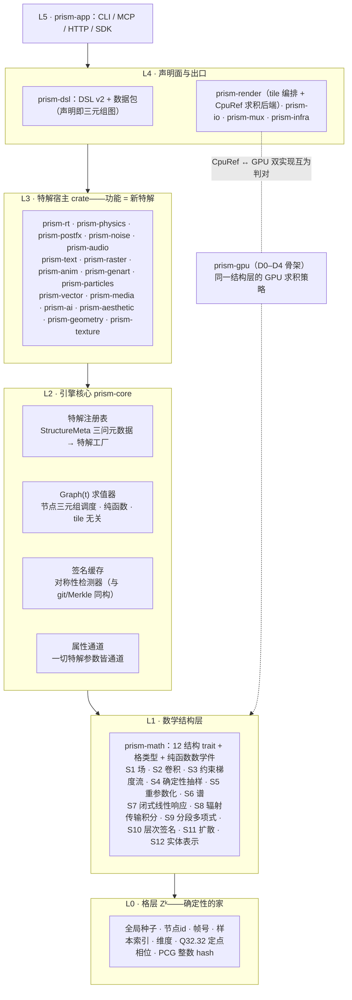
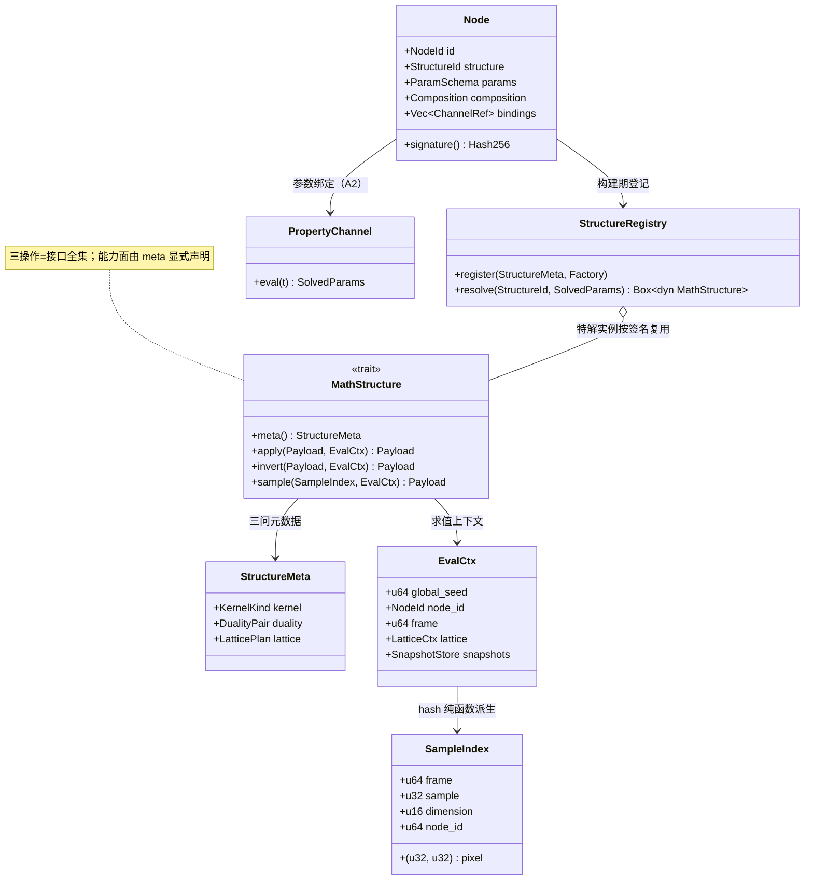
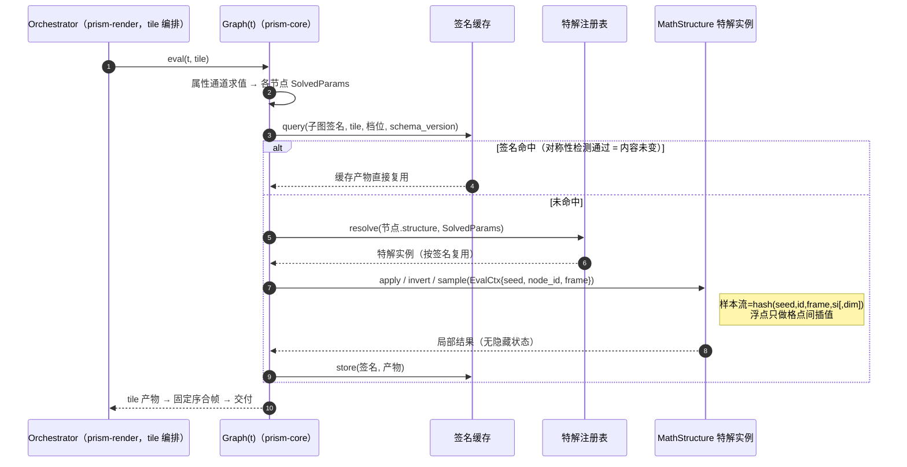
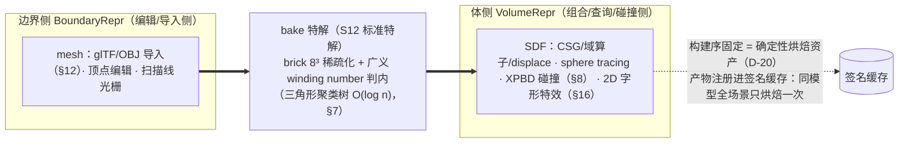
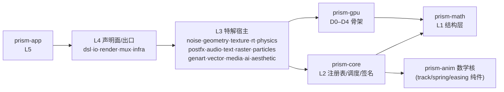

# 棱镜引擎（Prism Engine）架构总设计

> **v2.2 · 双视图架构 × 自定义光谱：数学骨骼 × 创作皮肤**（v2.1 的"自定义开放"修订；v0.1 功能导向节点表的正式取代者）
> 架构师 高见远 · 协调 主理人 齐活林
> 上位依据：《强大版路线图》v2.0（D-1~D-30 为权威）·《算法白皮书》v1.3（**§25 附录《核、对偶、格》+ §26 归约代数 = 本文内核出处**）·《兼容性宪章》v1.0（C1–C25）·《施工日历》v4.4（排期与关卡以此为准）
> 本文回答一个问题：**引擎的本体是什么。** 答案（D-22，用户原话）："引擎的各部分数学形式只是一个数学结构/数学理论的特解/外在表现形式。"——因此：**引擎核心 = 12 个数学结构 + 一张特解注册表；功能节点 =（结构， 特解参数， 组合方式）；新功能 = 新特解，内核零改动。**

### 双读者声明

> **为什么有两种叙述**：用户反馈原话——"这整个架构太数学了，你要叫开发者怎么理解？数学内容我们引擎内部就好。"用户认可数学作为**内核组织原则**（D-22 轴心不变），反对的是数学术语**泄漏到开发者界面**。故本文一套内核、两套叙述：

| 视图 | 读者 | 语言 | 所在章节 |
|------|------|------|----------|
| 内核视图 | 引擎贡献者（我们自己 + agent 军团） | 12 数学结构、三问注册、三操作 trait、对偶切换、格锚定 | §1、§3–§7 |
| 开发者视图 | 引擎使用者与自定义贡献者 | 创作导向功能概念：sphere / bloom / cloth / spring 曲线 / subtitle / 竖排…（自定义贡献者 opt-in 进内核词汇通道，§2.6） | §2 |

**铁律级纪律（数学术语不泄漏，v2.2 精确化）**：判据只对**官方预置面**（prism 官方 crate 的公开 API / 错误信息 / 加载报告 / 用户文档）生效——S1–S12、核、对偶、格、求逆等术语在这些界面**永不出现**，只活在 crate 代码与贡献者文档。**自定义通道 = 显式 opt-in 贡献者通道**（§2.6 特解级/结构级）：进通道用内核词汇名正言顺——类比 Rust 的 unsafe：显式声明责任边界，不是错误；自定义组件命名自由归开发者本人。两个视图的关系一句话：**数学结构是骨骼，功能概念是皮肤——骨骼决定能力上限，皮肤决定上手体验；别名层是纯声明的（一个友好名 = 一个预置特解参数包），零运行时成本；自定义光谱四级开放（§2.6）把骨骼的扩展权交给开发者。**

---

## 0. 一句话定位

**图即产物；图的每个节点只是某个数学结构的特解；12 结构 + 特解注册表 + Graph(t) 纯函数调度 = 引擎全部；CpuRef 与 GPU 是同一结构层的两种求积策略——CpuRef 永远是黄金参照（宪章 C22），GPU 与 CpuRef 互为判对。开发者面对的永远是创作词汇（§2 开发者视图），内核词汇只存在于本文 §1/§3–§7 与 opt-in 自定义通道（§2.6）；自定义光谱四级开放——参数、组合、特解、结构，从换预设到从数学底层自定义（D-23）。**

---

## 1. 架构总纲

> **内核视图（贡献者向）**：本节及 §3–§7 的术语（S1–S12/核/对偶/格/求逆）不向任何开发者界面泄漏，纪律见 §2.5。

**为什么轴心要换**：v0.1 的功能导向节点表（Geometry/Material/Light/…）在 M0/M1 验证了求值语义，但白皮书 §25 的数学探究证明：24 项算法可被 5 种核化身与 6 种求逆策略完全重述——功能分类是表象，数学结构是本体。以结构为轴心，"强大"与"上限高"获得同一来源（结构的组合空间天然开放：新特解零成本接入），且每条架构红利都有数学保证书（§25.4）而非工程运气。

### 1.1 分层总图（箭头 = 依赖方向，上层依赖下层）



### 1.2 十二结构总表（§25 三问的答案即此表）

| # | 结构 | 数学本体（§25 化身） | 引擎实例（白皮书 §） | 求逆策略（§25.1） | 格锚方式（§25.3） |
|---|------|---------------------|---------------------|------------------|------------------|
| S1 | 标量场 | 协方差核随机场 | 噪声族（§17）、SDF 场、SPH 密度场 | 作用为主 | 格点 hash + 格间 quintic 插值 |
| S2 | 卷积 | 调和分析核 | blur/bloom、K 加权（§21）、插值、shutter 核 | 谱逆 / 直接 | 核尺寸与相位格锚 |
| S3 | 约束梯度流 | 近端算子不动点 | XPBD 全家：刚体/软体/布料/关节/流体/破碎（§8–10） | 迭代逆（压缩映射） | 子步数固定、求解序按 id 格锚 |
| S4 | 确定性抽样 | 样本↔测度配对 | Sobol+Owen（§1）、撒点初值（§2/§10） | 生成元（无逆） | 本体生存在 Z⁴，无全局 RNG |
| S5 | 重参数化 | 变量替换+方程求根 | MNEE 牛顿（§2）、时间映射（§19）、UV warp | 局部逆（牛顿 3 步） | 初值个数与迭代数格锚 |
| S6 | 谱分解 | 傅里叶对角化 | FFT 节拍（§20）、JPEG DCT（C4） | 谱逆 | 蝶形运算序固定 |
| S7 | 闭式线性响应 | 格林函数（冲激响应） | Spring 解析解（§11）、包络、阶跃/斜坡响应 | 精确逆 | O(1) 求值，t 为自变量 |
| S8 | 辐射传输积分 | 转移核 | 路径追踪（§1）、random walk SSS（§4）、体积介质 | 随机逆（Neumann 级数 MC） | 路径样本全格锚（经 S4） |
| S9 | 分段多项式 | 再生核 / RKHS | track/缓动、ACES 拟合（§13）、Catmull-Rom（§23） | 精确逆（插值） | 节点锚在时间格 |
| S10 | 层次+签名 | 内容↔摘要（Merkle）+ 分割 | BVH（§6）、brick（§7）、签名树（§24） | 加速/判等（无逆） | 同输入同树（tie-break 格序） |
| S11 | 扩散 | 热核（拉普拉斯的格林） | 三合一降噪（§5）、halation 渗光链（§15） | 正则化逆 | 级数与半径格锚 |
| S12 | 实体表示 | 边界↔体对偶 | mesh/SDF/glTF（§7/§12）、SDF 字形（§16） | 表示切换（bake） | 构建序格锚 = 确定性烘焙资产 |

### 1.3 红利保证书 → 架构机制映射（§25.4 的落地位置）

| 保证书条目 | v2.1 架构机制 |
|-----------|--------------|
| 不变性→免费（Noether 式） | 签名缓存=对称性检测器（§4.2） |
| 压缩映射→收敛（Banach） | S3/S5 的 meta 声明压缩系数与迭代上界 → 子步/迭代数显式标价 |
| 内容寻址→缓存完备（Merkle） | 256 位签名树，10⁹ 条目生日界碰撞 ~10⁻⁵⁹ |
| 逼近阶=质量定价 | 草稿/标准/电影三档 = 特解参数显式标价（spp/eps/octaves） |

---

## 2. 开发者视图（新增：皮肤层规范）

**为什么要有这一章**：数学是内核的组织原则，不是开发者的界面语言——用户反馈"这整个架构太数学了"。开发者看到的每一个名字都必须是**创作导向的功能概念**；本章定义皮肤层的全部机制：别名层、功能节点库、创作 DSL、可见性边界、自定义光谱。**本章内容面向开发者文档体系；右列映射本身是内部资料。**

### 2.1 别名层机制（友好名 = 预置特解参数包，纯声明零运行时成本）

- **别名条目** = (友好名， StructureId, 预置参数包， 参数 schema, 行业对照)——一个友好名展开为一个预置特解；`material.glass` 就是"Transmission=1、IOR=1.5、roughness 低"的 S8 预设，仅此而已；
- **编译期展开**：codegen 在编译期把友好名展开为三元组图节点，**运行时与直接写结构完全一致**——别名层零间接、零开销；
- **单一出口**：官方预置的全部别名注册在唯一注册处（prism-core `alias.rs`，随 A4 落地）；DSL 校验、错误信息、MCP 工具描述、用户文档从同一处生成，映射禁止散落（§8.3）；自定义组件不走 alias.rs，走 registry! 双通道汇入同一注册表（§2.6）；
- **与宪章同源**：友好名审查走"命名三问"（C5）与行业对照表（C4/C6）——`cloth`/`spring`/`bloom` 本就是行业通用词，我们只是把它们接进预置特解。

### 2.2 功能节点库表（友好名 → 内核映射）

> **内部资料**：右两列供贡献者与 agent 军团使用；开发者文档只见左列（面向开发者的是宪章 C6 的"行业词汇 ↔ 友好名"对照表）。

| 开发者友好名（创作词汇） | 吸收的 v0.1 类 | 内部实现（结构 + 预置特解） |
|--------------------------|----------------|----------------------------|
| `sphere` `box` `plane` `cylinder` `torus` `capsule` | Geometry | S12 · 解析图元特解（白皮书 §6/B3） |
| `mesh`（glTF/OBJ 导入） | Geometry | S12 · 精简导入特解（§12）+ 可选烘焙 |
| `boolean { union/subtract/smooth }` | Geometry | S12 · CSG 与 smooth 变体特解（§7） |
| `repeat` `twist` `displace` | Geometry | S12 域算子 + S1 位移场特解（§7/§17） |
| `material.standard` | Material | S8 · Disney BSDF 特解（§3） |
| `material.glass` / `material.skin` / `material.metal` | Material | S8 · transmission/SSS/金属预设（§3/§4） |
| `sun` `area light` `ambient`（HDRI） | Light | S8 输入侧 · 面光采样/环境光特解（B2） |
| `camera` + `depth_of_field` + 快门 | Camera | S5 · 薄透镜与 shutter 核特解（§1/B1） |
| `keyframe` `easing` `spring` `wiggle` `remap` `loop` | Transform | S9 track/缓动特解 + S7 Spring 闭式解特解（A2/§11） |
| `expr` 表达式 | Transform | 受限表达式求值器（声明面，A2） |
| `cloth` `rigid` `fluid` `softbody` `fracture` `joints` | Simulation | S3 · XPBD 各约束族特解（§8/§9/§10） |
| `particles { emitter force }` | Simulation | S4 发射 + S3 求解 + S1 力场特解（B8） |
| `ai`（分镜/字幕草稿，离线 mock） | AIInference | S4 确定性 mock + Provider 声明面（D-3/D-11/B10） |
| `compose { over/plus/screen/… }` `mask` `key` | Compose | Merge 归约 + 特征域抠像特解（§18） |
| `depth composite`（2D 进 3D 雾/虚化） | Compose | S2 · 软深度合成特解（§18） |
| `blur` `bloom` `vignette` `CA` `sharpen` `glitch` `dissolve` | PostFX | S2 · 卷积族效果特解（B4） |
| `denoise` | PostFX | S11 · 三合一降噪正则化特解（§5） |
| `halation` `grain`（胶片感） | PostFX | S11 渗光链 + S4 双尺度颗粒特解（§15） |
| `toon` `watercolor` `halftone` `oil` | PostFX | S2+S11 · NPR 算子特解（§14） |
| `grade` `lut3d` | PostFX / Aesthetic | S1（.cube=RGB 三维标量场+三线性插值）/S9 · 色彩变换特解（C2） |
| `look cinematic/film/anime` + 草稿/标准/电影 | Aesthetic | S9 · ACES 拟合/风格曲线特解 + 三档标价（§13） |
| `text` `subtitle`（SRT） `竖排` | —（B5 新面） | S12 字形距离场 + S2 覆盖率 + 排版规则（§16；排版规则结构归属待定，L4 可兜底） |
| `path` `draw-on` `morph` `chart` | —（B5/B9 新面） | S9 插值 + S2 覆盖率 + 预置子图（B9） |
| `genart { flowField/lsystem/… }` | —（B9 新面） | S4 撒点 + S1 场特解（B9；lsystem=字符串改写→S4 生成规则特解、turing 实为 S11 扩散反应，映射待补标注） |
| `transition` `movie` `theme` | —（宪章一等概念） | S9 过渡曲线 + S5 时间映射 + 主题数据包（映射行待补详注） |
| `image/video/audio` 源（loop/pingpong/变速） | —（B11 新面） | S5 · 纯函数时间映射特解（§19） |
| `synth` `score`（作曲） `sampler`（SFZ） `beat reactive` | —（B6/B12/B13 新面） | S6/S2/S7/S4 音频特解族（§20/§22/§23） |
| `output { png/avi/mp4/10bit }` + manifest | Output | 声明面 + S9/S6 编码件（C2/C4） |

> **上表只是光谱的起点（官方预置面）**：L1 参数级 = 给表内任意友好名覆写参数包；L2 组合级 = 数据包（`.prismdata`）把表中若干行组装成新组件，进 alias.rs 形如官方条目；L3/L4 = 自定义特解与自定义结构，走 registry! 进同一注册表（四级定义与护栏见 §2.6）。

### 2.3 创作示例（全程无数学术语，编译产物是三元组图）

```prism
// prism-dsl 1
// glass_orb.prism —— 开发者视角的最小示例：与 v0.1 spin_red_ball 同风格
scene "glass_orb" (3s) {
  camera main {
    transform { translate(0, 0, -6) }
    fov 45
    depth_of_field { aperture 0.06  focus 4.0 }
  }
  light key { type area  size 2.0  intensity 20  color #fff4e6 }
  light rim { type sun  direction(1, -1, -0.5) }

  mesh orb   = geometry.sphere(radius 1.0)
  glass_mat  = material.glass { tint #cfe8ff  ior 1.5 }
  floor_mat  = material.standard { albedo #c0392b  roughness 0.3 }

  render orb with glass_mat lit_by key, rim
  render plane with floor_mat lit_by key
}

timeline {
  orb -> transform.orbit(y, 360deg over 3s, ease-in-out)
  main -> camera.dolly(zoom 1.0 .. 1.15 over 3s)
}

aesthetic {
  look cinematic          // 电影感 = 预设包引用
  post { bloom, grain }
}

output {
  resolution 1920x1080
  format video(h264) duration 3s fps 30
}
```

> 这段 DSL **全程无任何内核术语**（无 S1–S12、无核/对偶/格/求逆），编译产物即三元组图——示例语句 → 编译产物对照（内部资料）：

| DSL 语句 | 编译产物（三元组图节点） |
|----------|--------------------------|
| `geometry.sphere(radius 1.0)` | (S12, 解析图元特解， Feed) |
| `material.glass { ior 1.5 }` | (S8, transmission+IOR 预设特解， Feed) |
| `depth_of_field { aperture 0.06 }` | (S5, 薄透镜重参数化特解， Feed) |
| `post { bloom, grain }` | (S2, 渗光核特解) 与 (S4+S2, 双尺度颗粒特解) 的 Chain |
| `transform.orbit(...) / spring 曲线` | (S9/S7, 轨迹与闭式响应特解， Bind——参数绑定 Node.bindings，非 §3.5 六种组合方式) |
| `look cinematic` | (S9, ACES 分段拟合特解， Chain) |

### 2.4 可见性边界对照表（官方预置面判据；opt-in 自定义通道例外见 §2.6）

| 开发者永远看得到（创作面） | 开发者永远看不到（内核面） |
|----------------------------|----------------------------|
| 创作词汇：sphere / bloom / cloth / spring / subtitle / 竖排 / chart… | 结构编号与名称：S1–S12、StructureId |
| 参数名：radius / aperture / damping / 强度 / 半径 / 档位 | 三问字段：KernelKind / DualityPair / LatticePlan |
| 三段式错误信息（在哪 / 什么事 / 怎么改，宪章 C18） | 核、对偶、格、求逆、牛顿、不动点、热核等词 |
| 加载报告"未支持清单"（永不静默，C7/C20） | apply / invert / sample、Payload、EvalCtx |
| 行业对照："相当于 AE 的 X / Remotion 的 Y"（C4–C6） | crate 文件名、内部 trait、格锚计划 |
| 三档预设：草稿 / 标准 / 电影 | 压缩系数、谱半径、生日界、收敛阶 |

### 2.5 术语纪律（铁律级，六条）

1. **别名单向**：官方预置面内，友好名 → 预置特解，参数包可覆写（如 `material.glass { ior 1.2 }`）；绕过别名直写 StructureId 属贡献者行为，走 §2.6 opt-in 通道；
2. **单一出口**：官方预置的词表映射只存在于 alias 注册处一处（§8.3），codegen / 报错 / MCP schema / 文档全部由它生成；自定义组件的注册走用户 crate 的 registry!（§2.6），不进 alias.rs；
3. **泄漏即 bug（官方预置面判据）**：官方预置面的任何开发者可见文本（DSL 报错、加载报告、`--help`、MCP 工具描述、用户文档）出现内核术语 = 流程事故，CI 结构化断言拦截（对齐宪章 V7 思路）；自定义 opt-in 通道内的内核词汇不属泄漏——进通道即声明责任边界（类比 unsafe）；
4. **内部术语的合法居所**：crate 代码与注释、贡献者文档（本文件 §1/§3–§7、白皮书）、agent 军团施工指令，以及自定义贡献者的 opt-in 通道代码（§2.6 L3/L4）；
5. **友好名照行业惯例**：与 C4/C5/C6 同源——行业已有概念照抄行业词，自造词必须挂行业锚点；自定义组件命名自由归开发者本人，不做强制对照；
6. **逐级 opt-in**：自定义从浅到深（§2.6）：能用参数级/组合级解决的不进特解级/结构级——皮肤解决的事不惊动骨骼。

### 2.6 自定义光谱（v2.2 新增：四级开放，D-23 落地）

**为什么开放自定义**：D-22 命题"新功能 = 新特解"若只对官方开放，引擎上限被官方人力封顶；用户 2026-09-30 决策原话——"允许开发者在代码中自定义组件，允许从数学底层开始自定义"。四级光谱把架构红利变成开发者红利：**皮肤层（参数/组合）人人可用，骨骼层（特解/结构）显式 opt-in**——这正是"上限高"的完整含义。

#### 2.6.1 四级光谱表（从浅到深，逐级 opt-in）

| 级 | 名称 | 开发者做什么 | 词汇面 | 护栏 | 交付物 |
|----|------|--------------|--------|------|--------|
| L1 | 参数级 | 覆写别名参数包 / 换预设（`material.glass { ior 1.2 }`） | 创作词汇 | 全护栏，零声明 | DSL 参数 |
| L2 | 组合级 | DSL 组合已有节点成新组件，存 `.prism` 数据包——**数据即组件** | 创作词汇 | 全护栏，零代码（D-8：插件=数据包） | 数据包（manifest 校验 C12） |
| L3 | 特解级 | 实现 `MathStructure` trait + `registry!` 声明宏注册——**D-22"新功能=新特解"正式对外开放** | opt-in 内核词汇 | 贡献者协议：必答三问 + 四护栏（2.6.3） | 用户 crate |
| L4 | 结构级 | 注册全新数学结构 S13+ | opt-in 内核词汇（贡献者协议） | 贡献者协议 + 结构性质测试套件验收 | 用户 crate + 贡献者文档 |

每级协议要点：

- **L1/L2（创作词汇，全护栏）**：一切参数仍走属性通道（A2）；L2 组件可引用 L3 自定义特解，加载期校验（三问齐备 + C12 区间）；官方领域包（kinetic-type 等）与 L2 同机制——官方示范先走一遍。
- **L3（特解级）**：三问必答（KernelKind / DualityPair / LatticePlan），**不齐注册表拒绝**——注册汇入时结构化报错（三段式：在哪 / 缺哪问 / 怎么补，宪章 C18 同款；D-27：校验落运行期注册时，宏展开期仅查字段存在性）；数据包引用场景为加载期报错；能力面（invert / sample 支持与否）在 meta 显式声明。
- **L4（结构级）**：**架构上天然可插**——求值器只依赖 `MathStructure` trait 与 StructureId，不硬编码 12 个结构（v2.0 设计的自我兑现）；StructureId 开放用户段（官方 1–12，S13+ 起为自定义，按 crate 名隔离冲突）；**验收 = 结构性质测试套件**：按 StructureMeta 声明验证 apply/invert/sample 的确定性（同 EvalCtx 同输出）、可逆性（声明有逆则 invert∘apply ≡ 恒等）、格一致性（LatticePlan 声明的量格锚）；L4 结构须附贡献者文档（三问答案 + 数学说明，白皮书式）。

#### 2.6.2 registry! 与 alias.rs：双通道汇入同一注册表

| 通道 | 谁用 | 词汇面 | 声明位置 | 汇入 |
|------|------|--------|----------|------|
| `alias.rs` | 官方预置 | 创作词汇 | prism-core 单一出口（§2.1/§8.3） | 特解注册表 |
| `registry!` | 自定义贡献者 | opt-in 内核词汇 | 用户 crate 内声明 | 特解注册表 |

- **技术方案（D-27 静态汇入制）**：`registry!`（`macro_rules!`）在**定义所在 crate 内**展开为 `__prism_collect(reg)` 式注册函数（编译期展开，零第三方依赖，**禁 inventory / proc-macro 类方案不变**）；可执行 crate（prism-app / 用户 bin）启动时对各定义 crate **静态汇入一次**——无动态加载、无脚本层、无插件管理器（D-23"无运行时安装步骤"精确化为"**无动态加载，静态链接即用**"，开发者体验不变：写 impl + registry! 一行，往后即用）；**三问校验在注册汇入时执行**（运行期三段式结构化报错，宪章 C18 同款；宏展开期仅查字段存在性）；
- 两条通道汇入**同一个特解注册表**：运行时无差别（Graph(t) 调度器只认 StructureId，不认通道来源）；CI 术语断言只覆盖官方预置面（§8.3）。

自定义特解示意（设计示意，非实现；opt-in 通道内内核词汇名正言顺）：

```rust
// —— 用户 crate：my_fx ——（L3 特解级：显式 opt-in，责任边界自声明）
struct RippleField;                          // 命名自由归开发者

impl MathStructure for RippleField {
    fn meta(&self) -> &StructureMeta {
        // 三问必答：不齐 = 注册汇入时结构化报错（在哪 / 缺哪问 / 怎么补；D-27 落运行期注册时）
        &StructureMeta {
            id: StructureId::custom(13),           // 用户段 S13+，按 crate 名隔离冲突
            kernel: KernelKind::Covariance,        // 问一：核是什么
            duality: DualityPair::SampleMeasure,   // 问二：配对哪一侧
            lattice: LatticePlan::LatticeAnchored, // 问三：格锚了吗
        }
    }
    fn apply(&self, x: &Payload, ctx: &EvalCtx) -> Payload { /* 仅 prism-math / prism-core 原语 */ }
    // invert / sample 按能力在 meta 中声明——不支持者注册表拒绝含该操作的组合方式
}

registry! { structure RippleField => custom(13); } // 展开为 __prism_collect 注册函数（D-27 静态汇入制，禁 inventory/proc-macro）
```

**存档与读档（D-23 v2 补记的架构承接）**：自定义组件在存档图（`.prism`/`.prismir`）中**按名记录**；读档时按**当前程序的注册表**解析——定义跟着代码走（代码在，组件就在）；缺定义 = 结构化报错（三段式），**绝不静默降级**（宪章 C20 红线）。L2 数据包引用自定义特解同判（加载期校验三问齐备 + C12 区间）。

#### 2.6.3 四级护栏通吃不豁免

| 铁律 | 在自定义通道的形态 |
|------|--------------------|
| 零第三方依赖 | 特解实现只准用 prism-math / prism-core 原语，禁拉外部 crate（构建/加载期校验依赖清单） |
| 全链路确定性 | 全局种子 / 节点id / 帧号由 `EvalCtx` 注入，`SampleIndex` hash 派生 = 唯一随机源，自定义特解不得私开 RNG；开发者只提供自己名字空间的维度 |
| CpuRef 永远可跑 | 自定义特解随图进 CpuRef 求积后端（同一 trait 实现，无 GPU-only 旁路） |
| 签名树自动覆盖 | 自定义组件参数进图签名 → 缓存 / 增量 / 逐字节复现**免费获得**——D-22 架构红利直接落到自定义组件 |

---

## 3. 节点模型 v2

> **内核视图（贡献者向）**：本节术语不向开发者界面泄漏（§2.5）。

**为什么节点不再是"类型"**：功能节点类型表会随功能无限膨胀（v0.1 已 11 类，路线图功能面 ≥16 域），而结构只有 12 个。三元组把"类型爆炸"压缩为"参数空间"：节点类型表消失，注册表只登记 12 结构的特解工厂——**开发者的类型感由 §2 别名层完整还原，内核只认 12 个结构。**

### 3.1 节点三元组

| 元组位 | 类型 | 说明 | 例（玻璃球焦散） |
|--------|------|------|-----------------|
| 结构 StructureId | enum，12 值 | 本体 | S8 辐射传输积分，内嵌 S5 镜面链重参数化 |
| 特解参数 Params | schema 化，全部可接属性通道 | 特解身份（同一结构的不同特解由此区分） | ior=1.5、roughness=0、迭代步数=3、初值 k 个 |
| 组合方式 Composition | 6 种归约算子（§3.5） | 结构如何连接 | 与 NEE 按 MIS 合并 |

v0.1 功能节点 → v2.0 三元组吸收对照：Geometry→S12/S1；Material→S8 特解参数；Light→S8 输入侧特解；Camera→S5（薄透镜重参数化）；Transform→S9；Simulation→S3；AIInference→S4（确定性 mock）+ 声明面；Compose→Merge；PostFX→S2/S11；Aesthetic→S9 + 预设；Output→声明面。**v0.1 的 11 类全部被吸收，无一废弃；其开发者面名称全部以友好名形式活在 §2.2 别名层。**

### 3.2 三问接口（注册元数据，D-21 操作化）

新特解注册时必须填齐三问，**问不齐注册表拒绝**（白皮书 §25.5 纪律 1）。**三问由特解作者（内核贡献者）填写，使用者无感——开发者只见友好名与参数 schema（§2）。**

```rust
/// 三问注册元数据（设计签名，非实现）
struct StructureMeta {
    id:      StructureId,
    kernel:  KernelKind,   // 问一：核是什么？——卷积核/格林函数/转移核/协方差核/再生核/无核服务
    duality: DualityPair,  // 问二：配对哪一侧？——边界↔体/样本↔测度/时域↔频域/原问题↔乘子/内容↔摘要
    lattice: LatticePlan,  // 问三：格锚了吗？——哪些量锚 Zᵏ、哪些量允许格间浮点插值、插值核是什么
}
```

### 3.3 求值器统一接口（作用 / 求逆 / 采样三操作）

```rust
/// 12 结构统一求值器接口（设计签名，非实现代码）
/// 域/陪域按结构定义（Payload 包裹），注册表动态分发；
/// 每个特解 = 本 trait 的一个实现 + 一份参数 schema + 三问元数据
trait MathStructure {
    fn meta(&self) -> &StructureMeta;

    /// 作用：正向求值（结构作为算子对输入的作用）
    fn apply(&self, x: &Payload, ctx: &EvalCtx) -> Payload;

    /// 求逆：按 meta 声明的策略解算子方程 f = g + Kf（或 Kx = b）
    /// 策略 ∈ {精确, 局部(牛顿), 迭代(不动点), 谱, 正则化, 随机(MC), 表示切换}
    fn invert(&self, y: &Payload, ctx: &EvalCtx) -> Payload;

    /// 采样：随机求积——样本流 = hash(全局种子, 节点id, 帧, pixel, 样本索引[, 维度])，纯函数（D-28 像素域）
    fn sample(&self, si: SampleIndex, ctx: &EvalCtx) -> Payload;
}
```

三操作是接口全集；每个结构的能力面在 meta 中显式声明，不支持的操作（如 S10 无逆）注册表拒绝含该操作的组合方式——**能力缺失从静默缺陷变为类型级事实**。

### 3.4 三操作 × 12 结构能力表

| 结构 | apply（作用） | invert（求逆策略） | sample（随机求积） |
|------|--------------|-------------------|-------------------|
| S1 标量场 | 坐标 → 场值（含导数） | — | 域扭曲坐标喂回（经自身） |
| S2 卷积 | f ∗ k | 谱逆（FFT 相除） | shutter 核随机求积（经 S4） |
| S3 约束梯度流 | 约束投影一步（λ 累积） | 迭代逆（不动点至收敛） | — |
| S4 确定性抽样 | 索引 → 低差异样本 | — | **本体即采样** |
| S5 重参数化 | 参数 → 方程残差 | 局部逆（牛顿 3 步，多初值经 S4） | — |
| S6 谱分解 | 时域 → 频域 | 谱逆（逆变换） | — |
| S7 闭式线性响应 | (初值，输入轨迹) → 响应 | 精确逆（闭式解 A/B） | — |
| S8 辐射传输积分 | 场景+路径 → 辐射 | 随机逆（Neumann MC） | 路径/自由程/lobe 样本（经 S4） |
| S9 分段多项式 | t → 值 | 精确逆（插值节点反解） | — |
| S10 层次+签名 | 查询（求交/判等/近邻） | — | — |
| S11 扩散 | 正向渗光/模糊 | 正则化逆（降噪） | — |
| S12 实体表示 | 查询（距离/命中/内外） | 表示切换（bake，§5） | — |

### 3.5 组合方式（Composition，6 种）

| 组合方式 | 归约语义 | 引擎实例 |
|----------|----------|----------|
| Chain | 串行 f∘g∘h | `post { chain [...] }`、色彩节点链 |
| Merge(op) | 多输入归约：over/plus/screen/multiply/mask | Compose 树、混音 |
| Csg(op, k) | min/max/smooth 布尔变体 | SDF 组合（§7） |
| Mis(w) | power heuristic 多估计量合并 | BSDF 采样 × NEE；MNEE × 主积分器 |
| Dual | 表示切换（单向声明，§5） | mesh→SDF bake |
| Feed | 默认图边（单进单出） | 一切连线（SPH 密度喂色彩 = Feed） |

### 3.6 节点模型类图



---

## 4. 数据流与求值

> **内核视图（贡献者向）**：本节术语不向开发者界面泄漏（§2.5）。

**为什么调度器不需要懂功能**："功能=特解"的直接推论——Graph(t) 调度器只面对 12 个结构的 apply/invert/sample 与格上下文，新功能对调度器不可见，求值引擎一行不改。这是 v0.1"一切皆节点"的同构承诺在结构层的重述与加固。

### 4.1 一帧求值时序（Graph(t) 结构视角统一调度）



### 4.2 签名缓存 = 对称性检测（不是启发式）

- 节点签名 = hash(StructureId, 特解参数序列化， 各子签名， 属性通道变化特征)——自底向上子树哈希（§24）；**"属性通道变化特征"明文定义 = 通道定义（规格/AST）哈希，非瞬时值特征**（瞬时值相同而定义不同的通道必须不同签名，否则模拟快照误复用）；模拟节点快照键另含自起点以来通道定义签名链；
- 缓存键 = (子图签名， 分辨率， spp 档， tile, schema_version, engine_version)（宪章 C13，旧版本只失效重建、永不误复用；tile 维度与 §4.1 query 一致）；签名/键取 256 位哈希，碰撞概率 ~10⁻⁵⁹，本设计以无碰撞为公理；
- **"什么可以缓存"由不变量证明（§25.4.1），不是猜测**：签名相等 = 对称性检测通过 = 逐字节可复用；路径追踪累积缓冲、模拟快照、烘焙 SDF、节拍表共用同一生态（§24/[T] 红利）。

### 4.3 tile 无关性与格锚定规则表

tile 无关性三规则（A5 已验证资产，保留）：① per-tile 效果原地求值；② 大半径全帧效果走 halo 扩展协议；③ 跨 tile 与整幅渲染逐字节一致。

| 量 | 生活域 | 纪律 |
|----|--------|------|
| 种子/节点id/帧号/样本索引/维度/迭代计数 | Zᵏ | 整数运算——确定性是定理而非承诺 |
| 定点相位（采样回放） | Q32.32 | 整数累加，禁浮点相位（§23） |
| Sobol 逆/插值/积分步进 | ℝ | 只允许格点间局部插值，端点皆格点 |
| 求和/归约 | 格序 | 一律走 prism-core 唯一 reduction_shape(n)（白皮书 §26），串行为其退化情形；碰撞/约束按 id 排序（§8） |
| hash | Z→Z | PCG 整数函数；禁浮点三角（sin 大数法，§17） |
| 超越函数（sin/cos/exp/pow/atan2） | ℝ | **一律用 prism-math 确定性数学件（区间逼近多项式+固定系数，D-29），禁 libm**——libm 跨平台差 1–2 ulp，击穿"跨平台逐位一致"；整数幂一律连乘不用 pow |
| fma | — | 全局统一启用或禁用（跨平台逐位一致，§6 附注） |

### 4.4 确定性铁律的操作化

**随机性 = hash(全局种子， 节点id， 帧， pixel， 样本索引[, 维度])，全引擎唯一随机性入口**（D-28：pixel 为像素域，逐像素派生如胶片颗粒/采样流的安放处——同节点不同像素必不同流，防网格伪影）：任何结构的 sample 不得私开 RNG；Sobol 维度序号编码弹射深度等用途（§1；哈希只负责选点与打散，白皮书 §1）；RR 终止概率、MNEE 初值、PSR jitter、粒子发射、胶片颗粒、mock AI 全部经此派生。

**有状态模拟 = EvalCtx 快照库接线（D-28）**：`EvalCtx` 携带 `SnapshotStore` 引用——模拟类节点（S3 约束族）的 apply 语义 = 调度器自快照库装配（上一帧状态， 当前帧参数）后投影一步；快照键 = (子图签名， 帧)，签名含通道定义哈希（§4.2 明文），LRU 逐出只影响重算、不影响结果——**seek 等价成立条件**：跳第 N 帧 ≡ 顺序推进到第 N 帧，逐字节。求值纯函数契约（`eval(ctx, t)` 无隐藏状态）不变：状态在快照库（纯数据资产）而非隐藏可变全局。

---

## 5. 对偶切换机制

> **内核视图（贡献者向）**：本节术语不向开发者界面泄漏（§2.5）；开发者面上这一切只是 `mesh { bake sdf }` 一行声明。

**为什么单列一节**：五对偶（§25.2）中唯一发生"表示本身切换"的是边界↔体——它也是 [S] 红利（SDF 生态）的总闸门：**mesh 导入即获得无限细节（displace）、布尔组合、域变形、精确碰撞**（白皮书 §7 超越点）。

### 5.1 架构位置与切换流



- **位置**：bake 是 S12 实体表示的一个标准特解，与 GLTF 导入（§12）同挂特解注册表，不设旁路服务；
- **触发**：用户在 DSL 显式声明（`mesh { bake sdf }`），或碰撞/CSG 端口自动要求（编译期显式插入，永不静默，宪章 C20）。

### 5.2 切换后算子替换表（边界算子全部变场算子，§25.2）

| 边界侧算子 | 体侧算子（切换后） |
|-----------|-------------------|
| 法线 n | ∇d（梯度归一） |
| 曲率 | Δd / ∇²d |
| 内外判定（射线奇偶，有歧义） | sign(d)（winding number，容忍非水密，失败走警告） |
| 最近点查询（加速结构） | d(p) 直读 |
| 网格布尔（通用布尔，重） | min/max/smooth（SDF 三函数） |

### 5.3 纪律

① 切换**单向声明**（编辑在边界侧，组合/碰撞/变形在体侧）；② 反向（体→边界，如 marching cubes 提网格）**当前未设计**——按 D-20 口径记设计欠账（触发条件：雕刻/导出需求），文档禁用"永不"；③ 2D 同构：SDF 字形烘焙（§16）是同一服务的 2D 特解，[S] 红利跨 2D/3D；④ 判定失败按 exterior + 警告，永不静默。

---

## 6. crate 布局 v2

> **内核视图（贡献者向）**：crate 名与文件名是贡献者组织语言，不进开发者文档（§2.5）。

**为什么结构层只有一个 crate**：12 个结构 trait + 格类型是同一个整体（StructureId、EvalCtx、SampleIndex 互相引用），拆开只会制造循环依赖；全塞进各功能 crate 则接口无法内聚。Mini Code（D-16）：接口层内聚一处（prism-math，~1.5k 行），特解外挂宿主 crate——**12 结构 = 1 个接口 crate + N 个特解宿主**。

### 6.1 结构 → 接口与特解宿主映射表

| 结构 | 接口定义（prism-math） | 首批特解宿主 crate | 路线图工作流 |
|------|----------------------|-------------------|--------------|
| S1 标量场 | scalar_field.rs | prism-noise；prism-geometry（SDF 场）；prism-texture（B14 纹理） | A3 / B3 / B14 |
| S2 卷积 | conv.rs | prism-postfx（blur/bloom）；prism-raster（覆盖率滤波）；prism-audio（滤波）；prism-mux（DCT 前 S2 加权） | B4 / B5 / B6 / C4 |
| S3 约束梯度流 | grad_flow.rs | prism-physics（XPBD 全家）；prism-particles | B7 / B8 |
| S4 确定性抽样 | sampling.rs（PCG + SampleIndex + Sobol/Owen） | 全引擎；prism-rt；prism-genart | A3 / B1 / B9 |
| S5 重参数化 | reparam.rs | prism-rt（MNEE）；prism-media（时间映射）；prism-postfx（UV warp） | B2 / B4 / B11 |
| S6 谱分解 | fft.rs | prism-audio（节拍）；prism-mux（JPEG DCT） | B6 / C4 |
| S7 闭式线性响应 | response.rs | prism-anim（Spring/包络）；prism-audio（ADSR）；B15 运镜 | A2 / B12 / B15 |
| S8 辐射传输积分 | transfer.rs（接口） | prism-rt（积分器/BSDF/SSS/体积全套） | B1 / B2 |
| S9 分段多项式 | piecewise.rs | prism-anim（track/easing）；prism-math（ACES 拟合自宿主）；prism-audio（Catmull-Rom）；prism-io（PQ） | A2 / C2 / B12 |
| S10 层次+签名 | hierarchy.rs | prism-geometry（BVH/brick）；prism-core（签名树）；prism-io（SHA-256） | B3 / A6 / C3 |
| S11 扩散 | diffusion.rs | prism-postfx（halation/à-trous/降噪） | B4 / B14 |
| S12 实体表示 | entity.rs（含 Dual 切换 trait） | prism-geometry（mesh/SDF/bake/glTF）；prism-media（图像帧序列） | B3 / B5 / B11 |

### 6.2 现状 7 crate 安放（M0/M1 资产零损迁移）

| 现状 crate | v2.2 职责 |
|-----------|-----------|
| prism-math | **升格为 L1 数学结构层**：12 trait + 格类型 + 纯函数数学件（样条/Spring 通解/FFT/ACES 常量） |
| prism-core | **L2 引擎核心**：节点三元组、特解注册表（官方特解 + registry! 自定义特解双通道汇入，§2.6.2）、Graph(t) 调度、属性通道、签名缓存、alias 注册处（随 A4 落地） |
| prism-dsl | 原职扩展：全块语法 → 三元组图 codegen（A4，含防呆规则库 V5–V9 与用户面词表） |
| prism-io | 原职：手写 PNG、SHA-256、缓存 manifest（A6/C3 协同） |
| prism-render | tile 编排（A5）+ CpuRef 求积后端（一等运行后端，宪章 C22） |
| prism-gpu | D0–D4 骨架：WGSL compute = 结构层的 GPU 求积策略（D-15 自研绑定） |
| prism-app | 出口：CLI/MCP/HTTP/交付编排 |

### 6.3 依赖方向图（无环，L1 不依赖任何上层；箭头 = 依赖者 → 被依赖者，与 §1.1 约定一致）



> **prism-anim 双角色（W2 实装落地，2026-10-01）**：其 track/spring/easing/presets 数学核为纯函数件（仅依赖 noise，同 prism-noise 先例），被 prism-core 属性通道（property.rs）直接依赖——此边即 C→AN；其 Wiggle/宿主特解面仍属 L3 宿主角色（对上层开放）。全图无环经 cargo workspace 编译期 DAG 与 `cargo tree` 复核（QA W2-D 项）。

---

## 7. 工作流映射表（A1–A6 / B1–B15 / C1–C7 / D0–D4 → 结构 + 特解）

> **内核视图（贡献者向）**：本表是 agent 军团施工索引，不进开发者文档（§2.5）。

**为什么一表通览**：日历 v4.3 的每个波次拿到工作流编号，先查此表定位"它在实现哪个结构的哪个特解"；实现前必读白皮书对应节——三问已在此表给出答案，问不出的项当初就不会立项（§25.5）。

| 工作流 | 交付内容（简） | 主结构 | 特解锚（白皮书 §） | 依赖 |
|--------|--------------|--------|-------------------|------|
| A1 节点图与注册表 | 三元组 + 特解注册表 + Graph(t) | 全部（宿主层） | 架构本体 | — |
| A2 属性通道 | Const/Track/Spring/Expr/Wiggle/Remap/Loop | S7, S9 | §11 | A1 |
| A3 noise 四件套 | PCG hash/value/simplex/fbm | S1, S4 | §17 | 无 |
| A4 DSL v2 | 全块语法→图 + 防呆规则库 + alias 注册处 | 声明面 | 宪章 V1–V9 | A1, A2 |
| A5 tile 骨架 | TileGrid + halo + RGBA16F | L2 调度 | — | A1 |
| A6 子图签名 | canonical + SHA-256 + schema_version | S10 | §24 | A1 |
| B1 路径追踪 | PT + NEE + progressive + 体积/DOF/运动模糊 | S8, S4 | §1 | A5 |
| B2 BSDF 与灯光 | Disney/VNDF/SSS/灯光族；焦散 MNEE+PSR 附此 | S8, S4, S5 | §3, §4, §2 | B1 |
| B3 几何 | 图元/SDF/CSG/LOD/BVH/glTF/mesh→SDF | S12, S10, S1 | §6, §7, §12 | A1 |
| B4 后处理链 | 15+ 效果 + 三合一降噪 + UV warp | S2, S11, S5 | §5（映射同构 §19） | A5 |
| B5 文本排版 | 扫描线 + SDF 字形 + 竖排 CJK | S12, S2, S9 | §16 | A1 |
| B6 音频 | 合成/WAV/FFT/节拍/AudioReactive | S6, S2, S9 | §20 | A2, A3 |
| B7 XPBD 统一求解 | 刚体/软体/布料/关节/流体/破碎 | S3, S12, S4 | §8, §9, §10 | A1, A3, A6 |
| B8 粒子 | Emitter/力场/点精灵 | S4, S3, S1 | — | A3, B7 |
| B9 生成艺术与矢量 | 六算法 + draw-on/morph/humanize | S4, S9, S1 | — | A3, B5 |
| B10 AI mock | Provider/MockProvider/cues | S4, S9 | D-3/D-11 | A4 |
| B11 多媒体嵌入 | 源节点 + 纯函数时间映射 | S5, S9 | §19 | A1, A2, B6 |
| B12 声音引擎 | 效果器/物理建模/颗粒/空间/SFZ 采样核 | S2, S7, S9, S4 | §23 | B6 |
| B13 作曲与音序 | 和声语法状态机 + 模板织体 | S4, S9 | §22 | B6, A4 |
| B14 画面风格 | 胶片/NPR/二级调色/纹理族 | S11, S2, S9, S1 | §14, §15 | B4 |
| B15 镜头与版式 | 运镜模板/版式网格/路径排字 | S7, S9 | §11（响应复用） | A2, B5 |
| C1 深度合成 | DepthComposite/遮罩族/Compose 树 | S2, S12 | §18 | B1, B4, B5 |
| C2 ACES 与 HDR | 分段拟合 + PQ/HLG + PNG16 | S9 | §13 | B1, B4 |
| C3 增量渲染 | 签名接通 + 脏区间 + reuse_ratio | S10 | §24 | A6 |
| C4 容器交付 | AVI/JPEG/MP4 + EBU R128 | S2, S6 | §21 | A5, B6 |
| C5 critic 闭环 | analyze/critique/autofix | S1/S6 统计特解 + 应用层诊断 | D-13 | C3, B4 |
| C6 基础设施 | MCP/batch/HTTP/migrate | 声明面 | 宪章 C16 | A4, A6 |
| C7 H.264 交付 | ffmpeg 探测/降级 + 硬件编码器层 | 声明面（外部协作） | D-10 | C4 |
| D0 GPU 基础设施 | radix sort / scan / 同步 | S10（并行格序归约） | — | A5 骨架 |
| D1 vulkan/metal/wasm | 后端实装 + 测试 harness | 后端 | D-14/D-15 | A5 骨架 |
| D2 GPU 路径追踪 | wavefront WGSL + 判对 | S8, S4 | §1 | D1, B1–B3 |
| D3 GPU 模拟 | 百万粒子 compute | S3 | §8, §9 | D1, B7/B8 |
| D4 SDF 文本 GPU | 字形烘焙 + WGSL 采样 | S12, S1 | §16 | D1, B5 |

---

## 8. 迁移与开工说明

**为什么迁移成本必须为零**：M0/M1 资产全部已验证（36/36 帧 md5 逐字节一致、30+ 测试全绿），v2.x 是"轴心重述"而非"推倒重来"——已验证资产原样保留或升格安放，10/1 A1 波次直接按新模型开工（排期以日历 v4.3 为准，其增补为生效变更）。

### 8.1 资产安放表

| v0.1 / M0 / M1 资产 | v2.x 去处 | 处置 |
|---------------------|-----------|------|
| CpuRefBackend（单球体软件光追） | prism-render 求积后端 | 保留；B1 时升级为结构视角路径追踪宿主 |
| DSL 四块语法 Lexer/Parser | prism-dsl | 保留；A4 升级，codegen 目标改为三元组图 |
| 手写 PNG / SHA-256 | prism-io | 原样保留 |
| 36/36 帧 md5 + 30+ 测试 | 全链回归底线 | 每版持续执行（宪章 V18） |
| 单球体 Scene | prism-core 预置图 | 迁移为三元组图首个 golden 样例 |
| **已验证架构资产**：节点同构 / Graph(t) 纯函数 / tile 无关性 / 签名缓存 | L2 原样保留 | 铁律点名，不得回退 |

### 8.2 A1 实现入口（10/1 W1，2 路并行即新架构两半）

- **路一（A1，prism-core）**：`node.rs`（三元组）+ `registry.rs`（三问元数据 + 特解工厂）+ `graph.rs`/`eval.rs`（结构视角调度，只认识 12 trait）+ `signature.rs`（S10 子树哈希）；
- **路二（A3，prism-noise）**：S1 首批特解（value/simplex/fbm），同时落地 prism-math 的 `sampling.rs`（SampleIndex + PCG，S4 最小实现）——**当日即验证架构承诺："新特解 = 实现一个结构 + 注册三问"**；
- 关卡不变：两遍求值全帧 md5 一致；16×9 tile = 整幅逐字节一致。

### 8.3 A4 codegen 词表保证（v2.1 新增）

- DSL **用户面词汇与内部结构词汇是两套词表**；词表映射**单一出口** = prism-core 的 alias 注册处（`alias.rs`，随 A4 落地）——codegen、错误信息、MCP 工具描述、文档生成全部经它产出，**映射禁止散落到任何其他文件**；
- alias 条目 = (友好名， StructureId, 预置参数包， 参数 schema, 行业对照)，与宪章 C4–C6 命名审查同源；
- **CI 结构化断言**（对齐宪章 V7 思路）：抽取**官方预置面**全部开发者可见文本（DSL 报错、加载报告、`--help`、MCP 描述），断言零内核术语（S1–S12/核/对偶/格/求逆）——泄漏即测试失败；自定义 opt-in 通道（§2.6）不在此列。**执行细节**：禁用词匹配按词边界（防子串误杀，如"风**格**/核**心**/资**格**"）；《禁用词表 + 合法词白名单》单点文件化（docs/），与 alias.rs 同等单一出口纪律，CI 与文档生成从同一处读取。

### 8.4 验收对齐

- 锚点 1（测试 >60）新增结构性质测试首批（§25.5 纪律 4，按核类做一次）：S1 平移不变/归一、S9 插值端点命中、S7 解析解 vs RK <1e-3、S4 样本流纯函数性（同索引同值、无状态）；
- 12 结构各一次性质测试随 Phase 2 逐结构补齐（B 系各工作流自带）；
- 全链确定性回归（演示 DSL 双遍 md5）、宪章 V1–V20 挂接（R7）、日历四锚点（>60/>200/CI/手机网页）全部不变。

### 8.5 不动项清单

D-1~D-30 全部有效（D-22 为本文轴心，D-23 = 自定义开放，D-26 = 归约代数立项，D-27~D-30 = registry! 静态汇入 / A1 状态与采样接口 / 确定性数学件 / 焦散 k=2 链）· 宪章 C1–C25 全部有效 · 施工日历 v4.4 排期与关卡以此为准（其增补为生效变更）· 路线图各 Phase 验收标准逐字不变 · 铁律四条：零第三方依赖、全链路确定性、CpuRef 永远可跑（4 核/8G 沙箱实测基准）、Mini Code（100% 质量下去繁）· **铁律第五条（v2.2 精确化）：数学术语不泄漏——判据对官方预置面生效；自定义 = 显式 opt-in 贡献者通道，进通道用内核词汇名正言顺，命名自由归开发者（§2.5/§2.6，D-23）。**

---

## 9. 版本史

| 版本 | 内容 | 备注 |
|------|------|------|
| v0.1 | 功能导向节点表（Geometry…Output 11 类）+ Frame Graph + GPU 抽象层 + M0/M1 任务分解 | 评审通过，驱动 M0 PoC 与 M1 基座落地（7 crate、md5 确定性验证） |
| （v0.1→v2.0 间演进由上位文档承载） | 《强大版路线图》v1.0→v2.0（16 域→D-1~D-22）；《兼容性宪章》v1.0（C1–C25）；《算法白皮书》v1.2（24 算法 + §25 数学附录）；《施工日历》v1.0→v4.1 | 四份文档逐步补齐"做什么（路线图）/怎么算（白皮书）/怎么不出事（宪章）/何时做完（日历）" |
| v2.0 | 轴心从功能导向节点表换为**数学结构层 × 特解注册表**（D-22 落地）：节点 =（结构， 特解参数， 组合方式）；三问注册元数据；12 结构作用/求逆/采样 trait；签名缓存=对称性检测；对偶切换服务化；crate 布局 v2；工作流映射表；M0/M1 资产零损迁移 | 与日历 v4.1 对齐：10/1 A1 波次直接按本文开工 |
| **v2.1** | **双视图修订（用户反馈驱动："这整个架构太数学了，你要叫开发者怎么理解？"）**：新增 §2 开发者视图（别名层机制 / 功能节点库表 / 创作 DSL 示例 / 可见性对照表 / 术语纪律五条）；头部双读者声明；内核视图章节原样保留仅加标注；三问补"作者填写、使用者无感"；A4 codegen 词表单一出口保证；铁律加第五条"数学术语不泄漏" | D-22 轴心不变——数学仍是内核组织原则，只是不再泄漏到开发者界面；别名层纯声明零运行时成本 |
| **v2.2** | **自定义开放修订（用户决策驱动，2026-09-30："允许开发者在代码中自定义组件，允许从数学底层开始自定义"）**：新增 §2.6 自定义光谱四级表（L1 参数级 / L2 组合级 / L3 特解级 / L4 结构级，逐级 opt-in，D-23 落地）；registry!（macro_rules! 声明宏编译期收集）与 alias.rs 双通道汇入同一注册表，零第三方依赖；自定义特解 Rust 代码示意（StructureId::custom(13) 用户段）；四级护栏表（零依赖 / 确定性 SampleIndex hash / CpuRef / 签名树自动覆盖，通吃不豁免）；铁律第五条精确化（判据只对官方预置面生效，自定义 = 显式 opt-in 贡献者通道，类比 Rust unsafe）；§2.5 术语纪律五条扩为六条（新增"逐级 opt-in"） | D-22 轴心不变——骨骼扩展权交给开发者：新功能 = 新特解从内部原则变为开发者能力；§3–§7 内核视图实质内容零改动；施工日历 v4.1 排期一字不动 |
| **v2.3** | **审查修订（施工前三路实质审查驱动，2026-10-01）**：引用时效全面拉齐（D-1~D-26 / 白皮书 v1.3 / 日历 v4.3）；§4.3 归约纪律与白皮书 §26 咬合（唯一 reduction_shape(n)）；§4.2 缓存键补 tile + 碰撞公理明示 + "属性通道变化特征"=通道定义哈希明文；§2.6.2 增补存档/读档语义（D-23 v2 承接）；§6.3 依赖箭头统一为依赖者→被依赖者；§7 C5 映射纠偏；§8.3 术语断言词边界 + 词表单点出口；§2.3 示例补版本头；§1.1/§6.3 crate 全集拉齐（15 宿主）；判对措辞与宪章 C22 统一 | 全部为纠错/补明/拉齐，零新决策 |
| **v2.4（本文）** | **D-27~D-30 定案落载（用户委托主理人按推荐方案，2026-10-01）**：§2.6.2 registry! 改**静态汇入制**（宏展开为 __prism_collect 注册函数 + app 启动静态汇入，三问校验落注册时，D-27）；§3.6 类图 EvalCtx 增 `SnapshotStore`、SampleIndex 增 `pixel` 域（D-28）；§4.4 有状态模拟快照库接线 + seek 等价成立条件成文（D-28）；§4.3 格锚表增"超越函数 = 确定性数学件，禁 libm"行（D-29） | 配套：白皮书 §2 MNEE 扩 k=2（D-30）、§23 音高比查表（D-29）；日历 v4.4（B7 骨架提前 10/2、10/7 冲刺排序、C4 JPEG 灰度基线） |

---

*架构总设计 v2.4 · 架构师 高见远 · 2026-09-30（v2.2 · 自定义开放 · 2026-09-30；v2.3 · 审查修订 · 2026-10-01；v2.4 · D-27~D-30 定案落载 · 2026-10-01）· 本文与《强大版路线图》v2.0、《算法白皮书》v1.3、《兼容性宪章》v1.0、《施工日历》v4.4 互为引用、冲突时以 D-1~D-30 与宪章为准。*
