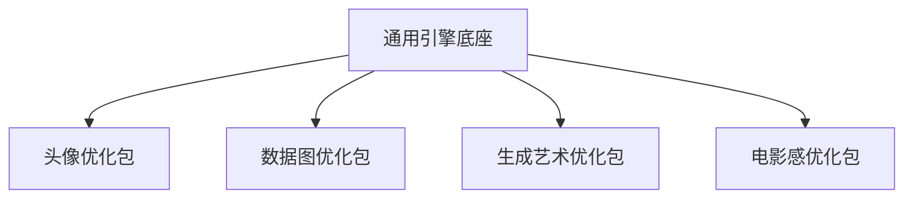
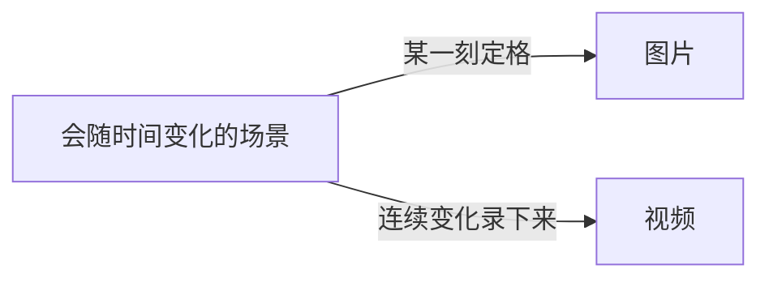
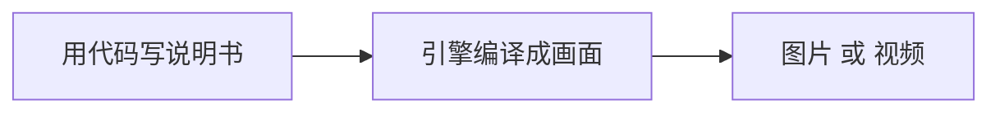

# 棱镜引擎 · 通俗版架构说明

> 读者对象：产品负责人 / 投资人 / 任何非技术背景的伙伴
> 本文用大白话和比喻讲清我们已经锁定的技术决策，不堆术语。遇到陌生词，第一次出现就会用一句话解释。
> 配套详细文档：`架构总设计.md`（供技术评审，较专业）

---

## 1. 先说清楚：我们在造什么

我们在做一套"能自己画图和做视频的软件发动机"（行内叫"引擎"：就是驱动画图/视频的底层软件核心）。

它不像修图软件只修照片，也不像剪辑软件只剪视频，而是一套**底层能力**：把"我想要一张图"和"我想要一段视频"变成同一件事。

**比喻**：像造一台万能"画面印刷机"——你喂给它一份说明书，它就印出图，或者印出一连串会动的图（视频）。

---

## 2. 一个底座，不是十个工具

有人会想：头像、数据图、艺术图、电影感，干脆各做一个软件算了？那样要维护十个，而且头像练出的光影技巧用不到电影里，全浪费了。

我们的做法是**一个通用底座 + 可叠加的"主题扩展包"**。底座管所有领域都用得上的通用能力（形状、材质、光、相机、动作、AI、合成、输出）；扩展包只是把某些高频组合提前打包好、调顺手，绝不另起炉灶。

**比喻**：就像乐高——一块通用底板（底座），上面可以拼"城堡套装""赛车套装"（扩展包）。底板一次做好，套装只是让它更快拼出常见造型，而不是再买十套互不兼容的玩具。

---

## 3. 同样的积木，不分"正经"和"插件"

系统里一切都是"积木块"（我们叫"节点"：就是画面流水线上的一块功能零件，有进口、出口和参数）。

关键决定：**用规则算出来的图**（比如"画个球"）和**用 AI 模型生成的图**（比如"生成一张人脸"），在系统里是**同一种积木**，地位完全平等。引擎不关心这块是规则算的还是 AI 算的，只关心数据怎么从这头流到那头。

**比喻**：蓝色积木（规则）和红色积木（AI）在拼搭时一模一样地插进底板，谁也不比谁高级。以后想混搭，随手接上就行。

---

## 4. 会动的是视频，定格的是图片

这是最反直觉、也最重要的一点：我们**不把"做图"和"做视频"分成两个系统**。

极简示意：
> **图片 = 画面在某一时刻的样子；视频 = 画面在一段时间里一连串的样子。**

我们把"场景"看成一张会随时间变化的画。在某一刻"按下暂停"，就是一张图片；让画连续变化并录下来，就是视频。同一套画法，不另起炉灶。

**比喻**：像翻页动画——定住某一页是图片，快速翻完一沓就是视频。我们的引擎只做"那一沓会动的画"，不分两个车间。

---

## 5. 用"代码"当画笔（统一绘图语言）

我们用一套简单的代码来描述"要什么、怎么摆、怎么动、长什么样、导出成什么"。这套代码我们叫 **DSL**（可以理解成"写给引擎看的说明书语言"）。

**代码即视频 / 图片**：这份说明书本身就能直接生成图或视频，还能存起来、比对每次改了哪。用大白话（自然语言）下指令的入口以后再说，现在先做代码入口。

**比喻**：像写菜谱——菜谱写清楚"放什么、火多大、炒几秒"，厨房（引擎）就端出菜（图或视频）。同一份菜谱，定住某一秒是照片，连续做就是做菜视频。

---

## 6. 一套调色滤镜管到底（统一美学）

"美学"就是我们说的颜色、光影、质感调校。我们让它**一套贯穿图和视频**，绝不会出现"图是暖色调、视频却变冷色调"的分裂。

做法：美学是画面上的"一层参数"，定格图和视频每一帧都套同一套，保证视频里一帧到下一帧颜色连续、不跳变。

**比喻**：像给所有成品套同一个"全局美颜滤镜"——无论你出的是单张美照还是一长段视频，色调质感始终是一个味儿。

---

## 7. 全自研，只借显卡厂商的接口

引擎内部的所有逻辑，我们**全自己写**；不引用任何现成的引擎或商业软件。

唯一借用的是**显卡厂商提供的底层接口**（叫 Vulkan 和 Metal，可以理解成"显卡的母语"）——这就像借用硬件的使用说明书，不算引第三方软件。好处是不被别人卡脖子，能力完全自己掌控。

**比喻**：我们自己造整台发动机，只借用"螺丝钉的通用标准"（硬件接口），不买别人的成品发动机。

---

## 8. 自己写"翻译官"对接显卡（自写后端）

显卡（电脑里专门负责画图的芯片）听不懂我们的高级想法，得有人把想法"翻译"成它能执行的指令。这一层我们叫**后端**，我们也**自己写**。

为什么自己写？为了又快又可控，不依赖别人封装好的中间层。这个后端就像我们和显卡之间的专属翻译官。

**比喻**：我们（导演）说"来个夕阳"，翻译官把它翻成显卡听得懂的一连串指令，显卡才动笔。翻译官我们自己养，不走外包。

---

## 9. 为"快"而生（效率是第一等要求）

速度快不是做完再补救，而是**从第一天设计就为快而建**。

做法：画面尽量交给显卡算；能提前准备好的不临时抱佛脚；能同时跑的（比如"模拟水流"和"正式渲染"）就一起跑，不排队等。

**比喻**：像流水线工厂——工序提前排好，多道工序并行开工，目标就是流畅不卡顿。

---

## 10. 没有显卡也能跑（CPU 保底）

我们的开发环境是一台普通老电脑：4 核大脑（CPU：电脑负责运算的中央处理器）/ 8G 内存 / **没有显卡**。

硬要求是：引擎必须保证，**没有显卡时，用电脑的"大脑"（CPU）也能跑**——慢，但结果正确。所以我们除了显卡后端，还写一个 CPU 版后端当保底；它同时充当"标准答案"，用来校验显卡版有没有算错。

**比喻**：主力是跑车（显卡），但配一辆自行车（CPU）保底——自行车慢，但照样能到目的地，还能用来核对跑车有没有抄错路。

---

## 一句话回顾

- **一个通用底座 + 主题扩展包**，不是做十个互不相通的软件。
- **规则生成和 AI 生成是同样的积木**，在系统里地位平等，随便混搭。
- **定格是图片，会动是视频**，同一套流程，不分两个系统。
- **用代码当画笔**（统一绘图语言），**一套美学管到底**，图与视频同味。
- **全自研、只借显卡接口、自己写翻译官**，而且**没显卡用 CPU 也能跑**。

---

*通俗版 v0.1 · 架构师 高见远 · 配合 `架构总设计.md` 使用*
