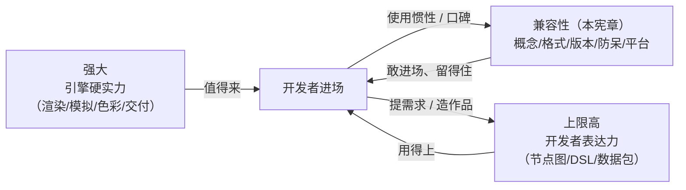

# Prism Engine 兼容性宪章（v1.0）

> 版本：v1.0
> 输入：需求口径——"兼容性也要，防止被开发者惯性冲死，修改一下架构"
> 关联文档：`架构总设计.md`
> 引用约定：本宪章条款编号 **C1–C25**；与 v2.0 的工作流编号 C1–C7 无关，引用时以"条款 C7"与"v2.0 工作流 C4（容器交付）"区分。验收项编号 V1–V20，修订点编号 R1–R12。

---

## 0. 定位：第三个维度

### 0.1 三维定位

v2.0 已确立两个正交维度：

- **维度一：强大（引擎硬实力）**——渲染、模拟、色彩、合成、交付的质量天花板。引擎一个人干活干得多好多真。
- **维度二：上限高（开发者表达力）**——通用场景图 + 节点注册表 + DSL + 数据包。一千个开发者能组合出一千种作品。

本轮新增第三个维度：

**维度三：兼容性（开发者信心）**——开发者**敢进场、留得住**的保险机制。

三者关系（白话版）：

- 强大与上限高决定"**值不值得来**"；
- 兼容性决定"**敢不敢来、留不留得住**"；
- 兼容性不产生任何新能力，它保证"能力的承诺可信"：你今天学的概念、接的格式、写的工程，明天还在、还能用；坏了有人管，改了有路走。

类比：强大是肌肉，上限高是关节自由度，兼容性是筋腱——筋腱自己不出力，但拉伤一次，就再也不敢发力。



### 0.2 铁律三：双向防冲死

v2.0 §1.2 的铁律管"强大必须节点化"。本宪章立第二条铁律（**铁律三**）：

> **引擎的演进永远不冲死"曾经能编译运行"的开发者工程；开发者的使用惯性也不许冲死引擎的演进。每一次改变必须做到三件事：公示（changelog 顶部声明）、留门（双读与废弃期）、给路（迁移命令与对照文档）。**

"防止被开发者惯性冲死"的完整解读，两层都要防：

1. **惯性冲死开发者**：引擎升级、改名、删接口、换格式，把开发者已在运行的工程冲死——开发者怕升级，从此锁死旧版本；
2. **惯性冲死引擎**：开发者大量使用某写法/某格式后，引擎即使明知设计有误（单位歧义、危险默认值）也不敢改，错误被惯性焊死，引擎失去演进能力。

所以兼容性不是单方面迁就：**该改的要敢改（错误的东西趁早改，改走公示流程）；不该改的绝不偷改（通用承诺逐条兑现）。**

### 0.3 兼容性 ≠ 冻结

- **C1（兼容性定义）**：兼容性不是"永不改变"，而是"**改变必有成本公示与迁移通道**"。引擎保留演进权，开发者获得知情权与退出通道。
- **C2（可测试原则）**：本宪章全部条款必须落到 §2 的可测试验收清单——宪法级约束不写愿望，只写"能被 CI 检查的条文"。
- **C3（教训入库原则）**：每一个已发生的兼容性事故（如 M0 的"度 vs 弧度"文档事故、duration 0s NaN 事故）必须转化为一条防呆规则或一条验收项，教训不允许只活在回忆里。

### 0.4 不兼容的代价：三个小故事

**故事一：一个静默的 90（概念/防呆层）。** 某开发者从旧引擎迁移，写了"旋转 90"。文档没写单位，引擎按弧度理解——90 弧度等于转了 14 圈半。他查了一整晚，最后在一个 issue 的角落里找到答案。他没有抱怨引擎"不够强大"，他只是从此不敢再升级。——不兼容的第一形态不是"功能缺失"，而是"**引擎替你做了你没同意的决定**"。（对应层一、层四。）

**故事二：剪不进去的成片（格式层）。** 某工作室用引擎做完 90 秒短片，交给调色师进达芬奇终审。引擎只出自家封装格式，调色师打不开，要求"给我 PNG 序列 + LUT"。工作室连夜重渲、人肉导出。成片进了正片，但工作室把引擎从下一个项目的候选清单里划掉了。——格式不兼容杀的不是这一次项目，是**下一次合作**。（对应层二。）

**故事三：一次升级毁掉的五十个场景（版本层）。** 某开发者写了 50 个场景的工程。某天引擎小版本升级，语法改名、旧写法直接报错，changelog 里一个字没提。他退回旧版本，从此锁死在半年前的引擎上；半年后新引擎的路径追踪再强，也与他无关，他还在论坛里劝新人"别用，会坏"。——版本不兼容杀的不是项目，是**引擎自己的未来**：开发者的惯性最终会反过来冲死引擎。（对应层三。）

> 三个故事里没有人说引擎"慢"或"质量差"。**兼容性就是不许引擎赢了参数、输了用户。**

---

## 1. 五层兼容承诺

| 层 | 回答的问题 | 一句话承诺 | 条款 |
|----|-----------|-----------|------|
| 一、概念兼容 | 老手能不能把经验带进来？ | 不发明行业已有概念，词汇对齐惯例 | C4–C6 |
| 二、格式兼容 | 数据进得来、出得去吗？ | 只吃通用格式、只产通用格式，不发明封闭格式 | C7–C9 |
| 三、版本兼容 | 升级会毁掉我的工程吗？ | 改变必公示、必留门、必给路 | C10–C16 |
| 四、API 防呆 | 我犯的错引擎接得住吗？ | 单位显式、错误可行动、静默须白名单、默认值不坑人 | C17–C21 |
| 五、平台兼容 | 换台机器还能跑吗？ | CpuRef 保底全平台可用，承诺级别如实标注 | C22–C24 |

### 1.1 层一：概念兼容（词汇与心智模型平移）

**承诺条文**

- **C4（不发明概念）**：Prism 不发明行业已有概念。凡 Remotion / After Effects / 剪映 / Three.js / Unity / UE / Nuke / 达芬奇已有成熟词汇的概念，Prism 沿用该词汇或其通用直译；自造词只允许出现在"行业没有对应物"的新概念上，且必须同时给出白话解释与对照表条目。
- **C5（DSL 命名原则）**：DSL 关键字与节点名——通用概念用通用名（layer / keyframe / transition / material / post / grade / camera / light / compose / mask / easing / spring / emitter…），不用自造缩写、不用拼音。新概念引入前必须过"命名三问"：①行业里叫什么？②有就照抄；③确实没有才自造，并登记进对照表。
- **C6（对照表随版本维护）**：官方维护《行业惯例词汇 ↔ Prism 概念对照表》（下表）与三份《从 X 来》迁移指南（§4），存放于 docs，随每个 minor 版本更新；文档中每个 DSL 块/节点页头部标注"相当于 Remotion 的 X / AE 的 Y"。

**行业惯例词汇 ↔ Prism 节点对照表**

| # | 行业通用词汇（出处） | Prism 对应 | 对齐说明 |
|---|---------------------|-----------|----------|
| 1 | Composition / 合成（AE、Remotion） | `scene (时长) { }` | scene 即 AE 合成 / Remotion Composition；多 scene + transition 是 Prism 增强 |
| 2 | Layer / 图层（AE、剪映、PS） | `layer text/path/particles/genart` | 层级组织为 compose 树，支持无限层 |
| 3 | Keyframe / 关键帧（AE、Unity、剪映） | `anim { 0s: x, 1.2s: y }` | 关键帧即 PropertyChannel 的 track 形态 |
| 4 | Transition / 转场（剪映、AE、iMovie） | `transition between a, b { wipe }` | 词汇直接沿用 |
| 5 | Material / 材质（Unity、UE、Blender） | `material { metalness/roughness/ior/... }` | Disney 风格参数化，参数名行业通行 |
| 6 | Effect / 后期效果（AE Effect、Nuke） | `post { chain [blur, bloom, ...] }` | 效果=节点，可排序可组合 |
| 7 | Color Grade / 调色（达芬奇、Lumetri） | `grade` 节点 | 词汇直接沿用 |
| 8 | LUT（达芬奇、Resolve、Nuke） | `lut3d` 节点（.cube 格式） | 行业标准格式直读 |
| 9 | Camera / 相机（Three.js、UE） | `camera { orbit/dof/fov }` | fov 沿行业惯例用度 |
| 10 | Light / 灯光（所有 3D 软件） | `light { directional/sphere/area/ambient }` | 灯光类型名行业通行 |
| 11 | Composite / Over / 混合模式（Nuke、PS） | `compose { op over/plus/screen/multiply/mask }` | 合成算子名对齐 Nuke/PS |
| 12 | Mask / Roto / 蒙版（AE、达芬奇） | `mask { path [...] feather }` | 支持路径蒙版与动态 Roto |
| 13 | Keying / 抠像（Keylight） | `LumaKey` / `ChromaKey` | 亮度/色度抠像，行业同名 |
| 14 | Easing / 缓动（CSS、AE、Remotion） | `easeOutCubic` 等同名函数 | 函数名与 CSS/业界一致 |
| 15 | Spring / 弹性动画（React Spring、Unity） | `spring { damping ... }` 通道 | 同为弹簧模型，参数可平移 |
| 16 | Emitter / 粒子发射器（AE Particular、Unity） | `emitter { rate ... }` + `force { ... }` | 词汇直接沿用 |
| 17 | Caption / 字幕（剪映、Premiere） | `captions` 块 + SRT 导入导出 | 字幕格式行业标准 |
| 18 | Preset / 预设（AE Presets） | 数据包 `presets/*.prism` | 预设=纯数据，无代码 |
| 19 | Timeline / 时间轴（所有 NLE） | `movie` 全局 + scene 时长 + `t`/`frame` | 时间模型与 NLE 一致 |
| 20 | Render Queue / 导出（AE、Media Encoder） | `output` 块 / CLI `render` | 导出参数显式声明 |

**设计机制**

1. **命名审查关卡**：DSL v2 语法定稿前，全部块名/关键字/参数名对照行业惯例表逐项审查并归档（修订点 R1）；此后每个 minor 新增命名都要过"命名三问"。
2. **术语表升级**：v2.0 §0 术语速查表增加"行业通用对应词"一列（修订点 R5）——自造词（PropertyChannel、子图签名、推理插座等）必须挂上行业锚点。
3. **注册表元数据**：节点注册表的参数 schema（v2.0 §2.4）增加 `alias/行业对应` 元数据字段，编辑器与 MCP 工具描述自动生成时带出。

**验收落点**：V2（命名审查归档）、V3（对照表与迁移指南存在于 docs）、V4（术语表加列）——落 Phase 1（随 v2.0 工作流 A4/A6）。

### 1.2 层二：格式兼容（数据进得来、出得去）

**承诺条文**

- **C7（通用格式）**：对外输入与对外输出只使用行业通用格式（下表为准）。产出必须能进入 Premiere / After Effects / Nuke / 达芬奇 / DAW 的既有工作流；输入必须能吃行业标配资产。
- **C8（边界条款：不发明封闭格式）**：**引擎永不发明封闭格式**。唯一豁免是引擎内部缓存/中间产物（.prismir 图缓存、tile 缓存、模拟快照缓存、增量 cache.json），但内部格式必须满足三条件：①文件头带格式版本号与引擎版本号；②有公开 schema 文档或提供 CLI 一键转出为 JSON；③版本废弃时静默失效重建——**缓存失效 ≠ 用户数据丢失**。
- **C9（私有扩展禁令）**：禁止以"性能优化"为由给对外通用格式加私有扩展；如确需扩展，必须以"可选旁支 + 默认关闭 + 公开文档"形式存在，且与标准工具的双向兼容性有测试保护。

**输入格式矩阵**

| 格式 | 方向 | 支持阶段 | 说明 |
|------|------|---------|------|
| PNG（8bit） | 入 | 已有（M0 手写解码） | 纹理 / logo / 序列帧输入 |
| PNG（16bit） | 入 | Phase 3（随 v2.0 工作流 C2 PNG16） | 10bit 量化 / 16bit 存储 |
| JPEG（基线） | 入 | Phase 3（可选，复用 C4 的 DCT 骨架做 IDCT 解码） | 不承诺 Phase 3 之前 |
| WAV（PCM） | 入 | Phase 2（B6 wav.rs） | RIFF 小端，按规范 |
| FLAC | 入 | 不承诺（远期可选） | 自研可行但尚无明确时间表，如实标注 |
| TTF 字体 | 入 | Phase 2（B5） | cmap/glyf/loca 子集解析；OTF/CFF 不承诺 |
| SRT 字幕 | 入 | Phase 2（随 B10 cues 体系） | 纯文本格式，实现成本极低 |
| .cube LUT | 入 | Phase 2（随 B4 LUT 应用） | 3D LUT 行业标准 |
| OBJ 网格 | 入 | Phase 1/2（B3 已列 P1） | 顶点/面；材质 MTL 不承诺 |
| Radiance .hdr（HDRI） | 入 | Phase 2（B2 环境光实装承载，HDRI 往返测试随 B2） | RGBE 编码，格式简单 |
| JSON | 入 | Phase 1 起（IR/canonical）；cues 随 B10 | 机器可读，schema 公开 |
| TOML | 入 | Phase 1（A4 packs manifest） | 数据包清单 |
| **MP4/H.264/HEVC 视频解码** | 入 | **不做** | 解码器工程量与零依赖原则冲突；需要时用外部工具转 PNG 序列（写进交接文档） |

**输出格式矩阵**

| 格式 | 方向 | 支持阶段 | 说明 |
|------|------|---------|------|
| PNG（8bit）帧序列 | 出 | 已有（M0 手写编码） | 基础交付 |
| PNG（16bit，PQ 10bit）帧序列 | 出 | Phase 3（C2） | HDR 帧序列 + manifest 声明 transfer 参数；进达芬奇/AE/Nuke |
| JPEG（基线） | 出 | Phase 3（C4） | 自写 DCT+Huffman |
| AVI（rawvideo） | 出 | Phase 3（C4） | "双击可播"底线 |
| MP4（MJPEG + PCM） | 出 | Phase 3（C4） | 自写 ISO-BMFF muxer，标准 .mp4 |
| MP4（H.264/HEVC，经外部 ffmpeg 或硬件编码器） | 出 | Phase 3 起（可选增强：检测降级，编码不自研） | 引擎内置基线 = MJPEG/AVI 永远可用；外部路径产出仍是标准 mp4 |
| WAV（PCM） | 出 | Phase 2（B6）+ EBU R128 响度归一 Phase 3（C4） | 进 DAW / 剪辑软件 |
| SRT 字幕 | 出 | Phase 2（随 B10 cues） | cues → SRT（HH:MM:SS,mmm） |
| .cube LUT 导出 | 出 | Phase 3（可选） | grade 节点链采样导出 3D LUT，供达芬奇/AE 复核对色 |
| manifest.json 渲染清单 | 出 | Phase 1 起（A6 缓存清单）→ Phase 3 交付级（C3/C4） | 引擎版本/种子/分辨率/fps/色彩空间/文件清单+md5，机器可读 |
| EXR | 出 | **不做**（远期仅设计评估） | Nuke 互换以 PNG16 + manifest 替代；压缩 EXR 工程量大，生态强需求再立项 |

**设计机制**

1. 每个对外格式一条"解析/编码往返测试"（V12），编码器与解析器互相为对方写测试；
2. 容器类格式（AVI/MP4）除自写回读断言外，增加"规范符合性"断言（box 结构合法、字段齐全）——保证外部工具能读，不是只有自己能读；
3. 交付目录固定附带 manifest.json（C8 豁免条款不适用于它——manifest 本身就是公开 schema）。

**验收落点**：V12（格式往返测试族）、V13（交付 manifest）、V14（容器规范符合性）——分别落 Phase 1/2/3。

### 1.3 层三：版本兼容（升级不冲死工程）

**承诺条文**

- **C10（Semver 细则）**：引擎遵循语义化版本 MAJOR.MINOR.PATCH。
  - **0.x 阶段**：MINOR 可含破坏性变更（业界惯例），但必须走 C14 废弃流程 + C11 双读 + C16 迁移三件套；PATCH 只修 bug 不改行为——若修复导致输出字节变化，必须进 changelog"渲染行为变化"清单，影响面大时升 MINOR 而非 PATCH。
  - **1.0 后**：MINOR 只加不改（可开始 deprecate）；移除只发生在 MAJOR；"静默移除 / 静默改语义"视为 P0 级流程事故。
  - 逃生门：引擎为静态二进制，**旧版本可并存安装**——遇到行为争议，用旧版本重渲是最终兜底，写进交接文档。
- **C11（DSL / 工程文件版本头 + 双读）**：`.prism` 文件首行可选注释 `// prism-dsl 1` 声明语法版本。有头 → 按该版本语义解析（新引擎同时携带至少 N-1 套语法解析器，**迁移期双读**）；无头 → 按当前默认版本解析并输出一次性 warning 引导补头（**渐进引导，不搞一刀切爆红**）；版本号超出引擎支持区间 → 报错并提示支持范围。数据包 manifest.toml 亦有 `dsl = 1` 字段声明包内 DSL 语法版本。
- **C12（数据包引擎版本区间，联动 v2.0 §2.4）**：manifest.toml 的"依赖的引擎能力版本"升级为**强制字段** `engine = ">=0.4, <0.7"`（区间语法），加载期校验；区间外拒绝加载，错误信息给出"该包需要引擎 x.y–z.w，当前 a.b.c"。数据包自身 semver：MAJOR = 预设数值/子图结构变化（属渲染行为变化，进清单）；MINOR = 新增预设/子图；PATCH = 资产修正。**官方数据包与引擎同版本号发布**——`theme film` 在同引擎版本下参数稳定。
- **C13（IR / canonical JSON 的 schema 版本）**：canonical 序列化（v2.0 工作流 A6）顶层增加 `"schema_version"`；**增量缓存键 = hash(schema_version, engine_version, 子图签名)**——旧 schema / 旧版本的缓存永不误复用，只会静默失效重建（对接 v2.0 §2.6 确定性与 C3 增量渲染）。
- **C14（废弃流程三步）**：①**声明**（MINOR N）：changelog 顶部【废弃】条目 + 编译 warning（含行号、替代写法、预计移除版本）；②**双读期**：旧写法继续可用 ≥1 个 minor 发布周期，期间回归测试保持绿色；③**移除**（最早声明后的下个 MINOR / MAJOR）：changelog 顶部【移除】清单 + 迁移规则 M-xx + `prism migrate` 支持。被废弃 API 文档标注 `@deprecated since x.y`。
- **C15（确定性基线的跨版本语义——明文化 v2.0 §2.3 的边界）**：

| 版本跨度 | 逐字节一致？ | 承诺 |
|---------|------------|------|
| 同 MAJOR.MINOR.PATCH + 同后端 + 同平台类 | ✅ | 全产物 md5 一致（CI 既有承诺） |
| 跨 PATCH | 允许变化 | bug 修复造成的输出变化必须逐条进 changelog"渲染行为变化"清单 |
| 跨 MINOR / MAJOR | ❌ 不承诺 | **结构语义不变**：老工程可编译、可运行、画面语义等价——"同一部电影，不同的像素"；数值演化逐条进清单 |
| 跨后端（CpuRef ↔ GPU） | ❌ 不承诺 | 视觉等价（统计 diff 阈值）——v2.0 既有验收升格为明文条款 |
| 跨平台 | ❌ 不承诺 | 视觉等价；零依赖红利：数学函数自研实现已规避 libm 差异这一最大不确定源，但逐字节承诺仍如实以同平台为边界 |

  changelog 顶部固定栏目《渲染行为变化清单》为必填模板：每条含"受影响特性 / 变化原因 / 视觉影响描述 / 是否有开关"。
- **C16（迁移给路）**：`prism migrate <工程路径>`（Phase 3，v2.0 工作流 C6）：默认 dry-run 输出改动报告（文件 / 行号 / 规则号 M-xx / changelog 链接），`--apply` 写回前打印完整 diff。每条迁移规则 M-xx 必须有注入测试：旧写法样本 → migrate → 编译通过 → 渲染结果与迁移前视觉等价。

**设计机制**：版本头 + 双读解析器（DSL 层）；缓存键带版本（增量层）；manifest 区间（数据包层）；migrate 命令（工程层）——四层机制覆盖"引擎碰到的每一份旧数据"。

**验收落点**：V1（版本头双读）、V9（区间校验）、V10（schema_version 缓存）、V15（deprecate 机制）、V16（migrate）、V17（行为变化清单机制）——Phase 1 建机制，Phase 2 起实际执行，Phase 3 补 migrate。

### 1.4 层四：API 防呆（错误信息可行动，歧义须白名单）

> 本层是把 M0 的两笔学费（"度 vs 弧度"文档 bug、duration 0s NaN 事故）变成制度：**防住的不是 bug，是"引擎替开发者做决定"的每一个瞬间。**

**承诺条文**

- **C17（单位显式化）**：
  - 角度字面量必须带单位：`90deg` / `1.5708rad`；裸数编译期报错，错误信息给出 `90deg` 修复建议。Rust API 命名纪律：弧度参数一律 `_rad` 后缀或 `Angle` 类型，**禁止裸 f64 角度参数**；
  - 时长字面量必须带后缀：`3s` / `1500ms` / `90f`（v2.0 §3.6 已有），裸数报错并给出三种候选写法；
  - **惯例豁免清单**（行业隐含单位、允许裸数但文档必须标单位）：fov（度）、bpm、aspect（比例）、LU（响度）、归一化标量（0–1）；
  - 教训固化：M0"度 vs 弧度"事故的修复不是改文档，是**改语法**——语法级强制才防得住惯性。
- **C18（危险参数编译期校验 + 错误三段式）**：已知坑清单进编译器成为"防呆规则库"，每条规则 = {规则 id，检测条件，错误信息模板，级别 error/warning}。首发 ≥12 条：duration≤0、fps≤0、spp≤0、bounces<0、分辨率 0、关键帧时间倒序、场景重叠为负、aperture∉[0,1]、duck_db>0（会把 BGM 抬响）、fov∉(0,180)、transmission∉[0,1]、radius<0。错误信息**三段式**：**在哪**（file:line:col）+ **什么事**（检测到的事实）+ **怎么改**（建议，最好给可直接粘贴的写法），可选第四段**为什么**（历史教训链接）。错误码分段：P1xxx 防呆参数 / P2xxx 类型语法 / P3xxx 图结构（环、悬空引用）/ P4xxx 资产 IO / W1xxx 警告；错误码在 docs 有页面。示例：

  ```
  error[P1003] scene.prism:7:11
    场景 intro 的时长为 0s。时长 0 会在帧时长计算中产生除零/NaN（历史事故：duration 0s NaN）。
    建议：写一个正时长，如 `scene intro (0.5s)` 或 `scene intro (15f)`。
    参见：docs/errors/P1003.md
  ```
- **C19（错误可行动化覆盖率）**：编译器测试集**结构化断言**每条 error/warning 文本含"建议"段——无建议的错误不许合入，不靠人审。
- **C20（静默容错白名单制度）**：**默认全部报错，白名单豁免**。凡"引擎替开发者做了决定"（静默 clamp、静默取整、静默按默认值补齐、静默改单位、静默转换）都属歧义，必须显式列入 `docs/silent-fallbacks.md`，每条含：歧义是什么 / 引擎选择是什么 / 为什么 / 如何显式写法规避。初始白名单：WL-1 关键帧时间不在帧网格上 → 就近取帧 + warning；WL-2 场景时长非整帧倍数（3.7s @ 30fps）→ 进位取整帧 + warning（与 Remotion 行为一致）；WL-3 数据包内未引用资产 → 不警告（允许冗余打包）；WL-4 未使用的 import/anim/expr 定义 → warning 不 error；WL-5 资产像素/位深与输入口不符（16bit PNG 喂 8bit 口）→ 显式转换 + warning。白名单之外一切静默行为 = bug。白名单的增删本身走 changelog。
- **C21（危险默认值禁止）**：默认值不得掩盖错误（禁止"默认 0 秒""默认 1×1"式兜底）；没有合理默认的参数必须显式必填，缺省报错并给示例；**默认值变更 = 渲染行为变化 = 必须进 changelog 清单**。

**验收落点**：V5（单位字面量）、V6（危险参数拦截）、V7（错误建议覆盖率）、V8（白名单穷尽式测试）——Phase 1 建立并随 Phase 2/3 扩容。

### 1.5 层五：平台兼容（换台机器还能跑）

**承诺条文**

- **C22（CpuRef 硬保证，继承 架构总设计.md §14 与 v2.0 硬约束）**：CpuRefBackend 是**一等运行后端**——无 GPU 平台引擎完整可运行、能产出正确图像/视频，且永远作为 GPU 后端的正确性黄金参照。这是全平台兼容的地基：**任何有 CPU 的平台都能跑 Prism**。
- **C23（平台矩阵如实标注）**：承诺级别不夸口——沙箱实测到哪，承诺就到哪：

| 平台 / 架构 | CpuRef | GPU 后端 | CI 实测 | 承诺级别 |
|------------|--------|----------|---------|---------|
| Linux x86_64（沙箱环境） | 一等路径，保证可用 | Vulkan 实装待 Phase 4 硬件 | **全量 CI（唯一实测环境）** | **完全承诺** |
| Linux aarch64 | 同上（代码无平台假设） | 待驱动生态 | 交叉编译冒烟（可选，Phase 2 起） | 尽力支持，不承诺 |
| macOS Apple Silicon | 同上 | Metal 待 Phase 4 硬件 | 无 | 尽力支持，不承诺 |
| macOS Intel | 同上 | 同上 | 无 | 不承诺（旧硬件，不强保） |
| Windows x86_64 | 同上 | Vulkan 待 Phase 4+ | 无 | 尽力支持，不承诺 |

  升级路径：GPU 机器到位后（Phase 4），实测矩阵同步扩展，每次扩展在 changelog 声明。
- **C24（平台中立纪律）**：①源文件/输出文本/manifest 一律 UTF-8；②DSL 与配置内路径统一 `/` 分隔符，Windows 差异只在平台边界层转换，引擎代码禁止硬编码 `\`；③行尾：写出一律 LF，读取兼容 LF/CRLF；④容器/二进制端序按各自格式规范（WAV RIFF 小端、MP4 box 大端——**按标准写，不自造**）；⑤禁止硬编码核数/内存/路径假设（沙箱教训已写进 架构总设计 §14：`nproc`/`free` 看到的是宿主机视图，规划一律按 4 核 8G）；⑥浮点不依赖 x87 / 未定义行为，求解顺序遵循 v2.0 §2.6 固定归约约定。

**验收落点**：V19（平台中立检查：无硬编码分隔符、无非 UTF-8 文件；aarch64 交叉编译冒烟可选）——Phase 1 建立检查，全程执行。

### 1.6 自指条款

- **C25（宪章自我兼容）**：本宪章自身的修改属于版本兼容事件——条款的新增、放宽、收紧均须 changelog 声明；且**承诺不追溯**：已发布版本按其发布时的宪章兑现，新版宪章不追溯违约。

---

## 2. 兼容性验收清单（可测试，逐条标注落点）

> 原则：每条验收 = 一个能写进 CI 或发版检查单的断言。挂接方式见修订点 R7。

| 编号 | 验收项（可测试） | 落点 Phase / 工作流 | 对应条款 |
|------|----------------|--------------------|---------|
| V1 | DSL 版本头：带 `// prism-dsl 1` 的 v1 语法样本在新引擎编译通过（双读）；无头输出 warning 引导；双读样本集在废弃期内回归保持绿 | Phase 1（A4） | C11 |
| V2 | 命名审查归档：DSL v2 全部块名/关键字/参数名的行业惯例对照表存档（PR 记录），此后每个 minor 增名均有审查记录 | Phase 1（A4）；此后每版 | C5 |
| V3 | docs/concepts.md 概念对照表（≥15 行）+ 三份《从 X 来》迁移指南存在且链接可达 | Phase 1 建立并随版更新 | C6 |
| V4 | v2.0 §0 术语速查表含"行业通用对应词"列，自造词零遗漏 | Phase 1（文档） | C4 |
| V5 | 单位字面量：deg/rad/s/ms/f 解析用例 ≥15；裸角度/裸时长报错且错误信息含修复建议 | Phase 1（A4） | C17 |
| V6 | 危险参数拦截：duration 0s、spp 0、fps 0、关键帧倒序等首发 ≥12 条规则各 ≥1 用例，报错符合三段式 | Phase 1 建，Phase 2/3 随域扩 | C18 |
| V7 | 错误建议覆盖率：编译器测试集自动断言每条 error/warning 含"建议"段（结构化检查，非人审） | Phase 1 建立并持续 | C19 |
| V8 | 静默白名单穷尽：docs/silent-fallbacks.md 存在；测试断言引擎所有静默行为均有 WL 编号 | Phase 1 建立并持续 | C20 |
| V9 | 数据包 manifest `engine` 区间校验：区间内加载成功；区间外报错并提示所需区间 | Phase 1（A4 packs.rs） | C12 |
| V10 | canonical JSON 含 schema_version；旧 schema/旧版本缓存签名不命中（注入测试：不误复用、只失效重建） | Phase 1（A6） | C13 |
| V11 | 引擎版本写入所有产物：帧序列 manifest / 容器 metadata / 缓存文件头均可读出版本 | Phase 1 起 | C10/C13 |
| V12 | 格式往返测试族：PNG8 像素级往返（已有）、PNG16（P3）、WAV md5 往返（P2）、TTF 字形索引往返（P2）、SRT 解析/写出（P2）、.cube 解析/应用数值期望（P2）、OBJ 顶点面数断言（P1/2）、JPEG 编解码往返（P3）、HDRI（P1） | 各对应 Phase（见 §1.2 矩阵） | C7 |
| V13 | 交付 manifest.json：交付目录含引擎版本/种子/分辨率/fps/transfer/文件 md5 清单，schema 公开 | Phase 3（C3/C4） | C7/C8 |
| V14 | 容器规范符合：MP4 box 结构自写解析器回读合法断言；AVI 可播验收（v2.0 C4 验收沿用并升格为兼容性条款） | Phase 3（C4） | C7 |
| V15 | deprecate 机制：构造废弃用例 → 编译 warning 含行号+替代写法+预计移除版本；changelog 顶部有【废弃】条目 | Phase 1 建机制 | C14 |
| V16 | `prism migrate`：旧写法注入样本集全部改写成功；diff 报告逐条对应 changelog 条目与 M-xx 规则 | Phase 3（C6） | C16 |
| V17 | 渲染行为变化清单：发版流程演练用例——构造跨 PATCH 行为变化 → 断言 changelog 含清单段且逐条声明 | Phase 1 建，每次发版执行 | C15 |
| V18 | 同版本确定性回归（继承 v2.0 既有验收）：演示工程两遍渲染帧+WAV+容器 md5 全一致，进 CI | Phase 1–3 持续（既有） | C15 |
| V19 | 平台中立检查：CI 断言源码无硬编码 `\` 路径、无非 UTF-8 文件；aarch64 交叉编译冒烟（可选） | Phase 1 建立并持续 | C24 |
| V20 | 白名单/错误码/迁移对照三份 docs 随发版检查非空且已更新 | Phase 1 起，每次发版 | C19/C20/C16 |

---

## 3. 对 v2.0 现有设计的修订点清单

> 以下 R1–R12 为对引擎现有设计与 `架构总设计.md` 的具体修改指令，随各 Phase 实现一并执行（纯文档项在 Phase 1 文档定稿时完成）。

| 编号 | 位置 | 修订内容 | 对应条款 |
|------|------|---------|---------|
| R1 | DSL v2 语法定稿 | 语法定稿前增加**命名审查关卡**（对照行业惯例，冻结后方可定稿）；语法规范补入：单位字面量（deg/rad/s/ms/f）、版本头 `// prism-dsl 1`、防呆规则库与错误三段式 | C5/C11/C17/C18 |
| R2 | manifest.toml 规格 | "依赖的引擎能力版本"升级为强制字段 `engine = ">=x.y, <x.z"`（区间语法 + 加载校验）；补数据包 semver 语义与官方包同版发布约定 | C12 |
| R3 | canonical 序列化与子图签名（工作流 A6） | canonical 序列化与子图签名增加 `schema_version`；增量缓存键纳入 (schema_version, engine_version)；.prismir 与缓存头写引擎版本 | C13 |
| R4 | 确定性跨版本语义 | 补"确定性跨版本语义"表（同版本逐字节 / 跨 PATCH 清单 / 跨 MINOR 结构不变 / 跨后端与跨平台视觉等价） | C15 |
| R5 | 术语速查表 | 增加"行业通用对应词"一列，全部自造词挂行业锚点 | C4/C6 |
| R6 | 容器交付目录（工作流 C4） | 交付目录增加 manifest.json（引擎版本/确定性参数/文件清单 md5）；B10 cues 增加 SRT 写出（P2）；grade 增加 .cube LUT 导出（P3 可选） | C7 |
| R7 | 各 Phase 验收 | 按本宪章 §2 挂接验收项：A4 ← V1/V2/V5/V6/V7/V8/V9；A6 ← V10/V11；B3/B4/B5/B6/B10 ← V12 相应格式项；C2 ← V12(PNG16)；C4 ← V12(JPEG 往返)/V13/V14；B2 ← V12(HDRI)；C6 ← V16；全程 ← V17/V19/V20 | §2 |
| R8 | 决策表 | **兼容性决策以本宪章 C10–C16 承载，不占用既有 D 编号**（D-11/D-12/D-13 为他域自有决策：AI 边界/排版资产/主题预设，与本宪章无涉）；版本头策略（宪章 Q5）仍待确认——推荐"非强制 + warning 引导补头"（避免存量文件一刀切爆红），备选"强制必填" | C1–C16 |
| R9 | 舍弃表 | 新增一行：视频解码输入（MP4/H.264/HEVC 解码）｜不做｜解码器工程量与零依赖冲突，宪章格式矩阵"不做"栏声明，外部工具转序列帧替代 | C7/C8 |
| R10 | 架构总设计.md §4.2（原指 §10.1/§10.3，章节已迁移） | IR JSON 增加 `schema_version` 字段；.prismir 明确归类"内部格式"并执行 C8 三条件（版本头 + 公开 schema + 可转 JSON + 静默失效重建） | C8/C13 |
| R11 | 架构总设计.md §2.3（原指 §5.3，示例已迁移） | 示例顶部补 `// prism-dsl 1` 注释行，与版本头条款一致（已于架构 v2.3 执行） | C11/C17 |
| R12 | 架构总设计.md §6.3（原指 §14，已并入 crate 层级图） | 并入平台承诺矩阵与 CI 级别如实标注（Linux x86_64 完全承诺/全量 CI；aarch64、macOS、Windows 尽力支持不承诺），升级路径挂 Phase 4 | C22/C23 |

---

## 4. 《从 X 来》迁移对照表

> 三份指南随 docs 发布（验收项 V3），每条映射在对应文档页头部亦有标注。

### 4.1 从 Remotion 来

| Remotion 概念 | Prism 对应 | 备注 |
|--------------|-----------|------|
| `<Composition>` / `<Sequence>` | `movie` 全局 + `scene (时长) { }` | scene≈Composition；多场景 + transition 是增强 |
| `useCurrentFrame()` / `useVideoConfig()` | 表达式 `frame` / `t`（秒） | 时间模型语义一致 |
| `interpolate(f, [0,30], [0,100])` | `track { 0s: 0, 1s: 100 }` / `remap` | 关键帧即插值，写法更声明式 |
| `spring({ damping, stiffness })` | `spring { damping ... }` 通道 | 同为物理弹簧，参数可平移 |
| `<Series>` / 进出场编排 | scene 时长 + `transition between` | 转场引擎内建 |
| `Audio` / 静态视频输入 | `audio { bgm "bed.wav" }` | 视频输入不做（宪章矩阵），PNG 序列替代 |
| `random(seed)` | 种子化哈希派生 | 全链路确定性同款思想 |
| `@remotion/shapes` / Lottie | 生成艺术节点 / Lottie 子集（P2） | 矢量节点可再加工 |

### 4.2 从 After Effects / 剪映 来

| AE / 剪映 概念 | Prism 对应 | 备注 |
|---------------|-----------|------|
| 合成（Composition） | `scene (时长) { }` | 多合成 + 自动转场拼接 |
| 图层（Layer） | `layer text/path/particles/...` | compose 树支持无限层 |
| 关键帧 + 缓动（Easy Ease） | `anim { 0s: x, 1.2s: y easeOutCubic }` | 缓动函数名与业界一致 |
| 效果（Effect 面板） | `post { chain [blur, bloom, ...] }` | 效果=节点，可排序组合 |
| Lumetri 调色 / LUT | `post { chain [grade film, lut3d] }` | .cube 直接吃 |
| 蒙版 / Roto | `mask { path [...] feather }` | 遮罩参数可用 Expr 动画 |
| 抠像（Keylight） | `LumaKey` / `ChromaKey` | 行业同名概念 |
| 文本工具 / 字幕 | `layer text` / `captions` + SRT | SRT 可导入导出 |

### 4.3 从 Three.js / Unity 来

| Three.js / Unity 概念 | Prism 对应 | 备注 |
|----------------------|-----------|------|
| Scene | `stage3d { }` | 图随时间 = Graph(t) |
| Mesh / Geometry | `mesh { }` / `sdf { sphere {...} }` | SDF/CSG 是 Prism 增强 |
| MeshStandardMaterial | `material { metalness/roughness/ior }` | Disney 参数化，参数可平移 |
| DirectionalLight / PointLight / RectAreaLight | `light { directional/sphere/area }` | NEE 面光采样，软阴影 |
| PerspectiveCamera (fov) | `camera { fov ... dof { aperture } }` | fov 单位度（行业惯例豁免清单） |
| OrbitControls | `camera { orbit { radius speed } }` | 声明式轨道，非逐帧手调 |
| AnimationClip / KeyframeTrack | `anim` / PropertyChannel track | 一切参数皆通道 |
| EffectComposer / UnrealBloom | `post { chain [bloom, ...] }` | 后处理链同构 |
| Timeline / Animator | scene 时间轴 + SimSession | 模拟可任意 seek（确定性） |

---

## 5. 收尾

一句话版本：**强大给质量，上限高给自由，兼容性给信任——三者齐了，开发者才敢把下一年押在这个引擎上。**

本宪章 25 条条款、20 项验收、12 处修订点，全部可测试、可引用、可追责；执行顺序：先落修订点 R1–R12（改文档与 Phase 验收挂接），再按 §2 验收清单随 Phase 1–3 逐条兑现。宪章自身的后续修改走 C25。

*（兼容性宪章 v1.0 完）*
