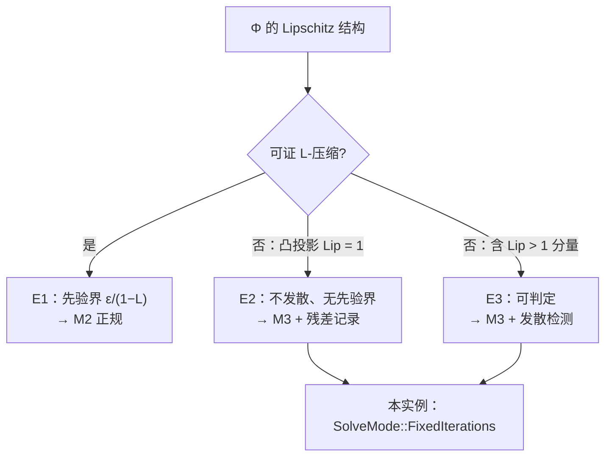

# 环推进：不动点实例（推进-停机四元组的第三配置）

> 状态：**W2 设计文档（只写文档，不写代码，不提交）**。
> 定位：《推进-停机-求值核心》命题 2.2 的实例化——环 = 约束梯度流的不动点
> 推进，服务 XPBD 类求解器。四实例（DAG/环/时间/音频）中，环是唯一没有以
> 「注册推进器」身份进入求值台内核的实例（§0 勘定）。
> 纪律：每条断言要么引用已证命题（E1/E2/E3、命题 3.x/4.x、S3、P1/F5），
> 要么标 **待证**；不发明新框架，只做实例化；框架缺口如实记入 §7。

---

## §0 实例定位与工程现状勘定

**框架侧**（定义 1.1）：四元组 `(X, ⊑, P, H)`，求值 = 从 `x₀` 出发求最小
`n` 使 `H(x_n)` 成立。环配置（命题 2.2）：X = 完全格 `L^V`，P = 同步算子 G，
H 三选一（M1 触顶 / M2 残差 / M3 定数）。

**语义复合**（《求值台的数学》命题 3.3）：XPBD 完整语义 = 时间维（帧间
轨道）⊗ 空间维（帧内不动点）。W1 波落已接通时间维（`movie.rs`
`SimTimeline` 跨帧快照库，F-2026-xx-01）；本实例配置的是**空间维那一
因子**：一帧之内，约束梯度流的不动点推进。

**工程现状勘定**（只读，未改）：

| 框架件 | 现状 | 证据 |
|---|---|---|
| 求解器 | 活（私有世界） | `prism-physics/src/xpbd.rs`：`World::step` = substeps × iterations |
| 模式声明 | 活（宿主层） | `SolveMode`/`SolveModeMeta`（M3 唯一变体）+ `DivergenceDetector`（第 8 波落） |
| 帧间状态 | 活（时间实例私有协议） | `movie.rs` `SimTimeline`（W1 接通；(ε, n) 经 `ChannelDef` tag 0x5333 进帧签名） |
| 求值台注册 | **缺** | `eval.rs` 仍禁环（P3005）；环未以推进器身份进内核 |

即：零件齐全、私有协议活着，缺的是**注册**。本文档为注册钉死数学。

## §1 X（状态空间）

**AH 粒度（主）**：`X = (ℝ³)^N × (ℝ³)^N`（位置 ⊕ 速度），N = 粒子数。

- **λ（对偶变量）不进 X**：每子步预测后清零重置（XPBD 论文 §3 语义），
  不跨子步、不跨帧。
- **`prev_position` 不进 X**：每子步预测阶段重写，子步内工作变量。
- **约束违反量不是状态分量**：`C_i(x)` 是 X 上的函数；残差
  `r(x) = max_i |C_i(x)|` 是质量的**读数**（纪律 3：免费输出约束残余作
  质量指标），与 §2 进度序的处理直接相关。

**不动点迭代粒度（内层）**：`X_GS = X ⊕ Λ`（Λ = 约束平行 λ 数组）。
一轮 GS 扫描后 λ **累积存活**（`xpbd.rs`：`*lambda += dlambda`，仅子步
边界清零）⟹ 若把 P 取为单轮扫描（§3 的 Φ），`Φ: X → X` 的纯度被破坏，
诚实的状态空间必须含 λ。**这是实例化对框架设定的一处细化**：框架
`Φ: X → X` 隐含「迭代函数无跨步隐藏状态」，XPBD 不满足——要么扩 X
（本实例取法），要么承认 Φ 不纯。记入 §7-4 的归一化时一并处理。

**范数**：`‖x‖_X = max(坐标 sup, 速度 sup)`（coord-max / ∞-范数）。
理由：(a) 与残差 `r = max_i |C_i|` 的最大值语义同族，是 GS 逐约束扫描的
天然尺度；(b) E1 的 `ε/(1−L)` 界在等价范数间只差常数因子——**模式选择
（E1/E2/E3 查表）对范数不敏感**，只有 M2 的 ε 标定依赖范数，而本实例是
M3，ε 仅作事后判定与发散余量（§4）；(c) 范数是分析工具，不进确定性
计算路径（C24 不受影响）。

**框架差异点（如实记）**：配置表 2.5 环行的 `L^V` 是 M1（Kleene）配置
的取值；本实例（M3）的 X 是带范数的度量空间，不装格序——f32 点值域有
无穷升链，格化无有限步保证（命题 3.1 / 3.9 推论 9a）。这不是脱离框架，
是**同一行配置的另一模式取值**：H 三选一，X 随之取度量侧。

## §2 ⊑（进度序）

**实例化：⊑ = 平凡序**（∀x,y: x ⊑ y；定义 1.1 明许「可为平凡序」）。

- M1 配置的「信息序」（格序）属有限高格，f32 域不满足（命题 3.1）——
  本实例无格序可装。
- **不能取「残差下降序」**（`x ⊑ y ⟺ r(x) ≥ r(y)`）：⊑ 必须是无条件
  预序（自反 + 传递），而 E2 明言非扩张情形残差**可能不降**——把残差
  塞进进度序，等于把无保证的质量现象冒充为结构性质（伪造压缩性的
  近亲）。且这是类型错误：残差是 H 侧的质量读数（§4），不是 X 上的
  信息序。

**「进展」的精确定义（M3 侧）**：AH 语义里，进展 = 步数计数器的推进
（`n → n+1`），这是 M3 配置（命题 2.2 表）唯一可谈的「进展」；残差下降
是**事后陈述**——有结构性衰减率时经验可见（§3），无先验保证（E2）。
二者不许混记。

## §3 P（推进函数）

**AH 粒度：一步 = 一个子步**（`World::step` 的 substep 循环体）：
① 预测（半隐式欧拉或速度 Verlet，`Integrator` 显式选择）；② GS 投影
`iterations` 轮（按约束 id 升序——求解序格锚，输入序无关）；③ 速度更新。

**不动点粒度：Φ = 一轮 GS 扫描**（§3.1 设定原文的 GS 形式
`x_{k+1} = Φ(x_k)`；此处 `x` 含 λ，见 §1）。一轮扫描 = 约束梯度流的
离散化一步：逐约束做 λ 更新 + 位置修正。

**非扩张性声明（分层；纪律：禁止伪造 Banach 界）**：

1. **约束投影算子** `P_C`（到凸约束流形的精确投影）：`Lip = 1`，非扩张
   ——E2/E3 已证命题的直接实例（凸投影收缩距离）。
2. **引擎实现的 XPBD 修正步**（柔度正则 `α̃ = α/h²` + λ 累积 + 部分
   修正）：`Lip ≤ 1` **待证**。支持论证的轮廓：`denom = Σw + α̃ ≥ Σw`
   （`α̃ ≥ 0` 只放大分母），单约束修正量不超过同构型刚性部分步长；但
   「不超过刚性步」到「复合映射 Lip ≤ 1」的传递**未证**，反例风险未
   排除。**纪律**：证明落地前，「非扩张」对 XPBD 步只是工作假设；安全
   兜底是 `DivergenceDetector`（E3(c)，已落地），不是分析结论。

**结构性衰减率 q < 1 的来源**：约束雅可比结构——每轮扫描把违反量乘以
与约束条件数（`Σw`、`α̃`、耦合拓扑）相关的因子（E2 定位原文：逐类约束
可证，**不是泛泛压缩性**）。`DistanceConstraint` 的 q 形式：**待证**
（§7-2）。经验收敛曲线（关卡 1：首残余 > 末残余 ×10，8 轮
final < 1e-4）是证据，**不是证明**。

**单调性**：P 对 ⊑（平凡序）空洞成立（定义 1.2）——不冒充收敛证据。

## §4 H（停机判据）

按 E1/E2/E3 查表（§3.1 三定理净结果表）：

**本求解器 = M3**（`SolveMode::FixedIterations`，唯一变体）：

- `H(x_n) = (n = substeps × iterations)`：固定步数显式标价
  （`substeps/iterations = 0` 拒绝，P1003/P1004；默认档 4×8 是骨架参考价，
  调用方显式给定——危险默认值禁止，C21）。
- **残差记录**：`StepReport::residuals`，长度 = substeps × iterations，
  顺序固定（子步外层 × 迭代内层）。顺序固定是命题 3.11（迭代输出为输入的
  确定函数）的前提，已满足；M3 定数停机下确定性是更弱断言，恒成立。
- **发散检测**：`DivergenceDetector`：连续 ≥3 个采样点残差上升超 ε 余量
  判发散（`DIVERGENCE_WINDOW_DEFAULT = 3`，`RESIDUAL_EPS_DEFAULT = 1e-4`）。
  E3(c) 的工程化：有限精度下 `Lip = 1 + O(ε_machine)` 的边界情形在长迭代
  中显现为残差缓慢上升——故判据是「连续窗口 + ε 余量」，不是单步不降。
  只观测、不改写：不接入求解循环（求解器语义零变化）。

**为什么不是 M2**：E2——非扩张（`L = 1`）时 `ε/(1−L)` 除零，无先验误差
界；设容差停机 = 伪造 Banach 界（`xpbd.rs` 模块文档成文纪律）。**为什么
不是 M1**：f32 点值域有无穷升链，Kleene 无有限步保证（命题 3.1 / 3.9
推论 9a）。

**ε 的身份钉死**：M3 实例里 `residual_eps` 仍在，但身份是 ① 事后质量
指标判定 ② 发散检测余量——**不是停机判据**。M2 路径若要开，须先另证
谱条件（E2 原文：「或另证谱条件」），当前无此证明。

## §5 seek 语义

**快照粒度 = 每帧末**（`SimTimeline`：帧末位置 + 速度）：

- 跨帧状态完备性 = 位置 + 速度（`World::set_state` 语义；`prev_position`
  由预测阶段重写、λ 每子步清零，均不属跨帧状态）。
- 帧内子步序列是确定重放的（P 确定，命题 3.11），无存储中间态的必要。

**马尔可夫性条件**（《推进-停机-求值核心》命题 3.3 检查点-重放等价 +
《求值台的数学》命题 4.3 seek 等式）：

- 帧间：`x(f) = Φ_f(x(f−1))`，跨度 1（现状满足）⟹ 从帧快照续算 ≡ 从
  `x₀` 重放到该帧，逐位一致（P1：粒子 `seek_with` 是同构型的活实例）。
- 帧内子步间：子步 k+1 的起点 = 子步 k 的终点（位置 + 速度），λ 重置
  ⟹ 子步级马尔可夫性同样成立（语义显然）——**每子步快照无数学障碍**，
  存不存是成本决策（F5a：该不该存状态由求值成本决定，不由数学决定）。

**跳帧续算三路径**（`movie.rs` 已落）：① 同签名顺序延续（目标在前方）
② 顺序推进逐帧写快照 ③ 快照装配（目标帧命中：seek 回退 / 预热后跳帧）。
**冷 seek**（帧 > 0 且前驱快照缺失）→ `P3012` 结构化报错，绝不静默
fallback 到初态（命题 4.1 修正默认 (i)；W1 已落）。

**与音频 seek 的分叉**（F5 / 命题 3.2）：音频群作用 ⟹ 任意 seek O(1)
重算；环实例必须快照或重放。分叉的是成本，不是数学。

## §6 签名 / 缓存键

**数学依据**：命题 4.2 推论 4.2a——M3 的 n 必须进签名；命题 S3 迭代层
行——迭代节点的缓存键必须含 `(ε, n)`（sig 对模式参数不闭包，须补进键）。

**工程对齐（W1 已落）**：`SolveModeMeta { mode, substeps, iterations,
residual_eps }` → `ChannelDef`（tag = **0x5333**）→ `channel_definition_
hash` → 帧签名。改 `(substeps, iterations, residual_eps)` 任一 ⟹ 签名变
⟹ 快照/缓存不误复用（F-2026-xx-01 确定性口径；测试
`movie_sim_timeline.rs` 断言模式元数据进签名与缓存键）。

**Infl 闭包核对**（命题 4.2）：环实例输出依赖 = { 参数（重力 /
compliance / rest_length / Integrator），上游通道，frame，(ε, n) 模式
参数，快照键 }。前三项经既有通道机制进签名；(ε, n) 经 0x5333 进（W1）；
`Integrator` 进签名的强制性未决（§7-3）。

**缺口（如实记）**：`SolveModeMeta` 目前是宿主层（`prism-physics` /
`movie.rs` 平行序列化）的局部实现，求值台内核无统一执行——命题 4.2
推论 4.2a 原话「求值台层无统一执行 = 缺口」。W2 注册时须收拢为内核
一等属性（模式元数据进签名，核心 §4 预算 ~80 行）。

## §7 未决问题（开放，不和稀泥）

1. **XPBD 柔度正则修正步的 `Lip ≤ 1`**：证或举反例（§3-2）。非扩张声明
   对引擎实现的精确覆盖范围取决于此；落地前不得把「非扩张」当已证事实
   引用（只许称工作假设 + 检测器兜底）。
2. **`DistanceConstraint` 结构性衰减率 q 的形式**：链式耦合拓扑下 q 与
   约束图条件数的关系——「逐类约束可证」的承诺未兑现；无它则 M2 路径
   永久缺席（E2：须另证谱条件）。
3. **`Integrator` 进帧签名的强制性**：数学上它是输出依赖分量（命题 4.2），
   工程上 0x5333 只收了 `(ε, n)`——需工程裁决（C15 波及面评估）。
4. **AH 步数单位的跨实例归一化**：DAG 一步 = 拓扑展开一层，环一步 =
   一个子步（或一轮扫描），时间一步 = 一帧——框架层「步」的计数语义未
   定义，影响停机步数报告与缓存键的 n 语义；与 §1 的两种粒度取舍联动。
5. **帧内子步级 seek 的形式化**：数学无障碍（§5），是否工程化是成本
   决策；若座，子步马尔可夫性需形式陈述（当前是语义显然 + 未形式化）。
6. **非凸/折叠约束族的 `Lip > 1` 先验识别**：E3 说「可判定」，判定程序
   未形式化（构造期按约束类型分类？）；当前只有 `DivergenceDetector`
   事后一路。
