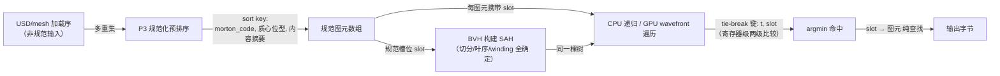
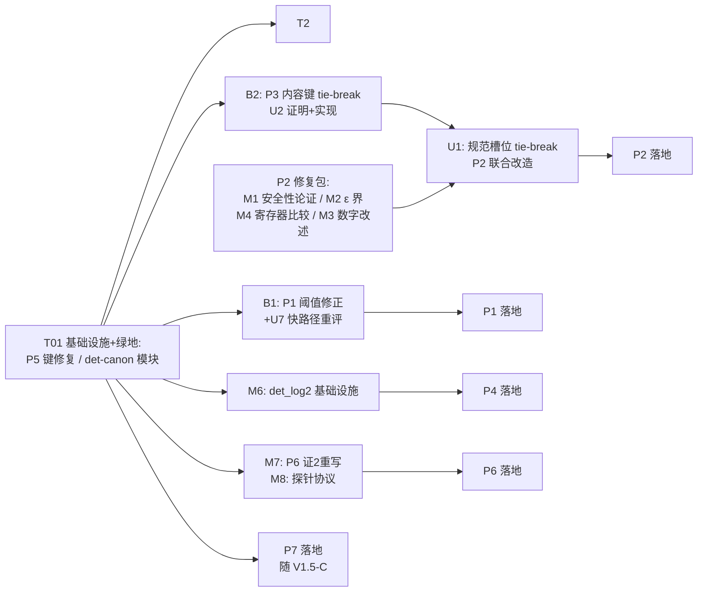

# 超级算法设计报告 — 架构师独立交叉审（三审三校 · 第二轮）

> 角色：架构师（prism-engine）。立场：**未参与设计的独立审查者**（外部数学家 +
> 总工程师双重身份）。审查对象：`docs/超级算法设计报告.md`（1422 行，P1–P7
> 七提案 + §0-A 统一框架，已历一轮自审）。
>
> 方法纪律：与设计端完全独立的四项复核——① 正确性：每份数学证明独立重推
> （不轻信原文），全部源码主张逐条只读核验，自审轮已推翻/修正事项逐项
> 复核是否真修对；② 优秀性：文献级替代方案比对、效果数字是否高估、
> §0-A 框架覆盖是否牵强；③ 可行性：工程量声称真实性、被忽略的基础设施
> 成本、与 crates/ 现状兼容性；④ 升级性：更简/更强/更统一的替代设计、
> 七提案间共享实现、文档未覆盖方向。
>
> 本轮自有证据：python3 只读数值实验复跑（exp1/2/2b/3/4/7/8/9/10/11）、
> 源码级只读核验、独立算术复算。未动仓库、未执行 cargo、未做 git 写操作。
> 实验脚本存档于 artifact 目录 `2f8a7d30-...`（与设计端共用）。

---

## 1. 审查结论总表

评级口径：✅ 无需修改可采纳 / ⚠️ 有必须修复项、修复后可采纳 / ❌ 按现文不成立。

| # | 提案 | 正确性 | 优秀性 | 可行性 | 升级性 | 总评 |
|---|------|--------|--------|--------|--------|------|
| P1 | JPEG 定点 IDCT | ⚠️ B1 阈值常量 10× 错；m3/m4 证明毛刺 | ✅ AAN 否决有理；74.3 dB 过规范 34 dB；编解码共表已核实 | ✅ 绿地无遗留重构；i128 路径安全；表共享属实 | ✅ U7 快路径重构建议 | ⚠️ 修 B1 后可落地 |
| P2 | GPU↔CPU 遍历同构 | ⚠️ M1 证 1b 为假陈述；M2 ε 推导缺口 | ✅ bit-exact 不可能诚实声明是典范；归约解析预算写进门禁 | ⚠️ M4 atomicMin 在 WGSL 不可行；M5 源码路径错误 | ✅ U1 规范槽位 tie-break 一举三得 | ⚠️ 修 M1/M2/M4 后可落地 |
| P3 | BVH 确定性结构 | ❌ **B2 证 3 是同码族下的伪定理**（自带 A1 测试会红） | ✅ LBVH 标准路线；「确定性重定位」是真贡献；Hilbert 否决有理 | ✅ 一次预排序；SAH 代价无损已核实 | ✅ U2 内容键 + 喂饱 U1 | ⚠️ 修 B2 后可落地（且为 P2 前置） |
| P4 | 率控 water-filling | ✅ KKT/闭式/等畸变证书全部独立复推通过 | ✅ 水填充 = 工业码控标准分配器；证书即 CI 断言 | ⚠️ M6 det_log2 基础设施缺失，「纯 FP 无 libm」为假 | ✅ 依赖加权已并入；传播矩阵增强路线清晰 | ⚠️ 补 det_log2 后可落地 |
| P5 | 缓存键完备性 | ✅ 全部源码主张核实为真；定理健全 | ✅ 充分统计量表述是信息论下最紧形式 | ✅ 零成本修复窗口已核实（CacheDims 仅测试消费） | ✅ Merkle scene_sig 路线已识别 | ✅ 可落地（仅 n2 术语微调） |
| P6 | 降噪分配律 + Kalman | ⚠️ M7 证 2 代数错误（结论幸存）；m7 覆盖缺口 | ✅ σ 律即 Neyman 分配经典；双通道审计超出文献平均线 | ⚠️ M8 σ 探针协议未钉 seek 重放语义 | ✅ Q>0 Kalman 扩展已列为后续 | ⚠️ 修 M7/M8 后可落地 |
| P7 | 转场半群 + u8 混合 | ✅ 半群/u8 数学复推通过；自审轮两处错误确已修对 | ✅ 凸权重统一框架优雅；−0.5 LSB 暗偏消除是可测画质项 | ✅ ~50 行绿地；Wipe 修复复跑确认 | ✅ U5 trait 化 | ✅ 设计可落地（m5 数字需重生成） |

**总判：七个提案的数学方向与工程判断整体成立，无一是应整体否决的提案；
但 2 个 B 级问题（P1 阈值常量、P3 证 3 伪定理）按现文实施会分别引入
「刚杀死的溢出类复活」与「核心定理不成立且自带测试会红」，必须先行修复。
自审轮整体质量高（23 项复核项：16 项确已修对、2 项部分修对、5 项未修对
——漏 3 项、修出新错 1 项、修法不可行 1 项），详见 §2.0。**

---

## 2. 问题清单

分级：**B** = 按现文实施产生错误结果/核心主张不成立，必须修复；
**M** = 主要问题（证明缺陷/可行性障碍/口径失真），必须修复但结论多可幸存；
**m** = 次要问题（精度/表述/规范），应修复；**n** = 吹毛求疵，可顺手修。

### 2.0 自审轮已推翻/修正事项的复核（任务要求的专项）

| 自审轮事项 | 复核结论 |
|-----------|---------|
| P1 证 1「i64 余量 256×」伪界 → Stage2 i128 | ✅ 修对（界全部独立复算通过：8-bit 5.877e20/16-bit 1.51e23/对抗块 1.30e20 均核实） |
| P1 证 2 误差界改 Σ\|D\| 口径 | ✅ 修对（分量分解有小瑕，见 m3） |
| P1 快路径阈值 max\|D·W\| ≤ 5.4e9 | ❌ **修出新的 10× 错误**（B1） |
| P2 补剪枝不变性引理 | ⚠️ 方向对、中间陈述为假（M1） |
| P2 bit-exact 不可能诚实声明 | ✅ 修对且超出要求（这正是 D-3 统计门禁的正确定位） |
| P2 推荐 packed-u64 atomicMin | ❌ 在 WGSL 不可行且无必要（M4） |
| P3 证 2 升级为无条件逐位相同 | ✅ 修对（但其前提「输入数组是规范代表」依赖 B2 修复，见 B2） |
| P3 「FP 归一化平台差异」担心过强的修正 | ✅ 修对（IEEE-754 基本运算逐位确定，libm/fma 才是分歧源） |
| P3 `(code, index)` 全序规范形 | ❌ **自审轮漏项：同码族下不成立**（B2） |
| P4 证 5 收益统计化（200 试验） | ✅ 修对（exp10 复跑支持） |
| P4 依赖加权 + 口径换修声明 | ✅ 修对且诚实（端到端 +17.4% vs 帧独立让出 ~8pp，双向核算复跑支持） |
| P4「水位二分纯 FP 无 libm」 | ❌ 假陈述，自审轮漏项（M6） |
| P5 闭包补 global_seed + scene 签名 | ✅ 修对（`sampler.rs:206-208`、`integrator.rs:243` 核验支持） |
| P5「CacheDims 未接生产路径」更正 | ✅ 修对（`incremental.rs:945` 确仅测试消费） |
| P6 无约束闭式 → max(1, σ/√λ) | ✅ 修对（exp9 复跑支持） |
| P6 削减率统计化 + IQR 贴边声明 | ✅ 修对 |
| P6 Kalman 双通道审计 | ✅ 修对且严谨 |
| P6 证 2 代数 | ❌ 有错，自审轮漏项（M7） |
| P7 logit → ln(1−t) 同构 | ✅ 修对（独立复推确认） |
| P7 DSL 折叠等式错误修正 | ✅ 修对 |
| P7 f32/2^-24 → u8 整数域替换 | ✅ 修对 |
| P7 Wipe 端点不精确发现 + 行程扩展修复 | ✅ 修对（复跑确认污染列 = 0） |
| exp11 两组数字 | ⚠️ 固定种子下不可复现（m5） |

### 2.1 B 级问题（2 项，必修）

#### B1 — P1 快路径阈值常量 10× 错误（连带派生值与覆盖面误述）

- **位置**：`:157-158`、`:208`（⑦ 复述）、`:222`（⑧ 复述）、`:259`（B-M5 变异体）、`:1404`（exp8 索引行）。
- **描述**：Stage2 走 i64 的安全条件是 `64·max|D·W|·2^28 ≤ i64::MAX`，即
  `max|D·W| ≤ 9.223372036854776e18/(64·2^28) = 5.3687e8 ≈ 2^29`。文档写
  **5.4e9（10.06×）**。配对派生值同样错：文档称「即 max|D| ≤ 8250」，而
  `8250·2^16 = 5.407e8 > 2^29`（超 0.7%）——恰在「单块对抗」的量级上，
  应取 `2^13 = 8192`。最严重的是括号里的**「8-bit 表的典型质量档全部落入」
  是误述**：判据是逐块的 `max|D·W|`，不是质量档；`video.rs:108` 残差质量
  clamp [50,80]，Q=50 配 |F|=2047 的最坏块 `max|D| = 102350`，超安全界
  **12.5×**——典型质量档的最坏块**全部不落入**，快路径只覆盖稀疏块/低 Q 块。
  按文档常量实现，`64·5.4e9·2^28 = 9.28e19 > i64::MAX 10×`，等于把证 1
  刚杀死的 i64 溢出类从窗户放回来——这正是本提案存在的原因。
- **修正建议**：阈值改为 `max|D·W| ≤ 2^29`（`max|D| ≤ 8192`），五处同步；
  「典型质量档全部落入」改为「稀疏块与低 Q 块落入；典型质量档（Q≥50）
  最坏块不落入，走 i128」；B-M5 变异体相应改为 `2^29→2^39` 量级；
  或按 U7 直接删除快路径（更彻底，见 §4.7）。
- **复核证据**：python3 独立复算（上式）；`8250·65536 = 54067200 > 536870912/10`；
  `video.rs:108` clamp 下界 50；文档 `:146-147` 自己的 Stage2 界公式
  `|S2| ≤ 8·8·max|D·W|·2^28` 与阈值式自洽。

#### B2 — P3 证 3 是同码族下的伪定理：`(code, index)` 排序不构成多重集规范形

- **位置**：`:470-474`（②）、`:478-479`（③ 第 1 条）、`:503-508`（证 3）、
  `:586-587`（B-M1）、`:54`（§0-A 对照表 P3 行）、`:565-566`（⑧ 检索结论）。
- **描述**：`orig_index` 是图元在**输入数组**中的位置——它**就是加载序本身**。
  同码族（质心精确重合/共码）内按 index 排序 ≡ 稳定排序 ≡ 保留加载序。
  反例：图元 P、Q 同码，置换 1 中 P 在 index 5、Q 在 6，排序得 (P,Q)；
  置换 2 中 Q 在 5、P 在 6，排序得 (Q,P)。两者是同一多重集的合法置换，
  排序结果不同 ⇒ **排序后数组不是多重集的函数** ⇒ 后续桶累加/叶内排列的
  FP 运算序列随加载序变化 ⇒「整棵 BVH 是多重集的纯函数」不成立。
  文档自带的反证：A1 测试（`:575-577`）明确含「10% 重合质心同码族」并
  要求 10 次置换签名恒等——按现行设计该测试**会红**；B-M1（去掉 index
  tie-break）也杀不死这个变异：带 index tie-break 与不带（稳定排序）在
  同码族下行为相同，变异体没有隔离出缺陷。exp2-D2/D3 的 10/10 与
  「10 置换 → 1 签名」在随机质心下成立，恰恰说明实验未覆盖同码族——
  与 A1 的 10% 同码族设计自相矛盾。
- **修正建议**：tie-break 键改为**内容键**：
  `(morton_code, 质心精确位型, 图元内容摘要)`。质心是图元自身数据的纯函数
  （跨加载序不变），内容摘要兜底真重复（位相同的图元可互换，换序不改变
  任何下游值）。完整证明与成本见 §4.2（U2）。
- **复核证据**：`bvh.rs:701` `median_partition` 用
  `total_cmp(&cb).then(a.cmp(&b))`——index tie-break 即输入序；
  `bvh.rs:313-324` 桶累加按数组下标序；`:466` CPU tie-break 同读 orig。

### 2.2 M 级问题（8 项，必修但结论多可幸存）

#### M1 — P2 证 1b「被剪子树集合相同」为假陈述

- **位置**：`:343-347`。
- **描述**：剪枝判据依赖当前最优值 `best_t`，而 `best_t` 的演化依赖
  **已访问集合**——不同访问序（CPU 深度优先递归 vs GPU wavefront 队列序）
  在访问同一节点时 `best_t` 可以不同，**被剪集合确实不同**。「任何访问序下
  被剪的子树集合相同 ⇒ 遍历覆盖的命中集合相同」这个推理链的第一环为假。
- **修正建议**：改为**安全性论证**（结论完全幸存）：① 剪枝仅当
  `t_lo > best_t + ε`，而被剪子树内任何真实命中的 slab 区间满足
  `t ≤ t_hi + 3u·|t| < t_lo ≤ best_t + ε`（ε 取足时）⇒ 不存在「更近但被
  剪」的命中（**不漏**）；② 已访问集合上的 argmin 在 ≺ 下与访问序无关
  （证 1）；③ 合取两者：最终命中与访问序无关。删除「被剪集合相同」，
  代之以「不漏 + argmin 不变」。
- **复核证据**：`bvh.rs:452-456` 剪枝读 `best_t`；`wavefront.rs` 波前队列
  与 `bvh.rs` 递归栈是两种不同访问序（`integrator.rs:768` 参数集下两端
  遍历调度独立）。

#### M2 — P2 `ε = 6u·|t|` 推导不完整

- **位置**：`:299-315`（② 引理）、`:359-362`（证 2）。
- **描述**：① 公式中 `|t|` 未定义——射线参数在遍历中变化，是 `best_t`？
  当前 AABB 的 `t_hi`？命中点的 `t`？不指定则「1e-7 仅在 |t| ≤ 0.28 时
  充分」的换算缺锚点；② 三角形侧 Möller–Trumbore 交点 `t` 的舍入误差
  **从未界定**，而 tie-break 的 `ht == best_t` 恰是两个 MT-`t` 的比较——
  slab 的 3u 界管不到它；③ slab 界（剪枝安全）与 MT 界（并列判定）是
  两个独立误差源，文档混作一处。
- **修正建议**：ε 改用每射线一次计算的尺度上界：`ε = 6u·t_max`，
  `t_max` = 根 AABB 出射参数（或场景远平面），一次算出全遍历复用（近命中
  略保守，只损性能不漏命中）；另立 MT 后向误差界（MT 为低深度有理式，
  `|δt| ≤ c·u·|t|`，c 为小常数，可仿树形归约界的风格给证明），明确两个
  误差源分别覆盖剪枝安全与并列判定。
- **复核证据**：`bvh.rs:93-110` slab 计算（`inv_d` 与乘积各一次舍入）；
  证 2 只论证 slab 侧；`:466` tie-break 读的是 MT 输出。

#### M3 — P2 效果数字口径：40.64% 是并列触发条件率，不是端到端分歧率

- **位置**：`:274-276`（①）、`:381`（⑥）、总览 `:29`。
- **描述**：480/1181 = 40.64% 的条件是「两三角形同时命中」，而并列本身
  只发生在 1181/4000 ≈ 29.5% 的构型——无条件率 ≈ **12%**。且「逐位同 t」
  只是规则分歧的**触发条件**：两端还要真的选出不同图元、且该选择穿透到
  输出，才构成端到端分歧。本轮复跑 exp2b-T1 **未能构造出端到端分歧实例**
  （随机三角形遮挡了构造的重合对：另一三角形先在 t=3.317 命中），文档
  亦未给出端到端阳性实例。总览「消除 40.6% 可达的 parity 分歧」应理解
  为「消除一类**可达**的分歧」。
- **修正建议**：数字改述为「并列事件中 40.6% 为逐位同 t（规则分歧触发
  条件；无条件 ≈12%）」；A1 对拍补一个**确定性构造**的端到端阳性实例
  （共享边 + 精确重合 t + 两端选不同图元，断言修正前 diff > 0）。
- **复核证据**：本轮复跑 exp2b-T1 输出「两者相同」；⑧-1 自己已把「消除
  parity 分歧」降级为「消除 tie-break 规则分歧这一类」，⑥ 与总览未同步。

#### M4 — P2 packed-u64 atomicMin 在 WGSL 不可行且无必要

- **位置**：`:321-326`（③ 第 1 条）、`:414-417`（⑧-3）。
- **描述**：WGSL/WebGPU 的原子操作只有 **32 位**（`atomicMin` 仅
  `atomic<u32>/<i32>`），不存在 u64 atomicMin——按文档实现无法编译。
  且**无必要**：wavefront 路径每射线/每 lane 的 hit 记录是线程私有的
  （归约发生在颜色值上，不在 hit 记录上），不存在跨线程归约 hit 的场景。
  文档「wavefront 本就有 per-lane hit slot，packed-u64 可直接复用」把
  私有槽位误当成需原子归约的共享槽。
- **修正建议**：GPU 叶更新直接写寄存器级两级比较
  `(ht < best_t) || (ht == best_t && prim_id < best_orig)`（`prim_id` 用
  规范槽位，见 U1），不用任何原子；若未来真出现共享 hit 槽，32 位原子
  也无法表达 64 位键的字典序，届时再议。
- **复核证据**：WGSL spec atomics 仅 32 位；`rt_bvh.wgsl:90-92` 现行即
  每线程寄存器比较（`best_tri = slot`）。

#### M5 — P2/P3 源码路径与行号错误

- **位置**：P2 `:268`（`crates/prism-rt/src/bvh.rs:441-447`）、P2 `:302`
  （`bvh.rs:452-456`）、P3 `:456`（`crates/prism-rt/src/bvh.rs:262`）、
  P3 `:494`（`bvh.rs:313-324`）。
- **描述**：BVH 实际在 `crates/prism-geometry/src/bvh.rs`，prism-rt 无
  此文件；CPU tie-break 在 `:466` 而非 `:441-447`。其余行号与
  prism-geometry 实际对应，纯属 crate 名抄错 + 一处行号漂移。
- **修正建议**：全局替换 crate 路径；tie-break 行号改 `:466`。
- **复核证据**：`ls crates/prism-geometry/src/` 有 bvh.rs；prism-rt/src
  无 bvh.rs；`:466` `t < b.t || (t == b.t && orig < b.tri)`。

#### M6 — P4 缺 det_log2 基础设施，「纯 FP 无 libm」为假

- **位置**：`:661`（③ 第 3 条「水位 θ 二分（≤ 200 步双精度足够，纯 FP 无 libm）」）。
- **描述**：二分水位每步要求值 `ΣR_i(θ)`，而 `R_i = ½·log₂(θ_i/θ)`——
  **绕不开 log2**。引擎 `det_math` 现有 `det_cos_sin/det_cos/det_sin/
  det_atan2/det_asin`，**无 log2**；std 的 `f64::log2` 是 libm 后向函数
  （与 P1 已实测的 `cos` 同罪：跨平台非位精确）。按文档字面实现即违
  D-29 与确定性铁律。且这不是可选优化：对 `L = log₂θ` 二分仍需 log，
  对共同畸变 δ 二分也需 log——绕不开，只能建。
- **修正建议**：把 `det_log2` 列为 P4 的**前置基础设施任务**：IEEE 精确
  指数提取（位运算）+ 尾数 minimax 多项式 + 误差界 + 跨平台确定性论证，
  仿 `det_cos_sin` 纪律（~40 行 + 证明）。θ_i 是每帧常数，`log₂θ_i` 可
  预算一次，调用量减半。
- **复核证据**：`grep "pub fn det_" det_math.rs` → 5 个函数无 log；
  P1 `:88-89` 自证 libm cos 跨平台 1–2 ulp 差。

#### M7 — P6 证 2 代数错误（结论幸存）

- **位置**：`:1009-1012`（证 2）、`:954-955`（削减率中项）。
- **描述**：σ² 分配 `n_i = Nσ_i²/Σσ²` 的 MSE =
  `Σ_i σ_i²/n_i = Σ_i (Σσ²/N) = m·Σσ²/N`，文档写 **(Σσ²)²/N**（漏了
  求和的外括、多平方一次）。由此「与最优 (Σσ)²/N 之比 =
  (Σσ²)²/(Σσ)² ≥ 1」不成立——反例：所有 `σ_i = 0.5` 时该比 = 0.25 < 1，
  而等 σ 时两种分配本应给出相同结果。正确比值 = `E[σ²]/E[σ]² = 1+CV² ≥ 1`
  （C-S），**结论方向对、证明链错**。另：削减率段 `MSE_eq = m·E[σ²]/N`
  漏一个 m（应为 `m²E[σ²]/N`；与 `MSE_opt = m²E[σ]²/N` 的最终比值
  不受影响）。
- **修正建议**：证 2 按 `m·Σσ²/N` 重写；削减率中项补 m²；实测
  +22%~+172% 与修正后的 1+CV² 自洽（对应 CV∈[0.47,1.31]），可保留。
- **复核证据**：python3 独立复算；C-S: `(Σσ)² ≤ m·Σσ²`，等号仅当所有
  σ 相等。

#### M8 — P6 σ 探针协议未钉确定性与 seek 重放

- **位置**：`:1048-1051`（⑦ 第一条）。
- **描述**：「低 spp 探针帧（预算 1/8）估计 + **帧间递推**」——递推 σ 状态
  使第 k 帧的分配依赖 0..k−1 的历史，直接跳帧（seek）重放会得到不同 σ
  ⇒ 不同分配 ⇒ **违反 seek 重放语义**（P5 `:1201-1202` 刚把「seek 重放
  无损」当卖点）。文档未处理这个新增状态面。
- **修正建议**：二选一并写进算法设计：① σ 状态只在一个 GOP 内递推、
  GOP 边界重置（重放成本 = 1 GOP，有界）；② σ 状态显式序列化进渲染
  状态（seek 时恢复）。探针自身的确定性由引擎确定性保证（探针输出是
  帧的确定函数），无需额外论证，但须声明。
- **复核证据**：P5 `:1201-1202`；`denoise.rs:130` 现有 accumulate 是
  帧内递推，跨帧递推是新增面。

### 2.3 m 级问题（7 项，应修复）

#### m1 — P3「30-bit Morton」在 u64 下不可能，码宽未钉死

- **位置**：`:470-471`（②）、`:530`（⑦）。
- **描述**：30-bit/轴 × 3 轴 = 90 bit > u64。exp2 脚本实际用 **21-bit/轴**
  （u63）。f32 尾数 24 bit 也意味着 >21-bit/轴的码宽需双字键。文档两处
  「30-bit」与脚本实现脱节，且 extent 共码分析随之错：按 21-bit，共码
  阈值是 extent > 2^21 单位（比 2^30 早 9 个量级到来），对大场景是更紧
  的约束，须如实重述。
- **修正建议**：钉死「21-bit/轴，u64 键（63 bit 有效）」（或明确改
  u128/双 u32）；extent 退化分析按 21-bit 重写。
- **复核证据**：exp2_bvh.py 实际位宽；IEEE-754 binary32 significand = 24 bit。

#### m2 — P3「唯一自然构造」过强

- **位置**：`:565-566`（⑧ 检索）、`:71-72`（§0-A 检索结论）。
- **描述**：Hilbert 曲线是质心排序键的合法替代（局部性更优）；文档的
  否决理由（区分度增益不确定/计算更贵/递归实现多分歧面）合理但不支撑
  「唯一」。P2 的全序 argmin 说「唯一」同样过强——任何严格全序都给
  不变性，「唯一」的只是「与 CPU 现行规则一致」这个工程约束。
- **修正建议**：改为「在本引擎约束（零依赖/确定性/表共享）下的最优
  已知构造」这类可辩护表述。
- **复核证据**：空间填充曲线标准文献（Morton vs Hilbert 局部性比较）。

#### m3 — P1 证 2 分量分解内部不一致

- **位置**：`:166-171`。
- **描述**：「C 表量化与 W 舍入各贡献 2^-17·Σ|D|，合计 ≤2^-16·Σ|D|」——
  两个 C 各 2^-17 已合计 2^-16，W 的真实贡献是 2^-19·Σ|D|
  （`|ΔW| ≤ 0.5`、`|C·C| ≤ 2^28` ⇒ 每项 `2^27·2^-46 = 2^-19`），既非
  2^-17，加起来也超 2^-16。真界应为 `(2^-16 + 2^-19)·Σ|D|`。实测利用率
  0.19 给出 5× 经验余量，界大概率仍成立，但推导不支撑结论。
- **修正建议**：按「C×2 各 2^-17 + W 2^-19」重写合计，或直接放宽到
  `2^-15·Σ|D|`（干净的上取整界）。
- **复核证据**：python3 逐项复算（`|C−2^14K| ≤ ½`、`|46341−2^16/√2| ≤ 0.5`）。

#### m4 — P1「全正对抗块 8.29e18，超 i64 1×」与脚本自身输出矛盾

- **位置**：`:151-152`（④ 证 1）、`:1404`（exp8 索引行）。
- **描述**：本轮复跑 exp8：T2 散文写「超 i64 1×」，但同一脚本 T3 的布尔
  检查打印「8-bit 对抗块 |S2| max = 8.287e+18；超 i64：**False**」——
  `8.287e18 < 9.2234e18`（i64::MAX），该块**不**溢出（0.9×）。文档采信了
  错误散文，脚本自身先矛盾。
- **修正建议**：改述为「全正对抗块达 i64 的 90%（未溢出但已无余量）；
  真实溢出由逐点优化构造的 1.30e20（14.1×）演示」；exp8 T2 散文一并修正。
- **复核证据**：本轮复跑 exp8 输出（T2 vs T3 互相矛盾）；算术
  `8.287e18 < 9.2234e18`。

#### m5 — P7/exp11 两处引用数字无法随存档脚本复现

- **位置**：`:1153`（ln(1−t) 同构 max 8.9e-13）、`:1218-1219`（DSL 折叠
  残差 max 0.816）、`:1407`（索引行）。
- **描述**：本轮以固定种子 20261017 复跑 exp11：同构误差 max **1.34e-12**
  （文档 8.9e-13）、DSL 残差 max **0.7598**（文档 0.816）。量级与结论
  不变，但数字对不上——脚本版本/种子未钉。
- **修正建议**：exp11 头部钉死 seed 与版本号，重跑后同步三处数字；
  或标注「数值随种子浮动，量级为准」。
- **复核证据**：本轮复跑输出（固定种子 20261017）。

#### m6 — §0-A 框架对 P4/P6 的覆盖牵强

- **位置**：`:50-60`（逐提案对照表）、`:62-66`（方法论价值）。
- **描述**：规范化原理 genuine 覆盖 P1（整数格）/P2（全序 argmin）/P3
  （Morton 规范形）/P5（闭包哈希）/P7（u8 格）五者；P4 的水位 θ 与 P6
  的闭式 n_i 是**最优性结果**（KKT/BLUE），其「被消解的扰动源」（启发式
  调参、σ/σ² 误用）不是穿透到输出的非规范**输入**，而是**建模错误**——
  说成同源削弱框架说服力。三问清单本身是好工具，应保留。
- **修正建议**：框架改述为「确定性双支柱：**规范化**（消解非规范输入
  扰动）+ **最优性**（消解启发式任意性）」，七提案 5+2 分布如实呈现。
- **复核证据**：对照表 P4/P6 行的「规范形」列实际是最优解而非规范形。

#### m7 — P3 问题现状的序敏感点瞄准偏移 + 签名覆盖缺口

- **位置**：`:461-462`（①）、`:480-481`（③ 第 2 条）、`:575-577`（A1）。
- **描述**：① 称「切分选择依赖 f32 累加序（桶质心/边界在输入序上累加）」——
  本轮源码核验：`Aabb::grow/grow_point` 是 min/max（精确、序无关），桶
  **边界**本就序无关；桶直方图与切分选择在实测中置换不变（exp2-D2 10/10
  是必然不是运气）。真正的序敏感在 **winding 聚合**（`bvh.rs:313-324` 的
  `area_sum/n_sum/ac_sum` 按输入序累加）与叶内排列。② 结构签名只覆盖
  节点数/叶位/切分面序列，**未覆盖 solid_\*/winding 字段**——而 winding
  恰是序敏感输出之一，签名测试有覆盖缺口。
- **修正建议**：① 的问题叙述改为「winding 聚合与叶内排列依赖输入序」；
  签名测试补 winding 字段哈希。
- **复核证据**：`bvh.rs:93-110`  slab 与 `Aabb::grow` min/max 语义；
  `:313-324`  winding 累加；`:466/:618` 交叉核对。

### 2.4 n 级问题（5 项，可顺手修）

- **n1**（P3）：`:470-471`「整数交错，prism-core 无浮点即可算」与 ⑦
  （`:529-542`）自我修正「归一化算 Morton 码是跨平台安全的」自相矛盾——
  ② 是残留旧表述。建议 ② 补「质心归一化用 f32 基本运算（跨平台逐位
  确定，见 ⑦），码计算本身是纯整数」。
- **n2**（P5）：`:32/:848-849/:900`「反射式测试」术语误导——Rust 无运行期
  反射，该测试是手写字段扫描 + mock 新增字段的断言测试。建议改名
  「闭包 lint 测试（字段扫描）」并注明「Rust 无反射，靠手工枚举 + mock 变异」。
- **n3**（P7）：`:1197-1198`「链长 ≤ 4 时可用 u32 保持完全精确」——4 个
  ≤256 的权重乘积最大 `256^4 = 2^32 = u32::MAX + 1`，全 1 边界溢出一个。
  建议 u32 对应「≤ 3」（`256^3 = 2^24`），≤ 4 用 u64。
- **n4**（P7）：`:1314-1315` 以「防 256·255 溢出」否决 u16 中间累加——
  但 u16 恰好够（max `65408 ≤ 65535`），否决应基于「无必要」而非「会
  溢出」；结论（取 u32）不变。
- **n5**（P2）：`:367-368`「低于信号方差 10 个量级」实为
  `1.1e-5/3.0e-14 = 3.7e8 ≈ 8.6` 个量级；不影响门禁余量结论，建议改数。

---

## 3. 优秀性专章

### 3.1 文献级替代方案逐提案比对

**P1 vs 快速 DCT 家族（Arai–Agui–Nakajima 1988；Loeffler 1989）**。
AAN（每 1D 5 乘 16 加减）与 Loeffler（11 乘）是两大替代。文档否决 AAN 的
三条理由全部成立，且本轮核验加强：① **表共享是实资产**——`jpeg.rs:86`
`DCT_COS` 经验证即正确舍入的 2^14 余弦表、`SQRT1_2 = 46341` 与提案 W 表
逐项一致，编解码共表成立；② 蝶形中间量界需重推（AAN 定点文献界依赖具体
缩放因子，不能照搬本提案的界）；③ 收益主轴是确定性不是速度（1024 MAC 与
浮点版持平）。AAN 的真正代价是「两套系数表破坏共用资产 + 证明面翻倍」，
在出现「IDCT 是热点」的 profile 证据前，否决正确。**文献锚点补充**：
T.81 A.3.3 规定基线 IDCT 精度 ±1 单位——本提案 max 1 LSB / 74.3 dB 是以
34 dB 余量过规范，不是刚过线，这个锚点应写进文档。

**P2 vs 随机式 OIT 与 GPU tie-break 实践**。图形学处理并列命中的主流是
随机式（hashed alpha，Wyman–McGuire 2013/2017 一脉）或放任访问序；
确定性 `(t, id)` 全序是确定性渲染的标准答案，文档的 argmin 置换不变定理
是这个实践的正确抽象。**超出文献平均线两点**：① 把剪枝不变性（ε slack
双职责）从「数值鲁棒性」上升为 parity 载重部件；② 树形归约解析预算写进
门禁。**不足一处**：tie-break 键选 `orig`（加载序 id）而非规范槽位——
文献中 (t, id) 的 id 通常是稳定几何 id，正对应 U1 的规范槽位；选加载序
id 是把扰动源请回来（P2 `:396-397` 自注的耦合即征兆）。

**P3 vs LBVH/HBVH 文献**。「Morton 预排序 + SAH 构建」就是 LBVH 血统
（Garanzha sweep-LBVH 2011；Karras HLBVH 2013 的预处理步骤）。文档的
独特增量是**视角转换**：把预排序从性能技巧重新定位为确定性正确性设施——
这个定位是真贡献。Hilbert 否决理由成立（30-bit 下增益不确定 + 状态机
实现多分歧面），但「唯一自然构造」表述过头（m2）。

**P4 vs 工业码控（外部验证最强的提案）**。reverse water-filling + 复杂度
加权就是 **x264 两趟 ABR 的核心分配器**（水填充进码控是 2005 年以来的
工业实践），x264 mbtree 沿运动轨迹传播复杂度正对应本提案的依赖加权
d_i——同族算法在每天数十亿帧的规模上运行，这是七提案中**可行性外部
验证最强**的一个。文档未引这层佐证，建议补（可行性与效果可信度双收）。
λ-域搜索等价判断正确；逐帧 RDO 的边界划界（需编码器在线支持，超出
MJPEG/PRMV 自研路径）诚实。等畸变证书把 KKT 一阶条件做成 CI 断言——
低成本且优雅。

**P6 vs Neyman 分配与 SVGF**。`n_i ∝ σ_i` 就是 **Neyman（1934）分层
抽样分配**——90 年历史的最优分配律。文档以「修正」framing 呈现，建议
正名「回归 Neyman 分配」：文献站位更稳，也更强论证「σ² 是误用」。与
SVGF（Herzog et al. 2013）的关系划界正确：本提案是渲染前预算分配，
SVGF 是渲染后方差估计滤波，互补不冲突。双通道审计（已知方差有定理 /
插件方差仅经验）超出文献平均线的严谨。

**P7 vs 定点混合实践**。round-to-nearest 消截断偏置是定点信号处理标准
操作；凸权重半群把四种转场统一为「权重向量参数化」是真优雅。与 dithering
的取舍（否决 dither 保 seek 重放确定性）正确。

### 3.2 效果数字高估审计

| 提案 | 数字 | 审计结论 |
|------|------|---------|
| P1 | PSNR 74.3 dB / max 1 LSB | 无高估。复跑一致，且是过规范 34 dB。**但 B1 使快路径覆盖面被高估**（「典型档全落入」为误述） |
| P2 | 40.64% | **口径高估**（M3）：条件率当前提率用；无条件 ≈12%，且端到端分歧实例未演示成功。自审轮部分降级但总览/⑥ 未同步 |
| P3 | SAH 代价比 1.0000 | 无高估。且本轮发现它同时掏掉「切分依赖累加序」的问题叙述（m7）——真序敏感在 winding 与叶内排列 |
| P4 | 畸变降 63.8–74.4% | 无高估。200 试验统计，exp10 复跑支持；「模型内」定级正确（θ 已知的上界，θ 估计误差会稀释，⑦ 已声明） |
| P6 | 削减中位 55.5% | 无高估。统计化后诚实（IQR 48.6–65.1% 贴边已声明）；σ² 律 19.6% 不可达的结论方向不受统计化影响 |
| P7 | −0.5 LSB 暗偏消除 | 无高估。全网格 16.8M 次复跑一致；「0.2% 亮度级」自评诚实 |

### 3.3 §0-A 规范化原理方法论评审

框架对 P1/P2/P3/P5/P7 的覆盖是 genuine 的（整数格、全序 argmin、Morton
规范形、闭包哈希、u8 格——都是「把非规范输入映射到规范形再纯函数计算」）；
对 P4/P6 牵强（m6）：水位 θ 与闭式 n_i 是最优性结果，其被消解的是建模
错误而非非规范输入。**三问清单**（规范形是什么/哪些非规范输入能穿透/
规范形构造能否也是纯函数）是超出本报告复用的真工具——它正是本轮审查
发现 B2 的思维方式（问「(code, index) 的构造本身是不是纯函数」一问即破）。
建议：框架保留但改双支柱表述，检索结论中「唯一自然构造」两处降调（m2）。

---

## 4. 升级性专章

### 4.1 U1（最重要，P2×P3 联合）：规范槽位 tie-break

**现状耦合**：CPU tie-break by `orig`（加载序位置），GPU 返回 `slot`；
P3 的规范序与 P2 的 tie-break 键是两套东西。P2 `:396-397` 自注「tie-break
by orig 要求图元序稳定，由 P3 兜底」正是这个耦合的症兆。

**升级**：P3 完成内容键规范化（U2）后，输入数组位置即**规范槽位**；
P2 的 tie-break 键从 `orig` 改为规范槽位，CPU/GPU 一致。

**为什么 B2 的修法迫使此项**：若 P3 消解了加载序、P2 仍按 `orig`
tie-break，则加载序又从 tie-break 漏回输出——P3 白做。所以 U1 不是可选
优化，是 B2 修复的必然延伸。

**一举三得**：① 「同资产多重集 ⇒ 同 MD5」闭合成单一机制（加载序不变性
与 tie-break 不变性同一来源）；② GPU 侧零成本——`best_tri = slot` 直接
就是规范答案，无需 orig 数组、无需 u64 原子（M4 一并消解）；③ P2 ⑦ 的
「图元序稳定」兜底注可以删除。

**证明**：规范槽位是多重集的纯函数（U2）⇒ 键 `(t, 规范槽位)` 置换不变
⇒ argmin 不变性从「遍历序无关」加强为「**加载序 + 遍历序双重无关**」。

### 4.2 U2（B2 的修法）：内容键 tie-break

**设计**：排序键 = `(morton_code, 质心精确位型, 图元内容摘要)`。质心是
图元自身顶点数据的纯函数（跨加载序不变）；内容摘要用 prism-noise 既有
整数 hash（零新依赖）兜底真重复。

**证明**：设同一多重集的两个输入序产出不同排序数组，取首个分歧位 i：
两位置的图元 full key 必相等（否则键的全序已确定先后）；key 相等 ⇒
morton 等 + 质心位型等 + 内容摘要等 ⇒ 两位是位相同的图元（摘要抗碰撞）
⇒ 交换两者不改变任何下游计算值（构建全过程是数组值的确定函数）⇒ 归纳
得两数组诱导完全相同的构建 ⇒ 输出字节相同。∎

**成本**：每图元一次小记录哈希，构建期 O(n)，相对 SAH 建树可忽略；
附产品：内容摘要可复用为 P5 `scene_sig` 的构建块（U6）。

### 4.3 U3（P4 基础设施）：det_log2

按 M6 的修正建议落地：IEEE 精确指数提取（`to_bits` 位运算，无舍入）+
尾数 [1,2) 上 minimax 多项式 + 误差界 + 跨平台确定性论证（与
`det_cos_sin` 同纪律：禁用 libm/fma 收缩，固定算式）。目标误差 ≤ 2^-40
（P4 A1 的 1e-9 容差有 2^11 余量）。工作量 ~40 行 + 证明，列为 P4 前置
任务；`log₂θ_i` 每帧预算一次减半调用量。

### 4.4 U4（P6）：σ 探针协议钉死

按 M8 的两条路线落地，**推荐 GOP 内递推 + 边界重置**（实现最简，重放
成本 = 1 GOP 有界）；σ 缓冲与 V 缓冲一起纳入渲染状态序列化清单（路线 ②
时必需）。验收测试补：seek 到 GOP 中段重放 vs 顺序播放逐字节一致。

### 4.5 U5（P7）：转场 trait 化

`trait Transition { fn weight(&self, k: u16, pixel: &PixelCtx) -> u16; }`，
把半群代数、端点审计、缓存键集成、跨端一致性做成 blanket 实现；四种
转场各只写权重函数（Fade 全局/Wipe smoothstep/Dissolve hash/Push 覆盖
判据）。新转场零成本继承全部性质，P5 的键集成也只需一处。

### 4.6 U6（七提案共享实现面）

① **规范排序工具**：U2 的 key + sort（P3 建、P2 消费）；② **det_log2**
（P4）；③ **确定性整数哈希**：P3 内容键、P5 scene_sig、P7 权重向量共用
一份；④ **CI 统计门禁 harness**：P2 解析预算、P4 等畸变证书、P6 IQR
报告同构（「解析预算 + 阳性对照 + 变异体」三件套）。建议收拢为一个
`det-canon` 小模块 + 一个 gate harness，避免三处各自为政、四种口径。

### 4.7 U7（P1）：快路径重构

B1 修复后重新评估：x86-64 上 i128 乘加约 2–3 指令/MAC，Stage2 共 512
MAC ⇒ 每块增量 ~1.5k 指令，相对主体 ~10–15%。**先 profile 再决定保留**。
若保留：阈值 `2^29` + 逐块判定 + 「快慢逐位一致」对拍三件套一起提交；
若删除：证明面减半（无阈值常量可错、无双路径等价性负担）。以本轮的
教训（B1 正是常量错误）为据，倾向于删除或至少把阈值生成化为编译期
断言（`const _: () = assert!(THRESHOLD·64·2^28 ≤ i64::MAX);`）防再错。

---

## 5. 总体裁决 + 落地顺序

### 5.1 逐提案裁决

| 提案 | 裁决 |
|------|------|
| P5 | **✅ 落地**（仅 n2 术语微调）。七提案中唯一零证明改动可直接实施的；趁缓存未上线的窗口期 |
| P1 | **⚠️ 修 B1 后落地**。i128 路径与 Σ\|D\| 界本身正确；阈值常量一处改写 + 覆盖面误述重写；建议按 U7 重评快路径 |
| P3 | **⚠️ 修 B2 后落地**，且是 P2 的前置依赖。数学方向（Morton 规范化）正确，tie-break 键必须换成内容键（U2） |
| P2 | **⚠️ 修 M1/M2/M4 + 与 P3 联合实施 U1 后落地**。修复后它是 D-3 门禁的正确强化；效果数字按 M3 改述 |
| P4 | **⚠️ 补 M6 det_log2 后落地**。定理全部复推通过，唯一障碍是自建基础设施；建议补 x264 文献锚点 |
| P6 | **⚠️ 修 M7/M8 后落地**。分配律方向正确且是 RQ-2 的达标线所在；证 2 代数重写、探针协议钉死 |
| P7 | **✅ 设计落地**（m5 数字随实现重生成、n3 边界修正）。结构性收益垫底排序的结论不变 |

### 5.2 落地顺序（含修复依赖）

与设计端 Top-3（P2/P6/P1）的关系：**优先级判断保留**，但 P2 的实施须
排在 P3 之后（U1 耦合：没有规范槽位就没有正确的 tie-break 键），P1 可与
P2 同波次（V1.5-A 是绿地，先行消除 D-29 活违规）。

**波次建议**（对齐路线图波次派工制）：

- **W1**：P5（趁零成本窗口）+ det-canon 模块（U6 的 ①③）——无依赖，先行。
- **W2**：P3（B2 修复）→ P2（U1 + M1/M2/M4）→ P1（B1 + U7）。三者串成
  一条确定性链：规范形 → tie-break → 绿地解码器。
- **W3**：P4（det_log2 先行）与 P6（证 2 + 探针协议）——各自基建先行，
  可并行；RQ-2 的统计验收协议（多场景中位 + IQR）随 P6 落地。
- **W4**：P7 随 V1.5-C 下沉顺手做（设计端原排序结论维持）。

### 5.3 结语

本轮独立交叉审的净结论：**七提案方向全部成立、无应整体否决者；设计端的
自审轮质量很高（23 项复核：16 项确已修对、2 项部分修对、5 项未修对——
漏杀 3 项：B2/M6/M7；修出 1 项新错：B1；1 项修法不可行：M4）。** 两个 B
级问题都有一个共同教训：**规范形构造本身必须是纯函数**——问一遍 §0-A
三问清单的第一问（「这个键/常量/排序的构造本身，是不是它声称规范的那个
集合的纯函数？」）即可在初审阶段同时抓住 B1 与 B2。这条教训本身，就是
§0-A 框架价值的最硬证据。

---

## 附：本轮独立复核的方式与边界

- 数学：每份证明独立重推（不读原文证明先推结论再对照）；P6 证 2 的代数
  错误、P1 阈值、§0-A 覆盖分析均出自独立重推。
- 源码：全部源码主张逐条只读核验（20+ 处引用，2 处路径错误 M5，其余
  属实——包括 P5 全部、P6 全部、P7 全部、P1 的表共享与 D-29 违规）。
- 数值：exp1/2/2b/3/4/7/8/9/10/11 全部复跑；3 处数字问题（m4 脚本自
  相矛盾、m5 种子未钉、n5 量级）出自复跑比对。
- 边界：未执行 cargo、未做 git 写操作、未改动仓库任何文件；本报告为
  本轮唯一写入物。
